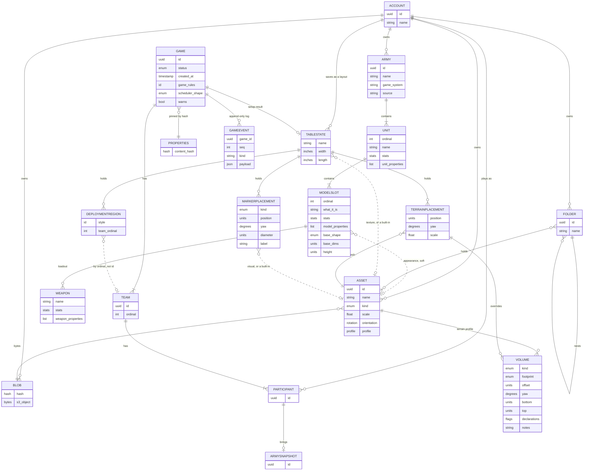

# Data model

Every entity the design sessions produced, and how they relate.

**Conceptual, not a schema.** No tables, no columns, no indices. Persistence layout was
deferred deliberately in three separate specs, and this document keeps that line: it says what
exists and what points at what.

Every field carries a real type. The geometric ones are defined in
[geometry values](superpowers/specs/2026-08-29-geometry-values-design.md), the rest in
[identity and enumerations](superpowers/specs/2026-08-29-identity-and-enumerations-design.md)
and [content values](superpowers/specs/2026-08-29-content-values-design.md). `units` means
world units, which are inches; `stats` is a set of declared-stat-to-value pairs.

Where this and a design doc disagree, the design doc is authoritative — this is a view
over them, not a source. [`docs/schema.md`](schema.md) is the physical expression of the same
model: tables, columns and constraints.

## Reading it

**Solid lines are hard references. Dotted lines are soft ones** — the target may be gone
and nothing breaks. Every dotted line but one points at `ASSET`, which is the one rule the whole
model is built around: **the rules never touch a mesh.** An army holds the hitbox, an asset
is only ever appearance, so deleting one degrades a slot to a proxy and is never blocked.

**`ASSET` has three profiles**, selected by `kind`. A miniature carries the base its mesh was
made for, which is a search axis rather than a hitbox. Terrain carries collision
volumes and their declarations. A texture is a flat image for the board's top face.

**`BLOB` hangs off `ACCOUNT`, not off the system.** Dedup is per user. Two accounts
uploading identical bytes get two blobs, and nothing ever counts references across accounts.
Participants in a game download each other's assets to render them, which creates no record
on either side — a download, not a share.

**`FOLDER` is the asset library's alone.** It nests, an asset can be in several, and armies
and layouts are flat lists.

**`TABLESTATE` has two owners and one shape.** A game has one as the result of its setup
phase; an account has any number, saved as layouts. There is no separate layout format —
the thing a game ends setup with and the thing a user saves are the same record.

**`ARMYSNAPSHOT` has no edge back to `ARMY`** on purpose. It is a copy taken when the game
loaded, with no live link, so editing a saved army cannot reach into a match in progress.

**`DEPLOYMENTREGION` names a built-in style**, which resolves to a **set** of polygons — one
of OPR's standard styles gives each team two diagonally opposite corners. Measurements are
anchored to table features rather than absolute, so a style works at any board size. Custom
shapes are a later expansion. **The polygons are not stored**: a built-in is not a row, so
holding both the style and what it resolves to would be two sources for one fact.

**It points at a team by ordinal, not by id** — the one soft edge that is not an asset. A
`TABLESTATE` saved by an account as a layout has no game, so there are no teams for it to
reference; the ordinal says *first team's zone* and binds to a real team only when a game
loads that layout.

**`VOLUME` is an extruded prism** — a circular or rectangular footprint with a bottom and a
top. Convex hulls are gone, so every geometry test is a 2D shape intersection plus a vertical
range. Volumes belong to the terrain asset and are computed from its bounding box at upload,
so they are never absent; a placement may override them. `kind` is `solid` or `area`, and
`declarations` is a closed set of six: impassable, blocks LoS, see in and out, cover,
difficult, dangerous.

**Models are yaw only and always upright**, so a placement is position and yaw. What a model
rests on is derived by settling, never stored.

**A stored position is three-dimensional.** Terrain and markers carry x, y and z, because both
are put where the user puts them — a marker ignores terrain entirely, and terrain does not
settle onto anything. A model's height is the only one derived rather than stored, and models
are not persisted at all.

**Stats are typed and declared at three levels** — unit, model and weapon — mirroring the three
property kinds. A stat declaration carries a kind: target number, distance, count, or dice
expression. `stats` above is a set of declared-stat-to-value pairs, not a free-form bag.

**A weapon lives on the model slot**, resolved in place. There is no shared weapon definition:
two Heavy Rifles in two armies are two copies, because an army holds its own copy of every
value. A melee weapon has no range at all rather than a range of zero.

**Nothing carries a count.** Ten models are ten `MODELSLOT` rows and `2x Heavy Rifle` is two
`WEAPON` rows. Placement is per model, so a slot has to exist per model regardless; a count
would be a second way to say the same thing and would have to be expanded before anything could
be placed. Import does that expansion once, at the boundary.

**`ARMY.game_system` is the `GameRules` identifier** — the same vocabulary as
`GAME.game_rules`, not a second one. Nothing reads it to interpret an army, which is
self-contained; its only reader compares it against the game's at army-pick time. With one
ruleset that comparison is a no-op, so the field is **dormant until a second `GameRules`
exists**. It is kept because import knows it for free and no later pass could recover it.

**`upgrades` and `list_entry` are both gone.** An upgrade's effect is already applied by import
time, so storing it would be two sources for one fact. A source identifier had no reader at all
— the only candidate was a heuristic that was deliberately deferred.

**`PROPERTIES` is drawn as an entity but is not a table.** A game stores the content hash and
nothing else; there is no registry to join to. It appears here because it is a thing the model
names, not a thing the database holds — the same reason built-ins have no entity.

**A ruleset is two things.** `PROPERTIES` is the pinned data — stat definitions plus three
disjoint catalogs, `UnitProperty`, `ModelProperty` and `WeaponProperty`. `GAME.game_rules`
names the per-ruleset C#: turn structure, actions, pipeline order, scheduler, dice. Only the
data half is pinned, which is an open problem for replay. There is no `RulePack` entity and no
registry table.

**Every enumeration is a closed set**, never a free string — `status`, `kind`, `scheduler_shape`
and the geometry enums all have named values in the design docs.

## What is deliberately not here

**In-play state is not persisted.** Unit in play, model in play, placement, wounds,
conditions, the shelf, whose activation it is, the score — none of it is a row. It is
reconstructed in memory by replaying `GAMEEVENT` from `TABLESTATE`, which is the log's
initial state. A table growing a "current position" column means the event spine has been
broken.

That is also why terrain is locked after setup with no flag and no check: terrain lives in
`TABLESTATE`, and nothing in the log can reach it. Making terrain destructible later is
additive — terrain events on top of the same snapshot.

**Presence is not here.** Cursors, pings, measurements, selection and live drag positions are
relayed between clients and never written, so they are values in
[`Tabletop.Protocol`](superpowers/specs/2026-08-30-presence-design.md) rather than entities.
Who is connected is not stored either: a presence value exists while a socket is open, and
`PARTICIPANT` is the roster underneath it.

**Built-ins are not rows.** Predefined board textures and deployment zone shapes ship with
the client. Nobody owns them, nothing is copied into an account, and they need no entity.

**Stytch stores nothing here.** No Stytch identifier appears in the model; the only link is
`external_id` on their side holding `ACCOUNT.id`.

**Two schemas, one shared id.** Everything above except `GAMEEVENT` is management's.
`GAMEEVENT` is the whole of the game server's, and there are no joins across the boundary.

## Where these came from

| Cluster | Design |
| --- | --- |
| `ACCOUNT`, `GAME`, `TEAM`, `PARTICIPANT` | [Accounts](superpowers/specs/2026-08-29-accounts-design.md) |
| `ARMY`, `UNIT`, `MODELSLOT` | [The army](superpowers/specs/2026-08-28-army-design.md), [table domain model](superpowers/specs/2026-08-27-table-domain-model-design.md) |
| `ASSET`, `BLOB`, `FOLDER` | [The asset library](superpowers/specs/2026-08-28-asset-library-design.md) |
| `TABLESTATE` and everything under it | [Setup content](superpowers/specs/2026-08-29-setup-content-design.md) |
| `VOLUME`, and every geometric field | [Geometry values](superpowers/specs/2026-08-29-geometry-values-design.md) |
| `GAMEEVENT`, `ARMYSNAPSHOT` | [`architecture.md`](architecture.md) |
| `PROPERTIES`, and every enumeration | [Identity and enumerations](superpowers/specs/2026-08-29-identity-and-enumerations-design.md) |
| `WEAPON`, stats, and property entries | [Content values](superpowers/specs/2026-08-29-content-values-design.md) |
| Property effects, the twelve kinds | [The effect grammar](superpowers/specs/2026-08-29-effect-grammar-design.md) |
