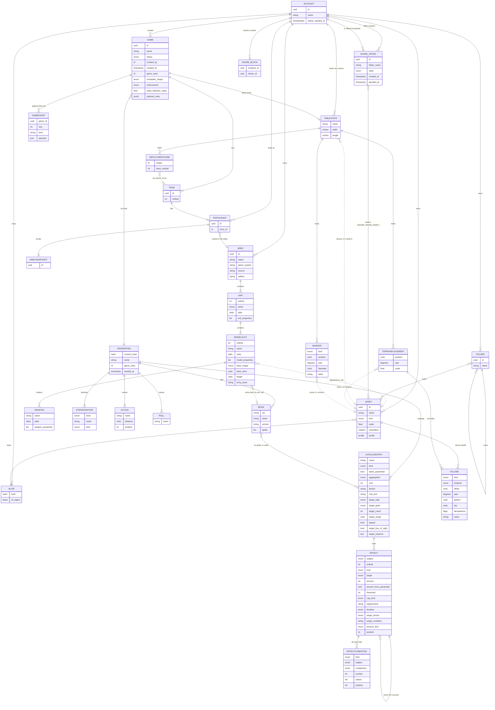

# Data model

Every entity the design sessions produced, and how they relate.

**Conceptual, not a schema.** No tables, no columns, no indices. Persistence layout was
deferred deliberately in three separate specs, and this document keeps that line: it says what
exists and what points at what.

Every field carries a real type. The geometric ones are defined in
[geometry values](superpowers/specs/2026-08-29-geometry-values-design.md), the rest in
[identity and enumerations](superpowers/specs/2026-08-29-identity-and-enumerations-design.md)
and [content values](superpowers/specs/2026-08-29-content-values-design.md). `units` means
world units, which are inches; `stats` is a set of declared-stat-to-value pairs.

Where this and a design doc disagree, the design doc is authoritative — this is a view
over them, not a source. [`docs/schema.md`](schema.md) is the physical expression of the same
model: tables, columns and constraints.

## Reading it

**Solid lines are hard references. Dotted lines are soft ones** — the target may be gone
and nothing breaks. Every dotted line but one points at `ASSET`, which is the one rule the whole
model is built around: **the rules never touch a mesh.** An army holds the hitbox, an asset
is only ever appearance, so deleting one degrades a slot to a proxy and is never blocked.

**`ASSET` has three profiles**, selected by `kind`. A miniature carries the base its mesh was
made for, which is a search axis rather than a hitbox. Terrain carries collision
volumes and their declarations. A texture is a flat image for the board's top face.

**`BLOB` hangs off `ACCOUNT`, not off the system.** Dedup is per user. Two accounts
uploading identical bytes get two blobs. Participants in a game download each other's assets to
render them, which creates no record on either side — a download, not a share. An **offer**
(`SHARE_OFFER`, its assets in `SHARE_OFFER_ASSET`) names a sharer, one recipient they have been in a game with, and a set
of the sharer's assets; only the recipient sees it, while it is open. Accepting gives the recipient an `ASSET` and a
`BLOB` of their own whose S3 key is the sharer's; the object goes only when no `BLOB` row names its key. `SHARE_BLOCK`
hides a sharer's offers from a recipient ([shared models](superpowers/specs/2026-10-25-shared-models-design.md)).

**`FOLDER` is the asset library's alone.** It nests, an asset can be in several, and armies
and layouts are flat lists.

**`TABLESTATE` has two owners and one shape.** A game has one as the result of its setup
phase; an account has any number, saved as layouts. There is no separate layout format —
the thing a game ends setup with and the thing a user saves are the same record.

**`ARMYSNAPSHOT` has no edge back to `ARMY`** on purpose. It is a copy taken when the game
loaded, with no live link, so editing a saved army cannot reach into a match in progress.

**`PARTICIPANT` does point at the `ARMY` it picked**, in the lobby, so a game recovers the pick
with the rest of its rows. The edge is nullable and cleared rather than cascaded when the army is
deleted. `ARMYSNAPSHOT` is written from it when setup ends, and the snapshot is what plays from
there.

**`DEPLOYMENTZONE` names one shape of a built-in style** (`frontline/1`). A style resolves to a
**set** of polygons, one row per shape; one of OPR's standard styles gives each team two diagonally
opposite corners. Six of the seven
built-in styles anchor their measurements to table features rather than writing them as
absolutes, and Side Battle scales its two legs with the edges they run along. Tables far from 72×48 are out of scope either way. Custom shapes are a later
expansion. **The polygons are not stored**: a built-in is not a row, so
holding both the style and what it resolves to would be two sources for one fact.

**It points at a team by ordinal, not by id** — the one soft edge that is not an asset. A
`TABLESTATE` saved by an account as a layout has no game, so there are no teams for it to
reference; the ordinal says *first team's zone* and binds to a real team only when a game
loads that layout.

**`VOLUME` is an extruded prism** — a circular or rectangular footprint with a bottom and a
top. Convex hulls are gone, so every geometry test is a 2D shape intersection plus a vertical
range. Volumes belong to the terrain asset and are computed from its bounding box at upload,
so they are never absent; a placement may override them. `kind` is `solid` or `area`, and
`declarations` is a closed set of eight: impassable, blocks LoS, see in and out, cover,
difficult, dangerous, dangerous on rush or charge, steep. Both editions read the same flags; the words and the
Steep, Unstable and Dense readings differ by edition (`GfEdition.TerrainWords`).

**Models are yaw only and always upright**, so a placement is position and yaw. What a model
rests on is derived by `Collision.RestHeight`, never stored.

**A stored position is three-dimensional.** Terrain and markers carry x, y and z, because both
are put where the user puts them — a marker ignores terrain entirely, and terrain does not
settle onto anything. A model's height is the only one derived rather than stored, and models
are not persisted at all.

**Stats are typed and declared at three levels** — unit, model and weapon — mirroring the three
property kinds. A stat declaration carries a kind: target number, distance, count, or dice
expression. `stats` above is a set of declared-stat-to-value pairs, not a free-form bag.

**A weapon lives on the model slot**, resolved in place. There is no shared weapon definition:
two Heavy Rifles in two armies are two copies, because an army holds its own copy of every
value. A melee weapon has no range at all rather than a range of zero.

**Nothing carries a count.** Ten models are ten `MODELSLOT` rows and `2x Heavy Rifle` is two
`WEAPON` rows. Placement is per model, so a slot has to exist per model regardless; a count
would be a second way to say the same thing and would have to be expanded before anything could
be placed. Import does that expansion once, at the boundary.

**`ARMY.game_system` is the `GameRules` identifier** — the same vocabulary as
`GAME.game_rules`, not a second one. Nothing reads it to interpret an army, which is
self-contained. Both Grimdark Future editions import as `grimdark-future` and the field does not tell them apart.

**`ARMY.edition` is the Grimdark Future edition of the list** (`'3.5'` or `'3.6'`, `ArmyEditions`), stamped at import from the
edition Army Forge serves; the TTS payload carries none. It is what the lobby compares against the game's rule set
(`RuleSets.EditionOf(game_rules)`): `PickArmy` and `EndSetup` refuse an army of the other edition, because unit ids, costs and
options differ between editions. `ARMYSNAPSHOT` carries it with the rest of the copy.

**`upgrades` and `list_entry` are both gone.** An upgrade's effect is already applied by import
time, so storing it would be two sources for one fact. A source identifier had no reader at all
— the only candidate was a heuristic that was deliberately deferred.

**A ruleset is two things, and an edition is a ruleset.** `grimdark-future` (3.5.1) and `grimdark-future-3.6` (3.6.0) are two
`GAME.game_rules` ids, each with its own `PROPERTIES` sets. `PROPERTIES` is the data — stat definitions, one
catalog of named rules, the actions and rolls that effects can target, and the army books that
list the catalog's spells. `GAME.game_rules`
names the per-ruleset C#: turn structure, actions, pipeline order, scheduler, dice. A
game's hash is its game rules' current set until the game ends ([games follow the current rules](superpowers/specs/2026-10-19-games-follow-the-current-rules-design.md)).

**There is no `RulePack` entity**, and `PROPERTIES` is not one. It is the set itself,
addressed by the hash of its contents; its `name` and `game_rules` exist so a set can be shown
and matched to the C# that reads it, not so packs can be registered and resolved by identity.

**The data half has a shape, and it is `PROPERTIES` and everything under it.** A stat
declaration says a stat exists at a level and what kind of value it holds. A catalog entry is
one named rule — its kind, whether it takes a parameter, how it aggregates across a unit, and
the rulebook wording players see. Its effects say what it does, and its effects' conditions say
when.

**An action is a row and carries one number, a distance.** Grimdark Future has no movement
stat — a unit is Quality and Defense, and movement comes from the action taken. So `Fast` and
`Slow` modify the action's distance, and an effect has to be able to point at it. That is the
line between an action's data and its behaviour: **what an effect can target is data**, and
what only the engine reads — may it shoot, must it reach contact, does it end the activation —
stays in `GAME.game_rules`.

**A roll is a row for the same reason.** Per
[action sequences](superpowers/specs/2026-09-03-action-sequences-design.md): a ruleset names
its rolls — Grimdark Future's are hit, defense, morale and casting — because effects point at
them, and 40k's wound and save rolls must be content rather than a migration. The dice
convention, threshold derivation and modifier cap are behaviour and stay in `GAME.game_rules`.

**The catalog holds four kinds: `unit`, `model`, `weapon` and `spell`.** The first three are
attachment points, and a name belongs to exactly one. **A spell is not a property** — it is not
attached to anything and does not travel with an army; it is cast, and it costs spell tokens,
which is the one field no property has. Its effects and conditions are the same vocabulary
everything else uses.

**An effect can act on another property**, which is what makes resolution two passes rather
than one: `Bane` suppresses `Regeneration` and `Thrust` changes what `AP` contributes, so
which properties are live has to settle before any effect applies. That is also why an effect
carries an explicit `ordinal` — the rulebook orders several by hand.

**A property with no effects is not a mistake.** `Ambush`, `Scout`, `Immobile`, `Limited` and
`Counter` carry no effect data at all; they are names `GameRules` checks for at hooks it owns —
deployment, movement, action legality, usage, and melee strike order.

**Every enumeration is a closed set**, never a free string. `status`, `kind`,
`scheduler_shape`, the geometry enums, and everything `PROPERTIES` introduced —
[identity and enumerations](superpowers/specs/2026-08-29-identity-and-enumerations-design.md)
lists all of them with their values.

The four exceptions on `EFFECT` are stronger rather than weaker: what a `Grant` or `Suppress`
names, what a `Replace a stat` names, and which action or roll an effect targets, are
**references into the same `PROPERTIES` set** — `Bane` cannot suppress a rule that set does
not define.

## What is deliberately not here

**In-play state is not persisted.** Unit in play, model in play, placement, wounds,
conditions, granted effects, spell tokens, wounds this activation, the shelf, what a model is
inside, the action record, the resolution stack, the scheduler's
position (round, team order, whose turn, who has passed), the score — none of it is a row. `ACTION` names what actions *exist*; what a unit has *done* is
events. It is
reconstructed in memory by replaying `GAMEEVENT` from `TABLESTATE`, which is the log's
initial state. A table growing a "current position" column means the event spine has been
broken.

That is also why terrain is locked after setup with no flag and no check: terrain lives in
`TABLESTATE`, which is writable only while the game is in `setup`, and nothing in the log can
reach it. Making terrain destructible later is
additive — terrain events on top of the same snapshot.

**Presence is not here.** Cursors, pings, measurements, selection and live drag positions are
relayed between clients and never written, so they are values in
[`Tabletop.Protocol`](superpowers/specs/2026-08-30-presence-design.md) rather than entities.
Who is connected is not stored either: a presence value exists while a socket is open, and
`PARTICIPANT` is the roster underneath it.

**Built-ins are not rows.** Predefined board textures, deployment zone shapes and, since
[the setup phase](superpowers/specs/2026-09-04-setup-phase-design.md), terrain pieces ship with
the client. Nobody owns them, nothing is copied into an account, and they need no entity. A
terrain placement therefore points at a built-in or an asset, and the line to `ASSET` is soft
for the same reason the texture's is.

**Stytch stores nothing here.** No Stytch identifier appears in the model; the only link is
`external_id` on their side holding `ACCOUNT.id`.

**Two schemas, one shared id.** Everything above except `GAMEEVENT` is management's.
`GAMEEVENT` is the whole of the game server's, and there are no joins across the boundary. The
game server does **write** a game's own management rows while the game is in `lobby` or `setup`
— status, teams, participants' team and snapshot, the `TABLESTATE` draft — and from `playing` on
writes only events and one row: `game.status = 'ended'` when its own log ends the game ([the setup phase](superpowers/specs/2026-09-04-setup-phase-design.md), 09-04).

## Where these came from

| Cluster | Design |
| --- | --- |
| `ACCOUNT`, `GAME`, `TEAM`, `PARTICIPANT` | [Accounts](superpowers/specs/2026-08-29-accounts-design.md) |
| `ARMY`, `UNIT`, `MODELSLOT` | [The army](superpowers/specs/2026-08-28-army-design.md), [table domain model](superpowers/specs/2026-08-27-table-domain-model-design.md) |
| `ASSET`, `BLOB`, `FOLDER` | [The asset library](superpowers/specs/2026-08-28-asset-library-design.md) |
| `TABLESTATE` and everything under it | [Setup content](superpowers/specs/2026-08-29-setup-content-design.md) |
| `VOLUME`, and every geometric field | [Geometry values](superpowers/specs/2026-08-29-geometry-values-design.md) |
| `GAMEEVENT`, `ARMYSNAPSHOT` | [`architecture.md`](architecture.md) |
| `PROPERTIES`, `STATDEFINITION`, `ACTION`, and every enumeration | [Identity and enumerations](superpowers/specs/2026-08-29-identity-and-enumerations-design.md) |
| `CATALOGENTRY`, `EFFECT`, `EFFECTCONDITION` | [The effect grammar](superpowers/specs/2026-08-29-effect-grammar-design.md) |
| `WEAPON`, stats, and property entries | [Content values](superpowers/specs/2026-08-29-content-values-design.md) |
| `GAME.created_by`, `TERRAINPLACEMENT` built-in or asset | [The setup phase](superpowers/specs/2026-09-04-setup-phase-design.md) |
| `EFFECT.duration`, spell targeting on `CATALOGENTRY` | [Spell effects](superpowers/specs/2026-09-04-spell-effects-design.md) |
| `BOOK`, `MODELSLOT.army_book`, `EFFECT.target_terrain` and `target_condition` | [The spell library](superpowers/specs/2026-10-02-spell-library-design.md) |
| `GAME.name`, `enforcement`, `waits_between_steps`; nullable participant team and snapshot | [The whole-design review](superpowers/specs/2026-09-04-whole-design-review.md) |
| `GAME.optional_rules` | [Optional rules](superpowers/specs/2026-10-15-optional-rules-design.md) |
