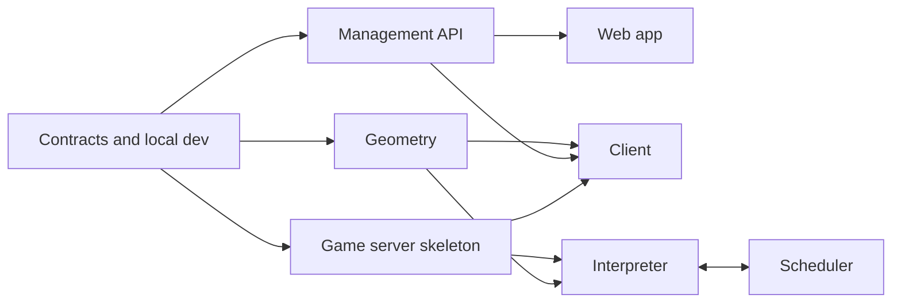

# Engineering design

One document per module, written against the implementation plans in
`docs/superpowers/plans/` and the design sessions in `docs/superpowers/specs/`. Each says what
its module builds, how it is shaped, and why — for a reader who has to review the design
before the code exists.

**Three layers, and which one to trust.** The design sessions in `docs/superpowers/specs/`
settle *what the product does*; a later spec beats an earlier one, and
[the whole-design review](../superpowers/specs/2026-09-04-whole-design-review.md) beats every
other. The plans in `docs/superpowers/plans/` settle *what gets written*, task by task, with
the code. These documents settle *how it hangs together* and record the reasoning. Where a
document here disagrees with its plan, the plan is the one an implementer follows; tell
whoever owns the module.

Nothing is built yet. Every module below is designed, planned and unimplemented.

| Module | Ships as | Document |
| --- | --- | --- |
| Contracts and local development | `libs/Tabletop.Geometry`, `libs/Tabletop.Protocol`, `libs/Tabletop.Content`, `docker-compose.yml` | [contracts](contracts/design.md) |
| Geometry | `libs/Tabletop.Geometry` implementations | [geometry](geometry/design.md) |
| Management API | `server/management/` | [management-api](management-api/design.md) |
| Game server | `server/game/`, without the rules | [game-server](game-server/design.md) |
| Web app | `web/` | [web-app](web-app/design.md) |
| Client | `client/` | [client](client/design.md) |
| Interpreter and effects | `server/game/`, the rules engine | [interpreter](interpreter/design.md), [effect grammar](interpreter/effect-grammar.md), [OPR sequences](interpreter/opr-sequences.md) |
| Scheduler | `server/game/`, turn order | [scheduler](scheduler/design.md) |

## Build order

Contracts first, because everything consumes it. Then geometry, the management API and the
game server skeleton, which have no dependency on each other. Then the web app, the client,
and the two rules modules. The interpreter and the scheduler share one engine and one
`IGameRules`, so neither is finishable alone.

Arrows are "must exist first". The double arrow is the one genuine cycle: the two rules
modules compose into a single engine.

## Reading order from cold

Read `../architecture.md` first, then [contracts](contracts/design.md), which defines the
vocabulary every other document uses: commands, events, Asks, presence, setup edits, the
projection. After that any module stands on its own.

To review a seam rather than a module, read both sides: the wire is contracts and
[client](client/design.md); the rules seam is
[game-server](game-server/design.md), [interpreter](interpreter/design.md) and
[scheduler](scheduler/design.md); the HTTP surface is
[management-api](management-api/design.md), [web-app](web-app/design.md) and
[client](client/design.md).

## Where the load is

Four things carry most of the design, and a reviewer with limited time should start there.

- **The rules live once, on the server.** The client is a renderer, an input surface and a
  geometry engine; it may compute anything and may only ever ask. Everything about the client
  follows from this.
- **State changes only by applying events.** The applier is rules-free because an event
  carries every state change it made, so applying is copying. Undo is replay from the setup
  snapshot, not inverse events, and the dice come back the same because the seed is part of
  game state.
- **Nothing recorded is an invariant.** This is a tabletop simulator: every property is
  editable from a menu through the same write path automation uses, enforcement has three
  positions, and legality is enumerated rather than validated.
- **One ruleset is built, and the second one is the test.** Only One Page Rules gets a
  `GameRules`. Warhammer 40,000's core rules were read as a falsifier and produced fifteen
  constraints on what the engine must not contain; those constraints are the generalisation
  budget, and they are recorded in the interpreter and scheduler documents.

## Conventions

One world unit is one inch. The table's origin is a corner, x along the width, y along the
length, z up. Identifiers are UUIDv7 throughout. Diagrams are mermaid, as in
`../data-model.md`. Where a document cites a rulebook page it means Grimdark Future v3.4.1.
