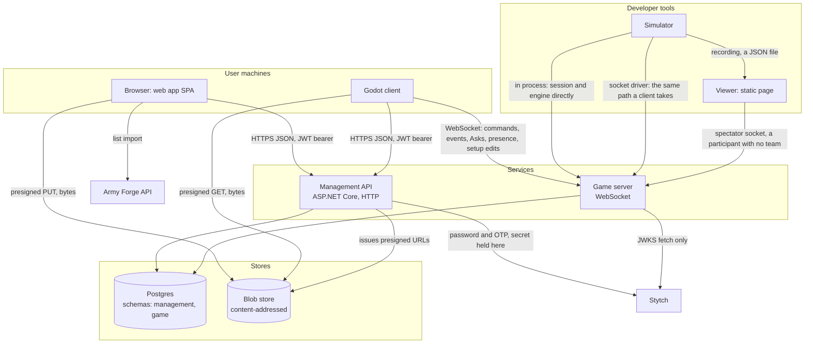
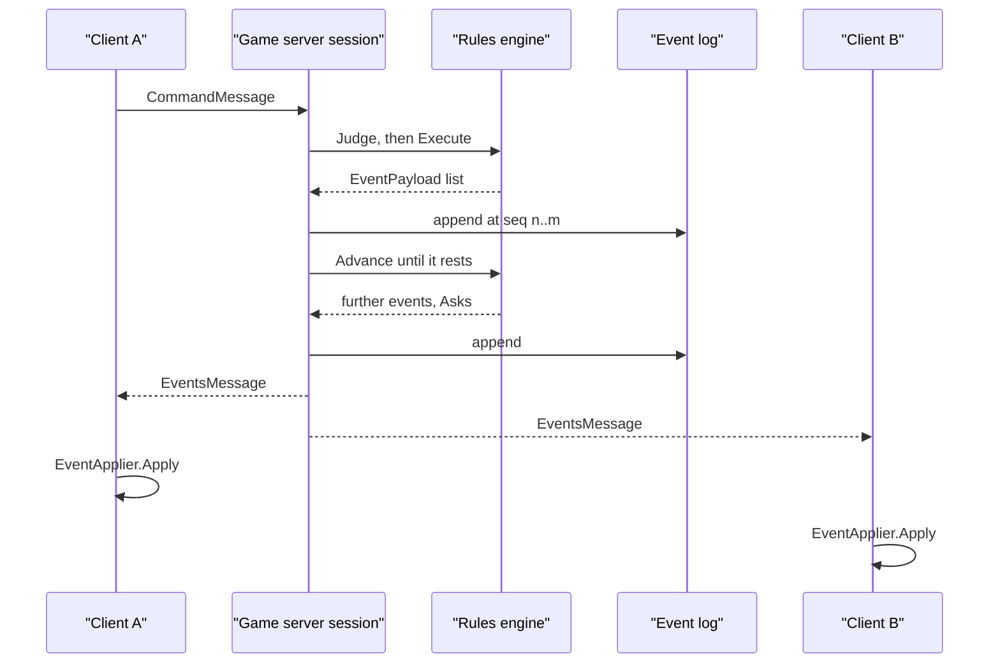
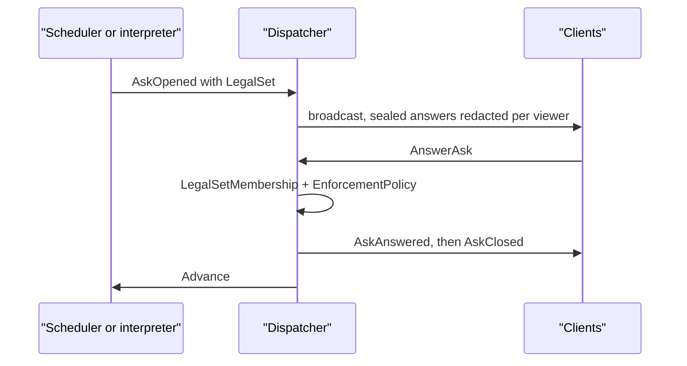
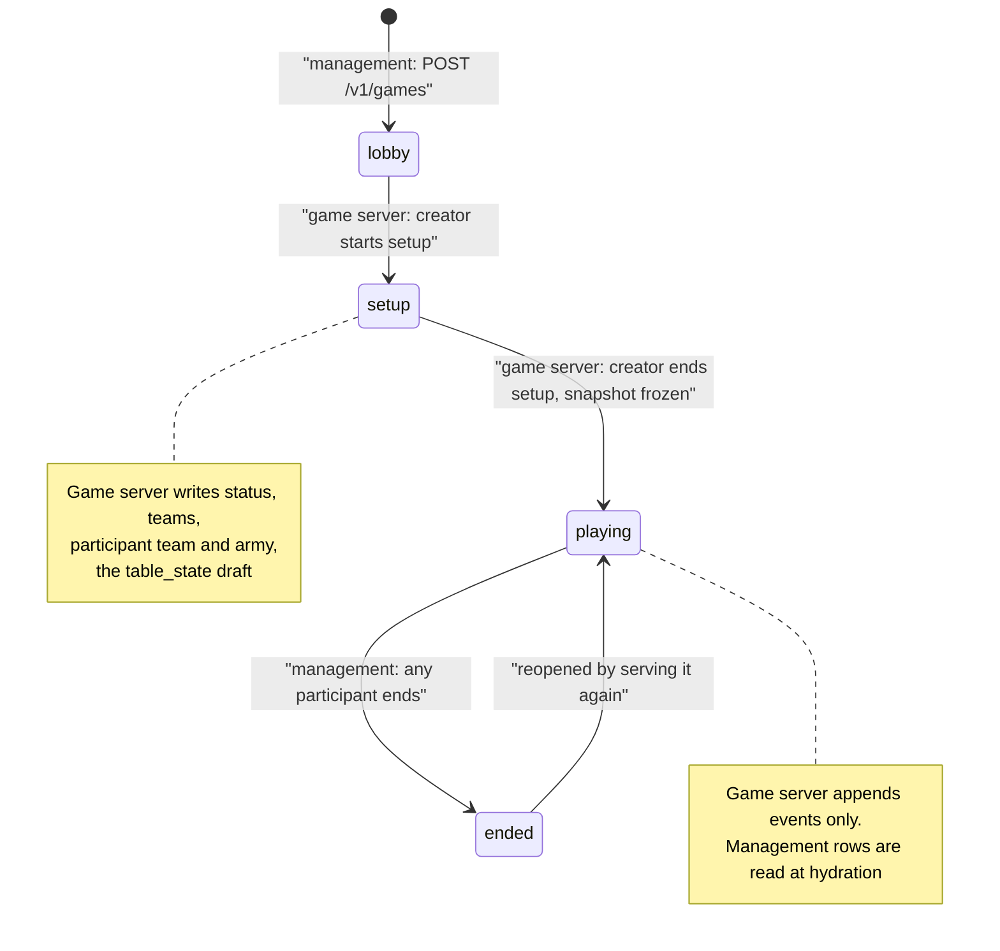
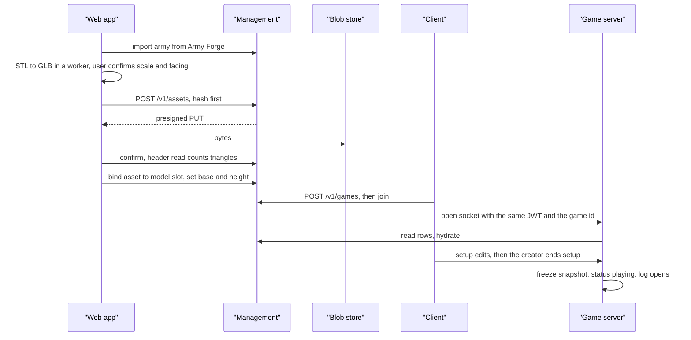
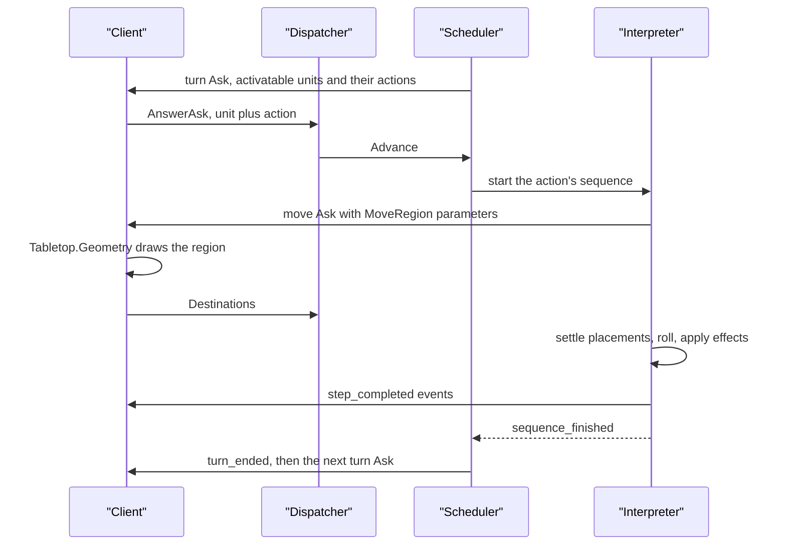
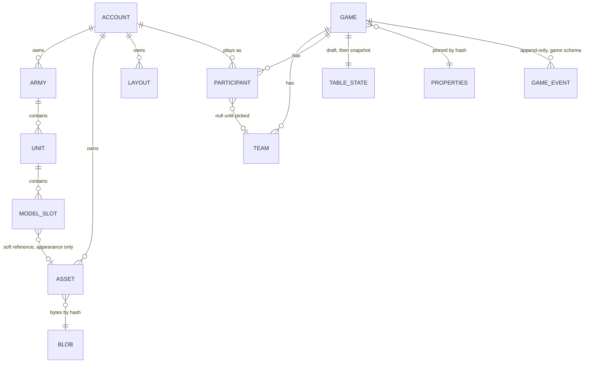
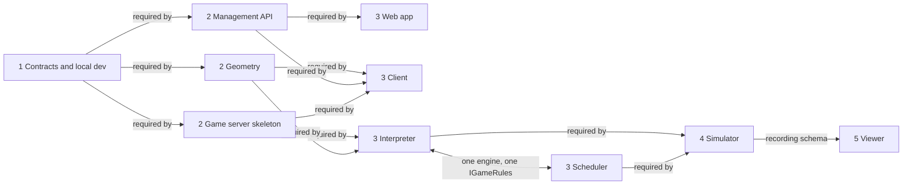

# System engineering design

## Goal

A virtual tabletop for One Page Rules and Warhammer 40,000. Two or more players share a 3D
table, place miniatures and terrain, measure, roll dice and resolve actions under a ruleset the
server adjudicates. Players import army lists and their own miniature meshes. A game runs for
hours, survives disconnection, and can be rewound to any point.

It is a simulator, not a referee. Every recorded value is editable by any player through the
same write path automation uses, and enforcement is a per-game dial. The engine scores Grimdark Future's core mission; players keep their own
counters.

## Scope of this document

The end architecture, how the modules communicate, the patterns that span them, and the build
order. Per-module detail is in the ten documents indexed at the bottom.

## What is being built

| Deliverable | Directory | Runtime | Owns |
| --- | --- | --- | --- |
| Game client | `client/` | Windows first, other desktop platforms possible; Godot 4.7 Mono export | Rendering, input, camera, local geometry, the game list, play |
| Game server | `server/game/` | Linux container | Live sessions, the rules engine, the event log |
| Management API | `server/management/` | Linux container | Accounts, armies, assets, layouts, game records |
| Web app | `web/` | Static SPA, Svelte 5 | Army import, mesh conversion and binding, the asset library, the account |
| Shared libraries | `libs/` | Consumed, never shipped alone | `Tabletop.Geometry`, `Tabletop.Protocol`, `Tabletop.Content` |
| Simulator | `sim/` | Developer tool | Playing whole games with no client, and recording them |
| Viewer | `viewer/` | Developer tool, static | Drawing a recording or a live game top-down |

The division of labour between the browser and the client is **preparation versus play**. The
browser owns everything a player builds between games. The client owns everything that happens
during one. The client cannot edit an army; it picks one.

`sim/` and `viewer/` ship to developers rather than to players: neither is in the client's
export, neither is referenced by a server, and a release omitting both is complete. A simulator
only xUnit can start is not something you can point at a problem.

The rules engine lives only in `server/game/`. It is not in `libs/`, so there is one
implementation and no second copy on a machine a player controls. There is no offline mode:
running the game means running a server.

### Component and protocol map

The two services never call each other. They share a database and nothing else. The simulator
reaches the game server two ways, in process and over the socket, and the same scenario asserts
the same things through either.

### Transport and payload per edge

| Edge | Transport | Auth | Payload |
| --- | --- | --- | --- |
| Browser to management | HTTP/JSON | `Authorization: Bearer <session JWT>` | Management DTOs |
| Client to management | HTTP/JSON | Same, plus `Tabletop-Client-Version` | Management DTOs, `Tabletop.Content` types |
| Client to game server | One WebSocket per game | Session JWT in the first frame | `Tabletop.Protocol` `SocketMessage`, twelve kinds |
| Browser or client to blob store | HTTP PUT or GET | Presigned URL, minted by management | GLB, PNG, JPEG bytes |
| Management to Stytch | HTTP/JSON | Project secret | Stytch API |
| Game server to Stytch | HTTP GET | None | JWKS |
| Either service to Postgres | Npgsql | Connection string | SQL |
| Simulator to game server, in process | None, direct construction | None | The session and engine types |
| Simulator to game server, over the socket | One WebSocket per game | Session JWT per team | The same `SocketMessage` a client sends |
| Simulator to viewer | A file on disk | None | A recording: one board, then a frame per event |
| Viewer to game server | One WebSocket | Session JWT, no team | `SocketMessage` inbound only. It sends no command |

Bytes never pass through management. It issues a URL and reads at most a ranged header.

## Cross-module design

Nine patterns carry the system. Each spans at least two modules, and each is the reason a
module is shaped the way it is.

### 1. Commands up, events down

Players never mutate state. The client submits a **command**, an intent such as `MoveModels`,
`AnswerAsk` or `SetWounds`. The game server validates it and appends ordered **events**, which
are facts. State changes only by applying events.

One pattern serves the network protocol, undo, save and load, replay, the test harness, the
client's animation queue, and the audit trail behind a result.

### 2. The applier is rules-free, and both sides run it

An event carries every state change it made, as a `StateChange`. Applying is therefore
copying, with no rules knowledge. The same `EventApplier` in `Tabletop.Protocol` builds the
server's authoritative `Projection` and the client's. There is no second state machine to
drift.

The cost is event size and a strictness hazard: the applier indexes dictionaries by id and
throws on an unknown one, which kills a projection permanently because reconnecting replays
the same event.

### 3. State is rebuilt from the log, not stored

Nothing derived is persisted. The scheduler's round and turn order, the interpreter's frame
stack, a unit's action record, conditions, wounds-this-activation and the grants store are all
recomputed by reading the log on every call.

| Persisted | Derived from the log | Held in memory only |
| --- | --- | --- |
| `game_event(game_id, seq, kind, payload)` | Projection, frame stack, scheduler position | Presence values |
| The setup snapshot, as the log's initial state | Action record, conditions, grants | Socket and client set |
| Management rows: account, army, asset, game, participant | RNG cursor | |

Three consequences. Starting a session, reconnecting and recovering a crashed task are one
code path. Undo is replay to a sequence number, not inverse events. The RNG is a counter over
the whole log, undone events included, so an undone roll's dice stay drawn and an undo leads to
fresh dice; it cannot be used to see the coming dice or fish for rolls.

The price is log scanning. Every `Advance` walks the effective log several times, and no
memoisation exists.

### 4. The Ask is the only way input enters

Every decision a player makes during play is an `Ask`: a question, the teams it addresses, a
`LegalSet` computed by the server, and flags for passing, sealing and window kind. A turn is an
Ask. So are deployment, target selection, wound allocation, casting's simultaneous token spend, the
confirm gate between steps, an interrupt window, and the round boundary.

One panel in the client renders every Ask, keyed on the legal set rather than the question
name, so a new ruleset question needs no client release.

### 5. Enumeration, not validation

The server answers `EnumerateLegalCommands` rather than only `IsLegal`. Validation falls out of
enumeration; the reverse does not. The client needs the enumerated set anyway to draw
affordances, and an AI opponent would get its action space from the same call.

Continuous choices are the exception. Movement is anywhere within an allowance, so the server
sends parameters (allowance, impassable volume ids, difficult-terrain ids and cap, any
containment offer) and the client's geometry draws the consequence.

### 6. Nothing recorded is an invariant

Enforcement is `silent | warn | strict` per game. Under `silent` and `warn` every command and
answer is accepted, with a logged warning when it falls outside the legal set. Under `strict`
an out-of-set answer or illegal command is refused.

The menu is exempt at every setting. A right-click edit of any property is accepted, logged
and visible to opponents. Base overlap, an Impassable Solid and a path through a model are
prevented by the client while dragging (Alt overrides) and judged by the server; coherency is not judged.
The override is what makes it a simulator rather than a referee, and it removes the
need for an admin mode.

### 7. Row ownership moves with game status

Management owns everything *about* a game. The game server owns what *happened* in it. Ownership
follows the game's status: while a game is in `lobby` or `setup` the game server writes the game's
own rows, because setup edits are not events and need somewhere to live. From `playing` on it
writes events and one row: `ended`, when its own log ends the game.

Both processes run against one database. Status therefore governs which rows are still editable,
not which process may touch a schema. Hydration and the rule that the game server writes a game's rows only in `lobby` and `setup`, plus `ended` from `playing`, are built on
exactly that. The game server also seeds the `Properties` tables at startup, once per content
hash; that is ruleset content rather than a game's state, so no status governs it.

`ended` is a flag, not a terminal state. Reopening an ended game is the same hydrate-from-log
operation as recovering a crashed task.

Frozen at the flip to `playing`: the scheduler shape, the armies in play, each participant's
army snapshot as opaque `jsonb`, and the whole terrain and objective layout. Terrain is locked
by construction rather than by a flag, because nothing in the log can reach it.

### 8. Content addressing and pinning

Two things are addressed by the hash of their contents, for the same reason: replay must see
exactly what play saw.

- **Blobs.** Meshes and textures are keyed by hash, deduplicated per user, and served by
  presigned URL straight from the store. A library is private for discovery, not for access:
  participants download the assets a game uses without any row being created on either side.
- **`Properties`.** The data half of a ruleset lives in eight Postgres tables, authored
  in-repo as JSON and seeded by the game server at startup, once per canonical hash. A game
  pins `properties_hash`, so a pack changing between sessions cannot make undo diverge.

Pinning covers the data half only. `GameRules` is C# shipped with the build, so a pipeline
order changing between deploys can make an old game replay differently. Accepted: pinning a
build version would make every deploy a wall old games cannot cross.

### 9. Rules as data, with a closed shape

Stats are named and typed rather than fields, because Quality and Defense are OPR's and
Warhammer uses M, T, Sv, W, Ld and OC. The schema of `Properties` is closed and enforced by
foreign keys and per-kind check constraints; its content extends freely. A mistyped name fails
loudly instead of silently doing nothing.

The split is between what is edited per ruleset and what is edited every day:

| Half | Form | Contents |
| --- | --- | --- |
| `Properties` | Rows in eight tables, pinned per game | Stat declarations, the catalog of named rules, effects, conditions, actions, rolls |
| `GameRules` | C# behind an interface | Turn structure, sequence definitions, dice conventions, threshold derivation, scheduler policy |

Only OPR's `GameRules` is implemented. Warhammer 40,000's core rules were read twice as a
falsifier and produced fifteen constraints on what the engine must not contain: nine from
action sequences, six from the scheduler. Those constraints are the generalisation budget, and
they are the reason no engine code branches on ruleset identity.

## Flows that cross modules

### Preparation to play

An army holds its own copy of every value, so Army Forge, the source list and the asset library
cannot reach into it. Assets are a soft reference: the army holds the hitbox, the mesh is only
appearance, and deleting an asset degrades a model to a proxy shape without affecting play.

### One activation

The turn ends when the declared action's sequence finishes. There is no end-turn command.
Moving models by hand never ends a turn: that exists to arrange models inside a unit.

### Geometry on both sides

The client and the server run the same library for different reasons. The server's answer is
authoritative. The client's is a prediction that removes the feeling of latency. A disagreement
resyncs the client, so a model snaps back and nothing compounds.

This is why bit-exact cross-platform determinism is not a requirement despite a Windows client
and a Linux server. The client holds no authoritative state to diverge into.

## Persistence

One Postgres database, two schemas. The `game` schema holds exactly one table.

Thirty-three tables. `jsonb` survives in two columns only: `game_event.payload`, so adding an
event kind is not a migration, and `participant.army_snapshot`, which is opaque on purpose
because a normalised snapshot would let a later migration alter what a past game was played
with. `docs/schema.md` holds the columns and `docs/data-model.md` the entity diagram.

Positions, wounds and whose activation it is are never rows. A table growing a current-position
column means the event spine has been broken.

One system, two processes, one database. The game server reads the `management` schema at
hydration, writes a game's own rows while it is in `lobby` or `setup` and `ended` from `playing` when its own log ends the game, and seeds the `Properties`
tables at startup. A management migration can therefore break a running game server. That risk is
recorded and unmitigated.

## Runtime topology

Local only. Hosting is deferred until there is something to host; `../architecture.md` carries
the ECS Fargate sketch a later session will design against.

| Process | Where | Address |
| --- | --- | --- |
| Management API | Docker | `127.0.0.1:5100` |
| Game server | Docker | `127.0.0.1:5200` |
| Web app dev server | Docker | `127.0.0.1:5173` |
| Postgres | Docker | `localhost:5432` |
| Blob store, MinIO | Docker | `localhost:9000` |
| Godot client | Windows host | Connects over forwarded localhost |
| Simulator | WSL | A console run, no address of its own |
| Viewer dev server | Docker | `127.0.0.1:5174` |

The client runs on the Windows host because the Godot editor does; the repository is reached
over the WSL share. This is the only configuration, so it is the one that is always tested.
Deploying changes the address, not the shape.

## Build order and why

**Contracts first** because they are the seams. Work behind a seam can proceed independently;
work across one cannot start until the seam is settled. The three libraries are types with no
implementations behind them, except the event applier, which is logic and is built and tested
here. The local environment lands with them so every later module has a database and a blob
store from its first test.

**Geometry, management and the game server skeleton next**, in any order or at once. None
depends on another. Geometry is pure computation with no I/O. Management has no game concepts.
The skeleton is transport, sessions and the log with an inert engine behind the rules seam, so
it is provable without a single rule.

**Then the four that consume them.** The web app needs management's routes. The client needs
all three. The two rules modules need the skeleton's seam and geometry.

**The rules modules are one unit.** They compose into a single `IRulesEngine` over a single
`IGameRules`, so neither is finishable alone. Build the interpreter first: the scheduler
consumes its Ask machinery, its roll primitive and its sequence starter. The interpreter needs the
scheduler's seam records (`TurnContext`, `TurnAsk`, `Activation`, `HookResult`,
`FirstTeamDecision`, `ActivationOption`) for its own `IGameRules` members, so its Task 8 declares
them in `server/game/Scheduler/` and the scheduler plan reads them — that is what makes the order
work rather than a cycle.

**The developer tools come last and repay early.** The simulator needs both rules modules
before it can play a game, and the viewer needs the simulator's recording schema before it can
draw one. Once the simulator exists the interpreter's and scheduler's own full-game tests run
through it.

**The scheduler starts before the interpreter lands.** Its dependency is interpreter Tasks 1–11, so its
tree branches from `interpreter` while that tree finishes, and merges into `main` after it.

### Checkpoints

A merge is gated on the whole-tree check. A checkpoint is gated on the owner playing the build, and the
next step is not dispatched until the owner has.

1. **The table, by hand.** After the client merges. Two clients: login, lobby, setup, terrain, drag,
   presence, menu edits, the log, undo. The table draws only `OnTable` models and the menu opens only on a
   drawn piece; the team panel's right-click puts a shelved model on the table. This checkpoint judges
   the table and setup, not play.
2. **First turns.** After the scheduler merges. Two clients roll off, deploy, activate, shoot, charge and
   fight in melee, through the real engine.
3. **Whole games.** After simulation Task 6, the run loop: in-process games run to `ended` or the round
   cap, before simulation Tasks 7–11 and the viewer.

Headless before rendered. The libraries, both servers and the rules engine are Godot-free and
have xUnit tests. The client is last and is tested by running it, with everything Godot-free
extracted into core code that the test project compiles from source.

## Module documents

| Module | Ships as | Document |
| --- | --- | --- |
| Contracts and local development | `libs/`, `docker-compose.yml`, the schema SQL | [contracts](contracts/design.md) |
| Geometry | `libs/Tabletop.Geometry` implementations | [geometry](geometry/design.md) |
| Management API | `server/management/` | [management-api](management-api/design.md) |
| Game server | `server/game/`, without the rules | [game-server](game-server/design.md) |
| Web app | `web/` | [web-app](web-app/design.md) |
| Client | `client/` | [client](client/design.md) |
| Interpreter and effects | `server/game/`, the rules engine | [interpreter](interpreter/design.md), [effect grammar](interpreter/effect-grammar.md), [OPR sequences](interpreter/opr-sequences.md) |
| Scheduler | `server/game/`, turn order | [scheduler](scheduler/design.md) |
| Simulator | `sim/` | [simulation](simulation/design.md) |
| Viewer | `viewer/` | [viewer](viewer/design.md) |

Precedence: the specs in `../superpowers/specs/` settle behaviour, these documents settle structure and record
rationale. A later spec beats an earlier one, and
[the whole-design review](../superpowers/specs/2026-09-04-whole-design-review.md) beats all of
them.

## Deferred

| Deferred | Reason | Recorded in |
| --- | --- | --- |
| Hosting | Designed when there is something to host | `../architecture.md` → Deployment |
| Buildings as shootable targets, army terrain | Needs terrain to become event-driven state on top of the setup snapshot | Setup content, the setup phase |
| Action boosting | Its rules are percentages and `amount` is an integer | Game flow |
| Advanced Casting's three optional modules | Needs two further effect durations | Spell effects |
| A second ruleset | Warhammer is the real test; Age of Fantasy is the same engine | `../architecture.md` → Rules as data |

## Conventions

One world unit is one inch. The table origin is a corner: x along the width, y along the
length, z up. Identifiers are UUIDv7, generated in application code. C# only in .NET projects,
`net10.0`, no GDScript. Diagrams are mermaid, as in `../data-model.md`. Rulebook page cites are
Grimdark Future v3.5.1.
