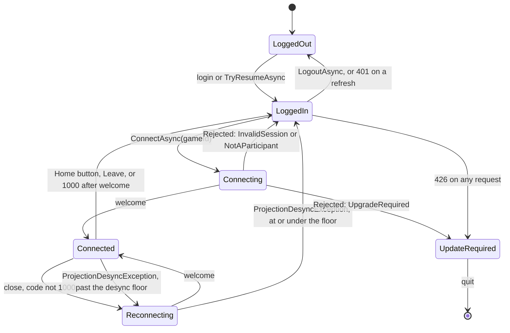
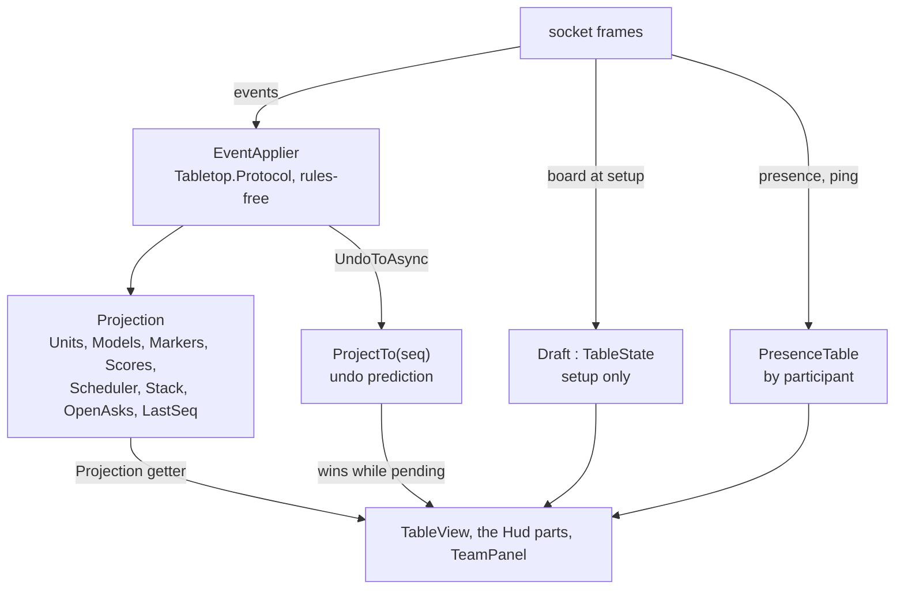

# Client: connection, projection, desync and presence

## The connection

`SessionPhase` is the client's whole connection state machine, and what `Main.Route` switches on.
There is no separate socket state for a screen to read.

`UpdateRequired` is a sink: `ConnectAsync` returns immediately from it and every login path
rethrows after setting it.

The connect sequence, as the game server plan states it: `Connect` is the first frame and must
arrive inside a ten-second handshake window. The server answers `Welcome`, or `Rejected` followed
by a close. A `BoardMessage` follows from `setup` on. Then one or more `EventsMessage`s at
`playing`/`ended`, batched at up to 500 events, with an empty one when the log is empty. Then live
frames. A game that ended before setup ran has no board and no log, so `Welcome` is the whole
sequence. `Session.CatchingUp` is true from `Reset` or a received board until a `ModelFacts` frame or an empty
`EventsMessage`: the batches between replay history, and the floating results, turn banners and camera follow stay
silent for them.

`Session` sends nothing but `Connect` before `Welcome`, gated on `_welcomed`. Presence and pings
are dropped. `SendCommandAsync` and `SendEditAsync` throw `InvalidOperationException`. A failed
undo send clears its prediction.

Reconnect is connect. `ConnectAsync` calls `Reset()` before the first frame, discarding `Applier`,
`Draft`, `Game`, `ParticipantId`, the undo prediction and the presence table. Everything comes back
from `Welcome`/`BoardMessage`/`EventsMessage`. There is no delta resume and no catch-up from a
sequence number, so there is no divergence to detect. A reconnect re-downloads the whole log. In
exchange, first join, reconnect, crash recovery and a game migrating between server tasks are one
code path on both sides.

The socket outlives its Connect JWT: after each successful refresh (every 60 s) a welcomed socket
gets `Reauth(SessionJwt)`, so the server's close at the token's `exp` does not come. While
`Reconnecting`, `SendCommandAsync` and `SendEditAsync` queue (`Session.Queueing`, at most 16) and go
out in order after the next `Welcome`; their tasks complete then, or fail with "Disconnected from the
game" when the session goes home instead. Outside a game they throw "Not connected". The decision box
keeps an open move's or deploy placement's ghosts, with the facings the player gave them, across the
reconnect (`GhostStash`, keyed by the Ask id or the deploying unit) and puts them back when the same
Ask or the same unit's placement renders again.

A reconnecting player rejoins their team. `MyTeamId` is derived, never picked or stored: it reads
`Game.Participants` for `ParticipantId`, and the server fills that from the participant's row,
which outlives the socket. So the `Welcome` that ends a reconnect names the team the previous one
named, and no client code re-picks a team or asks the player to (game flow → Teams are frozen at
the flip, and a team is a slot). `LobbyPanel`,
the only control that sends `PickTeam`, exists at `lobby` and `setup` only, which is where the
server accepts the edit. `MyTeamId` is
null in two unrelated states, and nothing may treat them alike: a spectator has a `Game` whose
participant row carries no team, while a client mid-reconnect has no `Game` at all. Both readers
return early on a null `Game`. `GameScreen.Rebuild` tears the team panels down and rebuilds them
from the `Welcome`, and `DecisionBox.Render` draws nothing. A returning player is therefore shown as
`Reconnecting…` and then as themselves, never as a watcher.

Reconnect policy lives in three fields:

| Close | Decision | Why |
| --- | --- | --- |
| any code, no `Welcome` yet, `GameId` set | reconnect with backoff 1, 2, 5, 10, 10… s | the game exists, the socket did not |
| code `1000` after a `Welcome` | do not reconnect; `Phase = LoggedIn` | the server closes a replaced socket that way, and reconnecting would fight the newer one |
| any `Rejected` | do not reconnect | the reason will not change by retrying |
| `DisconnectAsync` / `LeaveAsync` | do not reconnect | `_userClosed` |
| `1001` (server going away) | reconnect | drain-and-hydrate is the intended path |
| `1008` (the socket's JWT expired) | refresh the JWT, then reconnect | the server closes at the token's `exp`; the refresh makes the reconnect carry one it accepts, and a `401` there signs out |

`ConnectionLost(SocketClosed, bool willReconnect)` is what the game screen toasts. A desync raises
the same event with `SocketClosed.Error` carrying the `ProjectionDesyncException`, which is how the
toast tells a rebuild from a dropped socket.
`_welcomed && code == 1000` is the only signal that a socket was replaced, since no frame says so.
Any other server-side normal close after a welcome is read as a replacement. The inference stands,
because nothing on the wire distinguishes the two and a resync never reaches it: `TearDownSocket`
nulls `_socket` before closing it, and the `ReferenceEquals` guard then drops that socket's close.
The silence does not stand. `Session.LastCloseReason` survives the drop and the Home screen prints
it, so every close the player did not ask for arrives with a reason. It holds the player's words, not
the wire's: `Feedback.Closed` by close code, `Feedback.Rejected` by reject reason. A player-initiated
`ConnectAsync` clears it and so does `DisconnectAsync`, so Home explains only what the player did
not choose.

`Handle`'s switch has no default arm. A kind this client does not act on is dropped after a
successful deserialization, which is what `AtRest(long Seq)` gets. Nothing here waits for the server
to come to rest: every panel draws from the projection as events arrive, and the only busy state is
`Connecting`/`Reconnecting`, which `Welcome` ends. Acting on `AtRest` would add a second and weaker
source of truth for a settled table.

Each socket's handlers capture the socket instance and check `ReferenceEquals(socket, _socket)`
before touching state. A late frame or close from a replaced socket is dropped. That guard plus
`IDispatcher` is the entire concurrency design.

## The projection

Presence and the draft bypass the applier.

`Projection` is `Tabletop.Protocol`'s, built only by `EventApplier`. Applying is copying, never
deriving. Action sequences states that `step_completed` records everything it produced, so every
event carries the state changes it made and the applier has no rule to consult. That is why
`EventApplier` is shippable to a player's machine, and why the same applier serves the client, the
server's own hydrate and a future replay viewer.

The client adds three things around it:

1. `Session.Projection` is `_predicted ?? Applier?.Projection`. A pending undo prediction shadows
   the truth without replacing it.
2. `Session.Log` is `Applier.Log`: every event received, undone ones included. `CombatLogPanel` renders
   it through `CombatLog` with `EventApplier.EffectiveLog` to strike through undone ranges.
3. `Draft` is set from `BoardMessage.Board.Table` whenever status is `lobby` or `setup`. `Applier`
   is constructed from the board only when status is `playing` or `ended`. One frame kind, two
   destinations, chosen on `Game.Status`.

Undo is local first. `UndoToAsync(seq)` computes `Applier.ProjectTo(seq)`, a fresh projection of
the live log up to `seq`. It stores that in `_predicted`, records `PendingUndoTo` and the command
id, sends `Undo(seq)`, and raises `EventsApplied([])`, whose frame render redraws every panel against the
prediction. The prediction clears on one of two frames: an `EventsMessage` containing an `Undone`
whose `ToSeq` equals `PendingUndoTo`, or a `Refused` whose `MessageId` equals the pending command
id. There is no rollback machinery and no reconciliation. On either answer the client shows
`Applier.Projection`, which is by then the server's truth.

The server wins in every case. A `models_moved` event snaps the piece to where the event says. The
client never withholds an answer on its own geometry, and never edits the log.

## Desync and resync

`EventApplier` indexes its dictionaries directly, so an event naming an id the projection does not
hold throws `ProjectionDesyncException` carrying the event kind and the unknown id. One designed
feature reaches it: editing the dice of a frame that has been popped. The client treats it as a fatal desync of its own copy rather than a change to skip, because
a client that silently diverges from the server is worse than one that visibly resets.

`Session` catches it at the two places that apply events: `Applier.ApplyAll` in the `EventsMessage`
arm, and `Applier.ProjectTo` in `UndoToAsync`. `ProjectTo` replays a prefix of a log the applier has
already applied in order, so it cannot fault where `ApplyAll` did not, and that catch holds the
invariant rather than a known case. Both route to `OnDesync`, which drops the projection, closes the
socket and connects again. The rebuild is the ordinary hydrate.

A resync reuses `Reconnecting` rather than taking a phase of its own. `Main.Route` maps a phase to a
scene path, and a resync must not swap the scene, so a new phase would mean a new arm in `Route` and
in every screen that switches on `Phase`, for a state that renders identically to a reconnect. It
does not reuse `OnClosed`, because there is no close to interpret: the socket is healthy and the
client is the one tearing it down. `ConnectAsync` gains a private `resync` parameter that forces
`Reconnecting` and carries the desync bookkeeping across `Reset()`. The public signature is
unchanged.

The resync is immediate and has no backoff. The reconnect backoff exists because a dropped socket is
usually transient and time fixes it. A desync is not transient, so the bound is on attempts.

The bound is one attempt per sequence position. `_desyncFloor` records `Projection.LastSeq` at the
moment of the fault. A later fault whose projection reached past the floor is a different bad event
and gets its own attempt. A fault at or before the floor is the same event replayed out of the
server's own log, which no further attempt can change. `LastSeq` only rises, so the number of
resyncs in one connection is bounded by the number of distinct fault positions and every resync
makes progress. A fixed retry count was rejected on both ends: too low and an unrelated fault an
hour later gets no attempt at all, too high and a hydrate split into 500-event batches loops on the
partial progress each batch makes. `_desyncFloor` is cleared by a player-initiated `ConnectAsync`,
so rejoining from Home buys one more attempt and one more explanation.

Reaching the bound sets `Phase = LoggedIn` with `LastCloseReason` (`This game's log cannot be replayed: …`) and raises
`ConnectionLost(willReconnect: false)`, which is the outcome a `Rejected` already has. The bad event
is in the server's log, so the game is unplayable for every client until that log is repaired, and
Home with a reason is what the player can act on. The server has no equivalent recovery: applying
its own log is the last authority there, and the same exception faults the session.

`Reset()` is the whole discard, so a resync loses exactly what a reconnect loses.

| Invalidated | What becomes of it |
| --- | --- |
| the undo prediction | `ClearPrediction` drops `_predicted`, `PendingUndoTo` and the command id. The `Undone` or `Refused` that would have cleared it arrives on the replaced socket and is dropped by the `ReferenceEquals` guard. The rebuilt log says whether the undo committed |
| an in-flight command or edit | nothing is resent. It was accepted or refused before the socket closed, and its events are in the log the resync downloads. A `Refused` for it is lost, so a command refused at the moment of the fault leaves no toast and the piece stays where the rebuilt projection puts it |
| others' presence | `Others.Clear()`. Held placements and proposed ghosts vanish, and every piece snaps back to the projection |
| this client's presence | `SendPresenceAsync` no-ops while `_socket` is null. The server sends `PresenceEnded` for this participant when the old socket closes, so the other players see this one leave and come back |
| the selection, the ruler, an open menu, the setup toolbar's fields | held by Godot nodes and discarded when the hydrate redraws the table. The exit ghosts of a disembark go with them and are redrawn from the rebuilt Ask |

The player sees a toast and a table that blanks and repopulates: *The table fell out of step with the
server; rebuilding it from the log*. No dialog appears and nothing reaches Godot's error output,
because the catch is in `Session` and the socket read loop never sees the fault. The selection and a
pending undo are gone, which is the cost of the reset.

## Presence

`PresenceTable` is a dictionary keyed by participant with `Set`, `Remove`, `Of`, `All`, `Clear`.
Nothing in it is persisted, logged or replayed. `Reset()` clears it on every connect, and a
reconnecting client rebuilds it from nothing. Connectedness is not a field: who is connected is
which values exist. The server sends `PresenceEnded(participantId)` when a participant's last
socket closes.

Outgoing samples are sent at 20 Hz while something changed, by a `Timer` in `TableInput`, matching
the server's `PresenceRelayHz`. One `Presence` carries the cursor, the selection, the `held` or
`proposed` placements, and a measurement. The cursor is a world point plus the piece under it,
taken from the ray the client already casts to settle models. The selection is a unit id, plus
optionally the models within it. A ping is a separate one-shot `PingMessage` rather than a field,
because presence is state and a ping is an instant.

`PresenceOverlay` draws others' values in their team's colour: a cone at the cursor point with the
hovered piece highlighted, a line with a length for a measurement, a `held` placement by moving
that piece's own node, a `proposed` placement as a standalone translucent copy, a ruler for
another player's held placement, and a ping ring that fades over two seconds. The ruler is drawn
from the start position already in the local projection, so nothing new goes on the wire for it.
`Remove` reads what the overlay last drew rather than `Session.Others`, because the session has
already replaced the value by the time `PresenceChanged` fires.

