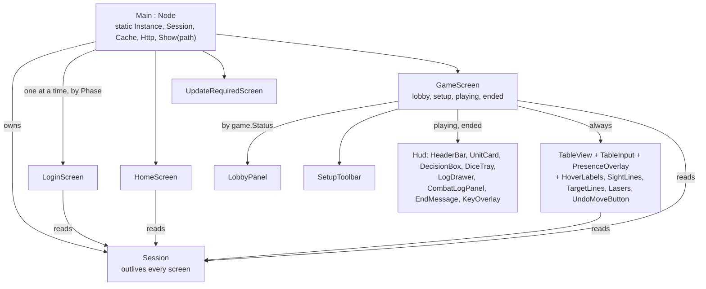

# Client: Core, the Godot layer and screens

## Core and the Godot layer

`client/src/Core/**` is `Tabletop.Client.Core`: plain C# that may reference `Tabletop.Geometry`,
`Tabletop.Content`, `Tabletop.Protocol` and the BCL, and nothing else. `tests/Tabletop.Client.Tests`
compiles those files directly:

```xml
<Compile Include="../../client/src/Core/**/*.cs" LinkBase="Core" />
```

A Godot dependency in a `Core` file breaks the test project's build. There is no assembly boundary
to hide behind: the Godot SDK produces one assembly for `client/`, and a second project cannot
reference it without referencing Godot.

Above it sit three Godot namespaces with one job each. `Tabletop.Client.Screens` swaps scenes and
composes panels. `Tabletop.Client.Table` draws the world and reads the mouse.
`Tabletop.Client.Panels` are the controls the game screen assembles by status. They call into
`Core`, hold node references, and keep nothing that is not on screen.

Some things inside Godot cannot be tested by compiling. The spec asks for two scripted checks. The
plan implements four greps in `scripts/check-client`, each exiting non-zero on a hit:

| Check | Pattern | Why a grep |
| --- | --- | --- |
| No physics body in a scene | `type="(StaticBody3D\|RigidBody3D\|CharacterBody3D\|Area3D\|CollisionShape3D\|CollisionPolygon3D)"` over `client/scenes` | scene files are editor-owned data; nothing else reads them |
| No physics in a script | the same class names plus `PhysicsServer3D`, `PhysicsBody3D` over `client/src` | Godot physics would be an answer the rules depend on |
| No rules type in a script | `Tabletop.GameServer`, `IGameRules`, `GameRulesRegistry`, `IRulesEngine`, `EnforcementPolicy`, `LegalSetMembership`, `CommandDispatcher`, `Legality` | there is no compile-time barrier: both build in one solution |
| `Core` is Godot-free | `using Godot` under `client/src/Core` | belt and braces over the compile check |

The bare word `GameRules` is not matched. It is a string field on `GameInfo` and
`PropertiesSummary` that the Home screen displays. A denylist costs maintenance as the rules
engine grows type names. A reflective escape passes it, such as `ClassDB.Instantiate("StaticBody3D")`
or a scene loaded from `user://`. It is a tripwire, not a sandbox.

## Screens and the session object



A status change happens inside the game screen. It is never a scene swap. `GameScreen` creates
one `TableView` and binds it once for the whole game, and a second `Bind` throws. It draws the
draft in `lobby` and `setup` and the projection's board from `playing` on.

`Main.Route` maps `Session.Phase` to a scene path and returns early when the path is unchanged, so
`Connecting → Connected → Reconnecting` all stay on `Game.tscn` and the table is not rebuilt.
The spec rejected two alternatives. One scene with panels toggled puts the game list and the table
in one tree for no reason. A scene per game status reloads the table on every status change, and
contradicts the server's view that lobby, setup and play are one connection.

`Session` is the single owner of everything that outlives a screen:

| Owns | Member |
| --- | --- |
| the management client and the JWT | `Management`, and `ManagementClient.Jwt` set by `Complete()` |
| the socket while one is open | private `_socket`, created through `IGameSocketFactory` |
| the projection | `Applier : EventApplier`, `Projection`, `Log` |
| the setup draft | `Draft : TableState?` |
| others' presence | `Others : PresenceTable` |
| the undo prediction | `_predicted`, `PendingUndoTo`, `_pendingUndoCommand` |
| reconnect and resync policy | `_attempt`, `_backoff`, `_userClosed`, `_welcomed`, `_desyncFloor` |
| local settings | `Settings`, persisted through the `persistSettings` delegate |

It raises eight events: `PhaseChanged`, `GameChanged`, `BoardChanged`, `EventsApplied`,
`PresenceChanged`, `Pinged`, `RefusedReceived`, `ConnectionLost`. Every one goes through
`IDispatcher.Post`. `GodotDispatcher` posts via `Callable.From(action).CallDeferred()`, so socket
frames arriving on the read loop's thread are handled on Godot's main thread.
`ImmediateDispatcher` runs them inline for tests. That seam and its two implementations are the
client's whole threading model.

One session object costs size: roughly forty public members across login, connection, projection
and presence. Accepted because the spec's structure requires a single owner, and because the type
is Godot-free and so the most heavily tested one in the client.

