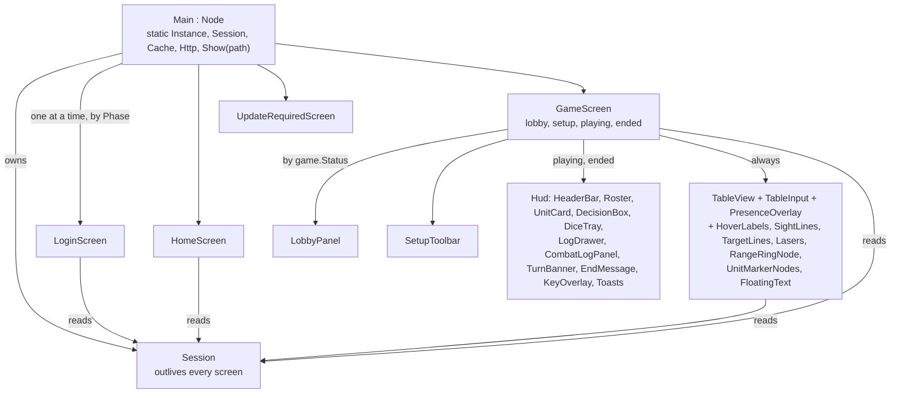

# Client: Core, the Godot layer and screens

## Core and the Godot layer

`client/src/Core/**` is `Tabletop.Client.Core`: plain C# that may reference `Tabletop.Geometry`,
`Tabletop.Content`, `Tabletop.Protocol` and the BCL, and nothing else. `tests/Tabletop.Client.Tests`
compiles those files directly:

```xml
<Compile Include="../../client/src/Core/**/*.cs" LinkBase="Core" />
```

A Godot dependency in a `Core` file breaks the test project's build. There is no assembly boundary
to hide behind: the Godot SDK produces one assembly for `client/`, and a second project cannot
reference it without referencing Godot.

Above it sit three Godot namespaces with one job each. `Tabletop.Client.Screens` swaps scenes and
composes panels. `Tabletop.Client.Table` draws the world and reads the mouse.
`Tabletop.Client.Panels` are the controls the game screen assembles by status. They call into
`Core`, hold node references, and keep nothing that is not on screen.

Some things inside Godot cannot be tested by compiling. The spec asks for two scripted checks. The
plan implements four greps in `scripts/check-client`, each exiting non-zero on a hit:

| Check | Pattern | Why a grep |
| --- | --- | --- |
| No physics body in a scene | `type="(StaticBody3D\|RigidBody3D\|CharacterBody3D\|Area3D\|CollisionShape3D\|CollisionPolygon3D)"` over `client/scenes` | scene files are editor-owned data; nothing else reads them |
| No physics in a script | the same class names plus `PhysicsServer3D`, `PhysicsBody3D` over `client/src` | Godot physics would be an answer the rules depend on |
| No rules type in a script | `Tabletop.GameServer`, `IGameRules`, `GameRulesRegistry`, `IRulesEngine`, `EnforcementPolicy`, `LegalSetMembership`, `CommandDispatcher`, `Legality` | there is no compile-time barrier: both build in one solution |
| `Core` is Godot-free | `using Godot` under `client/src/Core` | belt and braces over the compile check |

The bare word `GameRules` is not matched. It is a string field on `GameInfo` and
`PropertiesSummary` that the Home screen displays. A denylist costs maintenance as the rules
engine grows type names. A reflective escape passes it, such as `ClassDB.Instantiate("StaticBody3D")`
or a scene loaded from `user://`. It is a tripwire, not a sandbox.

## Screens and the session object



`LoginScreen` is a card with a segmented choice, Password (email, password, Remember me, **Sign in** and a flat **Create account**)
or Email me a code (email and **Send code**, then the code and **Sign in**); Enter moves from the email to the next field and signs in
from the password or the code field; its buttons are disabled while a request is out, and a failure is a line under the field it
concerns. Its gear opens Settings before sign-in. `HomeScreen` (UX redesign part 1 → Home) draws `HomeView`: a header with the gear
(Settings) and the account menu (**Rename…**, `Session.RenameAsync`, `PATCH /v1/account`, the dialog's OK waiting until
`TextLimits.NameProblem` is null; **Sign out**), a line while the name is management's default `Player-xxxx`
(`TextLimits.IsDefaultName`); **New game**, the name filter, refresh and **Ended too**; *Your games* (every page of
`GET /v1/games?joined=true`, not ended) as cards banded in the status colour (`HomeLook`) with the edition, three players then `+N`,
the state line, the primary (Play, Continue, Open) and a ▸ menu (Replay on a playing game, End game and Delete game for the creator,
Leave), each of End, Delete and Leave asked first; *Open games* (the rest of `GET /v1/games` not ended, paged with More games) as rows
with Join; my ended games as rows with Replay while Ended too is on. The list reloads after an action and when the window comes to
the front. Create game loads the rule sets and armies first; the name's problem shows from the first keystroke or an Enter, and
Create game waits for a valid name; the enforcement's line (`CreateDefaults.EnforcementHint`) is under its picker; created, the lobby
opens at once.
The game screen's corner (`CornerLine`) is the `home` icon button, then `Connecting…`, or the game's name, clipped with an ellipsis to
the corner's 420 px, then a status chip with the game's phase (`Lobby`, `Setup`, `Deployment`, `Round N`, `Ended`; `Watching` for a
watcher, `Replay` in a replay) and `reconnecting, attempt N; Home stops it…`, which never clip.

A status change happens inside the game screen. It is never a scene swap. `GameScreen` creates
one `TableView` and binds it once for the whole game, and a second `Bind` throws. It draws the
draft in `lobby` and `setup` and the projection's board from `playing` on.

`Main.Route` maps `Session.Phase` to a scene path and returns early when the path is unchanged, so
`Connecting → Connected → Reconnecting` all stay on `Game.tscn` and the table is not rebuilt.
The spec rejected two alternatives. One scene with panels toggled puts the game list and the table
in one tree for no reason. A scene per game status reloads the table on every status change, and
contradicts the server's view that lobby, setup and play are one connection.

`Session` is the single owner of everything that outlives a screen:

| Owns | Member |
| --- | --- |
| the management client and the JWT | `Management`, and `ManagementClient.Jwt` set by `Complete()` |
| the socket while one is open | private `_socket`, created through `IGameSocketFactory` |
| the projection | `Applier : EventApplier`, `Projection`, `Log` |
| the setup draft | `Draft : TableState?` |
| others' presence | `Others : PresenceTable` |
| the undo prediction | `_predicted`, `PendingUndoTo`, `_pendingUndoCommand` |
| reconnect and resync policy | `_attempt`, `_backoff`, `_userClosed`, `_welcomed`, `_desyncFloor` |
| local settings | `Settings`, persisted through the `persistSettings` delegate |

It raises eight events: `PhaseChanged`, `GameChanged`, `BoardChanged`, `EventsApplied`,
`PresenceChanged`, `Pinged`, `RefusedReceived`, `ConnectionLost`. Every one goes through
`IDispatcher.Post`. `GodotDispatcher` posts via `Callable.From(action).CallDeferred()`, so socket
frames arriving on the read loop's thread are handled on Godot's main thread.
`ImmediateDispatcher` runs them inline for tests. That seam and its two implementations are the
client's whole threading model.

`Session.Frame` (`RenderScheduler`) coalesces renders. Each `EventsApplied`, `GameChanged`, `BoardChanged` and
`FactsChanged` is raised as before, then marks the frame with its `RenderCause`. The first mark posts one flush through
`IDispatcher`; every mark before it runs folds in, and the flush raises `Render(RenderCause)` once with all the causes.
On Godot the post is a deferred call, so the batches already queued for the frame are applied first and the parts render
once, in subscription order, within the same frame. The parts that redraw from the current state subscribe to
`Frame.Render` and filter on the causes they used to subscribe to: `HeaderBar`, `Roster`, `UnitCard`, `DecisionBox`,
`DiceTray`, `UndoButton`, `CombatLogPanel`, `EndMessage`, `UnitMarkerNodes`, `HoverLabels`, `RangeRingNode`,
`TargetLines`, `SightLines`, and `GameScreen.RefreshAll`, whose deferred `ShowSelection` so still lands after the
decision box's render. `UnitCard` rebuilds its body only when its `UnitCardContent` (the sheet, team and note, equal
by value) changed, and a rebuild of the same unit's card keeps its scroll position. The parts that read the batch keep `EventsApplied`: `FloatingText`, `TurnBanner`,
`DecisionBox`'s sealed reveal (`SealedReveals` queues each batch's "Revealed: …" line until a render shows it), `Animator`, the camera follow, and `TableView`, which `Animator.Pump` also redraws.

`Session.CombatLog` (`CombatLogState`, from a `CombatLogCache`) is the combat log of the current log state, built at
most once and shared. The key is the log instance, its count and last seq, `PendingUndoTo`, the `GameInfo` and the
`Projection` instance (a prediction or a rebuild after an `Undone` is a new one). `Entries` is `CombatLog.Build` over
`Session.Log` (the log panel), `Latest` is the dice tray's roll, and `Undo` is the undo button's `UndoPlan`: over the
same entries, or, while an undo travels, over the log with its `Undone` marker appended.

One session object costs size: roughly forty public members across login, connection, projection
and presence. Accepted because the spec's structure requires a single owner, and because the type
is Godot-free and so the most heavily tested one in the client.

## Themes and settings

A theme is data. `UiTheme` (Core) holds the id and name, the palette (`Background`, `Panel`, `PanelBorder`, `Text`,
`DimText`, `ButtonText`, `Accent`, `Success`, `Failure`, `Warning`), six team colours, three fonts (`Display`, `Body`,
`Numerals`, each a `ThemeFont` of path, size and weight), a `PanelShape`, a `DiceStyle` and an icon map keyed by
condition or marker kind. `Rgba` stands in for Godot's `Color`, which Core cannot name. `UiTheme.Team(ordinal)` wraps
the six colours by team ordinal; `Icon(name)` is null when the theme has none. `PanelShape` is a corner radius, border
width, padding, a `Clipped` flag (corner detail 1, cut corners) and optional nine-patch textures for panels and buttons.
`DiceStyle` is `Pips` (a face texture per value) or `Numerals`. `UiThemes` holds `Fantasy` (parchment, Cinzel and EB
Garamond, nine-patch panels, pip dice) and `SciFi` (dark glass, Orbitron, Rajdhani and JetBrains Mono, clipped flat
panels, numeral dice); `Resolve(id)` falls back to `SciFi`, the `DefaultId`.

`Main` is a `Node`, so a `Theme` set on it reaches no screen. `Main.ApplyTheme` calls `Ui.Apply(theme)`, which has
`ThemeBuilder.Build` make the Godot `Theme`, and assigns it to the tree root and to the current screen's root `Control`
(again on every screen swap). It also sets the default clear colour to `Background`. `ThemeBuilder` (`src/Theme/`,
namespace `Tabletop.Client.Theming`) styles `Panel`, `PanelContainer`, popups and dialogs, `Button` in four states,
`LineEdit`, `ItemList`, `TabContainer`, label and button colours and the default font. A nine-patch button is
modulated from grey, lightened for hover and pressed and darkened when disabled. `CheckBox` draws no button stylebox and
takes `Text`. It also builds the type variations: `Variation.FlatButton` over `Button` (`Text`, `Accent` when pressed,
`DimText` when disabled), which every `Flat` button sets because it draws on the panel and not on a button face;
`Variation.Badge`, `Chip` and `DieFace` over `PanelContainer`; and over `Label` `Dim`, `Accent`, `Success`,
`Failure`, `Warning`, `Display`, `Numerals` and `Banner` (outlined, 48 px). Variable fonts are applied through a
`FontVariation` at the theme's weight.

`Ui` is the static view of the current theme for Godot code: `Ui.Theme`, `Ui.Current`, `Ui.Of(Rgba)`, `Ui.Team(ordinal)`,
`Ui.Accent/Success/Failure/Warning`, `Ui.Icon(name)` (cached, cleared on a change) and the `Changed` event. Hud, panel
and screen code names a colour through `Ui` or sets a `ThemeTypeVariation`; it never writes a colour literal.
A team colour on a label is a `font_color` override, never `Modulate`, which would multiply the theme's text colour.
On `Ui.Changed` the Hud parts that draw from the theme re-render themselves (`HeaderBar`, `Roster`, `UnitCard`, `EndMessage`,
`DiceTray`, `CombatLogPanel`), the table overlays that do too (`UnitMarkerNodes`, `FloatingText`, `RangeRingNode`), and `GameScreen` re-tints the team panels, redraws the table when bound and gives the
undo button `Ui.Theme`; nothing is recreated, so typed input survives. `DiceFaces.Of(Die)` makes a die as a
`DieFace` panel with the theme's face texture or a numeral, the modified value after an arrow when it differs, and
dimmed when the die failed.

`ClientSettings` holds every option (`client/AGENTS.md` lists the fields), each nullable in the DTO so an older file loads with
defaults. `OptionsScreen` (`Screens/`, spec `2026-11-21-options-screen-design.md`), opened from the gear on Login, Home and the play
header through `OptionsScreen.Open`, is a full-screen `CanvasLayer` over `OptionsModel`: changes are pending until Apply, which goes
through `Session.UpdateSettings`; `Main` applies the theme (with `UiThemes.Adjusted` for text size and colour-blind teams), key bindings,
UI scale, tooltip delay, buses and frame counter on `Session.SettingsChanged`.

`scripts/check-client` is the colour gate: `new Color(`, `new Godot.Color(`, `Colors.`, `Color.FromHtml`, `Color.Color8`,
`Color.FromHsv`, `Color x = new(` and target-typed `Modulate`, `SelfModulate` or `Color = new(` under `client/src/Hud`,
`Panels` and `Screens` fail the check. `Table/` draws in world colours through `Palette`, whose team colours come from
the theme. Assets sit in `client/content/themes/<id>/`: `fonts/`, `icons/`, and for `fantasy` also `panel.svg`,
`button.svg` and `dice/1.svg` to `6.svg`; each folder carries its `LICENSES.md`.
