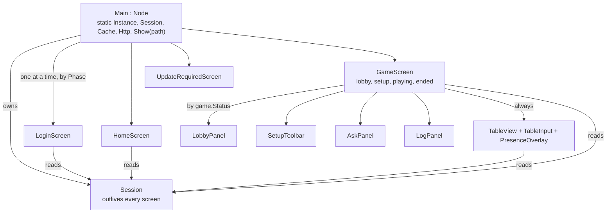
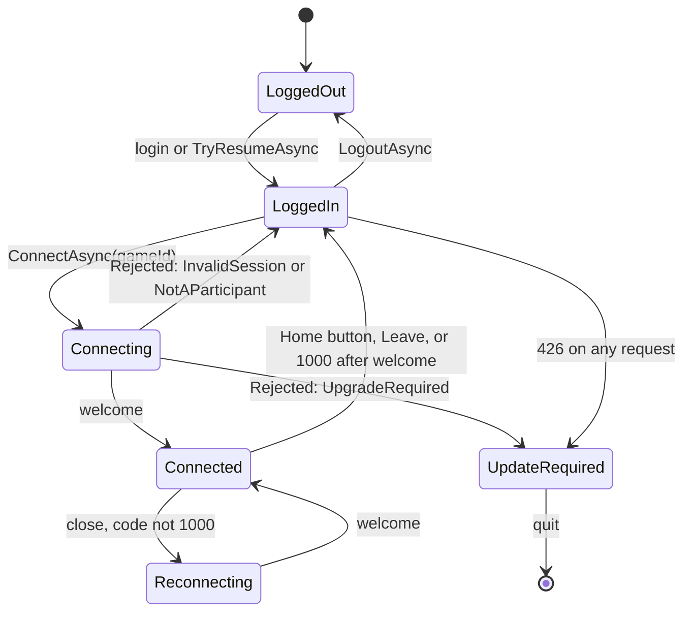
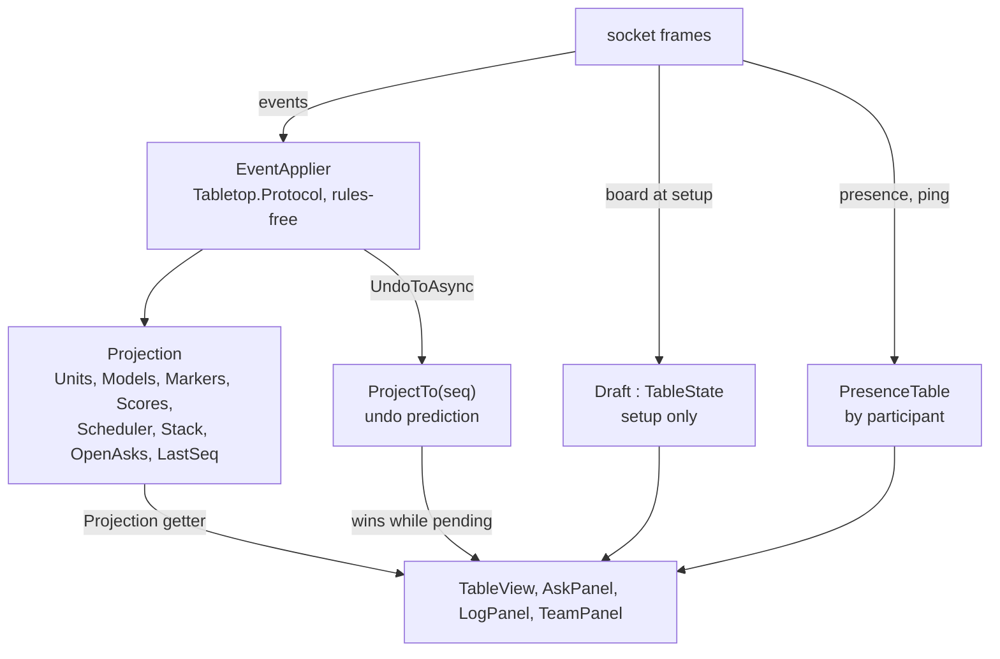
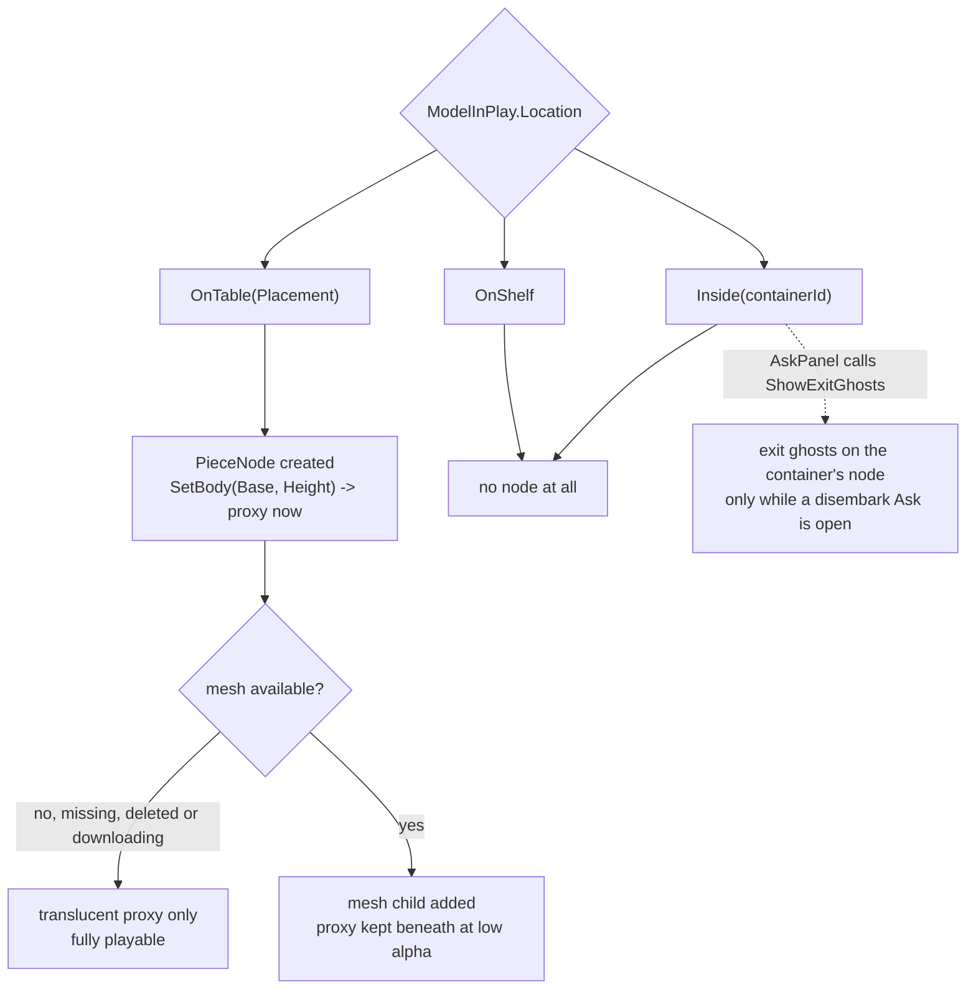
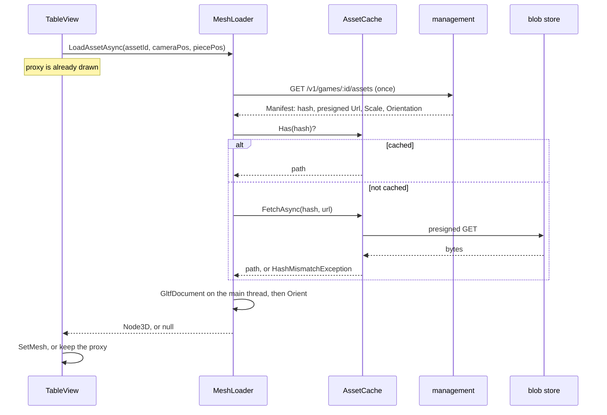
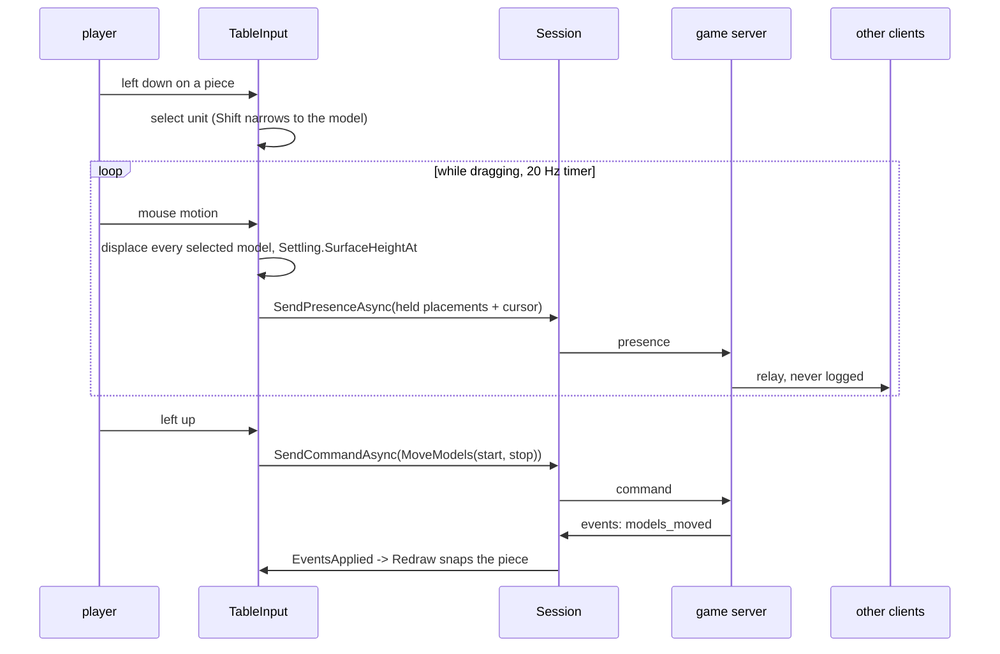
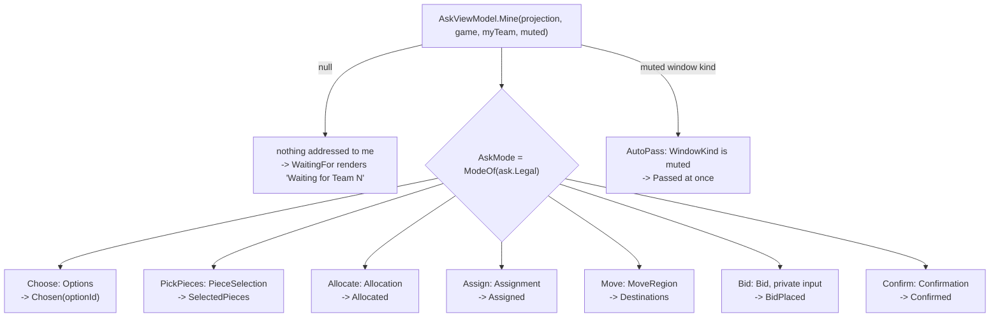
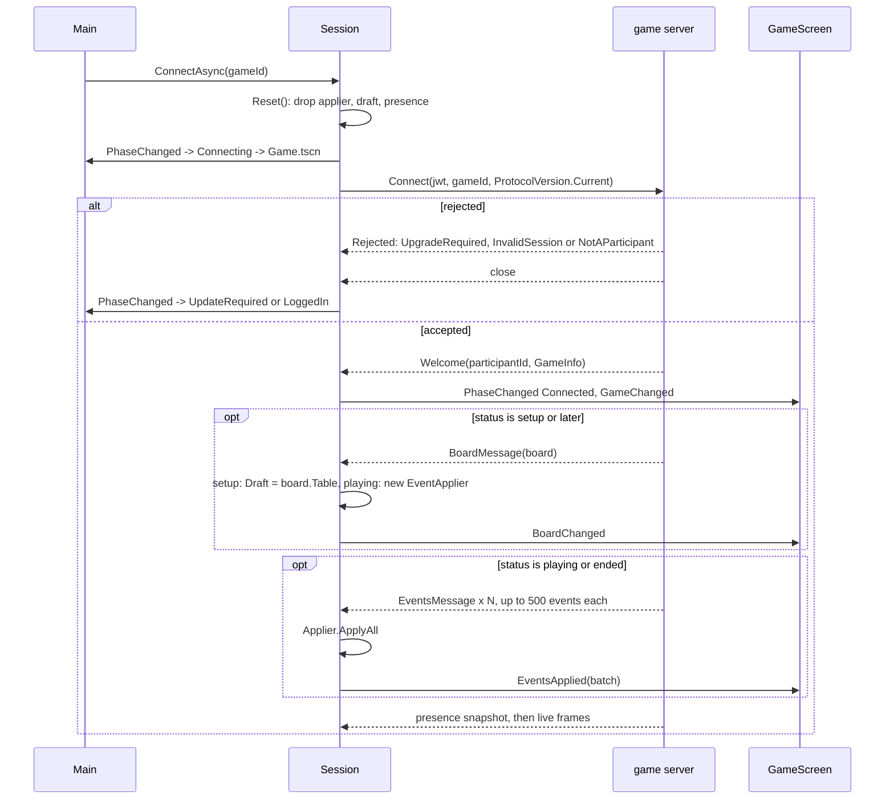
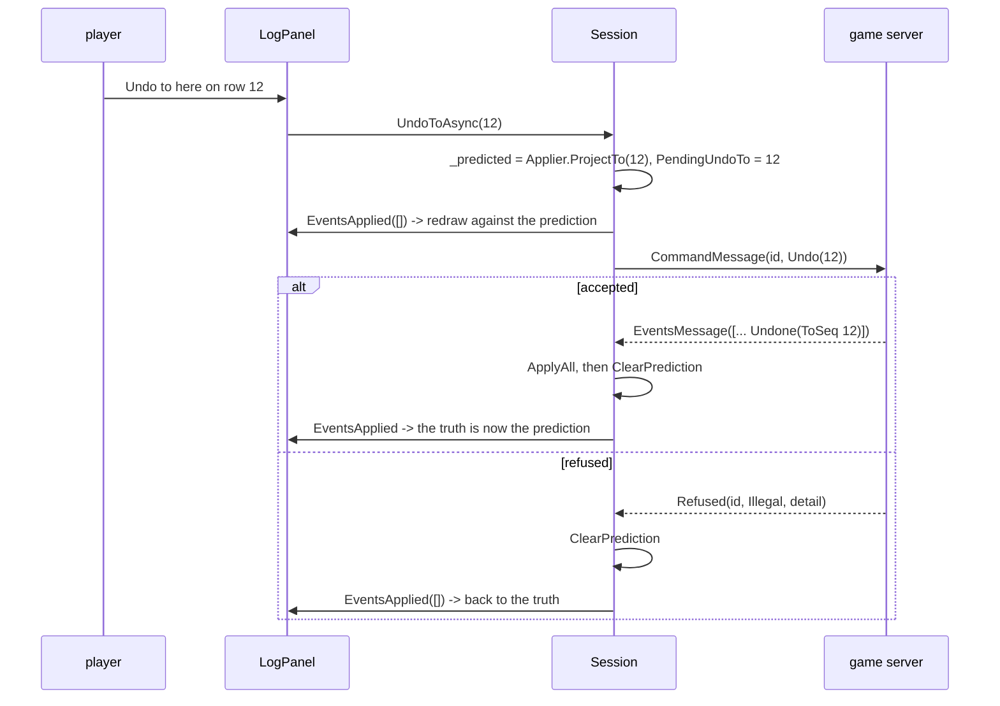
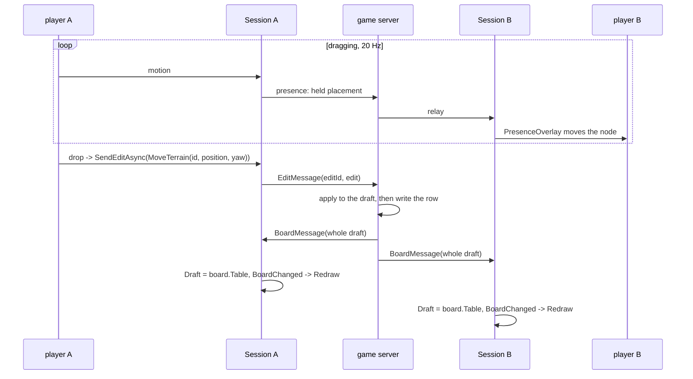

# Client — engineering design

The Godot 4.7 / C# client in `client/` is the game's only Godot dependency and its only
non-headless deliverable: a renderer, an input surface and a geometry engine over one session
object. It owns login, the game list, joining, and one game screen that serves `lobby`, `setup`,
`playing` and `ended`, because all four are one socket and one hydrate path. It draws the table
from a **projection** that `Tabletop.Protocol.EventApplier` builds by applying every event, so no
ruleset code, no dice, no turn order and no legality check reaches the player's machine.

The sentence a reviewer must not miss: **everything in this client that holds a decision lives
under `client/src/Core/` and is compiled from source into `tests/Tabletop.Client.Tests`, which is
what proves it needs no engine** — the session object, the management client, the socket seam, the
cache, the built-in content, the generators and every view model. The Godot layer above it draws
what those decided and forwards input back, and it is tested by running the game.

## Scope

In:

| Subject | Where |
| --- | --- |
| Login (password, email one-time code), remembered session, update-required screen | `client/src/Core/`, `client/src/Screens/` |
| The game list, create game, join | `client/src/Screens/HomeScreen.cs` |
| One session object: management client, socket, projection, draft, presence, undo prediction, reconnect | `client/src/Core/Session.cs` |
| One game screen over four statuses; lobby panel, setup toolbar, team panels | `client/src/Screens/`, `client/src/Panels/` |
| The table view: slab, hitbox-first pieces, terrain, markers, zones, camera | `client/src/Table/` |
| Runtime GLB loading into a content-addressed disk cache | `client/src/Table/MeshLoader.cs`, `client/src/Core/AssetCache.cs` |
| Input and presence: select, drag, drop, ruler, measure, ping, others' cursors and ghosts | `client/src/Table/TableInput.cs`, `PresenceOverlay.cs` |
| The Ask panel, the declared move's region and ghost, containment | `client/src/Panels/AskPanel.cs`, `client/src/Core/MoveRuler.cs` |
| The log panel with undo-to-here, the right-click menu, the animation queue | `client/src/Panels/`, `client/src/Table/Animator.cs` |
| Built-in terrain, textures, marker visuals, and the rulebook's four terrain generators | `client/src/Core/BuiltinContent.cs`, `TerrainGenerators.cs` |
| The scripted boundary checks: no physics, no rules type, no Godot in `Core` | `scripts/check-client` |

Deliberately not in:

- **No ruleset code, no legality, no dice, no turn order.** Enumerated as a constraint, greped
  for, and the load-bearing seam of the whole system (`architecture.md` → The load-bearing seam).
- **No Godot physics.** No `StaticBody3D`, `RigidBody3D`, `CharacterBody3D`, `Area3D` or
  `CollisionShape3D` in any scene or script. Picking is ray-versus-AABB over proxy bounds; every
  measurement is `Tabletop.Geometry`'s.
- **No truth outside the projection.** A screen keeps only what it draws.
- **No army editing, no asset upload, no STL conversion.** Those are the web app's; a wrong mesh
  sends the player to the browser.
- **No hidden-information handling.** The server filters streams (the sealed bid); the client shows
  what it receives.
- **No offline mode.** Running the game means running a server.
- Visual design of any screen, and the Godot scene tree beneath each, are undecided by design —
  the plan builds every control tree in `_Ready` and hand-writes `.tscn` files that carry a root
  node and a script and nothing else.

What already exists: `client/Tabletop.csproj` (`Godot.NET.Sdk/4.7.2`, `net10.0`, root namespace
`Tabletop`), `client/scenes/Main.tscn` and `client/src/Main.cs` as a scaffold, and
`Directory.Build.props` giving each OS its own `obj/`. `client/src/Core/`, `client/src/Screens/`,
`client/src/Table/`, `client/src/Panels/` and `tests/Tabletop.Client.Tests/` do not exist yet.

Position in the build order: **step 5**, running in parallel with step 4 (the game server
skeleton) once step 1's contracts exist (`architecture.md` → Build order). What must exist before
it starts: `Tabletop.Protocol` (commands, events, Asks, presence, setup edits, `EventApplier`,
`WireJson`, `ProtocolVersion`), `Tabletop.Geometry` (`Table`, `ZoneStyles`, `Movement`,
`Containment`, `Settling`, `Distance`), `Tabletop.Content` (`Army`, `TableState`, `ContentJson`),
management's `/v1/*` surface, and the game server's connect sequence. In practice the plan is
ordered after all four so that Task 9's "run it" steps have something to talk to; only Tasks 1–8
are needed before a server exists at all.

## Context


The client's four outward edges and the one library edge; nothing else matters to it.

Three seams, and they differ in kind. **Management is the client's HTTP dependency** and the only
one it authenticates against: login, the game list, create and join, armies, layouts, properties,
the per-game asset manifest, and presigned download URLs. Every request carries
`Tabletop-Client-Version: {ProtocolVersion.Current}`; a `426` is not an error to report but a
screen of its own, after which nothing else runs. The JWT lives five minutes and is refreshed by
`POST /v1/auth/session/refresh` on a 60-second `Timer` owned by `Main`.

**The game server is the client's only source of game truth**, over one socket carrying four
kinds of traffic: commands up and events down (logged), Asks down, presence both ways and
discarded, and — only while status is `lobby` or `setup` — edits that write the game's rows and
the `table_state` draft without being logged. The client opens the socket with the same session
JWT and a game id; there is no token of our own and no management-to-game-server call.

**The blob store is reached directly.** Management issues a presigned GET and the bytes never pass
through it. The client verifies the SHA-256 of what arrives against the hash the manifest gave and
keys the on-disk cache by that hash, so the same mesh in two games is one download and a corrupt
or substituted body cannot enter the cache.

The library edge is the important one for correctness. `Tabletop.Geometry` is shared with the game
server precisely so the two agree on distance, line of sight and settling — but the client runs it
for a different reason, and only the server's answer counts. Client geometry is a **prediction for
responsiveness**; a disagreement is resolved by resyncing, never by reconciling, which is why
bit-exact cross-platform determinism between Windows and Linux is not a requirement here.

## Design

### The two halves, and the line between them

`client/src/Core/**` is `Tabletop.Client.Core`: plain C# that may reference `Tabletop.Geometry`,
`Tabletop.Content`, `Tabletop.Protocol` and the BCL, and nothing else. `tests/Tabletop.Client.Tests`
compiles those files directly:

```xml
<Compile Include="../../client/src/Core/**/*.cs" LinkBase="Core" />
```

If a `Core` file takes a Godot dependency, the test project stops building. That is the test —
there is no assembly boundary to hide behind, because the Godot SDK produces one assembly for
`client/` and a second project cannot reference it without referencing Godot.

Above it sit three Godot namespaces with one job each: `Tabletop.Client.Screens` swaps scenes and
composes panels, `Tabletop.Client.Table` draws the world and reads the mouse, and
`Tabletop.Client.Panels` are the controls the game screen assembles by status. They call into
`Core`, hold node references, and keep nothing that is not on screen.

Some things inside Godot cannot be tested by compiling. The spec asks for two scripted checks; the
plan implements four greps in `scripts/check-client`, each exiting non-zero on a hit:

| Check | Pattern | Why a grep |
| --- | --- | --- |
| No physics body in a scene | `type="(StaticBody3D\|RigidBody3D\|CharacterBody3D\|Area3D\|CollisionShape3D\|CollisionPolygon3D)"` over `client/scenes` | scene files are editor-owned data; nothing else reads them |
| No physics in a script | the same class names plus `PhysicsServer3D`, `PhysicsBody3D` over `client/src` | Godot physics would be an answer the rules depend on |
| No rules type in a script | `Tabletop.GameServer`, `IGameRules`, `GameRulesRegistry`, `IRulesEngine`, `EnforcementPolicy`, `LegalSetMembership`, `CommandDispatcher`, `Legality` | there is no compile-time barrier: both build in one solution |
| `Core` is Godot-free | `using Godot` under `client/src/Core` | belt and braces over the compile check |

The bare word `GameRules` is deliberately *not* matched: it is a string field on `GameInfo` and
`PropertiesSummary` that the Home screen displays. The cost of a denylist is that it must be
maintained as the rules engine grows type names, and that a reflective escape
(`ClassDB.Instantiate("StaticBody3D")`, a scene loaded from `user://`) passes it. It is a
tripwire, not a sandbox.

### Screens and the session object



One screen at a time under `Main`; the session object beneath all of them. A status change is a
change *inside* the game screen, never a scene swap.

`Main.Route` maps `Session.Phase` to a scene path and returns early when the path is unchanged, so
`Connecting → Connected → Reconnecting` all stay on `Game.tscn` and the table is not rebuilt.
Two alternatives were rejected in the spec: one scene with panels toggled, which puts the game
list and the table in one tree for no reason; and a scene per game status, which reloads the table
on every status change and fights the server's view that lobby, setup and play are one connection.

`Session` is the single owner of everything that outlives a screen:

| Owns | Member |
| --- | --- |
| the management client and the JWT | `Management`, and `ManagementClient.Jwt` set by `Complete()` |
| the socket while one is open | private `_socket`, created through `IGameSocketFactory` |
| the projection | `Applier : EventApplier`, `Projection`, `Log` |
| the setup draft | `Draft : TableState?` |
| others' presence | `Others : PresenceTable` |
| the undo prediction | `_predicted`, `PendingUndoTo`, `_pendingUndoCommand` |
| reconnect policy | `_attempt`, `_backoff`, `_userClosed`, `_welcomed` |
| local settings | `Settings`, persisted through the `persistSettings` delegate |

It raises eight events — `PhaseChanged`, `GameChanged`, `BoardChanged`, `EventsApplied`,
`PresenceChanged`, `Pinged`, `RefusedReceived`, `ConnectionLost` — and every one goes through
`IDispatcher.Post`. `GodotDispatcher` posts via `Callable.From(action).CallDeferred()`, so socket
frames arriving on the read loop's thread are handled on Godot's main thread;
`ImmediateDispatcher` runs them inline for tests. This is the whole of the client's threading
model: one seam, two implementations.

The cost of one session object is that it is large — roughly forty public members across login,
connection, projection and presence. The plan accepts it because the spec's structure demands a
single owner, and because it is Godot-free and therefore the most heavily tested type in the
client.

### The connection

`SessionPhase` is the client's whole connection state machine, and it is also what `Main.Route`
switches on. There is no separate "socket state" for a screen to read.



`UpdateRequired` is a sink: `ConnectAsync` returns immediately from it and every login path
rethrows after setting it.

The connect sequence the client obeys, exactly as the game server plan states it: `Connect` is the
first frame and must arrive inside a ten-second handshake window; the server answers `Welcome`, or
`Rejected` followed by a close; a `BoardMessage` follows from `setup` on; then one or more
`EventsMessage`s at `playing`/`ended` (batched at up to 500 events, and an empty one when the log
is empty); then live frames. A game that ended before setup ever ran has no board and no log, so
`Welcome` is the whole sequence.

**Reconnect is connect**, literally: `ConnectAsync` calls `Reset()` before the first frame,
discarding `Applier`, `Draft`, `Game`, `ParticipantId`, the undo prediction and the presence table.
Everything comes back from `Welcome`/`BoardMessage`/`EventsMessage`. There is no delta resume, no
"catch me up from seq N", and therefore no divergence to detect. The cost is that a reconnect
re-downloads the whole log; the benefit is that first join, reconnect, crash recovery and a game
migrating between server tasks are one code path on both sides.

Reconnect policy lives in three fields and is deliberately narrow:

| Close | Decision | Why |
| --- | --- | --- |
| any code, no `Welcome` yet, `GameId` set | reconnect with backoff 1, 2, 5, 10, 10… s | the game exists; the socket did not |
| code `1000` after a `Welcome` | **do not** reconnect; `Phase = LoggedIn` | the server closes a *replaced* socket that way, and reconnecting would fight the newer one |
| any `Rejected` | do not reconnect | the reason will not change by retrying |
| `DisconnectAsync` / `LeaveAsync` | do not reconnect | `_userClosed` |
| `1001` (server going away) | reconnect | drain-and-hydrate is the intended path |

`ConnectionLost(SocketClosed, bool willReconnect)` is what the game screen toasts. Note the
compromise: `_welcomed && code == 1000` is the *only* signal that a socket was replaced, because
no frame says so. Any other server-side normal close after a welcome is read as a replacement and
silently drops the player to Home.

Each socket's handlers capture the socket instance and check `ReferenceEquals(socket, _socket)`
before touching state, so a late frame or a late close from a socket that has already been
replaced is dropped. That guard plus `IDispatcher` is the entire concurrency design.

### The projection



Three stores, one of which is the truth. Presence and the draft deliberately bypass the applier.

`Projection` is `Tabletop.Protocol`'s, built only by `EventApplier`. **Applying is copying, never
deriving**: action sequences ruled that `step_completed` records everything it produced, so every
event carries the state changes it made and the applier has no rule to consult. That is what keeps
`EventApplier` shippable to a player's machine, and it is why the same applier serves the client,
the server's own hydrate and a future replay viewer.

The client adds exactly three things around it:

1. `Session.Projection` is `_predicted ?? Applier?.Projection`. The undo prediction, when one is
   pending, shadows the truth without replacing it.
2. `Session.Log` is `Applier.Log` — every event received, undone ones included. `LogPanel` renders
   it with `EventApplier.EffectiveLog` to strike through undone ranges.
3. `Draft` is set from `BoardMessage.Board.Table` whenever status is `lobby` or `setup`, and
   `Applier` is constructed from the board only when status is `playing` or `ended`. One frame
   kind, two destinations, chosen on `Game.Status`.

**Undo is local first.** `UndoToAsync(seq)` computes `Applier.ProjectTo(seq)` — a fresh projection
of the live log up to `seq` — stores it in `_predicted`, records `PendingUndoTo` and the command
id, sends `Undo(seq)`, and raises `EventsApplied([])` so every panel redraws against the
prediction. The prediction clears on exactly one of two frames: an `EventsMessage` containing an
`Undone` whose `ToSeq` equals `PendingUndoTo`, or a `Refused` whose `MessageId` equals the pending
command id. There is no rollback machinery and no reconciliation: on either answer the client
shows `Applier.Projection` again, which is by then the server's truth.

**Server wins, always.** A `models_moved` event snaps the piece to where the event says. The client
never withholds an answer on its own geometry, and it never edits the log.

### Presence

`PresenceTable` is a dictionary keyed by participant with `Set`, `Remove`, `Of`, `All`, `Clear`.
Nothing in it is persisted, logged or replayed, and `Reset()` clears it on every connect — a
reconnecting client rebuilds it from nothing because there is nothing to rebuild.
Connectedness is not a field: who is connected is which values exist, and the server sends
`PresenceEnded(participantId)` when a participant's last socket closes.

Outgoing samples are sent at **20 Hz while something changed** by a `Timer` in `TableInput`,
matching the server's `PresenceRelayHz`. One `Presence` carries the cursor (a world point plus the
piece under it, from the ray the client already casts to settle models), the selection (a unit id
plus optionally the models within it), the `held` or `proposed` placements, and a measurement. A
ping is a separate one-shot `PingMessage`, not a field, because presence is state and a ping is an
instant.

`PresenceOverlay` draws others' values in their team's colour: a cone at the cursor point with the
hovered piece highlighted, a line with a length for a measurement, a `held` placement by moving
that piece's own node, a `proposed` placement as a standalone translucent copy, a ruler for
another player's held placement drawn from the start position already in the local projection, and
a ping ring that fades over two seconds. Nothing new goes on the wire for the ruler — both ends
compute it from values they already have. `Remove` reads what the overlay last drew rather than
`Session.Others`, because the session has already replaced the value by the time
`PresenceChanged` fires.

### The table view



The drawing rule in full: location decides whether a piece exists at all, and the hitbox is drawn
before any mesh is.

**A piece is drawn as its hitbox first.** `PieceNode.SetBody(Base, height)` builds the proxy
immediately — a `CylinderMesh`, `BoxMesh` or scaled cylinder for a circle, square or oval base,
extruded to the model's height, translucent. `SetMesh` adds the loaded GLB scene as a child and
keeps the proxy beneath it at 25% alpha. Terrain does the same from its volumes, one proxy
`MeshInstance3D` per `Volume` with offset, yaw, scale and heights applied and coloured by
declaration. This is not a fallback bolted on: the asset library settled that "the proxy is not a
stand-in for the mesh, it is the thing the mesh was always only decorating," and the base and
height are exactly what distance and line of sight are measured against. A missing, deleted,
still-downloading or hash-mismatched mesh therefore costs appearance and nothing else.

**A model that is not `OnTable` is absent, not drawn somewhere wrong.** `TableView.Redraw()` diffs
`Projection.Models.Values.Where(m => m.Location is OnTable)` against its node dictionary and frees
the node the moment an event moves a model to the shelf or inside a container. `OnShelf` and
`Inside` carry no `Placement`, so there is no stale or default position to draw at, and
`PieceAt(id)` returning null is what silently keeps the ruler, the log's click-highlight and the
Ask panel's highlights correct for an occupant.

The one exception lasts as long as one Ask. `ShowExitGhosts(modelIds, containerId)` puts one
`PieceNode` per occupant in a separate `_ghosts` child at the container's placement so the player
has something to drag out; `Redraw` never touches that child; `ClearExitGhosts` frees them when
the answer is sent. The ghosts are not part of the projection, which is what keeps the
no-truth-outside-the-projection rule intact — they are a control surface, not state.

Other nodes: `SlabNode` draws the table at its real size, 1" thick, with its texture or a flat
colour; `MarkerNode` a disc of the marker's diameter with a label; `ZoneNode` resolves
`ZoneStyles.Resolve(zone.Shape, size)` into flat `ArrayMesh` fans 0.02" above the slab, with no
frame conversion, and draws nothing plus a warning for an unknown shape id. `OrbitCamera` orbits
on the right button, pans on the middle, zooms on the wheel, snaps top-down on `Home` and drops to
table level on `End` — the placement and line-of-sight views the spec asks for.

**Godot physics is deliberately absent.** Picking is a ray tested against `TableView.Pieces`
AABBs and the slab plane (`Plane(Vector3.Up, 0).IntersectsRay`); settling is
`Settling.SurfaceHeightAt(new Point3(x, y, currentZ), volumes)`; distance is
`Distance.ClosestPoints`. The engine is never asked a question the rules depend on, so there is no
second geometry implementation to diverge from the server's and no collision layer to configure.
`WorldFrame` is the only place the two coordinate systems meet: `x = X`, `y = Z`, `z = −Y`,
`rotation.y = yaw` in radians. Nothing else converts, because the wire frame and
`Tabletop.Geometry`'s frame are the same frame (ruled 2026-09-05; the plan's `TableFrame`
conversion layer was deleted as a result).

### Mesh loading and the content-addressed cache

Two types, split along the Godot line. `AssetCache` in `Core/` is Godot-free and does the bytes:
`PathFor(hash)` is `{root}/{hash}.bin`, `Has(hash)` is a file check, and
`FetchAsync(hash, url, ct)` downloads to a `.part` file, verifies `Sha256Hex` against the expected
hash, and moves it into place — deleting the part and throwing `HashMismatchException(expected,
actual)` on a mismatch. A second call for a cached hash never touches the network.
`MeshLoader` in `Table/` does the engine work: it holds the per-game `Manifest`, resolves an asset
id to a `ManifestEntry`, calls the cache, then `GltfDocument.AppendFromFile` + `GenerateScene` on
the main thread, and applies the asset's `Scale` and `Orientation` in `Orient`.



Loading is background, nearest to the camera first, and every failure degrades to the proxy.

Three properties are worth calling out. **The hash is the key**, so the same mesh in two games,
or the same mesh used by two participants, is one download per machine. **Ordering is by distance
to the camera at request time**, through a priority queue with two downloads in flight; `Pump`
dequeues whichever waiting item is nearest, not the one it was called for, so a camera move lets
later-requested nearer pieces overtake. **Nothing goes through Godot's editor import**: `.glb`
files never appear in the project, only in `user://cache/`, which is also why an asset can arrive
mid-game. Built-in terrain takes the same path from `res://content/builtin/terrain/<name>.glb`
and never enters the cache.

`MeshLoader.Orient` is the only place the mesh convention is written on the client, and it must
change together with the web app's `toWorld`/`eulerFor` if the convention ever does. Another
participant's asset is reachable only through the manifest, because `GET /v1/assets/{id}` is
owner-only; an own asset not yet in the manifest (a texture, a library terrain being added in
setup) goes through `GetDownload` instead.

### Input, presence and a drag

The whole of dragging is: stream `held` presence while it moves, send exactly one command on
release.



Persistence and the log see one write per drop, never one per frame.

Selection is presence and never a command: clicking a unit is not activating it. During setup the
same click may select a terrain placement or a marker, and the drop sends the matching setup edit
(`MoveTerrain`, `MoveSetupMarker`) instead of a command; a token dropped in play sends
`MoveMarker`. The four release paths — `MoveModels`, `MoveTerrain`, `MoveSetupMarker`,
`MoveMarker` — are the only difference between a setup drag and a play drag.

Hand moves arrange models and never end a turn, per the scheduler; that is the plain drag. The
declared move is the Ask panel's business, and while one is open the panel fills
`TableInput.Proposing` so the same drag streams `proposed` ghosts and the release sends nothing.
`M` toggles the measure tool (two clicks on pieces, or one press-and-drag, resolved through
`Distance.ClosestPoints` and relayed as a `Measurement`; a base of diameter zero stands in for a
bare table point so piece-to-point is the same edge-to-edge call). `P` pings at the cursor.
`PickNextPiece` and `PickNextPoint` let the menu borrow the next click for a `PieceId` or
`TablePoint` item.

`TableInput` draws no ruler for a piece with no placement. `Drag.Starts` resolves a model that is
`Inside` a container to the *container's* placement — never `(0,0,0)` — because an occupant has no
table position of its own and disembarks relative to it. The same holds for other participants:
`PresenceOverlay.StartOf` returns null for an occupant.

### The ruler and the movement region

`MoveRuler` is Godot-free and is where the client's cosmetic geometry lives. Four functions:

| Member | What it answers |
| --- | --- |
| `Read(start, current, allowance)` | `RulerReadout(Distance, Remaining, OverAllowance)` — the base's **displacement** from where it started, which is how page 7 measures: *"no part of their bases move further than the total movement distance"* |
| `UsedInFrame(Frame, modelId)` | distance already spent this activation, read out of the frame, so the readout and the region shrink after a mid-move checkpoint such as a cast |
| `Region(PlacedModel start, MoveRegion, volumes, TableSize)` | the boundary from `Movement.Region`, resolving `ImpassableVolumeIds` and `DifficultVolumeIds` against the board's volumes and passing `DifficultCap` through |
| `ExitRegion(ModelBody, PlacedModel container, MoveRegion, volumes, TableSize)` | the disembark boundary: every placement `Containment.BaseFullyWithin(candidate, container, ExitWithin)` admits |

Everything the region is drawn from comes from the server. The Ask's `MoveRegion` carries the
allowance, the impassable and difficult volume ids and the difficult cap; the client renders the
consequence and the server re-decides every answer. Drawing a region the server offered is **not**
a legality check, which is the distinction that lets this code live in the client at all: under
`strict` the server checks `LegalSet.Contains`, and for a disembark `GfMoves.ExitPlacement`
re-checks every model. The client never withholds an answer on its own geometry — a ghost dropped
outside the drawn region still commits.

**`Region` cannot serve a disembark, so there are two functions.** When `Containment.ExitingId` is
non-null the unit is inside the container and its models have no `Placement`, so there is no start
to sweep rays from and `Movement.Region` is meaningless; `Allowance` on such an Ask is the action's
remaining distance and binds nothing about where an occupant may be placed. `IsDisembark(legal)` is
that test. `ExitRegion` answers instead, and answers as a **boundary rather than a predicate**, so
`MoveRegionNode` draws it with no change: `Movement.Rays` rays out of the container's base centre,
each marched outward in `Movement.Step` increments and bisected eight times at the first refusal —
the same loop shape `Movement.Region` uses, which is what stops a ring of impassable terrain from
re-admitting placements beyond it. A candidate is also refused for leaving the slab or touching an
impassable volume by asking `Movement.Check(candidate, its own centre, 0, impassable, [], null,
size)`: distance zero, so `Check` samples exactly that placement. No new geometry primitive is
added, at the cost of the client reimplementing a march-and-bisect loop that the library already
contains for the non-containment case.

Two consequences the plan states and a reviewer should weigh. The region is drawn for **one**
body — the lead model's, `ModelIds[0]` — so a unit with mixed base sizes sees the lead's boundary
and the server refuses outliers individually. And the facing a disembarking model takes is
**the container's yaw**, chosen because an oval base's footprint depends on its yaw and something
must supply one; nothing in the specs or rulebook p.14 says.

### The Ask panel

One panel, always in the same place, rendering whatever Ask is currently addressed to the player's
team. **It keys on the legal set, never on the question name**, which is the design's load-bearing
choice here: a new ruleset question needs no new branch.



Seven legal-set kinds, seven answer shapes, one dispatch. No branch anywhere reads a question name
except `ConfirmLabel`.

`AskViewModel.Mine` picks the first open Ask whose `Teams` contains my team and whose `Answers`
does not, returning null for a watcher — a participant with no team is never addressed. It also
computes `Highlights` (the pieces the legal set names, plus any `Enterable` container and the
container being exited) and `AnsweredTeams`, so the panel's choices and the table's highlights come
from one place. Asks addressed to other teams render as a waiting indicator naming the team, never
as controls.

Behaviour the specs demand, and where it lives:

- **Any team member may answer, and the panel shows who did** — `AnsweredBy` reads the last
  `AskAnswered` for that ask id and names its actor.
- **Mutes auto-pass**: a `WindowKind` in `ClientSettings.MutedWindowKinds` with `AllowPass` set
  sends `Passed` at once and shows "auto-passed (muted: {kind})" with an Unmute link. The pass is
  still that player's pass, logged as theirs — client convenience, not model.
- **Sealed bids** render as a private input; the panel shows *who* has answered without showing
  what, then reveals every answer at once from `ask_closed`. This is the one real consumer of the
  server's per-player filtered streams.
- **Confirm gates** (wait-between-steps) are one button in the same panel, labelled by
  `ConfirmLabel` — "Continue" for a step gate, "End the round" for the scheduler's `end_round`
  Ask.
- **`strict` refusals** show in the panel: a `Refused` whose `MessageId` matches the panel's last
  command prints "the server refused: outside the legal set".

**The round boundary needs no control of its own.** The scheduler stops at the boundary with one
unframed `Confirmation` addressed to every team that has a participant, so the panel renders it as
it stands: `Highlights` is empty, `AutoPass` cannot fire (no `WindowKind`), there is no Pass
button. Whoever answers first ends the round and every other player's panel is replaced by the next
round's turn Ask on the same `EventsApplied` tick. A second control would be a second path to the
same command; the menu already has *Set the round* for a player who wants to jump.

Two ruleset question names arrive carrying a `move_region` — `move` from the move step of
hold/advance/rush/charge, and `disembark` from `transport-destroyed`'s place step — and neither
belongs in `AskQuestions`. A disembark is the same `RenderMove` with three things swapped:

| | ordinary move | disembark (`Containment.ExitingId` set) |
| --- | --- | --- |
| region | `MoveRuler.Region` from the start placement | `MoveRuler.ExitRegion` about the container's base |
| draggable node | the model's own `PieceNode` | `TableView.ShowExitGhosts` on the container's node |
| `TableInput.Allowance` | `Allowance − UsedInFrame` | `null` |
| ruler | start to current, with remaining allowance | container to current, distance only |
| `ModelRelocation.From` | the model's `OnTable` | the model's `Inside`, passed through |
| yaw | the model's own | the container's, through `YawOf` |

Embarking answers with the unit, not the model: one `ModelRelocation` per model of the unit, all to
the same `Inside(container)`, because p.14 embarks the whole unit when one model reaches the
transport. There is no partial embark and no per-reaching-model answer. An offered container is a
**click target** rather than a button, because `Highlights` already highlights it and a button per
container would be a second control for the same command.

### The log panel is the undo control

`LogPanel` renders one row per event in `Session.Log`: `#{seq}  {LogText.Describe(event, names)}`,
newest at the bottom, auto-scrolled. `LogText` turns an event into words with a `Names` context
that resolves participants, teams, units, models and markers, degrading an unknown id to its first
eight characters. `EventApplier.EffectiveLog` decides which rows are struck through, so an undone
range stays visible rather than disappearing. **Presence never appears in it** — a replay is where
things went, not what people pointed at.

Clicking a row highlights `LogText.Touched(event)`. "Undo to here" on a row is the only undo
affordance: it calls `UndoToAsync(seq)` and greys every row above the target until `PendingUndoTo`
clears. There is no undo button, no undo stack UI and no redo — the log *is* the undo control,
which falls out of undo being replay to a sequence number rather than inverse events.

A row carrying rolls also offers "Reroll all" (`RerollDice(frame, roll, [])`), "Set die…"
(`SetDice`) and "Add modifier…" (`AddModifier`) for the roll it shows, because players roll their
own dice and every roll result is editable.

### The right-click menu is the override path

The menu is where *every property is editable* lives, and it has no admin mode and no confirmation
dialog. `MenuModel` is Godot-free and returns `MenuItem(Label, MenuInput, Func<string?, Command?>
Build)` lists; `PieceMenu` is the `PopupMenu` that shows them, pops a one-field dialog for an
`Integer` or `Text` item, borrows the next click for a `PieceId` or `TablePoint` item, and sends
whatever `Build` returns through `SendCommandAsync`.

| Wiring | Items |
| --- | --- |
| right-click a model | `ForModel` + `ForFrame` — wounds, conditions, spell tokens, shelf, container, place here |
| Shift-right-click a model | `ForUnit` — mark as having taken an action, clear the action record, conditions, grants, wounds-this-activation |
| right-click a marker | `ForMarker` — move, remove |
| right-click a team panel | `ForTeam` — score, set the active team, set the round |
| Alt-right-click the table | drop a token here, leave the game |

Each item is one ordinary command, logged with the actor, through the same path automation uses.
**The log is the accountability**, which is why there is no dialog: an edit that is visible to
every opponent and permanently recorded does not need a confirmation step, and the whole-design
review ruled that menu edits are accepted under *every* enforcement setting because they are the
override path.

Two consequences of the seam show here. `ForFrame`'s `MenuInput.TablePoint` item ("Place on the
table, here" / "Take out of the container, here") is the manual containment path that stays beside
the Ask-driven one, and it is the *only* path when no Ask is open — a transport deploying with
units inside (p.14), a correction after a misclick, or a group playing under `warn`/`silent`. And
`KnownActionNames` exists because the pinned `Properties`' action rows never reach the client: the
menu offers the names it has *seen* — the activate Ask's option labels and recorded actions — plus
free text.

### Setup: the lobby panel, the toolbar, built-in content and the generators

Lobby and setup are panels inside the game screen, driven by `game.Status`. Everything they do is
an `Edit`, not a `Command`: a third message kind, applied to the game's rows or the `table_state`
draft, broadcast, persisted, **never logged**. Editing is free for all — no per-team permission and
no turn — so two people dragging the same piece is settled by whoever drops last, and each sees
the other's drag through presence. The server answers every setup edit with a `BoardMessage`
carrying the whole draft, and every lobby edit with a `GameInfoMessage`; the client has no local
merge to do.

`LobbyPanel` covers the six lobby edits: `CreateTeam`, `PickTeam` (with `null` meaning watch),
`PickArmy`, `SetConfiguration` pre-filled with the current values, and — for the creator only —
`StartSetup` and `EndSetup`. The creator's two buttons are simply absent for anyone else; a forged
edit is refused with `NotPermitted`, so the UI is a convenience over a server rule rather than the
rule itself. The "End setup" button notes how many placements are still off the slab, because the
end-setup command deletes those rows before flipping.

`SetupToolbar` covers the fourteen setup edits: table size and texture; add built-in terrain, add
library terrain (`ListAssets(Terrain)` → `GetAssetVolumes` → `AddTerrain` with `VisualRef.OfAsset`),
move, scale, remove, swap mesh, override volumes and reset volumes; add and remove markers; set the
zone style (sending `ZoneStyles.ShapesOf(style)` as `SetZoneStyle.Shapes`) and swap two ordinals'
zones; load a layout (`GET /v1/layouts/{id}` then `ReplaceDraft`) and save one
(`POST /v1/layouts` from the client's own copy of the draft). Layouts stay management's: the game
server never writes an owner-side row.

`BuiltinContent` ships with the client — 35 terrain names with their `Volume` and declarations,
five textures, two marker visuals, and the zone style ids. A built-in's mesh file is **optional**:
`res://content/builtin/terrain/<name>.glb` is drawn when present and the volumes' proxy when not,
the same degrade path as a missing asset. For a built-in placement the placement's volume rows
*are* the volumes rather than overrides — there is no `asset_volume` row to fall through to — so
they are always written on add and "reset" re-copies the shipped ones.

`TerrainGenerators` implements the rulebook's four planet tables (GF p.17–18) as
`Generate(Planet, TableSize, Random)`: nine fixed pieces plus 4D3 rolled on 2D6, returned as a
batch of `AddTerrain` edits placed **off the slab** beside the long edge at `x = width + 4` in rows
8" apart, for players to drag on. The client rolls, because nothing in setup is logged and no
seeded RNG is owed. **The tables ship with the client and the server never reads them**, which is
what keeps the game server ruleset-blind during setup — and why 40k simply has none. Declarations
follow the tables literally; conditional clauses ("dangerous when using Rush or Charge", "units on
top may ignore one unit for line of sight") go in `Notes` and are never flags, because the engine
reads a closed set of six and carries the rest as text nobody interprets.

Zones are drawn for every ordinal during setup — in the team's colour when a team with that
ordinal exists, grey otherwise — so a group can see and swap zones before every team has formed;
from `playing` on only zones with a team are drawn.

### Animation

`AnimationQueue` sits between the projection and the renderer and does nothing else. The projection
applies an event the moment it arrives; whether the table then plays it out is the player's own
`Animate` setting in `ClientSettings` — presentation only, which is why it is not on the game row
(the game's `waits_between_steps` is, because it changes what the server does).

`Take(animate)` returns everything at once when animating is off and one event at a time when it is
on. `Animator` tweens a `ModelsMoved` over 0.4 s and shows a roll's dice as a transient `Label3D`
over the actor unit for 1.5 s, then pumps the next. It **may lag the projection and never delays an
Ask**: a player may answer while the dice are still rolling, because the Ask panel reads the
projection directly and the queue holds no lock on anything. Presence is never animated, only
drawn.

With Godot physics out of the scene, any dice roll is a scripted animation rather than a simulated
one; the plan takes a transient label for the first playable and notes that a tumbling-dice scene
would change only `Animator`.

## Key decisions

Contested or re-decided — the ones a reviewer should read first:

| Decision | Reason | Alternative rejected | Source |
| --- | --- | --- | --- |
| **No social login.** Email plus password, or email one-time code; the client has its own login screen | both methods are Basic-auth calls to Stytch through management and need no page to redirect back to | loopback listener and device code, both twice deferred by accounts and the web app to serve Google sign-in and magic links; **neither method is wanted** | client shell → No social login (ruled 2026-09-04) |
| **Enforcement is three positions**, and `strict` refuses; the panel says so | action sequences and the scheduler had both written a refusing mode | identity and enumerations' boolean (warn or silent, never block) — reopened by the review and the refusing position **kept** | whole-design review ruling 1 |
| **Menu edits are accepted under every enforcement setting** | they are the override path, visible to opponents and recorded with an actor | refusing them under `strict`, which would leave no way to fix a mistake | whole-design review ruling 1 |
| **Animation is the player's setting; waiting is the game's** | animation is presentation only; waiting changes what the server does and what the log records | resolution's "both set at game setup", with no column for either | whole-design review ruling 3 |
| **One game screen for four statuses** | all four are one socket and one hydrate path; a status change is a change *inside* the screen | a scene per status, which reloads the table on every change; one scene with panels toggled, which puts the game list and the table in one tree | client shell → Structure |
| **Presence is relayed** — measurements and ghosts go on the wire | a tape measure on a real table is visible to everyone at it; hidden pre-measuring is a different game | `architecture.md`'s original "computed locally, never sent anywhere" | presence → What this corrects in `architecture.md` |
| **Setup edits are a third message kind**, not commands | setup does not need replay, it needs a settled result; terrain is then locked after setup with no flag and no check | `architecture.md`'s original "placement is a stream of ordinary Commands" | setup phase → Editing is free for all |
| **One table frame; the client converts nothing** | the wire, `Tabletop.Geometry` and the client all use the corner frame | the plan's own `TableFrame` conversion layer, deleted when the ruling landed | compatibility review 2026-09-05; geometry plan → Global Constraints |
| **A model that is not `OnTable` is not drawn at all** | `OnShelf` and `Inside` carry no placement, so there is no position to draw at and `PieceAt` returning null keeps every consumer correct | drawing an occupant at the container's position, which makes it selectable and measurable when it is neither | spec correction 11; game flow → Inside a container |
| **Two region functions, and `ExitRegion` returns a boundary** | an occupant has no start to sweep rays from, so `Movement.Region` is meaningless; a boundary lets `MoveRegionNode` draw both with no change | a predicate (`BaseFullyWithin`) evaluated per candidate, which cannot express a ring of impassable terrain and needs a different node | plan Task 8; geometry plan Task 6 |
| **The round boundary gets no control of its own** | the one Ask panel is the whole affordance; a second control would be a second path to the same command | an "End round" button on the game screen or team panel | plan Task 14 (ruled 2026-09-06) |
| **`ManagementDtos.cs` mirrors management's records by hand** | keeps `client/` free of a dependency on `server/management`, and the DTOs are stable | a shared DTO assembly in `libs/` — explicitly not proposed | plan → Interfaces needed item 4 |

Decisions the plan took because a spec was silent:

| Decision | Assumption taken | Where it is recorded |
| --- | --- | --- |
| **Everything Godot-free goes under `client/src/Core/` and is compiled into the test project** | the spec said only "the projection applier and the geometry library get the tests"; the plan extends that to the session, the management client, the socket seam, the cache, the built-in content and the view models | spec correction 6 |
| **DPAPI over `user://session.bin`** for the remembered session | the spec said "the OS credential store"; `ProtectedData` with `DataProtectionScope.CurrentUser` behind two delegates | spec correction 1; question 2 |
| **20 Hz presence sampling** | presence deliberately left the rate open; matches the server's relay rate and `architecture.md`'s figure, itself named a first-pass assertion | question 1 (same question as the game server plan's question 4) |
| **Reconnect after any close the client did not ask for, except `Rejected` and `1000` after `welcome`** | the spec said only "reconnect is connect" | spec correction 2 |
| **Zones for ordinals with no team are drawn grey during setup** | the spec said zones are drawn as flat polygons and said nothing about teamless ordinals | spec correction 5; question 7 |
| **A disembarking model takes the container's yaw** | nothing in the specs or p.14 says, and an oval base's footprint depends on yaw | question 8 |
| **The disembark region is the lead model's** (`ModelIds[0]`) | matches what `Region` already does; the server refuses outliers individually | question 9 |
| **An enterable container is a click target, not a button** | it is already highlighted because the legal set names it | question 10 |
| **Built-in art is optional** | no meshes or textures are produced by the plan; terrain draws as its volumes and textures fall back to a flat colour | question 3 |

## Interfaces

### Produced for other modules

`Tabletop.Client.Core` is consumed only by `tests/Tabletop.Client.Tests` today; later plans (the
scheduler and interpreter plans' end-to-end runs, a replay viewer) copy these names verbatim.

| Type | Members that matter |
| --- | --- |
| `sealed record ClientSettings(bool Animate, IReadOnlySet<string> MutedWindowKinds, bool RememberMe, string ManagementUrl, string GameServerUrl)` | `static Default`, `static Load(path)`, `Save(path)`, `Mute(kind)`, `Unmute(kind)` |
| `sealed class SessionStore(path, Func<byte[],byte[]> protect, Func<byte[],byte[]> unprotect)` | `string? Read()`, `Write(jwt)`, `Clear()` |
| `sealed class ManagementClient(HttpClient, Uri baseUrl)` | `string? Jwt`; `SendOtp`, `VerifyOtp`, `LoginWithPassword`, `SignUp`, `Refresh`, `Logout`, `GetAccount`, `ListGames(after, limit)`, `CreateGame`, `GetGame`, `JoinGame`, `LeaveGame`, `ListProperties`, `ListArmies`, `GetArmy`, `ListLayouts`, `GetLayout`, `SaveLayout`, `GetManifest`, `ListAssets(kind, after)`, `GetAssetVolumes`, `GetDownload` |
| `interface IGameSocket : IAsyncDisposable` | `event Action<SocketMessage> FrameReceived`, `event Action<SocketClosed> Closed`, `ConnectAsync(Uri, ct)`, `SendAsync(SocketMessage)`, `CloseAsync()` |
| `interface IGameSocketFactory` | `IGameSocket Create()` |
| `sealed record SocketClosed(int? Code, string? Reason, Exception? Error)` | |
| `sealed class ClientGameSocket : IGameSocket`, `ClientGameSocketFactory` | over `ClientWebSocket`, one `SocketMessage` per text frame |
| `sealed class PresenceTable` | `Set`, `Remove`, `Of`, `All`, `Clear` |
| `interface IDispatcher { void Post(Action) }`, `ImmediateDispatcher` | |
| `enum SessionPhase { LoggedOut, LoggedIn, Connecting, Connected, Reconnecting, UpdateRequired }` | |
| `sealed class Session(ManagementClient, IGameSocketFactory, SessionStore, ClientSettings, Action<ClientSettings>, IDispatcher, Func<int,TimeSpan>?)` | state `Phase`, `Account`, `Settings`, `Management`, `GameId`, `ParticipantId`, `Game`, `Draft`, `Applier`, `Projection`, `Log`, `Others`, `PendingUndoTo`, `LastCloseReason`, `MyTeamId`, `IsCreator`; events `PhaseChanged`, `GameChanged`, `BoardChanged`, `EventsApplied(IReadOnlyList<GameEvent>)`, `PresenceChanged(Guid)`, `Pinged(Ping)`, `RefusedReceived(Refused)`, `ConnectionLost(SocketClosed, bool)`; methods `LoginWithPasswordAsync`, `SignUpAsync`, `SendOtpAsync`, `VerifyOtpAsync`, `TryResumeAsync`, `RefreshAsync`, `LogoutAsync`, `UpdateSettings`, `ConnectAsync(gameId)`, `DisconnectAsync`, `LeaveAsync`, `SendCommandAsync(Command) : Task<Guid>`, `SendEditAsync(Edit) : Task<Guid>`, `UndoToAsync(seq)`, `SendPresenceAsync`, `SendPingAsync` |
| `sealed record BuiltinTerrain(string Name, string Label, Volume Volume, string? MeshFile)`, `static class BuiltinContent` | `Terrain`, `Textures`, `MarkerVisuals`, `ZoneStyleIds`, `Place(name, Point3, Yaw, scale)`, `VolumesOf(name)`, `TextureFile(name)`, `TerrainMeshFile(name)` |
| `enum Planet { Generic, Hospitable, Wasteland, Death }`, `static class TerrainGenerators` | `Generate(Planet, TableSize, Random) : IReadOnlyList<AddTerrain>`, `Fixed(Planet)`, `Rolled(Planet, int twoD6)` |
| `sealed class AssetCache(string root, HttpClient)`, `HashMismatchException(Expected, Actual)` | `PathFor(hash)`, `Has(hash)`, `FetchAsync(hash, url, ct)`, `static Sha256Hex` |
| `sealed class Names(GameInfo, Projection?)` | `Participant`, `Team`, `Unit`, `Model`, `UnitOfModel`, `Piece`, `static Short` |
| `static class LogText` | `Describe(GameEvent, Names)`, `Answer(AskAnswer)`, `Touched(GameEvent)` |
| `enum AskMode { Choose, PickPieces, Allocate, Assign, Move, Bid, Confirm }`, `sealed record AskView(Ask, AskMode, Highlights, AnsweredTeams, AutoPass)`, `static class AskViewModel` | `Mine(Projection, GameInfo, Guid? team, IReadOnlySet<string> muted)`, `WaitingFor`, `AnsweredBy`, `ModeOf(LegalSet)`, `ConfirmLabel(Ask)` |
| `enum MenuInput { None, Integer, Text, PieceId, TablePoint }`, `sealed record MenuItem(string Label, MenuInput Input, Func<string?, Command?> Build)`, `static class MenuModel` | `ForUnit`, `ForModel`, `ForTeam`, `ForMarker`, `ForFrame`, `KnownActionNames` |
| `sealed record RulerReadout(double Distance, double? Remaining, bool OverAllowance)`, `static class MoveRuler` | `Read`, `UsedInFrame`, `Region`, `ExitRegion`, `IsDisembark` |
| `sealed class AnimationQueue` | `Enqueue`, `Take(bool animate)`, `Count` |

Godot layer, for completeness: `Main` (`static Instance`, `Session`, `Cache`, `Http`,
`Show(scenePath)`), `GodotDispatcher`, `WorldFrame` (`ToGodot`, `FromGodot`, `Radians`, `YawFrom`),
`Palette`, `TableView` (`Bind`, `Redraw`, `PieceAt`, `TerrainAt`, `MarkerAt`, `Pieces`, `Volumes`,
`Size`, `Camera`, `ShowExitGhosts`, `ClearExitGhosts`, `IsExitGhost`), `MeshLoader`
(`RefreshManifest`, `LoadAssetAsync`, `LoadBuiltin`), `TableInput` (`Bind`, `Tool`, `Selected`,
`Proposing`, `Allowance`, `PieceRightClicked`, `TableRightClicked`, `SelectionChanged`,
`PieceLeftClicked`, `ModelDragged`, `PickNextPiece`, `PickNextPoint`, `CancelDrag`), and the
panels.

### Consumed from other modules

`Tabletop.Protocol` — the whole wire contract, and the only module the client depends on for game
semantics:

| Group | Names |
| --- | --- |
| version | `ProtocolVersion.Current`, `.Header` (`Tabletop-Client-Version`), `.UpgradeRequiredStatusCode` (426) |
| envelope | `SocketMessage`; up: `Connect(SessionJwt, GameId, ClientVersion)`, `CommandMessage(CommandId, Command)`, `EditMessage(EditId, Edit)`; down: `Welcome(ParticipantId, GameInfo)`, `GameInfoMessage(GameInfo)`, `BoardMessage(Board)`, `EventsMessage(IReadOnlyList<GameEvent>)`, `PresenceEnded(ParticipantId)`, `Refused(MessageId, RefusalReason, Detail)`, `Rejected(RejectReason)`; both: `PresenceMessage`, `PingMessage`. `WireJson.Serialize/Deserialize` |
| game | `GameInfo`, `GameStatus`, `SchedulerShape`, `Enforcement`, `Team`, `Participant`, `Board(TableState Table, IReadOnlyList<ArmyInPlay> Armies)`, `ArmyInPlay` |
| projection | `EventApplier(Board, GameInfo)` — `Projection`, `Log`, `Apply`, `ApplyAll`, `ProjectTo(seq)`, `static EffectiveLog`; `Projection` — `Board`, `Units`, `Models`, `Markers`, `Scores`, `Scheduler`, `Stack`, `OpenAsks`, `LastSeq`; `UnitInPlay`, `ModelInPlay`, `SchedulerPosition`, `Frame`, `CompletedStep`, `OpenAsk` |
| location | `Location` = `OnTable(Placement)` \| `OnShelf` \| `Inside(Guid ContainerId)`; `ModelRelocation(ModelId, From, To)` |
| events | `GameEvent(Seq, Actor, Payload, Warning)`, every `EventPayload` and `StateChange`; the client reads `ModelsMoved`, `StepCompleted`, `ActionRecorded`, `MarkerPlaced`, `AskOpened/Answered/Closed`, `Undone`, `RoundStarted`, `TurnStarted/Ended` by name |
| asks | `Ask(Id, Question, Prompt, Teams, Legal, AllowPass, Sealed, WindowKind, FrameId)`, `AskOption`, `AskQuestions` (reads `EndRound` only); `LegalSet` = `Options` \| `PieceSelection` \| `Allocation` \| `Assignment` \| `MoveRegion` \| `Bid` \| `Confirmation`; `MoveRegion(ModelIds, Allowance, ImpassableVolumeIds, DifficultVolumeIds, DifficultCap, MoveContainment? Containment)`, `MoveContainment(Enterable, ExitingId, ExitWithin)`; `AskAnswer` = `Chosen` \| `SelectedPieces` \| `Allocated` \| `Assigned` \| `Destinations` \| `BidPlaced` \| `Confirmed` \| `Passed` |
| commands | `AnswerAsk`, `MoveModels`, `PlaceMarker`, `MoveMarker`, `RemoveMarker`, `SetWounds`, `SetCondition`, `RecordAction`, `ClearActionRecord`, `AddGrant`, `RemoveGrant`, `SetSpellTokens`, `SetWoundsThisActivation`, `SetScore`, `SetActiveTeam`, `SetRound`, `Undo`, `AbandonSequence`, `RerollDice`, `SetDice`, `AddModifier` |
| presence | `Presence(ParticipantId, Cursor?, Selection?, Placements, Measurement?)`, `Cursor(Point, Target)`, `Selection(PieceId, ModelIds)`, `PresencePlacement(PieceId, Position, Yaw, Kind)`, `PlacementKind { Held, Proposed }`, `Measurement(From, To)`, `Ping(Sender, Point, Target)` |
| edits | lobby: `CreateTeam`, `PickTeam`, `PickArmy`, `SetConfiguration`, `StartSetup`, `EndSetup`; setup: `SetTableSize`, `SetTexture`, `AddTerrain`, `MoveTerrain`, `ScaleTerrain`, `RemoveTerrain`, `OverrideTerrainVolumes`, `SwapTerrainMesh`, `AddSetupMarker`, `MoveSetupMarker`, `RemoveSetupMarker`, `SetZoneStyle`, `SwapZones`, `ReplaceDraft` |
| reasons | `RejectReason { UpgradeRequired, InvalidSession, NotAParticipant }`, `RefusalReason { OutsideLegalSet, Illegal, WrongStatus, NotPermitted, Unknown }` |

`Tabletop.Geometry`:

| Member | Used for |
| --- | --- |
| `Table.ContainsPoint(TableSize, Point2)` | the on-slab check; also the game server's `DraftEditor.OnSlab` rule |
| `ZoneStyles.All`, `.ShapesOf(style)`, `.Resolve(shapeId, TableSize)` | the toolbar's style list, `SetZoneStyle.Shapes`, and `ZoneNode`'s polygons |
| `Movement.Region(start, allowance, impassable, difficult, cap, table)` → `MovementRegion.Boundary` | the declared move's drawn region |
| `Movement.Check(...)` → `Distance`, `EffectiveAllowance`, `CrossesImpassable`, `LeavesTable` | the ruler readout, and single-placement legality of a disembark candidate (distance 0) |
| `Movement.Rays` (180), `Movement.Step` (0.25) | `ExitRegion`'s march-and-bisect loop |
| `Containment.BaseFullyWithin(model, container, inches)` | the disembark region — edge to edge from the container's base, not a circle about its centre |
| `Settling.SurfaceHeightAt(Point3 from, volumes)` | settling a dragged model by raycast down |
| `Distance.ClosestPoints(PlacedModel, PlacedModel)` | a measurement's two points |
| `Point2`, `Point3`, `Yaw`, `Orientation`, `TableSize`, `Base`, `BaseShape`, `ModelBody`, `PlacedModel`, `Placement`, `Volume`, `VolumeKind`, `Footprint`, `FootprintKind`, `TerrainDeclarations`, `WorldVolume`, `Polygon` | values throughout |

`Tabletop.Content`: `Army`, `Unit`, `ModelSlot`, `Weapon`, `ArmySnapshot`, `TableState`,
`TerrainPlacement`, `TerrainVolume`, `Marker`, `MarkerKind`, `DeploymentZone`, `VisualRef`
(`OfBuiltin`, `OfAsset`), and `ContentJson.Options` — the client serialises every HTTP body with
`ContentJson` and every socket frame with `WireJson`.

Management HTTP: `GET /healthz`; `POST /v1/auth/otp`, `/otp/verify`, `/password`,
`/password/signup`, `/session/refresh`, `DELETE /v1/auth/session`; `GET /v1/account`;
`GET /v1/properties`; `GET /v1/games`, `POST /v1/games`, `GET /v1/games/{id}`,
`POST /v1/games/{id}/join`, `POST /v1/games/{id}/leave`, `GET /v1/games/{id}/assets`;
`GET /v1/armies`, `GET /v1/armies/{id}`; `GET /v1/layouts`, `GET /v1/layouts/{id}`,
`POST /v1/layouts`; `GET /v1/assets?kind=terrain|texture`, `GET /v1/assets/{id}/volumes`,
`GET /v1/assets/{id}/download`. `Page<T>(Items, Next)` with `?limit&after`; problem+json on
errors; another owner's row is `404`; a missing version header is accepted but the client always
sends one.

Game server socket: `ws://localhost:5200/ws`. `Connect` first inside the ten-second handshake
window; `Welcome`, then `BoardMessage` from `setup` on, then `EventsMessage`s (batched at 500,
empty when the log is empty); `Rejected` then close; `1000` on a replaced socket; `1001` on
shutdown; `Refused.MessageId` echoing `CommandId`/`EditId`; `PresenceEnded` when a participant's
last socket closes; lobby edits refused with `WrongStatus` from `playing` on; a `BoardMessage`
with the whole draft after every setup edit and a `GameInfoMessage` after every lobby edit; the
default draft 72×48 with texture `grass`. The JWT is verified **once, at connect** — an open
socket is never re-authenticated, so the once-a-minute refresh matters only for the next connect.
Keep-alive is Kestrel's WebSocket ping/pong (20 s interval, 60 s timeout); there is no protocol
heartbeat message and the client implements none.

## Sequences

The drag path and the mesh-load path are drawn above, where they are designed. Four more matter.

### Connect and hydrate



The whole of hydration; a reconnect runs the identical path because `ConnectAsync` resets first.

Where it goes wrong: a `BoardMessage` arriving before `Welcome` is dropped, because the
`playing`/`setup` decision reads `Game.Status`, which `Welcome` sets — the client depends on the
server's ordering and has no reordering buffer. An `EventsMessage` arriving while `Applier` is null
(status `setup`, or before the board) is silently ignored. And an ended game that never ran setup
sends `Welcome` and nothing else, so the game screen must render with `Draft` and `Applier` both
null.

### Undo to here



Local first, server always winning, with no rollback machinery on either branch.

Where it goes wrong: the prediction clears only on an `Undone` whose `ToSeq` **equals**
`PendingUndoTo`, or on a `Refused` matching the one tracked command id. A second undo issued while
the first is pending overwrites both fields; a server answer that undoes to a different sequence
number leaves the prediction displayed indefinitely. The server refuses an `Undo` whose target is
neither `0` nor a live event's seq, which is the case the `Refused` branch exists for. Note also
that events arriving during a pending undo *are* applied to the applier but are invisible while
the prediction shadows it.

### A setup edit



Free-for-all editing with no client-side merge: the server broadcasts the whole draft and last drop
wins.

Where it goes wrong: the broadcast is the whole `TableState`, so a generator batch is one
`BoardMessage` per `AddTerrain` — up to 21 full-draft broadcasts and 21 `Redraw` passes in quick
succession. `ReplaceDraft` from a large layout is a single frame that must stay under the server's
4 MiB frame limit. An edit refused with `WrongStatus` (the flip to `playing` happened between the
drag and the drop) toasts and leaves the piece where the last broadcast put it.

### Embark, then disembark


The containment round trip, and the one place the client draws a control surface that is not part
of the projection.

Where it goes wrong: `Enterable` and `ExitingId` are never both set — that invariant lives on the
server and the client would render nonsense if it were broken. The exit ghosts are freed by
`ClearExitGhosts` when the answer is sent; if the Ask is closed by something other than this
player's answer (a teammate answers, the frame is abandoned) the panel must clear them on the next
`EventsApplied`, and `_renderedAsk` staleness checks exist for exactly that. A ghost dropped
outside the drawn region still commits, and the server leaves that model inside — the offer is
drawn, not enforced.

## State and data

**The client owns no Postgres tables and writes none.** There is no `erDiagram` here for that
reason: every row it touches belongs to management or to the game server, and it reaches them only
through `/v1/*` and the socket. What it reads out of those rows, by the column names in
`docs/schema.md`: `game.name`, `game.status`, `game.created_by` (which decides whether the
creator's two buttons appear), `game.enforcement`, `game.waits_between_steps`,
`game.properties_hash`, `game.game_rules`, `game.scheduler_shape`; `team.ordinal`;
`participant.team_id` (nullable — a participant with no team is a watcher) and
`participant.army_snapshot`; the whole `table_state` tree, including
`terrain_placement.builtin` beside a nullable `terrain_placement.asset_id` and each placement's
own `terrain_volume` rows; and `asset.hash`, `asset.scale` and
`asset.orientation_pitch/yaw/roll`, which reach it through the per-game manifest rather than the
asset row, because `GET /v1/assets/{id}` is owner-only. It writes exactly one owner-side row, and does so through
management: `POST /v1/layouts` from its own copy of the draft.

Local, per-machine state — three files under Godot's `user://` (on Windows,
`%APPDATA%\Godot\app_userdata\Tabletop\`):

| File | Contents | Failure behaviour |
| --- | --- | --- |
| `settings.json` | `Animate`, `MutedWindowKinds`, `RememberMe`, `ManagementUrl`, `GameServerUrl` | missing, unreadable or malformed reads as `ClientSettings.Default`; every field is individually nullable in the DTO so a partial file loses only its missing fields |
| `session.bin` | the session JWT, DPAPI-protected for the current user | absent or undecodable reads as null and the login screen shows; a `CryptographicException` is caught, not thrown |
| `cache/{hash}.bin` | asset blobs, keyed by SHA-256 | a partial download lives in `.part` and never becomes a cache entry; a hash mismatch deletes the part and the piece keeps its proxy |

In-memory state, all of it on `Session` except the node dictionaries:

| Held | Lifetime | Rebuilt from |
| --- | --- | --- |
| `Applier` + `Projection` | one connection | `Board` + the whole event log |
| `Draft` | `setup` only | the `BoardMessage` after every edit |
| `Others` (presence) | one connection | nothing — it starts empty by design |
| `_predicted`, `PendingUndoTo` | one pending undo | discarded on answer or on any reset |
| `Game`, `ParticipantId`, `MyTeamId`, `IsCreator` | one connection | `Welcome`, then each `GameInfoMessage` |
| `TableView`'s `_pieces`/`_terrain`/`_markers`/`_zones`/`_ghosts` | one game screen | `Redraw()` diffing the projection or draft |

Nothing in the projection is stored anywhere on the client. That is the point: a table growing a
"current position" of its own would mean the event spine had been broken.

## Failure modes

| Failure | What happens | Deliberate? |
| --- | --- | --- |
| Management unreachable | the login screen shows `Cannot reach {ManagementUrl}`; the Home screen's list stays stale | yes — no retry loop on HTTP |
| `426` on any request | `UpdateRequiredException` sets `Phase = UpdateRequired`, which is a sink; the screen offers Quit and nothing else | yes |
| JWT expired mid-session | the 60 s refresh normally prevents it; if a refresh fails with `401`, `TryResumeAsync` clears the store and drops to `LoggedOut`. An **open socket is unaffected**, because the server authenticates once at connect | yes, and worth noting: a socket can outlive its credential |
| Socket closes unexpectedly | reconnect with backoff 1, 2, 5, 10, 10… s; `ConnectionLost(willReconnect: true)` toasts; the projection is discarded and rebuilt | yes |
| Socket replaced by the same participant's newer connection (`1000` after `welcome`) | no reconnect; drop to Home | yes — reconnecting would fight the newer socket |
| Any other server-side `1000` after `welcome` | read as a replacement; the player is dropped to Home with no retry | **no** — an accepted ambiguity, because no frame distinguishes the two |
| `Rejected` with `InvalidSession` or `NotAParticipant` | no reconnect; `GameId` cleared; Home | yes |
| Handshake window missed (10 s) | the server closes; the client reconnects, because no `Welcome` arrived | yes |
| A command or edit refused | `RefusedReceived` toasts `{reason}: {detail}`; the Ask panel shows an in-panel line when the `MessageId` matches its last command; **nothing is rolled back**, because nothing was applied locally except a predicted undo | yes |
| A mesh 404s, its presigned URL has expired, or its hash mismatches | `MeshLoader` logs and returns null; the proxy stays; the game is fully playable | yes, and load-bearing |
| Presigned URLs expire mid-game (`Manifest.ExpiresAt`, 60 minutes) | `RefreshManifest()` must be called again; a long game that never re-fetches will fail to load newly-visible meshes | a gap: nothing schedules a refresh on expiry |
| Presence stops without `PresenceEnded` | another player's `held` placement leaves that piece's node displaced from the projection until the next `Redraw` for it | a gap: presence deliberately left "how a client is told a value stopped, versus timing it out" undecided; the plan relies on `PresenceEnded` alone |
| A frame over 4 MiB | the server treats it as a protocol violation; a very large `ReplaceDraft` is the only realistic candidate | not guarded on the client |
| Two players drag the same piece | last drop wins; each saw the other's drag through presence | yes |
| An unknown zone shape id | `ZoneNode` draws nothing and logs a warning | yes — the game server's `DraftEditor` tests use shape ids `ZoneStyles` does not resolve |
| A model placed outside the drawn region | committed as sent; the server re-decides (`LegalSet.Contains` under `strict`, `GfMoves.ExitPlacement` for a disembark) | yes — the client never withholds an answer on its own geometry |

Concurrency, ordering and lifecycle hazards, concretely:

- **Frames arrive on the socket read loop's thread**; `IDispatcher` marshals every one to Godot's
  main thread with `CallDeferred`, and each handler is gated on
  `ReferenceEquals(socket, _socket)` so a stale socket's frames and close are dropped. `_socket`
  is written by `ConnectAsync`, `TearDownSocket` and `OnClosed`, and reads of it from
  `SendCommandAsync`/`SendEditAsync`/`SendPresenceAsync` are unsynchronised — safe in practice
  because every one of those is called from the main thread, but nothing enforces it. This is the
  hazard `ImmediateDispatcher` cannot test.
- **Screens subscribe to `Session` events and never unsubscribe.** `Main.Show` calls `QueueFree`
  on the outgoing screen without detaching its handlers, and `GameScreen`, `AskPanel`, `LogPanel`,
  `PresenceOverlay` and `Animator` all subscribe in `_Ready`/constructors. A freed Godot object
  invoked from a live event throws `ObjectDisposedException`. `Session` outlives every screen, so
  this is a lifecycle bug waiting on the first screen swap that happens while frames are in
  flight — an `_ExitTree` detach on each subscriber is the fix, and nothing in the plan has one.
- **`GameScreen.Rebuild` runs on every `GameChanged` and `PhaseChanged`** and frees and re-creates
  every `TeamPanel`, the `LobbyPanel` and the `SetupToolbar`. Any lobby edit by any participant
  therefore destroys the setup toolbar mid-interaction, losing its selection and any open field.
  The Ask panel and the log panel are guarded (`if (_askPanel is not null) return`); the setup
  toolbar is not.
- **`AskViewModel.Mine` orders open Asks by `Ask.Id`**, a v7 GUID, so "the current Ask" is
  approximately the oldest-opened one rather than the innermost frame's. Under nested sequences the
  order that matters is the resolution stack's, and the two agree only because ids happen to be
  time-ordered.
- **`AnimationQueue` on hydrate.** `EventsApplied` fires with the whole log on connect; with
  `Animate` on, `Animator` tweens one `ModelsMoved` at a time over 0.4 s, so reconnecting into a
  long game replays every historical move as an animation. Nothing distinguishes a hydrate batch
  from a live one.
- **`Redraw()` is a full diff of the projection against the node dictionaries**, run on every
  `EventsApplied`, every `BoardChanged` and after every animation step. No incremental path and no
  measured budget; a 40-model game is fine and nothing says what is not.

## Testing

Two tiers, and the line between them is the Godot dependency.

**Headless, `tests/Tabletop.Client.Tests` (xUnit).** The project compiles
`client/src/Core/**/*.cs` from source and references the three libraries plus
`Tabletop.Content.Tests` and `Tabletop.Protocol.Tests` for their samples
(`TableStateTests.Sample()`, `Samples.Game`, `Samples.Board`). Every task with logic is
test-driven; the plan's running count ends at roughly 40 tests. What is covered:

| Subject | Test infrastructure | What is pinned |
| --- | --- | --- |
| references and the table frame | `ReferencesTests` | `ZoneStyles.Resolve` and `Table.ContainsPoint` answer in the wire frame, so nothing converts; the sample table state is on the slab |
| settings and the session store | temp directory | defaults on a missing or malformed file; round trip; DPAPI delegates faked with a byte flip; a corrupt session reads as null |
| the management client | `FakeManagement : HttpMessageHandler` scripting responses | the version header and bearer on every request, the exact paths and verbs, `426` → `UpdateRequiredException`, problem+json title and detail, contract types round-tripping under `ContentJson` |
| the socket seam and presence | `FakeGameSocket`, `FakeSocketFactory` | frames delivered, sends recorded, closes injected; presence set, removed and cleared |
| the session object | the two fakes plus `ImmediateDispatcher` | the connect sequence, the projection, local undo and its two clear paths, presence and pings bypassing the projection, reconnect with backoff, a replaced socket *not* reconnecting, `Rejected` stickiness, Home keeping the seat while Leave calls management |
| built-in content and generators | seeded `Random` | 35 built-ins present, volumes copied on `Place`, the four planet tables' fixed and rolled entries, pieces landing off the slab |
| the asset cache | temp directory, `HttpMessageHandler` | hash verification, `HashMismatchException`, a cached hash never touching the network |
| the view models | protocol samples | log wording, `Touched`, `AskMode` per legal-set kind, `Mine` skipping answered and other teams, auto-pass on a muted window kind, `ConfirmLabel`, menu items building the right commands, the ruler's displacement and remaining allowance, `UsedInFrame`, `Region` and `ExitRegion` boundaries, `IsDisembark`, the animation queue's two modes |

`ImmediateDispatcher` is what makes `Session` testable at all: every event is raised inline, so a
test asserts on state immediately after delivering a frame.

**By running the client.** Everything in `Screens/`, `Table/` and `Panels/` — because it needs a
window, a viewport, a mouse, `GltfDocument`, tweens and a `SubViewport`. Each task ends with a
scripted manual run against the local servers, several of them with **two clients** (two Windows
accounts, or one account in two instances), because presence, free-for-all setup editing, Asks
addressed to another team and "Home disconnects but the seat stays" cannot be observed from one.
Docker is needed for Postgres and the MinIO stand-in only; both servers run in WSL and the client
runs on the Windows host over forwarded localhost.

**`scripts/check-client`** is the scripted part of the Godot layer's testing: four greps, exit
non-zero on any hit. It is the only automated guard on the boundary rule.

Notable gaps, stated plainly:

- **No automated test of any Godot code.** `WorldFrame`'s conversion, `PieceNode`'s proxy
  geometry, `TableView.Redraw`'s diff, `MeshLoader`'s priority queue, `TableInput`'s picking and
  `PresenceOverlay`'s teardown are all verified by eye. `WorldFrame` in particular is pure and
  could live in `Core/` — it does not, because it returns `Vector3`.
- **No contract test between `ManagementDtos.cs` and `Tabletop.Management`'s records.** The
  management plan states "a change to any of these here is a change there" and nothing enforces
  it; the client's tests serialise its *own* mirrors, so a renamed property on the server side
  fails at runtime in the client, not at build time in either.
- **The Ask panel's mode dispatch is tested at the view-model level, not the panel level.**
  `ModeOf` is covered; that `RenderMove` actually swaps three things for a disembark is a manual
  step in Task 14.
- **Reconnect is tested with an injected close, not a real dropped socket.** Kestrel's keep-alive
  timeout, a WSL network hiccup and a server restart mid-hydrate are untested paths.
- **No performance test at all.** No budget for `Redraw`, for the 20 Hz presence sample, or for a
  game with many models and many volumes.

## Open questions and deferred work

The plan's ten questions, the assumption each takes, and what changes if the answer differs:

| Question | Assumption | If the answer differs |
| --- | --- | --- |
| 1. Presence sample rate | 20 Hz, matching the server's relay rate and `architecture.md`'s figure — which the whole-design review named a first-pass assertion and presence deliberately left open | one `Timer.WaitTime`. **Same question as the game server plan's question 4; one answer settles both** |
| 2. Where the remembered session lives | DPAPI (`ProtectedData`, current user) over `user://session.bin` | `SessionStore`'s two delegates become P/Invoke to `CredWrite`/`CredRead`; nothing else changes |
| 3. Built-in art | none is produced; terrain draws as its volumes and textures fall back to a flat colour | a content task with no code change — `MeshLoader.LoadBuiltin` and `SlabNode.Set` already look for the files |
| 4. Generator entries with alternatives ("Hill, Forest, or Field") | the client's RNG picks one, since players may swap the mesh afterwards | `TerrainGenerators.Generate` returns the alternatives and the toolbar asks |
| 5. Dice on the table | a roll's results appear as a transient label; models fall by tween | `Animator` gains a dice scene with a canned tumble; it is the only file that changes |
| 6. The game list's filters | status, name and "created by me", all from `GameSummary` | "games I am in" needs a `GET /v1/games/{id}` per row or a `Mine` flag on `GameSummary` — a one-column change in the management plan |
| 7. Zones for ordinals with no team | drawn grey during setup | `TableView.ZoneColour` returns transparent for them |
| 8. The facing a disembarking model takes | the container's yaw, for the ghost, for `ExitRegion`'s candidate and for the answer | keeping the embarked facing means `Location.Inside` carries a yaw — a wire change in the contracts plan; per-model turning needs a rotate control no spec asks for |
| 9. Whose base the disembark region is drawn for | the lead model's (`ModelIds[0]`), as `Region` already is | `MoveRegionNode.Show` takes a list of polygons |
| 10. Is an offered container a click target or a button | a click, since the legal set already highlights it | `OfferEmbark` adds a `Btn` per container and drops the `PieceLeftClicked` hook, leaving `TableInput.CancelDrag` unused |

Deferred, with where it is recorded:

- **The visual design of every screen, and the Godot scene tree beneath each** — client shell →
  Deliberately not decided. The plan hand-writes `.tscn` files with a root and a script and builds
  every control tree in code, so a real scene tree is additive.
- **Whether the client edits armies** — open since the web app session, unchanged. A wrong mesh
  sends the player to the browser.
- **Terrain becoming event-driven state**, and with it army terrain (GF p.19), buildings as
  targets, and unlocking terrain mid-game — setup phase → Deliberately not decided. Nothing in
  this client obstructs it: terrain would gain events on top of the same snapshot.
- **Placement styles (p.16), objective counts and spacing (p.6), and Generic Planet's dangerous
  picks (p.17)** stay social; the app places markers and does not count or space them. A style
  helper that warns on spacing is a later convenience.
- **Presence timeout versus an explicit stop frame** — presence → Deliberately not decided; the
  contracts plan's question 1 notes that if timing out wins, `PresenceEnded` leaves
  `SocketMessage` and the client owns the timeout.
- **Whether a participant can have two connections at once** — presence → Deliberately not
  decided. The game server's answer today is that the newer socket closes the older with `1000`,
  which is what the reconnect rule keys on.
- **A cache eviction policy.** `user://cache/` grows without bound; nothing in the spec or plan
  caps it.
- **Hosting.** Local only: management at `http://localhost:5100`, the game server at
  `ws://localhost:5200/ws`, MinIO at `http://localhost:9000`, all over WSL's forwarded localhost.
  Deployment is deferred by ruling (`architecture.md` → Deployment); both URLs are already
  settings, so deploying changes the address, not the shape.

## References

**Plan.** `docs/superpowers/plans/2026-09-05-client-shell.md` — 16 tasks, the File Structure
block, the `Interfaces → Produces` tables, 11 proposed spec corrections, 11 consumed-interface
statements and 10 owner questions.

**Specs**, in the order the plan's header names them:

- `docs/superpowers/specs/2026-09-04-client-shell-design.md` (primary)
- `docs/superpowers/specs/2026-08-30-presence-design.md`
- `docs/superpowers/specs/2026-09-04-setup-phase-design.md`
- `docs/superpowers/specs/2026-08-29-setup-content-design.md`
- `docs/superpowers/specs/2026-08-27-table-domain-model-design.md`
- `docs/superpowers/specs/2026-08-28-game-flow-design.md`
- `docs/superpowers/specs/2026-08-28-resolution-design.md`
- `docs/superpowers/specs/2026-09-03-action-sequences-design.md`
- `docs/superpowers/specs/2026-09-04-scheduler-design.md`
- `docs/superpowers/specs/2026-08-28-asset-library-design.md`
- `docs/superpowers/specs/2026-08-29-geometry-values-design.md`
- `docs/superpowers/specs/2026-09-04-whole-design-review.md` (newest; wins over every other)

Also read: `docs/architecture.md`, `docs/schema.md`, `docs/data-model.md`.
`docs/workstreams/05-client-shell.md` is stale ("table, camera and mouse with no server") and is
not followed.

**Rulebook.** Grimdark Future v3.4.1: page 7 (a move measures the base's displacement — *"no part
of their bases move further than the total movement distance"*), page 14 (`Transport(X)`: *"only
one model needs to reach the Transport for everyone to embark"*, *"must stay fully within 6" of it
when exiting"*), page 16 (placement styles, social), page 17 (terrain size classes: scatter 1–3",
large 4–8", up to 12"), pages 17–18 (the four planet generator tables), page 19 (army terrain,
deferred), page 49 (free-for-all deployment).

**Sibling design documents** in `docs/design/`: `contracts/`, `geometry/`, `management-api/`,
`game-server/`, `scheduler/`, `interpreter/`, `web-app/`. The four the client consumes are
contracts (the wire and the applier), geometry (the frame and the movement primitives),
management-api (the HTTP surface and the manifest) and game-server (the connect sequence and the
edit semantics).
