# Client

The Godot 4.7 / C# client in `client/` is the only Godot dependency and the only non-headless
deliverable. It is a renderer, an input surface and a geometry engine over one session object. It
owns login, the game list, joining, and one game screen serving `lobby`, `setup`, `playing` and
`ended`, since all four are one socket and one hydrate path. The table is drawn from a projection
that `Tabletop.Protocol.EventApplier` builds by applying every event. No ruleset code, no dice, no
turn order and no legality check runs on the player's machine.

Everything that holds a decision lives under `client/src/Core/`: the session object, the
management client, the socket seam, the cache, the built-in content, the generators and every view
model. `Core` is compiled from source into `tests/Tabletop.Client.Tests`, so it must run without
an engine. The Godot layer above it draws what those decided and forwards input back. It is tested
by running the game.

## Scope

In:

| Subject | Where |
| --- | --- |
| Login (password, email one-time code), remembered session, update-required screen | `client/src/Core/`, `client/src/Screens/` |
| The game list, create game, join | `client/src/Screens/HomeScreen.cs` |
| One session object: management client, socket, projection, draft, presence, undo prediction, reconnect, desync resync | `client/src/Core/Session.cs` |
| One game screen over four statuses; the side panel (lobby panel, setup toolbar, team panels) in lobby and setup, the Hud in play | `client/src/Screens/`, `client/src/Panels/`, `client/src/Hud/` |
| The table view: slab, hitbox-first pieces, terrain, markers, zones, camera | `client/src/Table/` |
| Runtime GLB loading into a content-addressed disk cache | `client/src/Table/MeshLoader.cs`, `client/src/Core/AssetCache.cs` |
| Input and presence: select, picks, drag, formations, drop, ruler, measure, ping, hotkeys, others' cursors and ghosts | `client/src/Table/TableInput*.cs`, `PresenceOverlay.cs` |
| Table overlays: hover labels, sight lines, target lines, shooting lasers, the undo-move button | `client/src/Table/{HoverLabels,SightLines,TargetLines,Lasers,UndoMoveButton}.cs`, `client/src/Core/ShotLines.cs` |
| The Hud: header, stat sheet, decision box, dice, log drawer, end message, key overlay; the declared move's region and ghost, containment | `client/src/Hud/`, `client/src/Core/MoveRuler.cs` |
| The combat log panel with undo-to-here, the right-click menu, the animation queue | `client/src/Hud/CombatLogPanel.cs`, `client/src/Table/Animator.cs` |
| Built-in terrain, textures, marker visuals, and the rulebook's four terrain generators | `client/src/Core/BuiltinContent.cs`, `TerrainGenerators.cs` |
| The scripted boundary checks: no physics, no rules type, no Godot in `Core` | `scripts/check-client` |

Not in:

- **No ruleset code, no legality, no dice, no turn order.** This is the load-bearing seam
  (`architecture.md` → The load-bearing seam), and `scripts/check-client` greps for it.
- **No Godot physics.** No `StaticBody3D`, `RigidBody3D`, `CharacterBody3D`, `Area3D` or
  `CollisionShape3D` in any scene or script. Picking is ray-versus-AABB over proxy bounds. Every
  measurement comes from `Tabletop.Geometry`.
- **No truth outside the projection.** A screen keeps only what it draws.
- **No army editing, no asset upload, no STL conversion.** Those belong to the web app. A wrong
  mesh sends the player to the browser.
- **No hidden-information handling.** The server filters streams, such as the simultaneous
  token spend. The client shows what it receives.
- **No offline mode.** Running the game means running a server.
- Visual design of any screen, and the Godot scene tree beneath each, are left undecided. The plan
  builds every control tree in `_Ready` and hand-writes `.tscn` files carrying a root node and a
  script and nothing else.

What already exists: `client/Tabletop.csproj` (`Godot.NET.Sdk/4.7.2`, `net10.0`, root namespace
`Tabletop`), `client/scenes/Main.tscn` and `client/src/Main.cs` as a scaffold, and
`Directory.Build.props` giving each OS its own `obj/`. `client/src/Core/`, `client/src/Screens/`,
`client/src/Table/`, `client/src/Panels/` and `tests/Tabletop.Client.Tests/` do not exist yet.

Position in the build order: step 5, in parallel with step 4 (the game server skeleton), once step
1's contracts exist (`architecture.md` → Build order). Prerequisites: `Tabletop.Protocol`
(commands, events, Asks, presence, setup edits, `EventApplier`, `WireJson`, `ProtocolVersion`),
`Tabletop.Geometry` (`Table`, `ZoneStyles`, `Movement`, `Containment`, `Collision`, `Distance`),
`Tabletop.Content` (`Army`, `TableState`, `ContentJson`), management's `/v1/*` surface, and the
game server's connect sequence. The plan is ordered after all four so Task 9's "run it" steps have
something to talk to. Tasks 1–8 need no server.

## Context

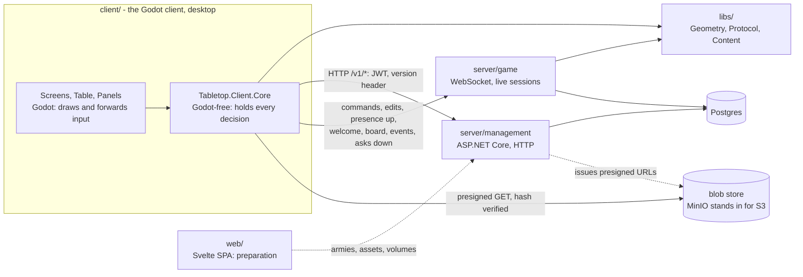

Management is the client's HTTP dependency and the only one it authenticates against: login, the
game list, create and join, armies, layouts, properties, the per-game asset manifest, and
presigned download URLs. Every request carries `Tabletop-Client-Version:
{ProtocolVersion.Current}`. A `426` is a screen of its own rather than a reported error, and
nothing else runs after it. The JWT lives five minutes. It is refreshed by `POST
/v1/auth/session/refresh` on a 60-second `Timer` owned by `Main`. `TryResumeAsync` at boot and
`RefreshAsync` on the timer share one in-flight request. Only a `401` signs out. A `426` sets `UpdateRequired`. Any other failure
keeps the token, in memory and on disk, and sets `_noRefreshBefore` one minute past the attempt's
start. `_authEpoch` is bumped by logout and by every login, and a refresh outcome from an older
epoch is dropped. Neither method throws. `LogoutAsync` always finishes locally.

The game server is the client's only source of game truth. One socket carries four kinds of
traffic: commands up and events down (logged), Asks down, presence both ways and discarded, and
edits that write the game's rows and the `table_state` draft without being logged. Edits are
accepted only while status is `lobby` or `setup`. The client opens the socket with the same
session JWT and a game id. There is no client-issued token and no management-to-game-server call.

The blob store is reached directly. Management issues a presigned GET and the bytes never pass
through it. The client verifies the SHA-256 of what arrives against the hash from the manifest,
and keys the on-disk cache by that hash. The same mesh in two games is one download, and a corrupt
or substituted body cannot enter the cache.

`Tabletop.Geometry` is shared with the game server so the two agree on distance, line of sight and
collision. The client runs it for a different reason: only the server's answer counts. Client
geometry is a prediction for responsiveness. A disagreement is resolved by resyncing, never by
reconciling. Bit-exact cross-platform determinism between the client's desktop build and the
server's Linux container is therefore not a requirement here.

Windows is the client's first export target and not its only possible one (`architecture.md` →
Deliverables). No design decision in this client depends on
Windows: `OS.GetUserDataDir()`, `res://` and `user://` are portable, and the remembered session is
a plain owner-only file rather than Windows data protection. The development machine is WSL with
the Godot editor on the Windows host, which is a fact about the current machine and carries no
platform commitment. Nothing is planned for the other platforms and no export preset for them
exists.

## Design

### Core and the Godot layer

`client/src/Core/**` is `Tabletop.Client.Core`: plain C# that may reference `Tabletop.Geometry`,
`Tabletop.Content`, `Tabletop.Protocol` and the BCL, and nothing else. `tests/Tabletop.Client.Tests`
compiles those files directly:

```xml
<Compile Include="../../client/src/Core/**/*.cs" LinkBase="Core" />
```

A Godot dependency in a `Core` file breaks the test project's build. There is no assembly boundary
to hide behind: the Godot SDK produces one assembly for `client/`, and a second project cannot
reference it without referencing Godot.

Above it sit three Godot namespaces with one job each. `Tabletop.Client.Screens` swaps scenes and
composes panels. `Tabletop.Client.Table` draws the world and reads the mouse.
`Tabletop.Client.Panels` are the controls the game screen assembles by status. They call into
`Core`, hold node references, and keep nothing that is not on screen.

Some things inside Godot cannot be tested by compiling. The spec asks for two scripted checks. The
plan implements four greps in `scripts/check-client`, each exiting non-zero on a hit:

| Check | Pattern | Why a grep |
| --- | --- | --- |
| No physics body in a scene | `type="(StaticBody3D\|RigidBody3D\|CharacterBody3D\|Area3D\|CollisionShape3D\|CollisionPolygon3D)"` over `client/scenes` | scene files are editor-owned data; nothing else reads them |
| No physics in a script | the same class names plus `PhysicsServer3D`, `PhysicsBody3D` over `client/src` | Godot physics would be an answer the rules depend on |
| No rules type in a script | `Tabletop.GameServer`, `IGameRules`, `GameRulesRegistry`, `IRulesEngine`, `EnforcementPolicy`, `LegalSetMembership`, `CommandDispatcher`, `Legality` | there is no compile-time barrier: both build in one solution |
| `Core` is Godot-free | `using Godot` under `client/src/Core` | belt and braces over the compile check |

The bare word `GameRules` is not matched. It is a string field on `GameInfo` and
`PropertiesSummary` that the Home screen displays. A denylist costs maintenance as the rules
engine grows type names. A reflective escape passes it, such as `ClassDB.Instantiate("StaticBody3D")`
or a scene loaded from `user://`. It is a tripwire, not a sandbox.

### Screens and the session object

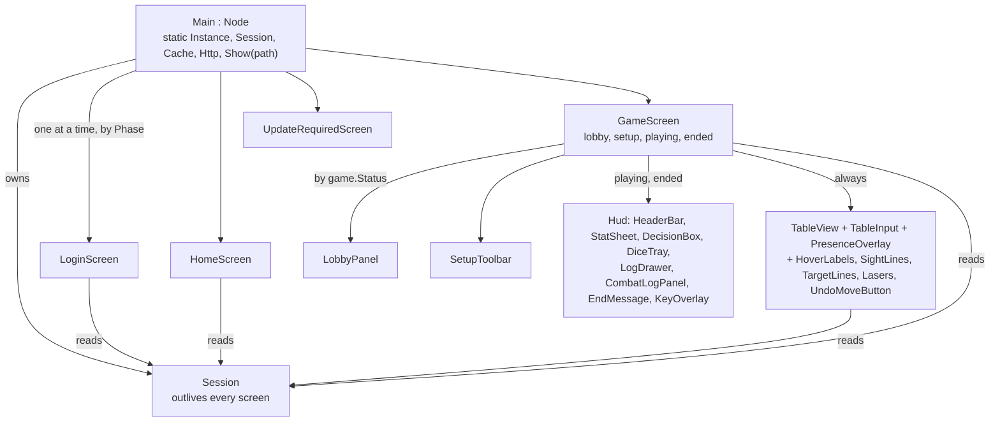

A status change happens inside the game screen. It is never a scene swap. `GameScreen` creates
one `TableView` and binds it once for the whole game, and a second `Bind` throws. It draws the
draft in `lobby` and `setup` and the projection's board from `playing` on.

`Main.Route` maps `Session.Phase` to a scene path and returns early when the path is unchanged, so
`Connecting → Connected → Reconnecting` all stay on `Game.tscn` and the table is not rebuilt.
The spec rejected two alternatives. One scene with panels toggled puts the game list and the table
in one tree for no reason. A scene per game status reloads the table on every status change, and
contradicts the server's view that lobby, setup and play are one connection.

`Session` is the single owner of everything that outlives a screen:

| Owns | Member |
| --- | --- |
| the management client and the JWT | `Management`, and `ManagementClient.Jwt` set by `Complete()` |
| the socket while one is open | private `_socket`, created through `IGameSocketFactory` |
| the projection | `Applier : EventApplier`, `Projection`, `Log` |
| the setup draft | `Draft : TableState?` |
| others' presence | `Others : PresenceTable` |
| the undo prediction | `_predicted`, `PendingUndoTo`, `_pendingUndoCommand` |
| reconnect and resync policy | `_attempt`, `_backoff`, `_userClosed`, `_welcomed`, `_desyncFloor` |
| local settings | `Settings`, persisted through the `persistSettings` delegate |

It raises eight events: `PhaseChanged`, `GameChanged`, `BoardChanged`, `EventsApplied`,
`PresenceChanged`, `Pinged`, `RefusedReceived`, `ConnectionLost`. Every one goes through
`IDispatcher.Post`. `GodotDispatcher` posts via `Callable.From(action).CallDeferred()`, so socket
frames arriving on the read loop's thread are handled on Godot's main thread.
`ImmediateDispatcher` runs them inline for tests. That seam and its two implementations are the
client's whole threading model.

One session object costs size: roughly forty public members across login, connection, projection
and presence. Accepted because the spec's structure requires a single owner, and because the type
is Godot-free and so the most heavily tested one in the client.

### The connection

`SessionPhase` is the client's whole connection state machine, and what `Main.Route` switches on.
There is no separate socket state for a screen to read.

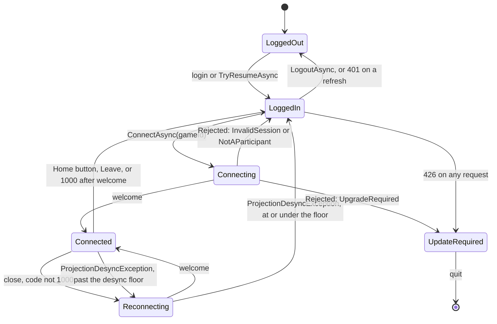

`UpdateRequired` is a sink: `ConnectAsync` returns immediately from it and every login path
rethrows after setting it.

The connect sequence, as the game server plan states it: `Connect` is the first frame and must
arrive inside a ten-second handshake window. The server answers `Welcome`, or `Rejected` followed
by a close. A `BoardMessage` follows from `setup` on. Then one or more `EventsMessage`s at
`playing`/`ended`, batched at up to 500 events, with an empty one when the log is empty. Then live
frames. A game that ended before setup ran has no board and no log, so `Welcome` is the whole
sequence.

`Session` sends nothing but `Connect` before `Welcome`, gated on `_welcomed`. Presence and pings
are dropped. `SendCommandAsync` and `SendEditAsync` throw `InvalidOperationException`. A failed
undo send clears its prediction.

Reconnect is connect. `ConnectAsync` calls `Reset()` before the first frame, discarding `Applier`,
`Draft`, `Game`, `ParticipantId`, the undo prediction and the presence table. Everything comes back
from `Welcome`/`BoardMessage`/`EventsMessage`. There is no delta resume and no catch-up from a
sequence number, so there is no divergence to detect. A reconnect re-downloads the whole log. In
exchange, first join, reconnect, crash recovery and a game migrating between server tasks are one
code path on both sides.

A reconnecting player rejoins their team. `MyTeamId` is derived, never picked or stored: it reads
`Game.Participants` for `ParticipantId`, and the server fills that from the participant's row,
which outlives the socket. So the `Welcome` that ends a reconnect names the team the previous one
named, and no client code re-picks a team or asks the player to (game flow → Teams are frozen at
the flip, and a team is a slot). `LobbyPanel`,
the only control that sends `PickTeam`, exists at `lobby` and `setup` only, which is where the
server accepts the edit. `MyTeamId` is
null in two unrelated states, and nothing may treat them alike: a spectator has a `Game` whose
participant row carries no team, while a client mid-reconnect has no `Game` at all. Both readers
return early on a null `Game`. `GameScreen.Rebuild` tears the team panels down and rebuilds them
from the `Welcome`, and `DecisionBox.Render` draws nothing. A returning player is therefore shown as
`Reconnecting…` and then as themselves, never as a watcher.

Reconnect policy lives in three fields:

| Close | Decision | Why |
| --- | --- | --- |
| any code, no `Welcome` yet, `GameId` set | reconnect with backoff 1, 2, 5, 10, 10… s | the game exists, the socket did not |
| code `1000` after a `Welcome` | do not reconnect; `Phase = LoggedIn` | the server closes a replaced socket that way, and reconnecting would fight the newer one |
| any `Rejected` | do not reconnect | the reason will not change by retrying |
| `DisconnectAsync` / `LeaveAsync` | do not reconnect | `_userClosed` |
| `1001` (server going away) | reconnect | drain-and-hydrate is the intended path |

`ConnectionLost(SocketClosed, bool willReconnect)` is what the game screen toasts. A desync raises
the same event with `SocketClosed.Error` carrying the `ProjectionDesyncException`, which is how the
toast tells a rebuild from a dropped socket.
`_welcomed && code == 1000` is the only signal that a socket was replaced, since no frame says so.
Any other server-side normal close after a welcome is read as a replacement. The inference stands,
because nothing on the wire distinguishes the two and a resync never reaches it: `TearDownSocket`
nulls `_socket` before closing it, and the `ReferenceEquals` guard then drops that socket's close.
The silence does not stand. `Session.LastCloseReason` survives the drop and the Home screen prints
it, so every close the player did not ask for arrives with a reason. A player-initiated
`ConnectAsync` clears it and so does `DisconnectAsync`, so Home explains only what the player did
not choose.

`Handle`'s switch has no default arm. A kind this client does not act on is dropped after a
successful deserialization, which is what `AtRest(long Seq)` gets. Nothing here waits for the server
to come to rest: every panel draws from the projection as events arrive, and the only busy state is
`Connecting`/`Reconnecting`, which `Welcome` ends. Acting on `AtRest` would add a second and weaker
source of truth for a settled table.

Each socket's handlers capture the socket instance and check `ReferenceEquals(socket, _socket)`
before touching state. A late frame or close from a replaced socket is dropped. That guard plus
`IDispatcher` is the entire concurrency design.

### The projection


Presence and the draft bypass the applier.

`Projection` is `Tabletop.Protocol`'s, built only by `EventApplier`. Applying is copying, never
deriving. Action sequences states that `step_completed` records everything it produced, so every
event carries the state changes it made and the applier has no rule to consult. That is why
`EventApplier` is shippable to a player's machine, and why the same applier serves the client, the
server's own hydrate and a future replay viewer.

The client adds three things around it:

1. `Session.Projection` is `_predicted ?? Applier?.Projection`. A pending undo prediction shadows
   the truth without replacing it.
2. `Session.Log` is `Applier.Log`: every event received, undone ones included. `CombatLogPanel` renders
   it through `CombatLog` with `EventApplier.EffectiveLog` to strike through undone ranges.
3. `Draft` is set from `BoardMessage.Board.Table` whenever status is `lobby` or `setup`. `Applier`
   is constructed from the board only when status is `playing` or `ended`. One frame kind, two
   destinations, chosen on `Game.Status`.

Undo is local first. `UndoToAsync(seq)` computes `Applier.ProjectTo(seq)`, a fresh projection of
the live log up to `seq`. It stores that in `_predicted`, records `PendingUndoTo` and the command
id, sends `Undo(seq)`, and raises `EventsApplied([])` so every panel redraws against the
prediction. The prediction clears on one of two frames: an `EventsMessage` containing an `Undone`
whose `ToSeq` equals `PendingUndoTo`, or a `Refused` whose `MessageId` equals the pending command
id. There is no rollback machinery and no reconciliation. On either answer the client shows
`Applier.Projection`, which is by then the server's truth.

The server wins in every case. A `models_moved` event snaps the piece to where the event says. The
client never withholds an answer on its own geometry, and never edits the log.

### Desync and resync

`EventApplier` indexes its dictionaries directly, so an event naming an id the projection does not
hold throws `ProjectionDesyncException` carrying the event kind and the unknown id. One designed
feature reaches it: editing the dice of a frame that has been popped. The client treats it as a fatal desync of its own copy rather than a change to skip, because
a client that silently diverges from the server is worse than one that visibly resets.

`Session` catches it at the two places that apply events: `Applier.ApplyAll` in the `EventsMessage`
arm, and `Applier.ProjectTo` in `UndoToAsync`. `ProjectTo` replays a prefix of a log the applier has
already applied in order, so it cannot fault where `ApplyAll` did not, and that catch holds the
invariant rather than a known case. Both route to `OnDesync`, which drops the projection, closes the
socket and connects again. The rebuild is the ordinary hydrate.

A resync reuses `Reconnecting` rather than taking a phase of its own. `Main.Route` maps a phase to a
scene path, and a resync must not swap the scene, so a new phase would mean a new arm in `Route` and
in every screen that switches on `Phase`, for a state that renders identically to a reconnect. It
does not reuse `OnClosed`, because there is no close to interpret: the socket is healthy and the
client is the one tearing it down. `ConnectAsync` gains a private `resync` parameter that forces
`Reconnecting` and carries the desync bookkeeping across `Reset()`. The public signature is
unchanged.

The resync is immediate and has no backoff. The reconnect backoff exists because a dropped socket is
usually transient and time fixes it. A desync is not transient, so the bound is on attempts.

The bound is one attempt per sequence position. `_desyncFloor` records `Projection.LastSeq` at the
moment of the fault. A later fault whose projection reached past the floor is a different bad event
and gets its own attempt. A fault at or before the floor is the same event replayed out of the
server's own log, which no further attempt can change. `LastSeq` only rises, so the number of
resyncs in one connection is bounded by the number of distinct fault positions and every resync
makes progress. A fixed retry count was rejected on both ends: too low and an unrelated fault an
hour later gets no attempt at all, too high and a hydrate split into 500-event batches loops on the
partial progress each batch makes. `_desyncFloor` is cleared by a player-initiated `ConnectAsync`,
so rejoining from Home buys one more attempt and one more explanation.

Reaching the bound sets `Phase = LoggedIn` with `LastCloseReason` and raises
`ConnectionLost(willReconnect: false)`, which is the outcome a `Rejected` already has. The bad event
is in the server's log, so the game is unplayable for every client until that log is repaired, and
Home with a reason is what the player can act on. The server has no equivalent recovery: applying
its own log is the last authority there, and the same exception faults the session.

`Reset()` is the whole discard, so a resync loses exactly what a reconnect loses.

| Invalidated | What becomes of it |
| --- | --- |
| the undo prediction | `ClearPrediction` drops `_predicted`, `PendingUndoTo` and the command id. The `Undone` or `Refused` that would have cleared it arrives on the replaced socket and is dropped by the `ReferenceEquals` guard. The rebuilt log says whether the undo committed |
| an in-flight command or edit | nothing is resent. It was accepted or refused before the socket closed, and its events are in the log the resync downloads. A `Refused` for it is lost, so a command refused at the moment of the fault leaves no toast and the piece stays where the rebuilt projection puts it |
| others' presence | `Others.Clear()`. Held placements and proposed ghosts vanish, and every piece snaps back to the projection |
| this client's presence | `SendPresenceAsync` no-ops while `_socket` is null. The server sends `PresenceEnded` for this participant when the old socket closes, so the other players see this one leave and come back |
| the selection, the ruler, an open menu, the setup toolbar's fields | held by Godot nodes and discarded when the hydrate redraws the table. The exit ghosts of a disembark go with them and are redrawn from the rebuilt Ask |

The player sees a toast and a table that blanks and repopulates: *The table fell out of step with the
server; rebuilding it from the log*. No dialog appears and nothing reaches Godot's error output,
because the catch is in `Session` and the socket read loop never sees the fault. The selection and a
pending undo are gone, which is the cost of the reset.

### Presence

`PresenceTable` is a dictionary keyed by participant with `Set`, `Remove`, `Of`, `All`, `Clear`.
Nothing in it is persisted, logged or replayed. `Reset()` clears it on every connect, and a
reconnecting client rebuilds it from nothing. Connectedness is not a field: who is connected is
which values exist. The server sends `PresenceEnded(participantId)` when a participant's last
socket closes.

Outgoing samples are sent at 20 Hz while something changed, by a `Timer` in `TableInput`, matching
the server's `PresenceRelayHz`. One `Presence` carries the cursor, the selection, the `held` or
`proposed` placements, and a measurement. The cursor is a world point plus the piece under it,
taken from the ray the client already casts to settle models. The selection is a unit id, plus
optionally the models within it. A ping is a separate one-shot `PingMessage` rather than a field,
because presence is state and a ping is an instant.

`PresenceOverlay` draws others' values in their team's colour: a cone at the cursor point with the
hovered piece highlighted, a line with a length for a measurement, a `held` placement by moving
that piece's own node, a `proposed` placement as a standalone translucent copy, a ruler for
another player's held placement, and a ping ring that fades over two seconds. The ruler is drawn
from the start position already in the local projection, so nothing new goes on the wire for it.
`Remove` reads what the overlay last drew rather than `Session.Others`, because the session has
already replaced the value by the time `PresenceChanged` fires.

### The table view


A piece is drawn as its hitbox first. `PieceNode.SetBody(Base, height)` builds the proxy
immediately: a `CylinderMesh`, `BoxMesh` or scaled cylinder for a circle, rect or oval base,
extruded to the model's height, translucent. `SetMesh` adds the loaded GLB scene as a child and
keeps the proxy beneath it at 25% alpha. Terrain does the same from its volumes, one proxy
`MeshInstance3D` per `Volume` with offset, yaw, scale and heights applied and coloured by
declaration. The asset library settled that "the proxy is not a stand-in for the mesh, it is the
thing the mesh was always only decorating". The base and height are what distance and line of
sight are measured against. A missing, deleted, still-downloading or hash-mismatched mesh costs
appearance and nothing else.

A model that is not `OnTable` has no node. `TableView.Redraw()` diffs
`Projection.Models.Values.Where(m => m.Location is OnTable)` against its node dictionary and frees
the node as soon as an event moves a model to the shelf or inside a container. `OnShelf` and
`Inside` carry no `Placement`, so there is no stale or default position to draw at. `PieceAt(id)`
returning null keeps the ruler, the log's click-highlight and the decision box's highlights correct
for an occupant.

The one exception lasts as long as one Ask. `ShowExitGhosts(modelIds, containerId)` puts one
`PieceNode` per occupant in a separate `_ghosts` child at the container's placement, so the player
has something to drag out. `Redraw` never touches that child. `ClearExitGhosts` frees them when
the answer is sent. The ghosts are a control surface, not state, and are not part of the
projection.

The other nodes: `SlabNode` draws the table at its real size, 1" thick, with its texture or a flat
colour. `MarkerNode` is a disc of the marker's diameter with a label. `ZoneNode` resolves
`ZoneStyles.Resolve(zone.Shape, size)` into flat `ArrayMesh` fans 0.02" above the slab, with no
frame conversion, and draws nothing plus a warning for an unknown shape id. `OrbitCamera` orbits
on the right button, pans on the middle, zooms on the wheel, snaps top-down on `Home` and drops to
table level on `End`, giving the placement and line-of-sight views the spec asks for.

Godot physics is not used. Picking is a ray tested against `TableView.Pieces` AABBs and the slab
plane (`Plane(Vector3.Up, 0).IntersectsRay`). A drag is `DragBodies` (`HeldBody`, `Stationary`, `Walls`, `Models`, `Piece`) through
`Collision.Separate`, which slides each model along the walls and other bases and rests it; Alt places freely, and
the server judges the landing. Distance is
`Distance.ClosestPoints`. The engine is never asked a question the rules depend on, so there is no
second geometry implementation to diverge from the server's and no collision layer to configure.
`WorldFrame` is the only place the two coordinate systems meet: `x = X`, `y = Z`, `z = −Y`,
`rotation.y = yaw` in radians. Nothing else converts. The wire frame and `Tabletop.Geometry`'s
frame are the same frame (geometry plan → Global Constraints), so there is no conversion layer.

### Mesh loading and the content-addressed cache

Two types, split along the Godot line. `AssetCache` in `Core/` is Godot-free and handles the
bytes. `PathFor(hash)` is `{root}/{hash}.bin`. `Has(hash)` is a file check.
`FetchAsync(hash, url, ct)` downloads to a `.part` file, verifies `Sha256Hex` against the expected
hash, and moves it into place. On a mismatch it deletes the part and throws
`HashMismatchException(expected, actual)`. A second call for a cached hash never touches the
network. `MeshLoader` in `Table/` does the engine work: it holds the per-game `Manifest`, resolves
an asset id to a `ManifestEntry`, calls the cache, then runs `GltfDocument.AppendFromFile` +
`GenerateScene` on the main thread, and applies the asset's `Scale` and `Orientation` in `Orient`.

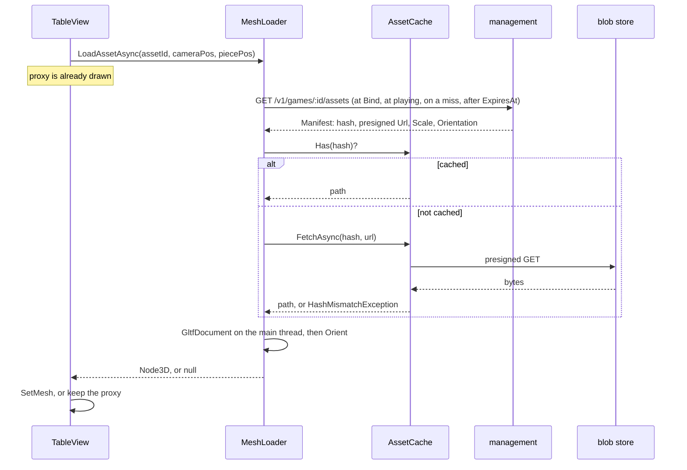

Loading is background and every failure degrades to the proxy.

The manifest is fetched at `Bind`. `TableView` fetches it again when status becomes `playing`,
because every army is in by then. `LoadAssetAsync` fetches it once more on an asset id it does not
list, and before any lookup at or after `Manifest.ExpiresAt`. Concurrent fetches join the one in
flight.

The hash is the cache key, so the same mesh in two games, or used by two participants, is one
download per machine. Ordering is by distance to the camera at request time, through a priority
queue with two downloads in flight. `Pump` dequeues whichever waiting item is nearest, not the one
it was called for, so a camera move lets later-requested nearer pieces overtake. Nothing goes
through Godot's editor import: `.glb` files never appear in the project, only in `user://cache/`,
which is why an asset can arrive mid-game. Built-in content is the other half of that split: it
ships inside the build and loads from `res://content/builtin/`, read out of the export's `.pck`
with no hash, no manifest entry, no presigned URL and no cache write. Adding a built-in means
shipping a new client build.

`MeshLoader.Orient` is the only place the mesh convention is written on the client. It must change
together with the web app's `toWorld`/`eulerFor` if the convention ever does. Another
participant's asset is reachable only through the manifest, because `GET /v1/assets/{id}` is
owner-only. An own asset not yet in the manifest goes through `GetDownload` instead, such as a
texture or a library terrain being added in setup.

### Input, presence and a drag

A drag streams `held` presence while the piece moves, and sends one command on release.

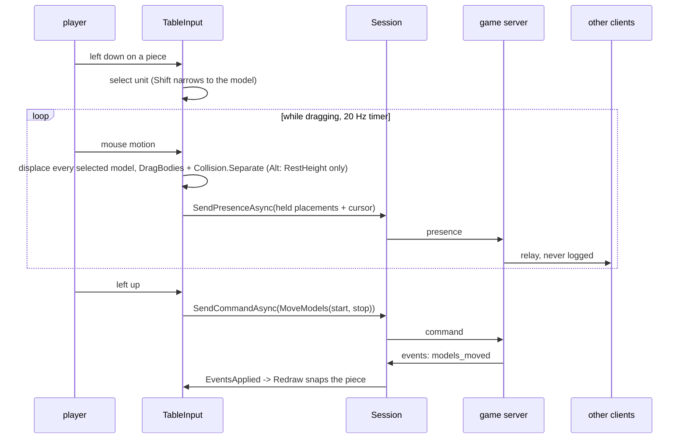

Persistence and the log see one write per drop, not one per frame.

Selection is presence and never a command. Clicking a unit does not activate it. During setup the
same click may select a terrain placement or a marker, and the drop sends the matching setup edit
(`MoveTerrain`, `MoveSetupMarker`) instead of a command. A token dropped in play sends
`MoveMarker`, as does an unlocked setup objective dropped in play: its first `MarkerMoved` copies it
into `Projection.Markers`, which `TableView` draws over the board row. Those four release paths are the
only difference between a setup drag and a play drag. In play a terrain drag starts and sends nothing on
release, so the piece snaps back. Objective markers are locked from play on (`MarkerLocks`): a drag on a
locked objective does not start under any enforcement setting, the marker menu's Unlock and Lock items
toggle it, and the state is local to the client. A setup marker is never removable.

A plain drag of a model outside a move step is a hand move: one `MoveModels` on release, which never ends a turn.
The server judges it under the game's enforcement setting (`HandMoves.Judge`, rule `hand_move`): placing the unit
picked at a deploy Ask from the shelf is legal, and anything else is a breach that `silent` accepts, `warn` accepts
with the warning on the event, and `strict` refuses. Under `strict` the drag does not start and the click only
selects. The drag slides along impassable terrain and stops at other models' bases (`DragBodies`, `Collision.Separate`); holding Alt
places freely, and the F1 overlay and the move hint say so. A placement that overlaps another base is `move_overlap` under the
same setting. A drag arms after 6 px, so a click never moves anything. The declared move and the deployment placement
belong to the decision box: while one is open it fills `TableInput.Proposing`, the same drag streams `proposed`
ghosts, the release sends nothing, and Enter commits. On a `Stoppable` move Ask, C (**Stop here**) sends the same ghosts
with `Destinations.Continues`: the move goes on after the before-attacking window. While a unit is held, 1–5 arrange it in that many rows about
the cursor (`Formation.Arrange`), the rows across the screen as the camera sees it, and Q/E turn them 15°.

A click selects a unit and Shift+click one model; a click on empty table or Esc clears. While a decision wants a
pick (`TableInput.Eligible`), a click on an eligible piece answers through `TargetClicked` or `ModelClicked` and
neither selects nor drags. Under an Options Ask only a piece exactly one choice names is eligible
(`DecisionView.ClickAnswers`); a unit several choices name (activate: one option per unit and action) glows, a click
selects it as any click does, and the decision box narrows to its options renumbered from 1 (`DecisionView.ChoicesOf`,
`Number`) until another unit is clicked or Esc widens it. Tab and Shift+Tab select my next unit with no action this round and centre the camera on
it; Space centres the active unit. Keys go through `Hotkeys.Of`; the table acts on its own and raises
`IntentPressed` for the rest. `M` toggles the measure
tool: two clicks on pieces, or one press-and-drag, resolved through `Distance.ClosestPoints` and
relayed as a `Measurement`; Ctrl held does the same while held, and letting go clears the measurement here and in presence.
Between the first point and the second the line follows the cursor and is relayed as it moves. A base of diameter zero stands in for a bare table point, so
piece-to-point is the same edge-to-edge call. `P` pings at the cursor. `PickNextPiece` and
`PickNextPoint` let the menu borrow the next click for a `PieceId` or `TablePoint` item. Deployment placement has its
own standing slot, `PlacementPoint`, which the decision box sets and clears; a menu pick armed meanwhile takes the next
click first, and the placement keeps waiting for the one after.

`TableInput` draws no ruler for a piece with no placement. `Drag.Starts` resolves a model that is
`Inside` a container to the container's placement rather than `(0,0,0)`. An occupant has no table
position of its own and disembarks relative to the container. The same holds for other
participants: `PresenceOverlay.StartOf` returns null for an occupant.

### The ruler and the movement region

`MoveRuler` is Godot-free and holds the client's cosmetic geometry. Four functions:

| Member | What it answers |
| --- | --- |
| `Read(start, current, allowance)` | `RulerReadout(Distance, Remaining, OverAllowance)`: the base's displacement from where it started, which is how page 7 measures: *"no part of their bases move further than the total movement distance"* |
| `UsedInFrame(Frame, modelId)` | distance already spent this activation, read out of the frame, so the readout and the region shrink after a mid-move checkpoint such as a cast |
| `Region(PlacedModel start, MoveRegion, volumes, TableSize)` | the boundary from `Movement.Region`, resolving `ImpassableVolumeIds` and `DifficultVolumeIds` against the board's volumes and passing `DifficultCap` through |
| `ExitRegion(ModelBody, PlacedModel container, MoveRegion, volumes, TableSize)` | the disembark boundary: every placement `Containment.BaseFullyWithin(candidate, container, ExitWithin)` admits |

Every input to the region comes from the server. The Ask's `MoveRegion` carries the allowance, the
impassable and difficult volume ids and the difficult cap. The client renders the consequence and
the server re-decides every answer. Drawing a region the server offered is not a legality check. A `MinDistance` (an
Aircraft's 30", held to `Movement.FarthestOnTable`, `MoveRuler.Minimum`) cuts the drawn region to the ring beyond it
(`MoveRuler.Inner`), and a model dragged short of it shows red like one past the allowance.
Under `strict` the server checks `LegalSetMembership.Contains` and `IGameRules.AnswerBreach` (p.11's cap holds every
model once any one enters difficult ground; an Aircraft moves at least `MinDistance`), and for a disembark `GfMoves.ExitPlacement` re-checks every model. A ghost dropped outside the drawn region still commits.

`Region` cannot serve a disembark, so there are two functions. When `Containment.ExitingId` is
non-null the unit is inside the container and its models have no `Placement`. There is no start to
sweep rays from, so `Movement.Region` is meaningless. `Allowance` on such an Ask is the action's
remaining distance and says nothing about where an occupant may be placed. `IsDisembark(legal)` is
that test. `ExitRegion` answers instead, as a boundary rather than a predicate, so
`MoveRegionNode` draws it unchanged: `Movement.Rays` rays out of the container's base centre, each
marched outward in `Movement.Step` increments and bisected eight times at the first refusal. That
is the loop shape `Movement.Region` uses, and it stops a ring of impassable terrain from
re-admitting placements beyond it. A candidate is also refused for leaving the slab or touching an
impassable volume by asking `Movement.Check(candidate, its own centre, 0, impassable, [], null,
size)`. Distance zero makes `Check` sample exactly that placement. No new geometry primitive is
added. The cost is that the client reimplements a march-and-bisect loop the library already
contains for the non-containment case.

The region is drawn for one body, the lead model's `ModelIds[0]`. A unit with mixed base sizes
sees the lead's boundary, and the server refuses outliers individually. **A disembarking model
takes any facing that fits**: p.7 says *"Models may move and turn in any direction regardless of
their facing"*, and a unit exits by using an ordinary move action, so a placement is legal if some
facing fits. `Admits` therefore tries `MoveRuler.ExitYaws` facings for a non-circular base and the
drawn region is the union over those that fit; a circular base is yaw-invariant and tries one, which
is every ordinary infantry model and so the whole common case. `MoveRuler.ExitYawAt` runs the same
search for the answer, so what the decision box sends is a placement `GfMoves.ExitPlacement` accepts. The
server checks the proposed placement rather than imposing a facing, so the facing search lives only
on the client.

### The play screen

From `playing` on the side panel goes and the table fills the window (in-game UX spec → Layout). `GameScreen`
keeps the side panel, the team panels and the selection line for lobby and setup. An overlay `Control` added after the
table carries Home, the status and the toast in every status, and in play `GameScreen.Play` adds the Hud to it: each
part a control in `client/src/Hud/` with `Bind(Session, TableView, TableInput)`, drawing a Godot-free model.

| Part | Where | Draws |
| --- | --- | --- |
| `HeaderBar` | top centre | `HeaderView`: round, turn, scores; the active unit, its action and the step strip from the action frame's `Outline`; the waiting line; "Game over" with the result. A team name's right-click opens the team menu |
| `StatSheet` | lower left | *Stats* (`UnitSheet`: weapons, rules with their `rule_text`, *not automated* for a rule with no catalog entry or a `played: false` one, the models strip from `ModelFacts`) and *This round* (`RoundHistory`), for the unit `SheetFocus` names |
| `DecisionBox` | bottom centre | the first open Ask addressed to me (below) |
| `DiceTray` | above the decision box | the latest roll as the combat log's collapsed entry; a click opens the log there |
| `LogDrawer` | lower right | `CombatLogPanel`: activation blocks, roll entries, filters All/Rolls/My units/This unit; 640 px; the Animate toggle until the Settings dialog; G opens it |
| `EndMessage` | centre | the result, the reason and the scores once `game_ended` lands |
| `KeyOverlay` | centre | every hotkey; F1 or ? |

The table overlays are children of the `TableView`. `HoverLabels`: the hovered unit's name in its team colour, the
edge-to-edge distance from my selected unit with a line between the two closest bases (`HoverView`), wounds left over
each multi-wound model, the Shift tag. `SightLines`: the server's `SightAnswer` while L is held over a unit, or while a
target assignment is open; green clear, amber screened, red blocked with the blocker lit, a summary over the target
(`SightSummary`: models that see it, clear lines screened, and under a target pick how many can shoot; never a cover
verdict, which is the rules'), and under a target pick the models that cannot shoot the hovered target or their group's
assigned one dimmed, each assigned target asked about in its own query. Each query's id is made before the send, so
only the newest query's answer is drawn. `TargetLines`: each assigned weapon group's shooters to
its target, one colour per target. `Lasers`: `Session.Fired` drawn for one second, a beam with bolts in the shooter's team
colour from each shooter to the nearest model of its target. `Session` applies a batch one event at a time and, after each
`SequenceStarted`, reads `ShotLines.Of`: an `attack-sequence` frame just pushed under a `shooting` frame, its shooters the actor's
models on the table carrying one of the frame's weapons, read while the targets still stand. `UndoMoveButton`, in a canvas layer of the table's viewport: beside my last hand
move until any later event lands (`HandMoveUndo`), undoing to the last effective-log event below the move.

The Hud parts take keys in `_Input`, which runs before the `SubViewportContainer` hands a key to the table's
viewport, and leave the digits and Esc to the table while a drag is in hand. Hud buttons give the GUI focus straight
back, so Space never presses one. Max wounds, who can shoot and sight come from the server; the client names no
rule.

### The decision box

One box, bottom centre over the table, rendering whatever Ask is currently addressed to the player's
team through `DecisionView`, with the keys that apply in a hint line under it; with nothing addressed to me it
shows the waiting line. It keys on the legal set, never on the question name, so a new ruleset question needs no new
branch.

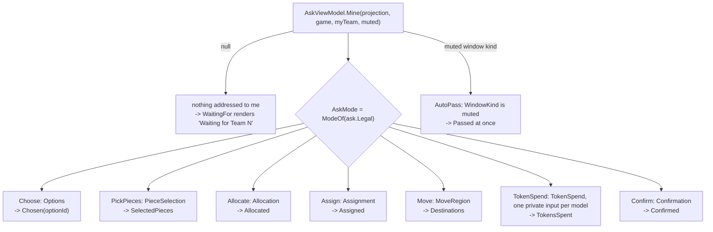

`ConfirmLabel` is the only place a question name is read.

`AskViewModel.Mine` picks the first open Ask whose `Teams` contains my team and whose `Answers`
does not. It returns null for a watcher, since a participant with no team is never addressed. It
also computes `Highlights` and `AnsweredTeams`, so the box's choices and the table's highlights
come from one place. `Highlights` is the pieces the legal set names, plus any `Enterable` container
and the container being exited, and less any spender model that is not my team's. Asks addressed to
other teams render as a waiting indicator naming the team, never as controls.

The `myTeam` argument is `Session.MyTeamId`, so a player who reconnects in the middle of an open
Ask is addressed by it again as soon as the `Welcome` lands, with the same controls a player who
never dropped is looking at. `Render` returns early while `Game` is null, so a reconnect never
reaches `Mine` with a null team and a returning player is never rendered as a watcher.

Behaviour the specs demand, and where it lives:

- Any team member may answer, and the box shows who did. `AnsweredBy` reads the last
  `AskAnswered` for that ask id and names its actor.
- Mutes auto-pass. A `WindowKind` in `ClientSettings.MutedWindowKinds` with `AllowPass` set sends
  `Passed` at once and shows "auto-passed (muted: {kind})" with an Unmute link. The pass is logged
  as that player's own. It is a client convenience, not part of the model.
- The simultaneous token spend renders as one private input per eligible model (p.13). The box
  shows who has answered without showing what, then reveals every answer at once from
  `ask_closed`. This is the only consumer of the server's per-player filtered streams.
- A `Confirmation` Ask is its question and one button that Enter presses, labelled by `ConfirmLabel`:
  "End the round" for the scheduler's `end_round` Ask, "Continue" for the interpreter's step gate. The step gate
  (`WaitsBetweenSteps`) is a development flag: neither the create-game form nor the lobby offers it, both send
  `false`, and players never meet it.
- A refusal shows in the box as an orange line. A `Refused` whose `MessageId` matches the box's last
  command prints "The server refused: {detail}".

The round boundary has no control of its own. The scheduler stops at the boundary with one unframed
`Confirmation` addressed to every team that has a participant, and the box renders it as it
stands: `Highlights` is empty, `AutoPass` cannot fire because there is no `WindowKind`, and there
is no Pass button. Whoever answers first ends the round. Every other player's box is replaced by
the next round's turn Ask on the same `EventsApplied` tick. A second control would be a second path
to the same command, and the menu already has *Set the round* for a player who wants to jump.

Two ruleset question names arrive carrying a `move_region`: `move` from the move step of
hold/advance/rush/charge, and `disembark` from `transport-destroyed`'s place step. Neither belongs
in `AskQuestions`. A disembark is the same `RenderMove` with three things swapped:

| | ordinary move | disembark (`Containment.ExitingId` set) |
| --- | --- | --- |
| region | `MoveRuler.Region` from the start placement | `MoveRuler.ExitRegion` about the container's base |
| draggable node | the model's own `PieceNode` | `TableView.ShowExitGhosts` on the container's node |
| `TableInput.Allowance` | `Allowance − UsedInFrame` | `null` |
| ruler | start to current, with remaining allowance | container to current, distance only |
| `ModelRelocation.From` | the model's `OnTable` | the model's `Inside`, passed through |
| yaw | the model's own | whatever fits at the drop point, through `YawOf` → `MoveRuler.ExitYawAt` |

Embarking answers with the unit, not the model: one `ModelRelocation` per model of the unit, all to
the same `Inside(container)`. P.14 embarks the whole unit when one model reaches the transport.
There is no partial embark and no per-reaching-model answer. An offered container is a click target
rather than a button. `Highlights` already highlights it, and a button per container would be a
second control for the same command.

### A spend over models and a pick of one model

Both put models where the box would otherwise hold one number and one unit.

A team's spell token spend is `TokenSpend(IReadOnlyDictionary<Guid,int> MaxByModel)`, `Sealed`,
with a pass, answered by `TokensSpent(IReadOnlyDictionary<Guid,int> Counts)` (p.13: *"Models within
18\" in line of sight of the caster's unit may spend any number of spell tokens at the same time
before rolling"*). Eligibility is the engine's: on the table, holding tokens, within 18" and in
line of sight of the caster's unit, the caster itself included. `AskMode.TokenSpend` keeps its own
control rather than borrowing the allocation widget, for two reasons in the shape itself. An
allocation is one total split exactly across its targets, and a spend has no total to split: p.13
allows any number up to each model's own holding, so spending one token of a possible five is a
legal answer that an allocation would reject. And an allocation carries a single amount with no
per-target bound, while five tokens across two models holding one and four is a different legal set
from five across two holding three and two. So the box renders one private `SpinBox` per entry of
`MaxByModel`, prefixed with the model's name and bounded by that model's own value, and no total
appears anywhere. The team's maximum is the sum of its own entries and is never rendered as a
constraint. The map covers every addressed team's models at once, which discloses
nothing a client does not already hold: `ModelInPlay.SpellTokens` is in every projection. It has to
cover both, because the window addresses both teams. P.13 gives the caster's side +1 and the other
side -1 per token, so the map necessarily names models this player may not spend.
`AskViewModel.SpendableBy(projection, game, myTeam, legal)` narrows it to the models whose unit
belongs to my own team, and both the spin boxes and `Highlights` come from that. A model the
projection cannot resolve to a team is not mine. The question name `spend_tokens` and the `casting`
window kind are unchanged, so the mute path, `AnsweredTeams` and the `ask_closed` reveal are the
ones already described.

A Takedown group's target is a `PieceSelection` over the model ids of one target unit, `Min` and
`Max` both 1, addressed to the attacking team (p.14: *"each model with Takedown may pick any model in
the target unit as its individual target"*). The wound goes to the model it names rather than
through the defender's allocation. Nothing on the wire changed for it. Two things follow for the
table. `Highlights` is that model list, and `TableView.PieceAt` takes a model id already, so the
highlight lands on the models rather than on the unit. And a left click still selects the model's
unit, because that is what a bare click means everywhere else in the client, so the box answers
from `TableInput.PieceLeftClicked`, which carries the clicked piece's own id and therefore a model,
rather than from `Selected`. The box calls `TableInput.CancelDrag()` on a click it consumed, so
answering an Ask is never also a drag. That matters most here, because the eligible models are the
other team's, and a stray click would otherwise start a hand move of the unit being shot at.
Shift-click, which narrows the selection to one model, is not needed to answer and does no harm.
Where the pick is one model the counter reads that model's name instead of a tally, and the model
is marked on the table. A wound landing on a particular model is worth reading back before "Done".

Both rulings land in the log through `LogText.Answer(answer, names)`, which takes a `Names` so it
can name pieces: a `TokensSpent` reads *"spent 3 tokens"* followed by each spending model and its
count, and a one-piece `SelectedPieces` reads *"picked"* followed by that model's unit and slot
name. `AskAnswered` and `AskClosed` both render through it, so an unsealed pick reads on the line
that answered it and a sealed spend reads on the line that closed it. `LogText.Touched` names the
pieces an answer carries, so clicking either row highlights the models that spent and the model that was
picked.

### The combat log

`CombatLog` builds the play log from `Session.Log`, and `CombatLogPanel` renders it, newest at the bottom, auto-scrolled. A
block (`ActivationBlock`) opens at the first `SequenceStarted` with `Context.Action` while none is open. It closes at that
frame's live `SequenceFinished` or `SequenceAbandoned` (a dead one stays inside the block, struck through) or at an `Undone`
whose `ToSeq` is before its start. Inside a block each event is a `LineEntry`, `LogText.Describe(event, names)` with a `Names`
context that resolves participants, teams, units, weapons, models and markers, degrading an unknown id to its first eight
characters. A step's rolls are one `RollEntry`: the roll's name, its threshold with its basis (the stat, the printed value and
each change), the dice, the result (`passed`/`failed` for one die, else `{successes} {roll}s`) and the chain's parts
(`{k} model(s) wounded`, `{k} model(s) removed`, each condition set or cleared). The chain's "wounded" leaves out a model the
same step sends to the shelf; that model counts as removed. A reroll, a set die or an added modifier attaches to the entry it
amends as a `RollAmendment`. `EventApplier.EffectiveLog` decides which entries are struck through, so an undone range stays
visible. Presence never appears in the log.

Filters are All, Rolls, My units and This unit; the last two keep blocks and roll entries whose actor or a target matches. The
filter and the open state persist in `ClientSettings` (`LogFilter`, `LogOpen`). The panel lives in `LogDrawer`, 640 px wide, a
button lower right that G or a click opens upward; the Animate toggle is in it until the Settings dialog. Clicking an entry
highlights `LogText.Touched(event)`. "Undo to here" on a row calls `UndoToAsync(seq)` and greys every row above the target
until `PendingUndoTo` clears. The other undo affordance is **Undo move** after a hand move (*The play screen*). There is no
undo stack UI and no redo. Undo is replay to a sequence number rather than inverse events, so the log serves as the control.
`LogPanel` (one row per event) has no caller.

A roll entry also offers "Reroll all" (`RerollDice(frame, roll, [])`), "Set die 1…" (`SetDice`) and "+1" (`AddModifier`) for
the roll it shows. Players roll their own dice and every roll result is editable.

### The right-click menu

The menu is where every property is editable. It has no admin mode and no confirmation dialog.
`MenuModel` is Godot-free and returns `MenuItem(Label, MenuInput, Func<string?, Command?> Build)`
lists. `PieceMenu` is the `PopupMenu` that shows them. It pops a one-field dialog for an `Integer`
or `Text` item, borrows the next click for a `PieceId` or `TablePoint` item, and sends whatever
`Build` returns through `SendCommandAsync`.

| Wiring | Items |
| --- | --- |
| right-click a model | `ForModel` + `ForFrame`: wounds, conditions, spell tokens, shelf, container, place here |
| Shift-right-click a model | `ForUnit`: mark as having taken an action, clear the action record, conditions, grants, wounds-this-activation |
| right-click a marker | `ForMarker`: remove a play marker, give an objective to a team or make it neutral; in play, Unlock or Lock an objective (local, `MarkerLocks`) |
| right-click a team name in the header | `ForTeam` + `OffTable`: score, set the active team, set the round, and one place-here item per shelf or container model of that team |
| Alt-right-click the table | drop a token here, leave the game |

Each item is one ordinary command, logged with the actor, through the same path automation uses.
There is no dialog because the log is the accountability. An edit visible to every opponent and
permanently recorded does not need a confirmation step. Menu edits are accepted under every
enforcement setting, since they are the override path.

`ForFrame`'s `MenuInput.TablePoint` item ("Place on the table, here" / "Take out of the container,
here") is the manual containment path beside the Ask-driven one. A model off the table has no node
to right-click, so `OffTable` offers the same item from its team's menu, through the shared
`BackOnTable` builder and `Names.TeamOfModel`. That item is the only path when no Ask is
open: a transport deploying with units inside (p.14), a correction after a misclick, or a group
playing under `warn`/`silent`. `KnownActionNames` exists because the pinned `Properties`' action
rows never reach the client. The menu offers the names it has seen, meaning the actions recorded
in the log and on the units, plus free text. The activate Ask's option labels
(`"{unit name}: {action}"`) are display text and are not parsed.

### Setup: the lobby panel, the toolbar, built-in content and the generators

Lobby and setup are panels inside the game screen, driven by `game.Status`. Everything they do is
an `Edit`, not a `Command`: a third message kind, applied to the game's rows or the `table_state`
draft, broadcast, persisted, never logged. Editing is free for all, with no per-team permission and
no turn. Two people dragging the same piece is settled by whoever drops last, and each sees the
other's drag through presence. The server answers every setup edit with a `BoardMessage` carrying
the whole draft, and every lobby edit with a `GameInfoMessage`. The client has no local merge to do.

`LobbyPanel` covers the six lobby edits: `CreateTeam`, `PickTeam` (with `null` meaning watch),
`PickArmy`, `SetConfiguration` pre-filled with the current values, and, for the creator only,
`StartSetup` and `EndSetup`. The creator's two buttons are absent for anyone else. A forged edit is
refused with `NotPermitted`, so the UI is a convenience over a server rule rather than the rule
itself. The "End setup" button notes how many placements are still off the slab, because the
end-setup command deletes those rows before flipping.

`SetupToolbar` covers the fourteen setup edits: table size and texture; add built-in terrain, add
library terrain (`ListAssets(Terrain)` → `GetAssetVolumes` → `AddTerrain` with `VisualRef.OfAsset`),
move, scale, remove, swap mesh, override volumes and reset volumes; add and remove markers; set the
zone style (sending `ZoneStyles.ShapesOf(style)` as `SetZoneStyle.Shapes`) and swap two ordinals'
zones; load a layout (`GET /v1/layouts/{id}` then `ReplaceDraft`) and save one
(`POST /v1/layouts` from the client's own copy of the draft). Layouts stay management's. The game
server never writes an owner-side row.

`BuiltinContent` ships with the client: 35 terrain names with their `Volume` and declarations, five
textures, two marker visuals, and the zone style ids. A minimal art set ships with it, so that a
generated table looks like a table.

The art is sixteen files, not fifty. The 35 pieces group into eleven meshes that differ only by
footprint, height, scale and yaw: `hill` (4 pieces, round), `hill-rect` (2, square), `woods` (5), `ruins` (4), `building` (3),
`wall` (2), `rock` (2), `field` (2), `water` (5), `pad` (5, every flat ground hazard including the
crater), `haze` (1, the toxic smog). Each of the eleven is glTF 2.0 binary, under 2000 triangles, one
colour-only material, and authored glTF Y-up in a unit box: the footprint on x and z in [−0.5, 0.5], the height on
y in [0, 1], base at y = 0. `BuiltinContent.MeshOrientation` (pitch 90) reads it into the table frame, z up, the value
the web app writes for a Y-up asset, and `MeshLoader.LoadBuiltin` scales that box onto the placement's first
volume, so `water` serves both a 4"-radius lake and a 3"×12" river. The five table textures are
seamless 1024×1024 PNGs, authored as a 12"×12" tile because `SlabNode.Set` derives `Uv1Scale` from
`width/12`. Markers and zones need no art: `MarkerNode` builds a disc and a `Label3D`, `ZoneNode`
builds `ArrayMesh` fans from `ZoneStyles.Resolve`.

These files are art and no code produces them. Every mesh file is still optional, and a missing one
still draws the hitbox: `LoadBuiltin` returns null and `TerrainNode` keeps its per-volume proxy
visible, the same degrade path as a missing asset, and a missing texture leaves the slab its flat
colour. That path is the fallback rather than the plan, kept rather than deleted, so a build with
no `content/builtin/` at all still renders a playable table. For a built-in placement the placement's volume rows are
the volumes rather than overrides, because there is no `asset_volume` row to fall through to. They
are always written on add, and "reset" re-copies the shipped ones.

`TerrainGenerators` implements the rulebook's four planet tables (GF p.18–19) as
`Generate(Planet, TableSize, Random)`: nine fixed pieces plus 4D3 rolled on 2D6. They are returned
as a batch of `AddTerrain` edits placed off the slab beside the long edge at `x = width + 4`, in
rows 8" apart, for players to drag on. The client rolls, because nothing in setup is logged and no
seeded RNG is owed. An entry naming alternatives ("Hill, Forest, or Field") is resolved by that
same RNG, so rolling a table produces a finished board in one action; a player
who dislikes a piece swaps its mesh or deletes it, which the toolbar already offers. The tables ship with the client and the server never reads them, which keeps
the game server ruleset-blind during setup. 40k has no such tables. Declarations follow the tables
literally. Conditional clauses ("dangerous when using Rush or Charge", "units on top may ignore one
unit for line of sight") go in `Notes` and are never flags. The engine reads a closed set of six
and carries the rest as text nobody interprets.

Zones are drawn for every ordinal during setup, in the team's colour when a team with that ordinal
exists and grey otherwise, so a group can see and swap zones before every team has formed. From
`playing` on, only zones with a team are drawn, through round 0 (deployment and the phases before the first round),
and none from round 1 (`TableView.ZonesShown`). A new game's draft starts with the Frontline style's zones
(`GameSession.NewDraft`); setup may set another style.

### Animation

`AnimationQueue` sits between the projection and the renderer and does nothing else. The projection
applies an event the moment it arrives. Whether the table then plays it out is the player's own
`Animate` setting in `ClientSettings`. It is presentation only, so it is not on the game row. The
game's `waits_between_steps` is on the game row, because it changes what the server does.

`Take(animate)` returns everything at once when animating is off, and one event at a time when it
is on. `Animator` tweens a `ModelsMoved` over 0.4 s, shows a roll as a transient `Label3D`
over the actor unit for 1.5 s, then pumps the next. The queue may lag the projection and never
delays an Ask. A player may answer while a roll's readout is still up, because the decision box reads
the projection directly and the queue holds no lock. Presence is never animated, only drawn.

A roll is a readout and not an object. The label carries the roll's name, its
threshold, the faces with the passing dice in brackets, and each modifier by source, all of which
`RollRecord` already holds. The dice tray and the combat log show the same roll as a
`RollEntry`; with Animate on the tray's dice tumble for 0.4 s. No die is placed on the table.

**A step may carry several rolls, and the readout carries all of them**, one block each, stacked.
`StepCompleted.Rolls` is a list, and the ruleset fills it with more than one wherever it splits a
roll: OPR's `roll-to-hit` takes one pool per Quality value the attacking models bring, since
rulebook p.4 tests each attack against *"the model's Quality value"* and a joined hero brings its
own. Each block's threshold is what tells the pools apart. The combat log's roll entries follow the
same list: one `RollEntry` per `RollRecord`, with "Reroll all" and "Set die 1…" naming a `RollRecord` by id, while "+1"
(`AddModifier`) names a roll by name. Godot physics is out
of the scene, so a die on the table would be a canned animation of a result the server has already
decided, and the readout says more than a tumbling die can. The client shell spec → Animation says
the same.

## Key decisions

Contested or re-decided:

| Decision | Reason | Alternative rejected | Source |
| --- | --- | --- | --- |
| No social login. Email plus password, or email one-time code, on the client's own login screen | both methods are Basic-auth calls to Stytch through management and need no page to redirect back to | loopback listener and device code, both twice deferred by accounts and the web app to serve Google sign-in and magic links; neither method is wanted | client shell → No social login |
| Enforcement is three positions, `strict` refuses, and the decision box says so | action sequences and the scheduler both specify a refusing mode | identity and enumerations' boolean (warn or silent, never block) | whole-design review ruling 1 |
| Menu edits are accepted under every enforcement setting | they are the override path, visible to opponents and recorded with an actor | refusing them under `strict`, which would leave no way to fix a mistake | whole-design review ruling 1 |
| Animation is the player's setting, waiting is the game's | animation is presentation only; waiting changes what the server does and what the log records | resolution's "both set at game setup", with no column for either | whole-design review ruling 3 |
| One game screen for four statuses | all four are one socket and one hydrate path, and a status change happens inside the screen | a scene per status, which reloads the table on every change; one scene with panels toggled, which puts the game list and the table in one tree | client shell → Structure |
| Presence is relayed: measurements and ghosts go on the wire | a tape measure on a real table is visible to everyone at it; hidden pre-measuring is a different game | computing them locally and sending nothing | presence → What this corrects in `architecture.md` |
| Setup edits are a third message kind, not commands | setup needs a settled result rather than replay; terrain is then locked after setup with no flag and no check | placement as a stream of ordinary Commands | setup phase → Editing is free for all |
| One table frame, and the client converts nothing | the wire, `Tabletop.Geometry` and the client all use the corner frame | a `TableFrame` conversion layer in the client | geometry plan → Global Constraints |
| A model that is not `OnTable` is not drawn at all | `OnShelf` and `Inside` carry no placement, so there is no position to draw at and `PieceAt` returning null keeps every consumer correct | drawing an occupant at the container's position, which makes it selectable and measurable when it is neither | client shell → The table view; game flow → Inside a container |
| Two region functions, and `ExitRegion` returns a boundary | an occupant has no start to sweep rays from, so `Movement.Region` is meaningless; a boundary lets `MoveRegionNode` draw both with no change | a predicate (`BaseFullyWithin`) evaluated per candidate, which cannot express a ring of impassable terrain and needs a different node | plan Task 8; geometry plan Task 6 |
| The round boundary gets no control of its own | the one decision box is the whole affordance, and a second control would be a second path to the same command | an "End round" button on the game screen or team panel | plan Task 14 |
| A `ProjectionDesyncException` resyncs the client, bounded at one attempt per sequence position | the fault is a divergence in this client's copy, which a rebuild from the log fixes; a fault that made no progress is in the server's log, which a rebuild cannot fix | skipping the change and carrying on, which diverges silently; a fixed retry count, which either strands an unrelated later fault or loops on a batched hydrate; a `Resyncing` phase, which renders identically to `Reconnecting` | client shell → The connection and the projection |
| `MyTeamId` is derived from `Game.Participants` on every read, and a reconnect re-picks nothing | the participant row is the one record of a slot, and it outlives the socket; teams are locked from `playing` on, so a returning player's team cannot have changed while they were away | caching the team across `Reset()`, which would be a second source of truth for a value the `Welcome` already carries; treating a reconnecting player as teamless, which is what a spectator is and would cost a seat on every dropped connection | game flow → Teams are frozen at the flip, and a team is a slot |
| The client drops `AtRest` | nothing here waits for the server to settle, and the only busy state ends at `Welcome` | stopping a busy indicator on it, which would be a second and weaker source of truth for a settled table | contracts plan ruling 3; plan → Interfaces needed item 12 |
| `ManagementDtos.cs` mirrors management's records by hand | keeps `client/` free of a dependency on `server/management`, and the DTOs are stable | a shared DTO assembly in `libs/`, not proposed | plan → Interfaces needed item 4 |

Decisions the plan took where a spec was silent:

| Decision | Reason | Where it is recorded |
| --- | --- | --- |
| Everything Godot-free goes under `client/src/Core/` and is compiled into the test project | the tests cover the session, the management client, the socket seam, the cache, the built-in content and the view models, beside the projection applier and the geometry library | client shell → Testing |
| An owner-only file at `user://session.bin` for the remembered session | no keystore is portable, so `SessionStore` writes a plain file with `UnixFileMode.UserRead \| UserWrite` where the platform has file modes | client shell → Screens; the plan's ruling 2 |
| 20 Hz presence sampling | presence leaves the rate open; matches the server's relay rate and `architecture.md`'s figure | the plan's ruling 1 |
| Reconnect after any close the client did not ask for, except `Rejected` and `1000` after `welcome` | `Rejected` means the server refused this participant, and `1000` after `welcome` means a newer socket replaced this one; reconnecting after either would fight the server | client shell → The connection and the projection |
| Zones for ordinals with no team are drawn grey during setup | a four-zone style in a two-player lobby shows two coloured and two grey, so the table shows what the style laid out | setup phase → Zones; the plan's ruling 7 |
| A disembarking model takes any facing that fits | p.7 lets a model turn in any direction, so a placement is legal if some facing fits; `ExitRegion` unions over `MoveRuler.ExitYaws` and a circular base tries one | the plan's ruling 8 |
| The disembark region is the lead model's (`ModelIds[0]`) | matches what `Region` already does, and the server refuses outliers individually | the plan's ruling 9 |
| An enterable container is a click target, not a button | it is already highlighted because the legal set names it | the plan's ruling 10 |
| Eleven grouped meshes and five textures ship as built-in art | 35 meshes is not minimal, and the pieces differ by footprint, height, scale and yaw rather than by shape; a missing file still draws the hitbox | the plan's ruling 3 |

## Interfaces

### Produced for other modules

`Tabletop.Client.Core` is consumed only by `tests/Tabletop.Client.Tests` today. Later plans copy
these names verbatim: the scheduler and interpreter plans' end-to-end runs, and a replay viewer.

| Type | Members that matter |
| --- | --- |
| `sealed record ClientSettings(bool Animate, IReadOnlySet<string> MutedWindowKinds, bool RememberMe, string ManagementUrl, string GameServerUrl)` | `static Default`, `static Load(path)`, `Save(path)`, `Mute(kind)`, `Unmute(kind)` |
| `sealed class SessionStore(string path)` | `string? Read()`, `Write(jwt)`, `Clear()` |
| `sealed class ManagementClient(HttpClient, Uri baseUrl)` | `string? Jwt`; `SendOtp`, `VerifyOtp`, `LoginWithPassword`, `SignUp`, `Refresh`, `Logout`, `GetAccount`, `ListGames(after, limit)`, `CreateGame`, `GetGame`, `JoinGame`, `LeaveGame`, `ListProperties`, `ListArmies`, `GetArmy`, `ListLayouts`, `GetLayout`, `SaveLayout`, `GetManifest`, `ListAssets(kind, after)`, `GetAssetVolumes`, `GetDownload`, `GetRuleTexts(propertiesHash)` |
| `interface IGameSocket : IAsyncDisposable` | `event Action<SocketMessage> FrameReceived`, `event Action<SocketClosed> Closed`, `ConnectAsync(Uri, ct)`, `SendAsync(SocketMessage)`, `CloseAsync()` |
| `interface IGameSocketFactory` | `IGameSocket Create()` |
| `sealed record SocketClosed(int? Code, string? Reason, Exception? Error)` | |
| `sealed class ClientGameSocket : IGameSocket`, `ClientGameSocketFactory` | over `ClientWebSocket`, one `SocketMessage` per text frame |
| `sealed class PresenceTable` | `Set`, `Remove`, `Of`, `All`, `Clear` |
| `interface IDispatcher { void Post(Action) }`, `ImmediateDispatcher` | |
| `enum SessionPhase { LoggedOut, LoggedIn, Connecting, Connected, Reconnecting, UpdateRequired }` | |
| `sealed class Session(ManagementClient, IGameSocketFactory, SessionStore, ClientSettings, Action<ClientSettings>, IDispatcher, Func<int,TimeSpan>?, TimeProvider?)` | state `Phase`, `Account`, `Settings`, `Management`, `GameId`, `ParticipantId`, `Game`, `Draft`, `Applier`, `Projection`, `Log`, `Others`, `PendingUndoTo`, `LastCloseReason`, `MyTeamId`, `IsCreator`, `Rules` (`RuleTexts`, empty until fetched for the game's hash), `MaxWounds` (from the latest `ModelFacts`; an absent id is 1); events `PhaseChanged`, `GameChanged`, `BoardChanged`, `EventsApplied(IReadOnlyList<GameEvent>)`, `PresenceChanged(Guid)`, `Pinged(Ping)`, `RefusedReceived(Refused)`, `ConnectionLost(SocketClosed, bool)`, `FactsChanged`, `SightAnswered(SightAnswer)`; methods `LoginWithPasswordAsync`, `SignUpAsync`, `SendOtpAsync`, `VerifyOtpAsync`, `TryResumeAsync`, `RefreshAsync`, `LogoutAsync`, `UpdateSettings`, `ConnectAsync(gameId)`, `DisconnectAsync`, `LeaveAsync`, `SendCommandAsync(Command) : Task<Guid>`, `SendEditAsync(Edit) : Task<Guid>`, `UndoToAsync(seq)`, `SendPresenceAsync`, `SendPingAsync`, `QuerySightAsync(queryId, observerUnitId, targetUnitId)` |
| `sealed record RuleTextDto(Name, Kind, TakesParameter, RuleText)`, `sealed class RuleTexts` | `static From(rows)`, `static Empty` (not loaded), `Loaded`, `TextOf(name)`, `IsAutomated(name)` (a catalog entry exists), `NotAutomated(name)` (loaded and no entry: the sheet's tag) |
| `sealed record BuiltinTerrain(string Name, string Label, Volume Volume, string? MeshFile)`, `static class BuiltinContent` | `Terrain`, `Textures`, `MarkerVisuals`, `ZoneStyleIds`, `Place(name, Point3, Yaw, scale)`, `VolumesOf(name)`, `TextureFile(name)`, `TerrainMeshFile(name)` |
| `enum Planet { Generic, Hospitable, Wasteland, Death }`, `static class TerrainGenerators` | `Generate(Planet, TableSize, Random) : IReadOnlyList<AddTerrain>`, `Fixed(Planet)`, `Rolled(Planet, int twoD6)` |
| `sealed class AssetCache(string root, HttpClient)`, `HashMismatchException(Expected, Actual)` | `PathFor(hash)`, `Has(hash)`, `FetchAsync(hash, url, ct)`, `static Sha256Hex` |
| `sealed class Names(GameInfo, Projection?)` | `Participant`, `Team`, `Unit`, `Model`, `UnitOfModel`, `Piece`, `static Short` |
| `static class LogText` | `Describe(GameEvent, Names)`, `Answer(AskAnswer, Names)`, `Touched(GameEvent)` |
| `enum AskMode { Choose, PickPieces, Allocate, Assign, Move, TokenSpend, Confirm }`, `sealed record AskView(Ask, AskMode, Highlights, AnsweredTeams, AutoPass)`, `static class AskViewModel` | `Mine(Projection, GameInfo, Guid? team, IReadOnlySet<string> muted)`, `WaitingFor`, `AnsweredBy`, `ModeOf(LegalSet)`, `SpendableBy(Projection, GameInfo, Guid team, TokenSpend)`, `ConfirmLabel(Ask)` |
| `enum MenuInput { None, Integer, Text, PieceId, TablePoint }`, `sealed record MenuItem(string Label, MenuInput Input, Func<string?, Command?> Build)`, `static class MenuModel` | `ForUnit`, `ForModel`, `ForTeam`, `ForMarker`, `ForFrame`, `KnownActionNames` |
| `sealed record RulerReadout(double Distance, double? Remaining, bool OverAllowance)`, `static class MoveRuler` | `Read`, `UsedInFrame`, `Region`, `ExitRegion`, `ExitYawAt`, `IsDisembark` |
| `sealed class AnimationQueue` | `Enqueue`, `Take(bool animate)`, `Count` |

Godot layer, for completeness: `Main` (`static Instance`, `Session`, `Cache`, `Http`,
`Show(scenePath)`), `GodotDispatcher`, `WorldFrame` (`ToGodot`, `FromGodot`, `Radians`, `YawFrom`),
`Palette`, `TableView` (`Bind`, `Redraw`, `PieceAt`, `TerrainAt`, `MarkerAt`, `Pieces`, `Volumes`,
`Size`, `Camera`, `ShowExitGhosts`, `ClearExitGhosts`, `IsExitGhost`), `MeshLoader`
(`RefreshManifest`, `LoadAssetAsync`, `LoadBuiltin`), `TableInput` (`Bind`, `Tool`, `Selected`,
`Proposing`, `Eligible`, `Holding`, `Allowance`, `Select`, `PieceRightClicked`, `TableRightClicked`, `SelectionChanged`,
`PieceLeftClicked`, `UnitClicked`, `TargetClicked`, `ModelClicked`, `HoveredUnitChanged`, `HandMoved`, `IntentPressed`,
`ModelDragged`, `PickNextPiece`, `PickNextPoint`, `PlacementPoint`, `CancelDrag`), the panels, the Hud parts and the table overlays, each
of the last two with `Bind(Session, TableView, TableInput)`.

### Consumed from other modules

`Tabletop.Protocol` is the whole wire contract, and the only module the client depends on for game
semantics.

| Group | Names |
| --- | --- |
| version | `ProtocolVersion.Current`, `.Header` (`Tabletop-Client-Version`), `.UpgradeRequiredStatusCode` (426) |
| envelope | `SocketMessage`; up: `Connect(SessionJwt, GameId, ClientVersion)`, `CommandMessage(CommandId, Command)`, `EditMessage(EditId, Edit)`; down: `Welcome(ParticipantId, GameInfo)`, `GameInfoMessage(GameInfo)`, `BoardMessage(Board)`, `EventsMessage(IReadOnlyList<GameEvent>)`, `PresenceEnded(ParticipantId)`, `Refused(MessageId, RefusalReason, Detail)`, `Rejected(RejectReason)`, `AtRest(long Seq)` (dropped); both: `PresenceMessage`, `PingMessage`. `WireJson.Serialize/Deserialize` |
| game | `GameInfo`, `GameStatus`, `SchedulerShape`, `Enforcement`, `Team`, `Participant`, `Board(TableState Table, IReadOnlyList<ArmyInPlay> Armies)`, `ArmyInPlay` |
| projection | `EventApplier(Board, GameInfo)`: `Projection`, `Log`, `Apply`, `ApplyAll`, `ProjectTo(seq)`, `static EffectiveLog`; `ProjectionDesyncException`, thrown on an event naming an id the projection does not hold and carrying the event kind and that id; `Projection`: `Board`, `Units`, `Models`, `Markers`, `Scores`, `Scheduler`, `Stack`, `OpenAsks`, `LastSeq`; `UnitInPlay`, `ModelInPlay`, `SchedulerPosition`, `Frame`, `CompletedStep`, `OpenAsk` |
| location | `Location` = `OnTable(Placement)` \| `OnShelf` \| `Inside(Guid ContainerId)`; `ModelRelocation(ModelId, From, To)` |
| events | `GameEvent(Seq, Actor, Payload, Warning)`, every `EventPayload` and `StateChange`; the client reads `ModelsMoved`, `StepCompleted`, `ActionRecorded`, `MarkerPlaced`, `AskOpened/Answered/Closed`, `Undone`, `RoundStarted`, `TurnStarted/Ended` by name |
| asks | `Ask(Id, Question, Prompt, Teams, Legal, AllowPass, Sealed, WindowKind, FrameId)`, `AskOption`, `AskQuestions` (reads `EndRound` only); `LegalSet` = `Options` \| `PieceSelection` \| `Allocation` \| `Assignment` \| `MoveRegion` \| `TokenSpend` \| `Confirmation`; `MoveRegion(ModelIds, Allowance, ImpassableVolumeIds, DifficultVolumeIds, DifficultCap, MoveContainment? Containment)`, `MoveContainment(Enterable, ExitingId, ExitWithin)`; `AskAnswer` = `Chosen` \| `SelectedPieces` \| `Allocated` \| `Assigned` \| `Destinations` \| `TokensSpent` \| `Confirmed` \| `Passed` |
| commands | `AnswerAsk`, `MoveModels`, `PlaceMarker`, `MoveMarker`, `RemoveMarker`, `SetWounds`, `SetCondition`, `RecordAction`, `ClearActionRecord`, `AddGrant`, `RemoveGrant`, `SetSpellTokens`, `SetWoundsThisActivation`, `SetScore`, `SetActiveTeam`, `SetRound`, `Undo`, `AbandonSequence`, `RerollDice`, `SetDice`, `AddModifier` |
| presence | `Presence(ParticipantId, Cursor?, Selection?, Placements, Measurement?)`, `Cursor(Point, Target)`, `Selection(PieceId, ModelIds)`, `PresencePlacement(PieceId, Position, Yaw, Kind)`, `PlacementKind { Held, Proposed }`, `Measurement(From, To)`, `Ping(Sender, Point, Target)` |
| edits | lobby: `CreateTeam`, `PickTeam`, `PickArmy`, `SetConfiguration`, `StartSetup`, `EndSetup`; setup: `SetTableSize`, `SetTexture`, `AddTerrain`, `MoveTerrain`, `ScaleTerrain`, `RemoveTerrain`, `OverrideTerrainVolumes`, `SwapTerrainMesh`, `AddSetupMarker`, `MoveSetupMarker`, `RemoveSetupMarker`, `SetZoneStyle`, `SwapZones`, `ReplaceDraft` |
| reasons | `RejectReason { UpgradeRequired, InvalidSession, NotAParticipant }`, `RefusalReason { OutsideLegalSet, Illegal, WrongStatus, NotPermitted, Unknown }` |

`Tabletop.Geometry`:

| Member | Used for |
| --- | --- |
| `Table.ContainsPoint(TableSize, Point2)` | the on-slab check; also the game server's `DraftEditor.OnSlab` rule |
| `ZoneStyles.All`, `.ShapesOf(style)`, `.Resolve(shapeId, TableSize)` | the toolbar's style list, `SetZoneStyle.Shapes`, and `ZoneNode`'s polygons |
| `Movement.Region(start, allowance, impassable, difficult, cap, table)` → `MovementRegion.Boundary` | the declared move's drawn region |
| `Movement.Check(...)` → `Distance`, `EffectiveAllowance`, `CrossesImpassable`, `LeavesTable` | the ruler readout, and single-placement legality of a disembark candidate (distance 0) |
| `Movement.Rays` (180), `Movement.Step` (0.25) | `ExitRegion`'s march-and-bisect loop |
| `Containment.BaseFullyWithin(model, container, inches)` | the disembark region, edge to edge from the container's base rather than a circle about its centre |
| `Collision.Slide`, `Collision.Separate`, `Collision.RestHeight(…)` | sliding and resting a dragged model or terrain piece; `DragBodies` names the walls and the other models |
| `Movement.Region(…, models)` | the move region's boundary around the other models (`MoveRuler.Region(…, others)`) |
| `Distance.ClosestPoints(PlacedModel, PlacedModel)` | a measurement's two points |
| `Point2`, `Point3`, `Yaw`, `Orientation`, `TableSize`, `Base`, `BaseShape`, `ModelBody`, `PlacedModel`, `Placement`, `Volume`, `VolumeKind`, `Footprint`, `FootprintKind`, `TerrainDeclarations`, `WorldVolume`, `Polygon` | values throughout |

`Tabletop.Content`: `Army`, `Unit`, `ModelSlot`, `Weapon`, `ArmySnapshot`, `TableState`,
`TerrainPlacement`, `TerrainVolume`, `Marker`, `MarkerKind`, `DeploymentZone`, `VisualRef`
(`OfBuiltin`, `OfAsset`), and `ContentJson.Options`. The client serialises every HTTP body with
`ContentJson` and every socket frame with `WireJson`.

Management HTTP: `GET /healthz`; `POST /v1/auth/otp`, `/otp/verify`, `/password`,
`/password/signup`, `/session/refresh`, `DELETE /v1/auth/session`; `GET /v1/account`;
`GET /v1/properties`; `GET /v1/games`, `POST /v1/games`, `GET /v1/games/{id}`,
`POST /v1/games/{id}/join`, `POST /v1/games/{id}/leave`, `GET /v1/games/{id}/assets`;
`GET /v1/armies`, `GET /v1/armies/{id}`; `GET /v1/layouts`, `GET /v1/layouts/{id}`,
`POST /v1/layouts`; `GET /v1/assets?kind=terrain|texture`, `GET /v1/assets/{id}/volumes`,
`GET /v1/assets/{id}/download`. `Page<T>(Items, Next)` with `?limit&after`; problem+json on
errors; another owner's row is `404`; a missing version header is accepted but the client always
sends one.

Game server socket: `ws://localhost:5200/ws`. `Connect` first inside the ten-second handshake
window; `Welcome`, then `BoardMessage` from `setup` on, then `EventsMessage`s (batched at 500,
empty when the log is empty); `Rejected` then close; `1000` on a replaced socket; `1001` on
shutdown; `Refused.MessageId` echoing `CommandId`/`EditId`; `PresenceEnded` when a participant's
last socket closes; lobby edits refused with `WrongStatus` from `playing` on; a `BoardMessage`
with the whole draft after every setup edit and a `GameInfoMessage` after every lobby edit; the
default draft 72×48 with texture `grass`. The JWT is verified once, at connect. An open socket is
never re-authenticated, so the once-a-minute refresh matters only for the next connect. Keep-alive
is Kestrel's WebSocket ping/pong (20 s interval, 60 s timeout). There is no protocol heartbeat
message and the client implements none. `AtRest(seq)` arrives when the server has nothing further
to emit; this client deserialises it and drops it.

## Sequences

### Connect and hydrate

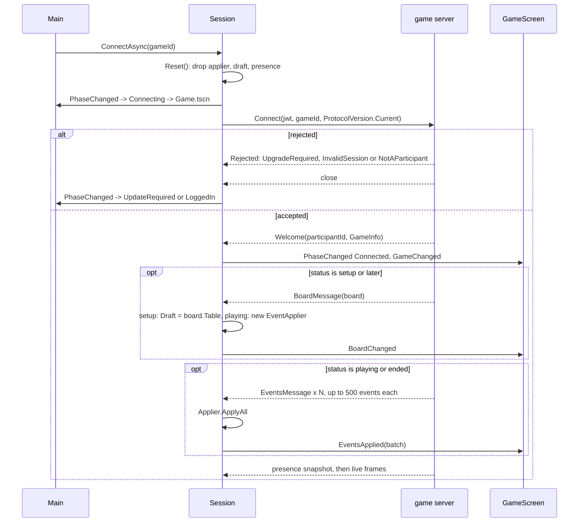

A reconnect runs this identical path, because `ConnectAsync` resets first.

A `BoardMessage` arriving before `Welcome` is dropped. The `playing`/`setup` decision reads
`Game.Status`, which `Welcome` sets. The client depends on the server's ordering and has no
reordering buffer. An `EventsMessage` arriving while `Applier` is null is ignored, which happens at
status `setup` or before the board. An ended game that never ran setup sends `Welcome` and nothing
else, so the game screen must render with `Draft` and `Applier` both null.

### Undo to here

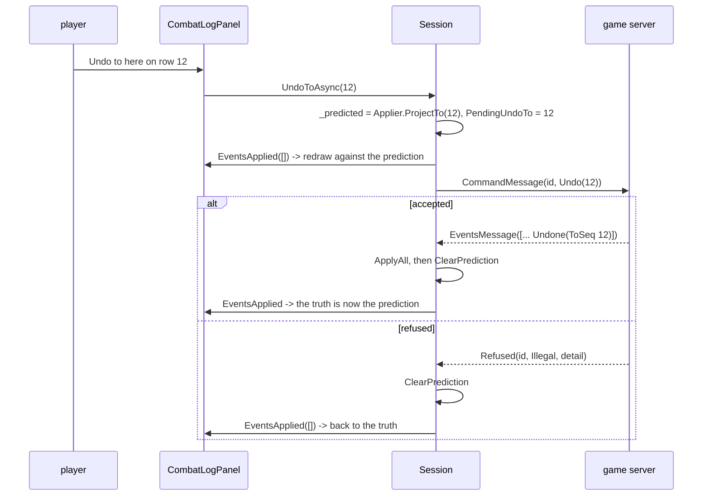

Neither branch has rollback machinery.

The prediction clears only on an `Undone` whose `ToSeq` equals `PendingUndoTo`, or on a `Refused`
matching the one tracked command id. A second undo issued while the first is pending overwrites
both fields. A server answer that undoes to a different sequence number leaves the prediction
displayed indefinitely. The server refuses an `Undo` whose target is neither `0` nor a live event's
seq, which is the case the `Refused` branch exists for. Events arriving during a pending undo are
applied to the applier, but are invisible while the prediction shadows it.

### A desync and its resync

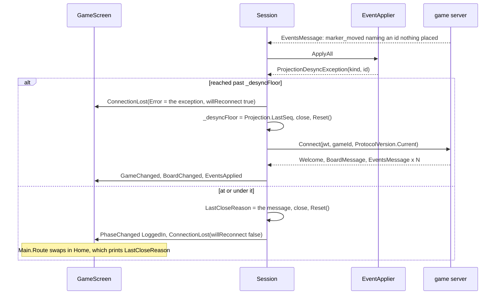

The first branch's rebuild is the connect-and-hydrate sequence unchanged.

The applier is partially applied when it throws, which is why the projection is dropped rather than
repaired. The socket carries no fault of its own, so the close is the client's own teardown and the
close-code inference plays no part.

### A setup edit

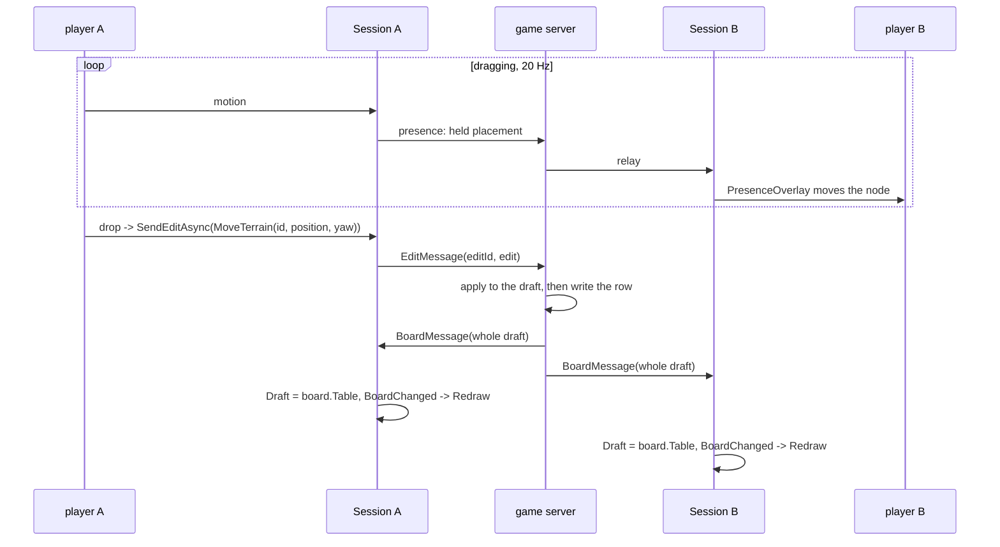

There is no client-side merge. The server broadcasts the whole draft and the last drop wins.

The broadcast is the whole `TableState`, so a generator batch is one `BoardMessage` per
`AddTerrain`: up to 21 full-draft broadcasts and 21 `Redraw` passes in quick succession.
`ReplaceDraft` from a large layout is a single frame that must stay under the server's 4 MiB frame
limit. An edit refused with `WrongStatus` toasts and leaves the piece where the last broadcast put
it. That happens when the flip to `playing` lands between the drag and the drop.

### Embark, then disembark

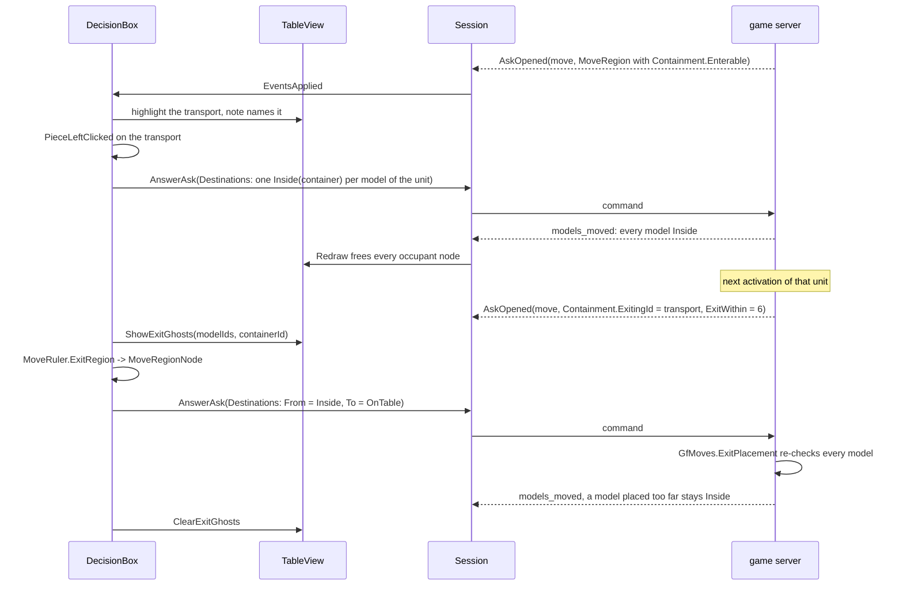

The exit ghosts are the one control surface the client draws that is not part of the projection.

`Enterable` and `ExitingId` are never both set. That invariant lives on the server, and the client
would render nonsense if it were broken. The exit ghosts are freed by `ClearExitGhosts` when the
answer is sent. If the Ask is closed by something other than this player's answer, such as a
teammate answering or the frame being abandoned, the decision box must clear them on the next
`EventsApplied`. `_renderedAsk` staleness checks exist for that case. A ghost dropped outside the
drawn region still commits, and the server leaves that model inside. The offer is drawn, not
enforced.

## State and data

The client owns no Postgres tables and writes none, so there is no `erDiagram` here. Every row it
touches belongs to management or to the game server, and it reaches them only through `/v1/*` and
the socket. What it reads out of those rows, by the column names in `docs/schema.md`: `game.name`,
`game.status`, `game.created_by` (which decides whether the creator's two buttons appear),
`game.enforcement`, `game.waits_between_steps`, `game.properties_hash`, `game.game_rules`,
`game.scheduler_shape`; `team.ordinal`; `participant.team_id` (nullable, and a participant with no
team is a watcher) and `participant.army_snapshot`; the whole `table_state` tree, including
`terrain_placement.builtin` beside a nullable `terrain_placement.asset_id` and each placement's
own `terrain_volume` rows; and `asset.hash`, `asset.scale` and `asset.orientation_pitch/yaw/roll`.
Those asset columns reach it through the per-game manifest rather than the asset row, because
`GET /v1/assets/{id}` is owner-only. It writes one owner-side row, through management:
`POST /v1/layouts` from its own copy of the draft.

Local, per-machine state is three files under Godot's `user://`, which `OS.GetUserDataDir()`
resolves per platform: `%APPDATA%\Godot\app_userdata\Tabletop\` on Windows, `~/.local/share` on
Linux, `~/Library/Application Support` on macOS:

| File | Contents | Failure behaviour |
| --- | --- | --- |
| `settings.json` | `Animate`, `MutedWindowKinds`, `RememberMe`, `ManagementUrl`, `GameServerUrl` | missing, unreadable or malformed reads as `ClientSettings.Default`; every field is individually nullable in the DTO, so a partial file loses only its missing fields |
| `session.bin` | the session JWT, in a file created readable and writable by its owner alone | absent, unreadable or not three dot-separated segments reads as null and the login screen shows; an `IOException` or `UnauthorizedAccessException` is caught, not thrown |
| `cache/{hash}.bin` | asset blobs, keyed by SHA-256 | a partial download lives in `.part` and never becomes a cache entry; a hash mismatch deletes the part and the piece keeps its proxy |

The remembered session is deliberately not in an OS keystore. Windows data protection is
Windows-only, which the client's platform position rules out (`architecture.md` → Deliverables), and a
per-platform store behind one interface costs three implementations of which two cannot be
exercised on the development machine, with libsecret depending on a session keyring a minimal
Linux desktop may not have. The file protects the token from other local accounts on a shared
machine, and from a group- or world-readable directory being backed up. It does not protect the
token from anything running as the same user, and it does not stop the file being copied to
another machine, where it refreshes until the Stytch session behind it expires. That last is the
one property data protection had and this does not. What bounds that is the token itself: a five-minute JWT whose only power is
`POST /v1/auth/session/refresh`, cleared on logout and on a `401`. `SessionStore` is three methods
with one call site in `Main._Ready`, so a keystore can replace the file later without touching
`Session`.

In-memory state, all of it on `Session` except the node dictionaries:

| Held | Lifetime | Rebuilt from |
| --- | --- | --- |
| `Applier` + `Projection` | one connection | `Board` + the whole event log |
| `Draft` | `setup` only | the `BoardMessage` after every edit |
| `Others` (presence) | one connection | nothing; it starts empty |
| `_predicted`, `PendingUndoTo` | one pending undo | discarded on answer or on any reset |
| `_desyncFloor` | one player-initiated connection | nothing; it starts null, rises to the projection's `LastSeq` at each desync, and a resync carries it |
| `Game`, `ParticipantId`, `MyTeamId`, `IsCreator` | one connection | `Welcome`, then each `GameInfoMessage` |
| `TableView`'s `_pieces`/`_terrain`/`_markers`/`_zones`/`_ghosts` | one game screen | `Redraw()` diffing the projection or draft |

Nothing in the projection is stored anywhere on the client. A table growing a "current position" of
its own would mean the event spine had been broken.

## Failure modes

| Failure | What happens | Chosen? |
| --- | --- | --- |
| Management unreachable | the login screen shows `Cannot reach {ManagementUrl}`; the Home screen's list stays stale | yes; no retry loop on HTTP |
| `426` on any request | `UpdateRequiredException` sets `Phase = UpdateRequired`, which is a sink; the screen offers Quit and nothing else | yes |
| JWT expired mid-session | the 60 s refresh normally prevents it; a refresh answered `401` disconnects, clears the store and drops to `LoggedOut`. An open socket is otherwise unaffected, because the server authenticates once at connect | yes; a socket can outlive its credential |
| Refresh fails with anything but `401` or `426` | the token stays in memory and on disk; no refresh is sent for one minute from the failed attempt's start | yes; a management outage does not sign anyone out, and the five-minute JWT absorbs one missed tick |
| Socket closes unexpectedly | reconnect with backoff 1, 2, 5, 10, 10… s; `ConnectionLost(willReconnect: true)` toasts; the projection is discarded and rebuilt, and the `Welcome` restores the player's team | yes |
| Socket replaced by the same participant's newer connection (`1000` after `welcome`) | no reconnect; drop to Home | yes; reconnecting would fight the newer socket |
| Any other server-side `1000` after `welcome` | read as a replacement; the player goes to Home with no retry, and Home prints `LastCloseReason` | the inference is an accepted ambiguity, since no frame distinguishes the two |
| `Rejected` with `InvalidSession` or `NotAParticipant` | no reconnect; `GameId` cleared; Home | yes |
| Handshake window missed (10 s) | the server closes; the client reconnects, because no `Welcome` arrived | yes |
| A command or edit refused | `RefusedReceived` toasts `{reason}: {detail}`; the decision box shows an orange line when the `MessageId` matches its last command; nothing is rolled back, because nothing was applied locally except a predicted undo | yes |
| `ProjectionDesyncException` while applying an event | the projection is dropped, the socket is reopened and the log is replayed; `ConnectionLost(willReconnect: true)` toasts it as a rebuild | yes; client shell → The connection and the projection |
| A resync faulting again at or before `_desyncFloor` | no further attempt; `Phase = LoggedIn`, `LastCloseReason` is the exception's message, and Home prints it | yes; the bad event is in the server's own log, and rejoining buys one more attempt |
| A frame kind the client does not act on, `AtRest` included | dropped; `Handle`'s switch has no default arm and deserialization has already succeeded | yes; contracts plan ruling 3 |
| A mesh 404s, its presigned URL has expired, or its hash mismatches | `MeshLoader` logs and returns null; the proxy stays; the game is playable | yes, and load-bearing |
| Presigned URLs expire mid-game (`Manifest.ExpiresAt`, 60 minutes) | the next `LoadAssetAsync` at or after `ExpiresAt` refetches the manifest before it looks the asset up | yes |
| Presence stops without `PresenceEnded` | another player's `held` placement leaves that piece's node displaced from the projection until the next `Redraw` for it | a gap: the server sends `PresenceEnded` when a participant's last socket closes, and the client relies on that frame alone, with no timeout of its own |
| A frame over 4 MiB | the server treats it as a protocol violation; a very large `ReplaceDraft` is the only realistic candidate | not guarded on the client |
| Two players drag the same piece | last drop wins; each saw the other's drag through presence | yes |
| An unknown zone shape id | `ZoneNode` draws nothing and logs a warning | yes; the game server's `DraftEditor` tests use shape ids `ZoneStyles` does not resolve |
| A model placed outside the drawn region | committed as sent; the server re-decides (`LegalSetMembership.Contains` under `strict`, `GfMoves.ExitPlacement` for a disembark) | yes; the client never withholds an answer on its own geometry |

Concurrency, ordering and lifecycle hazards:

- Frames arrive on the socket read loop's thread. `IDispatcher` marshals every one to Godot's main
  thread with `CallDeferred`, and each handler is gated on `ReferenceEquals(socket, _socket)` so a
  stale socket's frames and close are dropped. `_socket` is written by `ConnectAsync`,
  `TearDownSocket` and `OnClosed`. Reads of it from
  `SendCommandAsync`/`SendEditAsync`/`SendPresenceAsync` are unsynchronised. Every one of those is
  called from the main thread, but nothing enforces it. `ImmediateDispatcher` cannot test this
  hazard.
- `Session` outlives every screen, and a freed Godot object invoked from a live event throws
  `ObjectDisposedException`. Every subscriber holds its handlers in fields and detaches them in `_ExitTree`
  (`Animator` in `Dispose`, which `GameScreen.FreePlayPanels` calls), so a screen swap or the end of play leaves
  no handler behind. A new subscriber that skips the detach reintroduces the fault.
- `GameScreen.Rebuild` runs on every `GameChanged` and `PhaseChanged`, and frees and re-creates
  every `TeamPanel`, the `LobbyPanel` and the `SetupToolbar`. Any lobby edit by any participant
  destroys the setup toolbar mid-interaction, losing its selection and any open field. The play
  Hud is built once (`ShowPlayPanels` returns while `_header` is set). The setup toolbar is not guarded.
- `AskViewModel.Mine` orders open Asks by `Ask.Id`, a v7 GUID, so "the current Ask" is
  approximately the oldest-opened one rather than the innermost frame's. Under nested sequences the
  order that matters is the resolution stack's. The two agree only because ids happen to be
  time-ordered.
- `EventsApplied` fires with the whole log on connect. With `Animate` on, `Animator` tweens one
  `ModelsMoved` at a time over 0.4 s, so reconnecting into a long game replays every historical
  move as an animation. Nothing distinguishes a hydrate batch from a live one.
- `Redraw()` is a full diff of the projection against the node dictionaries, run on every
  `EventsApplied`, every `BoardChanged` and after every animation step. There is no incremental
  path and no measured budget. A 40-model game is fine, and nothing says what is not.

## Testing

Two tiers, split on the Godot dependency.

Headless, `tests/Tabletop.Client.Tests` (xUnit). The project compiles `client/src/Core/**/*.cs`
from source and references the three libraries plus `Tabletop.Content.Tests` and
`Tabletop.Protocol.Tests` for their samples (`TableStateTests.Sample()`, `Samples.Game`,
`Samples.Board`). Every task with logic is test-driven. The plan's running count ends at 45 tests.
What is covered:

| Subject | Test infrastructure | What is pinned |
| --- | --- | --- |
| references and the table frame | `ReferencesTests` | `ZoneStyles.Resolve` and `Table.ContainsPoint` answer in the wire frame, so nothing converts; the sample table state is on the slab |
| settings and the session store | temp directory | defaults on a missing or malformed file; round trip; the session file's Unix mode is owner read and write; a file that is not three dot-separated segments reads as null |
| the management client | `FakeManagement : HttpMessageHandler` scripting responses | the version header and bearer on every request, the exact paths and verbs, `426` → `UpdateRequiredException`, problem+json title and detail, contract types round-tripping under `ContentJson` |
| the socket seam and presence | `FakeGameSocket`, `FakeSocketFactory` | frames delivered, sends recorded, closes injected; presence set, removed and cleared |
| the session object | the two fakes plus `ImmediateDispatcher` | the connect sequence, the projection, local undo and its two clear paths, presence and pings bypassing the projection, reconnect with backoff, a reconnect rejoining the same team with no re-pick, a replaced socket not reconnecting, `Rejected` stickiness, Home keeping the seat while Leave calls management, a desync dropping the projection and rebuilding it from the log, the bound sending the player to Home with a reason, an `AtRest` frame ignored |
| built-in content and generators | seeded `Random` | 35 built-ins present, each naming one of the eleven group meshes, volumes copied on `Place`, the four planet tables' fixed and rolled entries, pieces landing off the slab |
| the asset cache | temp directory, `HttpMessageHandler` | hash verification, `HashMismatchException`, a cached hash never touching the network |
| the view models | protocol samples | log wording, `Touched`, `AskMode` per legal-set kind, `SpendableBy` keeping only my team's spender models, the reveal naming who spent what, a one-model pick naming the model, `Mine` skipping answered and other teams, auto-pass on a muted window kind, `ConfirmLabel`, menu items building the right commands, the ruler's displacement and remaining allowance, `UsedInFrame`, `Region` and `ExitRegion` boundaries, `IsDisembark`, the animation queue's two modes |

`ImmediateDispatcher` raises every event inline, so a test asserts on state immediately after
delivering a frame.

By running the client. Everything in `Screens/`, `Table/` and `Panels/` needs a window, a
viewport, a mouse, `GltfDocument`, tweens and a `SubViewport`. Each task ends with a scripted
manual run against the local servers. Several of them need two clients, either two desktop
accounts or one account in two instances. Presence, free-for-all setup editing, Asks addressed to
another team and "Home disconnects but the seat stays" cannot be observed from one. Docker is
needed for Postgres and the MinIO stand-in only. On the development machine both servers run in
WSL and the client runs on the Windows host over forwarded localhost.

The fitted built-in meshes are among the things verified by eye, at both extremes of each group's
footprint, and there is no automated check that a mesh file fits the volume it decorates.

`scripts/check-client` is the scripted part of the Godot layer's testing: four greps, exit non-zero
on any hit. It is the only automated guard on the boundary rule.

Gaps:

- No automated test of any Godot code. `WorldFrame`'s conversion, `PieceNode`'s proxy geometry,
  `TableView.Redraw`'s diff, `MeshLoader`'s priority queue, `TableInput`'s picking and
  `PresenceOverlay`'s teardown are all verified by eye. `WorldFrame` is pure and could live in
  `Core/`. It does not, because it returns `Vector3`.
- No contract test between `ManagementDtos.cs` and `Tabletop.Management`'s records. The management
  plan states "a change to any of these here is a change there" and nothing enforces it. The
  client's tests serialise its own mirrors, so a renamed property on the server side fails at
  runtime in the client, not at build time in either.
- The decision box's mode dispatch is tested at the view-model level (`AskViewModel`, `DecisionView`), not the box level. `ModeOf` is
  covered. That `RenderMove` swaps three things for a disembark is a manual step in Task 14.
- The desync path is tested with an injected faulting event, and has no manual trigger: nothing a
  player can do makes the server emit an event the applier cannot apply. The two desync arms of the
  `ConnectionLost` toast and Home's reason line are read rather than run.
- Reconnect is tested with an injected close, not a real dropped socket. Kestrel's keep-alive
  timeout, a WSL network hiccup and a server restart mid-hydrate are untested paths.
- No performance test. There is no budget for `Redraw`, for the 20 Hz presence sample, or for a
  game with many models and many volumes.

## Rulings and deferred work

The plan's ten rulings, the decision and reason of each, and what changes if a ruling is reversed.

| Ruling | Decision | If it changed |
| --- | --- | --- |
| 1. Presence sample rate | **20 Hz**, matching the server's relay rate and `architecture.md`'s figure | one `Timer.WaitTime`. The game server plan's relay rate is the same figure, and one answer settles both |
| 2. Where the remembered session lives | **Not an OS keystore.** `user://session.bin`, created owner-only where the platform has file modes; DPAPI is Windows-only, which the client's platform position excludes | a keystore replaces `SessionStore`, three methods with one call site |
| 3. Built-in art | **A minimal set ships**, so a generated table looks like a table. Eleven grouped `.glb` meshes (generated by `scripts/terrain-meshes`; `hill` round, `hill-rect` square) and five `.png` textures; a missing file still draws the hitbox | more art is more files in `content/builtin/`, or a per-name mesh for a piece that outgrows its group, both without a code change |
| 4. Generator entries with alternatives ("Hill, Forest, or Field") | **The client's RNG picks one**, so rolling a planet table produces a finished board in one action, and a player who dislikes a piece swaps or deletes it during setup | asking the player would have `TerrainGenerators.Generate` return the alternatives and the toolbar prompt |
| 5. Dice on the table | **A readout, not dice objects.** Text beside the unit gives the faces, the threshold, the modifiers and which dice passed, for every roll on the step rather than the first; nothing tumbles, and models still fall by tween | visible dice would give `Animator` a dice scene with a canned tumble, and `Animator` is the only file that changes |
| 6. The game list's filters | **Status, name and "created by me"**, all three off the `GameSummary` the browser already returns | "Games I am in" is not built because the summary carries no participants: it would need a new field on `GameSummary` or a `GET /v1/games/{id}` per row |
| 7. Zones for ordinals with no team | **Drawn grey during setup**, so a four-zone style in a two-player lobby shows two coloured zones and two grey and the table shows what the style laid out | hiding them would have `TableView.ZoneColour` return transparent |
| 8. The facing a disembarking model takes | **Any facing that fits**, since p.7 lets a model turn in any direction: `ExitRegion` unions over `ExitYaws` facings and `ExitYawAt` answers with one that fits | the container's yaw would be one facing tried; keeping the embarked facing means `Location.Inside` carries a yaw, a wire change in the contracts plan; per-model turning needs a rotate control no spec asks for |
| 9. Whose base the disembark region is drawn for | **The lead model's** (`ModelIds[0]`), as `Region` already is; the server refuses an outlier individually | `MoveRegionNode.Show` takes a list of polygons |
| 10. Is an offered container a click target or a button | **A click**, since the legal set already highlights it and the container's name is in the box's note; one control for one command | `OfferEmbark` adds a `Btn` per container and drops the `PieceLeftClicked` hook, leaving `TableInput.CancelDrag` unused |

Deferred, with where it is recorded:

- The visual design of every screen, and the Godot scene tree beneath each: client shell → not
  decided. The plan hand-writes `.tscn` files with a root and a script and builds every control
  tree in code, so a real scene tree is additive.
- Whether the client edits armies: open, and the web app owns editing. A wrong mesh sends the
  player to the browser.
- Terrain becoming event-driven state, and with it army terrain (GF p.20), buildings as targets,
  and unlocking terrain mid-game: setup phase → not decided. Nothing in this client obstructs it.
  Terrain would gain events on top of the same snapshot.
- Placement styles (p.17), objective counts and spacing (p.6), and Generic Planet's dangerous
  picks (p.18) stay social. The app places markers and does not count or space them. A style helper
  that warns on spacing is a later convenience.
- Presence timeout versus an explicit stop frame: an explicit frame. The server sends
  `PresenceEnded` when a participant's last socket closes, and no client owns a presence timeout
  (contracts plan ruling 1). Were a timeout chosen instead, `PresenceEnded` would leave
  `SocketMessage` and the client would own the timeout.
- Whether a participant can have two connections at once: no. The newer socket closes the older
  with `1000` (game server plan ruling 3), which is what the reconnect rule keys on.
- A cache eviction policy. `user://cache/` grows without bound, and nothing in the spec or plan
  caps it.
- Hosting. Local only: management at `http://localhost:5100`, the game server at
  `ws://localhost:5200/ws`, MinIO at `http://localhost:9000`, all over WSL's forwarded localhost.
  Deployment is deferred by ruling (`architecture.md` → Deployment). Both URLs are already
  settings, so deploying changes the address, not the shape.

## References

Plan: `docs/superpowers/plans/2026-09-05-client-shell/README.md`. 16 tasks, the File Structure block, the
`Interfaces → Produces` tables, 11 consumed-interface statements and ten rulings.

Specs, in the order the plan's header names them:

- `docs/superpowers/specs/2026-09-04-client-shell-design.md` (primary)
- `docs/superpowers/specs/2026-08-30-presence-design.md`
- `docs/superpowers/specs/2026-09-04-setup-phase-design.md`
- `docs/superpowers/specs/2026-08-29-setup-content-design.md`
- `docs/superpowers/specs/2026-08-27-table-domain-model-design.md`
- `docs/superpowers/specs/2026-08-28-game-flow-design.md`
- `docs/superpowers/specs/2026-08-28-resolution-design.md`
- `docs/superpowers/specs/2026-09-03-action-sequences-design.md`
- `docs/superpowers/specs/2026-09-04-scheduler-design.md`
- `docs/superpowers/specs/2026-08-28-asset-library-design.md`
- `docs/superpowers/specs/2026-08-29-geometry-values-design.md`
- `docs/superpowers/specs/2026-09-04-whole-design-review.md` (newest; wins over every other)

Also read: `docs/architecture.md`, `docs/schema.md`, `docs/data-model.md`.

Rulebook: Grimdark Future v3.5.1. Page 7 (a move measures the base's displacement: *"no part of
their bases move further than the total movement distance"*), page 15 (`Transport(X)`: *"only one
model needs to reach the Transport for everyone to embark"*, *"must stay fully within 6" of it when
exiting"*), page 17 (placement styles, social), page 18 (terrain size classes: scatter 1–3", large
4–8", up to 12"), pages 18–19 (the four planet generator tables), page 20 (army terrain,
deferred), page 50 (free-for-all deployment).

Sibling design documents in `docs/design/`: `contracts/`, `geometry/`, `management-api/`,
`game-server/`, `scheduler/`, `interpreter/`, `web-app/`. The four the client consumes are
contracts (the wire and the applier), geometry (the frame and the movement primitives),
management-api (the HTTP surface and the manifest) and game-server (the connect sequence and the
edit semantics).
