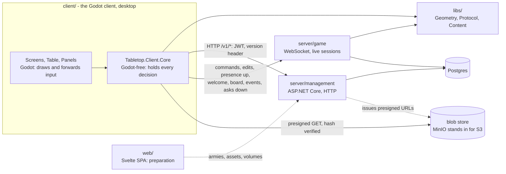

# Client: scope and context

## Scope

In:

| Subject | Where |
| --- | --- |
| Login (password, email one-time code), remembered session, update-required screen | `client/src/Core/`, `client/src/Screens/` |
| The game list, create game, join | `client/src/Screens/HomeScreen.cs` |
| One session object: management client, socket, projection, draft, presence, undo prediction, reconnect, desync resync | `client/src/Core/Session.cs` |
| One game screen over four statuses; the side panel (lobby panel, setup toolbar, team panels) in lobby and setup, the Hud in play | `client/src/Screens/`, `client/src/Panels/`, `client/src/Hud/` |
| The table view: slab, hitbox-first pieces, terrain, markers, zones, camera | `client/src/Table/` |
| Runtime GLB loading into a content-addressed disk cache | `client/src/Table/MeshLoader.cs`, `client/src/Core/AssetCache.cs` |
| Input and presence: select, picks, drag, formations, drop, ruler, measure, ping, hotkeys, others' cursors and ghosts | `client/src/Table/TableInput*.cs`, `PresenceOverlay.cs` |
| Table overlays: hover labels, sight lines, target lines, shooting lasers, the undo-move button | `client/src/Table/{HoverLabels,SightLines,TargetLines,Lasers,UndoMoveButton}.cs`, `client/src/Core/ShotLines.cs` |
| The Hud: header, unit card, decision box, dice, log drawer, end message, key overlay; the declared move's region and ghost, containment | `client/src/Hud/`, `client/src/Core/MoveRuler.cs` |
| The combat log panel with undo-to-here, the right-click menu, the animation queue | `client/src/Hud/CombatLogPanel.cs`, `client/src/Table/Animator.cs` |
| Built-in terrain, textures, marker visuals, and the rulebook's four terrain generators | `client/src/Core/BuiltinContent.cs`, `TerrainGenerators.cs` |
| The scripted boundary checks: no physics, no rules type, no Godot in `Core` | `scripts/check-client` |

Not in:

- **No ruleset code, no legality, no dice, no turn order.** This is the load-bearing seam
  (`architecture.md` → The load-bearing seam), and `scripts/check-client` greps for it.
- **No Godot physics.** No `StaticBody3D`, `RigidBody3D`, `CharacterBody3D`, `Area3D` or
  `CollisionShape3D` in any scene or script. Picking is ray-versus-AABB over proxy bounds. Every
  measurement comes from `Tabletop.Geometry`.
- **No truth outside the projection.** A screen keeps only what it draws.
- **No army editing, no asset upload, no STL conversion.** Those belong to the web app. A wrong
  mesh sends the player to the browser.
- **No hidden-information handling.** The server filters streams, such as the simultaneous
  token spend. The client shows what it receives.
- **No offline mode.** Running the game means running a server.
- Visual design of any screen, and the Godot scene tree beneath each, are left undecided. The plan
  builds every control tree in `_Ready` and hand-writes `.tscn` files carrying a root node and a
  script and nothing else.

What already exists: `client/Tabletop.csproj` (`Godot.NET.Sdk/4.7.2`, `net10.0`, root namespace
`Tabletop`), `client/scenes/Main.tscn` and `client/src/Main.cs` as a scaffold, and
`Directory.Build.props` giving each OS its own `obj/`. `client/src/Core/`, `client/src/Screens/`,
`client/src/Table/`, `client/src/Panels/` and `tests/Tabletop.Client.Tests/` do not exist yet.

Position in the build order: step 5, in parallel with step 4 (the game server skeleton), once step
1's contracts exist (`architecture.md` → Build order). Prerequisites: `Tabletop.Protocol`
(commands, events, Asks, presence, setup edits, `EventApplier`, `WireJson`, `ProtocolVersion`),
`Tabletop.Geometry` (`Table`, `ZoneStyles`, `Movement`, `Containment`, `Collision`, `Distance`),
`Tabletop.Content` (`Army`, `TableState`, `ContentJson`), management's `/v1/*` surface, and the
game server's connect sequence. The plan is ordered after all four so Task 9's "run it" steps have
something to talk to. Tasks 1–8 need no server.

## Context

Management is the client's HTTP dependency and the only one it authenticates against: login, the
game list, create and join, armies, layouts, properties, the per-game asset manifest, and
presigned download URLs. Every request carries `Tabletop-Client-Version:
{ProtocolVersion.Current}`. A `426` is a screen of its own rather than a reported error, and
nothing else runs after it. The JWT lives five minutes. It is refreshed by `POST
/v1/auth/session/refresh` on a 60-second `Timer` owned by `Main`. `TryResumeAsync` at boot and
`RefreshAsync` on the timer share one in-flight request. Only a `401` signs out. A `426` sets `UpdateRequired`. Any other failure
keeps the token, in memory and on disk, and sets `_noRefreshBefore` one minute past the attempt's
start. `_authEpoch` is bumped by logout and by every login, and a refresh outcome from an older
epoch is dropped. Neither method throws. `LogoutAsync` always finishes locally.

The game server is the client's only source of game truth. One socket carries four kinds of
traffic: commands up and events down (logged), Asks down, presence both ways and discarded, and
edits that write the game's rows and the `table_state` draft without being logged. Edits are
accepted only while status is `lobby` or `setup`. The client opens the socket with the same
session JWT and a game id. There is no client-issued token and no management-to-game-server call.

The blob store is reached directly. Management issues a presigned GET and the bytes never pass
through it. The client verifies the SHA-256 of what arrives against the hash from the manifest,
and keys the on-disk cache by that hash. The same mesh in two games is one download, and a corrupt
or substituted body cannot enter the cache.

`Tabletop.Geometry` is shared with the game server so the two agree on distance, line of sight and
collision. The client runs it for a different reason: only the server's answer counts. Client
geometry is a prediction for responsiveness. A disagreement is resolved by resyncing, never by
reconciling. Bit-exact cross-platform determinism between the client's desktop build and the
server's Linux container is therefore not a requirement here.

Windows is the client's first export target and not its only possible one (`architecture.md` →
Deliverables). No design decision in this client depends on
Windows: `OS.GetUserDataDir()`, `res://` and `user://` are portable, and the remembered session is
a plain owner-only file rather than Windows data protection. The development machine is WSL with
the Godot editor on the Windows host, which is a fact about the current machine and carries no
platform commitment. Nothing is planned for the other platforms and no export preset for them
exists.

