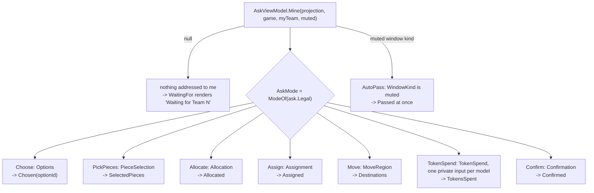

# Client: the play screen, decision box, combat log and menu

## The play screen

From `playing` on the side panel goes and the table fills the window (in-game UX spec → Layout). `GameScreen`
keeps the side panel, the team panels and the selection line for lobby and setup. The side panel is 360 px wide and scrolls vertically; its button rows wrap (`HFlowContainer`) and its long buttons and labels wrap their text, so nothing widens it. An overlay `Control` added after the
table carries Home, the status and the toasts in every status, and in play `GameScreen.Play` adds the Hud to it: each
part a control in `client/src/Hud/` with a `Bind` over the session (and, for most, the `TableView` and `TableInput`), drawing a Godot-free model.

| Part | Where | Draws |
| --- | --- | --- |
| `HeaderBar` | top centre | `HeaderView`: round, turn, scores; a wrapping row of teams, each with `· k not activated` (units with a model on the table and no action recorded this round), and an objective chip per objective marker, bordered and filled in its controller's team colour, a plain chip while no team controls it; a wrapping row of the active unit, its action and the step strip from the action frame's `Outline`, led by `Team 2 activating: ` for another team's activation (`ActivationLine`); the waiting line (`HeaderView.Waiting` with my team: `Your move: …` first, then each other team's; for a watcher `HeaderView.Watching`); "Game over" with the result. A team name's right-click opens the team menu |
| `Roster` | left column, above the unit card | `RosterView`: per team, my team first, each unit's activated tick, wound pips summed over models not removed, condition icons or text chips; off-table units dimmed; a `Reserve: {property} ({unit})` chip, on its own line under the row, on a unit the army holds off the table (every model on the shelf, none wounded) until a property places it (`RosterView.ReserveOf`), also on its card. A click selects and centres the unit; R collapses to the team headers |
| `UnitCard` | lower left | `UnitSheet` for the unit `SheetFocus` names (the selected unit, else my team's activating unit): the unit's models alive and wounds left (`ModelFacts`), Quality and Defense badges, state chips, a row per group of like models (`UnitCardContent.Groups`: alive/size, what sets the group apart, its wound total for Tough models, a joined hero marked; a click cycles through the group's standing models), weapons with an AP column, rules with their `rule_text` and *not automated*; above it `EnemyStrip` for a hovered enemy (Defense, models alive, distance, each weapon's range within or beyond) |
| `TerrainCard` | the unit card's slot, in setup and play | `TerrainCardContent` for the selected terrain piece: name, source (built-in or library asset), height, facing, each volume's kind, footprint (scaled), heights on the table, declarations and notes. While terrain is selected `SheetFocus` names no unit, so the unit card hides; selecting a unit brings it back. In setup the same card carries the piece's edits (Facing field and ⟲/⟳ 15° through `MenuModel.TurnInDraft`, scale, swap mesh, swap for my asset, reset volumes, remove, each volume's fields) and, for a selected setup marker (`MarkerCardContent`), its kind, diameter, label and Remove. In play it is read-only and leads with the effects (`TerrainCardContent.Effects`): a band in the strongest effect's colour, then each
effect as a large icon in its colour, its word and the server's sentence of what it does to a unit (`Session.TerrainRules`); the table
draws the selected piece's volumes at full strength in the same colours (`HitboxLook.Selected`, `Palette.ForDeclarations`). Esc clears the selection; Delete or Backspace removes the selected piece in setup |
| `DecisionBox` | right column, above the undo and log buttons | the first open Ask addressed to me (below) |
| `DiceTray` | above the decision box | the latest roll's log line, its height only (a long line clips; the tooltip holds all of it); a click opens the log there, expanded |
| `LogDrawer` | lower right | `CombatLogPanel`: action blocks (a cast nested in one), roll lines, change lines, one row per entry; filters All/Rolls/My units/This unit; 640 px; G opens it |
| `UndoButton` | lower right, left of the log button | `UndoPlan`: shown to every player (hidden for a watcher), disabled when nothing is undoable; undoes the last action in the game, whoever took it (the newest effective-log event with an actor that is neither an `Undone` marker nor an `AskClosed`, with the engine events after it), to the live seq before it or 0; tooltip `Undo: ` and `LogText.Describe` of the action; a "Undo dice rolls?" dialog listing each lost roll once, as its combat log line, when the range holds a roll or a `dice_rerolled`/`dice_edited`; Ctrl+Z presses it; re-plans from `Session.CombatLog.Undo` on the frame's render for events or a board, and while an undo travels as if its marker had landed; a failure is a toast |
| `TurnBanner` | upper third, transient | `RollOffBanners` first: `Team k goes first` 4 s with each team's roll on a second line, best first (`Team 2 rolled 5 · Team 1 rolled 3`, a tie's re-rolls joined by commas), from the roll-off's ranking step (`place_k`, `rolled_<ordinal>_<k>`), never in a replay; then `TurnBanners`: `Round n` 1.5 s; `Team k's turn` 1 s when the team differs from the previous `TurnStarted`'s; silent while `Session.CatchingUp`, on a batch with an undo, with Animate off or the setting off. Clicks pass through |
| `EndMessage` | centre | the result, the reason and the scores once `game_ended` lands |
| `KeyOverlay` | centre | `KeyOverlayView`: the open Ask's keys first (`Now · ` its title), then Camera, Measure and Table, one column each, keys as caps; F1, ? or `KeyOverlay.Request` (the decision card's ⌨) open it, any key closes it |

The table overlays are children of the `TableView`. `HoverLabels`: the hovered unit's name in its team colour, the
edge-to-edge distance from my selected unit with a line between the two closest bases (`HoverView`), wounds left over
each multi-wound model, the Shift tag, a hovered terrain piece's panel beside the cursor in a layer over the Hud (`TerrainLabel.HoverOf`: name, height,
one chip per effect in its `TerrainEffects` icon and colour; not the selected piece's: the terrain card shows that). `SightLines`: the server's `SightAnswer` while L is held over a unit, or while a
target assignment is open; green clear, amber screened, red blocked with the blocker lit, a clear line drawn to the
target point the server saw (`SightLine.Seen`), a summary over the target
(`SightSummary`: models that see it, clear lines screened, and under a target pick how many can shoot; never a cover
verdict, which is the rules'), and under a target pick the models that cannot shoot the hovered target or their group's
assigned one dimmed, each assigned target asked about in its own query. Each query's id is made before the send, so
only the newest query's answer is drawn. `TargetLines`: each assigned weapon group's shooters to
its target, one colour per target. `Lasers`: `Session.Fired` drawn for one second, a beam with bolts in the shooter's team
colour from each model the server aimed to the point of the target model it saw. `Session` applies a batch one event at a
time and, after each `StepCompleted`, reads `ShotLines.Of`: a `determine-attacks` step of an `attack-sequence` frame under a
`shooting` frame, read while the targets still stand. Its `aim_<shooter>_<target>` values are the server's (`GfAttack.Aims`):
each eligible model's nearest target model in range that it sees under the game's sight options, valued at the index into
`LineOfSight.TargetPoints` of the point its clear line reaches. A model hidden from every shooter (behind a unit's perimeter,
p.5) gets no beam, and no beam passes through what hides it.

`UnitMarkerNodes` and `FloatingText` draw in that canvas layer at projected anchors and take no clicks: `UnitMarkers`
rows (activated, each condition by the server's name with the theme's icon or a text chip, a wounded multi-wound
model's pips) over each unit's centroid above its tallest model, hidden at End's pitch and behind the camera;
`FloatingResults` lines (`-2 models`, `-1 wound`, a condition) rising for 1.2 s as the `Animator` plays their event
(`Animator.Played`), wounds diffed against the last total seen, silent while `Session.CatchingUp` and on a batch with
an undo. `FloatingText` subscribes to `EventsApplied` before the `Animator` is made, so it reads each batch before the
Animator plays it. `RangeRingNode`: with V on (`ClientSettings.RangeRings`) and a unit of mine selected, `RangeRings`'
union outline per printed `Range` around the models carrying it, labelled with the printed value; a melee weapon draws
none. Hovering a unit of another team (`ThreatRings.OfAnotherTeam`; a watcher's every unit) draws its threat rings in its team
colour whatever V says (threat range plan): `ThreatRings` over `Session.Threats` (`ModelFacts.Threats`), a `Charge` outline at
the unit's charge move round every model and a `Shoot` outline per distinct `ShootMove` + range round the models with that reach;
`ThreatRingCache` recomputes only when the unit, its placements or its threat change. `OrbitCamera` orbits a moving focus (`CameraFocus`): WASD and Q/E read held each frame, ignored while a text
field has focus, Q/E the held unit's turn while one is in hand; pan speed scales with distance and the focus stays
within the table plus 12"; Space, Tab and a roster click glide 0.3 s; an action frame's start glides to its actor
(`CameraFocus.FollowTarget`) unless the camera moved in the last 2 s, a unit is held, `ClientSettings.CameraFollow` is
off or `Session.CatchingUp`.

The Hud parts take keys in `_Input`, which runs before the `SubViewportContainer` hands a key to the table's
viewport, and leave the digits and Esc to the table while a drag is in hand. Hud buttons give the GUI focus straight
back, so Space never presses one. Max wounds, who can shoot and sight come from the server; the client names no
rule.

## The Hud frame

`HudLayout.Of(width, height, HudVisible)` (Core) returns a `HudRect` per `HudPart`, and nothing else in the client
decides where a Hud part goes. Every part keeps an 8 px margin (`HudLayout.M`) to the window and to its neighbours,
anchored to an edge, and no two parts overlap from 1280 x 720 up (`HudRect.Overlaps` is what the tests assert).

| Slot | Where | Size |
| --- | --- | --- |
| `Corner` | top left | 420 x 40: Home, the game's name clipped with an ellipsis to what the slot leaves, and `CornerLine`'s tail (status, `— watching`, the reconnect), never clipped |
| `Toasts` | top right | 360 x 120 |
| `Header` | top, centred in the band between corner and toasts | up to 760 x 96 |
| `Roster`, `UnitCard` | left column under the corner, 420 wide | the column's height, halved when both show; the card's slot then starts at the roster's actual bottom |
| `Decision` | right column, from below the toasts and header down to 8 px above the log button | 480 wide; the column less the dice slot, or its lower half while the log is open |
| `Dice` | right column, stacked above the decision box; no slot while the log is open (the log holds the same roll, and `DiceTray.Covered` hides the tray) | 480 x 96 |
| `LogButton` | bottom right | 140 wide; as tall as the undo and log buttons' actual minimum (`HudLayout.Of`'s `buttonH`), never under 36 |
| `UndoButton` | bottom right, left of the log button | as `LogButton` |
| `LogPanel` | right, under the toasts and header, down to the decision/dice stack or the log button; with the decision box showing, the right column's upper half | 640 wide, up to 720 tall |
| `Banner` | full-width band at the upper third | overlay; placed with `Fill` whether shown or not |
| `EndMessage` | centre | overlay; computed but not placed: the message stays a full-screen backdrop centring its panel |

`HudLayout.Overlays` (`Banner`, `EndMessage`) are exempt from the no-overlap rule: they draw over the frame.

`HudPlacement` puts a control in a slot, anchored top left. `Top` takes the slot's top edge and the control's minimum
height capped by the slot, `Bottom` takes the slot's bottom edge by the control's actual height, so a part whose minimum
outgrows its slot grows upward and not off the screen, and `Fill` takes the whole slot.

`GameScreen.Layout` places every part. It is not called directly: `QueueLayout` defers it, at most four passes a frame; a fifth waits for the next frame and logs a warning, so a layout that does not settle cannot fill Godot's message queue. Every scroll area reserves its vertical bar's width (`ScrollMode.Reserve`), so its content's width, and with it the height of wrapping text and flow rows, never depends on whether the bar shows. Its triggers are
the Hud or side panel resizing, the side panel's visibility, `MinimumSizeChanged` on the corner, toasts, header, roster, unit
card, decision box and dice tray, `VisibilityChanged` on the last five, the log opening or closing, and building the play Hud. It
subtracts the side panel's width outside play. Because the decision box is only as tall as its content, `Layout`
moves the dice slot to end 8 px above the decision box's actual top, and ends the open log's panel 8 px above
the actual decision box and dice tray when the panel's columns span theirs, so a short decision box leaves the log the room above it (up to 720 px). Likewise the panel starts 8 px below the
header's actual bottom when their columns overlap, since the header's three lines can outgrow its 96 px slot; the
panel's height never goes negative. The unit card's slot starts 8 px below the roster's actual bottom
(`HudLayout.Below`), so a roster collapsed by R gives the card the column back; the terrain card takes the same slot, and outside play, with no roster, the whole column; the roster's half stays its ceiling. `UnitCard.Place` sizes the card to its
content, capped by its slot, and anchors it to the slot's bottom; `Roster.Place` sizes its scroll list to its content,
capped by its slot, against the slot's top, since a `ScrollContainer` reports no content height. `DecisionBox.Place` does the
same for its controls against the slot's bottom: the title, notes, refusal and hint stay in view and the controls scroll.

`Toasts` stacks the newest three messages top right in every status, each removed after 4 s. `KeyOverlay` is centred on
the window and sits outside the frame. `EndMessage` stays a full-screen backdrop.

## The decision box

One box, in the right column above the undo and log buttons, rendering whatever Ask is currently addressed to the player's
team through `DecisionView`, with the keys that apply in a hint line under it; with nothing addressed to me it
shows the waiting line. It keys on the legal set, never on the question name, so a new ruleset question needs no new
branch.

`ConfirmLabel` is the only place a question name is read.

`AskViewModel.Mine` picks the first open Ask whose `Teams` contains my team and whose `Answers`
does not. It returns null for a watcher, since a participant with no team is never addressed. It
also computes `Highlights` and `AnsweredTeams`, so the box's choices and the table's highlights
come from one place. `Highlights` is the pieces the legal set names, plus any `Enterable` container
and the container being exited, and less any spender model that is not my team's. Asks addressed to
other teams render as a waiting indicator naming the team, never as controls.

The `myTeam` argument is `Session.MyTeamId`, so a player who reconnects in the middle of an open
Ask is addressed by it again as soon as the `Welcome` lands, with the same controls a player who
never dropped is looking at. `Render` returns early while `Game` is null, so a reconnect never
reaches `Mine` with a null team and a returning player is never rendered as a watcher.

Behaviour the specs demand, and where it lives:

- Any team member answers any of the team's Asks, for any unit of the team (rulebook p.50 Team Games; owner ruling:
  "Either player from the team can take the activation across any unit in their team."); the header reads
  "Your move" for every player of the team, and the box shows who answered. `AnsweredBy` reads the effective log's last
  `AskAnswered` for that ask id and my team and names its actor, unless that is me; an answer an undo took back names no one.
- Mutes auto-pass. A `WindowKind` in `ClientSettings.MutedWindowKinds` with `AllowPass` set sends
  `Passed` at once and shows "auto-passed (muted: {kind})" with an Unmute link. The pass is logged
  as that player's own. It is a client convenience, not part of the model.
- The simultaneous token spend renders as one private input per eligible model (p.13). The box
  shows who has answered without showing what, then reveals every answer at once from
  `ask_closed`. This is the only consumer of the server's per-player filtered streams.
- A `Confirmation` Ask is its question and one button that Enter presses, labelled by `ConfirmLabel`:
  "End the round" for the scheduler's `end_round` Ask, "Continue" for the interpreter's step gate. The step gate
  (`WaitsBetweenSteps`) is a development flag: neither the create-game form nor the lobby offers it, both send
  `false`, and players never meet it.
- A refusal shows in the box as an orange line. A `Refused` whose `MessageId` matches the box's last
  command prints "The server refused: {detail}".

The round boundary has no control of its own. The scheduler stops at the boundary with one unframed
`Confirmation` addressed to every team that has a participant, and the box renders it as it
stands: `Highlights` is empty, `AutoPass` cannot fire because there is no `WindowKind`, and there
is no Pass button. Whoever answers first ends the round. Every other player's box is replaced by
the next round's turn Ask on the same `EventsApplied` tick. A second control would be a second path
to the same command, and the menu already has *Set the round* for a player who wants to jump.

Two ruleset question names arrive carrying a `move_region`: `move` from the move step of
hold/advance/rush/charge, and `disembark` from `transport-destroyed`'s place step. Neither belongs
in `AskQuestions`. A third, `place` from `place-reserve` (a Spawn or Split reserve), is the disembark's
shape over models on the shelf, anchored on a model on the table (`MoveRuler.IsShelfPlacement`). A disembark is the same `RenderMove` with three things swapped:

| | ordinary move | disembark (`Containment.ExitingId` set) | reserve placement (movers on the shelf) |
| --- | --- | --- | --- |
| region | `MoveRegions.Outline`: each model's own reach by path (round difficult terrain within the allowance or through it within the cap), the lead's at first, then the held models' on each pickup (`TableInput.PickedUp`) | `MoveRuler.ExitRegion` about the container's base, the lead's | the same, about the anchor model |
| clamp (no Alt) | each held model to its `MoveRegions.Clamp`: the nearest point a path within the allowance, or through difficult terrain within the cap, reaches | none | none |
| draggable node | the model's own `PieceNode` | `TableView.ShowExitGhosts` on the container's node | `TableView.ShowGhosts` in rings about the anchor (`DeployView.Around`): the first ring clear of the anchor's base (a rectangle's corner) by the Ask's separation, a spot whose base would leave the table skipped |
| `TableInput.Allowance` | `Allowance − UsedInFrame` | `null` | `null` |
| ruler | start to current, with remaining allowance | container to current, distance only | anchor to current, distance only |
| `ModelRelocation.From` | the model's `OnTable` | the model's `Inside`, passed through | `OnShelf` |
| yaw | the model's own | whatever fits at the drop point, through `YawOf` → `MoveRuler.ExitYawAt` | the ghost's (Q/E) |

Embarking answers with the unit, not the model: one `ModelRelocation` per model of the unit, all to
the same `Inside(container)`. P.14 embarks the whole unit when one model reaches the transport.
There is no partial embark and no per-reaching-model answer. An offered container is a click target
rather than a button. `Highlights` already highlights it, and a button per container would be a
second control for the same command.

## A spend over models and a pick of one model

Both put models where the box would otherwise hold one number and one unit.

A team's spell token spend is `TokenSpend(IReadOnlyDictionary<Guid,int> MaxByModel)`, `Sealed`,
with a pass, answered by `TokensSpent(IReadOnlyDictionary<Guid,int> Counts)` (p.13: *"Models within
18\" in line of sight of the caster's unit may spend any number of spell tokens at the same time
before rolling"*). Eligibility is the engine's: on the table, holding tokens, within 18" and in
line of sight of the caster's unit, the caster itself included. `AskMode.TokenSpend` keeps its own
control rather than borrowing the allocation widget, for two reasons in the shape itself. An
allocation is one total split exactly across its targets, and a spend has no total to split: p.13
allows any number up to each model's own holding, so spending one token of a possible five is a
legal answer that an allocation would reject. And an allocation carries a single amount with no
per-target bound, while five tokens across two models holding one and four is a different legal set
from five across two holding three and two. So the box renders one private `SpinBox` per entry of
`MaxByModel`, prefixed with the model's name and bounded by that model's own value, and no total
appears anywhere. The team's maximum is the sum of its own entries and is never rendered as a
constraint. The map covers every addressed team's models at once, which discloses
nothing a client does not already hold: `ModelInPlay.SpellTokens` is in every projection. It has to
cover both, because the window addresses both teams. P.13 gives the caster's side +1 and the other
side -1 per token, so the map necessarily names models this player may not spend.
`AskViewModel.SpendableBy(projection, game, myTeam, legal)` narrows it to the models whose unit
belongs to my own team, and both the spin boxes and `Highlights` come from that. A model the
projection cannot resolve to a team is not mine. The question name `spend_tokens` and the `casting`
window kind are unchanged, so the mute path, `AnsweredTeams` and the `ask_closed` reveal are the
ones already described.

A Takedown group's target is a `PieceSelection` over the model ids of one target unit, `Min` and
`Max` both 1, addressed to the attacking team (p.14: *"each model with Takedown may pick any model in
the target unit as its individual target"*). The wound goes to the model it names rather than
through the defender's allocation. Nothing on the wire changed for it. Two things follow for the
table. `Highlights` is that model list, and `TableView.PieceAt` takes a model id already, so the
highlight lands on the models rather than on the unit. And a left click still selects the model's
unit, because that is what a bare click means everywhere else in the client, so the box answers
from `TableInput.PieceLeftClicked`, which carries the clicked piece's own id and therefore a model,
rather than from `Selected`. The box calls `TableInput.CancelDrag()` on a click it consumed, so
answering an Ask is never also a drag. That matters most here, because the eligible models are the
other team's, and a stray click would otherwise start a hand move of the unit being shot at.
Shift-click, which picks models for a move, is not needed to answer and does no harm.
Where the pick is one model the counter reads that model's name instead of a tally, and the model
is marked on the table. A wound landing on a particular model is worth reading back before "Done".

Both rulings land in the log through `LogText.Answer(answer, names)`, which takes a `Names` so it
can name pieces: a `TokensSpent` reads *"spent 3 tokens"* followed by each spending model and its
count, and a one-piece `SelectedPieces` reads *"picked"* followed by that model's unit and slot
name. `AskAnswered` and `AskClosed` both render through it, so an unsealed pick reads on the line
that answered it and a sealed spend reads on the line that closed it. `LogText.Touched` names the
pieces an answer carries, so clicking either row highlights the models that spent and the model that was
picked.

## The combat log

`CombatLog` builds the play log from `Session.Log`, once per log state (`Session.CombatLog`, shared with the dice tray and the undo button), and `CombatLogPanel` renders it while the drawer is open, newest at the bottom, auto-scrolled: opening the drawer and every new entry show the newest, once the rows are laid out (the scroll bar's `Changed`); scrolling up lets go, scrolling back to the end follows again. The
lines are the combat-log spec's (`2026-10-13-combat-log-design.md` → The log).

An action block (`ActivationBlock`) opens at a `SequenceStarted` with `Context.Action` while none is open; a `casting` frame inside
it is a nested block (`Nested`, header `Cast {spell} → {targets}`, the spell's label read off the frame's own `Options` Ask). The
header is `R{round} · {Team} · {Unit} · {Action}[ → {targets}][ · moved {d}"]`: `→ shoots {target}` once a `shooting` frame opened
inside it; targets from the action frame, from nested frames whose actor is the block's actor (a strike-back adds none) and from a
`SelectedPieces` answer on the action frame's own steps; `moved` is the most any of the actor's models moved, each model's
table-to-table moves summed, to 0.5". A block closes at its frame's `SequenceFinished` or `SequenceAbandoned`, or at an `Undone`
whose `ToSeq` is before its start. A live block closes only at a live finish (a dead one stays inside the block, struck through); a
block whose start is undone closes at its own undone finish, so it never absorbs a later activation. A block is open, its entries
indented beneath it; a click folds it to its header and its chain (each live roll's `Label` and successes, or a single die's result,
and each change line, `Hit 3 → 2 models removed → Morale failed → Shaken`).

Each `RollRecord` of a step is one `RollEntry` (`RollWords` composes the words from the record): `Title` (label and target),
the raw faces, `Outcome` and each live amendment, by `RollId`, as a `RollAmendment`. A single-die test (`RollEntry.IsTest`: not a hit,
a block or a roll per wound) takes as its `Consequence` the change words of its frame's later steps with no roll, up to the frame's
end; those steps draw no line of their own (`failed → Shaken`). A roll-off's dice are labelled by the teams they belong to and the
record that broke the tie carries `Team k wins` (`CombatLog.Aftermath`, from `winner_ordinal`). A step's changes follow its rolls as
`LineEntry` lines: `{k} model(s) wounded` (leaving out a model the same step sends to the shelf), `{k} model(s) removed`,
`{unit} Fled!` for models shelved unwounded, each condition set or cleared (`{unit} · ` first when it is not the block's actor), and
`{unit} gets {rule}` for a grant. Outside an action: `Round n`, `{Team} · {unit} deployed` for a player's placement from the shelf,
a step's deployment or objective change and a round end's objective changes (`LogText.RoundChange`), a menu edit ending `· by hand`,
`Undone to: {header}` (the first block the undo took back that no earlier undo had already taken, else the action it stepped into)
and the game's end. Words come from `Names` (participants, teams, units,
weapons, models, markers; an unknown id degrades to its first eight characters). Asks, answers, closes, sequence starts without an
action, finishes, abandons, turns and steps with neither roll nor change draw nothing. A roll with neither `Threshold` nor
`RequiredRaw` (a roll-off, a property's own roll) shows its faces and no result; the dice tray paints it neutral.
`EventApplier.EffectiveLog` decides which entries are struck through, so an undone range stays visible. Presence never appears in
the log.

A roll row wraps to the panel's width: its title, then its faces and outcome in a flow, each label at least 160 px wide; the wheel
scrolls the panel over it. A click expands its `Details` (the weapons, the basis and each change, each modifier, the cover verdict's
count, the target), each die, each amendment, the rule chips when the step applied any, then Undo to here. Every other row
carries Undo to here beside it.

Filters are All, Rolls, My units and This unit; the last two keep blocks and roll entries whose actor or a target matches. The
filter and the open state persist in `ClientSettings` (`LogFilter`, `LogOpen`). The panel lives in `LogDrawer`, 640 px wide, a
button lower right that G or a click opens upward. Clicking an entry
highlights `LogText.Touched(event)`. "Undo to here" on a row calls `UndoToAsync(seq)` and greys every row above the target
until `PendingUndoTo` clears. The other undo affordance is the **Undo** button (*Undo*). There is no
undo stack UI and no redo. Undo is replay to a sequence number rather than inverse events, so the log serves as the control.

The rules roll every die and apply every modifier; a roll entry offers no way to reroll, set a face or add a modifier.

## The right-click menu

The menu is where every property is editable. It has no admin mode and no confirmation dialog.
`MenuModel` is Godot-free and returns `MenuItem(Label, MenuInput, Func<string?, Command?> Build)`
lists. `PieceMenu` is the `PopupMenu` that shows them. It pops a one-field dialog for an `Integer`
or `Text` item, a filtered list for a `Choice` item (`MenuItem.Choices`), borrows the next click for a `PieceId` or `TablePoint` item, and sends whatever
`Build` returns through `SendCommandAsync`.

| Wiring | Items |
| --- | --- |
| right-click a model | `ForBoarding` while my move Ask moves it and offers containers (Board transport per `MoveContainment.Enterable`, answering the Ask), then `ForModel` + `ForFrame`: wounds, conditions, spell tokens, shelf, container, place here |
| Shift-right-click a model | `ForUnit`: mark as having taken an action, clear the action record, conditions, Add a grant (a `Choice` of `Session.Grantable`: the game's set's grantable effects from `GET /v1/properties/{hash}/grants`, `GrantChoices`; one use, the unit as its own grantor) and Remove grant, wounds-this-activation |
| right-click a marker | `ForMarker`: give an objective to a team or make it neutral; in play, Unlock or Lock an objective (local, `MarkerLocks`) |
| right-click a roster row of my team | `ForRosterUnit`: Set aside / Return to deployment (a shelved unit `ModelFacts.MaySetAside` names), Put in transport per Transport `ModelFacts.DeployInside` names, Take out of transport while that Transport is on the shelf (passengers spec) |
| right-click a team name in the header | `ForTeam` + `OffTable`: score, set the active team, set the round, and one place-here item per shelf or container model of that team |
| Alt-right-click the table | leave the game |

Each item is one ordinary command, logged with the actor, through the same path automation uses.
There is no dialog because the log is the accountability. An edit visible to every opponent and
permanently recorded does not need a confirmation step. Menu edits are accepted under every
enforcement setting, since they are the override path.

`ForFrame`'s `MenuInput.TablePoint` item ("Place on the table, here" / "Take out of the container,
here") is the manual containment path beside the Ask-driven one. A model off the table has no node
to right-click, so `OffTable` offers the same item from its team's menu, through the shared
`BackOnTable` builder and `Names.TeamOfModel`. That item is the only path when no Ask is
open: a correction after a misclick, or a group playing under `warn`/`silent`. A unit deploys inside a Transport through
the roster's Put in transport (passengers spec). `KnownActionNames` exists because the game's `Properties`' action
rows never reach the client. The menu offers the names it has seen, meaning the actions recorded
in the log and on the units, plus free text. The activate Ask's option labels
(`"{unit name}: {action}"`) are display text and are not parsed.

