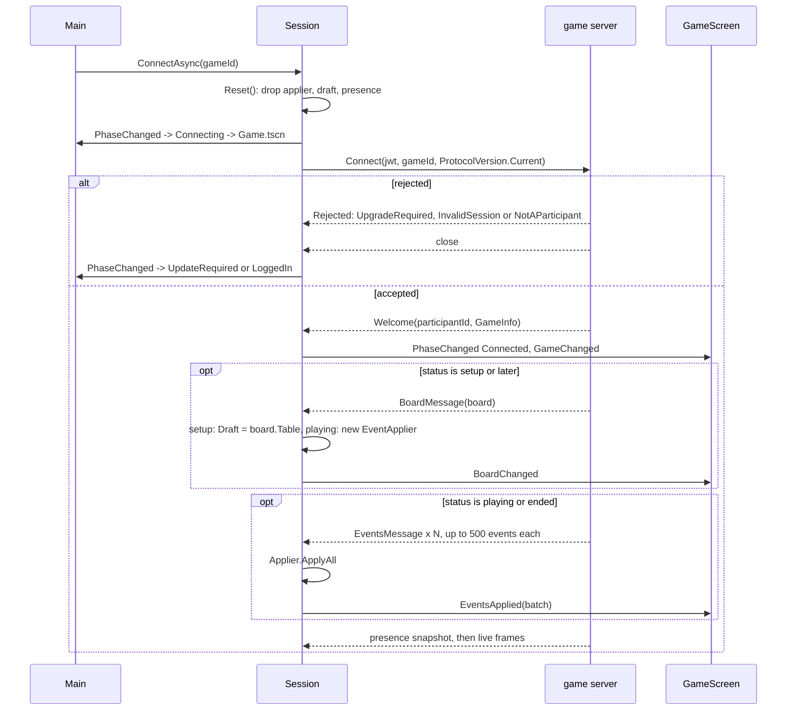
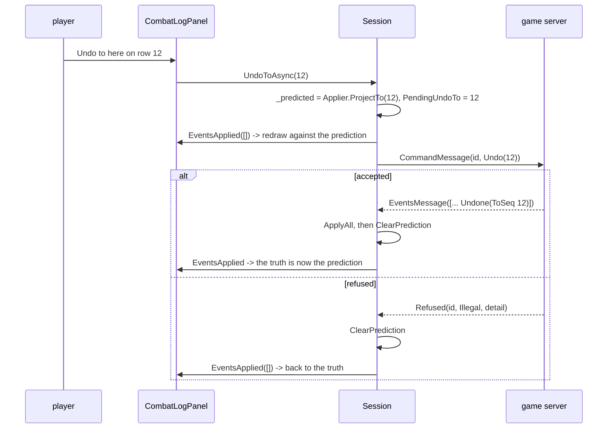
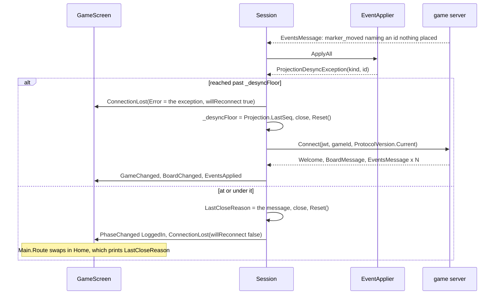
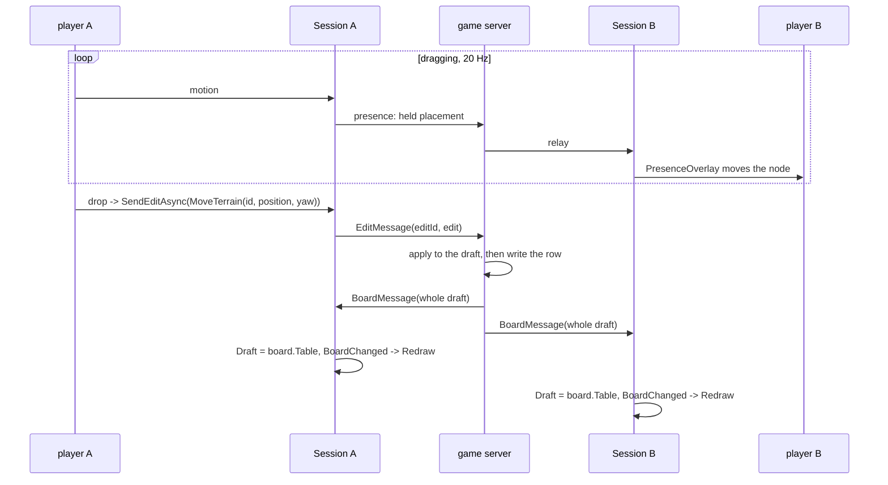
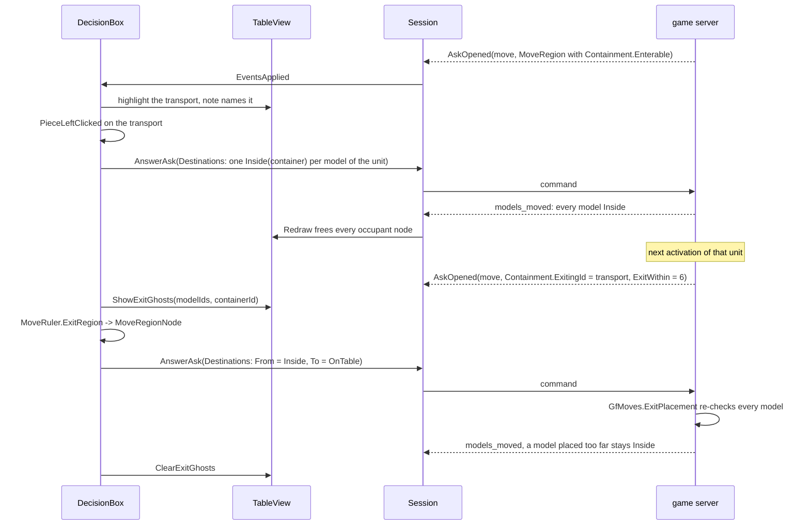

# Client: sequences

## Sequences

### Connect and hydrate

A reconnect runs this identical path, because `ConnectAsync` resets first.

A `BoardMessage` arriving before `Welcome` is dropped. The `playing`/`setup` decision reads
`Game.Status`, which `Welcome` sets. The client depends on the server's ordering and has no
reordering buffer. An `EventsMessage` arriving while `Applier` is null is ignored, which happens at
status `setup` or before the board. An ended game that never ran setup sends `Welcome` and nothing
else, so the game screen must render with `Draft` and `Applier` both null.

### Undo to here

Neither branch has rollback machinery.

The prediction clears only on an `Undone` whose `ToSeq` equals `PendingUndoTo`, or on a `Refused`
matching the one tracked command id. A second undo issued while the first is pending overwrites
both fields. A server answer that undoes to a different sequence number leaves the prediction
displayed indefinitely. The server refuses an `Undo` whose target is neither `0` nor a live event's
seq, which is the case the `Refused` branch exists for. Events arriving during a pending undo are
applied to the applier, but are invisible while the prediction shadows it.

### A desync and its resync

The first branch's rebuild is the connect-and-hydrate sequence unchanged.

The applier is partially applied when it throws, which is why the projection is dropped rather than
repaired. The socket carries no fault of its own, so the close is the client's own teardown and the
close-code inference plays no part.

### A setup edit

There is no client-side merge. The server broadcasts the whole draft and the last drop wins.

The broadcast is the whole `TableState`, so a generator batch is one `BoardMessage` per
`AddTerrain`: up to 21 full-draft broadcasts and 21 `Redraw` passes in quick succession.
`ReplaceDraft` from a large layout is a single frame that must stay under the server's 4 MiB frame
limit. An edit refused with `WrongStatus` toasts and leaves the piece where the last broadcast put
it. That happens when the flip to `playing` lands between the drag and the drop.

### Embark, then disembark

The exit ghosts are the one control surface the client draws that is not part of the projection.

`Enterable` and `ExitingId` are never both set. That invariant lives on the server, and the client
would render nonsense if it were broken. The exit ghosts are freed by `ClearExitGhosts` when the
answer is sent. If the Ask is closed by something other than this player's answer, such as a
teammate answering or the frame being abandoned, the decision box must clear them on the next
`EventsApplied`. `_renderedAsk` staleness checks exist for that case. A ghost dropped outside the
drawn region still commits, and the server leaves that model inside. The offer is drawn, not
enforced.

