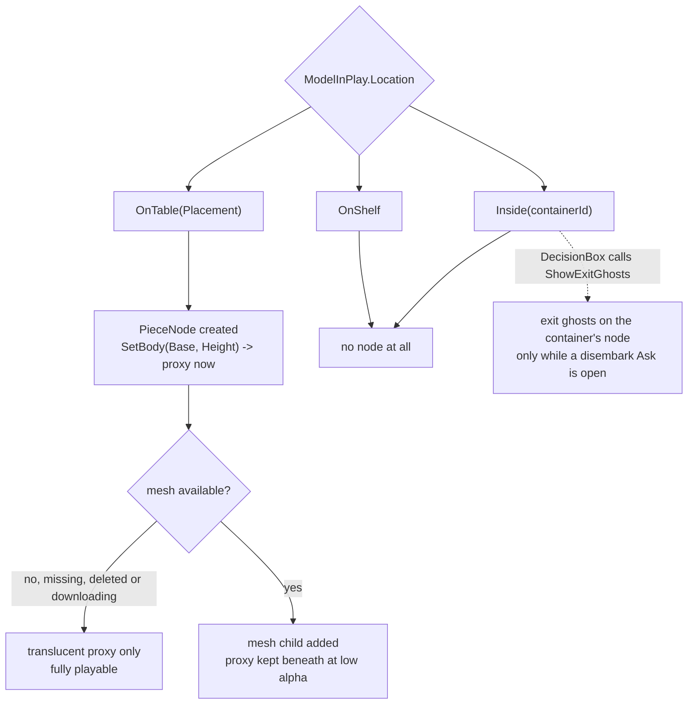
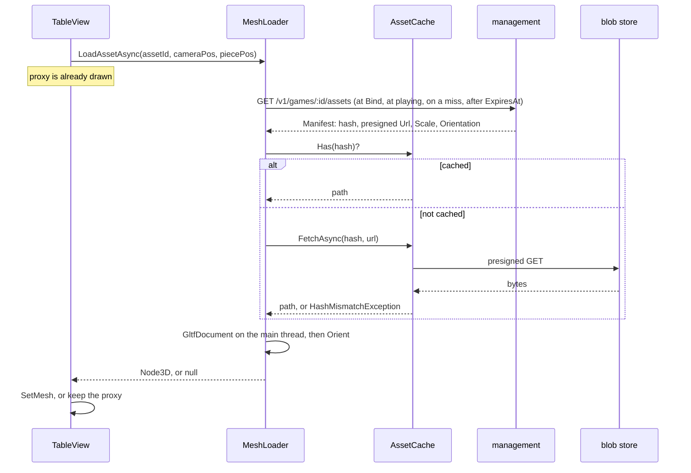
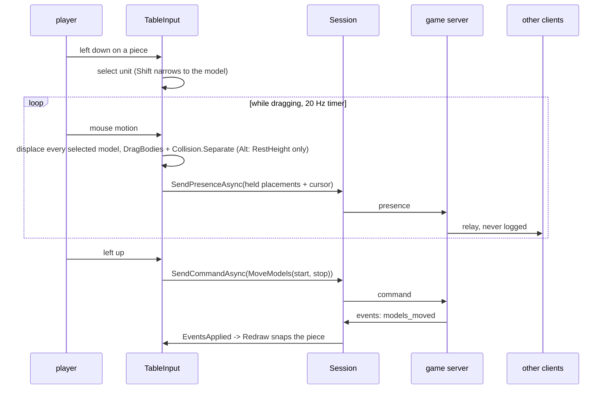

# Client: the table view, meshes, input and the ruler

## The table view

A piece is drawn as its hitbox first. `PieceNode.SetBody(Base, height)` builds the proxy
immediately: a `CylinderMesh`, `BoxMesh` or scaled cylinder for a circle, rect or oval base,
extruded to the model's height, translucent. `SetMesh` adds the loaded GLB scene as a child and
keeps the proxy beneath it at 25% alpha. Terrain does the same from its volumes, one proxy
`MeshInstance3D` per `Volume` with offset, yaw, scale and heights applied and coloured by
declaration. The asset library settled that "the proxy is not a stand-in for the mesh, it is the
thing the mesh was always only decorating". The base and height are what distance and line of
sight are measured against. A missing, deleted, still-downloading or hash-mismatched mesh costs
appearance and nothing else.

A model that is not `OnTable` has no node. `TableView.Redraw()` diffs
`Projection.Models.Values.Where(m => m.Location is OnTable)` against its node dictionary and frees
the node as soon as an event moves a model to the shelf or inside a container. `OnShelf` and
`Inside` carry no `Placement`, so there is no stale or default position to draw at. `PieceAt(id)`
returning null keeps the ruler, the log's click-highlight and the decision box's highlights correct
for an occupant.

The one exception lasts as long as one Ask. `ShowExitGhosts(modelIds, containerId)` puts one
`PieceNode` per occupant in a separate `_ghosts` child at the container's placement, so the player
has something to drag out. `Redraw` never touches that child. `ClearExitGhosts` frees them when
the answer is sent. The ghosts are a control surface, not state, and are not part of the
projection.

The other nodes: `SlabNode` draws the table at its real size, 1" thick, with its texture or a flat
colour. `MarkerNode` is a disc of the marker's diameter with a label. `ZoneNode` resolves
`ZoneStyles.Resolve(zone.Shape, size)` into flat `ArrayMesh` fans 0.02" above the slab, with no
frame conversion, and draws nothing plus a warning for an unknown shape id. `OrbitCamera` orbits
on the right button, pans on the middle, zooms on the wheel, snaps top-down on `Home` and drops to
table level on `End`, giving the placement and line-of-sight views the spec asks for. It orbits a moving focus
(`CameraFocus`): W A S D pan the way the camera faces and Q/E orbit, read held each frame (`CameraFocus.Steer`) and
ignored while a text field has focus in the Hud or any dialog; with a unit in hand Q/E turn the unit instead. Pan speed
scales with the camera's distance and the focus stays within the table plus 12" (`CameraFocus.Clamp`). `Centre` glides
the focus to a point over 0.3 s (`CameraFocus.Glide`); `Follow` glides only when `CameraFocus.Follows`: follow on, no
unit in hand, and no player camera move in the last 2 s. Any player move stops a glide. A player's focus (Space, Tab, a
roster click: `TableInput.Focus`, `Centre(…, byPlayer: true)`) counts as a camera move for follow and keeps its own glide.

Godot physics is not used. Picking is a ray tested against `TableView.Pieces` AABBs and the slab
plane (`Plane(Vector3.Up, 0).IntersectsRay`). A drag is `DragBodies` (`HeldBody`, `Stationary`, `Walls`, `Models`, `Piece`) through
`Collision.Separate`, which slides each model along the walls and other bases and rests it; Alt places freely, and
the server judges the landing. Distance is
`Distance.ClosestPoints`. The engine is never asked a question the rules depend on, so there is no
second geometry implementation to diverge from the server's and no collision layer to configure.
`WorldFrame` is the only place the two coordinate systems meet: `x = X`, `y = Z`, `z = −Y`,
`rotation.y = yaw` in radians. Nothing else converts. The wire frame and `Tabletop.Geometry`'s
frame are the same frame (geometry plan → Global Constraints), so there is no conversion layer.

## Mesh loading and the content-addressed cache

Two types, split along the Godot line. `AssetCache` in `Core/` is Godot-free and handles the
bytes. `PathFor(hash)` is `{root}/{hash}.bin`. `Has(hash)` is a file check.
`FetchAsync(hash, url, ct)` downloads to a `.part` file, verifies `Sha256Hex` against the expected
hash, and moves it into place. On a mismatch it deletes the part and throws
`HashMismatchException(expected, actual)`. A second call for a cached hash never touches the
network. `MeshLoader` in `Table/` does the engine work: it holds the per-game `Manifest`, resolves
an asset id to a `ManifestEntry`, calls the cache, then runs `GltfDocument.AppendFromFile` +
`GenerateScene` on the main thread, and applies the asset's `Scale` and `Orientation` in `Orient`.

Loading is background and every failure degrades to the proxy.

The manifest is fetched at `Bind`. `TableView` fetches it again when status becomes `playing`,
because every army is in by then. `LoadAssetAsync` fetches it once more on an asset id it does not
list, and before any lookup at or after `Manifest.ExpiresAt`. Concurrent fetches join the one in
flight.

The hash is the cache key, so the same mesh in two games, or used by two participants, is one
download per machine. Ordering is by distance to the camera at request time, through a priority
queue with two downloads in flight. `Pump` dequeues whichever waiting item is nearest, not the one
it was called for, so a camera move lets later-requested nearer pieces overtake. Nothing goes
through Godot's editor import: `.glb` files never appear in the project, only in `user://cache/`,
which is why an asset can arrive mid-game. Built-in content is the other half of that split: it
ships inside the build and loads from `res://content/builtin/`, read out of the export's `.pck`
with no hash, no manifest entry, no presigned URL and no cache write. Adding a built-in means
shipping a new client build.

`MeshLoader.Orient` is the only place the mesh convention is written on the client. It must change
together with the web app's `toWorld`/`eulerFor` if the convention ever does. Another
participant's asset is reachable only through the manifest, because `GET /v1/assets/{id}` is
owner-only. An own asset not yet in the manifest goes through `GetDownload` instead, such as a
texture or a library terrain being added in setup.

## Input, presence and a drag

A drag streams `held` presence while the piece moves, and sends one command on release.

Persistence and the log see one write per drop, not one per frame.

Selection is presence and never a command. Clicking a unit does not activate it. During setup the
same click may select a terrain placement or a marker, and the drop sends the matching setup edit
(`MoveTerrain`, `MoveSetupMarker`) instead of a command. A token dropped in play sends
`MoveMarker`, as does an unlocked setup objective dropped in play: its first `MarkerMoved` copies it
into `Projection.Markers`, which `TableView` draws over the board row. Those four release paths are the
only difference between a setup drag and a play drag. In play a terrain drag starts and sends nothing on
release, so the piece snaps back. Objective markers are locked from play on (`MarkerLocks`): a drag on a
locked objective does not start under any enforcement setting, the marker menu's Unlock and Lock items
toggle it, and the state is local to the client. A setup marker is never removable.

A plain drag of a model outside a move step is a hand move: one `MoveModels` on release, which never ends a turn.
The server judges it under the game's enforcement setting (`HandMoves.Judge`, rule `hand_move`): placing the unit
picked at a deploy Ask from the shelf is legal, and anything else is a breach that `silent` accepts, `warn` accepts
with the warning on the event, and `strict` refuses. Under `strict` the drag does not start and the click only
selects. The drag slides along impassable terrain and stops at other models' bases (`DragBodies`, `Collision.Separate`); holding Alt
places freely, and the F1 overlay and the move hint say so. A placement that overlaps another base is `move_overlap` under the
same setting. A drag arms after 6 px, so a click never moves anything. The declared move and the deployment placement
belong to the decision box: while one is open it fills `TableInput.Proposing`, the same drag streams `proposed`
ghosts, the release sends nothing, and Enter commits. On a `Stoppable` move Ask, C (**Cast a spell**, or **Stop here to use a rule** when no moving model holds tokens) sends the same ghosts
with `Destinations.Continues`: the move goes on after the before-attacking window. While a unit is held, 1–5 arrange it in that many rows about
the cursor (`Formation.Arrange`), the rows across the screen as the camera sees it, and Q/E turn them 15°.

A click selects a unit and Shift+click one model; a click on empty table or Esc clears. While a decision wants a
pick (`TableInput.Eligible`), a click on an eligible piece answers through `TargetClicked` or `ModelClicked` and
neither selects nor drags. Under an Options Ask only a piece exactly one choice names is eligible
(`DecisionView.ClickAnswers`); a unit several choices name (activate: one option per unit and action) glows, a click
selects it as any click does, and the decision box narrows to its options renumbered from 1 (`DecisionView.ChoicesOf`,
`Number`) until another unit is clicked or Esc widens it. Tab and Shift+Tab select my next unit with no action this round and centre the camera on
it; Space centres the active unit. Both glide the camera (`TableInput.Focus`). Keys go through `Hotkeys.Of`; the table acts on its own and raises
`IntentPressed` for the rest. `M` toggles the measure
tool: two clicks on pieces, or one press-and-drag, resolved through `Distance.ClosestPoints` and
relayed as a `Measurement`; Ctrl held does the same while held, and letting go clears the measurement here and in presence.
Between the first point and the second the line follows the cursor and is relayed as it moves. A base of diameter zero stands in for a bare table point, so
piece-to-point is the same edge-to-edge call. `P` pings at the cursor. `PickNextPiece` and
`PickNextPoint` let the menu borrow the next click for a `PieceId` or `TablePoint` item. Deployment placement has its
own standing slot, `PlacementPoint`, which the decision box sets and clears; a menu pick armed meanwhile takes the next
click first, and the placement keeps waiting for the one after.

`TableInput` draws no ruler for a piece with no placement. `Drag.Starts` resolves a model that is
`Inside` a container to the container's placement rather than `(0,0,0)`. An occupant has no table
position of its own and disembarks relative to the container. The same holds for other
participants: `PresenceOverlay.StartOf` returns null for an occupant.

## The ruler and the movement region

`MoveRuler` is Godot-free and holds the client's cosmetic geometry. Four functions:

| Member | What it answers |
| --- | --- |
| `Read(start, current, allowance)` | `RulerReadout(Distance, Remaining, OverAllowance)`: the base's displacement from where it started, which is how page 7 measures: *"no part of their bases move further than the total movement distance"* |
| `UsedInFrame(Frame, modelId)` | distance already spent this activation, read out of the frame, so the readout and the region shrink after a mid-move checkpoint such as a cast |
| `Region(PlacedModel start, MoveRegion, volumes, TableSize)` | the boundary from `Movement.Region`, resolving `ImpassableVolumeIds` and `DifficultVolumeIds` against the board's volumes and passing `DifficultCap` through |
| `ExitRegion(ModelBody, PlacedModel container, MoveRegion, volumes, TableSize)` | the disembark boundary: every placement `Containment.BaseFullyWithin(candidate, container, ExitWithin)` admits |

Every input to the region comes from the server. The Ask's `MoveRegion` carries the allowance, the
impassable and difficult volume ids and the difficult cap. The client renders the consequence and
the server re-decides every answer. Drawing a region the server offered is not a legality check. A `MinDistance` (an
Aircraft's 30", held to `Movement.FarthestOnTable`, `MoveRuler.Minimum`) cuts the drawn region to the ring beyond it
(`MoveRuler.Inner`), and a model dragged short of it shows red like one past the allowance.
Under `strict` the server checks `LegalSetMembership.Contains` and `IGameRules.AnswerBreach` (p.11's cap holds every
model once any one enters difficult ground; an Aircraft moves at least `MinDistance`), and for a disembark `GfMoves.ExitPlacement` re-checks every model. A ghost dropped outside the drawn region still commits.

`Region` cannot serve a disembark, so there are two functions. When `Containment.ExitingId` is
non-null the unit is inside the container and its models have no `Placement`. There is no start to
sweep rays from, so `Movement.Region` is meaningless. `Allowance` on such an Ask is the action's
remaining distance and says nothing about where an occupant may be placed. `IsDisembark(legal)` is
that test. `ExitRegion` answers instead, as a boundary rather than a predicate, so
`MoveRegionNode` draws it unchanged: `Movement.Rays` rays out of the container's base centre, each
marched outward in `Movement.Step` increments and bisected eight times at the first refusal. That
is the loop shape `Movement.Region` uses, and it stops a ring of impassable terrain from
re-admitting placements beyond it. A candidate is also refused for leaving the slab or touching an
impassable volume by asking `Movement.Check(candidate, its own centre, 0, impassable, [], null,
size)`. Distance zero makes `Check` sample exactly that placement. No new geometry primitive is
added. The cost is that the client reimplements a march-and-bisect loop the library already
contains for the non-containment case.

The region is drawn for one body, the lead model's `ModelIds[0]`. A unit with mixed base sizes
sees the lead's boundary, and the server refuses outliers individually. **A disembarking model
takes any facing that fits**: p.7 says *"Models may move and turn in any direction regardless of
their facing"*, and a unit exits by using an ordinary move action, so a placement is legal if some
facing fits. `Admits` therefore tries `MoveRuler.ExitYaws` facings for a non-circular base and the
drawn region is the union over those that fit; a circular base is yaw-invariant and tries one, which
is every ordinary infantry model and so the whole common case. `MoveRuler.ExitYawAt` runs the same
search for the answer, so what the decision box sends is a placement `GfMoves.ExitPlacement` accepts. The
server checks the proposed placement rather than imposing a facing, so the facing search lives only
on the client.

