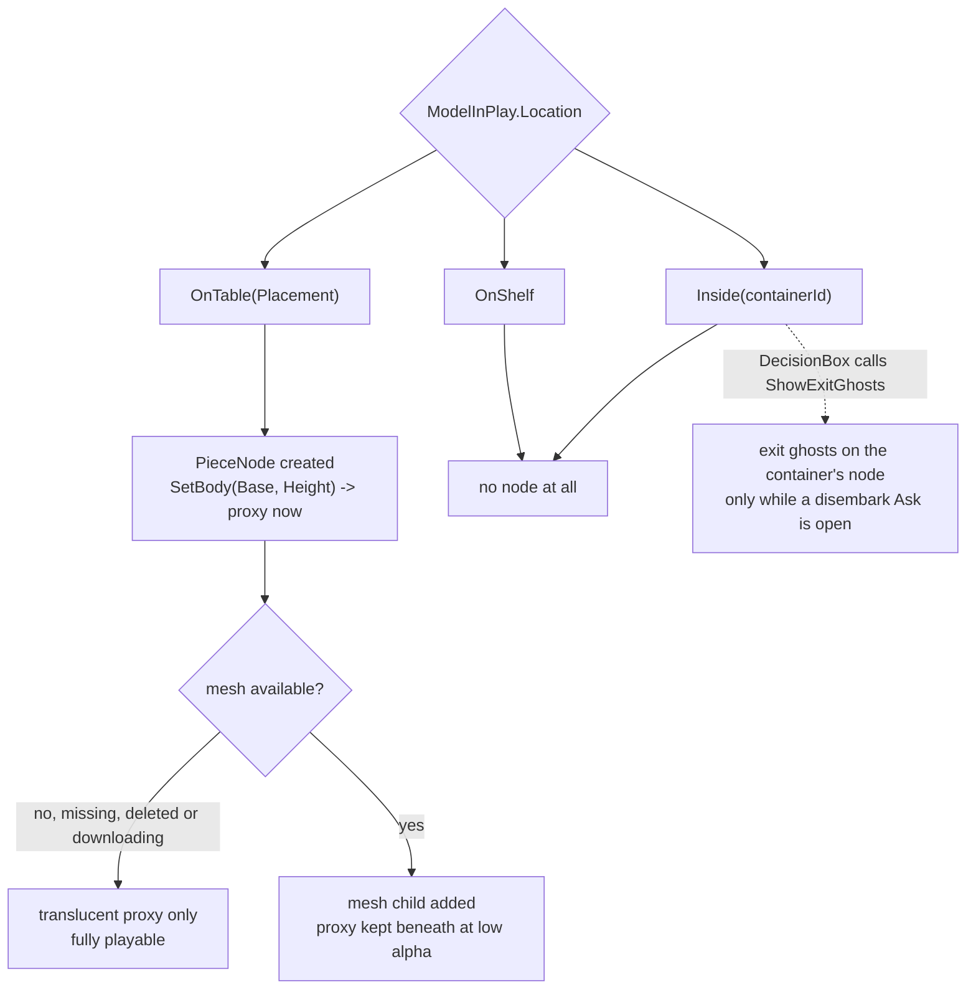
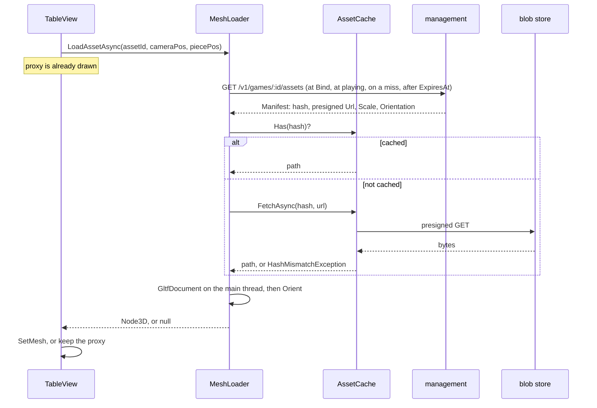
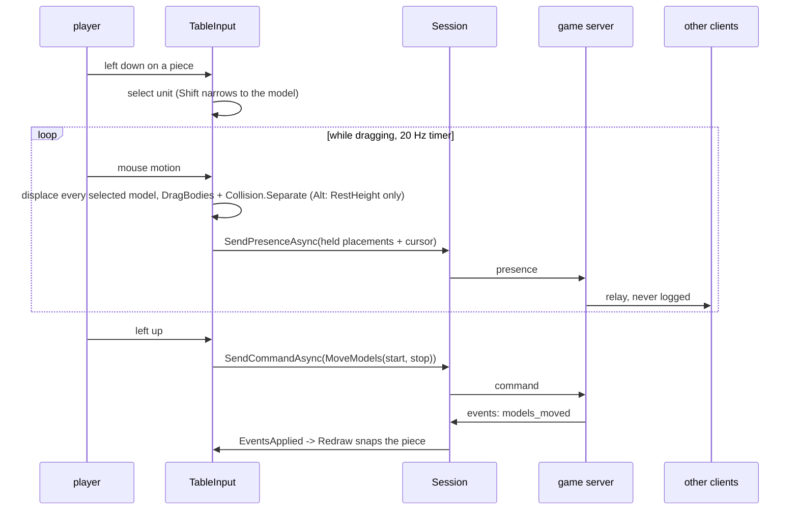

# Client: the table view, meshes, input and the ruler

## The table view

A piece is drawn as its hitbox first. `PieceNode.SetBody(Base, height)` builds the proxy
immediately: a `CylinderMesh`, `BoxMesh` or scaled cylinder for a circle, rect or oval base,
extruded to the model's height, translucent. `SetMesh` adds the loaded GLB scene as a child and
keeps the proxy beneath it at 25% alpha. Terrain does the same from its volumes, one proxy
`MeshInstance3D` per `Volume` with offset, yaw, scale and heights applied and coloured by
declaration. The asset library settled that "the proxy is not a stand-in for the mesh, it is the
thing the mesh was always only decorating". The base and height are what distance and line of
sight are measured against. A missing, deleted, still-downloading or hash-mismatched mesh costs
appearance and nothing else.

Two settings, each default on and each in the Settings dialog, decide what draws over a mesh, through `HitboxLook`. Show
hitboxes (`ClientSettings.ShowHitboxes`; B) governs models: on, a model with a mesh keeps its faint volume; off, it draws
the mesh and a thin base ring in its team colour (the highlight colour while highlighted). Show terrain hitboxes
(`ClientSettings.ShowTerrainHitboxes`; Shift+B) governs terrain: on, terrain with a mesh shows its volumes faintly; off, it
draws the mesh alone, except the piece selected in setup, which shows its volumes in full. A model or piece
without a mesh always draws its volume; a placement ghost keeps its look. `TableView.RefreshLooks` applies a setting or
selection change at once.

A model that is not `OnTable` has no node. `TableView.Redraw()` diffs
`Projection.Models.Values.Where(m => m.Location is OnTable)` against its node dictionary and frees
the node as soon as an event moves a model to the shelf or inside a container. `OnShelf` and
`Inside` carry no `Placement`, so there is no stale or default position to draw at. `PieceAt(id)`
returning null keeps the ruler, the log's click-highlight and the decision box's highlights correct
for an occupant.

The one exception lasts as long as one Ask. `ShowExitGhosts(modelIds, containerId)` puts one
`PieceNode` per occupant in a separate `_ghosts` child at the container's placement, so the player
has something to drag out. `Redraw` never touches that child. `ClearExitGhosts` frees them when
the answer is sent. The ghosts are a control surface, not state, and are not part of the
projection.

Every placement ghost — a deployment's and a Spawn or Split reserve's (`ShowGhosts`), a disembark's
(`ShowExitGhosts`), another player's proposed placement (`PresenceOverlay`) — draws what
`GhostLooks` (`GhostLook`: the slot's base, height and asset, the placement and facing) names:
`TableView.Ghost` builds the hitbox at once and `PieceNode.SetGhost` adds a ring on the base's
outline; the slot's mesh comes from the same `MeshLoader` template as the placed model's, with the
asset's scale and orientation, and swaps in when it loads. The mesh is drawn see-through
(`GeometryInstance3D.Transparency`) under one shared overlay material, casting no shadow, so a ghost
costs no material or mesh of its own. `MeshLoader` keeps each resolved asset, so a ghost drawn again
gets its mesh in the same frame. Q/E turn the node and the mesh with it. `PresenceOverlay` keeps a
proposed ghost's node across presence updates and only moves it.

The look (spec `docs/superpowers/specs/2026-10-19-tabletop-look-design.md`): `SlabNode` draws the board at its real size,
1" thick, its top a gaming-mat print through `board.gdshader` (`PrintTextures`: the print's albedo, the normal map
`HeightNormals` derives from its alpha height, two blended samples against tiling), its edge the print's mean colour darkened,
over a wooden table that fades into the room; a served print is read from its PNG, a packed one through its lossless import,
and an unknown one leaves a flat edge colour. `TableLighting` lights the scene (warm shadowed key, cool fill, sky ambient,
SSAO, AgX). `MeshLoader` hands every built-in mesh to `TerrainLook`, which gives each surface its `SurfaceFamily`'s
triplanar detail print and normal map over the baked vertex paint; asset meshes are drawn as uploaded. The other nodes: `MarkerNode` is a disc of the marker's diameter with a label. `ZoneNode` resolves
`ZoneStyles.Resolve(zone.Shape, size)` into flat `ArrayMesh` fans 0.02" above the slab, with no
frame conversion, and draws nothing plus a warning for an unknown shape id. `OrbitCamera` orbits
on the right button, pans on the middle, zooms on the wheel, snaps top-down on `Home` and drops to
table level on `End`, giving the placement and line-of-sight views the spec asks for. It orbits a moving focus
(`CameraFocus`): W A S D pan the way the camera faces and Q/E orbit, read held each frame (`CameraFocus.Steer`) and
ignored while a text field has focus in the Hud or any dialog; with a unit or a setup terrain piece in hand Q/E turn it instead
(15°, Shift 5°). Pan speed
scales with the camera's distance and the focus stays within the table plus 12" (`CameraFocus.Clamp`). `Centre` glides
the focus to a point over 0.3 s (`CameraFocus.Glide`); `Follow` glides only when `CameraFocus.Follows`: follow on, no
unit in hand, and no player camera move in the last 2 s. Any player move stops a glide. A player's focus (Space, Tab, a
roster click: `TableInput.Focus`, `Centre(…, byPlayer: true)`) counts as a camera move for follow and keeps its own glide.

Godot physics is not used. Picking is a ray tested against `TableView.Pieces` AABBs and the slab
plane (`Plane(Vector3.Up, 0).IntersectsRay`). A drag is `DragBodies` (`HeldBody`, `HeldEnd`, `Stationary`, `Walls`, `Models`, `Piece`;
held pieces lift over spec). Lifted, every pick-up's start, a held model or setup terrain piece goes straight to the
cursor, drawn over what is under it (`Collision.Hover`), and lands at the nearest clear spot (`Collision.Land`), marked
by a ring (`LandingMarks`). In a charge Ask a landing within the Ask's `ContactGrace` of a `ContactWith` model is drawn flush against
it (`DragBodies.Abutment`, `Collision.Abut`), where the server ends the charge. PageDown and PageUp step a level (`HoldLevel`); at a level a model goes through
`Collision.Separate`, which slides each model along the walls and other bases that height and rests it nearest the level,
and a terrain piece through `Collision.Clear` (out of what a turn swung it into) and `Collision.Follow` (straight to a free
cursor, else a slide from where it is held). Alt places freely, and the server judges the landing. Distance is
`Distance.ClosestPoints`. The engine is never asked a question the rules depend on, so there is no
second geometry implementation to diverge from the server's and no collision layer to configure.
`WorldFrame` is the only place the two coordinate systems meet: `x = X`, `y = Z`, `z = −Y`,
`rotation.y = yaw` in radians. Nothing else converts. The wire frame and `Tabletop.Geometry`'s
frame are the same frame (geometry plan → Global Constraints), so there is no conversion layer.

## Mesh loading and the content-addressed cache

Two types, split along the Godot line. `AssetCache` in `Core/` is Godot-free and handles the
bytes. `PathFor(hash)` is `{root}/{hash}.bin`. `Has(hash)` is a file check.
`FetchAsync(hash, url, ct)` downloads to a `.part` file, verifies `Sha256Hex` against the expected
hash, and moves it into place. On a mismatch it deletes the part and throws
`HashMismatchException(expected, actual)`. A second call for a cached hash never touches the
network. `MeshLoader` in `Table/` does the engine work: it holds the per-game `Manifest`, resolves
an asset id to a `ManifestEntry`, calls the cache, then runs `GltfDocument.AppendFromFile` +
`GenerateScene` on the main thread, and applies the asset's `Scale` and `Orientation` in `Orient`.

Loading is background and every failure degrades to the proxy.

The manifest is fetched at `Bind`. `TableView` fetches it again when status becomes `playing`,
because every army is in by then. `LoadAssetAsync` fetches it once more on an asset id it does not
list, and before any lookup at or after `Manifest.ExpiresAt`. Concurrent fetches join the one in
flight.

The hash is the cache key, so the same mesh in two games, or used by two participants, is one
download per machine. Ordering is by distance to the camera at request time, through a priority
queue with two downloads in flight. `Pump` dequeues whichever waiting item is nearest, not the one
it was called for, so a camera move lets later-requested nearer pieces overtake. Nothing goes
through Godot's editor import: `.glb` files never appear in the project, only in `user://cache/`,
which is why an asset can arrive mid-game. Built-in content is the other half of that split: it
ships inside the build and loads from `res://content/builtin/`, read out of the export's `.pck`
with no hash, no manifest entry, no presigned URL and no cache write. Adding a built-in means
shipping a new client build.

`MeshLoader.Orient` is the only place the mesh convention is written on the client. It must change
together with the web app's `toWorld`/`eulerFor` if the convention ever does. Another
participant's asset is reachable only through the manifest, because `GET /v1/assets/{id}` is
owner-only. An own asset not yet in the manifest goes through `GetDownload` instead, such as a
texture or a library terrain being added in setup.

## Input, presence and a drag

A drag streams `held` presence while the piece moves, and sends one command on release.

Persistence and the log see one write per drop, not one per frame.

Selection is presence and never a command. Clicking a unit does not activate it. During setup the
same click may select a terrain placement or a marker, and the drop sends the matching setup edit
(`MoveTerrain`, `MoveSetupMarker`) instead of a command. A token dropped in play sends
`MoveMarker`, as does an unlocked setup objective dropped in play: its first `MarkerMoved` copies it
into `Projection.Markers`, which `TableView` draws over the board row. Those four release paths are the
only difference between a setup drag and a play drag. In play a terrain drag starts and sends nothing on
release, so the piece snaps back. Objective markers are locked from play on (`MarkerLocks`): a drag on a
locked objective does not start under any enforcement setting, the marker menu's Unlock and Lock items
toggle it, and the state is local to the client. A setup marker is never removable.

A plain drag of a model outside a move step is a hand move: one `MoveModels` on release, which never ends a turn.
The server judges it under the game's enforcement setting (`HandMoves.Judge`, rule `hand_move`): placing the unit
picked at a deploy Ask from the shelf is legal, and anything else is a breach that `silent` accepts, `warn` accepts
with the warning on the event, and `strict` refuses. Under `strict` the drag does not start and the click only
selects. The drag is lifted over everything and lands clear of other bases and impassable terrain; at a level (PageDown) it slides along impassable terrain and stops where its body meets another model's, in plan and height, so it passes above or below a model on another level (`DragBodies`, `Collision.Separate`); holding Alt
places freely, and the F1 overlay and the move hint say so. A placement that overlaps another base is `move_overlap` under the
same setting. A drag arms after 6 px, so a click never moves anything. The declared move and the deployment placement
belong to the decision box: while one is open it fills `TableInput.Proposing`, the same drag streams `proposed`
ghosts, the release sends nothing, and Enter commits. On a `Stoppable` move Ask, C (**Cast a spell**, or **Stop here to use a rule** when no moving model holds tokens) sends the same ghosts
with `Destinations.Continues`: the move goes on after the before-attacking window. While a unit is held, 1–5 arrange it in that many rows about
the cursor (`Formation.Arrange`), the rows across the screen as the camera sees it, and Q/E held turn them smoothly (120° a second, Shift 30°).

**Contact marks.** While a model is dragged the client measures the contacts the server would refuse, with the same geometry
(`ContactCheck`, Core: each landing rested by `Collision.RestHeight`, then `Overlap.Bases`, `Movement.Check`'s `CrossesModels`
along the path from where the model stands, `Distance.BodyToBody`), from the open Ask's own parameters. A move answer's ghosts are
measured for a landing on a base (`overlaps a base`), a landing no path round the standing models reaches within the allowance
(the unit's capped allowance once the cap holds it, `MoveRegions.Allowance`), on the table, though one through them does, unless the Ask `PassesModels` (`path crosses a model`) and a landing within the Ask's `Separation` of another unit's model (`within 1" of Orc Boyz`); a unit a
mover already stood that close to is left to the server. A deployment's ghosts and a hand move are measured for a landing on a
base only (the server's placement judge). The decision box measures its ghosts on every drag, turn and render; `TableInput`
measures a hand move while it is in hand and forgets it on the drop. Each marked model is drawn in the theme's warning colour
(`PieceNode.SetWarning`) and each reason shows once, in a label over its first model, the held ones first, so it rides the
cursor (`ViolationMarks` over `TableInput.Violations`). The decision box's reason line names every reason with its count
(`MoveRuler.Gate`). Under `strict` a mark disables Commit, the stop and Place, and the ghosts stay where they were dropped for
the player to adjust; Esc puts them back as before. Under `warn` and `silent` the same marks show and the commit goes. A
commit the server still refuses comes back where it was dropped (`CommitHold`, `GhostStash`): its moved models (every model
when none moved) are marked with the server's reason until one of them is dragged again, and under `strict` the commit waits
until then. A refused hand move snaps back.

A click selects a unit and Shift+click one model; a click on empty table or Esc clears. While a decision wants a
pick (`TableInput.Eligible`), a click on an eligible piece answers through `TargetClicked` or `ModelClicked` and
neither selects nor drags. Under an Options Ask only a piece exactly one choice names is eligible
(`DecisionView.ClickAnswers`); a unit several choices name (activate: one option per unit and action) glows, a click
selects it as any click does, and the decision box narrows to its options renumbered from 1 (`DecisionView.ChoicesOf`,
`Number`) until another unit is clicked or Esc widens it. Tab and Shift+Tab select my next unit with no action this round and centre the camera on
it, and past the last (before the first) clear the selection, which widens the box again (`SelectionView.Cycle`); Space centres the active unit. Both glide the camera (`TableInput.Focus`). Keys go through `Hotkeys.Of`; the table acts on its own and raises
`IntentPressed` for the rest. Measuring is `TapeMeasure` (Core): an anchor and a current end, each a body, resolved
through `Distance.ClosestPoints` and relayed as a `Measurement` with its mode. Ctrl going down anchors it at the point
under the cursor at that moment, with no click; the line follows the cursor until Ctrl comes up, which clears it here and
in presence, and a click while Ctrl is held anchors it again. `M` toggles the measure tool: two clicks on pieces, or one
press-and-drag, and the line stays until the next click, Esc or M. Between the anchor and the far end the line follows the
cursor and is relayed as it moves; until the cursor leaves the anchor there is no line (`TapeMeasure.Line` is null under
0.05"), so Ctrl+Z draws nothing. A model's end is its base (p.5); a terrain piece's end rests on the piece's top under the
point (`TapeMeasure.OnSurface`, `Collision.RestHeight`); anything else is a base of diameter zero at the point, so
piece-to-point is the same edge-to-edge call. H (with or without Ctrl) switches the mode, kept in `ClientSettings.MeasureMode`:
`Horizontal` (2D, the default) reads the distance across the table plane, `Straight` (3D) the line through the height
difference. The label is `MeasureReading.Label`: `12.4" (2D)`, or `13.0" (3D)  Δh 3.0"`. `P` pings at the cursor. `PickNextPiece` and
`PickNextPoint` let the menu borrow the next click for a `PieceId` or `TablePoint` item. Deployment placement has its
own standing slot, `PlacementPoint`, which the decision box sets and clears; a menu pick armed meanwhile takes the next
click first, and the placement keeps waiting for the one after.

`TableInput` draws no ruler for a piece with no placement. `Drag.Starts` resolves a model that is
`Inside` a container to the container's placement rather than `(0,0,0)`. An occupant has no table
position of its own and disembarks relative to the container. The same holds for other
participants: `PresenceOverlay.StartOf` returns null for an occupant.

## The ruler and the movement region

A move is measured along the path its base takes (p.5: *"always measure so that no part of its base moves further than the
total distance"*): round impassable terrain and the other models, and round difficult and dangerous terrain when that fits
(`docs/design/geometry/movement.md`). `MoveRegions` holds one `MoveReach` per model of the Ask, built from the Ask's parameters
the first time it is asked for:

| Member | What it answers |
| --- | --- |
| `MoveRegions.Outline(id)` | the area the model can reach, as triangles `MoveRegionNode.ShowTriangles` draws: owner ruling, *"the visible feedback to users should just show the furthest they could move accounting for both if they cross or go around the difficult"*, so it is one area, wherever the model gets round difficult terrain within the allowance or through it within the cap |
| `MoveRegions.Route(id, to, capped)` | the path a move there is measured along (`MoveReach.Route`); the ruler (`RulerNode`, `RulerPath.Lift`) draws it as a polyline and reads its length; the shortest once the unit is capped |
| `MoveRegions.Clamp(id, target, cap)` | without Alt, the target, or the nearest point a path within the limit reaches (round walls and models too) |
| `MoveRuler.Read(distance, allowance, minimum)` | `RulerReadout(Distance, Remaining, OverAllowance, UnderMinimum)` for a path's length |
| `MoveRuler.UsedInFrame(Frame, modelId)` | distance already spent this activation, read out of the frame, so the readout and the region shrink after a mid-move checkpoint such as a cast |
| `MoveRuler.ExitRegion(ModelBody, PlacedModel container, MoveRegion, volumes, TableSize)` | the disembark boundary: every placement `Containment.BaseFullyWithin(candidate, container, ExitWithin)` admits |

Every input to the region comes from the server. The Ask's `MoveRegion` carries the allowance, the
impassable and difficult volume ids and the difficult cap. The client renders the consequence and
the server re-decides every answer. Drawing a region the server offered is not a legality check. A `MinDistance` (an
Aircraft's 30") cuts the drawn region to the ring beyond it (`MoveReach.Triangles` with the least), and a model dragged short of it shows red
like one past the allowance. The least is the server's `GfMoves.Minimum` (`MoveRuler.Minimum`): the 30" where the table has
room for it in some direction; where it has none, as far as the table lets the base go in the direction the model is dragged
(`Movement.RoomAlong`), so the ring follows the table edge on each ray. p.11's cap is the unit's: once any model of the move
goes in or through a listed difficult volume along its path, every model is held to `DifficultCap` (`MoveRegions.Allowance`, read from every
ghost of the move; a drag clamps each held model to it, and the readouts and the gate read it). A landing whose base touches
an impassable volume on the table is marked `ends in impassable terrain` (`ContactCheck.Move`, `ContactKind.InImpassable`)
unless the Ask `IgnoresTerrain`, whatever volumes the Ask lists: a Flying unit's lists none and the server still judges
its landing. A model a hand move left in impassable terrain reaches only what a path heading straight out of that volume first
gets to.
Under `strict` the server checks `LegalSetMembership.Contains` and `IGameRules.AnswerBreach` (p.11's cap holds every
model once any one enters difficult ground; an Aircraft moves at least `MinDistance`), and for a disembark `GfMoves.ExitPlacement` re-checks every model. A ghost dropped outside the drawn region still commits.

`MoveRegions` cannot serve a disembark, so the region has two sources. When `Containment.ExitingId` is
non-null the unit is inside the container and its models have no `Placement`. There is no start to
measure a path from, so `MoveReach` is meaningless. `Allowance` on such an Ask is the action's
remaining distance and says nothing about where an occupant may be placed. `IsDisembark(legal)` is
that test. `ExitRegion` answers instead, as a boundary rather than a predicate, so
`MoveRegionNode` draws it unchanged: `Movement.Rays` rays out of the container's base centre, each
marched outward in `Movement.Step` increments and bisected eight times at the first refusal, which
stops a ring of impassable terrain from
re-admitting placements beyond it. A candidate is also refused for leaving the slab or touching an
impassable volume by asking `Movement.Check(candidate, its own centre, 0, impassable, [], null,
size)`. Distance zero makes `Check` sample exactly that placement. No new geometry primitive is
added.

The region is drawn for one body, the lead model's `ModelIds[0]`. A unit with mixed base sizes
sees the lead's boundary, and the server refuses outliers individually. **A disembarking model
takes any facing that fits**: p.7 says *"Models may move and turn in any direction regardless of
their facing"*, and a unit exits by using an ordinary move action, so a placement is legal if some
facing fits. `Admits` therefore tries `MoveRuler.ExitYaws` facings for a non-circular base and the
drawn region is the union over those that fit; a circular base is yaw-invariant and tries one, which
is every ordinary infantry model and so the whole common case. `MoveRuler.ExitYawAt` runs the same
search for the answer, so what the decision box sends is a placement `GfMoves.ExitPlacement` accepts. The
server checks the proposed placement rather than imposing a facing, so the facing search lives only
on the client.

