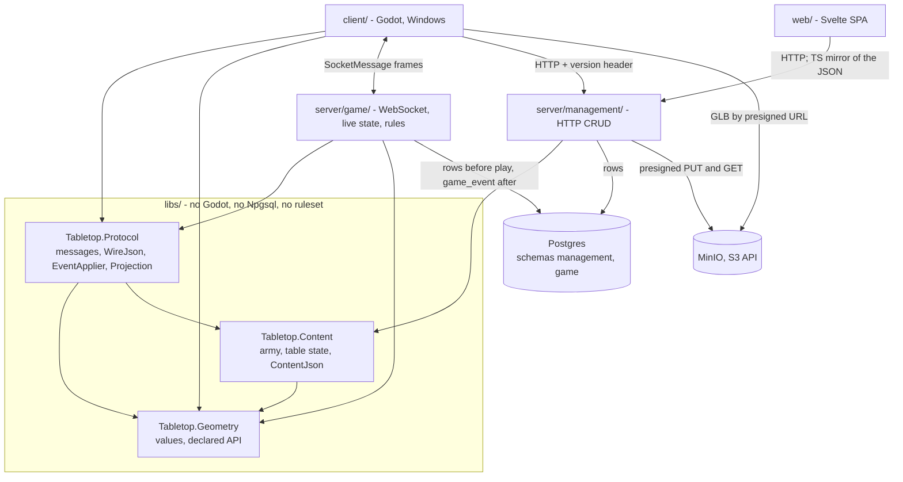
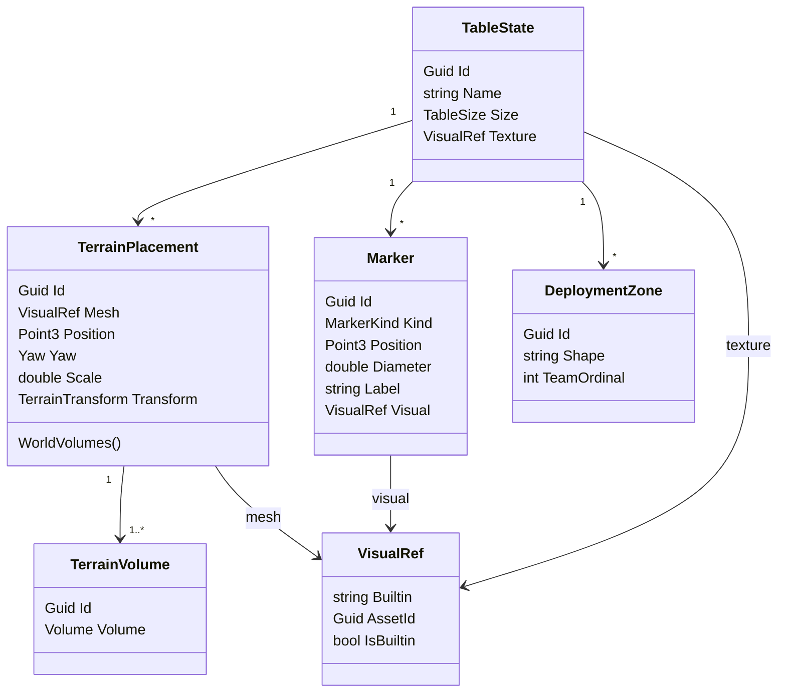
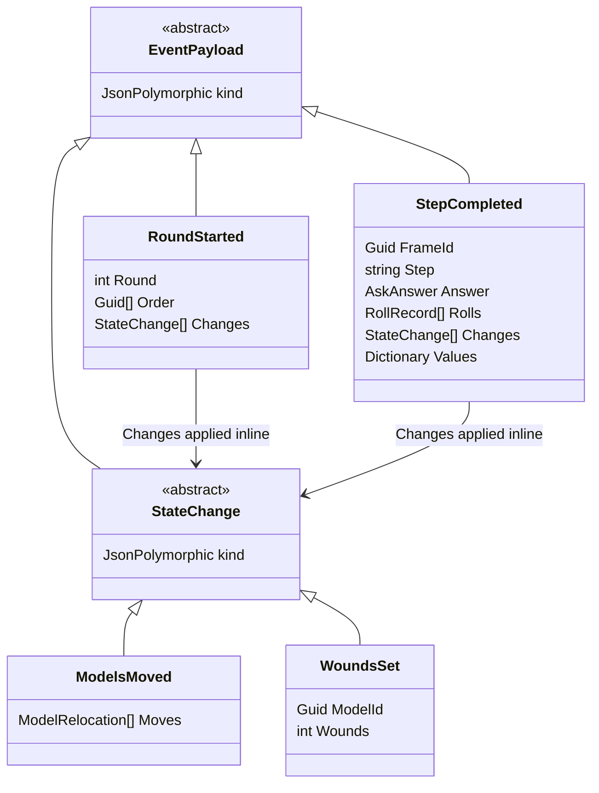
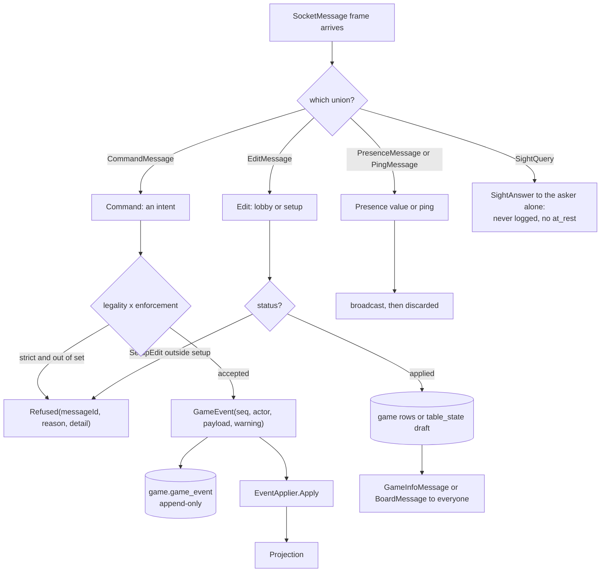
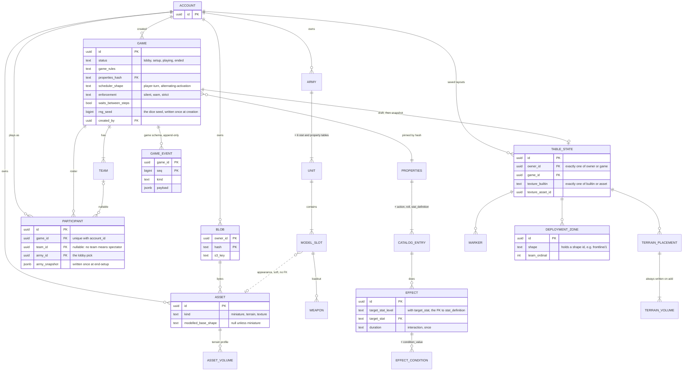
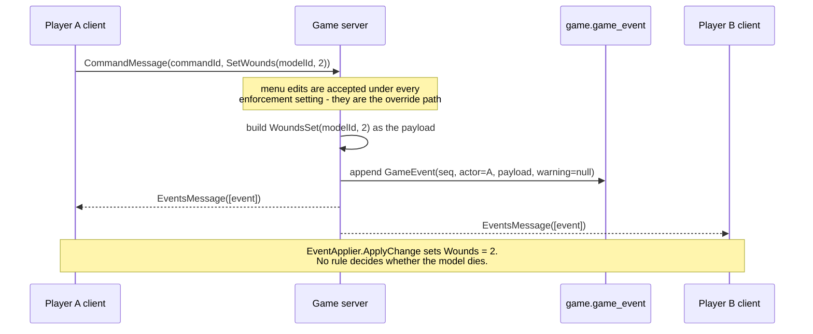
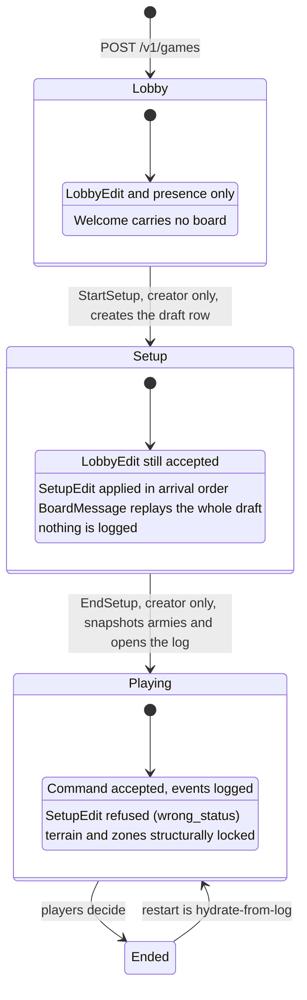
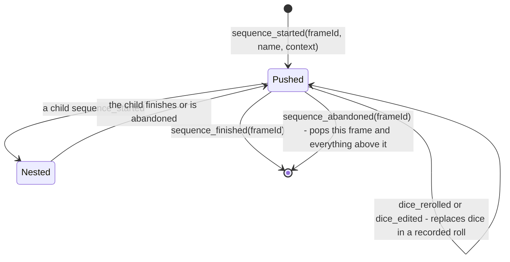

# Contracts and local development

This module is the three shared libraries under `libs/` (`Tabletop.Geometry`,
`Tabletop.Content`, `Tabletop.Protocol`), their three xUnit test projects, and the local
development environment: Postgres and MinIO in Docker plus the thirty-three-table schema as init
SQL. It owns every type more than one deliverable must agree on. That is the geometry value types
and the declared distance / line-of-sight / settling API, the army snapshot and table-state
records, and the whole socket vocabulary: commands, events, Asks, presence, setup edits, the
envelope, the JSON rules, `EventApplier`, and the `Projection` it builds.

The applier is rules-free because every event carries the complete state change it made. `Apply` is
a copy, never a derivation. An event allowed to imply a consequence its payload does not state puts
rules on the player's machine and makes undo-by-replay unsound.

Nothing in `libs/` references Godot, Npgsql, an ORM, a persistence attribute, or a ruleset. The same
assemblies therefore compile into a Windows Godot export, two Linux containers, and later WASM, and
`server/game/` stays the single home of the rules.

## Scope

**In scope.**

| Deliverable | Where | What it is |
| --- | --- | --- |
| `Tabletop.Geometry` | `libs/Tabletop.Geometry/` | `Points.cs`, `Bases.cs`, `Volumes.cs`, `Placements.cs` hold the value types. `Api.cs` declares `Distance`, `LineOfSight`, `Settling`, `Containment`, `Overlap` with throwing bodies |
| `Tabletop.Content` | `libs/Tabletop.Content/` | `Stats.cs`, `Army.cs`, `TableState.cs`, `ContentJson.cs` |
| `Tabletop.Protocol` | `libs/Tabletop.Protocol/` | `ProtocolVersion.cs`, `Game.cs`, `State.cs`, `StateChanges.cs`, `Asks.cs`, `Events.cs`, `Commands.cs`, `Presence.cs`, `Edits.cs`, `Wire.cs`, `Projection.cs`, `EventApplier.cs` |
| Tests | `tests/Tabletop.{Geometry,Content,Protocol}.Tests/` | xUnit 2.9, one project per library; `tests/` is a fourth top-level directory of the repo-level-support kind |
| Local stack | `docker-compose.yml`, `.env.example`, `scripts/postgres/init/001_schema.sql` | Postgres 17 (`5432`), MinIO (`9000`/`9001`), bucket `tabletop-blobs`, schemas `management` and `game` |
| Documentation | `CLAUDE.md` | Commands, Layout (`tests/`, the three libs), Environment (Docker, ports), Conventions (tests exist now) |

**Not in scope.**

- **Every geometry body.** `Api.cs` and `Polygon.Contains` throw `NotImplementedException("Implemented
  by the geometry plan.")`. The geometry module fills them in. It may not change a signature or a
  documented contract without first changing the spec. It also *adds* members this module does not
  declare: `Settling.SurfaceHeightAt(Point3 from, …)`, `Containment.VolumesFullyContaining`,
  `Containment.BaseFullyWithin`, `Movement`, `Table`, `ZoneStyles`.
- **`Properties` types.** The catalog, effect and condition rows are interpreted only by the game
  server. The eight tables exist in SQL here. The C# for them belongs to the game server and
  interpreter modules. `architecture.md` → Rules as data leaves the content import undesigned.
- **Any rules.** No legality, dice, turn order, threshold derivation, phase list or action list. The
  strings that name those things are on the wire. The code that reads them is not in `libs/`.
- **Any persistence code.** The schema ships as SQL that Docker applies on first volume creation. The
  real migration mechanism (DbUp, `Persistence/Migrator.cs`) belongs to the management API module.
  That module embeds a byte-for-byte copy of `001_schema.sql` as its migration 001.
- **Hosting.** Local only, per `architecture.md` → Deployment (deferred). No AWS,
  no ECS, no RDS. MinIO stands in for S3 so that later "deploying changes the address, not the
  shape".
- **`Presence` transport.** The values are here. The sample rate, the relay and the timeout are not
  (presence → Deliberately not decided).

**Build order and prerequisites.** This is step 1 of `architecture.md` → Build order, and it has no
predecessor. What already exists: `Tabletop.sln` (listing `client/Tabletop.csproj` only),
`global.json` pinning SDK `10.0.400`, `Directory.Build.props` giving each OS its own
`obj/$(OS)/`, and a `.gitignore` that excludes `.env` and keeps `.env.example`. None of the four is
rewritten. `server/game/` and `server/management/` are empty directories. `web/` and `tests/` do not
exist yet, and `libs/` is empty.

Everything else waits on this module. Geometry (step 2) and the management API and web app (step 3)
start the moment it lands and have no dependency on each other. The game server skeleton (step 4)
and the client shell (step 5) start once the wire contract is frozen. `architecture.md` → Contracts
to freeze before parallel work names these three libraries as the seams, and the event applier with
them.

**Cost of being first.** Two costs are accepted. First, `libs/` is written against specs and not
against a working consumer, so an awkward shape surfaces only in another module's plan. The seven
"Interfaces needed from other modules" obligations at the end of the plan are that record.
`MoveRegion.Containment` and the sixth `DifficultCap` parameter both came from consumers' plans.
Second, the contract has no version story beyond an integer:
[Versioning and the 426 path](#6-versioning-and-the-426-path).

## Context



The three libraries and the four things that consume them. `libs/` has no edge to Postgres, to MinIO
or to the web app.

**Seam one: `libs/` is a leaf.** Its only outward dependencies are the BCL and each other, in one
direction: `Geometry` ← `Content` ← `Protocol`. `TableState` is in `Content` rather than `Protocol`
because it is shared by the client and *both* servers, which is `architecture.md`'s criterion for
the `Content` row. Management stores it as a saved layout, the game server writes it as the setup
draft, and the client saves and loads it over HTTP (setup phase → Layouts; whole-design review
ruling 4). `architecture.md` → What is actually shared lists the table state in its
`Tabletop.Content` row.

**Seam two: the socket carries three kinds of message with three different fates.** Commands are
validated and answered with events, which are appended to `game.game_event` and replayed. Edits are
applied to the game's rows or its draft, broadcast, persisted, and **never logged** (setup phase →
A third message kind). Presence is relayed and discarded. All three travel inside one
`SocketMessage` union on one socket. The union is the only place that distinction is written down as
types rather than prose.

**Seam three: the web app is outside the type system.** `web/` shares no code with the .NET
projects (`architecture.md` → Repository layout), so the JSON conventions in `ContentJson.Configure`
are a contract the Svelte app satisfies by hand. Two shapes make that non-trivial: the
`[Flags] TerrainDeclarations` wire form (`"impassable, cover"`) and the `builtin`-or-`assetId`
exclusive pair. Nothing in this module tests the TypeScript side ([Testing](#testing)).

## Design

### 1. The layering rule

Three `.csproj` files with no `PackageReference` at all: `net10.0`, `LangVersion 12`,
`Nullable enable`, `ImplicitUsings enable`, `RootNamespace` = project name, matching
`client/Tabletop.csproj`. `Content` references `Geometry`. `Protocol` references both. The absence
of package references is the enforcement. There is no Godot SDK to acquire a Node from, no Npgsql to
acquire a connection from, and no attribute namespace to decorate an entity with. A violation
requires a `.csproj` edit, which is visible in review.

The test projects mirror the same graph. `Tabletop.Protocol.Tests` references `Protocol` only;
Geometry and Content flow transitively. The one exception is that `Tabletop.Protocol.Tests` also
references `Tabletop.Content.Tests`, because the wire samples are built from `ArmyTests.Sample()`
and `TableStateTests.Sample()`. That makes a test project a *published seam*: the game server and
client shell plans both consume `Tabletop.Protocol.Tests.Samples`. One sample set means one place to
add a case when a union grows.

`Tabletop.sln` gains solution folders `libs` and `tests`. The client project stays in the solution.
`Godot.NET.Sdk/4.7.2` restores from NuGet and compiles headless under WSL without the editor, so
`dotnet build` at the root is a whole-tree check. Nothing under `web/` is in the solution.

`Directory.Build.props` already routes `obj/` to `obj/$(OS)/`. The plan's Task 1 Step 6 verifies
that the new projects inherit it (`ls libs/Tabletop.Geometry/obj` shows only `Unix/`). The client
references these libraries from the Windows side too, and a shared `obj/` records absolute
OS-specific paths into `project.assets.json`.

### 2. `Tabletop.Geometry`: values now, bodies later

**Values.** One world unit is one inch. Yaw and orientation are degrees. The library does no unit
conversion (geometry values → Bases: "Millimetres never enter the model"). Every dimension pair is
flat `(Shape, A, B)` rather than a union of per-shape records, mirroring `base_shape/base_a/base_b`
and `footprint/dim_a/dim_b` in `schema.md`. Symmetric shapes store the same number twice, so
`(A, B)` is always the extent.

| Type | Shape | Meaning of A, B |
| --- | --- | --- |
| `Base` | `Circle` | A = B = diameter |
| `Base` | `Oval` | A = length, B = width |
| `Base` | `Rect` | A = length, B = width; a square is `Rect(s, s)` |
| `Footprint` | `Circle` | A = B = radius |
| `Footprint` | `Rect` | A = width (x), B = length (y) |

Circle base uses a **diameter** and circle footprint uses a **radius**. The asymmetry comes from the
domain: bases are sold as "32mm round", and a volume's footprint is authored from a bounding box.
Both factory methods document it. Nothing in the type system catches a mix-up, and it is the most
likely call-site error in the library.

`Volume` is an extruded prism relative to its piece's origin: `Kind` (`Solid` occupies space and its
top is standable, `Area` is stood inside), `Footprint`, `Offset`, `Yaw`, `Bottom`, `Top`,
`Declarations`, `Notes`. `Bottom`/`Top` rather than one height makes a hill (`0–2`), a wall
(`0–4`, thin footprint) and a second storey (`4–8`, nothing beneath) one mechanism (geometry values →
Collision volumes). Declarations are the six OPR terrain types as a `[Flags]` enum, beside free
`Notes` that nothing interprets. That closed-set-plus-open-field split is the rulebook's own:
players "must agree on what terrain type rules each piece follows" (Grimdark Future v3.5.1 pp. 17,
21). `Impassable` is orthogonal to `Solid`/`Area` and all four combinations are real, so it is a
declaration rather than something implied by `Solid`.

`WorldVolume(Guid Id, Volume Volume, TerrainTransform Transform)` is the placed form. Its `Id` is
the `terrain_volume` id that a move Ask names in `ImpassableVolumeIds`. That id is the only handle
the wire has on a volume, so `TerrainPlacement.WorldVolumes()` preserves it by construction.

**The declared API.** `Api.cs` contains five static classes whose every body throws. The XML doc
comments are the contract, and they encode decisions rather than descriptions.

| Member | Contract |
| --- | --- |
| `Distance.EdgeToEdge(PlacedModel, PlacedModel)` | horizontal inches, edge to edge between bases, never centre to centre; `0` when the outlines overlap |
| `Distance.EdgeToEdge(PlacedModel, Point2)` | same, to a bare point |
| `LineOfSight.Check(from, to, volumes)` | only volumes declaring `BlocksLineOfSight` obstruct; a `SeeInAndOut` volume obstructs a line passing through but not one starting or ending inside it; the mesh is never consulted |
| `Settling.SurfaceHeightAt(Point2, volumes)` | raycast down: the highest `Solid` top under the point, or `0` (the slab) |
| `Containment.VolumesContaining(model, volumes)` | ids of volumes whose footprint and vertical range contain the base centre, `Area` or `Solid` |
| `Overlap.Bases`, `Overlap.WithSolid` | flagged, never prevented (`architecture.md` → Rules enforcement) |
| `Polygon.Contains(Point2)` | point in polygon |

The signatures are declared here rather than by the geometry module because `architecture.md` lists
"`Tabletop.Geometry` API surface" as a contract to freeze *before* parallel work. Letting geometry
invent the surface with the bodies would leave the client shell and the game server unable to name
calls they must make. The price is that `ApiSurfaceTests` asserts only that each member throws,
which is a compile-time check dressed as a test. The geometry module deletes it and replaces it with
behaviour tests. The five doc comments are the specification. The empty bodies are placeholders.

Every value uses the corner frame: origin at a table corner, `0 ≤ x ≤ width`, `0 ≤ y ≤ length`, Z
up, and this module's samples assume it.
`Orientation(Pitch, Yaw, Roll)` fixes the one convention an arbitrary glTF needs. Raw mesh
coordinates are read as table-frame coordinates, rotated Pitch about X, then Roll about Y, then Yaw
about Z (right-handed, extrinsic), and scaled last. A Y-up glTF stood upright is therefore
`Pitch = 90`. The web app's converter writes the orientation and the client's mesh loader applies
it. This is the only place the rotation order is written down.

### 3. `Tabletop.Content`: army, table state, JSON conventions

**Stats are text, read under a declared kind.** `Unit`, `ModelSlot` and `Weapon` each carry
`IReadOnlyDictionary<string, string> Stats`, the text as written, mirroring `unit_stat`,
`slot_stat` and `weapon_stat` in `schema.md`. `StatValue(StatKind Kind, string Text)` with
`static Read(StatKind, string)` is the reader: `TargetNumber` accepts `4+` or `2`, `Distance` accepts
`24"`, `6` or `1.5"`, `Count` accepts an integer, `DiceExpression` accepts any non-empty string
because its grammar is undecided (content values → Deliberately not decided). Wrong format is a
`FormatException`. The wrong accessor for a kind is an `InvalidOperationException`.

The stat kinds live in `stat_definition`, which only the game server reads. The client can never
construct a `StatValue`. It renders `Stats` as written. `StatKind`/`StatValue` are in `Content` for
the two servers' benefit and are dead weight on the client. That is the accepted price of a declared
stat set (`schema.md` → Stats are rows because stats are declared: "the one unavoidable smell in the
schema").

**The army snapshot has no edge back and no `Source`.**
`ArmySnapshot(Guid Id, string Name, string GameSystem, IReadOnlyList<Unit> Units)` with
`static Of(Army, Guid id)`. `Army.Source` (where it was imported from) and `Army.Id` are both
dropped. The snapshot is *"a deep copy … no edge back to `ARMY` and no partial fields"* (content
values → `ARMYSNAPSHOT` is a deep copy), and `ArmyTests` asserts by reflection that no `ArmyId` or
`Source` property exists. `Of` **shares the `Units` list rather than cloning it**, because every
type below it is an immutable record. The copy that matters is the serialised one, written once to
`participant.army_snapshot` and never updated, which stops an edit to a saved army reaching into a
live match. The shared reference is a deep copy only while every type in the tree stays immutable,
and nothing but review enforces that.

**The table state is one record with two owners.**



`TableState` is a saved layout when management owns it, and the setup draft or snapshot when a game
does. One shape, two owners, matching `table_state`'s two nullable owner columns.

Four decisions are carried in this shape.

- **`VisualRef` is exactly one of `Builtin` or `AssetId`**, validated in the constructor, mirroring
  `texture_builtin | texture_asset_id`, `visual_builtin | visual_asset_id` and
  `terrain_placement.builtin | asset_id`. Built-in terrain, textures and marker visuals ship inside
  the client and belong to nobody. A library asset is a soft reference with no foreign key, so
  deleting an asset degrades appearance and never blocks.
- **A placement's `Volumes` is always populated.** They are copied from the asset's `asset_volume`
  rows or from the built-in's shipped volumes at add time. The draft and the snapshot are therefore
  self-contained, and the game server never resolves `asset_volume`. It could not do so anyway,
  because an asset's volumes are owner-only over HTTP. Editing them in place *is* the override.
  "Clearing" re-sends the source's own volumes (`OverrideTerrainVolumes`). `schema.md` → A terrain
  placement names a built-in or an asset states the same.
- **Objectives and tokens are one `Marker` with a `Kind`**, sized by a diameter. Markers ignore
  terrain: no settling, no collision (setup content → Markers; table domain model). Where a marker
  lives differs by origin. Setup markers are rows in `TableState.Markers`. A token dropped in play is
  a logged `MarkerPlaced` and lands in `Projection.Markers`. A setup marker's first `MarkerMoved`
  copies its row into `Projection.Markers` at the new position, and that entry wins on the shared id
  from then on; control stays keyed by id. A setup marker is never removed: `RemoveMarker` naming one
  is refused.
- **`DeploymentZone` names a *shape id* and a team ordinal**, never a team, because a saved layout
  has zones and no game. Shape ids are namespaced by style (`"frontline/1"`), the ids
  `Tabletop.Geometry.ZoneStyles.ShapesOf(style)` lists, one row per shape, keyed by ordinal `1..n`.
  The C# property is `Shape` and the column is `deployment_zone.shape`.

**`ContentJson` is the single JSON configuration.** `Configure(JsonSerializerOptions)` sets
camelCase properties, `WhenWritingNull` ignore, `JsonStringEnumConverter(SnakeCaseLower)` and
`AllowOutOfOrderMetadataProperties`. `Protocol`'s `WireJson.Options` is built by calling the same
`Configure`, giving one set of conventions and two entry points. It lives in `Content` rather than
`Protocol` because management serialises `army_snapshot` and layout payloads without touching a
socket message.

### 4. `Tabletop.Protocol`: closed message unions

Every message set is an `abstract record` base with `[JsonPolymorphic(TypeDiscriminatorPropertyName =
"kind")]` and one `[JsonDerivedType(typeof(X), "snake_case_kind")]` per concrete leaf, each leaf a
`sealed record`. There are eight such unions: `SocketMessage`, `Command`, `Edit` (with the
intermediate `LobbyEdit` / `SetupEdit` families), `EventPayload`, `StateChange`, `LegalSet`,
`AskAnswer`, `Location`.

A `kind` string plus a `JsonObject` or a property bag was rejected. Identity and enumerations opens
with *"predefined properties, not magic strings"*, against the failure mode *"a mistyped key that
silently does nothing"*. A closed C# union buys four things a bag cannot.

1. **Exhaustiveness at the switch.** `EventApplier.ApplyTo` and `ApplyChange` are `switch` statements
   with `default: throw new NotSupportedException(...)`. An event added without a handler fails at
   the first event of that kind instead of silently dropping state. For a projection rebuilt from a
   log, that is the difference between a loud bug and two clients drawing different boards.
2. **A reflection test that the set is complete.** `StateChangeTests.Registered(baseType)` reads the
   `JsonDerivedTypeAttribute`s and `ConcreteSubclasses(baseType)` reads the assembly. Every union has
   a test asserting the two sets match, that discriminators are unique, and that they are snake_case.
   A leaf that compiles but is not registered would serialise as its base and throw at runtime. The
   test catches it at build time.
3. **A place to put the direction and the fate.** The game server accepts a `LobbyEdit` at any
   status and a `SetupEdit` only while status is `setup`. `EditTests` asserts the two families
   *partition* the union (`IsSubclassOf(LobbyEdit) ^ IsSubclassOf(SetupEdit)`), so a new edit cannot
   be added without deciding which rule governs it.
4. **The free strings stay safe.** Action, stat, condition, roll, sequence, step, phase, window-kind
   and Ask-question names are left as `string`, so a second ruleset is content rather than a
   Protocol change (identity and enumerations → The closed sets, applied to Ask questions by action
   sequences constraint 9: *"who answers an Ask differs per ruleset"*). The shape the client renders
   stays closed. An `Ask` carries an arbitrary `Question` string, but its `Legal` is one of seven
   `LegalSet` kinds and its answer one of eight `AskAnswer` kinds. A new ruleset invents question
   names, and it cannot invent a rendering.

The cost is a code change for a new message. The same trade is taken elsewhere (`schema.md` →
Enumerations are `text` with a check constraint), and the `jsonb` payload column means adding an
event kind is not a database migration.

#### `StateChange` is an `EventPayload`



Thirteen leaves are registered on two bases, so one `Apply(change)` serves both the menu and
automation.

A `StateChange` is both an event in its own right and an element of the `Changes` list that
`step_completed`, `round_started` and `turn_ended` carry. A menu edit or a hand move logs exactly
one. This is the type-level expression of game flow → Nothing is an invariant: *"automation and the
menu write the same fields through the same path"*. Each of the thirteen leaves carries a
`[JsonDerivedType]` on both `StateChange` and `EventPayload` with the same discriminator.
`EventTests.State_change_kinds_match_on_both_bases` asserts the two registrations agree.
`System.Text.Json` selects the discriminator from the declared type of the property being written,
`StateChange` inside `Changes` and `EventPayload` inside `GameEvent.Payload`, so a divergence would
produce two spellings of one fact in one log.

Wrapping every state change in a `StateChanged` event payload was rejected: it adds a level of
nesting to the most common event in the log and forces the applier to unwrap before it can switch.

#### The three fates of a socket frame



#### Event inventory

`GameEvent(long Seq, Guid? Actor, EventPayload Payload, string? Warning)` with a `[JsonIgnore]`
`Kind => EventKinds.Of(Payload)`. `Actor` is the participant who caused it and `null` when the engine
did. `Warning` is set under `warn` enforcement when the command was outside the legal set
(whole-design review ruling 1). `Kind` is what the game server writes to `game_event.kind`, and
`EventKinds` exposes `All`, `Of(Type)` and `Of(EventPayload)` from the same attribute metadata the
tests read.

| Group | Kinds | Payload of note | Source |
| --- | --- | --- | --- |
| Scheduler | `round_started`, `turn_started`, `turn_ended`, `phase_started` | `RoundStarted(Round, Order, Changes)`; `TurnEnded(TeamId, Passed, Changes)` | scheduler → Events; `turn_ended.passed` from whole-design review → The scheduler's pass |
| Resolution stack | `sequence_started`, `step_completed`, `sequence_finished`, `sequence_abandoned` | `StepCompleted(FrameId, Step, Answer, Rolls, Changes) { Values }`; `SequenceStarted(FrameId, Sequence, Context, Outline?)`, the outline the sequence's player-facing steps as `OutlineStep(Step, Label)`, null in logs written before it | action sequences → The resolution stack, Abandonment |
| Asks | `ask_opened`, `ask_answered`, `ask_closed` | `AskAnswered(AskId, TeamId, Answer?, OutsideLegalSet)`; `AskClosed(AskId, IRL<TeamAnswer>)` | action sequences → Asks, Windows; client shell → the projection holds the current Asks |
| Dice | `dice_rerolled`, `dice_edited`, `modifier_added` | `DieReplacement(Index, Die Old, Die New)`; `ModifierAdded(FrameId, Roll, RollModifier)` | resolution → Players roll their own dice; scheduler → Deployment ("every roll result is editable from the menu") |
| Undo | `undone` | `Undone(long ToSeq)` | `architecture.md` → Undo; client shell → undo is local first |
| State change | `models_moved` | `ModelsMoved(IRL<ModelRelocation>)`, one kind for deployment, hand moves, casualties and embarking | table domain model → The one wire decision; game flow → The shelf, Inside a container |
| State change | `wounds_set`, `condition_set`, `action_recorded`, `action_record_cleared` | `ConditionSet(Subject, Condition, Present)` | game flow → What a unit in play records, Nothing is an invariant |
| State change | `grant_added`, `grant_removed` | `Grant(Id, EffectId, EntryName, CasterUnitId, RemainingUses)` | spell effects → The grants store |
| State change | `spell_tokens_set` | per model | action sequences → The token economy (p.13, capped at 6) |
| State change | `wounds_this_activation_set` | per unit, cleared at `turn_ended` | whole-design review → Gaps filled ("a store that outlives the frame") |
| State change | `score_set` | per team | game flow → Scoring |
| State change | `marker_placed`, `marker_moved`, `marker_removed` | tokens dropped in play only | setup content → Markers; whole-design review → "Tokens had no home in the log" |

Two shapes in this table need more than a table row.

**`StepCompleted.Values` is an `IReadOnlyDictionary<string, int>?`.** It is a flat map of named
integers holding a step's settled parameters: attacks counted, a capped multiplier, a token spend,
a winner's ordinal, "a distance used in tenths". A later step or a nested frame reads them without
re-deriving.
It is a non-positional `init` property, wire name `values`, omitted when null. It is the one open
string bag in a design whose governing principle is the opposite, and action sequences left it open:
*"Whether `step_completed` payloads need a schema per step kind, or stay free-form."* It is
`int`-only, so a distance has to be encoded in tenths. It is the weakest type in the contract.

**`ModelsMoved` carries `From` as well as `To`, and the applier ignores `From`.** The table domain
model's reason was *"start position is recorded as well as stop because undo needs somewhere to go
back to"*. Undo is replay from the initial state, so reconstruction never reads `From`. It survives
for the log panel's narration and for an inverse-event path this design has rejected. It is
redundant weight on the most frequent event on the wire.

#### Command inventory

`Command` is an intent. The server answers with events, or with `Refused` under `strict`.

| Group | Kinds | Source |
| --- | --- | --- |
| The only in-play action path | `answer_ask` | action sequences → Asks; scheduler → The turn is an Ask |
| Hand move | `move_models` | client shell → Input and presence (the drop sends one move command) |
| Tokens in play | `place_marker`, `move_marker`, `remove_marker` | setup content → Markers |
| The menu | `set_wounds`, `set_condition`, `record_action`, `clear_action_record`, `add_grant`, `remove_grant`, `set_spell_tokens`, `set_wounds_this_activation`, `set_score`, `set_active_team`, `set_round` | client shell → The log, undo and the menu; scheduler → Nothing is an invariant |
| Undo and abandon | `undo`, `abandon_sequence` | `architecture.md` → Undo; action sequences → Abandonment |
| Dice | `reroll_dice` (empty indices means every die), `set_dice`, `add_modifier` | resolution → Players roll their own dice; scheduler → Deployment |

**There is no end-turn command and no pass command.** Both are `AnswerAsk`. The turn is an Ask, and
passing is a real answer (`Passed`) that is logged.
`CommandTests.There_is_no_end_turn_or_pass_command` asserts by reflection that no `EndTurn`,
`EndActivation` or `Pass` type exists. The test is written against `architecture.md`'s examples;
`EndActivation` is included because a pre-design sketch used that name. Each menu command maps one-to-one onto its
`StateChange` event, except `SetActiveTeam` (logs `turn_started`) and `SetRound` (logs
`round_started`).

#### Ask inventory

`Ask(Id, Question, Prompt, IRL<Guid> Teams, LegalSet Legal, bool AllowPass, bool Sealed,
string? WindowKind, Guid? FrameId)`. Teams is a list because a sealed window addresses several at
once. `FrameId` is null for the scheduler's own Asks. `WindowKind` is the name a player mutes by and
is null when the Ask is not a window. `AskQuestions` holds only the engine's own nine names:
`activate`, `act_or_end_phase`, `deploy`, `deploy_scouts`, `deploy_ambusher`, `end_round`,
`confirm`, `react`, `spend_tokens`. Every other name comes from `GameRules`, including `shoot_or_not`,
`strike_back`, `remove_casualties`, a charge target, a spell's targets and a `Takedown`'s target model.

| `LegalSet` | Answer | Used for |
| --- | --- | --- |
| `Options(IRL<AskOption> Choices)` | `Chosen(OptionId)` | activate (unit x action), act-or-end-phase, react, ruleset yes/no questions |
| `PieceSelection(Eligible, Min, Max)` | `SelectedPieces(PieceIds)` | deploy, deploy scouts, deploy ambushers, spell targets (1..`target_count`), a `Takedown`'s target model (p.14) |
| `Allocation(Targets, Amount)` | `Allocated(IRD<Guid,int>)` | wound assignment, casualty removal; the counts sum to `Amount` exactly |
| `Assignment(Items, Targets, MaxDistinctTargets)` | `Assigned(IRD<string,Guid>)` | weapon groups to up to two targets (p.8) |
| `MoveRegion(ModelIds, Allowance, ImpassableVolumeIds, DifficultVolumeIds, DifficultCap, Containment?)` | `Destinations(IRL<ModelRelocation>)` | every declared move, charge close-in, fall back, consolidation, embark, disembark |
| `TokenSpend(MaxByModel)` | `TokensSpent(Counts)` | casting's simultaneous token spend, per spending model (p.13) |
| `Confirmation` | `Confirmed` | the wait-between-steps confirm gate, the round boundary |
| any, when `AllowPass` | `Passed` | a window's pass, a team passing its turn |

`MoveRegion` is the continuous-action case `architecture.md` designs for. The server sends
parameters, not an enumerated answer, and `Tabletop.Geometry` draws the consequence.
`DifficultCap` is the whole-move cap `GameRules` computed, null when the ruleset has none. In OPR it
is 6" and never a multiplier (`architecture.md` → Continuous actions).

`MoveContainment(Enterable, ExitingId, ExitWithin)` is the newest field in the contract.
`Location.Inside` and `ModelRelocation` already put an `Inside` destination on the wire, but nothing
told the client where one is legal, so the move Ask carries it. `Enterable` are the containers a
model reaching one embarks the **whole unit** into, since *"only one model needs to reach the
Transport for everyone to embark"*. The answer is therefore a `Destinations` whose `To` is
`Inside(container)` for every model of the unit, not one relocation per reachable model. `ExitingId`
is the container the unit is inside. `ExitWithin` is the distance its models must be placed **fully**
within of it (OPR: 6"), which is `Containment.BaseFullyWithin`. The client draws that region instead
of `Movement.Region`, because an occupant has no position to move from. `Enterable` and `ExitingId`
are never both set, which enforces *"never both in one activation"* (game flow → Inside a container;
Grimdark Future p.15 `Transport(X)`, p.21 solid buildings). `Containment` is optional, so an ordinary
open-table move constructs with five arguments.

**`PieceSelection.Eligible` holds either grain.** A unit id is the grain for deploy, for an Ambusher
and for a charge target. A model id is the grain for a spell whose `effect.target_grain` is `model`,
and for a `Takedown` choosing which model of the target unit takes the wound (Grimdark Future p.14).
Nothing in the contract distinguishes the two. `LegalSetMembership` checks the count bounds, the
distinctness of the ids and their presence in `Eligible`. The client resolves a clicked piece's own
id first and the unit its selection widened to second, so a model-grain set is answerable by one
click, and `Names.Piece` labels a unit, a model or a marker from the same id. A `Takedown` target Ask
is therefore a `PieceSelection(models, 1, 1)` under a `GameRules` question name, and costs nothing
new on the wire.

**A wound already names its model.** `WoundsSet(Guid ModelId, int Wounds)` sets one model's absolute
wound count, and it travels inside `StepCompleted.Changes` like every other state change. A
`Takedown`'s wound is that change on the chosen model id, so a targeted wound needs nothing new on the
wire. What a takedown sequence bypasses is the `assign` Ask itself: p.15's rule that a wounded `Tough`
model takes wounds until it dies, and its rule that heroes are assigned last, both live in the
predicate that builds `Allocation.Targets`, and a step that opens no `Allocation` consults neither.
The bypass is an absence in the sequence rather than a field in the contract.

**`TokenSpend` is a per-model map.** `TokenSpend(IRD<Guid,int> MaxByModel)` names every model that
may pay and the number of tokens it holds. Grimdark Future p.13, `Caster(X)`: *"Models within 18" in
line of sight of the caster's unit may spend any number of spell tokens at the same time before
rolling, to give the caster +1/-1 to the roll per token."* The player chooses which model pays what,
because every token holder is itself a caster with its own spell to pay for. A model may pay only
what it holds, and that per-model cap is the map's value; a team's maximum is the sum of its own
entries and is not carried separately. The caster's own model is in the map with the tokens it has
left after the spell's cost. The hero upgrade whose single token is spendable only in a token spend
(p.31) is one more model with a cap of one. `TokensSpent(IRD<Guid,int> Counts)` is the answer, a key
absent from it paid nothing, and an empty map is the fact `Passed` already carries.
`LegalSetMembership` checks that every key is a key of `MaxByModel` and every value lies between
zero and that key's cap. Which team owns a key is the spend step's check and not membership's, on
the precedent of `MoveRegion`, whose distances belong to the move step. One map covers every
addressed team's eligible models, because an Ask has one legal set for all of its teams, and it
reveals nothing: `ModelInPlay.SpellTokens` is in the projection every client holds, and range and
line of sight are read off the table. The sealed window still withholds the answers (the plan's
Rulings → The token spend and the `Takedown` target).

Reusing `Allocation(Targets, Amount)` for the spend was rejected on two counts. `Allocated` is legal
only when its counts sum to `Amount`, which is what wound assignment and casualty removal need and
the opposite of a spend of any number up to a maximum. `Allocation` also carries no per-target cap,
and the cap does not follow from a total: five tokens over two models holding one and four is a
different legal set from five over two holding three and two. An optional cap map plus an exactness
flag on `Allocation` would make one shape's meaning conditional on a field, would change what its
two existing uses validate against, and would buy the deletion of a wire kind that already exists.
`TokenSpend` and `TokensSpent` keep their slots and change their shapes, so `LegalSet` still has
seven kinds and `AskAnswer` eight.

#### Edit inventory

An `Edit` is applied to the game's rows or its draft, broadcast, persisted, and **never logged**
(setup phase → A third message kind). Two families, two acceptance rules.

| Family | Kinds | Accepted | Source |
| --- | --- | --- | --- |
| `LobbyEdit` | `create_team`, `pick_team`, `pick_army`, `set_configuration` | any status | whole-design review rulings 4 and 5; setup phase → Joining, The lifecycle |
| `LobbyEdit` | `start_setup`, `end_setup` | any status, **creator only** | setup phase → The lifecycle (`game.created_by`) |
| `SetupEdit` | `set_table_size`, `set_texture` | `setup` only | setup phase → Editing is free for all |
| `SetupEdit` | `add_terrain`, `move_terrain`, `scale_terrain`, `remove_terrain`, `override_terrain_volumes`, `swap_terrain_mesh` | `setup` only | setup phase → Terrain: imported, built-in, generated |
| `SetupEdit` | `add_setup_marker`, `move_setup_marker`, `remove_setup_marker` | `setup` only | setup phase → Editing is free for all |
| `SetupEdit` | `set_zone_style`, `swap_zones` | `setup` only | setup phase → Zones |
| `SetupEdit` | `replace_draft` | `setup` only | setup phase → Layouts (the layout wins, size included) |

Three notes. The setup marker edits are named `*Setup*` because `PlaceMarker`/`MoveMarker`/
`RemoveMarker` are the in-play commands. Same nouns, different lane, and the naming is the only
thing keeping them apart.

`PickTeam(null)` and `PickArmy(null)` are how a participant leaves a team or drops an army. A
participant with no team is never Asked, and that is what a spectator is (whole-design review ruling
5).

`SetZoneStyle(Style, Shapes)` carries the style's shape ids, `ZoneStyles.ShapesOf(style)` in
team-ordinal order. The server's draft editor therefore stays a pure function over strings and never
links a geometry inventory into a rules decision. It writes one `DeploymentZone` per shape keyed by
ordinal `1..n` whether or not a team with that ordinal exists yet (setup phase → Zones). It is
consistent with ruling 5: a style's shape list is a property of the style, not of the team list.

#### Presence

`Presence(ParticipantId, Cursor?, Selection?, IRL<PresencePlacement> Placements, Measurement?)` is
one value per connected participant, latest wins, never logged. **Existence is connectedness**
(presence → Connectedness is not a field), so there is no `Connected` flag and no sequence number.
`Cursor(Point3 Point, Guid? Target)` carries the piece under the ray rather than making every
receiver raycast every other cursor. `Selection(PieceId, IRL<Guid> ModelIds)` is a unit, optionally
with the models inside it (empty means the whole unit), or during setup a terrain placement or
marker. `PresencePlacement` carries `PlacementKind { Held, Proposed }`, so a drag and a movement
ghost are one value differing only in what others draw. `Measurement` is two already-resolved
points. The receiver draws a line and computes the length itself. There is no anchor union and no
re-resolution. `Ping(Sender, Point, Target?)` rides as its own message rather than a field on
`Presence`, because presence is state and a ping is an instant.
`EditTests.A_ping_is_not_a_presence_field` asserts that by reflection.

#### The envelope

`SocketMessage` is one union for both directions, with each kind's direction documented rather than
typed. The union therefore admits a client sending a `Welcome`. The game server switches on the
kinds it accepts and treats any other kind as a protocol error (close code `1002`). One union means
one `WireJson.Serialize`/`Deserialize` pair and one text frame format on a bidirectional socket.

| Direction | Kinds |
| --- | --- |
| Client to server | `connect` (`Connect(SessionJwt, GameId, ClientVersion)`), `command`, `edit`, `sight_query` (`SightQuery(QueryId, ObserverUnitId, TargetUnitId)`) |
| Server to client | `welcome` (`Welcome(ParticipantId, GameInfo)`), `game` (`GameInfoMessage`), `board` (`BoardMessage`), `events` (`EventsMessage(IRL<GameEvent>)`), `at_rest` (`AtRest(Seq)`), `presence_ended`, `refused` (`Refused(MessageId, RefusalReason, Detail)`), `rejected` (`Rejected(RejectReason)`), `sight_answer` (`SightAnswer(QueryId, Lines, CanShoot)`, to the asker alone), `model_facts` (`ModelFacts(MaxWounds)`) |
| Both | `presence`, `ping` |

Sixteen kinds. Every receiver but the game server ignores a kind it does not handle and stays up,
which is what lets a kind be added to the union without a lockstep release of the client, the viewer
and the simulator.

`RejectReason { UpgradeRequired, InvalidSession, NotAParticipant }` closes the connection.
`RefusalReason { OutsideLegalSet, Illegal, WrongStatus, NotPermitted, Unknown }` refuses one command
or edit and leaves the socket up. `Refused.MessageId` is the client's own `CommandId` or `EditId`,
so both `CommandMessage` and `EditMessage` carry a client-generated `Guid`. It is a correlation id
and nothing else. An accepted command gets no acknowledgement, because the resulting event is the
acknowledgement.

**`AtRest(long Seq)` is the rest frame.** The game server sends it when it has finished processing
an inbound `connect`, `command` or `edit` and has nothing further to emit for that game. It is
sent after the last frame that processing produced: the hydration frames on a connect, the `events`
frame on an accepted command, the `refused` frame on a rejected one. Who receives it is the game
server's rule and is settled in its design: the frame follows its batch, broadcast when the batch
appended an event and sent to the provoking client alone when it did not. Presence and pings are
relayed rather than processed and never produce one, and a `sight_query` is answered without being processed into the log, so it produces none either. `Seq` is the last sequence number in the log, so it repeats the previous value
when the round of processing appended nothing, and is `0` for a game whose log is empty. It is a
rest point, not a receipt: `at_rest` says nothing more is coming, and never that anything happened.
The cost is one small frame per participant per inbound frame, paid by every client whether or not
it reads them.

### 5. Serialization rules

| Rule | Mechanism | Why |
| --- | --- | --- |
| camelCase properties | `PropertyNamingPolicy = CamelCase` | one convention for the socket, `army_snapshot`, `game_event.payload` and the Svelte app |
| string enums, snake_case | `JsonStringEnumConverter(SnakeCaseLower)` | the same spellings the database's check constraints use, so the game server's `RowMapping` reads enum text through `WireJson` instead of keeping a second table |
| two hyphenated exceptions | `[JsonStringEnumMemberName("player-turn")]`, `("alternating-activation")` | `game.scheduler_shape` was already written hyphenated in `schema.md` |
| `[Flags]` as a joined string | `JsonStringEnumConverter` | `TerrainDeclarations.None` is `"none"`; `Cover \| Impassable` is `"impassable, cover"`, names in ascending flag order joined by `", "` |
| `"kind"` discriminator, snake_case | `[JsonPolymorphic]` + `[JsonDerivedType]` | one spelling per leaf, asserted unique and snake_case by test |
| nulls omitted | `DefaultIgnoreCondition = WhenWritingNull` | a withheld sealed answer, an absent `WindowKind`, an absent `Values` all vanish rather than appearing as `null` |
| discriminator may arrive late | `AllowOutOfOrderMetadataProperties = true` | a hand-written or re-serialised frame must not depend on property order |
| derived properties never serialised | `[JsonIgnore]` | see below |

**The `[JsonIgnore]` rule.** `System.Text.Json` writes every get-only property, so a computed
property is on the wire unless it is suppressed. Seven such properties exist on five types, and
every one is attributed: `Point3.Horizontal`, `VisualRef.IsBuiltin`, `TerrainPlacement.Transform`,
`GameEvent.Kind`, and `StatValue`'s three accessors (`TargetNumber`, `Inches`, `Count`). The last
three would throw during serialization for any given `Kind`, since two of the three always throw.
`TableStateTests.TableState_round_trips_through_json` asserts `"horizontal"`, `"isBuiltin"` and
`"transform"` are absent from the JSON. Any later convenience property on a wire type inherits this
obligation, and nothing but that test enforces it.

**What round-trip equality proves.** The tests compare
`Serialize(value) == Serialize(Deserialize(Serialize(value)))` and compare runtime types, not
`value == back`. Records with collection members use reference equality for those members, so
`new ModelsMoved([x]) != new ModelsMoved([x])`. Types whose members are all value types or strings
are values: `Volume`, `Placement`, `OnTable(Placement)`, `Marker`. The applier and the tests rely on
that (`Assert.Equal(Samples.Deploy.To, model.Location)`). These records are values on the wire and
only sometimes values in C#, and nothing in the type system distinguishes the two groups.

### 6. Versioning and the 426 path

`ProtocolVersion` holds three constants and no logic: `Current = 1`,
`Header = "Tabletop-Client-Version"`, `UpgradeRequiredStatusCode = 426`. The client sends the header
on every management request and the same integer inside `Connect.ClientVersion`. Management answers
`426 Upgrade Required` when it is below its configured minimum. The game server answers
`Rejected(UpgradeRequired)` and closes. The client shell renders either as an *update required*
screen (management API → The version check; client shell → Screens).

Two things are absent.

- **There is no negotiation and no per-message version.** One monotonic integer, compared against a
  server-side minimum. The game server reads that minimum from `TABLETOP_MIN_CLIENT_VERSION`,
  defaulting to `ProtocolVersion.Current`. Adding a field is compatible by construction: unknown
  properties are ignored on read and nulls are omitted on write. Renaming or removing one is not.
  The only remedy is to raise the minimum and lock old clients out.
- **The event log is a persistence format with no version stamp.** `game_event.payload` is
  `WireJson.Serialize(GameEvent)`, so the log's schema is the wire schema. Undo is replay, and
  replay reads rows written by whatever build was live at the time. `Properties` is content-addressed
  and pinned because *"replay needs the exact ruleset that produced the log"*. The same argument
  applies to the payload shape, and nothing pins it. `GameRules` is knowingly unpinned (identity and
  enumerations → Only `Properties` is pinned), and this extends that accepted risk from behaviour to
  format. The only mitigation today is the rule already in the design: never rename or remove a
  payload property, only add. This is accepted with a revisit trigger
  ([Key decisions](#accepted-risk-the-payload-format-is-unversioned)), and no version field is
  added now.

The HTTP status code `426` sits in `Tabletop.Protocol`, which otherwise knows nothing about
transports. That is accepted so the client, management and the game server name one constant rather
than three literals.

### 7. The projection

| Held in `Projection` | Absent |
| --- | --- |
| `Board`: the `TableState` plus one `ArmyInPlay` per participant, fixed for the life of the game | presence, pings, measurements and ghosts, held in a separate in-memory table and gone with the socket |
| `Units`, as `UnitInPlay`: `Actions`, `Conditions`, `Grants`, `WoundsThisActivation` | the setup draft; there is no log during `setup`, so there is no projection |
| `Models`, as `ModelInPlay`: `Location`, `Wounds`, `Conditions`, `SpellTokens` | terrain, zones and table size as mutable state; they live inside `Board` and nothing can reach them |
| `Markers`, only tokens dropped in play | legality, dice, turn order, thresholds, all server only |
| `Scores` by team; `Scheduler`: `Round`, `Order`, `ActiveTeamId`, `Phase`, `Passed` | anything derived: no "is this unit activated", no "whose turn is next", no distances |
| `Stack`, frames bottom first; `OpenAsks`, the Ask plus each team's answer; `LastSeq` | any store the applier would have to clear on its own initiative |

The left column is everything a client draws about a game in progress.

`Projection.Initial(board, game)` seeds it: every model on its owner's shelf
(`Location = OnShelf`), no wounds, no conditions, every team's score `0`, round `0`, an empty stack,
no open Asks, `LastSeq = 0` (client shell → The connection and the projection; game flow → The
shelf). From there the only writer is `EventApplier`.

**The read/write split.** `Projection` and its six satellite classes (`UnitInPlay`, `ModelInPlay`,
`SchedulerPosition`, `Frame`, `CompletedStep`, `OpenAsk`) expose `IReadOnlyDictionary`,
`IReadOnlyList` and `IReadOnlySet` views over `internal` mutable fields. `EventApplier` lives in the
same assembly and is the only thing that can reach them. This is the cheapest mechanism that gives
consumers a read-only surface without copy-on-write. It costs two things. The read-only views are
live, so a consumer holding `projection.Units[id].Conditions` sees it change under them. And
`internal` is assembly-scoped, so nothing stops a later type in `Tabletop.Protocol` from writing to
a projection.

**What is absent.** Four omissions carry design weight.

- **No terrain, no zones, no table size.** They live in `Projection.Board.Table`, unchanged for the
  life of the game, because *"terrain and objectives are locked after setup with no flag and no
  check, because nothing in the log can reach them"* (`architecture.md` → Terrain placement is a
  game phase). The lock is the absence of terrain events. Destructible terrain would be additive:
  terrain events on top of the same snapshot.
- **No presence.** Presence and setup edits bypass the projection entirely (client shell). Presence
  is a separate in-memory table keyed by participant, and a setup edit replaces the draft.
- **No draft.** During `setup` there is no log, so there is no projection. The client holds a
  `TableState? Draft` instead and constructs the applier only when a `BoardMessage` arrives at
  `playing`. `Projection?` is nullable in the client's `Session` as a result.
- **Nothing derived.** No "is this unit activated", no "whose turn is it next", no legal set, no
  distance. `SchedulerPosition` holds only what the four scheduler events state: round, order,
  active team, phase, and the set of teams that passed. *"The scheduler reads state on every step and
  never assumes its last output is still true"* (scheduler → Nothing is an invariant).

**The one copy that looks like a derivation.** `CompletedStep.Values` is copied from
`StepCompleted.Values`. The interpreter's own `FrameReader` reads the event. The client's log panel
reads this copy. The duplication lets the client render a step's settled numbers without any ruleset
code.

### 8. `EventApplier`

```csharp
public sealed class EventApplier(Board board, GameInfo game)
{
    public Projection Projection { get; private set; }
    public IReadOnlyList<GameEvent> Log { get; }              // every event received, undone included
    public void Apply(GameEvent e);
    public void ApplyAll(IEnumerable<GameEvent> events);
    public Projection ProjectTo(long seq);                     // local undo prediction
    public static IReadOnlyList<GameEvent> EffectiveLog(IReadOnlyList<GameEvent> log);
    public static void ApplyTo(Projection p, GameEvent e);
    public static void ApplyChange(Projection p, StateChange change);
}

public sealed class ProjectionDesyncException(string kind, Guid unknownId) : Exception
{
    public string Kind { get; }                                // the event kind that could not be applied
    public Guid UnknownId { get; }                             // the id the projection has no entry for
}
```

`ProjectionDesyncException` is thrown wherever an event names an id the projection does not hold: a
model, a unit, a marker, an Ask, a frame or a roll. `Kind` is `EventKinds.Of(payload)`, so a change
riding inside `round_started`, `turn_ended` or `step_completed` reports its own kind rather than the
carrier's, because that is what names the payload that failed. It means the projection the caller
passed in is unusable and has to be thrown away and rebuilt, not that the event was bad. Nothing is
repaired partway: a payload carrying several relocations may have applied some before it threw, and
the failed event is already in `Log`, which is why the whole applier goes rather than the event.
The two call sites answer it differently, and the difference is the point of the type. A client
drops its projection, reconnects, and rebuilds from the log (client shell → The connection and the
projection). The game server, which is applying events it wrote itself, faults the session: a resync
replays the same event and throws again, so the fault is a server bug and hiding it behind a rebuild
loop would hide the bug.

The contract as prohibitions: **it never decides legality, never derives a location, never clears a
store on its own.** Every branch in `ApplyChange` is an assignment, an `Add`, a `Remove` or a
`Clear` driven by a field in the payload. `ModelsMoved` sets `Location = r.To` and does not consult
geometry, because the server already settled the Z. `ConditionSet` adds or removes by the payload's
`Present` flag rather than toggling. `GrantAdded`/`GrantRemoved` are explicit rather than the applier
noticing a grant was used, as spell effects requires: *"Both are explicit in the payload, so the
client's projection copies rather than derives."*

Three branches look like exceptions and are not.

1. **`RoundStarted` clears `Passed` and `ActiveTeamId`.** That is the definition of a new round's
   position rather than a rule. The round-boundary hooks' effects (record clears, spell tokens,
   fatigue) ride as `RoundStarted.Changes` and are applied through the same `ApplyChange`.
2. **`TurnEnded` adds to `Passed` only when `Passed` is true**, and clears `ActiveTeamId` only if it
   was this team's. A team's pass *"is logged and stands for the round"* (scheduler → Re-entering a
   round). The applier holds it because the event says so, not because it knows what finishing
   means.
3. **`StepCompleted` clears the frame's pending modifiers for each roll it carries.** A hand-added
   modifier is recorded as `ModifierAdded` before the roll happens, and the `RollRecord` that comes
   back already folds it in (action sequences → One roll primitive). Keeping it pending would
   double-count it in the UI. This is the only bookkeeping in the applier that is not a direct copy,
   and the roll record being complete is what justifies it.

**Undo is a rebuild, not an inverse.** `Undone(N)` is appended to the log like any event. `Apply`
sees it and replaces the whole `Projection` with a rebuild of `EffectiveLog(log)` from
`Projection.Initial`. `EffectiveLog` walks the log once. On meeting an `Undone(u)` it drops every
event with `Seq > u.ToSeq`, and it never emits the `Undone` markers themselves. The log stays
append-only, which is the database's own guarantee, while the effective log shrinks. `ProjectTo(seq)`
builds a throwaway projection of the effective log up to `seq`. That is the client's local undo
prediction: `Session.Projection` returns `Applier.ProjectTo(n)` until the server's `undone` arrives
or the command is `Refused`.

`ToSeq` must be `0` or the seq of a **live** event. The game server refuses anything else
(`Replay.IsValidUndoTarget`). The applier does not check it. Because `Undone` markers are dropped
from the effective log, undoing to a sequence number that has already been undone past re-truncates
rather than resurrecting the events between. The server-side guard is the only thing keeping `undo`
from meaning that.

### 9. Local development

One `docker-compose.yml` at the repo root beside `Tabletop.sln`, three services, two volumes.

| Service | Image | Ports | Notes |
| --- | --- | --- | --- |
| `postgres` | `postgres:17-alpine` | `5432` | db `tabletop`, user `tabletop`; `./scripts/postgres/init` mounted read-only at `/docker-entrypoint-initdb.d`; healthcheck `pg_isready` |
| `minio` | `minio/minio` (pinned release) | `9000` S3 API, `9001` console | healthcheck `mc ready local` |
| `minio-init` | `minio/mc` (pinned release) | none | waits for `minio` healthy, then `mc mb --ignore-existing local/tabletop-blobs`, prints `bucket ready` |

`.env.example` is committed and `.env` is not (the existing `.gitignore` already handles both). It
defines the five names the two server modules read: `TABLETOP_DB_CONNECTION`,
`TABLETOP_S3_ENDPOINT`, `TABLETOP_S3_BUCKET`, `TABLETOP_S3_ACCESS_KEY` and
`TABLETOP_S3_SECRET_KEY`. It also defines `TABLETOP_DB_PASSWORD` for compose itself. Reserved ports:
management `5100`, game server `5200`, both binding `0.0.0.0`.

**Three decisions in this file.**

- **MinIO stands in for S3** because it speaks the S3 API the AWS SDK's `AmazonS3Client` already
  targets (`ServiceURL` + `ForcePathStyle`), so presigned PUT and GET work unchanged and the
  management API writes S3 code once. `architecture.md` → Local development: *"deploying changes the
  address, not the shape."*
- **Two Postgres schemas in one database**, `management` and `game`, a choice made for local
  development and recorded under `schema.md` → Still open. The reason is in `architecture.md`: the
  game server reads management's rows at hydration and writes a game's own rows while status is
  `lobby` or `setup` and `status = 'ended'` from `playing`, which is one connection when they share a database. The stated cost stands:
  *"the two services share a database, so a management migration can break the game server"*.
  Hosting may revisit it.
- **Windows reaches WSL over forwarded localhost.** With WSL2's default `localhostForwarding=true`,
  Docker's published ports and any WSL listener on `0.0.0.0` answer at `localhost:<port>` from
  Windows. The Godot client uses `localhost` for both servers, and presigned MinIO URLs are minted
  for `http://localhost:9000`. The same URL works from a WSL server and a Windows client. This is
  the only configuration, so it is the one always tested.

**Migrations: two mechanisms.** `scripts/postgres/init/001_schema.sql` is applied by Postgres on
first volume creation, so a bare `docker compose up -d` yields the full schema, which is all the
game server and its tests need. `docker compose down -v && docker compose up -d` re-applies it. The
management API module owns the real migrator (DbUp). It embeds a byte-for-byte copy of this file as
migration `001`, recognises a compose-built database (`management.account` exists, no journal) and
records 001 as applied instead of re-running it, then owns `002_blob_uploaded.sql` onward. A database
management creates from nothing, such as its per-run test databases, gets 001 from DbUp. **The
`create schema management; create schema game;` at the top of this file is the only place either
schema is created, on either path.** The game server never migrates.

#### The schema, by group

Thirty-three tables: thirty-two in `management`, one in `game`. The diagram is the group structure
plus the columns that carry design weight. `schema.md` holds every column.



Six groups: accounts and the asset library, the army tree, `Properties`, games and their rosters, the
table state, and the one append-only log table in the `game` schema.

Five properties of this SQL are load-bearing.

- **Enumerations are `text` with check constraints**, not Postgres `enum` types, and the spellings
  are the wire spellings: `'player-turn'`, `'alternating-activation'`, `'target_number'`,
  `'blocks_los'`. The game server's `RowMapping` therefore derives enum text from `WireJson` rather
  than maintaining a second mapping table.
- **Soft references are plain `uuid` columns with no foreign key**: `model_slot.asset_id`,
  `table_state.texture_asset_id`, `terrain_placement.asset_id`, `marker.visual_asset_id`. Deleting
  an asset must never be blocked, and a placement degrades to its hitbox (the army → Assets are a
  soft reference).
- **`blob`'s primary key is `(owner_id, hash)`**, which makes per-user dedup a property of the schema
  rather than a rule in code.
- **`game.game_event` has no foreign key across the schema boundary.** One shared `game_id` and no
  joins. Account deletion is a multi-step operation in application code, because it cascades upward
  from participant to team to game and then back down into the game schema.
- **The check constraints encode the same closed sets the C# encodes**, twice, with nothing linking
  them. `('solid','area')` in SQL and `enum VolumeKind { Solid, Area }` in C# are two spellings of
  one decision. Only the wire round-trip test and the naming policy keep them aligned.

`game.properties_hash` is `not null references properties(content_hash)`, so **no game can be created
against a fresh database until a `Properties` set has been seeded**. This module seeds none. Seeding
belongs to the interpreter module (rows, not schema). A freshly composed stack therefore has an empty
`properties` table and a management API that cannot create a game.

## Key decisions

| Decision | Reason | Alternative rejected | Source |
| --- | --- | --- | --- |
| Every message set is a closed C# union with a `"kind"` discriminator | exhaustive switches, a reflection test that the set is complete, and a place to hang direction and fate | a `kind` string plus a property bag or `JsonObject`; a mistyped key would silently do nothing | identity and enumerations → The closed sets |
| The applier copies and never derives | keeps every ruleset off the player's machine and makes replay faithful to what happened | let the client recompute consequences from a thinner event | client shell → The connection and the projection; action sequences → `step_completed` records "everything it produced" |
| Undo is replay to N from the initial state, `Undone(N)` a logged event, the log append-only | RNG is state, so redoing reproduces the dice; no inverse events to write or keep correct | inverse events; a separate checkpoint mechanism | `architecture.md` → Undo |
| `GameInfo` carries `long RngSeed`, positional and last among the scalars, backed by `game.rng_seed bigint not null` with no database default | undo and replay need a seed fixed for the life of the game, and a simulator run needs one it can choose; positional because a construction that omitted it would silently get `0`, and a `0` seed is a real game whose dice match every other game that omitted it | deriving the seed from `game.id`; carrying it in the first event, which a game in `lobby` or `setup` does not have; a database default, which would let a management bug produce a playable game | `schema.md` → A game stores its dice seed |
| `AtRest(long Seq)`, wire kind `at_rest`, broadcast when the server finishes processing an inbound frame | a client, a simulator run and a viewer all need to know that nothing more is coming, and the only signal before this was a 250 millisecond quiet window that reads a slow server as a stuck game | leave the quiet window, whose cost is minutes per socket run and a false stall under load; a per-command acknowledgement, which would say a command was handled rather than that the game is idle | game server → The rest frame; simulation plan ruling 5 |
| `PresenceEnded(ParticipantId)` is an explicit frame, sent when a participant's last socket closes | departure is a fact the server knows exactly, while a client inferring it from silence has to pick a timeout and will get it wrong on a slow network | a client-side presence timeout, which puts a mechanism in every client to replace one frame from the server | the plan's ruling 1; presence → Connectedness is not a field |
| An event naming an id the projection does not hold throws `ProjectionDesyncException`, and the client rebuilds from the log | the fault is identifiable, so the client can treat its own copy as lost instead of dying, and the server can fault a session it knows is its own bug | `KeyNotFoundException`, which is untypeable at the catch site; skipping the change and carrying on, which trades a visible reset for a client that silently diverges from the server | [`EventApplier`](#8-eventapplier); client shell → The connection and the projection |
| Asks are events (`ask_opened`, `ask_answered`, `ask_closed`) | the projection *holds* the current Asks and is rebuilt from snapshot and log, so an Ask outside the log cannot survive a reconnect, and a window's pass is "a real answer, logged" | Asks as ephemeral server state pushed to clients | derived from client shell and action sequences, neither of which listed the kinds |
| The 13 `StateChange` leaves are registered on both `StateChange` and `EventPayload` | one `ApplyChange` serves the menu and automation: "the same fields through the same path" | wrap each change in a `StateChanged` payload | game flow → Nothing is an invariant |
| `TableState` lives in `Content`, not `Protocol` | management stores it as a layout, the game server writes it as the draft, the client saves and loads it over HTTP. The client and both servers, which is `architecture.md`'s own test for `Content` | keep it in `Protocol` and duplicate a layout DTO in management | setup phase → Layouts; whole-design review ruling 4; `architecture.md` → What is actually shared |
| A placement's `Volumes` are always written on add, never resolved from `asset_volume` | the client and server need every placed volume; an asset's volumes are owner-only over HTTP and the manifest does not carry them | fall through to `asset_volume` when a placement has no override | `schema.md` → A terrain placement names a built-in or an asset; setup content → Terrain |
| A move Ask carries `MoveContainment` | `Inside` was already a destination on the wire but nothing said where one was legal, so no plan could offer embark or disembark | infer enterable containers on the client (it has no rules); a separate embark command | game flow → Inside a container; GF p.15, p.21 |
| Geometry's API is declared here and implemented later | `architecture.md` names the API surface as a contract to freeze *before* parallel work; two other modules must be able to name the calls | let the geometry module invent the surface with the bodies | `architecture.md` → Contracts to freeze |
| Free strings for action, stat, condition, roll, sequence, step, phase, window-kind and Ask-question names | a second ruleset must be content, not a Protocol change; the shape the client renders stays closed | enumerate them and migrate the Protocol per ruleset | identity and enumerations → The closed sets; action sequences constraint 9 |
| `MoveRegion` carries parameters (allowance, impassable ids, difficult ids, cap), not an enumerated destination set | movement is continuous: the server describes the constraint, the client draws the consequence | send legal destinations; round-trip every drag | `architecture.md` → How the client stays responsive |
| Two Postgres schemas in one database | the game server reads and, before play, writes management's rows, so one connection | two databases and a second connection, or an internal API | `schema.md` → Still open |
| Compose init SQL *and* a DbUp migrator, both keeping 001 | a bare `docker compose up` must give the game server a schema, management owns the schema, and `libs/` may not touch persistence | one mechanism only, giving either no schema without running management or no migration story | management API plan → Migrations |
| MinIO rather than a filesystem stand-in | same S3 API, so presigned PUT/GET and the AWS SDK code are written once | a local blob directory behind a management endpoint, which would pass the bytes through the API. The design forbids that | `architecture.md` → Local development; management API → Asset bytes never pass through the API |

### Accepted risk: the payload format is unversioned

`game_event.payload` holds the serialized wire message and nothing versions it. Renaming a property
breaks every stored log, and every round-trip test still passes, because those tests prove
self-consistency and not stability. This is accepted because nothing is built and no stored game
matters yet.

The revisit trigger is the first game worth keeping. Until then a rename is a text edit; after it a
rename is a migration of every `game_event` row.

Two ways out were considered and neither is built now. Golden fixtures, a committed corpus of
literal JSON per kind, would fail the build on a rename and would need regenerating on every
intentional change. A version stamped on the stored payload would let a reader dispatch on it and
would need a reader per version from the first bump. Adding either before the trigger buys a guard
against breaking logs that do not exist.

### Contested decisions

Each of these leaves a residue in the types.

| Decision | Rejected alternative | Where |
| --- | --- | --- |
| **Enforcement** has three positions, `silent \| warn \| strict`. `strict` refuses an out-of-set Ask answer or an illegal command; **the menu's edits are accepted under every setting** | a boolean: warn or silent, never block | whole-design review ruling 1. In the types: `Enforcement`, `RefusalReason`, `Refused`, and `GameEvent.Warning` |
| **The scheduler's pass** is a logged fact, `TurnEnded(TeamId, Passed, Changes)`, and only teams that did not pass re-enter the round | scheduler state holding "which teams have finished", with no logged fact | whole-design review → Contradictions fixed. In the types: `TurnEnded.Passed` and `SchedulerPosition.Passed` |
| **Where a token lives**: objectives are snapshot rows; a token dropped in play is a logged command rebuilt from the log | a token dropped during play and moved freely, with the marker table only on the snapshot | whole-design review → "Tokens had no home in the log". In the types: `MarkerPlaced/Moved/Removed` beside `TableState.Markers` |
| **A participant's team**: `Participant.TeamId` is nullable, a participant with no team is never Asked, and that is what a spectator is. Joining is allowed at any status | a spectator as a member of a third team; team membership fixed once playing | whole-design review ruling 5; setup phase → Joining is allowed at any status. In the types: `Guid? TeamId`, `PickTeam(Guid?)` |
| **Lobby picks are edits, not commands**: create team, pick team, pick army and change configuration are the third message kind, written, broadcast, never logged | setup as ordinary commands inside a loaded game | whole-design review ruling 4; setup phase → A third message kind. In the types: `LobbyEdit` |
| **Terrain declarations** are six, read out of the rulebook; **blocking is declared, not derived** (a chain-link fence is solid and transparent) | five flags with blocking derived from `Solid`, and an invented "blocks sight past three inches" | geometry values → Declarations. In the types: `[Flags] TerrainDeclarations` and `LineOfSight`'s contract |
| **Difficult terrain**: OPR caps a unit's whole move at 6" rather than scaling it, so the parameter is whatever `GameRules` computes | a terrain multiplier scaling the move | `architecture.md` → Continuous actions. In the types: `MoveRegion.DifficultCap` |
| **No end-turn or pass command**, both being `AnswerAsk`. A roll is a `RollRecord` inside `step_completed`, not an event | `EndActivation` as a command, `DiceRolled` as an event | whole-design review → Architecture's examples. Asserted by `CommandTests` |
| **Spell grants** are a fourth store with three references, so a grant cannot be a condition (conditions stay names) | a grant written as a condition | spell effects → The grants store. In the types: `Grant`, `GrantAdded`, `GrantRemoved`, `UnitInPlay.Grants` |

### Decisions the plan took because a spec was silent

Each of these is this module's own call, not a spec's.

| Choice | Silence it fills | Consequence if wrong |
| --- | --- | --- |
| `ProtocolVersion.Current = 1` and a single integer with no negotiation | no spec defines a protocol version scheme; management API defines only the header and `426` | a compatible-but-renamed field cannot be shipped without locking out old clients |
| `StepCompleted.Values` as `IRD<string,int>?` | action sequences left "a schema per step kind, or free-form" open | the one untyped bag in the contract, and `int`-only forces distances into tenths |
| One `SocketMessage` union for both directions | client shell explicitly deferred "which socket frames carry which message kind" | a client can construct a server-only frame, because direction is documentation and not a type |
| `Refused` correlates by a client-generated `CommandId`/`EditId`, with no ack for success | no spec mentions acknowledgement | a command that legitimately produces no event is indistinguishable from a lost one |
| `EventsMessage` carries a list, and the whole log on connect | no spec bounds the connect payload | a long game's first frame is unbounded (see [Failure modes](#failure-modes)) |
| `WireJson` and `ContentJson` hold two `JsonSerializerOptions` instances built by the same `Configure` | no spec says where the options live | two metadata caches, and a divergence between them would be silent |
| Dimensions are flat `(Shape, A, B)` triples | geometry values describes `circle(diameter)` / `oval(length, width)` / `rect(length, width)` as a union | diameter-versus-radius call-site errors are not type-checked |

## Interfaces

### Consumed

**None.** This is the first module. It depends only on the BCL, the pinned SDK `10.0.400`, and the
four repo files it does not rewrite (`Tabletop.sln`, `global.json`, `Directory.Build.props`,
`.gitignore`).

### Produced: `Tabletop.Geometry`

`IRL<T>` abbreviates `IReadOnlyList<T>`, `IRD<K,V>` abbreviates `IReadOnlyDictionary<K,V>`.

| Type | Members |
| --- | --- |
| `readonly record struct Point2(double X, double Y)` | |
| `readonly record struct Point3(double X, double Y, double Z)` | `Point2 Horizontal` `[JsonIgnore]` |
| `readonly record struct Yaw(double Degrees)` | |
| `readonly record struct Orientation(double Pitch, double Yaw, double Roll)` | degrees; extrinsic Pitch-X, Roll-Y, Yaw-Z, then scale |
| `readonly record struct TableSize(double Width, double Length)` | |
| `sealed record Polygon(IRL<Point2> Vertices)` | `bool Contains(Point2)`, implemented by the geometry module |
| `enum BaseShape { Circle, Oval, Rect }` | |
| `readonly record struct Base(BaseShape Shape, double A, double B)` | `static Circle(double diameter)`, `static Oval(double length, double width)`, `static Rect(double length, double width)` |
| `readonly record struct ModelBody(Base Base, double Height)` | |
| `enum FootprintKind { Circle, Rect }` | |
| `readonly record struct Footprint(FootprintKind Kind, double A, double B)` | `static Circle(double radius)`, `static Rect(double width, double length)` |
| `enum VolumeKind { Solid, Area }` | |
| `[Flags] enum TerrainDeclarations` | `None=0, Impassable=1, BlocksLineOfSight=2, SeeInAndOut=4, Cover=8, Difficult=16, Dangerous=32` |
| `sealed record Volume(VolumeKind Kind, Footprint Footprint, Point2 Offset, Yaw Yaw, double Bottom, double Top, TerrainDeclarations Declarations, string? Notes)` | |
| `readonly record struct Placement(Point3 Position, Yaw Yaw)` | |
| `readonly record struct TerrainTransform(Point3 Position, Yaw Yaw, double Scale)` | |
| `readonly record struct PlacedModel(ModelBody Body, Placement Placement)` | |
| `sealed record WorldVolume(Guid Id, Volume Volume, TerrainTransform Transform)` | `Id` is the `terrain_volume` id the move Ask names |
| `static class Distance` | `double EdgeToEdge(PlacedModel, PlacedModel)`, `double EdgeToEdge(PlacedModel, Point2)` |
| `sealed record LineOfSightResult(bool Clear, IRL<Guid> ObstructedBy)` | |
| `static class LineOfSight` | `LineOfSightResult Check(PlacedModel from, PlacedModel to, IRL<WorldVolume>)` |
| `static class Settling` | `double SurfaceHeightAt(Point2, IRL<WorldVolume>)` |
| `static class Containment` | `IRL<Guid> VolumesContaining(PlacedModel, IRL<WorldVolume>)` |
| `static class Overlap` | `bool Bases(PlacedModel, PlacedModel)`, `bool WithSolid(PlacedModel, WorldVolume)` |

### Produced: `Tabletop.Content`

| Type | Members |
| --- | --- |
| `enum StatKind { TargetNumber, Distance, Count, DiceExpression }` | |
| `readonly record struct StatValue(StatKind Kind, string Text)` | `static StatValue Read(StatKind, string)` (throws `FormatException`), `int TargetNumber`, `double Inches`, `int Count`, all `[JsonIgnore]` and all throwing `InvalidOperationException` on the wrong kind |
| `sealed record PropertyInstance(string Name, int? Parameter)` | zero or one integer parameter, across the whole of Grimdark Future |
| `sealed record Weapon(Guid Id, string Name, IRD<string,string> Stats, IRL<PropertyInstance> Properties)` | a melee weapon has no `Range` stat at all |
| `sealed record ModelSlot(Guid Id, int Ordinal, string Name, IRD<string,string> Stats, IRL<PropertyInstance> Properties, Base Base, double Height, Guid? AssetId, IRL<Weapon> Weapons)` | `Base`+`Height` are the hitbox, `AssetId` is appearance and soft |
| `sealed record Unit(Guid Id, int Ordinal, string Name, IRD<string,string> Stats, IRL<PropertyInstance> Properties, IRL<ModelSlot> Models)` | |
| `sealed record Army(Guid Id, string Name, string GameSystem, string Source, IRL<Unit> Units)` | `GameSystem` is the `GameRules` identifier |
| `sealed record ArmySnapshot(Guid Id, string Name, string GameSystem, IRL<Unit> Units)` | `static Of(Army, Guid id)`, no `ArmyId`, no `Source` |
| `readonly record struct VisualRef` | `string? Builtin`, `Guid? AssetId`, `[JsonConstructor] VisualRef(string?, Guid?)` throwing unless exactly one, `bool IsBuiltin` `[JsonIgnore]`, `static OfBuiltin(string)`, `static OfAsset(Guid)` |
| `sealed record TerrainVolume(Guid Id, Volume Volume)` | |
| `sealed record TerrainPlacement(Guid Id, VisualRef Mesh, Point3 Position, Yaw Yaw, double Scale, IRL<TerrainVolume> Volumes)` | `TerrainTransform Transform` `[JsonIgnore]`, `IRL<WorldVolume> WorldVolumes()` |
| `enum MarkerKind { Objective, Token }` | |
| `sealed record Marker(Guid Id, MarkerKind Kind, Point3 Position, Yaw Yaw, double Diameter, string? Label, VisualRef Visual)` | |
| `sealed record DeploymentZone(Guid Id, string Shape, int TeamOrdinal)` | `Shape` is a `ZoneStyles` shape id |
| `sealed record TableState(Guid Id, string? Name, TableSize Size, VisualRef Texture, IRL<TerrainPlacement> Terrain, IRL<Marker> Markers, IRL<DeploymentZone> Zones)` | |
| `static class ContentJson` | `JsonSerializerOptions Options`, `JsonSerializerOptions Configure(JsonSerializerOptions)`, `string Serialize<T>(T)`, `T Deserialize<T>(string)` |

### Produced: `Tabletop.Protocol`

The message unions are inventoried in [Design](#4-tabletopprotocol-closed-message-unions);
this table is the rest of the surface, with the exact member names later modules copy.

| Type | Members |
| --- | --- |
| `static class ProtocolVersion` | `const int Current = 1`, `const string Header = "Tabletop-Client-Version"`, `const int UpgradeRequiredStatusCode = 426` |
| `enum GameStatus { Lobby, Setup, Playing, Ended }` | wire `lobby setup playing ended` |
| `enum SchedulerShape { PlayerTurn, AlternatingActivation }` | wire `player-turn`, `alternating-activation` |
| `enum Enforcement { Silent, Warn, Strict }` | |
| `sealed record Team(Guid Id, int Ordinal)` | |
| `sealed record Participant(Guid Id, Guid AccountId, string Name, Guid? TeamId, Guid? ArmyId)` | |
| `sealed record GameInfo(Guid Id, string Name, GameStatus Status, Guid CreatedBy, string GameRules, string PropertiesHash, SchedulerShape SchedulerShape, Enforcement Enforcement, bool WaitsBetweenSteps, long RngSeed, IRL<Team> Teams, IRL<Participant> Participants)` | what a lobby connect receives; `RngSeed` is the game's stored dice seed, wire name `rngSeed` |
| `sealed record ArmyInPlay(Guid ParticipantId, ArmySnapshot Snapshot)`; `sealed record Board(TableState Table, IRL<ArmyInPlay> Armies)` | `Armies` empty during setup |
| `abstract record Location` | `OnTable(Placement)` `[table]`, `OnShelf` `[shelf]`, `Inside(Guid ContainerId)` `[inside]` |
| `sealed record ModelRelocation(Guid ModelId, Location From, Location To)` | |
| `enum SubjectKind { Unit, Model }`; `sealed record Subject(SubjectKind Kind, Guid Id)` | |
| `sealed record Grant(Guid Id, Guid EffectId, string EntryName, Guid CasterUnitId, int RemainingUses)` | |
| `sealed record Die(int Raw, int Modified, bool Success)`; `sealed record RollModifier(string Source, int Amount)` | |
| `sealed record RollRecord(Guid Id, string Roll, int? Threshold, IRL<RollModifier> Modifiers, IRL<Die> Dice)` | `Threshold` null for the roll-off |
| `sealed record SequenceContext(Guid? ActorUnitId, IRL<Guid> TargetUnitIds, IRL<Guid> WeaponIds, string? Action)` | |
| `sealed record GameEvent(long Seq, Guid? Actor, EventPayload Payload, string? Warning)` | `string Kind` `[JsonIgnore]` |
| `static class EventKinds` | `IReadOnlyCollection<string> All`, `string Of(Type)`, `string Of(EventPayload)` |
| `sealed record Ask(...)`; `sealed record AskOption(string Id, string Label, IRL<Guid> Pieces)`; `static class AskQuestions` | nine `const string` question names |
| `sealed record MoveContainment(IRL<Guid> Enterable, Guid? ExitingId, double? ExitWithin)` | not a union member, used as `MoveRegion.Containment` |
| `sealed record TeamAnswer(Guid TeamId, AskAnswer Answer)`; `sealed record DieReplacement(int Index, Die Old, Die New)`; `sealed record DieValue(int Index, int Raw)` | |
| `enum PlacementKind { Held, Proposed }`; `Presence`, `Cursor`, `Selection`, `PresencePlacement`, `Measurement`, `Ping` | |
| `enum RejectReason { UpgradeRequired, InvalidSession, NotAParticipant }`; `enum RefusalReason { OutsideLegalSet, Illegal, WrongStatus, NotPermitted, Unknown }` | |
| `static class WireJson` | `JsonSerializerOptions Options`, `string Serialize(SocketMessage)`, `SocketMessage Deserialize(string)`, `string Serialize<T>(T)`, `T Deserialize<T>(string)` |
| `sealed class Projection` | `static Initial(Board, GameInfo)`, `Board Board`, `IRD<Guid,UnitInPlay> Units`, `IRD<Guid,ModelInPlay> Models`, `IRD<Guid,Marker> Markers`, `IRD<Guid,int> Scores`, `SchedulerPosition Scheduler`, `IRL<Frame> Stack`, `IRD<Guid,OpenAsk> OpenAsks`, `long LastSeq` |
| `sealed class UnitInPlay` | `Id`, `ParticipantId`, `Unit Definition`, `IReadOnlySet<string> Actions`, `IReadOnlySet<string> Conditions`, `IRL<Grant> Grants`, `int WoundsThisActivation` |
| `sealed class ModelInPlay` | `Id`, `UnitId`, `ModelSlot Slot`, `Location Location`, `int Wounds`, `IReadOnlySet<string> Conditions`, `int SpellTokens` |
| `sealed class SchedulerPosition` | `int Round`, `IRL<Guid> Order`, `Guid? ActiveTeamId`, `string? Phase`, `IReadOnlySet<Guid> Passed` |
| `sealed class Frame` | `Id`, `string Sequence`, `SequenceContext Context`, `IRL<CompletedStep> Steps`, `IRD<string, IRL<RollModifier>> PendingModifiers` |
| `sealed class CompletedStep` | `string Step`, `AskAnswer? Answer`, `IRL<RollRecord> Rolls`, `IRL<StateChange> Changes`, `IRD<string,int>? Values` |
| `sealed class OpenAsk` | `Ask Ask`, `IRD<Guid, AskAnswer?> Answers` (null while withheld) |
| `sealed class EventApplier(Board, GameInfo)` | `Projection Projection`, `IRL<GameEvent> Log`, `Apply`, `ApplyAll`, `ProjectTo(long)`, `static EffectiveLog`, `static ApplyTo`, `static ApplyChange` |
| `sealed class ProjectionDesyncException : Exception` | `string Kind`, `Guid UnknownId`; thrown by `Apply`, `ApplyAll`, `ApplyTo` and `ApplyChange`, and it means the projection passed in is unusable |

### Produced: local development

| Produced | Value |
| --- | --- |
| Postgres | `localhost:5432`, db `tabletop`, user `tabletop`, schemas `management` and `game`, `TABLETOP_DB_CONNECTION` |
| MinIO | S3 API `http://localhost:9000`, console `:9001`, bucket `tabletop-blobs`, path-style, `TABLETOP_S3_ENDPOINT`, `TABLETOP_S3_BUCKET`, `TABLETOP_S3_ACCESS_KEY`, `TABLETOP_S3_SECRET_KEY` |
| Schema | `scripts/postgres/init/001_schema.sql`, applied on first volume creation, including `management.game.rng_seed bigint not null`, and the same file is the management API's migration 001 |
| Reserved ports | management `5100`, game server `5200`, both bound to `0.0.0.0` |
| Test seam | `Tabletop.Protocol.Tests.Samples`, one instance of every concrete message, event, command, edit, legal set and answer |

### Obligations this module places on later modules

The signatures and behaviours later modules must honour. None is optional. Each is a contract
written in this module and kept in another.

| Module | Obligation |
| --- | --- |
| Geometry | implement every body in `Api.cs` and `Polygon.Contains` without changing a signature; replace `ApiSurfaceTests` with behaviour tests; add `ZoneStyles`, `Movement`, `Table`, `Containment.BaseFullyWithin`, `Settling.SurfaceHeightAt(Point3, …)` |
| Game server | read `game.rng_seed` with the rest of the game's row at hydration, pass it into `GameInfo.RngSeed`, and never write it; emit `ask_closed` before `sequence_abandoned` for any open Ask on the popped frames; write `GameEvent.Kind` to `game_event.kind` and `WireJson.Serialize(GameEvent)` to `payload`; refuse `Undo(ToSeq)` unless `ToSeq` is `0` or the seq of a live event; send `BoardMessage` (whole draft) after each setup edit and `GameInfoMessage` after each lobby edit; filter `ask_answered.Answer` to null for teams a sealed window withholds from; overwrite `Presence.ParticipantId`, `Ping.Sender` and `GameEvent.Actor` from the socket's identity. The `Properties` catalog types are the interpreter plan's, not the skeleton's |
| Management API | adopt `001_schema.sql` as migration 001 and baseline a compose-built database; generate `game.rng_seed` in application code when inserting the game row, never update it, and return it in the game representation; read the `TABLETOP_*` names; answer `ProtocolVersion.UpgradeRequiredStatusCode` when `ProtocolVersion.Header` is below the minimum; mint presigned URLs against `TABLETOP_S3_ENDPOINT` with path-style addressing |
| Client shell | add `ProjectReference`s from `client/Tabletop.csproj` to the three libraries and confirm the Godot-side build creates `obj/Windows_NT/`; marshal socket-thread applier writes onto Godot's main thread; render `MoveRegion.Containment`, where a click on an `Enterable` container answers `Destinations` with `Inside(container)` for every model and a non-null `ExitingId` draws the exit region with `Containment.BaseFullyWithin` |
| Web app | mirror the JSON conventions in TypeScript, including the `[Flags]` comma-joined `TerrainDeclarations` form and the `builtin`-or-`assetId` exclusivity |

### What `at_rest` and `ProjectionDesyncException` require of each consumer

Each adds a contract another module has to keep. Every consumer of `at_rest` and of
`ProjectionDesyncException` is listed here.

| Module | What it must now do |
| --- | --- |
| Client shell | Catch `ProjectionDesyncException` around every `Apply`, `ApplyAll` and `ProjectTo` call, drop the projection, reconnect, and rebuild from the log. Never skip the event and carry on. Ignore `at_rest`, and ignore any other kind it does not handle, without faulting |
| Game server | Send `AtRest(Seq)` after the last frame that processing produced, broadcast when the batch appended an event and to the provoking client alone when it did not, per its own plan's rule, after the last frame that processing produced, with `Seq` the last sequence number in the log. Do not send one for a relayed `presence` or `ping`. Fault the session when its own `EventApplier` throws `ProjectionDesyncException`, rather than resyncing: it is applying events it wrote itself, so a rebuild replays the same event and throws again |
| Simulation | Wait for `at_rest` as the end of a step, and delete the 250 millisecond quiet window. A socket run's pacing is the frame, not a timer |
| Viewer | Ignore `at_rest`. It reads the log and has nothing to do at a rest point |

### What the per-model token spend requires of each consumer

`TokenSpend` and `TokensSpent` carry a map keyed by model, and a `Takedown` target is a model-grain
`PieceSelection`. Both have consequences in other modules.

| Module | What it must now do |
| --- | --- |
| Interpreter | Build `TokenSpend.MaxByModel` from p.13's predicate over every addressed team's models, each with its own token count as its cap, the caster's own model included with the tokens left after the spell's cost. Read `TokensSpent.Counts` and deduct each model's own spend with `SpellTokensSet` on that model. Sum every team's counts for the roll modifier, which is what `Values["net_tokens"]` records. Open a `Takedown`'s target as a `PieceSelection(models, 1, 1)` under its own question name and write the wound as `WoundsSet` on the chosen model, opening no `assign` Ask |
| Game server | `LegalSetMembership` for a `TokenSpend` checks that every key of `Counts` is a key of `MaxByModel` and every value lies between zero and that key's cap. It checks no total, because a spend is any number up to a maximum. Which team owns a key belongs to the spend step, as `MoveRegion`'s distances belong to the move step |
| Client shell | Render `AskMode.TokenSpend` as one private spinner per key of `MaxByModel`, each bounded by that key's cap, and answer `TokensSpent` with the map. The mode stays one `AskMode.TokenSpend` |
| Simulation | Choose a count per model within that model's cap and answer `TokensSpent` with the map, rather than one integer within a single maximum |
| Viewer | Read `TokenSpend.MaxByModel`'s keys as the pieces an Ask concerns and the sum of its values as the amount at stake, and sum `TokensSpent.Counts` when it reports what a team spent. Neither kind is renamed, so its generated types and its recording's legal-kind strings are unaffected |

## Sequences

### 1. Connect and hydrate

```mermaid
sequenceDiagram
    participant C as Client
    participant S as Game server
    participant DB as Postgres

    C->>S: Connect(sessionJwt, gameId, clientVersion)
    alt version below minimum
        S-->>C: Rejected(upgrade_required)
        S--xC: close
    else no participant row
        S-->>C: Rejected(not_a_participant)
        S--xC: close
    else accepted
        S->>DB: read game, team, participant rows
        S-->>C: Welcome(participantId, GameInfo)
        opt status is setup, playing or ended
            S->>DB: read table_state, army_snapshot
            S-->>C: BoardMessage(Board)
        end
        opt status is playing or ended
            S->>DB: read game_event from seq 0
            S-->>C: EventsMessage(whole log, filtered per viewer)
            Note over C: new EventApplier(board, game); ApplyAll(log)
        end
        S-->>C: AtRest(lastSeq)
        loop while connected
            S-->>C: EventsMessage(live), PresenceMessage, PingMessage
        end
    end
```

The one hydrate path. A first join, a reconnect and a crashed-task recovery are all this.

Three hazards. At `lobby` there is no board, so the client cannot construct an applier and
`Session.Projection` is null. Every consumer must tolerate that. `EventsMessage` on connect carries
the whole log in a single frame with no paging, so a long game's first frame grows without bound. The
log arrives as one frame while live events are already flowing, so the server must serialise the
two. The applier has no gap or duplicate detection to fall back on.

### 2. A menu edit



The command names an intent, the event states the fact, and both clients copy it.

The applier looks `w.ModelId` up in `p.ModelsMut`, so an event naming a model that is not in the
projection throws `ProjectionDesyncException` and the client rebuilds from the log. The trust
boundary is that the server only emits ids from the snapshot it hydrated. Nothing validates that a
wound count is within a model's capacity, because nothing recorded here is an invariant.

### 3. A declared move

```mermaid
sequenceDiagram
    participant C as Client
    participant S as Game server
    participant G as Tabletop.Geometry

    S-->>C: AskOpened(Ask activate, Options(unit x action))
    C->>S: AnswerAsk(askId, Chosen("unitId:Advance"))
    S-->>C: AskAnswered, AskClosed, SequenceStarted(frame, "advance")
    S-->>C: AskOpened(Ask, MoveRegion(modelIds, allowance, impassableIds, difficultIds, cap, containment))
    C->>G: Movement.Region(start, allowance, volumes, cap, tableSize)
    G-->>C: boundary polygon
    Note over C: drag streams PresencePlacement(held);<br/>the client settles Z locally with Settling
    C->>S: AnswerAsk(askId, Destinations([ModelRelocation(model, from, to)]))
    S->>G: re-check distance, settle Z authoritatively
    S-->>C: StepCompleted(frame, "move", answer, rolls, [ModelsMoved(...)])
    Note over C: the event's To overwrites the client's predicted Z
```

The continuous-action case, and the only place client geometry appears in the protocol.

The client's `To.Z` is a prediction. The server uses it as the drop height for its own raycast, and
its event is the answer (`architecture.md` → Geometry: "server wins, always"). When the client and
server disagree on Z or on whether an impassable volume was crossed, the model snaps. That is the
designed cost. `MoveRegion.ImpassableVolumeIds` are ids the client resolves against
`TerrainPlacement.WorldVolumes()`, and an id the board does not contain is silently ignored rather
than surfaced.

### 4. A simultaneous token spend

```mermaid
sequenceDiagram
    participant A as Team 1 client
    participant S as Game server
    participant B as Team 2 client

    S-->>A: AskOpened(Ask spend_tokens, Sealed=true, Teams=[1,2], TokenSpend({m1: 2, m2: 3, m3: 1}))
    S-->>B: AskOpened(same Ask)
    A->>S: AnswerAsk(askId, TokensSpent({m1: 2}))
    S-->>A: AskAnswered(askId, team1, TokensSpent({m1: 2}), false)
    S-->>B: AskAnswered(askId, team1, null, false)
    Note over B: OpenAsks[askId].Answers[team1] = null<br/>"answered, but not what"
    B->>S: AnswerAsk(askId, TokensSpent({m3: 1}))
    S-->>A: AskClosed(askId, [team1 = TokensSpent({m1: 2}), team2 = TokensSpent({m3: 1})])
    S-->>B: AskClosed(askId, same)
    Note over A,B: both projections drop the OpenAsk;<br/>the reveal is one event
```

The only use of `architecture.md`'s per-player filtered streams (casting's simultaneous token spend,
Grimdark Future p.13). The filtering nulls a field rather than withholding an event, so both clients
show "Team 1 has answered" from the same event kind. The one legal set lists team 1's eligible models
`m1` and `m2` beside team 2's `m3`, with each model's own token count as its cap, and a team's answer
may name only models it owns.

`AskAnswered` indexes `OpenAsksMut[a.AskId]` and throws if the Ask is not open, so the server must
never filter out an `ask_opened`. Only answers are filtered. A frame carrying an open Ask that is
abandoned must be preceded by `ask_closed`, or the Ask leaks in every projection forever. That is an
obligation on the game server, and the applier cannot repair it.

### 5. Undo, predicted locally then confirmed

```mermaid
sequenceDiagram
    participant U as Player
    participant C as Client
    participant S as Game server
    participant L as game.game_event

    U->>C: "Undo to here" on log entry seq 12
    C->>C: PendingUndoTo = 12; Projection = Applier.ProjectTo(12)
    C->>S: CommandMessage(id, Undo(12))
    alt 12 is not 0 and not a live event seq
        S-->>C: Refused(id, illegal, "not a live sequence")
        C->>C: drop the prediction, show Applier.Projection
    else valid
        S->>L: append GameEvent(seq=41, payload=Undone(12))
        S-->>C: EventsMessage([Undone(12)])
        C->>C: Apply: Projection = rebuild(EffectiveLog(log)); LastSeq = 41
    end
```

Undo is why the applier is in `libs/`. The client re-derives the same projection from the same log
the server does, so a prediction and a confirmation are computed by identical code.

`Apply(Undone)` rebuilds from `Initial` every time, and `ProjectTo` does the same on every call. A
client calling `ProjectTo` per rendered frame would replay the whole log per frame. `EffectiveLog` is
O(n x undos), since each `Undone` does a `RemoveAll` over the accumulated list. Neither cost matters
at a few thousand events, and neither call belongs in a loop.

## State and data

### What is persisted, what is rebuilt, what is discarded

| Kind of state | Home | Written by | Lifetime |
| --- | --- | --- | --- |
| Accounts, assets, blobs, folders, armies, saved layouts | `management` schema | management API | forever, until the account is deleted |
| `Properties` and its seven child tables | `management` schema | the content import (undesigned) | pinned by content hash, never mutated |
| `game`, `team`, `participant` | `management` schema | management API at create/join, and **the game server while status is `lobby` or `setup`, and `game.status = 'ended'` from `playing`** | forever |
| `participant.army_snapshot` | `management` schema, `jsonb` | the game server, once, at end-setup | forever, never updated |
| The setup draft: `table_state` and its terrain, markers, zones | `management` schema | the game server on every setup edit | becomes the snapshot at the status flip, and off-slab terrain rows are deleted first |
| The event log | `game.game_event` | the game server, append-only, before broadcast | forever |
| Positions, wounds, conditions, action records, grants, spell tokens, scores, scheduler position, the resolution stack, open Asks | **nowhere**, held as `Projection` in memory | `EventApplier` only | rebuilt from `Board` + log on every hydrate |
| Presence, pings, measurements, ghosts | in-memory table keyed by participant | the relay | gone when the socket closes |

*"A table growing a 'current position' column means the event spine has been broken"*
(`architecture.md` → Game management data model). The middle rows are the setup-phase exception
(whole-design review ruling 4). Before play the game server writes rows, because setup is not logged.

### Game status and the message kinds it accepts



Four statuses, one socket, one screen. Ended is a flag and not a terminal state, because restarting
an ended game is the same hydrate-from-the-log operation as recovering a crashed task. There is
**no** `Playing --> Setup` edge. The log has started, and unlocking terrain is the standing open
question about terrain becoming event-driven state.

### A frame on the resolution stack



`Projection.Stack` is a list, bottom first. `Pop` removes the named frame **and every frame above
it**, which is what abandonment means: applied effects stay applied, unapplied steps never happen.
The same-name-twice case is legal. A step may complete and run again, producing a second
`step_completed` with a fresh history. `dice_rerolled` and `dice_edited` reach backwards into an
already-recorded `CompletedStep` and replace dice in place. They do not carry the downstream
consequences, so editing a die changes what the log panel shows and not what it caused.

### `Projection` in memory, per game per client

Rough shape for a two-player Grimdark Future game: two `ArmyInPlay` snapshots of perhaps twenty
units and eighty models. `Units` and `Models` hold about a hundred small objects with a handful of
sets and lists each. `Stack` is one to three frames deep and `OpenAsks` is usually one entry. The log
is what grows, a few thousand events over a long game, and `EventApplier` keeps all of it including
undone events, because `EffectiveLog` needs the `Undone` markers in place to recompute. Both the
client and the game server hold one applier per game. The game server's `GameSession` is an actor
with a mailbox loop, so its projection is single-threaded. The client's socket read loop raises
events off Godot's main thread and the client shell marshals them through an `IDispatcher`. Nothing
in `libs/` is thread-safe.

## Failure modes

### Applier strictness

Every lookup in `ApplyChange` and `ApplyTo` that can miss throws `ProjectionDesyncException` with
the event's kind and the id that was not found. Sixteen lookups can miss, by the kind that reaches
them: `ModelsMut` for `models_moved`, `wounds_set`, `condition_set` on a model and
`spell_tokens_set`; `UnitsMut` for
`condition_set` on a unit, `action_recorded`, `action_record_cleared`, `grant_added`,
`grant_removed` and `wounds_this_activation_set`; `MarkersMut` for `marker_moved`; `OpenAsksMut` for
`ask_answered`; `FrameOf` for `step_completed`, `modifier_added` and both dice kinds; and the roll
lookup inside `ReplaceDice`. The sites that cannot miss are the assignments (`score_set`,
`marker_placed`), `Remove` (`marker_removed`, `ask_closed`) and `Pop`, whose `FindIndex` does
nothing when the frame is already gone.

Strictness holds because the server is the only writer and it emits ids from the snapshot it
hydrated. One case falls on the wrong side of it, and it is a typed desync rather than a
`KeyNotFoundException` or an `InvalidOperationException`.

- **Editing a roll after its sequence has finished throws.** The scheduler says *"every roll result
  is editable from the menu, as any roll is"*. `SetDice`/`DiceEdited` carry a `FrameId`, and
  `ReplaceDice` calls `FrameOf`, which throws once the frame has been popped. The roll lookup throws
  in the same way when no step in a live frame holds that roll. So the menu affordance the scheduler
  promises is unreachable for any roll in a completed sequence. The end-of-turn morale test is the
  remaining example: a root frame with an actor and one step, which pops before any boundary can
  gate it. The deployment roll-off is not a case, because it is gated, so its frame is live while
  the gate is open.

The typed exception makes the case recoverable on the client and loud on the server rather than
fatal on both, and `EventApplierTests` asserts each of them. It does not make either case
correct: a client that resyncs replays the same event and desyncs again, so the two id spaces and
the popped-frame lookup are still the fix, and both belong to the game server module.

### Ordering, duplication and gaps

`Apply` does not check that `e.Seq` is `LastSeq + 1`, does not reject a duplicate, and does not
detect a gap. It sets `LastSeq = e.Seq` unconditionally. The design's answer to every transport
problem is *reconnect is connect*: discard the projection and rebuild. That requires something to
notice, and nothing does. A dropped event produces a silently divergent board. A replayed event
applies twice. `WoundsSet` is idempotent, `GrantAdded` is not because it appends, and `ModelsMoved`
is idempotent only because it copies `To` and ignores `From`. A `Seq` continuity check in `Apply`
would cost nothing and is not in the plan.

### Undo guard

`Undone(N)` is only meaningful when `N` is `0` or the seq of a live event. The game server enforces
that (`Replay.IsValidUndoTarget`). `EventApplier` does not. Because `EffectiveLog` drops the `Undone`
markers, undoing to a sequence that has already been undone past re-truncates rather than restoring
anything, so an unguarded call loses events a user expected back.

### Concurrency and lifecycle

- `Projection` is mutable and its read-only views are live. A consumer iterating
  `unit.Conditions` while an event is applied gets an `InvalidOperationException` from the
  underlying `HashSet`. The game server avoids this by being an actor and the client by
  marshalling through `IDispatcher`. Nothing in `libs/` enforces either.
- `Frame.PendingModifiers` allocates a fresh dictionary on every get. Harmless in a log panel,
  wasteful if a renderer touches it per frame.
- `EventApplier` retains the entire log for the life of the session, undone events included. There
  is no truncation and no compaction.
- `Projection.Initial` requires a `Board`, so no applier can exist at `lobby`. Every consumer must
  handle a null projection.

### Trust boundary

Three fields on the wire are self-reported and must be overwritten by the server from the socket's
identity: `Presence.ParticipantId`, `Ping.Sender` and `GameEvent.Actor`. Nothing in `Tabletop.Protocol`
prevents a client from claiming another participant's presence or attributing an event to someone
else. The union is a data format, not an authorization layer, and `architecture.md` puts
authorization on the server as a session concern. `AddTerrain` and `AddSetupMarker` carry
**client-generated ids**, so a malicious or buggy client can collide with an existing id. Setup edits
are free-for-all by design and the server applies them in arrival order.

### Structural duplication

Every closed set exists twice, as a C# `enum` or union and as a `text` check constraint, with
nothing linking them. `('solid','area')`, `('player-turn','alternating-activation')`,
`('target_number','distance','count','dice_expression')` and the six declaration booleans are all
restatements of C# in SQL. The only thing keeping them aligned is that the snake_case naming policy
produces the same spellings, which is why the game server derives enum text from `WireJson` rather
than writing its own table. A rename on either side is a silent break until a row fails a check
constraint at runtime.

`VisualRef` validates in its constructor but is a `readonly record struct`, so `default(VisualRef)`
has neither `Builtin` nor `AssetId` and bypasses the check. It is reachable through `default`,
through an uninitialised array element, and through deserialization of a JSON object that omits both
properties. The tests only exercise the constructor.

`ArmySnapshot.Of` shares the `Units` list rather than cloning it, which is a deep copy only while
every type in the tree stays immutable. Nothing enforces that.

### Left to break

- **Base overlap, terrain intersection and broken coherency are flagged, never prevented**
  (`architecture.md` → Rules enforcement). `Overlap` returns a bool that nothing acts on.
- **Nothing recorded is an invariant.** A dead model can stand on the table, a unit that has moved
  can move again, a score can be any integer, `Transport(X)` capacity is not checked and a building's
  capacity is not recorded at all. The applier will copy every one of those states without complaint,
  and code reading the projection may not assume the rules were followed to produce it.
- **A missing or undownloadable mesh degrades to a proxy.** `VisualRef` may name an asset that no
  longer exists. The soft reference has no foreign key and the game stays playable.
- **`GameRules` is unpinned**, so replaying an old log after a deploy may diverge. Accepted, and this
  module extends it to the payload format ([Versioning](#6-versioning-and-the-426-path),
  [Key decisions](#accepted-risk-the-payload-format-is-unversioned)).

### Local stack

`001_schema.sql` runs only when the Postgres volume is created. Editing it afterwards changes
nothing until `docker compose down -v`, which destroys the data. A developer who edits the file and
restarts gets a stale schema with no error. The management API's DbUp journal is what makes later
changes safe. Before that module exists, `down -v` is the only path.

## Testing

Three xUnit 2.9 projects under `tests/`, one per library, run by `dotnet test` at the repo root.
Nothing in this module needs Docker, and nothing in it needs Godot. The expected final counts are
Geometry 12, Content 15, Protocol 32.

| What | How | Project |
| --- | --- | --- |
| Value semantics and dimension conventions | direct assertions: circle base stores the diameter twice, oval is length then width, rect footprint is width then length, `Point3.Horizontal` drops Z, `Volume` is equal by value | Geometry |
| The declared API exists and is unimplemented | `Assert.Throws<NotImplementedException>` per member, a compile-time surface check replaced by the geometry module | Geometry |
| Stat parsing | `[Theory]` over target numbers, distances with and without the inch mark, counts and dice text, with `FormatException` for a bad format and `InvalidOperationException` for the wrong accessor | Content |
| The snapshot has no edge back | reflection: no `ArmyId` or `Source` property on `ArmySnapshot` | Content |
| `VisualRef` exclusivity | `ArgumentException` for both-set and neither-set | Content |
| Volumes project into the world | `WorldVolumes()` preserves the volume id and builds the transform from position, yaw and scale | Content |
| The `[Flags]` wire form | exact strings: `"none"`, `"impassable, cover"`, and parsing `"blocks_line_of_sight, cover"` back | Content |
| Union completeness | reflection per union: every concrete subclass is a registered `[JsonDerivedType]`, discriminators unique and snake_case | Protocol |
| The two bases agree | every `StateChange` discriminator is identical on `EventPayload` | Protocol |
| The edit families partition | every `Edit` is exactly one of `LobbyEdit` or `SetupEdit`, and there are six lobby edits | Protocol |
| Absent types | no `EndTurn`, `EndActivation` or `Pass` command, and `Ping` is not a `Presence` property | Protocol |
| Round-trip fidelity | `Samples` holds one instance of every concrete message, event, command, edit, legal set and answer, and each round-trips through `WireJson` to identical JSON and the same runtime type | Protocol |
| Sample coverage | for each of the six unions, every concrete subclass has a sample: *"if it fails, add the sample; never delete the assertion"* | Protocol |
| Derived properties stay off the wire | `"horizontal"`, `"isBuiltin"`, `"transform"` absent from serialised `TableState` | Content |
| One literal wire shape | the `EventsMessage` prefix is asserted character for character: `{"kind":"events","events":[{"seq":1,"payload":{"kind":"turn_started","teamId":"` | Protocol |
| Applier behaviour | deployment moves a model off the shelf; every store copies what its event says and un-copies on the inverse event; the scheduler's four events with a pass that stands across a round; frames push, record steps, clear pending modifiers, replace dice, and pop with everything above; Asks open, collect and close; undo drops a range while `Log` stays append-only, including `ProjectTo(1)`, `ProjectTo(0)` and `Undone(0)` | Protocol |
| Desync is typed | moving a marker neither the board nor the log holds, and editing the dice of a frame that has been popped, each throw `ProjectionDesyncException` carrying the event kind and the unknown id; moving a setup marker copies it into `Projection.Markers` | Protocol |

`Every_concrete_kind_has_a_sample` plus the round-trip loop means no message kind can be added to
the contract without a serialisation test existing for it. That is the mechanism keeping a
hand-written union honest.

**Gaps.**

- **The wire format has no golden fixtures.** Round-tripping proves self-consistency, not
  stability. Renaming `RollRecord.Roll` to `RollName` would change every serialised log and every
  test would still pass. Exactly one assertion pins literal JSON, and it covers one event kind.
  `game_event.payload` is this format, so a golden-file corpus is the missing guard against silently
  breaking every existing log. This is an accepted risk with a revisit trigger, recorded under
  [Key decisions](#accepted-risk-the-payload-format-is-unversioned).
- **The TypeScript side is untested.** The web app must parse the same JSON and nothing shared
  verifies it. The two hardest shapes for a hand-written parser are the comma-joined `[Flags]`
  string and the exclusive `builtin`/`assetId` pair, and they are the two most likely to drift.
- **The schema has no test.** `001_schema.sql` is verified by hand in Task 15: a `psql`
  count that thirty-three tables exist and a `docker compose logs` line reading `bucket ready`.
  A typo in a check constraint, a wrong enum spelling, or a missing `on delete cascade` surfaces in
  the management API module. The check constraints are a second copy of every closed set, which
  makes this the largest untested surface in the module.
- **`EffectiveLog` is not tested against interleaved undos**: an `Undone` after an `Undone`, or an
  `Undone` naming a sequence that was already undone past. The behaviour is defined by the code and
  by a server-side guard in a different module, and no test states it.
- **A missing id is tested at two sites, not at all sixteen.** The unknown marker and the popped frame
  are asserted; the model, unit, Ask and roll lookups are not. One test per site would be cheap and
  is not in the plan.
- **Nothing measures.** No assertion bounds a frame size, a projection rebuild, or `EffectiveLog`
  over a realistic log.
- **`ApiSurfaceTests` is not a behaviour test.** Until the geometry module lands, the five most
  consequential contracts in `Tabletop.Geometry` are enforced only by doc comments.

The client's Godot layer is out of scope and is tested by running the game (client shell → Testing).

## Rulings and deferred work

### Rulings

**1. A departed presence is signalled by an explicit frame.** The server sends `PresenceEnded` when
a participant's last socket closes, and no client owns a presence timeout. Departure is a fact the
server knows exactly; a client inferring it from silence has to pick a timeout and will get it wrong
on a slow network. Timing out on the client is the rejected alternative (presence → Still open).

### Answered from the specs

| Question | Answer, and where it came from |
| --- | --- |
| Should Asks be events in the log? | **Yes.** The client shell puts *"the current Asks"* in the projection and builds it by applying every event, and says a reconnect is *"discarded and rebuilt from snapshot and log"*, so an Ask outside the log cannot survive one. Action sequences adds *"the log records who did"* and *"passing is a real answer, logged."* |
| Is `TableState` in `Tabletop.Content` acceptable? | **Yes**, by `architecture.md`'s own criterion for that row |
| Do rulesets name their Ask questions as free strings? | **Yes.** Identity and enumerations settles the identical case for actions: *"a ruleset with an action nobody anticipated needs content, not a code change"*. Action sequences constraint 9 makes the same argument for who answers an Ask. What stays closed is `LegalSet` and `AskAnswer` |

### Deferred

| Deferred | Where it is recorded |
| --- | --- |
| Every geometry body, plus `ZoneStyles`, `Movement`, `Table`, `BaseFullyWithin` | geometry module (`docs/superpowers/plans/2026-09-05-geometry.md`) |
| The `Properties` C# types and the interpreter | game server and interpreter modules; `architecture.md` → Rules as data |
| How authored `Properties` content reaches the eight tables (the content import) | `architecture.md` → Rules as data; whole-design review → Left as first-pass assertions; spell effects → Deliberately not decided |
| The real migration mechanism and every migration after 001 | management API module |
| Hosting: AWS, containers, the S3 endpoint | `architecture.md` → Deployment |
| The presence sample rate, the debounce interval, and whether a participant may hold two connections | presence → Deliberately not decided |
| The built-in inventories: terrain meshes, textures, marker visuals, zone shapes | setup content → Deliberately not decided; geometry values → Deployment shapes |
| A dice-expression grammar | content values → Deliberately not decided; `StatKind.DiceExpression` keeps the text |
| Whether `step_completed` needs a schema per step kind | action sequences → Still open; today it is `Values` |
| Terrain becoming event-driven state (destructible terrain, army terrain, buildings as targets) | setup content → Still open; game flow → Inside a container |
| Rectangular bases; whether a footprint ever needs to be a polygon | geometry values → Deliberately not decided |

## References

**Plan.** `docs/superpowers/plans/2026-09-05-contracts-and-local-dev.md`: sixteen tasks, the
`Interfaces → Produces` tables, the kind-by-kind spec table, its rulings, five
obligations on later modules.

**Repository documents.** `docs/architecture.md` (the load-bearing seam, what is actually shared, the
command/event spine, rules enforcement, undo, geometry, two servers, persistence, local development,
contracts to freeze, build order); `docs/schema.md` (every table and every decision behind it);
`docs/data-model.md` (the entity diagram); `CLAUDE.md` (environment, commands, layout, conventions).

**Specs, in the order the plan names them.**
`2026-08-29-geometry-values-design.md` (bases, height/position/facing, the terrain transform,
collision volumes, declarations, deployment shapes, asset scale and orientation, marker size);
`2026-08-29-identity-and-enumerations-design.md` (`GameRules` versus `Properties`, the closed sets,
enforcement, only `Properties` is pinned);
`2026-08-29-content-values-design.md` (typed stats at three levels, a weapon on the slot, the
snapshot as a deep copy);
`2026-08-27-table-domain-model-design.md` (position per model, base and height, terrain declares,
containment is computed, the one wire decision);
`2026-08-28-game-flow-design.md` (the three stores, the shelf, inside a container, scoring, nothing
is an invariant);
`2026-08-28-resolution-design.md` (two orthogonal settings, a half-resolved pipeline as state,
players roll their own dice, what a roll records);
`2026-08-30-presence-design.md` (the presence value, the cursor, drag and ghost as one value, a
measurement is two points, a ping is not a field);
`2026-09-03-action-sequences-design.md` (the resolution stack, four event kinds, abandonment, one
roll primitive, Asks, windows, the simultaneous token spend, the nine interface constraints, rolls
become rows);
`2026-09-04-scheduler-design.md` (the line, state, nothing is an invariant, the turn is an Ask, the
two shapes, deployment, the round boundary, re-entering a round);
`2026-09-04-setup-phase-design.md` (joining at any status, the lifecycle, editing is free for all,
the third message kind, the draft is the row, layouts, zones, terrain);
`2026-09-04-client-shell-design.md` (structure, the connection and the projection, the table view,
input and presence, Asks and windows, the log/undo/menu, what must not be in the client);
`2026-09-04-spell-effects-design.md` (duration, the grants store, target selection);
`2026-09-04-whole-design-review.md` (five rulings, the contradictions fixed, the gaps filled),
**newer than every other spec**;
`2026-08-29-setup-content-design.md` (the table is a slab, deployment zones, the snapshot, markers,
terrain);
`2026-08-28-army-design.md` (self-contained not immutable, base and height per slot, assets are a
soft reference);
`2026-08-28-asset-library-design.md` (two records, per-user dedup, private for discovery not access).
`2026-08-29-management-api-design.md` is consulted for one sentence: the version check is a request
header answered by `426`.

**Rulebook.** Grimdark Future v3.5.1: p. 6 (objectives, the deployment roll-off), p. 7 (rounds,
turns, activations, movement measured from each base's start), p. 8 (weapon groups and up to two
targets), p. 13 (`Caster(X)`, spell tokens capped at 6, the simultaneous token spend),
p. 14 (`Takedown`, `Scout`), p. 15 (`Transport(X)`, wounded `Tough` models and heroes assigned
last), p. 31 (the hero upgrade holding one token spendable only in a token spend), pp. 17-21
(terrain types, placement styles, solid buildings and the 6" exit), p. 50 (free-for-all and team
games).

**Sibling design documents** under `docs/design/`: `geometry/`, `management-api/`, `web-app/`,
`game-server/`, `client/`, `scheduler/`, `interpreter/`. All of them consume these three
libraries. Where a name here disagrees with a name there, the name here is the contract.
