# Game server skeleton

`server/game/` is the only module that holds live state. It is one Kestrel process with one
`/ws` endpoint. A `GameSession` per game holds the `GameInfo`, the setup draft or the `Board`,
the `EventApplier`, and the connected sockets with their presence values, all on a
single-threaded mailbox, so nothing in the module needs a lock. The scope is the socket, the
session lifecycle, the append-only log, the row writes that happen before play, and the seam
the rules plug into. No rules live here. Nobody instantiates a game session: a client opens a
socket naming a game, and if no session for it is in memory the server hydrates one from
management's rows plus the event log.

## Scope

### In

| Subject | Types |
| --- | --- |
| Host, configuration, the `/ws` endpoint | `Program`, `GameServerOptions`, `DotEnv` |
| Stytch session JWT verification, locally against the JWKS | `ISessionVerifier`, `StytchJwtVerifier`, `IJwksSource`, `HttpJwksSource`, `VerifiedSession` |
| Management's rows: the six reads and seven writes this server is allowed | `IGameRows`, `PostgresGameRows`, `RowMapping`, `OwnedArmy` |
| The append-only event log, and replay to a sequence | `IEventLog`, `PostgresEventLog`, `InMemoryEventLog`, `Replay`, `DuplicateSequenceException` |
| Dispatch: classes, the override path, Ask mechanics, enforcement, per-viewer filtering | `CommandDispatcher`, `MenuTranslation`, `LegalSetMembership`, `EnforcementPolicy`, `EventFilter` |
| The rules seam and its inert implementation | `IGameRules`, `GrimdarkFutureRules`, `GameRulesRegistry`, `IRulesEngine`, `IRulesEngineFactory`, `InertEngine`, `GameState`, `Actor`, `EngineResult` |
| The session actor, hydration, the registry, the socket, the drain | `GameSession` (+ five partials), `Hydrator`, `SessionRegistry`, `SocketConnection`, `ConnectionHandshake`, `SessionHost`, `PresenceTable`, `ISessionClient`, `SessionServices` |
| The lobby and setup statuses, and the two creator transitions | `GameSession.Lobby`, `GameSession.Setup`, `GameSession.EndSetup`, `DraftEditor` |

### Not in

- **Any rule.** No dice, no turn order, no legality beyond membership of an Ask's
  server-computed legal set, no `Properties` interpretation. `IGameRules` carries one member,
  `Id`; the later plans add `JudgeAdvance`, `OnRoundEnded` and `AnswerBreach`, default members returning none. `InertEngine` judges nothing and advances nothing.
- **Geometry adjudication.** `MoveRegion` answers are checked for model ids (each at most once) and finite placements only, plus what the
  ruleset's `IGameRules.AnswerBreach` finds (Grimdark Future: the allowance, impassable terrain, the table edge, a disembark's
  6", p.11's difficult-terrain cap, p.13's Aircraft minimum, p.7's contact clauses). Applying, containment and resting belong to the move step in [the interpreter](../interpreter/design.md)
  over `Tabletop.Geometry`.
- **HTTP resources.** The game server exposes commands and events and nothing else. Creating,
  joining, leaving, ending and deleting a game are management endpoints, and layouts stay
  management's.
- **Hosting.** Development: Postgres from `docker-compose.yml`, the server on `5200` published on
  loopback. Production: `deploy/` (the image, compose, systemd, Caddy in front); the server listens on
  `127.0.0.1:5200` by default.
- **Migrations.** `scripts/postgres/init/001_schema.sql` reaches the database through compose
  or through management's migrator. This server never migrates.

### Code layout

```
server/game/Tabletop.GameServer.csproj      Microsoft.NET.Sdk.Web, net10.0, root namespace Tabletop.GameServer
  Program.cs  appsettings.json  Configuration/  Auth/  Persistence/  Log/  Rules/  Dispatch/  Setup/  Session/
tests/Tabletop.GameServer.Tests/            xUnit; Infrastructure/ plus one *Tests.cs per task
```

It references `Tabletop.Geometry`, `Tabletop.Content` and `Tabletop.Protocol`, and adds nothing
to `libs/`. The rules engine lives here and goes nowhere else.

### Position in the build order

Step 4 of `architecture.md`'s build order, in parallel with the client shell (step 5). Step 1,
the contracts, must exist first. Every `Tabletop.Protocol`, `Tabletop.Content` and
`Tabletop.Geometry` name used here is the contracts module's ([contracts design](../contracts/design.md)), and
`scripts/postgres/init/001_schema.sql` plus `docker-compose.yml` come with it. Nothing
in this module waits on the geometry bodies being implemented. Nothing waits on management
either, since the two services share a database and never call each other. The scheduler and
the interpreter build behind the seam this module defines. The management API can land in either
order: the only thing this server needs from it is that the session JWT carries the `account_id`
custom claim.

## Context

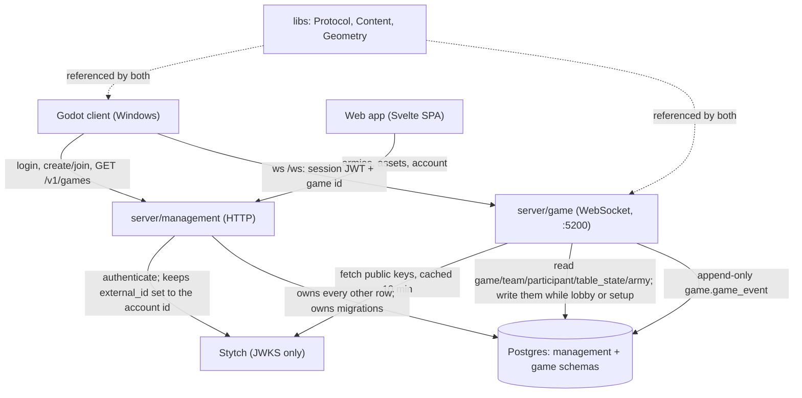

The game server never calls management and management never calls it. They share one database
and one token format.

**The token seam.** The client logs in against management, which calls Stytch and gets back a
session JWT. The client then opens `ws://.../ws` and sends `Connect(SessionJwt, GameId,
ClientVersion)`. `StytchJwtVerifier` validates it locally: RS256, issuer `stytch.com/{project}`,
audience the project id, 30 s clock skew, keys from `HttpJwksSource`. A key id the cache does not
hold triggers one refetch; every other validation failure answers null with no fetch. A JWKS fetch
that fails propagates, and the handshake closes the socket `1011` rather than sending `Rejected`,
because a check that could not run is not a refusal. It reads the account UUID
out of the top-level custom claim `account_id`. The claim is there because management adds
it to each new session with `session_custom_claims`, and Stytch keeps it on the session across
refreshes (the management plan's ruling 1); this server passes no claims. There is no M2M call, no shared signing
key and no session row. Verification happens once, at connect. The socket lives hours and the JWT
five minutes, so re-checking it would kill live games on a five-minute clock.
`VerifiedSession.ExpiresAt` is recorded and not enforced. `VerifiedSession.Roles` is the top-level
custom claim `roles`, the Stytch user's role ids, stamped by management beside `account_id` (an array,
or a lone string; absent is no roles). `IsAdmin` is `Roles` containing `admin`.

**The row seam.** One database, two schemas, no joins across the line. The game server reads
`management.game`, `management.team`, `management.participant`, the `management.table_state`
tree and `management.army`. It **writes** the game's own rows while the status is `lobby` or
`setup` (`architecture.md` → Game management data model). From `playing` on it writes only
`game.game_event`. The two services share a schema, so a management migration can break
this one, and this module owns no migration to defend itself with.

**The rules seam.** `IGameRules` is the hook surface and `IRulesEngine` is the generic engine.
This module ships `GrimdarkFutureRules` with an identity and nothing else, plus `InertEngine`.
`InertEngine` implements `IRulesEngine`, returns `Legality.Illegal`, refuses every `Execute` and
advances nothing. Every test of the session, the log and the dispatcher runs through it, so the
skeleton is complete with no rule in the tree.

## Design

### Component structure

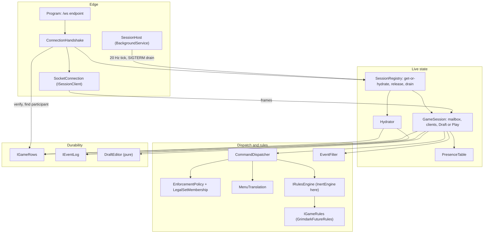

Everything above the session is per-socket and concurrent. Everything the session touches runs
on one thread at a time.

### Session actor and mailbox

`GameSession` is a partial class over six files: `GameSession.cs` (the actor, broadcast, the
log path), `.Frames.cs`, `.Connect.cs`, `.Lobby.cs`, `.Setup.cs`, `.EndSetup.cs`. It owns:

| Field | Meaning |
| --- | --- |
| `GameInfo Info` | configuration, teams, participants, as last read from the rows |
| `IGameRules Rules` | resolved once from `game.game_rules` by `GameRulesRegistry` |
| `TableState? Draft` | non-null exactly while the status is `setup` |
| `GameState? Play` | non-null from `playing` on: `Board`, `EventApplier`, `Projection`, `Info` |
| `IRulesEngine? Engine`, `CommandDispatcher? Dispatcher` | created with `Play`, never before |
| `List<ISessionClient> _clients`, `PresenceTable _presence` | the live overlay |
| `bool Faulted` | terminal for this instance |

The concurrency model is one `Channel<Func<Task>>` with `SingleReader = true` and one loop
consuming it. Every public entry point wraps its work in `RunAsync`, which posts a closure and
returns a `Task` the caller awaits: `ConnectAsync`, `AttachAsync`, `DetachAsync`, `ReceiveAsync`,
`TickPresenceAsync`, `DrainAsync`. Nothing else mutates session state. There is **no lock
anywhere in the module** and no field needs to be thread-safe.

An actor was chosen over a lock or a reader-writer pair because three of the four things a
session does are ordered, and the ordering is the correctness condition. Events must get
consecutive sequence numbers with no gaps and no reuse. Setup edits must apply in arrival order,
because "two people dragging the same piece is settled by whoever drops last" ([the setup
phase](../../superpowers/specs/2026-09-04-setup-phase-design.md)). A client's connect sequence
is `Welcome`, board, the whole log, then live frames, and a live event must not interleave into
the middle of the log being sent, so `ConnectAsync` is one mailbox turn rather than several. A
lock around the state would give mutual exclusion without giving any of those an order.

**Cost.** Every database round trip taken inside a handler blocks the whole game, not just the
caller. `RunToRestAsync` awaits the log append before broadcasting. That is required: the log is
the authority, so nothing may be broadcast that is not durable. It bounds command throughput at
one Postgres transaction per command. `HandleSetupEditAsync` awaits `WriteDraftAsync` after
broadcasting, which is *not* required, and is the one place the implementation reads against its
spec. The setup phase says the row write is "off the path clients wait on". On the mailbox it is
on the path of every *subsequent* frame for that game. See Failure modes.

The mailbox is unbounded. A slow database and a fast dragger grow the queue rather than applying
backpressure. Setup edits are one per drop, not one per frame, because live drag positions go on
the presence channel instead.

### Session creation and hydration

`SessionRegistry` is the only thing that creates a session, and it does so only when a socket
arrives. `GetOrHydrateAsync` takes that game's own `SemaphoreSlim` (held in a reference-counted map, removed
when no one holds or waits on it) so that two sockets landing together hydrate once, and a slow
hydration holds up only its own game. It returns a live non-faulted session if there is one, and otherwise
calls `Hydrator.HydrateAsync` and `StartAsync`.

`Hydrator` is the one path. It branches only on status:

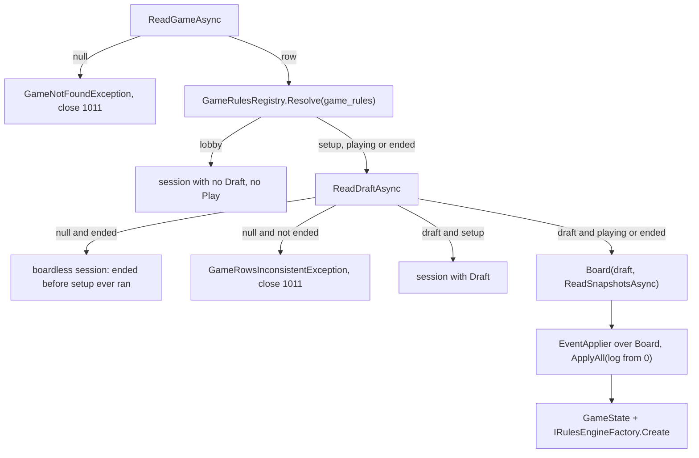

There is no second recovery mechanism to keep in step with hydration.

Three consequences:

- **Reconnect is connect.** The client discards its projection and rebuilds. Nothing on the
  server distinguishes a first join from a rejoin from a crashed-task recovery, so the path is
  exercised by all three and not only by an incident. A participant's team is part of what
  hydration reads: `participant.team_id` outlives the socket, `Welcome` carries it in
  `Info.Participants`, and `TeamOf` filters the log by it. A socket arriving at `playing` for a
  participant who has a team is that team's player again, with no re-pick and nothing
  re-derived. A spectator is a participant whose `team_id` is null, which is a fact about the
  row rather than about how the socket arrived (the plan's ruling 1; the model is stated in
  game flow → Teams are frozen at the flip, and a team is a slot).
- **`ended` is a flag, not a terminal state.** `Hydrator` treats `Ended` like `Playing`, and
  `HandleCommandAsync` accepts commands at both. Accounts says "any participant can pick an
  ended game back up" and that this is "the identical operation" to recovery. There is no un-end
  endpoint, so refusing commands at `ended` would make the flag one-way in fact while being
  reversible in the model.
- **A game leaves memory with its last socket.** `ReleaseIfEmptyAsync` removes it and drains it.
  The next socket hydrates again. Nothing keeps a game warm and nothing reaps abandoned ones.
  Every reconnect re-reads and re-applies the whole log, which grows with the game.

`StartAsync` starts the loop, then runs `RunToRestAsync` with no events of its own if `Play` is
non-null. A task that died between appending a command and running its engine to rest catches up
on the next hydrate, instead of leaving a game whose Ask never opened.

### The event log

One table, `game.game_event (game_id, seq, kind, payload jsonb)`, primary key `(game_id, seq)`.
`kind` is `GameEvent.Kind`, from `EventKinds.Of`. `payload` is `WireJson.Serialize(GameEvent)`,
so `seq`, `actor` and `warning` ride inside the `jsonb` as well as beside it. Reading is one
`WireJson.Deserialize<GameEvent>` per row with no per-kind mapping. Adding an event type is not
a migration.

`RunToRestAsync` on the session is the whole write path. A unit of it is one command
(`HandleCommandAsync`'s `Applied`), the catch-up at `StartAsync`, or the end of setup, and its
order is fixed:

1. stage the unit's own events, if any, as one batch
2. loop `Engine.Advance(Play)` until it returns nothing, staging each result as one batch
3. one `IEventLog.AppendAsync` of every staged event, all-or-nothing, inside one transaction
4. send each batch, in order, as its own `EventsMessage(EventFilter.ForViewer(batch,
   TeamOf(client), sealedBefore))`
5. `ModelFacts` when a value changed, and the `ended` row write when the unit ended the game

Staging a batch captures `EventFilter.SealedOpenAsks(Play.Projection)` (the sealed windows open
*before* that batch), assigns `seq` from `Play.Projection.LastSeq + 1` upward (the actor on all of
them, the warning on the first only), and applies it with `Play.Applier.ApplyAll`, so the next
`Advance` reads it. Steps 1 and 2 are synchronous; step 3 is the unit's one await on the database.
`PostgresEventLog` sends the inserts as one `NpgsqlBatch`: one round trip and one commit per unit,
however many batches it holds. The wire is per batch, as it would be with one append per batch;
only the timing moves behind the commit.

**The sequence constraint is the concurrency control.** Nothing else stops two processes serving
one game: the registry is per-process, and no lease, advisory lock or ownership row exists. If a
second task hydrates the same game and appends, the primary key rejects it and
`PostgresEventLog` translates the unique violation into `DuplicateSequenceException`. The session
that loses calls `FaultAsync`, which closes every socket with `1011` and marks the instance
`Faulted` so `GetOrHydrateAsync` will replace it. Detection was chosen over prevention.
Single-task ownership is a deployment property ("one game lives on one task"), and the database
is the backstop for the window in which it is briefly false.

**The projection runs ahead of the log inside one unit, and never past it.** Between steps 1 and
3 the in-memory projection holds events the log does not. Nothing reads it from outside the
mailbox turn, and nothing is sent before step 3 returns. If step 3 throws
(`DuplicateSequenceException` or anything else) the session faults before step 4: no client saw
the staged events, the instance is discarded, and the next hydration rebuilds from the log and
catches up through `RunToRestAsync`. A failed append of unknown outcome is the same case: the next
`seq` is unknown and only the log is trusted.

**An engine or projection failure rolls the run back.** An exception from `Advance`, or any
exception from applying a staged batch (a `ProjectionDesyncException` above all), ends staging;
nothing staged is appended or sent, `Play` is rebuilt by applying the stored log to a fresh
`EventApplier`, and `RunToRestAsync` returns false. The command is answered `Refused(Unknown,
"the rules engine failed on this command; nothing was applied")` and its `AtRest`; the exception
goes to the server log. A batch this server could not apply, once stored, would throw on every later
hydration and leave the game unopenable; refused, it leaves the game playable from its last stored
state, where undo and the menu still work. At hydration the catch-up stores nothing and the
session stays live.

### The rest frame

`AtRest(long Seq)` is the server saying it has nothing further to send right now, with the log
ending at `Seq`. `Seq` is always `Play?.Projection.LastSeq ?? 0`, the log's high-water mark: `0`
before the log opens, and unchanged from the previous frame when the batch appended nothing. The
frame is `GameSession.Rest()` and has three call sites.

| Sent | To whom | Carrying |
| --- | --- | --- |
| At the end of `ConnectAsync`, at every status | the connecting client alone | the log as delivered, `0` at `lobby` and `setup` |
| At the end of `HandleCommandAsync`, whatever the outcome | everyone when the batch appended an event, the sender alone when it appended none | the mark after the batch, or the unchanged mark |
| At the end of `HandleEndSetupAsync`, after `RunToRestAsync` | everyone | the last of the scheduler's opening events |

The frame follows its batch. A command refused under strict enforcement, or refused for the
status, appends nothing, so its rest frame reaches nobody but the sender and a refusal still
tells the other players nothing. A command that appended reaches everyone the events reached, after those
events, because both go out from the same mailbox turn through each connection's ordered send
queue. A client connecting to an idle game therefore gets one immediately after its initial
events, and needs no quiet window to tell "still sending" from "finished".

Lobby and setup edits emit nothing. They touch no log, `Seq` would name nothing at `setup`, and
the `GameInfoMessage` or `BoardMessage` carrying the whole settled value is itself the
terminator. Ending setup is the exception among edits, because it opens the log and runs the
engine.

The simulator waits for this frame rather than timing a 250 millisecond quiet window, under which
a slower server reads as a stuck game and a socket run takes minutes. A client with no use for
the frame ignores it, as it ignores any kind it does not recognise.

### Undo by replay

`Undo(ToSeq)` is an ordinary logged command. The dispatcher accepts it only when `ToSeq` is `0`
or the sequence of a *live* event whose next live event is not an `AskClosed` (the answer that closes an Ask and
the close are one command), checked by `Replay.IsValidUndoTarget` over `EventApplier.EffectiveLog`. It emits one `Undone(ToSeq)` payload, appended like anything else.
The log stays append-only. An undo is a marker in it.

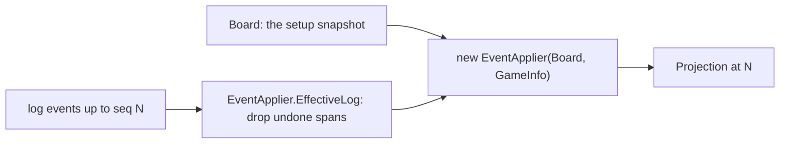

Replay to N starts from the setup snapshot because there is nothing earlier to start from.

There is no checkpoint mechanism and there are no inverse events. `Replay.To(board, info, log,
seq)` builds a fresh `EventApplier` over the `Board` and applies the effective log up to `seq`.
Three properties follow:

- the initial state exists because [setup content](../../superpowers/specs/2026-08-29-setup-content-design.md)
  made the snapshot the log's initial state, so terrain is locked structurally and nothing in the
  log can reach it
- an undone roll's dice stay drawn, because the RNG cursor counts the whole log, so an undo leads to fresh dice; the
  seed is game state and every
  roll's raw and modified results are recorded in the `step_completed` that made them
- an inverse-event table, which would have to know how to undo every event kind, never exists

Replaying to an arbitrary N is O(log), and this module does not memoise. `Undone` compounds: the
log grows with every undo, and every hydrate re-applies all of it.

### Message kinds on one socket

One socket carries every `SocketMessage` kind. Commands, edits and presence have three different
durability rules, and a sight query has none: it is answered and forgotten. `GameSession.ReceiveAsync` is the whole routing table:

| Frame | Handled by | Logged | Persisted | Broadcast | Valid at |
| --- | --- | --- | --- | --- | --- |
| `CommandMessage` | `HandleCommandAsync` → `CommandDispatcher` | **yes**, before broadcast | in the log | to everyone, filtered per viewer, then one `AtRest` | `playing`, `ended` |
| `PresenceMessage` | `HandlePresence` → `PresenceTable.Set` | never | never | on the next 20 Hz tick, latest value only | every status |
| `PingMessage` | relayed at once, sender stamped | never | never | immediately, except back to the sender | every status |
| `SightQuery` | `HandleSightAsync` → `Sight.From(state, observer).Line` per model pair, `IGameRules.Shooters` | never | never | one `SightAnswer` to the asker alone, no `AtRest` | every status (empty lists before play) |
| `EditMessage` with a `LobbyEdit` | `HandleLobbyEditAsync` | never | **management's rows** | `GameInfoMessage` | `lobby`, `setup` |
| `EditMessage` with a `SetupEdit` | `HandleSetupEditAsync` → `DraftEditor` | never | the `table_state` tree | `BoardMessage` with the whole draft | `setup` |

Edits are the third kind. Presence is relayed and discarded, commands are logged, and setup
edits sit between the two: setup needs a settled result and does not need replay. Placement as a
stream of commands was rejected. It would have bought undo-during-placement and a predefined map
as a batch of events, and cost the structural lock on terrain, because anything in the log can be
moved by the log. Keeping the draft out of the log and *in a row* makes "nobody nudges a ruin
while reaching across the board" free of a flag and a check. Edits exist only during `lobby` and
`setup`. From `playing` on the server refuses both edit kinds with `RefusalReason.WrongStatus`,
which locks the draft from `playing` on.

The draft **is** the row, not a copy of one. `table_state` with `game_id` set is the live draft.
`DraftEditor.Apply` produces the next value, the session broadcasts it, then `WriteDraftAsync`
rewrites the row and its children. Ending setup flips the status, and the row is thereby the
snapshot, with no copy step. Two alternatives were rejected in the spec: memory-only with one
write at the end loses an hour of placement when the task dies, and a client-owned draft pushed
whole contradicts free-for-all editing.

`DraftEditor` is a pure function of `(TableState, SetupEdit) -> TableState?` with an `out string?
missing`. The setup phase is therefore headless logic: fourteen edit kinds, no I/O, no clock, no
session. It also owns two rules that are not edits. `OnSlab` is the corner frame,
`0 <= x <= width` and `0 <= y <= length`. `OnSlab` re-implements `Tabletop.Geometry`'s
`Table.ContainsPoint` rather than calling it, without that method's `Tolerance.Distance` margin. `Add`, `Move`, `Scale` and
`OverrideTerrainVolumes` rest the edited piece with `Collision.RestHeight`.
`DropOffSlab` is used once, by end-setup, to implement
Grimdark Future page 17's *"if it's impossible to place the terrain piece, simply remove it"* for
generated pieces never dragged onto the table.

### The sight query, model facts and the step outline

Three additions serve the play screen. The sight query and model facts are socket messages outside the log; the
outline rides on the logged `SequenceStarted`. A `SightQuery(QueryId, ObserverUnitId, TargetUnitId)`
is answered from the current state with the same `Sight` the rules use: one `SightLine` per model pair, `BlockedBy`
the obstructing volumes (a terrain volume's id or a model's), and `CanShoot` the observer's models that p.8's *Who can
shoot* lets fire at the target (`IGameRules.Shooters`). It goes to the asker alone; nothing is appended, broadcast or
followed by `AtRest`. `ModelFacts(MaxWounds, DeployInside)` is `IGameRules.MaxWounds` for every model in play (Grimdark Future:
`Tough(X)`, else 1) and `IGameRules.DeployInside` (each unit that may be put in a Transport now, and the Transport models;
passengers spec), sent to a client on connect once the game is playing and broadcast after a batch whenever a value
differs from the last facts sent. `SequenceStarted.Outline` lists a sequence's labelled steps (`IStep.Label`) in order;
a step with no label is internal, a sequence with no labelled step writes none, and a log written before outlines
replays with none.

`Shooters` needs the game's `PropertySet` outside a running step, so `IRulesEngine.Properties` exposes the one
`RulesEngine` holds. Grimdark Future answers it per ranged weapon group with `GfAttack.EligibleModels`, over the live
set of `GfAttack.AttackInteraction`'s frame-optional core: the same core the fire groups use inside a sequence, called
with no frame, so the range is the units' distance and there are no faces. Every `IGameRules` wrapper that forwards by
hand (the tests' `WithSequences`) forwards `MaxWounds`, `Shooters`, `MayDeployInside`, `DeployInside` and `AnswerBreach`, or the wrapped
ruleset answers 1, nobody, never, nothing and nothing broken.

### Enforcement and the override path

`game.enforcement` is `silent | warn | strict` (`architecture.md` → Rules enforcement). `silent`
and `warn` are
[identity and enumerations](../../superpowers/specs/2026-08-29-identity-and-enumerations-design.md)'
two positions, *"the server warns, or it says nothing"*; `strict` is the refusing mode action
sequences and the scheduler both need. `EnforcementPolicy.Decide` is the setting as a function:

| `Legality` | `silent` | `warn` | `strict` |
| --- | --- | --- | --- |
| `AlwaysAccepted` | accept | accept, no warning | accept, no warning |
| `Legal` | accept | accept, no warning | accept |
| `OutsideLegalSet` | accept silently | accept **with a warning on the event** | `Refuse(OutsideLegalSet)` |
| `Illegal` | accept silently | accept with a warning | `Refuse(Illegal)` |

**Menu edits are accepted under every setting; a hand move is judged.** `CommandDispatcher.Classify` puts the
fifteen menu and hand-move commands in `CommandClass.Override`, and `Override` translates each through
`MenuTranslation`, which refuses only a missing reference. A `MoveModels` then goes through
`HandMoves.Judge(state, command, actor)` and `Decide(Enforcement, Breach?)`. A relocation that takes a model from the
shelf to the table is legal when its unit is one the actor's team picked at the deploy-family Ask (`deploy`,
`deploy_scouts`, `deploy_ambusher`) whose answer the scheduler is waiting on, which holds while no Ask has opened since
that one closed: that is the placement the scheduler waits for. A relocation of a model of the actor's team from the shelf
inside a container is legal, at any time, when `IGameRules.MayDeployInside(state, unit, container, deploying)` allows it,
`deploying` being those picked units (Grimdark Future, p.15: *"units inside Transports are deployed at the same time as the
Transport"*: a Transport of the same team whose unit is being placed now or has never deployed, the boarding unit never
deployed (no model ever placed on the table, or moved to the shelf from the table or from a Transport that had been on it)
and set aside exactly when the Transport is, with room by p.15's spaces, after which it counts as deployed with the
Transport and its set-aside clears with the Transport's; a Transport deployed at an earlier pick takes no one). Back out
to the shelf from a container still on the shelf is legal while `MayDeployInside` would let the unit in. Placing a
Transport from the shelf is a breach when `MayDeployInside` no longer allows one of its occupants (passengers spec).
Anything else is the breach `hand_move`, `StrictRefuses(Illegal)`, detail "{unit} deployed inside a
container the rules do not allow" for a disallowed container and "{unit} moved by hand outside a move step" otherwise:
`silent` accepts, `warn` accepts with the warning on the event, `strict` refuses. `HandMoves.Judge` also asks `IGameRules.PlacementBreach` (default none; `WithSequences` forwards it; Grimdark Future: `GfMoves.OverlapBreach`): a legal placement that overlaps another base is `move_overlap`; before round one, with zones on the table, a placement not fully within the placing team's zone (p.6), or for a Scout not fully within 12" of it (p.14), is `deploy_zone` (`GrimdarkFutureRules.ZoneBreach`; an Ambusher, from round two, is not zone-bound); once rounds have begun, a set-aside unit placed from the shelf (an Ambusher) with any base within 9" of an enemy model is `ambush_distance` (`GrimdarkFutureRules.AmbushBreach`, p.13: *"anywhere over 9” away from enemy units"*); the detail is appended to a `hand_move` breach. The other override commands never reach the policy, by a `switch` arm rather
than by a value flowing through it; `Legality.AlwaysAccepted` exists in the enum and is exercised by
`EnforcementPolicyTests`, but the dispatch path never constructs it.

A breach is the policy's second input, raised by a hand move or by the engine's own proposal. `Decide(Enforcement,
Breach?)` reads it:

| Breach | `silent` | `warn` | `strict` |
| --- | --- | --- | --- |
| none | `Accept(null)` | `Accept(null)` | `Accept(null)` |
| `StrictRefuses(r)` | `Accept(null)` | `Accept(Detail)` | `Refuse(r, Detail)` |
| `StrictEndsGame(w)` | `Accept(null)` | `Accept(Detail)` | `EndGame(Detail, w)` |

`RulesEngine.Advance` judges its own proposal through `IGameRules.JudgeAdvance`; under strict a breach there ends the game.

`MenuTranslation.Translate` maps each override command to the one event that states its change
in full: `SetWounds` to `WoundsSet`, `SetActiveTeam` to `TurnStarted`, `SetRound` to
`RoundStarted`, `SetObjectiveControl` to `ObjectiveControlSet`. It checks **only references**. The event must name a unit, model, team or marker
the projection has, because applying an event that names nothing would throw inside the applier.
It checks nothing else. A dead model may be put back on the table, a unit may be marked moved
twice, and the active team may be set to a team whose turn it is not. That is game flow's
*nothing is an invariant*. The same path serves automation and the menu: what the engine sets, a
player can set, through the same translation and the same log.

### Legality enumeration

There is no `IsLegal(command)`. Legality is the Ask's server-computed legal set, and two
functions read it:

- `LegalSetMembership.Contains(Ask, AskAnswer)` is rules-free set membership over the seven
  closed `LegalSet` shapes. `Options` by option id, `PieceSelection` by count bounds,
  distinctness and eligibility, `Allocation` by targets and a sum equal to `Amount`,
  `Assignment` by offered items (at least one; one left out holds fire), each item's target on its own list (`Assignment.TargetsOf`) and `MaxDistinctTargets`, `TokenSpend` by keys and per-key caps —
  every key of `TokensSpent.Counts` is a key of `MaxByModel` and every value is between zero and
  that key's own cap, with **no total**, because a spend is any number up to a maximum —
  `Confirmation` and `Passed` by shape. `MoveRegion` checks **model ids only**: every id is in
  `ModelIds` and appears once, and every table placement has finite coordinates and yaw. The distance
  against `Allowance`, the impassable volume ids and the table edge are geometry the ruleset judges.
  Grimdark Future reads a move answer one way, `GfAnswers.Moves`, for both its breach checks and
  the steps that apply it, so nothing a check does not see is applied.
  An answer inside the set is then asked of `IGameRules.AnswerBreach(state, ask, answer)`, which
  needs the table and returns `AnswerBreachFound(Rule, Detail)`. Grimdark Future's are, in order:
  `move_not_offered` (`GfMoves.NotOfferedBreach`: a relocation `GfAnswers.Moves` does not read, so
  strict never accepts an answer as a silent zero move); `move_exit` (a disembark not fully within
  `ExitWithin` of the container, on the table and clear of impassable terrain, p.15, p.7 and p.11, `GfMoves.ExitPlacement`);
  `move_off_table`, `move_impassable` and `move_allowance` (`GfMoves.PathBreach`, each move's
  straight path against the Ask's own parameters: p.7 *"never move outside of the battlefield (no part
  of them, at any point)"*, p.11 *"Units may not move through impassable terrain"*, p.7 *"no part of
  their bases move further than the total movement distance"*, and the landing against every impassable
  volume on the table, p.11 *"may not end their move partially overhanging gaps or terrain"* with p.7
  *"physically impossible locations"*, except an Aircraft's move, its own or a forced one (`MoveRegion.IgnoresTerrain`, p.13 *"when
  moving and stopping"*); a
  model answered where it stands is not judged, one already standing off the table is not judged for the
  edge, and one whose base already touches an impassable volume is not judged for sweeping that volume);
  `aircraft_minimum`; and
  `difficult_cap` (`GfMoves.DifficultCapBreach`: every model of a `MoveRegion` with a `DifficultCap`
  is held to it once any model's straight path enters a listed difficult volume, or an earlier
  segment of the move did; p.11: *"all models in the unit may not move more than 6" for that
  movement"*), with `aircraft_minimum` (`GfMoves.MinimumBreach`: every model moves at least
  `MinDistance`, p.13) before it. They cover every Ask that applies a move answer: the action moves and
  charges, the defender's close-in and consolidation (whose Asks list the impassable volumes), a
  disembark and a destroyed transport's survivors, rule repositions and placements, and a spell's forced
  move. A Flying unit's action move, charge, close-in, consolidation, reposition and forced move Asks list no impassable
  volume (p.13 Flying *"may move through units and terrain"*; p.11 *"unless they have any rules that allow
  them to ignore it"*; read from the live set), so only its landing is judged. A spell's forced move reads the target's
  own terrain rules (`GfMoves.TerrainFor`, owner ruling *"Spells move as however that unit moves"*). A relocation
  to where the model already is (an occupant answered `Inside` its own container) is standing still, not
  `move_not_offered`. p.7's contact clauses are `GfMoves.ContactBreach`, chained last in `AnswerBreach`: `move_overlap` (a landing on another model's base), `move_through_models` (`Collision.Crosses` against the models the answer does not move, in three dimensions so a path above a lower model does not cross it, unless the region `PassesModels`: the Flying and Aircraft pass-impassable rule, including the terrain reposition Ask) and `move_separation` (`Distance.BodyToBody`, between the bodies in three dimensions, within the region's `Separation`: 1 except the Charge move, the close-in, consolidation and an Aircraft's move or placement (move step, forced move, reposition); a disembark keeps it). Coherency is not judged. The dispatcher hands it to `EnforcementPolicy.Decide` as a `Breach` with
  that rule and `StrictRefuses(Illegal)`: refused under `strict`, applied with the warning and
  `AskAnswered.Breach` (the rule name) under `warn`; `OutsideLegalSet` marks only an answer outside the set.
  A spend divides the same way: whether the answering team owns the models it paid with is state
  the protocol cannot answer, so the spend step checks it.
- `CommandDispatcher.EnumerateLegalCommands(state, teamId)` returns the discrete affordances for
  a team, derived from the open Asks addressed to it: every `Options` choice, `Confirmed` where
  the set is a `Confirmation`, and `Passed` where `AllowPass`.

Validation falls out of enumeration and not the reverse, and the client needs enumeration to
render affordances. `EnumerateLegalCommands` covers two of the seven `LegalSet` shapes.
`PieceSelection`, `Allocation`, `Assignment`, `TokenSpend` and `MoveRegion` are parameters the client
renders, not lists the server can expand. A move region is not enumerable by construction, which
is `architecture.md`'s continuous-action argument. A piece selection is enumerable, and this
method does not expand it. `architecture.md`'s claim that "an AI opponent later gets its action
space for free" is therefore true for two shapes and not for five.

### The rules seam

Two interfaces. The division between them is the module boundary of the whole product.

```csharp
public interface IGameRules { string Id { get; } }                       // the hook surface

public interface IRulesEngine                                            // the generic engine
{
    Legality Judge(GameState state, Command command, Actor actor);
    EngineResult Execute(GameState state, Command command, Actor actor);
    IReadOnlyList<EventPayload> Advance(GameState state);
}
public interface IRulesEngineFactory { IRulesEngine Create(IGameRules rules, GameInfo game); }
```

`IGameRules` is the ruleset-specific C# named by [identity and
enumerations](../../superpowers/specs/2026-08-29-identity-and-enumerations-design.md). This
module declares it with one member and ships one implementation, `GrimdarkFutureRules`
(`Rules/GrimdarkFuture/GfRules.cs`, id `grimdark-future`), **`partial` from day one** so that
the scheduler plan can add `GfRules.Scheduling.cs` and `GfRules.Deployment.cs` and the
interpreter plan `GfRules.Sequences.cs` without either editing a file the other owns.
`GameRulesRegistry.Resolve` is a two-arm switch throwing `UnknownGameRulesException`, because a
registry table would answer "what rulesets exist", which the build already knows.

`IRulesEngine` is ruleset-blind. The scheduler and the interpreter are **one** implementation
between them, not two. The interpreter plan's `RulesEngine` registers as `IRulesEngineFactory`
in place of `InertEngineFactory`, and the scheduler plugs into it through its own
`ISchedulerFactory`. `GameState` holds `Info`, `Board`, `Applier`, `Projection` and `Rules`, and
both read it. The interpreter plan adds the RNG seed to it as a member of its own.

Division of labour inside a command:

| Owned by `CommandDispatcher` | Owned by `IRulesEngine` |
| --- | --- |
| authorization: the answering team must be one of `Ask.Teams`, and must not have answered already | `Judge`: is this command legal under the rules |
| the whole override path (`MenuTranslation`) | `Execute`: the events an accepted engine command produces |
| `Undo` target validity | `Advance`: everything with no input (opening the next turn's Ask, completing steps, reacting to `ask_closed`) |
| `AbandonSequence`: find the frame, emit `AskClosed` for every Ask on the popped frames, then `SequenceAbandoned` | |
| `AnswerAsk`: membership, the enforcement verdict, `AskAnswered`, and `AskClosed` when unsealed or when every addressed team has answered | |
| applying the enforcement setting to whatever `Judge` returned | |

After **every** command that produced events the session loops `Engine.Advance(Play)` until it
returns an empty list, staging each result and appending them all with the command's own events in
one transaction (The event log). That is where the scheduler opens the next Ask and the
interpreter completes steps. The engine is never asked "what happens next" by a timer, only by a
command having landed. `architecture.md`'s "no simulation tick" is this loop being driven by
appends. The loop is capped at 10 000 iterations and logs an error rather than spinning forever.
That cap is the only guard against a `GameRules` hook that never rests. When the loop does rest,
one `AtRest` goes out behind the last of its events, which is the client's signal that the
command is finished and not merely quiet.

The seam states two invariants for the plans behind it. The engine **never appends and never
broadcasts**: it returns payloads. The engine reads `state.Projection` afresh on every call,
because "the scheduler reads state on every step and never assumes its last output is still
true".

`InertEngine` is the implementation the skeleton is tested through. `Judge` returns `Illegal`,
`Execute` returns `RefuseCommand`, `Advance` returns empty. Under `silent` and `warn` an engine
command is therefore *accepted* by the policy and then refused by `Execute`. `RefuseCommand` is
not a legality refusal and is independent of the enforcement dial. The test double
`FixedAskEngine` supplies the other half. It opens one Ask in `Advance`, so the Ask mechanics can
be tested end to end with no rules in the tree.

### Row reads and writes

The game server writes management's rows while the game is `lobby` or `setup`, and
`game.status` once more when its own log ends the game (`architecture.md` → Game management data model), and the list is closed:

| While `lobby` or `setup` | From `playing` on |
| --- | --- |
| `game.status` (the two creator transitions) | `game.status = 'ended'`, once, when a `game_ended` it appended becomes live (`IGameRows.EndGameAsync`) |
| `game.name`, `properties_hash`, `game_rules`, `scheduler_shape`, `enforcement`, `waits_between_steps` | nothing |
| `team` (insert, ordinal `max + 1`) | nothing |
| `participant.team_id`, `participant.army_id` | nothing |
| `participant.army_snapshot` (once, at end-setup) | nothing |
| the game's `table_state` tree: the row, `terrain_placement`, `terrain_volume`, `marker`, `deployment_zone` | nothing |
| — | `game.game_event`, append-only |

It never writes an account's `layout` row. Layouts stay management's. The client saves one with
`POST /v1/layouts` from its own copy of the draft, and loads one with `GET /v1/layouts/{id}`
followed by a `ReplaceDraft` edit. `ReplaceDraft` copies the layout's placements, markers and zones under
fresh ids, because those ids are global primary keys and the layout's rows keep theirs; the client
reads the ids back from the `BoardMessage` and never holds the layout's.

`WriteDraftAsync` and `WriteTreeAsync` rewrite the children **whole**: delete every
`terrain_placement`, `marker` and `deployment_zone` for the draft, then reinsert. The draft is a
value and one drop is one write, so the write is a value replacement rather than a diff. On a
thirty-piece board a single drag-drop is on the order of a hundred statements in one transaction,
awaited on the session's mailbox. A diff would be faster and would need change tracking on an
immutable record.

`SetZoneStyle(style, shapes)` writes one `DeploymentZone` per shape with ordinals `1..n`,
**whether or not a team with that ordinal exists yet**. The style name itself is never stored,
only its expansion, one shape id per row. "Zones re-derive from the zone style whenever the team
list changes" therefore becomes a join at render time: the client draws the zones whose ordinal
has a team, and the server keeps no style state. `SwapZones(a, b)` swaps the two ordinals'
shapes. That is the mechanism that makes Grimdark Future page 6's *"the winner picks an edge"*
possible without the app running a roll-off in setup.

### The creator's two transitions

`game.created_by` is read for the two transitions below, `SetConfiguration` (creator only), and
`PickTeam` naming another participant or a team someone else holds (the creator's placing; see
Watchers and lobby authority). The creator is not a host, cannot kick, and does not own the log.

**`StartSetup`** is creator only, `lobby` only. It creates the `table_state` draft row with
`NewDraft()`: `GameServerOptions.DefaultTableWidth` × `DefaultTableLength` (72 × 48) and the
built-in texture `grass`, in one transaction with `status = 'setup'`. Then `Draft` is set,
`ReloadInfoAsync` broadcasts the new `GameInfo`, and a `BoardMessage` carries the empty board.
Nothing freezes here. Teams, armies and configuration stay editable through setup, because
deployment has not happened.

**`EndSetup`** is creator only, `setup` only, and it is where things freeze. In order:
`DraftEditor.DropOffSlab` removes generated pieces still beside the table. Each participant's
army is read and `ArmySnapshot.Of` taken *as it stands*. One transaction rewrites the tree,
writes every `army_snapshot` (null staying null) and flips `status` to `playing`. Then in memory
`Draft` becomes null, `Play` is a fresh `GameState` over `new Board(snapshot, armies)`, and a
fresh `EventApplier`, `Engine` and `Dispatcher` are created. `GameInfoMessage`, `BoardMessage`
and an empty `EventsMessage` go out, and `RunToRestAsync` runs, which is where the scheduler will
begin deployment. One `AtRest` closes the transition, because it is the one edit that opens the
log and runs the engine.

| Transition | Frozen by it |
| --- | --- |
| `lobby -> setup` | nothing; the draft row starts existing |
| `setup -> playing` | the board (structurally: the snapshot is the log's initial state), the scheduler shape, the team list, the armies in play and every `army_snapshot`, and the layout; the log opens |

There is no way back from `playing` to `setup`. An account joining the game after the flip has no
`army_snapshot` and no team, because `CreateTeam` and `PickTeam` are refused with `WrongStatus`
from `playing` on. A participant on a team with no army picked freezes with `army_snapshot` null
and contributes nothing to any legal set, and the scheduler skips a team whose legal set is
empty. A participant with no team at all is never addressed by an Ask, **and that is what a
spectator is**. There is no second identity for one.

Freezing the team list is about the list, not about who is holding a socket: a participant's team
is their slot on their `participant` row, and reconnecting during play returns them to it (the
plan's ruling 1).

### Per-team Ask addressing and the sealed answer

An Ask is addressed to a **team**, never a player, because activation authority is team-wide.
`Ask.Teams` is a list, any member of an addressed team may answer, and the log records which
participant did (`GameEvent.Actor`). The dispatcher enforces two things and no more. The actor's
`TeamId` must be in `Ask.Teams`, and a participant with no team is refused with `NotPermitted`.
The team must not already have an answer recorded, so two members of one team racing produces one
answer and one refusal rather than two.

The sealed variant is the one place the design uses per-viewer filtered streams. Casting's
simultaneous token spend (p.13) has every eligible team answer concurrently, and online a
sequential reveal hands the last mover an advantage the tabletop does not.
`EventFilter.ForViewer(events, viewerTeamId, sealedOpenBefore)` walks a batch or a whole log
tracking which sealed Asks are open. It rewrites `AskAnswered` to `Answer = null` when the Ask is
sealed, still open, and the answer belongs to another team. `AskClosed` carries every answer and is
never filtered. It is the reveal. Three properties:

- **withholding is positional.** On a replayed log the answer stays hidden *where it happened*
  and appears *where the window closed*. A reconnecting client's projection converges to the
  same state as one that watched it live, and the server never rewrites history.
- **a spectator (`viewerTeamId` null) sees no sealed answer** until the reveal, which is the
  reading of "withheld from the other teams".
- **the filter is applied per client on the way out**, on `RunToRestAsync`'s broadcast and on
  `ConnectAsync`'s log delivery. The log itself is never filtered, which keeps one canonical
  history.

### Watchers and lobby authority

An account that is not a participant of the game and whose session has the `admin` role joins as a
watcher (admin watch spec); anyone else is `Rejected(NotAParticipant)`, and so is an admin naming a game
that does not exist. A watcher is an admin tool: the viewer reads any game, finished or running, without
joining it.

- `GameSession.WatchAsync` runs the connect sequence a participant with no team gets: `Welcome` with
  `ParticipantId` `Guid.Empty`, the board, the log from the start filtered as for no team, `ModelFacts`
  once playing, every participant's presence value, `AtRest`. It writes no row: the watcher is in no
  participant list, lobby or presence.
- `GameSession` holds watchers in `_watchers`, apart from `_clients`, so lobby edits, presence, Asks and
  `ActorOf` never meet one. Watchers receive every broadcast, each batch filtered as for no team, and
  every relayed presence value and ping. Leaving sends no `PresenceEnded`. `SessionRegistry` keeps a game
  in memory while it has a participant or a watcher.
- What a watcher sends: a `SightQuery` is answered. A command (answers and undo included), an edit,
  presence or a ping is answered `Refused` with reason `watcher` (`RefusalReason.Watcher`; `MessageId`
  the command or edit id, `Guid.Empty` for presence and ping) and nothing else follows, no `AtRest`.
- From `playing` on, a participant with no team is answered exactly as a watcher (`GameSession.Watches`):
  game flow makes that participant a spectator. Before `playing` a teamless participant is choosing a team
  and edits and points as anyone does. `CommandDispatcher.Dispatch` refuses every command from an actor
  with no team (`NotPermitted`), so the override path, undo and abandon need a team; either team may
  still undo or correct anything.
- A frame from a connection the session no longer holds (replaced, or closed over its account's socket
  cap) is dropped.

Lobby edits that change who plays: `SetConfiguration` is the creator's. Teams are shared by design (game
flow: two players on a side), and `PickTeam(TeamId, ParticipantId?)` takes an empty team freely; a team
another participant holds is joined only by the creator's placing (`ParticipantId` names whom the
creator places; a non-creator naming anyone but themselves, or a held team, is `NotPermitted`). A lobby
edit from a participant whose row has gone is refused.

### Presence and the drain

`PresenceTable` keeps the latest value per participant plus a dirty set. `HandlePresence` stamps
the frame with the sender's participant id and stores it, so a client cannot speak for another.
There is no sequence number, because presence is never replayed and the latest value wins.
`SessionHost`, a `BackgroundService`, runs a `PeriodicTimer` at `1000 / PresenceRelayHz` ms (20
Hz, `architecture.md`'s figure) and calls `TickPresenceAsync` on every live
session, which relays each changed value to everyone but its owner. Pings bypass the timer. They
are an instant, not state, and are relayed immediately.

Connectedness is not a field. A presence value exists while a participant is connected, so who
is connected is which values exist. `DetachAsync` removes the value and broadcasts
`PresenceEnded` when the participant's *last* socket closes. A participant has one connection
(the plan's ruling 3), and `AttachCoreAsync` closes an older socket for the same participant with
`1000`. The new client is sent every other participant's current value at attach, so a joiner
sees the room immediately.

**SIGTERM.** `SessionHost` registers on `ApplicationStopping` and calls
`SessionRegistry.DrainAllAsync` inside the callback rather than after it. The host waits for
those callbacks before stopping Kestrel, so every socket receives its `1001 Going Away` while
the listener is still up. `DrainAsync` posts one last mailbox item that closes the clients,
completes the channel writer, and awaits the loop. Every queued append and every queued draft
write finishes first. `HostOptions.ShutdownTimeout` bounds the whole thing at 30 s. "Draining to
the event log" is therefore *finishing the queue*. Every event is appended before it is
broadcast, so nothing is held in memory that the log does not already have and the drain has
nothing to flush.

### Limits

Every bound is a property of `GameServerOptions` (the connection limits are also read from `TABLETOP_*`)
or a record it holds (`DraftLimits`, `ArmyLimits`). The figures and why:

| What | Bound | Over it | Why this figure |
| --- | --- | --- | --- |
| Open connections | Kestrel `MaxConcurrentConnections` 2000, `MaxConcurrentUpgradedConnections` 1000 (`TABLETOP_MAX_CONNECTIONS`, `TABLETOP_MAX_UPGRADED_CONNECTIONS`) | refused by Kestrel | one small server's worth |
| Sockets per account | 4 (`TABLETOP_SOCKETS_PER_ACCOUNT`) | the account's oldest closed `1000`, as a replaced socket | a player, a second window, the sim's recorder |
| `Connect` | 5 s from the upgrade, 8 KB | `1002`, `1009` | a JWT and two numbers |
| Any later frame | 64 KB; `ReplaceDraft` 512 KB; presence 16 KB | `1009` | the largest legal draft serialises to about 380 KB |
| Text in a frame | no C0 control, DEL, or bidi override or isolate (U+202A–202E, U+2066–2069), property names included (`InboundText`) | a command or edit `Refused(Unknown)` by its id; any other frame dropped | a label that reads as something else; NUL breaks Postgres text |
| Frame rate | commands, edits and sight queries 20/s, burst 40 (`TABLETOP_FRAME_RATE`, `TABLETOP_FRAME_BURST`; unset in dev mode, machine speed: the rules suite sends each command as the last rests); pings 3/s, burst 6; presence 30/s, burst 60 (`FrameLimiter`, `TokenBucket`) | the read loop waits for a token (the peer is slowed by its own TCP window); a ping or presence frame is dropped | a player clicks far below 20/s; the client sends presence at 20 Hz |
| Outbound queue | 20 000 messages or 64 MB (`SocketLimits`); presence coalesced per participant, latest wins | `1013` | the connect sequence queues the whole log at once, 500 events a message |
| Session lifetime | the JWT's `exp`, moved on by each `Reauth` with a refreshed token of the same account (an admin watcher's still an admin's) | `1008` "session expired"; a `Reauth` that does not verify or names another account is `Refused(ReauthId, NotPermitted)` and the old expiry stands | revocation reaches an open socket |
| Events per game | 200 000 (`TABLETOP_MAX_EVENTS_PER_GAME`) | every command `Refused(NotPermitted)` | many times a full game's log |
| Draft (`DraftLimits`) | 64 pieces, 8 volumes a piece, 32 markers; labels 64, notes 500 characters; volumes from 0 to at most 24" and upward; markers 0.5–6" across; scale up to 10; positions finite within 144" of the table's centre; table edges at most 144" (`Table.MaxEdge`); a built-in visual a lowercase slug (the catalog lives in the client); zone shapes the style's own, once each | the edit `Refused(Unknown)`; removals always apply | p.6 recommends 15 or more pieces; the client's generators place 13–21 |
| Assets in a setup edit | each must exist in `management.asset` and belong to a participant (`IGameRows.AssetOwnersAsync`) | `Refused(NotPermitted)` | a stranger's mesh id would publish their blob |
| Army at `PickArmy` and `EndSetup` (`ArmyLimits`) | 150 units, 50 models a unit, 1000 models; bases 0.4–12", heights 0.1–24", a defined base shape; Quality and Defense 2+–6+, Attacks 1–100, Range up to 144"; rule parameters 0–100 | `Refused(Illegal)` naming what is out of range | an army is user data read by every step; 100 keeps a titan's Tough playable |
| Override commands (`MenuLimits`) | an action or a grant's entry and effect must exist in the property set; a condition 1–64 characters (conditions are free names: game flow, "anything else the unit currently is"); positions finite within the table's diagonal of its centre (`GfAnswers.Moves`' bound); wounds, tokens 0–10 000; score ±10 000; round 0–100 | `Refused(Unknown)` | what the menu writes is read back by every later step |
| Presence (`PresenceLimits`) | 64 placements, 64 selected models, finite coordinates; a ping's point finite | dropped | one unit's drag |
| A roll | 1000 dice (`Roller.MaxDice`); a negative count throws | clamped, logged | the rulebook's largest pool is a few hundred |
| A swept check | 4096 samples (`Sampling.MaxSamples`: `Movement`, `Collision.Slide`, `Collision.Crosses`) | samples spread further apart | a forged length costs a bounded loop |
| Rule parameter sums | ±1 000 000 in 64-bit arithmetic (`ParameterSum`) | clamped | no overflow from user data |
| Stat text | ASCII digits, at most six (`StatValue.Read`) | `FormatException` | `\d` matches other scripts' digits |
| Enums on the wire | by name only (`WireJson`: `ContentJson.Configure(options, integerEnums: false)`) | unreadable frame, `1007` | an integer names no member |
| JWKS | cached 10 min; an unknown `kid` refetches at most once per 30 s, one fetch shared; a 5 s fetch timeout; on failure the held keys serve for at most 1 h after their fetch, then verification fails closed | `1011` | a stream of made-up kids costs one request per 30 s |

Close reasons sent to a peer are fixed phrases, cut to 123 UTF-8 bytes; exception text and type names go
to the server log only. The send loop catches everything; the handshake releases the game in a finally
nested outside the detach.

## Key decisions

| Decision | Why | Rejected alternative | Source |
| --- | --- | --- | --- |
| Enforcement is three positions, `silent \| warn \| strict` | Action sequences and the scheduler both need a refusing mode | A boolean (warn or say nothing), on the grounds that blocking contradicts a virtual tabletop | Whole-design review ruling 1 |
| Menu edits are accepted under **every** setting | They are the override path, visible to opponents and logged with an actor, never silent | A separate admin mode or a confirmation gate; a second write path for overrides | Review ruling 1; game flow, *Nothing is an invariant* |
| The game server **writes** the game's own rows while `lobby` or `setup`, and `ended` from `playing` | Setup has it writing the draft, flipping the status and taking team and army picks over the socket | Read-only throughout, with management endpoints for team, army, configuration and the draft | Review ruling 4 |
| A participant has no team until they pick one, and that *is* a spectator | `join` assigns no team | Presence's "someone who wants to watch joins a third team" | Review ruling 5 |
| The team list is locked at the flip to `playing`, and a participant reconnecting during play is returned to their slot | A team is a slot on the `participant` row, so it survives the socket; letting teams change mid-game would also need a score entry for a team created after `Projection.Initial` | Teams created and picked at any status, which contradicts the server writing only events and the end from `playing` on; treating a reconnecting player as a late joiner, which would make every dropped connection cost a seat | The plan's ruling 1; game flow → Teams are frozen at the flip, and a team is a slot |
| The setup phase is not logged; only the result is | Setup needs a settled result, not replay, and keeping terrain out of the log locks it structurally, with no flag and no check | Placement as a stream of ordinary commands, so a predefined map is a batch of events and undo-during-placement is free | Setup content, *The setup phase is snapshotted, not logged*; setup phase |
| Measurements, ghosts and cursors are relayed | A tape measure on a real table is visible to everyone at it | Computed locally and never sent anywhere | Presence, *What this corrects in architecture.md* |
| No join token, and no token of our own at all | A game has an id, the session JWT says who you are, `participant` records who is allowed in; a token restated all three and added an expiry that could lapse mid-game | The join token accounts designed, and the `session` table beside it | Accounts; management API, *We issue no tokens of our own* |
| Nobody instantiates a session | Starting, reconnecting, moving a game and crash recovery become one path | Management creating a session over M2M, which would also make management learn which task holds which game | `architecture.md`, *Contracts to freeze*; accounts, *A game is a lobby* |
| Undo is replay from the setup snapshot | the RNG cursor counts every die in the whole log, so an undone roll stays spent and undo cannot fish for rolls; no inverse-event table has to exist | Inverse events; a separate checkpoint mechanism | `architecture.md`, *Undo* |
| `ended` is a flag; commands are accepted at `ended`, whether management ended the game or a strict `game_ended` did | Restarting an ended game is the identical hydrate-from-the-log operation as recovery, and there is no un-end endpoint. A strict round-4 end appends `game_ended` and sets the row to `ended` from `playing`; the flag does not stop commands | Refusing commands until something un-ends the game | Accounts, *Ending is a flag*; identity and enumerations |
| Legality is `EnumerateLegalCommands`, not `IsLegal` | Validation falls out of enumeration and not the reverse; the client needs the set anyway to render affordances | An `IsLegal(command)` predicate | `architecture.md`, *Rules enforcement* |

Decisions this module settles itself:

| Decision | Mechanism | Why |
| --- | --- | --- |
| One actor per game, mailbox, no locks | Every mutation runs on the loop | Three of the four things a session does are order-sensitive; a lock gives exclusion without order |
| The account UUID rides as the top-level custom claim `account_id`, set by management on each new session through `session_custom_claims` | Stytch's `sub` is its own `user_id` and does not carry `external_id` | Accounts allowed the fallback ("if it ever cannot, it is added as a custom claim"); the verifier needs one exact name |
| The heartbeat is Kestrel's WebSocket ping/pong, not a protocol frame | `KeepAliveInterval` 20 s, `KeepAliveTimeout` 60 s | `Tabletop.Protocol` has no heartbeat kind and needs none; `architecture.md` → Deployment |
| The table frame is corner-origin | `0 <= x <= width`, `0 <= y <= length`, Z up | End-setup's off-slab rule and the client's rendering both need an origin; the geometry plan's ruling 1 states the frame |
| `deployment_zone` rows exist per shape, keyed by ordinal, with no stored style | "Re-derive on team change" becomes a render-time join | The server keeps no style state; `docs/schema.md` → A deployment zone names a team ordinal, not a team |
| The draft starts at 72 × 48 with texture `grass` | `StartSetup` carries no fields and the columns are non-null | 72 × 48 is the size every deployment style assumes, and the creator has a legal table to edit without a round trip. The plan's ruling 2 |
| A newer socket replaces an older one for the same participant | `AttachCoreAsync` closes the old one with `1000` | A reconnection after a blip works and a second window kills the first. The plan's ruling 3; presence → Deliberately not decided |
| `presence_ended` is an explicit frame, not a timeout | Sent when the participant's last socket closes | No client owns a presence timeout. Presence → Deliberately not decided |
| A game leaves memory with its last socket; nothing keeps it warm | `ReleaseIfEmptyAsync` on every detach | Accounts makes hydrate-from-the-log the one path, so a warm cache would be a second one |
| 20 Hz presence relay | `GameServerOptions.PresenceRelayHz` | Presence sets no rate; `architecture.md`'s "four players at 20Hz" is the figure |
| A lost `seq` race faults the game rather than retrying | `FaultAsync`, close `1011`, replace on next hydrate | One game on one task is a deployment property; the primary key is the backstop, and a retry would paper over two writers |
| The rest frame follows its batch: broadcast when the batch appended, to the sender alone when it did not | `HandleCommandAsync` compares `LastSeq` before and after | Always broadcasting would tell every player that someone's command was refused, and sending only on a non-empty batch would leave a refused sender with no terminator |
| A desync applying the server's own event faults the session | `FaultAsync`, close `1011`; hydration hits the same event and the handshake closes `1011` | Resyncing, which is what the client does with the same exception, would replay the same event from the same log |

## Interfaces

### Produced for the scheduler and the interpreter

`Tabletop.GameServer.Rules`:

| Type | Members |
| --- | --- |
| `interface IGameRules` | `string Id { get; }`, `GameEndingBreach? JudgeAdvance(GameState, PropertySet, IReadOnlyList<EventPayload>)`, `IReadOnlyList<StateChange> OnRoundEnded(GameState, PropertySet, int round)` (the last two default to none; extend with hooks, do not replace) |
| `sealed partial class GrimdarkFutureRules : IGameRules` | `const string RulesId = "grimdark-future"`, `static GrimdarkFutureRules Instance`, `Id`; namespace `Tabletop.GameServer.Rules.GrimdarkFuture`, file `Rules/GrimdarkFuture/GfRules.cs` |
| `static class GameRulesRegistry` | `IGameRules Resolve(string id)`, throws `UnknownGameRulesException(string id)` |
| `sealed record Actor(Guid ParticipantId, Guid? TeamId)` | |
| `sealed class GameState(GameInfo, Board, EventApplier, IGameRules)` | `GameInfo Info { get; set; }`, `Board Board`, `EventApplier Applier`, `Projection Projection`, `IGameRules Rules`; the interpreter plan adds the RNG seed here |
| `abstract record EngineResult` | `Emit(IReadOnlyList<EventPayload> Events)`, `RefuseCommand(RefusalReason Reason, string Detail)` |
| `interface IRulesEngine` | `Legality Judge(GameState, Command, Actor)`, `EngineResult Execute(GameState, Command, Actor)`, `IReadOnlyList<EventPayload> Advance(GameState)` |
| `interface IRulesEngineFactory` | `IRulesEngine Create(IGameRules rules, GameInfo game)` |
| `sealed class InertEngine`, `sealed class InertEngineFactory` | replaced by the interpreter plan's `RulesEngineFactory` |

`Tabletop.GameServer.Dispatch`:

| Type | Members |
| --- | --- |
| `enum Legality` | `AlwaysAccepted, Legal, OutsideLegalSet, Illegal` |
| `abstract record Verdict` | `Accept(string? Warning)`, `Refuse(RefusalReason Reason, string Detail)` |
| `static class EnforcementPolicy` | `Verdict Decide(Enforcement, Legality, string detail)` |
| `static class LegalSetMembership` | `bool Contains(Ask ask, AskAnswer answer)` |
| `static class EventFilter` | `IReadOnlyList<GameEvent> ForViewer(IReadOnlyList<GameEvent>, Guid? viewerTeamId, IReadOnlySet<Guid> sealedOpenBefore)`, `IReadOnlySet<Guid> SealedOpenAsks(Projection)` |
| `static class MenuTranslation` | `EventPayload? Translate(GameState, Command, out string? missing)` |
| `enum CommandClass` | `Override, Undo, Abandon, Answer, Engine` |
| `abstract record DispatchOutcome` | `Applied(IReadOnlyList<EventPayload> Events, string? Warning)`, `Refused(RefusalReason Reason, string Detail)` |
| `sealed class CommandDispatcher(IRulesEngine)` | `static CommandClass Classify(Command)`, `DispatchOutcome Dispatch(GameState, Command, Actor)`, `IReadOnlyList<Command> EnumerateLegalCommands(GameState, Guid? teamId)` |

`Tabletop.GameServer.Session`, `.Log`, `.Persistence`, `.Auth`, `.Setup`, `.Configuration`:

| Type | Members |
| --- | --- |
| `interface ISessionClient` | `Guid ConnectionId`, `Guid ParticipantId`, `ValueTask SendAsync(SocketMessage)`, `ValueTask CloseAsync(WebSocketCloseStatus, string)` |
| `sealed class GameSession` | `GameId`, `Info`, `Rules`, `Draft`, `Play`, `Engine`, `Dispatcher`, `Clients`, `Faulted`, `StartAsync`, `ConnectAsync`, `AttachAsync`, `DetachAsync`, `ReceiveAsync`, `TickPresenceAsync`, `RunAsync<T>`, `DrainAsync`, `BroadcastAsync`, `TeamOf`, `ActorOf`; internal `AppendAsync`, `RunToRestAsync`, `Rest`, `ReloadInfoAsync`, `NewDraft` |
| `sealed record SessionServices` | `IGameRows Rows, IEventLog Log, IRulesEngineFactory Engines, GameServerOptions Options, ILoggerFactory Logging` |
| `sealed class PresenceTable` | `Set(Presence)`, `Remove(Guid)`, `IReadOnlyList<Presence> TakeDirty()`, `IReadOnlyList<Presence> All` |
| `static class Hydrator` | `Task<GameSession> HydrateAsync(Guid, SessionServices, CancellationToken)`; `GameNotFoundException`, `GameRowsInconsistentException` |
| `sealed class SessionRegistry` | `GetOrHydrateAsync`, `ReleaseIfEmptyAsync`, `Live`, `DrainAllAsync`, `bool Draining` |
| `sealed class SocketConnection : ISessionClient` | `RunSendLoopAsync(CancellationToken)`, `static Task<SocketMessage?> ReadFrameAsync(WebSocket, CancellationToken)` |
| `sealed class ConnectionHandshake` | `Task RunAsync(WebSocket, CancellationToken)` |
| `sealed class SessionHost : BackgroundService` | the 20 Hz presence tick and the SIGTERM drain |
| `interface IEventLog` | `AppendAsync(Guid, IReadOnlyList<GameEvent>, CancellationToken)`, `ReadAsync(Guid, long afterSeq, CancellationToken)`, `LastSeqAsync(Guid, CancellationToken)`; `DuplicateSequenceException(Guid GameId, long Seq)` |
| `static class Replay` | `Projection To(Board, GameInfo, IReadOnlyList<GameEvent>, long seq)`, `bool IsValidUndoTarget(EventApplier, long toSeq)` |
| `interface IGameRows` | six reads: `ReadGameAsync`, `FindParticipantAsync`, `ReadDraftAsync`, `ReadSnapshotsAsync`, `ReadArmyAsync`, `PropertiesExistAsync`; seven writes: `CreateTeamAsync`, `SetParticipantTeamAsync`, `SetParticipantArmyAsync`, `SetConfigurationAsync`, `StartSetupAsync`, `WriteDraftAsync`, `EndSetupAsync`; `sealed record OwnedArmy(Army Army, Guid OwnerId)` |
| `interface ISessionVerifier` | `Task<VerifiedSession?> VerifyAsync(string jwt, CancellationToken)`; `sealed record VerifiedSession(Guid AccountId, string StytchUserId, DateTimeOffset ExpiresAt, IReadOnlySet<string> Roles)` with `IsAdmin`; `const string StytchJwtVerifier.AccountClaim = "account_id"`, `RolesClaim = "roles"` |
| `static class DraftEditor` | `TableState? Apply(TableState, SetupEdit, out string? missing)`, `TableState DropOffSlab(TableState)`, `bool OnSlab(TableState, Point3)` |
| `sealed class GameServerOptions` | `DbConnection`, `StytchProjectId`, `StytchJwksUrl`, `MinimumClientVersion`, `PresenceRelayHz = 20`, `HandshakeTimeout = 5 s`, the connection limits, `Outbound`, `ActionRate`, `PingRate`, `PresenceRate`, `MaxEventsPerGame`, `Draft`, `Army` (Limits), `KeepAliveInterval = 20 s`, `KeepAliveTimeout = 60 s`, `DefaultTableWidth = 72`, `DefaultTableLength = 48`, `DefaultTextureBuiltin = "grass"`; `static FromEnvironment(IConfiguration)` |

### Consumed

| From | What |
| --- | --- |
| `Tabletop.Protocol` | `ProtocolVersion`, `SocketMessage` and its thirteen kinds including `AtRest`, `ProjectionDesyncException`, `Command` and its twenty-one, `EventPayload`/`StateChange`, `GameEvent`, `EventKinds`, `Ask`/`LegalSet`/`AskAnswer`/`AskQuestions`, `Edit`/`LobbyEdit`/`SetupEdit`, `Presence`/`Ping`, `GameInfo`/`Team`/`Participant`/`ArmyInPlay`/`Board`, `Projection`/`EventApplier`, `GameStatus`/`SchedulerShape`/`Enforcement`/`RefusalReason`/`RejectReason`, `WireJson` |
| `Tabletop.Content` | `TableState`, `TerrainPlacement`, `TerrainVolume`, `Marker`, `DeploymentZone`, `VisualRef`, `Army`, `Unit`, `ModelSlot`, `Weapon`, `PropertyInstance`, `ArmySnapshot`, `ContentJson` |
| `Tabletop.Geometry` | `Point2`, `Point3`, `Yaw`, `TableSize`, `Base`, `Volume`, `Footprint`, `TerrainDeclarations` (values only, no geometry is computed here) |
| Management (indirectly) | `game`, `team`, `participant`, `army`, `properties` rows, and a session JWT carrying `account_id`, set by management as a session custom claim |

### Obligations

Honoured, from the contracts plan: `GameEvent.Kind` to `game_event.kind` and
`WireJson.Serialize(GameEvent)` to `payload`; `AskClosed` before `SequenceAbandoned` for every
Ask on a popped frame; `Undo` refused unless the target is `0` or a live seq; a `BoardMessage`
with the whole draft after each setup edit and a `GameInfoMessage` after each lobby edit;
`AskAnswered.Answer` nulled for teams a sealed window withholds from; `AtRest` as the last frame
of the connect sequence and of every command, and `ProjectionDesyncException` caught rather than
allowed to kill a mailbox item.

Placed: management must keep every Stytch user's `external_id` set to its `Account.id` and add
`account_id` to every session, so that every JWT that reaches this server carries it, must insert `game` at `status = 'lobby'` with `created_by` and the six configuration
columns, must insert `participant` with `team_id` and `army_id` null, and must
never write `status = 'setup' | 'playing'`, `team`, `participant.team_id`, `participant.army_id`,
`participant.army_snapshot`, or a game's `table_state` tree. The scheduler and the interpreter
must supply exactly one `IRulesEngine` between them, must not emit `AskAnswered`/`AskClosed` for
answers, and must not append or broadcast. Every client must ignore a `SocketMessage` kind it
does not recognise, `at_rest` included, rather than treat it as a protocol error. The simulator
waits for `at_rest` instead of timing a quiet window.

## Sequences

### Connect and hydrate

An admin watcher takes the same path: `FindParticipantAsync` answers null, the session `IsAdmin` and
`ReadGameAsync` finds the game, so the handshake calls `WatchAsync` instead of `ConnectAsync` (see
*Watchers*).

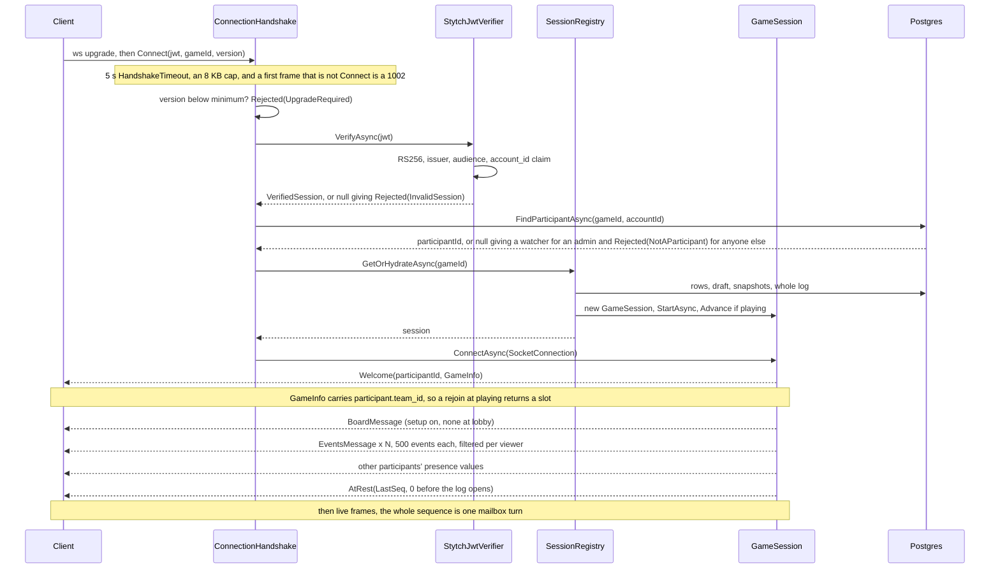

The four rejections are ordered cheapest-first. Delivery of the log happens inside one mailbox
turn, so no live event can interleave into the middle of it. A `Rejected` frame is followed by a
close. A hydration failure closes with `1011` instead, so the client sees a different signal for
"your game is broken" than for "you are not allowed in". An empty `EventsMessage` is always sent
at `playing`, so "the log from the start" is one observable thing even when the log is empty. A
game that ended before setup ever ran has no `table_state` row and no log, so `Welcome` and
`AtRest(0)` are the whole sequence. `AtRest` is the last frame at every status, and this is the
one place it is addressed to a single connection rather than broadcast, because what it
terminates is that connection's delivery.

A hydration failure includes `ProjectionDesyncException` out of `Hydrator`'s `ApplyAll`: a
stored log that does not apply to the stored snapshot is a server bug, and no reconnect clears
it, so the socket closes with `1011` like any other broken game.

### A command: socket to log to broadcast

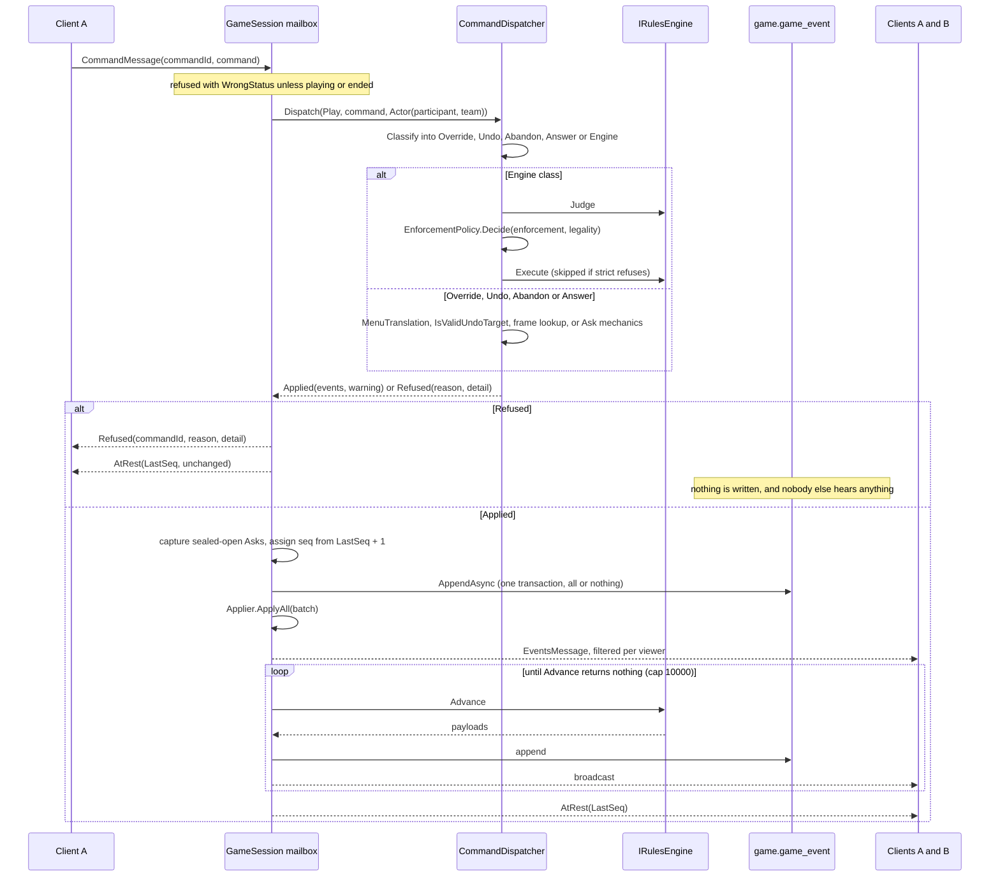

The append precedes every broadcast, so no client ever sees an event that is not durable. A
refusal reaches only the sender and writes nothing. The append is a Postgres round trip on the
mailbox, so command latency for a game is one round trip plus however many `Advance` iterations
the engine takes. A `GameRules` hook that emits an event every iteration turns one command into a
chain of appends before any other frame for that game is handled. The whole chain ends in one
`AtRest`, after the last of its events, so the batch has one terminator however many appends it
took. A `DuplicateSequenceException` and any other append failure fault the game; an `Advance`
exception or a batch the projection cannot apply refuses the command and stores nothing.

### A setup edit, for contrast

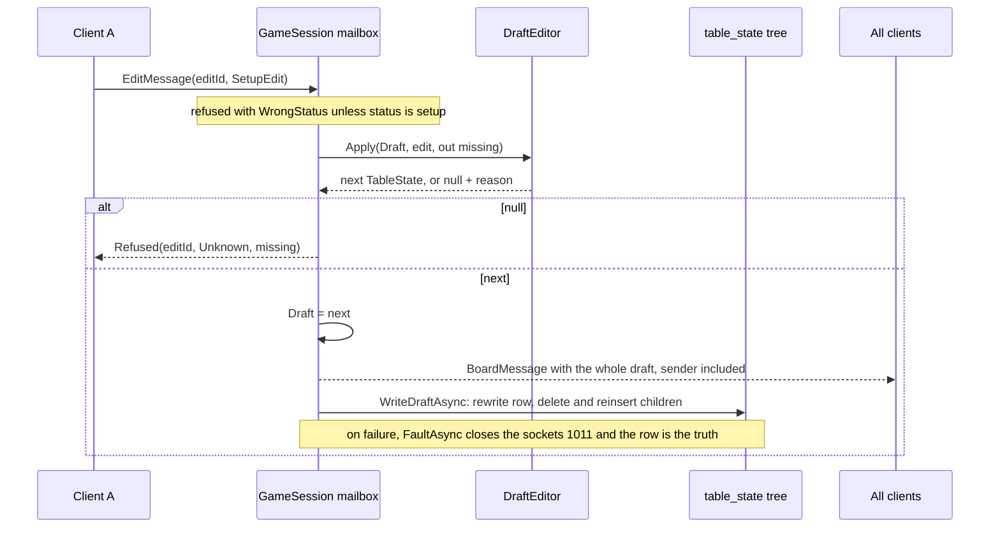

Nothing is logged and no sequence number exists. The broadcast happens *before* the write, and
the whole draft is sent rather than the delta, so free-for-all editing needs no per-client
reconciliation. The write is awaited on the mailbox, so back-to-back drops from two players
serialise on the database. The broadcast-then-write order means a failed write leaves clients
holding a board the row does not have, and the session faults rather than continuing.

### Ending setup

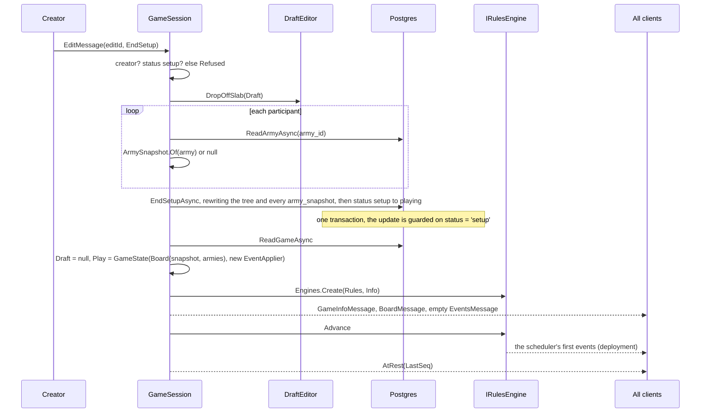

The draft becomes the snapshot by the status flip, with no copy step, and the log opens on it.
The army reads and the transaction are all on the mailbox, so a four-player game with large
armies blocks its own session for the duration. The `status = 'setup'` guard makes the flip
idempotent against a duplicate `EndSetup`, but not against a partial failure between the commit
and the in-memory swap. A crash there recovers by hydrating at `playing`, which is the correct
state.

### A sealed window

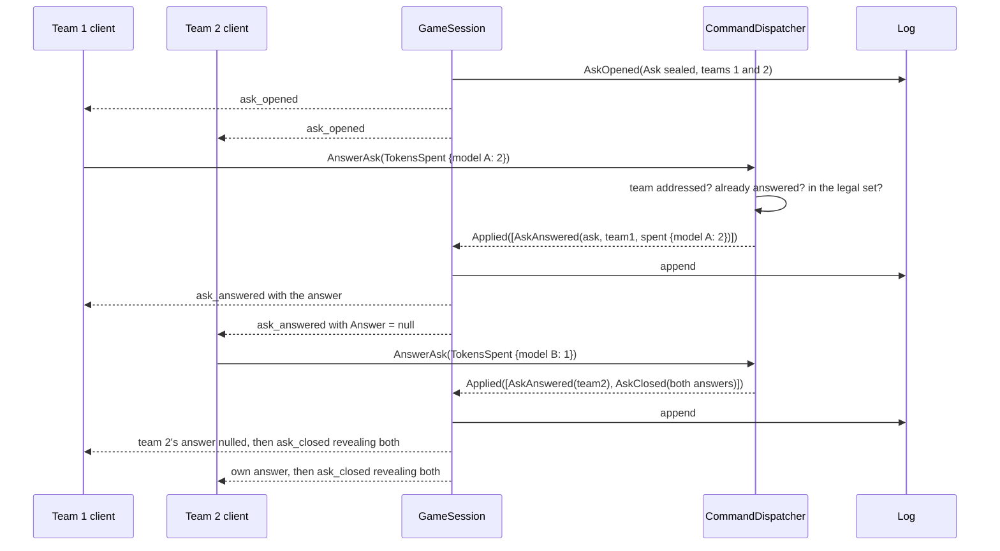

Withholding is per viewer on the way out, and the log holds one canonical history. The reveal is
`AskClosed`, emitted by the dispatcher the moment every addressed team has answered. A spectator
sees `Answer = null` for both. A sealed Ask whose frame is abandoned reveals through the
`AskClosed` the abandon path emits, so `AbandonSequence` on a sealed window is a way to see a spend
early. Nothing in the skeleton restricts who may abandon, and any participant may.

## State and data

### Persisted

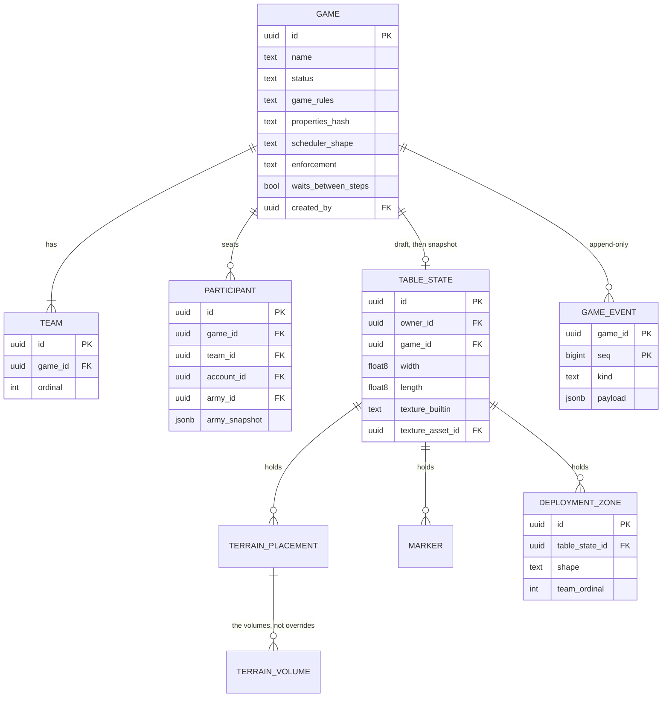

Every table but `game_event` is management's. This server writes them only while the status is
`lobby` or `setup`. `deployment_zone.shape` holds a shape id namespaced by style
(`frontline/1`), not a style name.

`participant.game_id` and `participant.army_id` are `docs/schema-diagram.md` → PARTICIPANT columns
(*`participant` links to its game, and holds the army it picked*). This module's SQL uses both.

### In memory

| Held | By | Rebuilt from |
| --- | --- | --- |
| `GameInfo` | `GameSession.Info`, and `GameState.Info` | `management.game` + `team` + `participant`, re-read on every lobby edit and on end-setup |
| the setup draft | `GameSession.Draft` | the `table_state` tree, at hydration |
| the initial state | `GameState.Board` = `Board(snapshot, army snapshots)` | `table_state` + `participant.army_snapshot` |
| every in-play fact | `GameState.Applier.Projection` | the whole log, applied from the `Board` |
| presence | `PresenceTable` | nothing; a reconnecting client rebuilds from zero because there is nothing to rebuild |
| the sockets | `_clients` | nothing |

Nothing that is state *in play* is a row. Placements, wounds, conditions, action records,
grants, spell tokens, scores, the scheduler's position, the resolution stack and the open Asks
all live in the `Projection` and come from the log. A table growing a "current position" column
means the event spine has been broken.

### The game's status

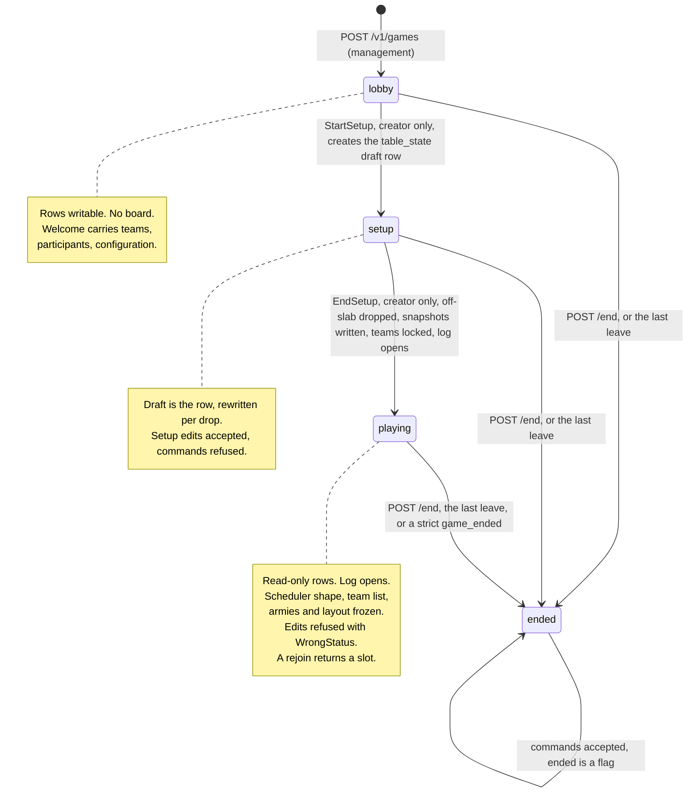

There is no arrow from `playing` back to `setup`. `ended` is not terminal: nothing hydrates
differently for it, and commands are accepted there. The arrow from `playing` is also taken by the
game server, when a strict round-4 end appends `game_ended`.

What freezes at the flip is the scheduler shape, the team list, the armies and the layout.
Freezing the team list means `CreateTeam` and `PickTeam` are refused with `WrongStatus` from
`playing` on, so no `team` row and no `participant.team_id` changes for the rest of the game. It
does not mean a participant loses their team by disconnecting. Their slot is on their
`participant` row, so a socket arriving during play is returned to it, and only an account that
never joined before the flip has no slot and watches (the plan's ruling 1; the model is
stated in game flow → Teams are frozen at the flip, and a team is a slot).

### A session in memory

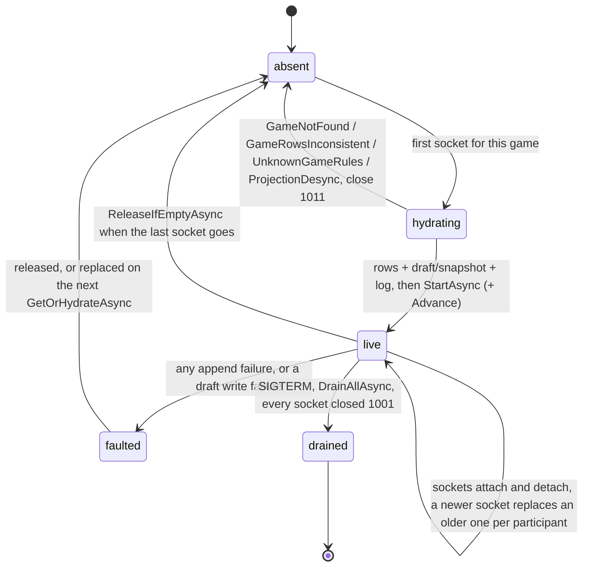

A session exists because a socket arrived and stops existing when the last one leaves. Every
edge back to `absent` is recovered by hydrating again.

## Failure modes

### Concurrency and ordering

| Hazard | What the system does | Test |
| --- | --- | --- |
| Two sockets for one game arriving together | `SessionRegistry`'s per-game semaphore serialises get-or-hydrate; one hydration, one session; another game's hydration is not held up | `A_slow_hydration_holds_up_only_its_own_game` |
| Two tasks serving one game | Nothing prevents it. The `(game_id, seq)` primary key rejects the loser's append, `PostgresEventLog` raises `DuplicateSequenceException`, the session faults and closes every socket with `1011`, and the next hydrate replaces the instance | `Losing_the_seq_race_faults_the_session_and_closes_every_socket` |
| A partially appended batch | `AppendAsync` is one transaction; a duplicate anywhere in the batch lands none of it | `A_duplicate_seq_is_refused_and_nothing_of_the_batch_lands` |
| A live event interleaved into a connecting client's log delivery | `ConnectAsync` is one mailbox turn | `Connecting_at_playing_yields_welcome_board_and_the_log_then_live_events` |
| Two members of one team answering the same Ask | The dispatcher refuses the second with `NotPermitted`; one answer per team | `Only_an_addressed_team_may_answer_and_an_unknown_ask_is_unknown` |
| Two people dragging the same piece in setup | Arrival order on the mailbox; last drop wins, and each sees the other's drag through presence | `Anyone_edits_everyone_sees_the_whole_draft_and_the_row_follows` |
| A crash between an append and `Advance` | `StartAsync` runs `RunToRestAsync` after hydrating a `playing` game | `Starting_advances_the_engine_and_a_sealed_answer_is_withheld_per_viewer` |
| An event the server's own projection cannot apply, or an `Advance` that throws | The run is rolled back: nothing stored or sent, the projection rebuilt from the log, the command refused; the session stays live | `An_event_the_servers_own_projection_cannot_apply_rolls_the_command_back`, `An_engine_that_throws_in_advance_refuses_the_command_and_stays_usable` |
| An engine that never rests | `RunToRestAsync` caps at 10 000 iterations and logs an error | — |
| Two sockets for one participant | The newer replaces the older, closed with `1000`; the older's read loop stops and any frame it still delivers is dropped; presence stays one value | `A_second_connection_for_the_same_participant_replaces_the_first`, `A_replaced_socket_is_read_no_further` |

### Lifecycle

- **A slow or dead database blocks a whole game.** Every append and every row write is awaited
  on the mailbox. There is no timeout on those awaits, no circuit breaker, and no backpressure
  on the unbounded mailbox. A Postgres stall shows up as a game that has stopped responding to
  every frame, including presence.
- **A draft write failure faults the session.** Memory and row would otherwise disagree, and the
  next hydrate is what shows the truth. Closing the sockets makes clients reconnect onto the row
  rather than hold a board the database does not have.
- **No exception escapes a mailbox item.** `AppendAsync` catches every exception from
  `IEventLog.AppendAsync` and every `ProjectionDesyncException` from applying the batch, and
  faults on all of them. What a handler throws off the log path, in a lobby edit's row read or
  the end-setup transaction, reaches the `Task` that `ReceiveAsync` returned, and
  `ConnectionHandshake`'s read loop catches it as a last resort, logs it, and closes that
  connection with `1011`. Catching only `DuplicateSequenceException` would leave the read loop
  awaiting a faulted `Task` it did not handle: a dead socket and a running session.
  Faulting is reserved for the two places where memory and the database can disagree: the log
  path, and the draft write whose broadcast has already gone out. A lobby or end-setup write that
  throws rolls back and leaves the session's own state untouched, so only the connection goes.
- **A faulted session accepts nothing after the fault.** `FaultAsync` closes and clears the
  clients; every later frame and presence tick is ignored, an attaching client is closed `1011`, and
  `GetOrHydrateAsync` drains the faulted instance before storing its replacement, so no mailbox loop
  outlives it. `DrainAsync` is idempotent, and `RunAsync` on a drained mailbox throws
  `SessionDrainedException`, which the handshake answers with one retry of `GetOrHydrateAsync`.
- **`GameInfo` is re-read when a connecting participant is missing from it.** `ConnectAsync`
  reloads the rows when the connecting account is not in `Info.Participants`, so a participant who
  joined through management after the session hydrated receives a `Welcome` that names them and
  the connected clients receive a `GameInfoMessage`. Every other path that changes the rows
  refreshes `GameInfo` as it writes.
- **A game deleted while a session is live.** `DELETE /v1/games/{id}` removes the rows and the
  log. The session keeps serving from memory until its sockets close. The next append fails on
  the foreign key rather than on the primary key, so it is not the duplicate path.
- **A socket lives as long as its JWT.** A timer closes it `1008` ("session expired") at the
  token's `exp`. A `Reauth` frame carrying a refreshed token of the same account re-arms the timer
  at the new `exp`; without one the client reconnects with the token it has refreshed since (any
  close other than `1000` after `Welcome` reconnects). Revocation latency is at most the token's lifetime.

### Left to break

- **Illegal game states.** Nothing is an invariant: a dead model on the table, a unit marked
  activated twice, an active team whose turn it is not. Only references are checked, because
  applying an event naming nothing would throw inside the applier.
- **A stored log the projection cannot apply is unrecoverable in place.** This server rolls back
  a batch it cannot apply before storing it, so such a log comes only from outside (a hand edit, an
  older build). Every hydrate replays it and throws, and the game cannot be opened until the row is
  removed by hand.
- **`GameRules` is not pinned.** Only `Properties` is content-addressed. Restarting an ended
  game after a deploy that changed a step list may replay differently. Pinning a build version
  was rejected: every deploy would become a wall old games cannot cross.
- **Hand-move positions are rested.** `MenuTranslation` rests each hand move with `Battlefield.Settle`, which ignores the
  client's `Z`; the `X`/`Y` the client chose are recorded. Accepted under "anyone can move
  anything, and the record says who".
- **Limits are per connection and per game, not per account over time.** An account may hold four
  sockets; each is rate-limited on its own. Nothing caps how many games one account plays at once.

## Testing

Everything in this module is headlessly testable. There is no Godot, and the socket is exercised
end to end in-process.

| Layer | How | Docker |
| --- | --- | --- |
| `StytchJwtVerifier` | `TestKeys` mints RS256 tokens against an in-process `StaticJwksSource`; one good token and five flawed ones (issuer, audience, expiry, missing claim, garbage) | no |
| `IEventLog` | `EventLogContract`, an abstract test class run twice, as `InMemoryEventLogTests` and `PostgresEventLogTests`, so the fake and the real implementation are proven to agree | for one of the two |
| `Replay` | a scripted log with an `Undone` marker, replayed to each sequence and asserted against a table of expected states; `IsValidUndoTarget` over live, undone and future targets and the seq between an answer and its close | no |
| `LegalSetMembership`, `EnforcementPolicy`, `EventFilter` | pure functions; the policy is a nine-row theory over the three settings times the four legalities | no |
| `CommandDispatcher` | over `InertEngine` and `FixedAskEngine`; menu edits under every setting, out-of-set answers under each setting, sealed collection, abandon-closes-asks-first, enumeration | no |
| `DraftEditor` | fourteen edit kinds in, drafts out, plus the corner-origin off-slab rule | no |
| `GameSession` | `RecordingClient` implements `ISessionClient`, so the actor, the log path, presence, faulting, per-viewer filtering, the rest frame's two audiences and the desync fault (`DesyncingEngine` emits an event naming a model nothing created) are tested with no socket at all | no |
| `PostgresGameRows` | `PostgresFixture` seeds and deletes rows in the compose database; an army tree is written and read back against `ArmyTests.Sample()` | **yes** |
| The socket | `GameServerFactory : WebApplicationFactory<Program>` plus `TestClient`; connect, four rejections, protocol errors, the log-then-live sequence, the rest frame closing the connect sequence and following every batch, reconnect, release-and-rehydrate, the presence tick, the SIGTERM drain, lobby and setup edits, teams locked from `playing` on with a rejoining participant returned to their team, end-setup | **yes** for anything that needs a game row |

Tests needing rows carry `[Collection("Postgres")]` and expect `docker compose up -d`. The
fixture neither migrates nor checks the schema, so a volume created before
`001_schema.sql` existed fails with `relation "management.game" does not exist`. The reset is
`docker compose down -v`.

Two things are exercised only by `dotnet test`'s own scheduling:

- **Nothing tests two processes racing one game.** `Losing_the_seq_race_faults_the_session_and_closes_every_socket`
  provokes the duplicate by appending behind the session's back with a second `IEventLog`
  handle, which proves the fault path but not the mechanism that would produce it in
  production.
- **Nothing tests the mailbox under load.** Ordering is proven for two frames, not for a
  thousand, and the unbounded mailbox's behaviour under a stalled database is untested.

`HttpJwksSource` is tested over a counting `HttpMessageHandler` and a manual clock
(`JwksSourceTests`); the socket tests swap in a static source. Every `Advance` behaviour beyond "the inert engine returns nothing" is untested
too. The loop's cap and its interleaving with appends are first exercised by the scheduler and
interpreter plans.

## Rulings and deferred work

The plan's three rulings:

1. **Teams are not created or picked after `playing`, and a returning player rejoins their
   slot.** Teams are created only while the game is `lobby` or `setup`, and the team list freezes
   at the flip with the scheduler shape, the armies and the layout, so `CreateTeam` and
   `PickTeam` are refused with `WrongStatus` from `playing` on. A participant's team is their
   slot, recorded on their `participant` row; a socket arriving during play is returned to it,
   with no re-pick and nothing re-derived. Only an account that never joined before the flip has
   no slot, and that account is a spectator: no team, never Asked, watching. The canonical
   statement is game flow → Teams are frozen at the flip, and a team is a slot.
   `Projection.Scores` therefore needs no entry beyond the ones `Projection.Initial` builds from
   the frozen list.
2. **The draft starts as 72 × 48 with the built-in texture `grass`**, replaced by the first edit
   (typically a layout load) ([closing the open questions](../../superpowers/specs/2026-09-09-open-questions-design.md)).
   72 × 48 is the size every deployment style assumes and the creator has a legal table to edit
   without a round trip. Rejected: the creator's client choosing, which gives `StartSetup`
   fields, a `Tabletop.Protocol` change the contracts plan owns; a layout as the default, which
   needs a way to read one that this server has not got.
3. **One connection per participant: a newer socket replaces the older**
   ([closing the open questions](../../superpowers/specs/2026-09-09-open-questions-design.md)).
   A reconnection after a blip works; a second window kills the first. Rejected: two connections,
   under which presence stays one value per participant (both sockets write the same slot, latest
   wins), and `AttachCoreAsync`/`DetachAsync` stop replacing and stop sending `PresenceEnded`
   until the last socket closes.

Rulings the plan takes from the specs: commands while `ended` (accepted, because `ended` is a
flag and there is no un-end endpoint), the presence relay rate (20 Hz), session eviction (a game
leaves memory with its last socket), and the account claim name (`account_id`, shared with
management's plan). Management sets the claim on the session (the management plan's
ruling 1); `StytchJwtVerifier` depends only on that name and its top-level position.

Deferred, with where it is recorded:

| Deferred | Where |
| --- | --- |
| Every rule: scheduler, interpreter, `Properties`, dice, legality beyond set membership | [scheduler](../scheduler/design.md), [interpreter](../interpreter/design.md) |
| Server-side geometry in the move Ask: distance against `Allowance`, impassable containment, resting `Z` (`Battlefield.Settle(state, modelId, placement)`) | the interpreter's move step over `Tabletop.Geometry` |
| Hosting: proxy idle timeouts, shutdown drain, more than one process | `architecture.md` → Deployment |
| Terrain as event-driven state, which unlocks army terrain, buildings as targets and mid-game terrain edits | setup content → Still open |
| A replay viewer | build order step 11 |

Two shapes are left as they are. `Legality.AlwaysAccepted` is never constructed on the dispatch
path, and `EnumerateLegalCommands` expands two of seven `LegalSet` shapes.

## References

**Specs**:

- [`2026-08-29-accounts-design.md`](../../superpowers/specs/2026-08-29-accounts-design.md): auth as a module, a game is a lobby, ending is a flag, nobody instantiates a session
- [`2026-08-30-presence-design.md`](../../superpowers/specs/2026-08-30-presence-design.md): the ephemeral channel, nothing is written down, connectedness is not a field
- [`2026-09-04-setup-phase-design.md`](../../superpowers/specs/2026-09-04-setup-phase-design.md): the two creator transitions, the third message kind, the draft is the row, zones
- [`2026-08-28-game-flow-design.md`](../../superpowers/specs/2026-08-28-game-flow-design.md): nothing is an invariant, the shelf, configuration in the lobby
- [`2026-08-27-table-domain-model-design.md`](../../superpowers/specs/2026-08-27-table-domain-model-design.md): live positions broadcast, the log carries settled start and stop
- [`2026-08-29-setup-content-design.md`](../../superpowers/specs/2026-08-29-setup-content-design.md): the snapshot is the log's initial state; the lock is structural
- [`2026-08-29-identity-and-enumerations-design.md`](../../superpowers/specs/2026-08-29-identity-and-enumerations-design.md): `GameRules` and `Properties`, every closed set, `ended` is reversible
- [`2026-09-04-scheduler-design.md`](../../superpowers/specs/2026-09-04-scheduler-design.md) and [`2026-09-03-action-sequences-design.md`](../../superpowers/specs/2026-09-03-action-sequences-design.md): seams only: the turn is an Ask, Asks and windows, the sealed variant, abandonment
- [`2026-09-04-client-shell-design.md`](../../superpowers/specs/2026-09-04-client-shell-design.md): the connect sequence, the projection, undo local first, reconnect is connect
- [`2026-09-04-whole-design-review.md`](../../superpowers/specs/2026-09-04-whole-design-review.md): rulings 1, 2, 3, 4 and 5
- [`2026-08-29-management-api-design.md`](../../superpowers/specs/2026-08-29-management-api-design.md): auth and join; we issue no tokens of our own; the version check

**Repo documents.** [`docs/architecture.md`](../../architecture.md) (the load-bearing seam, the
command/event spine, rules enforcement, undo, two servers, transport, deployment's three
constraints, the game management data model, persistence, contracts to freeze, build order);
[`docs/schema.md`](../../schema.md); [`docs/data-model.md`](../../data-model.md).

**Rulebook.** Grimdark Future v3.5.1 page 17 covers the placement styles, and *"if it's
impossible to place the terrain piece, simply remove it"*, which is `DraftEditor.DropOffSlab`.
Page 6 covers the deployment roll-off the app does not run in setup, reconciled by `SwapZones`.
No other page is read by this module, because this module holds no rules.

**Sibling design documents.** [`../contracts/design.md`](../contracts/design.md) (the three
libraries and local development), [`../scheduler/design.md`](../scheduler/design.md),
[`../interpreter/design.md`](../interpreter/design.md) (together the one `IRulesEngine`),
[`../management-api/design.md`](../management-api/design.md),
[`../client/design.md`](../client/design.md),
[`../geometry/design.md`](../geometry/design.md), [`../web-app/design.md`](../web-app/design.md).
