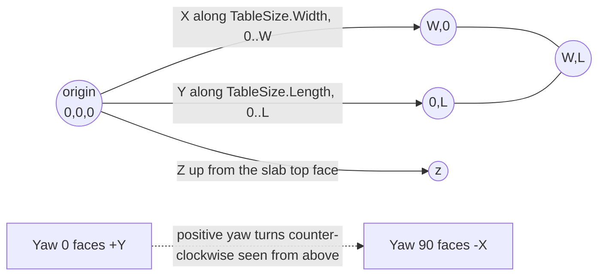
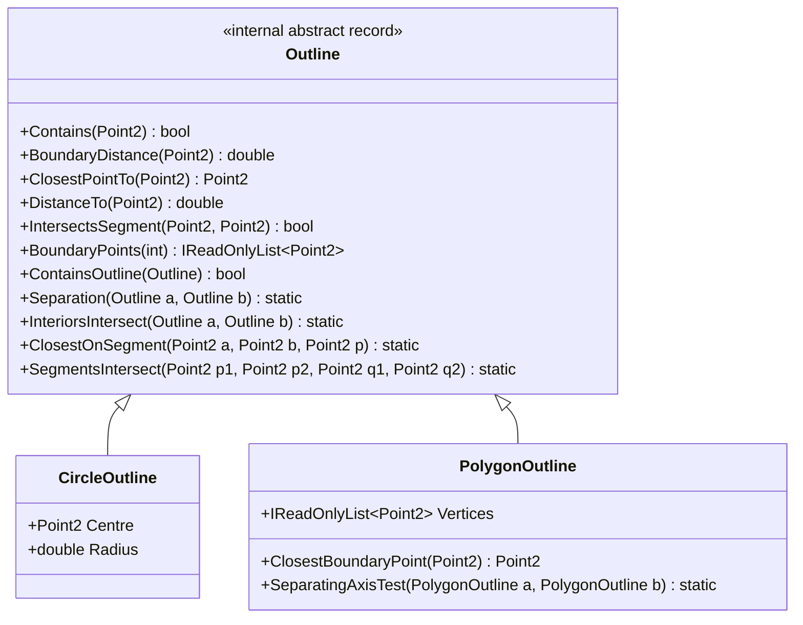
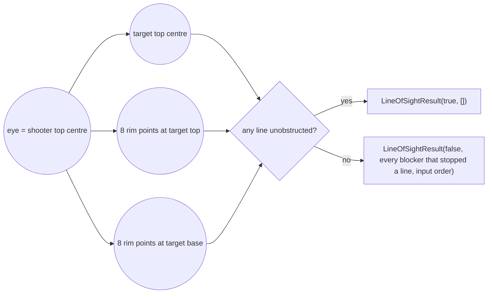
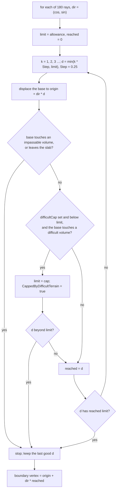
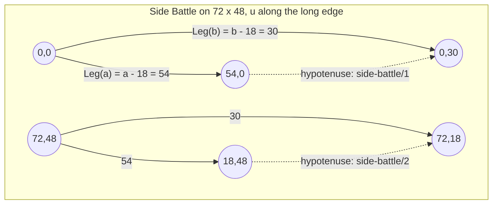
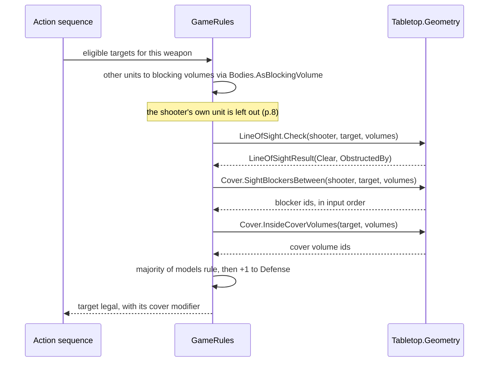
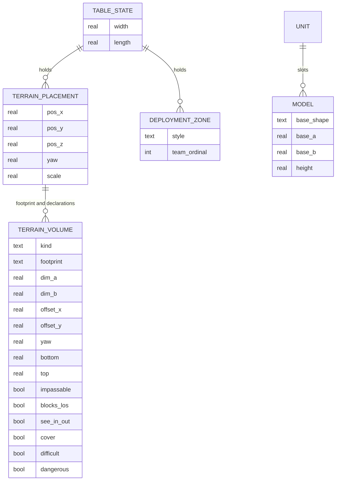

# Geometry — engineering design

`libs/Tabletop.Geometry` is the measurement engine both the client and the game server run.
It answers six kinds of question — how far apart, is the line clear, what is a model standing
in or on, does this overlap that, what can this model reach, is this shape on the table — and
it answers every one of them as a **2D shape intersection plus a vertical range**, because
`architecture.md` → Geometry dropped convex hulls in favour of extruded prisms. It knows
nothing of Godot, of a ruleset, or of persistence: OPR's numbers reach it as parameters, and
every result is a measurement, a flag, or a drawn region that the caller interprets. The one
sentence a reviewer must not miss: **the client's copy of this library is a cosmetic
prediction and the server's is the answer**, which is precisely why bit-exact cross-platform
determinism is not a requirement, and why a single `Tolerance.Distance = 1e-6` is the whole
numerical policy.

## Scope

In scope, all of it inside `libs/Tabletop.Geometry`:

| Subject | Type | Task |
| --- | --- | --- |
| Point helpers, point-in-polygon | `Point2`, `Polygon`, `Tolerance` | 1 |
| The one internal convex shape | `Outline`, `CircleOutline`, `PolygonOutline` | 2 |
| Values to world outlines | `Bodies`, `WorldVolumes` | 3 |
| Edge-to-edge measurement | `Distance` | 4 |
| Surface settling | `Settling` | 5 |
| Standing in and on terrain | `Containment` | 6 |
| Base overlap, terrain intersection | `Overlap` | 7 |
| Line of sight | `LineOfSight`, `LineOfSightResult` | 8 |
| The geometric half of the cover rule | `Cover` | 9 |
| Unit coherency | `Coherency`, `CoherencyResult` | 10 |
| The slab | `Table` | 11 |
| The movement region from server parameters | `Movement`, `MovementRegion`, `MoveCheck` | 12 |
| The built-in deployment zone styles | `ZoneStyles` | 13 |

Deliberately not in scope:

- **The rules.** No legality decision, no majority-of-models rule, no `+1 to Defense`, no
  6" difficult cap of its own. `architecture.md` → Rules enforcement: flagged, never prevented.
- **The terrain generators and the built-in terrain inventory.** The setup phase spec ships the
  four planet tables with the client and the server never reads them; the client shell plan owns
  `TerrainGenerators` and `BuiltinContent` in `client/src/Core/`. The zone styles are the one
  piece of built-in setup content that comes into the library, because the server checks a
  deployment against them too.
- **Geodesic movement**, **exact ellipse math**, **polygon clipping** (area coverage),
  **convex hulls**, and **unit conversion**. Each is recorded in Open questions with the
  assumption taken instead.
- **Persistence and the wire.** The library has zero package dependencies; `Tabletop.Protocol`
  serialises these value types, and nothing here reads a row.

Position in the build order: **step 2**, `architecture.md` → Build order, running in parallel
with step 3 and depending only on step 1. What must exist first is the contracts plan
(`docs/superpowers/plans/2026-09-05-contracts-and-local-dev.md`) Tasks 1–3: the project, the
solution, the test project, the value types in `Points.cs` / `Bases.cs` / `Volumes.cs` /
`Placements.cs`, and the declared-but-throwing surface in `Api.cs`. Nothing else in the
repository is a prerequisite, and nothing in the repository is a consumer yet — `libs/` holds
only a `.gitkeep` today.

What already exists when this plan starts, and what this plan does to it: `Api.cs` is a set of
`NotImplementedException` stubs whose signatures are frozen contract, and `ApiSurfaceTests.cs`
asserts that they throw. Each stub moves into its own file as its task implements it, `Api.cs`
is deleted in Task 8 when `LineOfSight` leaves it, and `ApiSurfaceTests.cs` is deleted in
Task 4 in favour of behaviour tests. **No declared signature changes; members are only added.**

## Context


The library sits below both runtimes and above nothing. Take from this that geometry has no
inbound dependency it can be broken by, and two consumers that must agree.

Three seams matter.

**Geometry to protocol.** `Tabletop.Protocol` does not wrap these types; it *uses* them.
`Point3`, `Yaw`, `Placement`, `TableSize`, `Volume` and `TerrainTransform` are on the wire
verbatim, which is why the coordinate frame is a library constraint rather than a client
convention: `TerrainPlacement.WorldVolumes()` in `Tabletop.Content` produces the
`IReadOnlyList<WorldVolume>` that every call here takes, and nothing converts anywhere.
`Polygon` is the one type that never crosses the wire: a deployment zone travels as a shape
**id** (`"frontline/1"`), and both ends call `ZoneStyles.Resolve` to get the polygons back.

**Geometry to the game server.** The server owns which volumes count. `MoveRegion` carries
`ImpassableVolumeIds`, `DifficultVolumeIds` and the `DifficultCap` that `GameRules` computed;
`Movement.Region` takes those as plain parameters, so the library never references the protocol
record. Every OPR constant — coherency `(1, 9)`, the 1" separation, the 6" cap, melee reach
`EdgeToEdge <= 2 && Vertical <= 4`, objectives `EdgeToMarker <= 3`, Ambush `> 9`, Scouts
`<= 12` — is supplied by `GameRules` at the call site.

**Geometry to the client.** The client draws consequences, never answers. It resolves the id
lists to `WorldVolume`s, calls `Movement.Region`, and draws `.Boundary` as a polygon; it calls
`Settling.SurfaceHeightAt(new Point3(x, y, currentZ), volumes)` on every drag frame; it builds
a presence `Measurement(From, To)` from `Distance.ClosestPoints`. When the server's event
disagrees with any of it, the model snaps and that is the entire cost
(`architecture.md` → Geometry).

## Design

### 1. The frame, and why it is a corner

No spec said where the origin was or which way yaw turned. This plan first assumed the
table's **centre**; the compatibility review of 2026-09-05 **ruled the corner** and every
affected file was changed to match (plan question 1, spec correction 4). The reasons were
that the game server plan's `DraftEditor.OnSlab` and the contracts plan's wire samples
already used `0 <= x <= width`, that nothing in the specs preferred the centre, and that one
frame everywhere removes a conversion layer from the client. It is a reversal a reviewer
should look at, because it is the only decision in this module that the wire, the database
and both runtimes all depend on simultaneously.



The corner frame and the yaw convention. Take from this that a position is on the slab exactly
when `0 <= x <= W` and `0 <= y <= L`, and that `Point2.Rotate(new Yaw(90))` sends `(0,1)` to
`(-1,0)`.

The dependent conventions, all in the plan's Global Constraints and all load-bearing:

| Convention | Consequence in code |
| --- | --- |
| One world unit = one inch, angles in degrees | No conversion anywhere; millimetres never enter |
| Yaw only, always upright | `Outline` is 2D; settling sets height, never tilt |
| An oval's `A` (length) lies along the facing axis | `BaseOutline` builds `(B/2 cos t, A/2 sin t)` then rotates |
| A rect footprint's `A` is local X, `B` local Y | Matches `Footprint.Rect(width, length)` |
| `Scale` multiplies footprint dimensions, offset, `Bottom` and `Top` | `WorldBottom` = `Position.Z + Bottom * Scale` |
| `Position.Z` is added to both heights | A piece raised 1" raises its whole prism |

The last two are the whole of the terrain transform: a uniform scale, because a per-axis one
would stretch a circular footprint into an ellipse and quietly reintroduce a shape the
geometry does not have (geometry values → The terrain transform).

### 2. Extruded prisms, not convex hulls

`architecture.md` originally listed boxes, cylinders **and convex hulls** as collision shapes.
Geometry values dropped the hulls, and that single deletion is the reason this module is small.
With footprints restricted to a circle or a rectangle and bases restricted to a circle, an oval
or a square, every test in the library factors into two independent problems:

1. a **2D shape intersection or distance** between two convex outlines on the table plane, and
2. a **1D interval test** between two vertical ranges `[bottom, top]`.

Nothing needs hull construction, nothing needs a 3D separating-axis test, nothing needs a
physics engine — `Godot physics is not in the scene` (client shell → Geometry). It also means
`bottom` and `top` rather than a single height covers every case with one mechanism: a hill is
`0-2`, a wall is `0-4` with a thin footprint, a second storey is `4-8` with nothing beneath it,
and a forest on a hill is a Solid `0-2` with an Area `2-8` on top.

The cost, stated plainly: an uploaded mesh's visual flair lies outside its hitbox, deliberately;
a sloped roof is a box; and an ellipse is not representable, so an oval base becomes a
convex 64-gon (`Bodies.OvalVertices = 64`, error under 0.2% of the radius). The 64-gon is
*inscribed* — its vertices lie on the ellipse — so distances to an oval are very slightly
over-reported and overlaps very slightly under-detected. `DistanceTests` compares oval results
at three decimal places rather than six, which is the plan conceding exactly this.

### 3. `Outline` — the one 2D shape

`Outline.cs` holds the entire geometric core, and all of it is `internal`. Consumers see only
`PlacedModel`, `WorldVolume`, `Polygon`, `Point2/3` and the result records; the test project
reaches the internals through `InternalsVisibleTo` added to the csproj in Task 1.



Two concrete shapes, one abstract contract, four static helpers. Take from this that the
library's whole geometric surface is a dozen members over three internal types, and that
everything public is a thin composition over them.

**A circle is exact, a polygon is convex.** `CircleOutline` is a true circle — not a polygon
approximation — so a round base, by far the commonest, carries no discretisation error at all.
`PolygonOutline`'s constructor rejects fewer than three vertices and **reorders the vertices
counter-clockwise** by the sign of twice the signed area, so callers may hand it either winding
and `Contains` (a left-of test against every edge) stays correct. Convexity is an unchecked
precondition; every producer inside the library builds a rectangle, a square, an inscribed
ellipse or a table rectangle, all convex by construction.

**Separation is dispatched on the pair, and it is exact.**

| Pair | Method | Exactness |
| --- | --- | --- |
| circle, circle | centre distance minus both radii, clamped at 0 | exact |
| circle, polygon | `ClosestBoundaryPoint` from the centre, minus the radius | exact |
| polygon, polygon | every vertex of A against B's boundary, and the reverse | exact |

The polygon-polygon scan is exact rather than approximate because for two convex polygons the
minimum distance is always attained with at least one **vertex** as an endpoint, so scanning
vertices against the other's boundary cannot miss it. That is worth stating explicitly, since a
reader may assume it is a sampling heuristic like the ones elsewhere in this module.
`Separation` also returns the two witness points, which is what a presence measurement is made
of (presence → A measurement is two points).

**Overlap is not distance.** `InteriorsIntersect` requires *positive* shared area:
touching bases and a model standing exactly on a hill's top face do not overlap. For two
polygons it runs a **separating-axis test** over the edge normals of both, with the axis
projections compared with a `Tolerance.Distance` slack that makes edge contact "not
intersecting". SAT is the right tool here precisely because both shapes are convex and neither
is axis-aligned in general: a square base at yaw 45 against a rotated wall footprint is the
ordinary case, not the exotic one.

**Segment tests** exist for line of sight. A circle intersects a segment when the closest point
on the segment is within the radius; a polygon does when either endpoint is inside or any edge
crosses. `SegmentsIntersect` uses the four-cross-product orientation test with an explicit
collinear fallback through `Polygon.OnSegment`, which is the same tolerance-aware on-segment
predicate `Polygon.Contains` uses for boundary inclusion.

**Boundary inclusion is uniform: on the boundary is inside.** Every `Contains`, every
`ContainsPoint`, `Table.ContainsPoint`, `Polygon.Contains` and the vertical range test are
inclusive to within `Tolerance.Distance`. This is a deliberate bias toward admitting a
placement, consistent with `flagged, never prevented`.

### 4. From values to outlines: `Bodies` and `WorldVolumes`

Two files convert the stored value types into world-space outlines, and they are the only
places a transform is applied. Every other class calls them.


The two transform chains. Take from this that a model's Z never enters its outline (it is the
vertical range) and that a volume's yaw is the **sum** of the piece's yaw and the volume's own.

`Bodies` also supplies the three vertical facts a body has — `Bottom()` is the settled Z,
`Top()` is `Bottom + Height`, and `Eye()` is `(X, Y, Top)` — and one adapter,
`AsBlockingVolume(Guid id, PlacedModel m)`, which is how rulebook p.11's *"other units are
sight blockers"* is expressed without the library knowing what a unit is. The caller passes the
models it wants treated as blockers, so p.8's *"models may always ignore friendly models from
their own unit"* is the caller **leaving them out** — no friend/foe concept enters the library.

One asymmetry to note in `AsBlockingVolume`: an oval or square base becomes its **bounding
rectangle** (`Footprint.Rect(b.B, b.A)`), because `Footprint` has no oval kind. A model is
therefore shot *at* as a 64-gon and blocks *as* a rectangle, and the rectangle is the larger
shape. It over-blocks by the corner area of the bounding box, which for a 2.36×1.38 oval is
about 21% of the footprint.

### 5. Distance is edge to edge

`Distance` is seven members of dispatch onto `Outline.Separation`, and the whole design
decision is in the name: **edge to edge between base shapes, never centre to centre** (table
domain model). Centre-to-centre would be one subtraction and would be wrong in a way players
notice immediately: a 32mm round reaches 0.63" past its centre and a 60mm oval 1.18" past its,
so two of them measured centre to centre are short by nearly two inches.

| Member | What it measures | Read from |
| --- | --- | --- |
| `EdgeToEdge(PlacedModel, PlacedModel)` | base edge to base edge, 0 when touching or overlapping | table domain model |
| `EdgeToEdge(PlacedModel, Point2)` | base edge to a bare point, 0 when the point is inside | contracts plan |
| `EdgeToEdge(PlacedModel, WorldVolume)` | base edge to a footprint edge | added |
| `EdgeToMarker(PlacedModel, Point2, double diameter)` | base edge to a marker's rim | p.6, *within 3" of a marker*; geometry values → Marker size |
| `ClosestPoints(PlacedModel, PlacedModel)` | the two witness points, each carrying its own base's Z | presence → A measurement is two points |
| `InRange(PlacedModel, PlacedModel, double)` | inclusive, with tolerance | p.8 |
| `Vertical(PlacedModel, PlacedModel)` | difference of base heights | p.9, *within 2" horizontally and 4" vertically* |

Distance is strictly **horizontal**. Height never enters it — `Height_does_not_enter_horizontal_distance`
is a test — and vertical separation is a second, separate number, because that is how the
rulebook writes melee reach on p.9. A single 3D distance would collapse two rules into one and
match neither.

### 6. Settling: a raycast down through Solid volumes

`Settling.SurfaceHeightAt` is the whole of `architecture.md`'s *"settling a model onto the
surface it lands on by raycasting down through terrain volumes"*. It is a linear scan, not a
physics query: the highest `WorldTop()` of a **Solid** volume whose footprint contains the
point and whose top is at or below the drop height, defaulting to `0` — the slab.

Two overloads, and the difference is the reason the second exists:

- `SurfaceHeightAt(Point2, volumes)` drops from **infinity**: the highest Solid top under the
  point, full stop. This is the declared contract and the right answer for placing a model.
- `SurfaceHeightAt(Point3 from, volumes)` drops from `from.Z`: the highest Solid top **at or
  below** it. This is what lets a model dragged along the ground of a ruin pass *under* its
  second storey instead of teleporting onto it, and the server uses the client's `To.Z` as the
  drop height when settling a `Destinations` answer.

The scan skips anything that is not `Solid`, skips a top already beaten or above the drop
height, and only then does the footprint test — so Area volumes are passed straight through
(*solid tops are standable, area volumes are stood inside*, geometry values → Collision
volumes) and the slab at Z = 0 is the floor of the answer rather than a volume in the list.

**"What it is resting on" is not stored.** The table domain model listed it as part of a
placement; geometry values dropped it, because settling re-derives it whenever it is needed and
terrain is locked after setup, so nothing a model stands on ever moves. This design keeps that
promise: there is no cached surface anywhere.

### 7. Containment and overlap

Containment answers *where is this model standing*; overlap answers *is this placement
physically silly*. Both are computed and neither is stored (table domain model → Containment is
computed, never stored). Note the vocabulary collision the whole-design review annotated:
**this** containment is standing in terrain, while game flow's containment — being inside a
transport or a building — is a stored `Location.Inside` on the wire and is not this module's
concern except through `BaseFullyWithin`.

| Call | Predicate | Serves |
| --- | --- | --- |
| `Containment.VolumesContaining` | footprint contains the base **centre**, vertical range contains the base height | p.11 *mostly inside* (single models); *is activated in it* |
| `Containment.VolumesFullyContaining` | footprint contains the **whole base** | p.11 *fully inside a piece of cover terrain* (multi-model units) |
| `Containment.BaseFullyWithin(model, container, inches)` | every point of the base within `inches` of the container's base, edge to edge | p.14 `Transport(X)`, p.20 solid buildings — *"must stay fully within 6" of it when exiting"* |
| `Overlap.Bases` | positive shared area **and** positive shared vertical extent | flagged base overlap |
| `Overlap.WithSolid` | the same, against a Solid volume only | flagged terrain intersection |

The vertical range is **inclusive**, which is what makes standing on a hill count as being in
it: a hill declaring cover and difficult applies to the model on top of it, with no flag and no
special case. `Overlap` is the mirror image — it uses `IntervalsOverlap`, which demands a
*positive* shared extent, so a model standing on a Solid's top does not intersect it, a model
under a `4-8` slab does not intersect it, and a 5"-tall model standing under the same slab
does.

`BaseFullyWithin` deserves its own paragraph, because it is the one place a naive
implementation would have broken the module's own rule. The obvious reading of *"fully within
6\""* is a circle of radius 6 about the container's centre. That is centre-to-centre, which
this library never does. The region actually tested is the **container's footprint grown by
`inches`** — a Minkowski sum in effect, though it is never constructed. Both outlines are
convex, so the farthest point of the moving base is exact without any new primitive:

- a **polygon** base's farthest point is one of its vertices, so test all of them;
- a **circular** base's is its centre pushed `Radius` along the outward direction, so
  `container.DistanceTo(centre) + Radius <= inches` is the answer.

When the two bases overlap, `DistanceTo(centre)` is 0 and the circular form degrades to
`Radius <= inches` — an upper bound, so it can only ever refuse a placement that is already
touching the container, never admit one that is too far. That is the correct direction for a
one-sided error here.

### 8. Line of sight: sampled rays between an eye and a rim

This is the module's largest judgement call, and the plan records it as question 2 rather than
as a settled fact. The specs pin only what it runs **against**: *"Line of sight is settled
against the cylinder that the base and height describe. The visual mesh is never tested"*
(table domain model), and *"blocking is declared, not derived"* (geometry values → Declarations)
— the declaration says the volume is **opaque**, and geometry then answers whether a given line
passes through it. What no spec pinned is how many lines to draw.

The policy: the eye is the shooter's **top centre**; the target is sampled at its top centre
plus up to eight rim points at **both** its top and its base; sight is clear when **any one**
line reaches its point unobstructed.



Seventeen rays for a circular or oval base; nine for a square, whose four vertices are its whole
rim. Take from this that partial exposure counts as visible, and that `ObstructedBy` is a
union over all failed rays rather than the blockers of any one ray.

`Rim(Outline)` supplies the sample points: `BoundaryPoints(8)` evenly around a circle, all
vertices of a polygon with eight or fewer, and every n-th vertex of a larger one — so an oval's
64-gon is sampled at 8 of its 64 vertices. Sampling both the top *and* the base rim is what
makes a low wall behave: a `0-1` wall leaves the target's top rim visible and its base rim
hidden, so sight is clear and `Cover.SightBlockersBetween` is non-empty, which is exactly
p.11's *behind a sight blocker*.

`SeeInAndOut` is a **modifier on blocking**, not an independent property — it means nothing on a
volume that is not opaque. `Obstructions` implements it as: skip this blocker if either endpoint
of the segment is inside it. A forest therefore blocks sight *through* it while a model inside it
can see out, a model outside can see in, and two models both inside can see each other
(rulebook p.12).

**What the sampling cannot answer**, stated so a reviewer does not have to discover it:

- **How much of the target is visible.** The result is a boolean plus a blocker list. Any rule
  phrased as *"more than half obscured"* has nothing to read. OPR does not have one; a
  Warhammer ruleset might.
- **Which part is visible.** Seventeen booleans are discarded down to one. A rule that cared
  whether the *head* was exposed would need the per-point results kept.
- **Anything between the samples.** A blocker narrower than the angular gap between adjacent
  rays, positioned to cover a rim point without covering its neighbours, is simply not seen.
  With 8 rim points the gap at 10" range for a 1.26" base is generous.
- **Non-vertical occlusion of the eye itself.** The eye is a single point at the top centre. A
  model standing so that its own base is inside a blocker still shoots from its top centre.
- **The lower body as a firing position.** There is no eye at the base, so a model cannot see
  under an overhang it is standing beneath if the overhang covers its top centre.

A single centre-to-centre line would be simpler and stricter, but then a low wall either hides
a model wholly or not at all, and *behind a sight blocker* would have nothing to measure. A
denser sample, or sampling the shooter's rim as well, changes only `TargetPoints` and `Eye`.

### 9. Cover: two geometric facts, and no rule

`Cover` exists so that `GameRules` can read p.11's cover rule without doing geometry of its own:
*"If the majority of models in a unit are fully inside a piece of cover terrain or behind a
sight blocker (for multi-model units), or that are mostly inside cover terrain or behind sight
blockers (for single-model units), they get +1 to Defense rolls"*.

| Rulebook phrase | Geometry call | Whose job |
| --- | --- | --- |
| *fully inside a piece of cover terrain* | `Cover.InsideCoverVolumes` non-empty | geometry |
| *behind a sight blocker* | `LineOfSight.Check` clear **and** `Cover.SightBlockersBetween` non-empty | geometry |
| *mostly inside cover terrain* | `Containment.VolumesContaining` filtered to `Cover` | geometry |
| *the majority of models*, *+1 to Defense* | — | `GameRules` |

`SightBlockersBetween` draws the same seventeen rays as `Check` and returns every blocker that
stopped at least one of them, whether or not sight is clear overall. That is the only way to
express *behind* — a wall that blocks nothing at all is not cover, and a wall that blocks
everything is a failed shot rather than cover.

Two consequences a reviewer should weigh. First, the server calls `Check` and
`SightBlockersBetween` back to back for the same pair, doing the ray work twice; a combined
call returning both would halve it. Second, the predicate is permissive: a 1"×1" pillar half an
inch off the line stops one rim ray and therefore grants cover. Whether that matches how the
rule is played at a table is a rules question, not a geometry one, but it is a decision this
code makes.

### 10. Coherency: connected components plus a spread test

Rulebook p.7: *"All models in a unit must always stay within 1" of at least one other model,
and must stay within 9" of all other models … forming an uninterrupted chain of models in 1"
coherency with each other"*. Two conditions, and they are not the same shape of test.

`Coherency.Check(models, chainDistance, maxSpread)`:

1. build the full `n × n` edge-to-edge distance matrix;
2. find connected components under `distance <= chainDistance`, by depth-first search;
3. the **largest** component is the unit's body — ties keep the one holding the earliest model,
   which falls out of numbering components by first-encountered index;
4. a model outside the body is out of coherency; so is a model inside it that is further than
   `maxSpread` from **any** other model in the body.

The rulebook's `1"` and `9"` are the caller's, per the constraint that no OPR number lives in
this library. `CoherencyResult` reports indices into the input rather than ids, because the
library has no model identity — the caller zips them back.

Two properties worth challenging. The spread test flags **both** ends of an over-long chain
(the plan's `A_long_chain_breaks_the_spread` expects `{0, 6}`), so the result is the set of
models participating in a violation, not the minimal set to move. And the matrix is O(n²) with
a full outline separation per pair, which for a 20-model unit of ovals is roughly 190 pairs of
64-gon-versus-64-gon separation.

### 11. The slab

The table is *a rectangle. No shape field and no play-area boundary volume* (setup content →
The table is a slab), so `Table` is three members over `TableSize`:

- `Bounds(TableSize)` — the four corners as a `Polygon`, in the corner frame;
- `ContainsPoint(TableSize, Point2)` — edge inclusive, `0 <= x <= W && 0 <= y <= L`. This is
  the game server's `DraftEditor.OnSlab` rule, and it is what deletes off-slab terrain at
  end-setup (setup phase → Terrain: *"A piece still off the slab when setup ends is dropped
  from the snapshot"*);
- `ContainsBase(TableSize, PlacedModel)` — the **whole base** on the slab, rulebook p.7
  *"models may also never move outside of the battlefield (no part of them, at any point)"*.

`ContainsPoint` is an axis comparison while `ContainsBase` goes through `PolygonOutline`. The
two agree, but they are two implementations of the same predicate, and a reviewer may prefer
one.

### 12. The movement region: rays marched from server parameters

`architecture.md` → How the client stays responsive is the whole brief for this class:
*"The server sends parameters, not an answer: move allowance, terrain effects, and the ids of
volumes that cannot be crossed. `Tabletop.Geometry` renders the region from those parameters."*
The same section corrects an earlier invention: *"Terrain multipliers" was an invention* — OPR's
difficult terrain **caps a unit's whole move at 6"** rather than scaling it, so the parameter is
`double? difficultCap`, whatever `GameRules` computed, and `null` when the ruleset has none.

`Movement.Region(start, allowance, impassable, difficult, difficultCap, table)` returns
`MovementRegion(Origin, Allowance, CappedByDifficultTerrain, Boundary)` — one boundary vertex
per ray, `Rays = 180`, which the client draws as a polygon.



One ray of the march. Take from this that the region is a **star-shaped polygon** sampled at 2°
intervals, that the obstacle test is the *base outline* being displaced rather than a point, and
that `d` is clamped to `limit` so a non-multiple allowance such as 7.3" is reached exactly.

**Why star-shaped, not geodesic** (plan question 4). A geodesic region — true reach around a
corner, via a visibility graph over the footprint polygons — is a materially larger piece of
work, and it would buy nothing that survives: the region is a **cosmetic prediction**, the
server judges the landed move, and the client shell's ruler readout is *"the base's displacement
from where it started"* (client shell → Input and presence), which is a straight line by
definition. The rulebook agrees: p.7 measures *"no part of their bases move further than the
total movement distance"*, not path length. The compromise is visible, though: a model cannot be
shown as able to step around a wall it can in fact step around, and the region is optimistic in
the other direction too — it says nothing about whether the path taken to a reachable point was
itself legal.

**Marching, and what it costs.** There is no bisection or refinement pass. The boundary is
quantised to `Step = 0.25`, and near an obstacle it systematically **under-reports** reach by up
to a quarter inch; the plan's own test asserts a *range*
(`Assert.InRange(r.Boundary[0].X, 2.5, 2.87)`) rather than a value, which is that quantisation
in the open. Adding a bisection of the last interval would cost about five more samples per ray
and would take the error to 1e-2. The cost the marching does incur is real: 180 rays × up to
`allowance / 0.25` samples, each constructing a base outline and running
`InteriorsIntersect` against **every** volume in both lists, with no bounding-box or
bounding-circle broad phase anywhere in `Outline`. For a 6" allowance that is roughly 4,300
displaced-base tests per volume; with an oval base (a 64-gon, 68 SAT axes) and ten impassable
pieces it is tens of millions of dot products for one region. This is computed once per move Ask
rather than per frame, which is what makes it survivable, but it is the first thing to profile
and the cheapest thing to fix.

`Movement.Check(start, destination, …)` judges one straight move against the same parameters and
returns `MoveCheck(Distance, EffectiveAllowance, WithinAllowance, CrossesImpassable,
EntersDifficult, LeavesTable)`. `Distance` is the base's **displacement**, which is the ruler
readout; `EffectiveAllowance` applies the cap when the path enters difficult terrain, so the
client can show *remaining allowance* as `EffectiveAllowance - Distance`.

`Movement.VolumesCrossed(start, destination, volumes)` is the **in or through** test, and it is
what the sixth declaration needs. Rulebook p.11 fires a dangerous terrain test when a model
*"moves in or through dangerous terrain"* — a question the landing position alone cannot answer,
because the model may have crossed the pit and ended past it. The plan's test states exactly
that: `VolumesCrossed` names the pit while `Containment.VolumesContaining` at the destination is
empty. The same primitive answers *"moves in or through difficult terrain"*, and
`Check.EntersDifficult` is its boolean form over the difficult list.

### 13. The disembark region is not a movement region

A unit inside a container has no position to move from, so `Movement.Region` cannot draw its
exit. `MoveRegion.Containment` (protocol; spec correction 9, added 2026-09-06 by the containment
coverage gap) carries `MoveContainment(Enterable, ExitingId, ExitWithin)`, and when `ExitingId`
is set the client draws the set of placements that `Containment.BaseFullyWithin(candidate,
container, ExitWithin)` admits — the container's base **grown by the distance**, per section 7 —
instead of calling `Region` at all. `Allowance` in that Ask is the action's remaining distance
and binds nothing.

The two are never both set: *a unit may not embark and disembark in one activation*
(game flow → Inside a container). Embarking needs no region — one model reaching the transport
embarks the whole unit, so the answer is a `Destinations` whose `To` is `Inside(container)` for
every model.

### 14. The six declarations, read geometrically

Six flags, and they are OPR's own terrain types, read from the Grimdark Future and Age of
Fantasy advanced rulebooks whose terrain sections are word-for-word identical. **No effects are
stored**: a flag says *this is difficult*; the ruleset says what that costs. What follows is how
each flag is *read* here, and it is the answer to "what does this module do with terrain".

| Declaration | Read by | Geometrically |
| --- | --- | --- |
| `Impassable` | `Movement.Region`, `Movement.Check` | the server names the volumes; a ray stops where the displaced base's interior would intersect a footprint |
| `BlocksLineOfSight` | `LineOfSight.Blockers` | the only filter on the volume list; a segment through the prism obstructs |
| `SeeInAndOut` | `LineOfSight.Obstructions` | a modifier: skip this blocker if either endpoint is inside it |
| `Cover` | `Cover.InsideCoverVolumes` | whole base inside the footprint and vertical range |
| `Difficult` | `Movement.Region`/`Check`, `VolumesCrossed` | *in or through*, not the landing position |
| `Dangerous` | `Movement.VolumesCrossed` | the same *in or through* primitive, over the dangerous list |

Note which classes read a flag at all: `LineOfSight` and `Cover` filter on declarations
themselves; `Movement` does **not** — it is handed two pre-filtered lists, because the server
already decided which volumes count for this move. `Containment`, `Overlap`, `Settling` and
`Distance` read no declaration whatsoever; they read `VolumeKind` (Solid or Area) or nothing.
`Impassable` being orthogonal to Solid-versus-Area is what makes all four combinations real —
a climbable hill, an impassable building, a walkable forest, an impassable lake — and neither
axis implies the other.

### 15. Deployment zone styles: measurements read from diagrams

Deployment zones are the one piece of built-in setup content that lands in this library, and
that is a **reversal**: the contracts plan explicitly said *"Not here, by decision: deployment
zone style resolution … the client shell plan owns it"*. It moved because the **server** checks
a deployment against a zone too (`ZoneStyles.BaseFullyWithin` for the deploy Ask), and a
resolver that lives in the client cannot be called by the server. Spec correction 1 records the
reversal and was applied to the contracts plan.

Three facts the rulebook settles, all from geometry values → Deployment shapes:

1. **A zone is a set of shapes, not one shape** — Disordered gives each team two triangles, so
   `Resolve` returns `IReadOnlyList<Polygon>`.
2. **The shapes are polygons.** Triangles and diagonal bands are load-bearing, and unlike
   terrain volumes this costs nothing: a zone is *"a flat point-in-polygon test with no
   collision, no settling and no height"*.
3. **Measurements are anchored, not absolute and not normalized.** The rulebook writes absolute
   inches on an assumed table — 12", 24", 36", 54" — which does not survive a 30×22 skirmish
   table; normalized fractions would scale 12" on a 48" table into 11" on a 44" one, which the
   rules do not say either. Anchoring to table features reads as the rulebook writes it and
   works at any size.

**The dimensions came from the page's diagrams, not its text.** Grimdark Future v3.4.1 p.21
*names* the six basic styles — Frontline, Ground War, Side Battle, Disordered, Spearhead,
Opposing Forces — and gives their dimensions only as labels on six figures. The plan records
them as read from the six extracted diagram images on a 72×48 table (re-extracted with pypdf
and re-read 2026-09-06, every figure a label on its own diagram). That provenance matters
because a diagram can be internally inconsistent, and one is: Side Battle's 54" and 30" legs
put the perpendicular gap between the two hypotenuses at 24.5", not the 24" its arrow says. The
plan takes the legs as the shape and the band as illustration (question 6).

A shape id is `"<style>/<n>"`, `n` the team ordinal the setup phase assigns in order.
`ShapesOf(style)` is the list `SetZoneStyle.Shapes` carries; the server's `DraftEditor` writes
one `deployment_zone` row per shape keyed by ordinal `1..n` and stays a pure function over
strings, and `SwapZones` swaps two ordinals' shapes — which is how p.6's *"the winner picks an
edge"* works without the app running a roll-off.

Resolution happens in a canonical **u,v frame**: `u` along the long edge from 0, `v` along the
short edge from 0, and `Frame.ToTable` swaps the pair when `Length > Width`. "Long edge" is the
longer dimension; a square table takes X as long.



Side Battle's anchored reading: the hypotenuse ends 18" short of the far corner along each edge,
which reproduces the diagram and shrinks with the table. Take from this that a fixed 54"/30"
would overrun a 30×22 table, and that `Leg(edge) = max(0, edge - 18)` degenerates rather than
scales when a dimension approaches 18".

The seven styles as implemented:

| Style | Shapes each | Geometry, in the u,v frame |
| --- | --- | --- |
| `frontline` | 1 | 12" bands along both long edges. Also p.6's core deployment, *"fully within 12" of their table edge"* |
| `ground-war` | 1 | 24" bands along both short edges |
| `side-battle` | 1 | a triangle in each of two opposite corners, legs `a-18` and `b-18` |
| `disordered` | 2 | a diamond through the four edge midpoints; each team keeps the two triangles on its long edge |
| `spearhead` | 1 | a triangle on each short edge, apex 24" in at the edge's centre |
| `opposing-forces` | 1 | a 24"×24" square in two diagonally opposite corners |
| `free-for-all` | 1 | p.49's *"2'x1' area"* in each of four corners, read as 24" along the long edge by 12" along the short |

`Contains(shapeId, table, point)` is the flat test; `BaseFullyWithin(shapeId, table, model)` is
p.6's *"fully within"*, the whole base inside **one** of the zone's polygons. Unknown styles and
malformed ids throw `ArgumentException` rather than returning empty, so a typo in a stored
`deployment_zone.style` fails loudly. The p.22–23 styles are not shipped here.

### 16. Determinism, tolerance, and the prediction contract

`architecture.md` → Geometry: *"This is why bit-exact cross-platform determinism is not a
requirement here, even though the client is Windows and the server is Linux. Divergence cannot
compound, because the client holds no authoritative state to diverge into."*

What that buys this design, concretely:

- **`double` throughout**, and free use of `Math.SinCos`, `Math.Sqrt` and `Enumerable` — no
  fixed-point arithmetic, no deterministic transcendental library, no ordering discipline
  imposed on floating-point accumulation.
- **One tolerance, one constant.** `internal static class Tolerance { const double Distance =
  1e-6; }`, used for boundary inclusion, interval overlap, SAT slack, on-segment tests and
  range inclusivity alike. Tests compare with `Assert.Equal(expected, actual, 6)`.
- **Approximations are allowed to be visible.** A 64-gon oval, a 0.25"-quantised region
  boundary, seventeen sampled sight lines, 180 rays — every one of these would be a correctness
  bug in a lockstep architecture and is a tuning constant here.
- **Both sides may disagree.** Turn-based play means no rollback netcode
  (`architecture.md` → Undo and the presence design). If the client says 4.7399" and the server
  says 4.7401" and the range was 4.74", the server's answer is the answer, and the visible
  consequence is a model snapping or a target greying out on the next event.

The one thing this does *not* license is disagreement about **conventions**. A different origin,
a different yaw direction, or an oval's length along the wrong axis is not a tolerance question
— it is a different answer. That is why the frame is stated in Global Constraints, restated in
`Table`'s doc comment, and carried as spec correction 4 into geometry values.

## Key decisions

Contested or reversed decisions first — those are the ones worth re-litigating.

| Decision | Reason | Alternative rejected | Source |
| --- | --- | --- | --- |
| **Origin at a table corner**, X along Width `0..W`, Y along Length `0..L`, Z up from the slab top; yaw 0 faces +Y, positive yaw counter-clockwise | The game server plan's `DraftEditor.OnSlab` and the contracts plan's wire samples already used it; one frame on the wire, in the library and in both runtimes removes a conversion layer | **Table centre**, which this plan assumed first | Ruled 2026-09-05 by the compatibility review; plan question 1, spec correction 4 |
| **Zone style resolution lives in the library** | The server checks a deployment against a zone (`BaseFullyWithin`); a client-side resolver cannot be called by the server | Contracts plan's explicit *"Not here, by decision … the client shell plan owns it"* | Reversed by geometry plan spec correction 1, applied to the contracts plan |
| **`MoveRegion` carries `DifficultVolumeIds` and `DifficultCap`** | `architecture.md` names "terrain effects" among the parameters and says the cap is whatever `GameRules` computes; the three-field record could not carry it | The declared three-field `MoveRegion` | Spec correction 5, applied 2026-09-05 |
| **`MoveRegion.Containment` (optional)** | `Location.Inside` and `ModelRelocation` already put an `Inside` destination on the wire, but nothing told the client *where* one is legal | Leaving embark/disembark undrawable | Spec correction 9, the containment coverage gap of 2026-09-06 |
| **Convex hulls dropped** | Every test becomes a 2D intersection plus a vertical range; no hull math, and moving a model through terrain stays cheap | `architecture.md`'s original boxes, cylinders **and convex hulls** | geometry values → Collision volumes |
| **Blocking is declared, not derived** | A chain-link fence is solid and transparent. The declaration says *opaque*; geometry answers whether a line passes through | An earlier draft where Solid volumes blocked sight geometrically | geometry values → Declarations |
| **`impassable` is a declaration of its own** | Without it a hill and a building are indistinguishable | The earlier five-declaration set | geometry values → Declarations |
| **"What it is resting on" is not stored** | Settling re-derives it; terrain is locked after setup, so nothing a model stands on ever moves | The table domain model's stored surface reference | geometry values → Height, position, facing |
| **Enforcement is advisory here** | Every result is a measurement, a flag or a region; `strict` refusal lives in the server | Geometry returning legality | Ruled 2026-09-04 in the whole-design review, ruling 1 |

Decisions the plan took because **no spec said anything** — these are the plan's own, and each
is a question for the owner in section *Open questions*:

| Decision | Reason | Alternative rejected | Where |
| --- | --- | --- | --- |
| Sight lines: eye at the shooter's top centre; target sampled at top centre plus 8 rim points at top and base; clear if any line is clear | A single line makes a low wall all-or-nothing and leaves *behind a sight blocker* nothing to measure | One centre-to-centre line; a denser sample; sampling the shooter's rim too | Task 8, question 2 |
| *Mostly inside* (single models) = base centre inside the volume | The whole-base test already serves *fully inside*; a centre test is exact and needs no new primitive | More-than-half-the-area, which needs polygon clipping and a `BaseCoverage` member | Task 6, question 3 |
| The movement region is **star-shaped** about the start | It is a cosmetic prediction; the server judges the landed move, and the ruler measures displacement | Geodesic reach via a visibility graph; a plain disc | Task 12, question 4 |
| Ovals are convex 64-gons | Error under 0.2% of the radius, inside the tolerance the architecture allows | Exact ellipse-ellipse distance — no closed form, needs an iterative solver on both sides | Task 3, question 7 |
| Free-for-all's *2'x1'* is 24" along the long edge by 12" along the short | p.49 gives no orientation | The other way round — a two-number change per corner | Task 13, question 5 |
| Side Battle legs are `edge - 18` | Reproduces the p.21 diagram on 72×48 and shrinks sensibly | Fixed 54"/30" legs (overrun a 30×22 table); proportional legs (the normalisation the spec rejects) | Task 13, question 6 |
| `Rays = 180`, `Step = 0.25` | 2° angular resolution and a quarter-inch radial one, for a region redrawn once per Ask | Fewer rays with interpolation; a bisection refinement pass | Task 12 |
| `RimSamples = 8`, `OvalVertices = 64` | Eight rim points are enough at tabletop ranges; 64 keeps the ellipse error negligible | Any other constants — both are `public const`, so a caller can see them but not change them | Tasks 3 and 8 |
| `BaseFullyWithin` takes a `PlacedModel` container only | Only `Transport(X)` is automated; a solid building holds models through the client's menu, which places by hand | A `WorldVolume` overload — five lines and one test if a building must offer the same region | Task 6, question 8 |

## Interfaces

### Produced (namespace `Tabletop.Geometry`; `IRL<T>` is `IReadOnlyList<T>`)

Everything the contracts plan declared keeps its signature; rows marked *added* are new to this
plan.

| Type | Members |
| --- | --- |
| `Point2` | *added:* `+`, `-`, `*(double)`, `double Length`, `double DistanceTo(Point2)`, `double Dot(Point2)`, `double Cross(Point2)`, `Point2 Rotate(Yaw)` |
| `Polygon` | `bool Contains(Point2)` — implemented; boundary inclusive, any vertex order, concave allowed |
| `static class Bodies` *added* | `const int OvalVertices = 64`; ext. `double Bottom(this PlacedModel)`, `double Top(this PlacedModel)`, `Point3 Eye(this PlacedModel)`; `WorldVolume AsBlockingVolume(Guid id, PlacedModel)` |
| `static class WorldVolumes` *added* | ext. `double WorldBottom(this WorldVolume)`, `double WorldTop(this WorldVolume)`, `Point2 WorldCentre(this WorldVolume)`, `Yaw WorldYaw(this WorldVolume)` |
| `static class Distance` | `double EdgeToEdge(PlacedModel, PlacedModel)`, `double EdgeToEdge(PlacedModel, Point2)`; *added:* `double EdgeToEdge(PlacedModel, WorldVolume)`, `double EdgeToMarker(PlacedModel, Point2 centre, double diameter)`, `(Point3 OnA, Point3 OnB) ClosestPoints(PlacedModel, PlacedModel)`, `bool InRange(PlacedModel, PlacedModel, double range)`, `double Vertical(PlacedModel, PlacedModel)` |
| `sealed record LineOfSightResult(bool Clear, IRL<Guid> ObstructedBy)` | unchanged |
| `static class LineOfSight` | `LineOfSightResult Check(PlacedModel from, PlacedModel to, IRL<WorldVolume>)`; *added:* `const int RimSamples = 8` |
| `static class Cover` *added* | `IRL<Guid> InsideCoverVolumes(PlacedModel, IRL<WorldVolume>)`, `IRL<Guid> SightBlockersBetween(PlacedModel from, PlacedModel to, IRL<WorldVolume>)` |
| `static class Settling` | `double SurfaceHeightAt(Point2, IRL<WorldVolume>)`; *added:* `double SurfaceHeightAt(Point3 from, IRL<WorldVolume>)` |
| `static class Containment` | `IRL<Guid> VolumesContaining(PlacedModel, IRL<WorldVolume>)`; *added:* `IRL<Guid> VolumesFullyContaining(PlacedModel, IRL<WorldVolume>)`, `bool BaseFullyWithin(PlacedModel model, PlacedModel container, double inches)` |
| `static class Overlap` | `bool Bases(PlacedModel, PlacedModel)`, `bool WithSolid(PlacedModel, WorldVolume)` |
| `sealed record CoherencyResult(bool Coherent, IRL<int> OutOfCoherency)` *added* | indices into the input |
| `static class Coherency` *added* | `CoherencyResult Check(IRL<PlacedModel> models, double chainDistance, double maxSpread)` |
| `static class Table` *added* | `Polygon Bounds(TableSize)`, `bool ContainsPoint(TableSize, Point2)`, `bool ContainsBase(TableSize, PlacedModel)` |
| `sealed record MovementRegion(Point2 Origin, double Allowance, bool CappedByDifficultTerrain, IRL<Point2> Boundary)` *added* | |
| `sealed record MoveCheck(double Distance, double EffectiveAllowance, bool WithinAllowance, bool CrossesImpassable, bool EntersDifficult, bool LeavesTable)` *added* | |
| `static class Movement` *added* | `const int Rays = 180`, `const double Step = 0.25`; `MovementRegion Region(PlacedModel start, double allowance, IRL<WorldVolume> impassable, IRL<WorldVolume> difficult, double? difficultCap, TableSize? table)`; `MoveCheck Check(PlacedModel start, Point2 destination, …same parameters…)`; `IRL<Guid> VolumesCrossed(PlacedModel start, Point2 destination, IRL<WorldVolume>)` |
| `static class ZoneStyles` *added* | `Frontline`, `GroundWar`, `SideBattle`, `Disordered`, `Spearhead`, `OpposingForces`, `FreeForAll`; `IRL<string> All`; `IRL<string> ShapesOf(string style)`; `IRL<Polygon> Resolve(string shapeId, TableSize)`; `bool Contains(string shapeId, TableSize, Point2)`; `bool BaseFullyWithin(string shapeId, TableSize, PlacedModel)` |

Internal, and visible to the test project only: `Tolerance.Distance`, `Outline`,
`CircleOutline`, `PolygonOutline`, `Polygon.OnSegment`, `Bodies.BaseOutline`, `Bodies.Place`,
`WorldVolumes.WorldOutline`, `WorldVolumes.VerticalRangeContains`, `WorldVolumes.ContainsPoint`,
`WorldVolumes.IntersectsSegment`, `Overlap.IntervalsOverlap`, `Table.Outline`,
`LineOfSight.Blockers`, `LineOfSight.TargetPoints`, `LineOfSight.Rim`,
`LineOfSight.Obstructions`.

### Consumed

| From | Type or member | Used for |
| --- | --- | --- |
| Contracts plan, Task 2 | `Point2`, `Point3`, `Yaw`, `Orientation`, `TableSize`, `Polygon`, `BaseShape`, `Base`, `ModelBody`, `FootprintKind`, `Footprint`, `VolumeKind`, `TerrainDeclarations`, `Volume`, `Placement`, `TerrainTransform`, `PlacedModel`, `WorldVolume` | every input and output |
| Contracts plan, Task 3 | `Api.cs` frozen signatures | the contract this plan fills in |
| BCL only | `System`, `System.Linq` | zero package dependencies |

### Obligations this design places on other modules

| Module | Obligation |
| --- | --- |
| Protocol (contracts plan Task 8) | `MoveRegion(ModelIds, Allowance, ImpassableVolumeIds, DifficultVolumeIds, DifficultCap, MoveContainment? Containment = null)` and `MoveContainment(Enterable, ExitingId, ExitWithin)`. `Movement.Region` takes the first five as plain parameters, so the library does not reference the record |
| Game server | Resolve both id lists from `TerrainPlacement.WorldVolumes()`; pass other units through `Bodies.AsBlockingVolume`, leaving out the shooter's own unit (p.8); settle a `Destinations` answer with the `Point3` overload using the client's `To.Z`; owe a dangerous-terrain test from `Movement.VolumesCrossed`, not from the landing position; delete off-slab terrain with `Table.ContainsPoint`; supply every OPR constant from `GameRules` |
| Client shell | Draw a disembark region from `Containment.BaseFullyWithin` rather than `Movement.Region`; send `ZoneStyles.ShapesOf(style)` as `SetZoneStyle.Shapes`; draw `ZoneStyles.Resolve(zone.Shape, table.Size)`; build `Measurement(From, To)` from `Distance.ClosestPoints`; draw `Movement.Region(...).Boundary`; show `Movement.Check(...).Distance` as the readout and `EffectiveAllowance - Distance` as the remainder; settle a dragged model with the `Point3` overload |

## Sequences

### A declared move: parameters out, a region drawn, a destination back

```mermaid
sequenceDiagram
    participant P as Player
    participant C as Client geometry
    participant S as Server geometry
    participant G as GameRules

    S->>G: legal actions for this unit
    G-->>S: allowance, impassable ids, difficult ids, cap
    S->>C: Ask with MoveRegion(...)
    C->>C: resolve ids to WorldVolume via TerrainPlacement.WorldVolumes()
    C->>C: Movement.Region(start, allowance, impassable, difficult, cap, size)
    C-->>P: draw Boundary as a polygon
    P->>C: drag a model
    C->>C: Settling.SurfaceHeightAt(Point3(x, y, currentZ), volumes)
    C->>C: Movement.Check(...) for the ruler and the remainder
    C->>S: Destinations answer, To carries the client's settled Z
    S->>S: Movement.Check + Settling + Table.ContainsBase, authoritatively
    S->>S: Movement.VolumesCrossed for dangerous and difficult
    S-->>C: ModelMoved events with the server's Z
    C->>C: apply events; the model snaps if it disagreed
```

The load-bearing round trip of the whole module. Where it goes wrong: the client's `To.Z` is
*input* to the server's settling, not a claim — if a client sends a Z under a second storey the
server settles beneath the slab and the model appears on the ground floor, which is the intended
behaviour and also the exploit surface. A second hazard is staleness: the region was drawn from
volume ids resolved at Ask time, and terrain is locked from `playing` on, so this is safe only
because of that lock.

### A shooting Ask: line of sight and cover for one target



Two calls that each redraw the same seventeen rays. Where it goes wrong: the cost is quadratic
in models when every model of every other unit is converted to a blocking volume, and the two
calls double it; and `SightBlockersBetween` is deliberately permissive, so scatter terrain near
the line grants cover.

### Settling during a drag, and the second-storey case

```mermaid
sequenceDiagram
    participant P as Player
    participant C as Client
    participant Geo as Tabletop.Geometry
    P->>C: drag frame at (x, y), model currently at z
    C->>Geo: SurfaceHeightAt(Point3(x, y, z), volumes)
    Geo->>Geo: Solid volumes only; top at or below z; footprint contains x, y
    Geo-->>C: highest such top, else 0
    C-->>P: model drawn at that height
    Note over C,Geo: dragging along the ground under a 4-8 slab keeps z = 0
    Note over C,Geo: dragging from above the slab keeps z = 8
```

The `Point3` overload's entire reason for existing. Where it goes wrong: the drop height is the
model's *current* Z, so a model dragged off a roof falls only when its path leaves the roof
footprint — it does not fall while still above it — and a model dragged onto the side of a hill
from below will not climb it, because the hill's top is above the drop height. Whether a model
*can* get up there is a movement rule the pack owns (geometry values: `climbable` is dropped).

### Setting a zone style in setup, and checking a deployment against it

```mermaid
sequenceDiagram
    participant P as Any participant
    participant C as Client
    participant S as Game server DraftEditor
    participant DB as Postgres
    participant Geo as Tabletop.Geometry
    P->>C: pick a zone style
    C->>Geo: ZoneStyles.ShapesOf(style)
    Geo-->>C: ["side-battle/1", "side-battle/2"]
    C->>S: SetZoneStyle(style, shapes) setup edit
    S->>DB: one deployment_zone row per shape, team_ordinal 1..n
    S-->>C: broadcast the edit; never logged
    C->>Geo: ZoneStyles.Resolve(zone.Shape, table.Size)
    Geo-->>C: polygons to draw
    P->>C: SwapZones(1, 2) so the winner takes its edge
    Note over S,Geo: at deployment, the server checks ZoneStyles.BaseFullyWithin(shape, size, model)
```

Why the resolver had to move into the library. Where it goes wrong: a style string that is not
in `All` throws, and setup edits are not commands, so the failure surfaces as a rejected edit
rather than a refused command; and rows are written for ordinals that may have no team yet
(the whole-design review's ruling 5) — a team created after `playing` has no zone at all.

### Coherency and overlap after a move

No diagram earns its place here: the server calls `Coherency.Check(unitModels, 1, 9)`,
`Overlap.Bases` pairwise and `Overlap.WithSolid` per Solid volume after applying the move,
warns under `warn`, refuses only under `strict`, and the client highlights the flagged models.
Where it goes wrong: `OutOfCoherency` holds **positional indices**, so the caller must pass
models in a stable order and zip the result back itself; and the spread test flags both ends of
an over-long chain rather than naming the model to move.

## State and data

**The library holds no state.** Every class is `static`, every method is a pure function of its
arguments, there is no cache, no spatial index and no mutable field. `Tolerance.Distance`,
`Bodies.OvalVertices`, `LineOfSight.RimSamples`, `Movement.Rays` and `Movement.Step` are the
only constants, and `ZoneStyles.All` is the only static collection. Nothing here is rebuilt
from the event log because nothing here is state at all — the log rebuilds the *placements*
that this library then measures.

The values it measures come from `schema.md`, and knowing which columns they are is how a
reviewer checks the value types are complete.



The rows every geometry value comes from. Take from this that dimensions are stored flat as
`(shape, dim_a, dim_b)` and `(base_shape, base_a, base_b)`, which is why `Base` and `Footprint`
are flat `(Kind, A, B)` triples with symmetric shapes repeating the value in both — so `(A, B)`
is always the extent. `deployment_zone.style` holds a **shape id** (`'frontline/1'`), not a
style name, despite the column's name.

Two things deliberately absent from these tables, and both are this module's doing:

- **No `resting_on` column.** Settling derives it (geometry values → Height, position, facing).
- **No containment table.** *Containment is computed, never stored* (table domain model). The
  stored containment — `Location.Inside` — is a different concept with the same word, annotated
  as such by the whole-design review.

There is no state machine in this module. The only lifecycle it participates in is the game's
own: terrain is editable while `status` is `lobby` or `setup` and locked from `playing` on,
which is what makes it safe for a move region computed at Ask time to remain valid until the
answer arrives.

## Failure modes

| Failure | What happens | Deliberate? |
| --- | --- | --- |
| Client and server disagree on a measurement near a threshold | The server's answer stands; the client resyncs and a model snaps | Yes — `architecture.md` → Geometry |
| A non-convex `PolygonOutline` is constructed | `Contains` and SAT silently return wrong answers; convexity is an unchecked precondition | Accepted: every producer inside the library builds a convex shape, and the type is `internal` |
| A degenerate zone triangle on a small table (a dimension near or below 18") | `Leg` clamps at 0, so Side Battle's triangle collapses; `PolygonOutline`'s `Axes` then normalises a zero-length edge and produces `NaN` in SAT, and `Polygon.Contains` on collinear vertices is meaningless | **No** — this is a latent bug, see Open questions |
| A base outline with fewer than three vertices | `PolygonOutline`'s constructor throws `ArgumentException` | Yes, loudly |
| An unknown `BaseShape` or `FootprintKind` | `ArgumentOutOfRangeException` from the switch's default arm | Yes |
| An unknown or malformed zone shape id | `ArgumentException` from `ShapesOf` or `Resolve` | Yes — a typo in a stored `deployment_zone.style` must not silently draw nothing |
| A move region computed against stale terrain | Cannot happen while `playing`, because terrain is locked; during setup there is no move Ask | Structurally prevented |
| Base overlap, terrain intersection, broken coherency, a model off the slab | Reported as a flag or an index list. The server warns under `warn` and refuses only under `strict` | Yes — flagged, never prevented |
| A move whose *path* was illegal but whose endpoint is fine | `Movement.Check` samples the straight segment only; a bent path is judged at its endpoint | Yes — question 4's straight-line reach |
| A blocker between two adjacent sight rays | Not detected; the target is called visible | Yes — sampling, question 2 |
| A model dragged into a wall by the client | The client's region already excluded it, but nothing stops a hand-placed model overlapping a Solid; `Overlap.WithSolid` flags it | Yes |
| Two structurally identical `Polygon` values compared with `==` | Unequal — `Polygon` is a record over `IReadOnlyList<Point2>`, so equality is reference equality on the list | **Trap.** Nothing in this library compares polygons, but a consumer might |

Concurrency and lifecycle hazards are, unusually, absent by construction: no shared mutable
state, no I/O, no async, so every call is trivially thread-safe and reentrant. The two real
hazards are **ordering** and **cost**:

- **Ordering.** `Containment.VolumesContaining`, `VolumesFullyContaining`, `LineOfSight.Check`'s
  `ObstructedBy`, `Cover.SightBlockersBetween` and `Movement.VolumesCrossed` all promise
  **input order** in their results, and `Coherency` promises **input indices**. A caller that
  reorders the volume list between two calls gets differently ordered ids for the same
  situation, which matters if any of it is compared or hashed downstream.
- **Cost.** There is **no broad phase anywhere.** `Outline.InteriorsIntersect` and
  `Separation` do full work on every pair, with no bounding-circle rejection. The three places
  this bites are `Movement.Region` (180 rays × up to 24 samples × every volume),
  `Coherency.Check` (O(n²) full separations, 64-gons for ovals) and `Cover` plus `LineOfSight`
  called back to back on the same pair. The plan has no test that would catch a performance
  regression here, because every test uses one or two volumes.

## Testing

Thirteen test classes in `tests/Tabletop.Geometry.Tests`, one per subject, roughly 110 facts,
all headless and all `dotnet test` with no infrastructure. **Nothing in this module needs
Docker, a database, a socket or Godot** — that is the point of `architecture.md`'s build-order
note that geometry has *"headless tests, zero dependencies"*.

The method is test-driven per the plan's Global Constraints: failing test, run, implement, run,
commit, one commit per task. Tests reach `Outline`, `BaseOutline`, `TargetPoints` and the rest
through `InternalsVisibleTo`, which makes the test project's assembly name load-bearing.
`Fixtures.cs` gives one helper type, `Fx`, with `Model`, `Box`, `Cylinder` and the two
declaration combinations (`Blocks`, `ForestSight`); every test reads as a sentence about a
table because of it.

What the tests are for, by class:

| Class | The hazard it exists to catch |
| --- | --- |
| `PolygonTests` | boundary and vertex inclusion, either winding, a concave notch, the yaw direction |
| `OutlineTests` | exact circle separation, circle-to-rect, rect-to-rect vertex/edge pairs, touching-is-not-intersecting, SAT on a rotated diamond, clockwise reordering, segment tests, whole-outline containment |
| `BodyTests` | the two transform chains: yaw on a square base, an oval's length along the facing axis, scale × yaw × offset × Z on a volume, a segment clipped to a prism's vertical range |
| `DistanceTests` | edge-to-edge on every base pair, height not entering, the marker overload, witness points carrying their own Z, inclusive range |
| `SettlingTests` | Area passed through, highest Solid from above, **dropping from below a slab landing beneath it**, scale and Z raising the top, a rotated footprint |
| `ContainmentTests` | centre versus whole base, a model on a hill under a canopy in both, ground beneath a second storey in neither, `BaseFullyWithin` measured from the container's *edge* |
| `OverlapTests` | touching is not overlapping, different storeys, standing on a hill, a tall model reaching a slab, Area never intersecting |
| `LineOfSightTests` | a low wall shot over, blocking declared not derived, a forest blocking through but not in/out/within, the first of two forests, a wall off the line, tall versus short bodies, another unit as a blocker, partly hidden still clear, the 17/9 sample counts |
| `CoverTests` | fully inside, a low wall as a sight blocker while sight is clear, a transparent wall is not one, another unit is one |
| `CoherencyTests` | a straggler, equal groups keeping the earliest, a long chain breaking the spread, exactly one inch counting |
| `TableTests` | the corner frame's bounds, edge inclusivity, a base wholly on the slab, **a square base rotated 45° off it** |
| `MovementTests` | a full circle on open ground, an impassable volume stopping short, the difficult cap, no cap changing nothing, the table edge, a non-multiple allowance, displacement versus allowance, `VolumesCrossed` naming what containment cannot |
| `ZoneStyleTests` | every style resolving, each style's diagram dimensions, the long-edge rule on a portrait table, `fully within` needing the whole base, malformed ids throwing |

Notable gaps, stated so nobody assumes coverage that is not there:

- **No performance test.** Every test uses one or two volumes; the `Movement.Region` cost above
  is unmeasured and unguarded.
- **No cross-platform comparison test.** By design — determinism is not a requirement — but it
  means a genuine convention mismatch between the Windows client and the Linux server would not
  be caught here either. The frame is defended by prose and by `TableTests`, not by a
  differential test.
- **No property-based or fuzz testing.** Every fact is a hand-chosen case. The invariants that
  would benefit most are `Separation(a, b) == Separation(b, a)`,
  `Separation > 0 implies not InteriorsIntersect`, and `ContainsOutline implies Contains` of
  every boundary point.
- **The 0.25" region quantisation is asserted as a range**, not a value
  (`Assert.InRange(r.Boundary[0].X, 2.5, 2.87)`), so a refinement pass could be added without
  the test changing — and equally, a regression in the marching would have to be large to fail.
- **`Movement.Region`'s difficult-cap interaction with an obstacle beyond the cap** is untested:
  the only fixture puts the forest at 3", where the cap binds immediately.
- **`AsBlockingVolume`'s bounding-rectangle inflation for oval bases** has no test asserting the
  size of the error.
- **Nothing tests a table smaller than 72×48 for the zone styles** except the portrait 48×72
  case, so the Side Battle degeneracy is not exercised.

## Open questions and deferred work

The plan's own eight questions, each with the assumption taken and what changes if the answer
differs.

| # | Question | Assumption taken | If the answer differs |
| --- | --- | --- | --- |
| 1 | Where is the origin? | **The corner**, ruled 2026-09-05 by the compatibility review; the owner is asked to confirm | `Table.Bounds`/`ContainsPoint`, `ZoneStyles.Resolve` and their tests revert; the game server's `OnSlab` and the wire samples must move with them. Every other class is frame-agnostic |
| 2 | What is the sight-line policy? | Eye at the shooter's top centre; 17 target points (9 for a square); clear if any line is clear | A denser or shooter-rim sample changes only `TargetPoints` and `Eye`. A single centre line is simpler and stricter but leaves *behind a sight blocker* nothing to measure |
| 3 | What does *mostly inside* mean for a single model? | Base centre inside the volume | Area coverage needs polygon clipping in `Outline` and a new `BaseCoverage(PlacedModel, WorldVolume) : double` |
| 4 | Is straight-line reach enough? | Yes — the region is a cosmetic prediction and the server judges the landed move | Geodesic reach is a visibility graph over footprint polygons: a separate, larger task. A plain disc drops Task 12's obstacle handling entirely |
| 5 | Free-for-all's *2'x1'* — which way round? | 24" along the long edge, 12" along the short | Two numbers per corner |
| 6 | Side Battle's anchoring | `Leg(edge) = edge - 18`, reproducing the p.21 diagram. The diagram's own three labels are inconsistent — 54"/30" legs put the band at 24.5", not 24" — so legs are the shape and the band is illustration | Fixed 54"/30" legs overrun a 30×22 table; proportional legs are the normalisation the spec rejects |
| 7 | Ovals as 64-gons? | Acceptable: error under 0.2% of the radius | Exact ellipse-ellipse distance has no closed form and needs an iterative solver on both client and server |
| 8 | Is a terrain container needed as well as a model container? | No — only `Transport(X)` is automated; a building holds models through the client's menu, which places by hand | One overload, `BaseFullyWithin(PlacedModel, WorldVolume, double)` over `WorldOutline()` — five lines and one test — and `MoveContainment.ExitingId` then names a `TerrainVolume` id, which the bare `Guid` already permits |

Two further items this design raises that the plan does not ask about, and a reviewer should:

- **The Side Battle degeneracy is a bug, not a question.** `Leg` clamps at zero, but a
  zero-area triangle reaches `PolygonOutline`, whose `Axes` divides an edge vector by its own
  zero length. The guard belongs either in `Leg` (refuse a table with a dimension at or below
  18" for this style) or in `PolygonOutline` (reject collinear vertices as it already rejects
  fewer than three).
- **No broad phase.** A bounding-circle rejection at the top of `InteriorsIntersect` and
  `Separation` would be a handful of lines and would change the cost of `Movement.Region` and
  `Coherency.Check` by an order of magnitude. It is not in the plan.

Deliberately deferred, with where it is recorded:

| Deferred | Recorded in |
| --- | --- |
| Convex hull volumes | geometry values → Collision volumes (dropped, not deferred) |
| Rectangular bases | geometry values → Deliberately not decided |
| Whether a footprint ever needs to be a polygon | geometry values → Still open |
| Whether the closed six-declaration set survives a genuinely different ruleset — Warhammer is the real test | geometry values → Still open |
| The p.22–23 deployment styles; custom and adjustable zone shapes | geometry plan Task 13; setup content → Deliberately not decided |
| How zone styles are organised per game | geometry values → Deployment shapes; spec correction 2 |
| `climbable` as a declaration | geometry values → Declarations (dropped; a movement rule the pack owns) |
| The terrain generators and the built-in terrain inventory | setup phase → Terrain; the client shell plan's `TerrainGenerators` |
| A combined `Check` + `SightBlockersBetween` call | this document, section 9 |
| A bisection pass on the movement region's rays | this document, section 12 |

The plan also proposes nine **spec corrections**, of which five are marked already applied to
another plan (1, 5, 8, 9 to the contracts plan; 1 also to the client shell obligations) and four
are still owed to specs: correction 2 and 4 and 7 to
`2026-08-29-geometry-values-design.md`, correction 3 to `2026-08-29-setup-content-design.md`,
and correction 6 to `2026-09-04-client-shell-design.md`. None of them is applied by this
document, which may only write under `docs/design/geometry/`.

## References

**The plan.** `docs/superpowers/plans/2026-09-05-geometry.md` — thirteen tasks, the
`Interfaces → Produces` table, nine spec corrections, eight questions.

**Consumed plan.** `docs/superpowers/plans/2026-09-05-contracts-and-local-dev.md` — Task 2
(the value types), Task 3 (the frozen API surface), Task 5 (`DeploymentZone`,
`TerrainPlacement.WorldVolumes()`), Task 8 (`MoveRegion`, `MoveContainment`, `Destinations`),
Task 11 (`SetZoneStyle`, `SwapZones`).

**Specs**, in `docs/superpowers/specs/`:

- `2026-08-29-geometry-values-design.md` — the primary spec: bases; height, position, facing;
  the terrain transform; collision volumes; declarations; deployment shapes; marker size.
- `2026-08-27-table-domain-model-design.md` — a miniature is a base and a height; distance is
  edge to edge; containment is computed, never stored; terrain declares, the system interprets.
- `2026-08-29-setup-content-design.md` — the table is a slab; deployment zones are a built-in
  shape id plus a team.
- `2026-09-04-setup-phase-design.md` — zones assigned to team ordinals and swapped; off-slab
  terrain dropped at end-setup.
- `2026-09-04-client-shell-design.md` — geometry runs in `Tabletop.Geometry`; the ruler, the
  reachable region, measure, drag, no Godot physics.
- `2026-09-03-action-sequences-design.md` — where the geometry calls sit inside a sequence
  (attack-sequence's *in range and line of sight*, charge, casting's 18" and line of sight).
- `2026-08-30-presence-design.md` — *A measurement is two points*, which `ClosestPoints` serves.
- `2026-08-28-game-flow-design.md` — *Inside a container*: enter or exit with any move action,
  never both in one activation, exit within 6".
- `2026-09-04-whole-design-review.md` — newer than every other spec; enforcement's three
  positions, the game server writing setup rows, a participant with no team.

**Architecture.** `docs/architecture.md` → The load-bearing seam; What is actually shared; How
the client stays responsive without the rules; Rules enforcement; Geometry; Table and layout;
Client and server responsibilities; Contracts to freeze; Build order.

**Data.** `docs/data-model.md`; `docs/schema.md` → `table_state`, `terrain_placement`,
`terrain_volume`, `deployment_zone`, `model`, `asset_volume`.

**Rulebook.** Grimdark Future v3.4.1: p.6 (deployment *fully within 12"*, objectives, within 3"
of a marker), p.7 (coherency 1"/9"; no part of a base off the battlefield; *no part of their
bases move further than the total movement distance*), p.8 (in range, line of sight, ignoring
friendly models of one's own unit), p.9–10 (charge; within 2" horizontally and 4" vertically),
p.11 (the terrain types: impassable, cover, difficult, dangerous, sight blockers; *fully inside*
versus *mostly inside*; *moves in or through*), p.12 (forests: see into and out of, not
through), p.13–14 (`Transport(X)`), p.20 (solid buildings), p.21 (the six basic deployment
styles, dimensions from the page's diagrams), p.49 (free-for-all's corner areas). The Age of
Fantasy advanced rulebook's terrain section is word-for-word identical and is not a second
example.

**Sibling design documents**, in `docs/design/`: contracts, game server, scheduler,
interpreter and effects, client shell, management API, web app.
