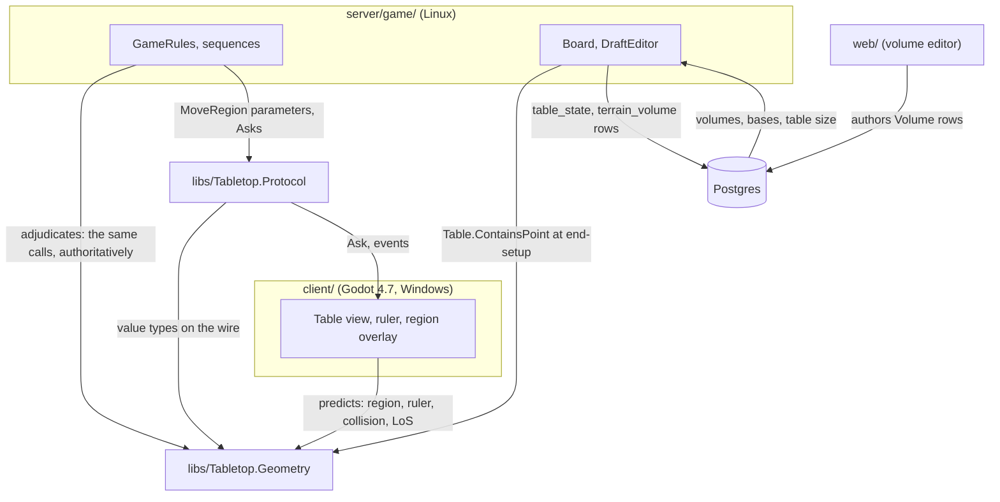
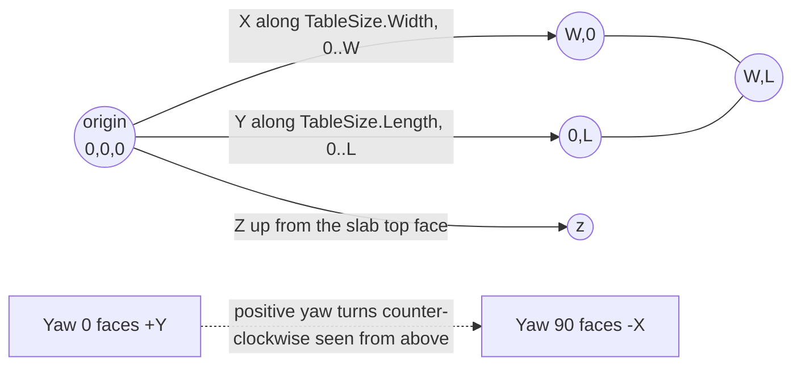
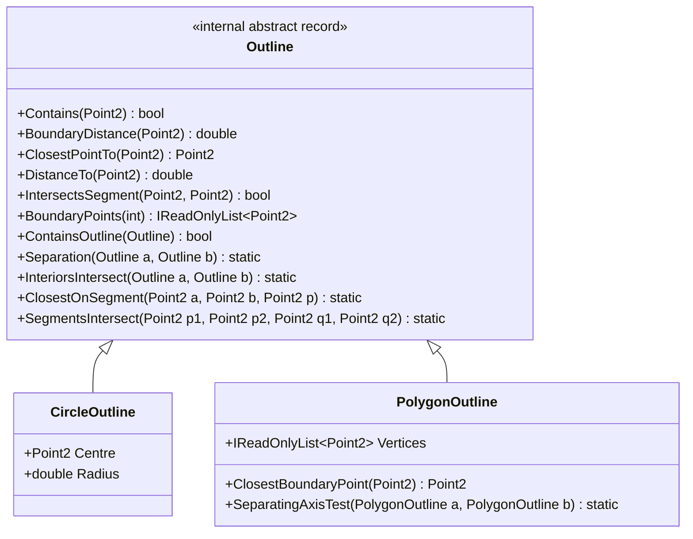
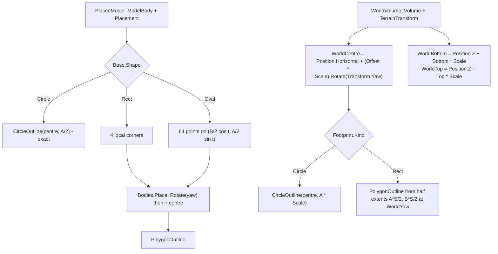
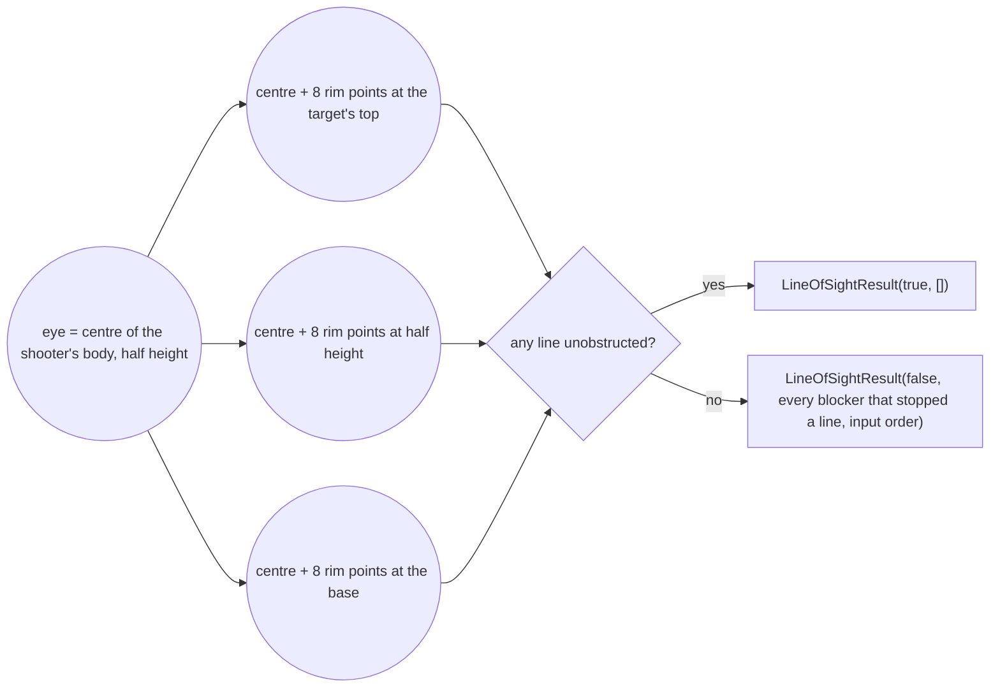
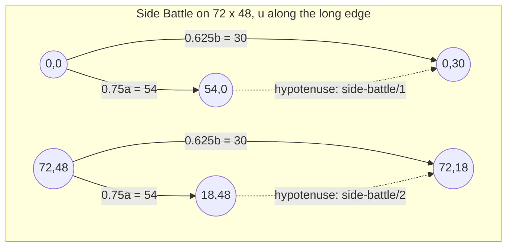
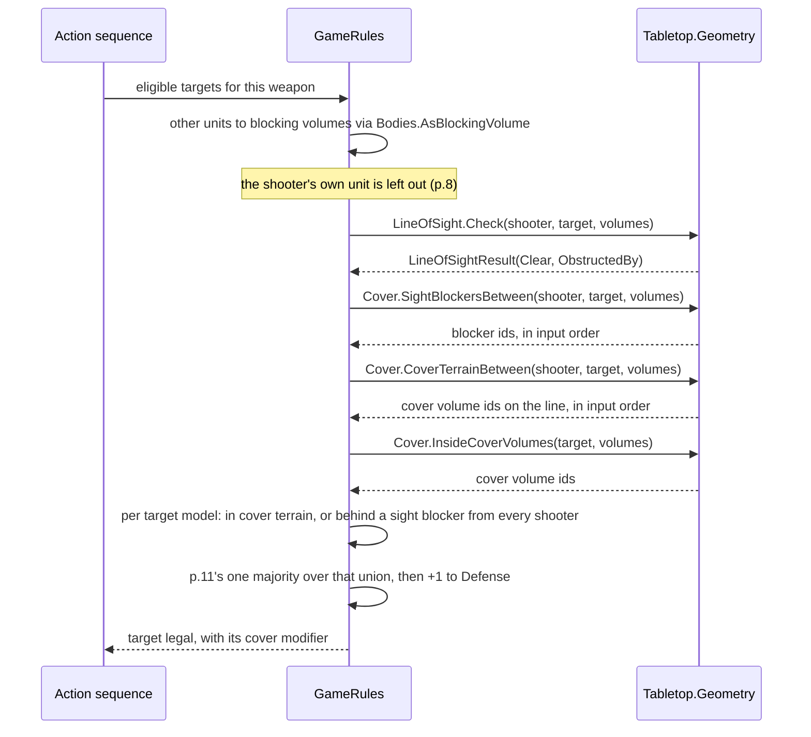
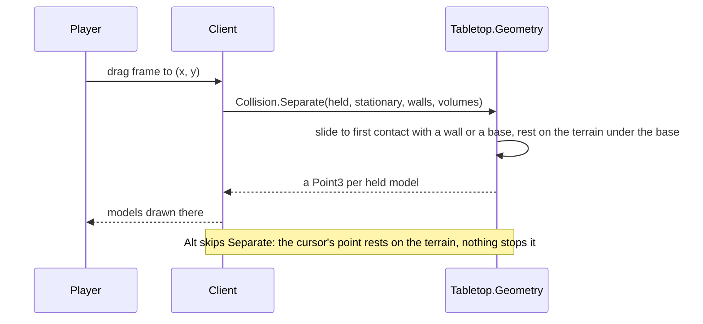
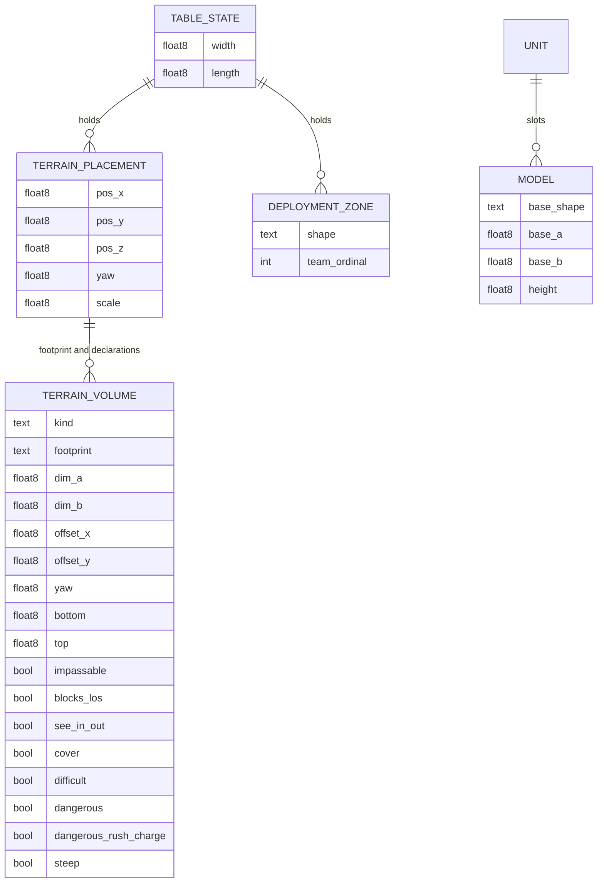

# Geometry

`libs/Tabletop.Geometry` is the measurement engine the client and the game server both run.
It answers six questions: distance, line of sight, containment, overlap, reachable region, and
whether a shape is on the table. Every answer is a **2D shape intersection plus a vertical
range**: collision shapes are extruded prisms, not convex hulls (`architecture.md` → Geometry). It
knows nothing of Godot, of a ruleset, or of persistence: OPR's numbers arrive as parameters,
and every result is a measurement, a flag, or a drawn region the caller interprets. **The
client's copy is a cosmetic prediction and the server's is the answer**, so bit-exact
cross-platform determinism is not a requirement and `Tolerance.Distance = 1e-6` is the whole
numerical policy.

## Scope

In scope, all of it inside `libs/Tabletop.Geometry`:

| Subject | Type | Task |
| --- | --- | --- |
| Point helpers, point-in-polygon | `Point2`, `Polygon`, `Tolerance` | 1 |
| The one internal convex shape | `Outline`, `CircleOutline`, `PolygonOutline` | 2 |
| Values to world outlines | `Bodies`, `WorldVolumes` | 3 |
| Edge-to-edge measurement | `Distance` | 4 |
| Collision: rest, surfaces, slide, separate, land | `Collision` | 5 |
| Standing in and on terrain | `Containment` | 6 |
| Base overlap, a body inside a Solid | `Overlap` | 7 |
| Line of sight | `LineOfSight`, `LineOfSightResult` | 8 |
| The geometric half of the cover rule | `Cover` | 9 |
| Unit coherency | `Coherency`, `CoherencyResult` | 10 |
| The slab | `Table` | 11 |
| The movement region from server parameters | `Movement`, `MovementRegion`, `MoveCheck` | 12 |
| The built-in deployment zone styles | `ZoneStyles` | 13 |

Not in scope:

- **The rules.** No legality decision, no majority-of-models rule, not p.11's cover
  majority, no `+1 to Defense`, no 6" difficult cap of its own. Facts are returned
  per model and the caller counts. `architecture.md` → Rules enforcement.
- **The terrain generators and the built-in terrain inventory.** The setup phase spec ships the
  planet tables with the client, and the server never reads them. The client shell plan
  owns `BuiltinContent` in `client/src/Core/`; the planet rolls and the random table are `Tabletop.Content`'s (`PlanetTerrain`, `RandomTables`). The zone styles are the
  one piece of built-in setup content that does come into the library, because the server
  checks a deployment against them too.
- **Small tables.** *"We don't need to support skirmish at all."* The seven built-in zone
  styles therefore assume a table near 72×48, and the 30×22 skirmish size is not a target.
  `Table` and `TableSize` still take any positive size; it is the styles' absolute insets that
  stop working, at the thresholds named under Failure modes. `architecture.md` → Table and
  layout records the limit beside its `Table` bullet's *"Arbitrary sizes, never a constant"*.
- **Geodesic movement**, **exact ellipse math**, **polygon clipping** (area coverage),
  **convex hulls**, and **unit conversion**. Each is recorded under Rulings with the decision
  taken instead.
- **Persistence and the wire.** The library has zero package dependencies. `Tabletop.Protocol`
  serialises these value types, and nothing here reads a row.

Position in the build order: **step 2**, `architecture.md` → Build order, in parallel with
step 3 and depending only on step 1. The prerequisite is the contracts module's
foundation: the project, the
solution, the test project, the value types in `Points.cs` / `Bases.cs` / `Volumes.cs` /
`Placements.cs`, and the declared-but-throwing surface in `Api.cs`. Nothing else in the
repository is a prerequisite, and there is no consumer yet. `libs/` holds only a `.gitkeep`
today.

`Api.cs` is a set of `NotImplementedException` stubs whose signatures are frozen contract, and
`ApiSurfaceTests.cs` asserts that they throw. Each stub moves into its own file as its task
implements it. `Api.cs` is deleted in Task 8 when `LineOfSight` leaves it, and
`ApiSurfaceTests.cs` is deleted in Task 4 in favour of behaviour tests. **No declared signature
changes; members are only added.**

## Context



The library sits below both runtimes and above nothing. It has no inbound dependency, and two
consumers that must agree.

Three seams:

**Geometry to protocol.** `Tabletop.Protocol` does not wrap these types. It uses them.
`Point3`, `Yaw`, `Placement`, `TableSize`, `Volume` and `TerrainTransform` are on the wire
verbatim, so the coordinate frame is a library constraint rather than a client convention.
`TerrainPlacement.WorldVolumes()` in `Tabletop.Content` produces the
`IReadOnlyList<WorldVolume>` that every call here takes. Nothing converts anywhere. `Polygon`
is the one type that never crosses the wire. A deployment zone travels as a shape **id**
(`"frontline/1"`), and both ends call `ZoneStyles.Resolve` to get the polygons back.

**Geometry to the game server.** The server owns which volumes count. `MoveRegion` carries
`ImpassableVolumeIds`, `DifficultVolumeIds` and the `DifficultCap` that `GameRules` computed.
`Movement.Region` takes those as plain parameters, so the library never references the protocol
record. `GameRules` supplies every OPR constant at the call site: coherency `(1, 9)`, the 1"
separation, the 6" cap, melee reach `EdgeToEdge <= 2 && Vertical <= 4`, objectives
`EdgeToEdge(model, marker centre) <= 3`, Ambush `> 9`, and for Scouts the deployment zone grown by 12", which is
p.14's *"fully within 12" of their deployment zone"* and not a distance from a placed position:
3.4.1 had a Scout deploy and then reposition *"anywhere within 12" of their position"*. The game
server's deployment check (`GrimdarkFutureRules.ZoneBreach`) reads it as `ZoneStyles.BaseFullyWithin(shapeId, table, model, 12)`. Ambush's is `GrimdarkFutureRules.AmbushBreach`: `Distance.EdgeToEdge` from every placed base to every enemy model over 9.

Coherency is two distances per pair, so p.11's *"If not all models in a unit can fit on elevation,
then a coherency of 3" is allowed to models at different elevation"* is served for the allowance and
deliberately not for its precondition: whether the unit *can fit* is a ruleset judgement, and the
allowance is applied to every cross-elevation pair without it; see section 10.

**Geometry to the client.** The client draws consequences, never answers. It resolves the id
lists to `WorldVolume`s, builds a `MoveReach` per model and draws its triangles, its ruler along `MoveReach.Route`. It calls
`Collision.Slide` and `Collision.Separate` on every drag frame (the client's `DragBodies` names the walls and the other models). It builds
a presence `Measurement(From, To)` from `Distance.ClosestPoints`. When a server event disagrees
with any of it, the model snaps. That is the entire cost (`architecture.md` → Geometry).

## Design

### 1. The coordinate frame

The origin is a **corner** of the table (the plan's ruling 1; geometry values → Height,
position, facing). Every affected file matches. Three reasons carry it: the game server plan's
`DraftEditor.OnSlab` and the contracts plan's wire samples use `0 <= x <= width`, nothing in the
specs prefers the centre, and one frame everywhere removes a conversion layer from the client.
This is the only decision in the module that the wire, the database and both runtimes depend on
simultaneously.



A position is on the slab when `0 <= x <= W` and `0 <= y <= L`. `Point2.Rotate(new Yaw(90))`
sends `(0,1)` to `(-1,0)`.

The dependent conventions, all in the plan's Global Constraints:

| Convention | Consequence in code |
| --- | --- |
| One world unit = one inch, angles in degrees | No conversion anywhere; millimetres never enter |
| Yaw only, always upright | `Outline` is 2D; rest sets height, never tilt |
| An oval's `A` (length) lies along the facing axis | `BaseOutline` builds `(B/2 cos t, A/2 sin t)` then rotates |
| A rect footprint's `A` is local X, `B` local Y | Matches `Footprint.Rect(width, length)` |
| `Scale` multiplies footprint dimensions, offset, `Bottom` and `Top` | `WorldBottom` = `Position.Z + Bottom * Scale` |
| `Position.Z` is added to both heights | A piece raised 1" raises its whole prism |

The last two are the whole of the terrain transform. The scale is uniform: a per-axis scale
would stretch a circular footprint into an ellipse, a shape the geometry does not have
(geometry values → The terrain transform).

### 2. Extruded prisms, not convex hulls

Collision shapes are boxes and cylinders, **not convex hulls** (geometry values → Collision
volumes). With footprints restricted to a circle or a rectangle and bases restricted to a
circle, an oval or a rectangle, every test in the library factors into two independent
problems:

1. a **2D shape intersection or distance** between two convex outlines on the table plane, and
2. a **1D interval test** between two vertical ranges `[bottom, top]`.

No hull construction, no 3D separating-axis test, and no physics engine: `Godot physics is not
in the scene` (client shell → Geometry). A `bottom`/`top` pair rather than a single height then
covers every case with one mechanism. A hill is `0-2`, a wall is `0-4` with a thin footprint, a
second storey is `4-8` with nothing beneath it, and a forest on a hill is a Solid `0-2` with an
Area `2-8` on top.

The costs. An uploaded mesh's visual detail lies outside its hitbox. A sloped roof is a box. An
ellipse is not representable, so an oval base becomes a convex 64-gon
(`Bodies.OvalVertices = 64`, error under 0.2% of the radius). The 64-gon is inscribed, its
vertices on the ellipse, so distances to an oval are slightly over-reported and overlaps
slightly under-detected. `DistanceTests` compares oval results at three decimal places rather
than six.

### 3. `Outline`, the one 2D shape

`Outline.cs` holds the entire geometric core, and all of it is `internal`. Consumers see only
`PlacedModel`, `WorldVolume`, `Polygon`, `Point2/3` and the result records. The test project
reaches the internals through `InternalsVisibleTo`, added to the csproj in Task 1.



The library's whole geometric surface is a dozen members over three internal types. Everything
public is a thin composition over them.

**A circle is exact, a polygon is convex.** `CircleOutline` is a true circle, not a polygon
approximation, so a round base carries no discretisation error. Round is the commonest base.
`PolygonOutline`'s constructor rejects fewer than three vertices and **reorders the vertices
counter-clockwise** by the sign of twice the signed area. Callers may therefore hand it either
winding and `Contains`, a left-of test against every edge, stays correct. Convexity is an
unchecked precondition. Every producer inside the library builds a rectangle, an
inscribed ellipse or a table rectangle, all convex by construction.

**Separation is dispatched on the pair, and it is exact.**

| Pair | Method | Exactness |
| --- | --- | --- |
| circle, circle | centre distance minus both radii, clamped at 0 | exact |
| circle, polygon | `ClosestBoundaryPoint` from the centre, minus the radius | exact |
| polygon, polygon | every vertex of A against B's boundary, and the reverse | exact |

The polygon-polygon scan is exact, not a sampling heuristic. For two convex polygons the
minimum distance is always attained with at least one **vertex** as an endpoint, so scanning
vertices against the other's boundary cannot miss it. `Separation` also returns the two witness
points, which is what a presence measurement is made of (presence → A measurement is two
points).

**Overlap is not distance.** `InteriorsIntersect` requires *positive* shared area. Touching
bases do not overlap, and neither does a model standing exactly on a hill's top face. For two
polygons it runs a separating-axis test over the edge normals of both. The axis projections are
compared with a `Tolerance.Distance` slack that makes edge contact "not intersecting". Both
shapes are convex and neither is axis-aligned in general. A rect base at yaw 45 against a
rotated wall footprint is the ordinary case here.

**Segment tests** exist for line of sight. A circle intersects a segment when the closest point
on the segment is within the radius. A polygon does when either endpoint is inside or any edge
crosses. `SegmentsIntersect` uses the four-cross-product orientation test with a collinear
fallback through `Polygon.OnSegment`. That is the same tolerance-aware on-segment predicate
`Polygon.Contains` uses for boundary inclusion. `OnSegment` treats a zero-length segment as
containing only its own point, rather than the degenerate cross- and dot-product test that would
otherwise call it collinear with every point in the plane.

**Boundary inclusion is uniform: on the boundary is inside.** Every `Contains`, every
`ContainsPoint`, `Table.ContainsPoint`, `Polygon.Contains` and the vertical range test are
inclusive to within `Tolerance.Distance`. The bias is toward admitting a placement, consistent
with the client's drag, which prefers a placement to a refusal.

### 4. From values to outlines: `Bodies` and `WorldVolumes`

Two files convert the stored value types into world-space outlines, and they are the only
places a transform is applied. Every other class calls them.



A model's Z never enters its outline; it is the vertical range. A volume's yaw is the **sum** of
the piece's yaw and the volume's own.

`Bodies` also supplies the three vertical facts a body has. `Bottom()` is the resting Z,
`Top()` is `Bottom + Height`, and `Eye()` is `(X, Y, Bottom + Height / 2)`, the centre of the
body. It supplies one adapter,
`AsBlockingVolume(Guid id, PlacedModel m)`, which expresses rulebook p.11's *"other units are
sight blockers"* without the library knowing what a unit is. The caller passes the models it
wants treated as blockers, so p.8's *"models may always ignore friendly models from their own
unit"* is the caller leaving them out. No friend/foe concept enters the library.

A `WorldVolume`'s `Id` is a `terrain_volume` id for terrain, but for a `WorldVolume` built by
`AsBlockingVolume` it is the model's id, since the caller supplies it. A Guid list such as
`LineOfSightResult.ObstructedBy` or `Cover.SightBlockersBetween` mixes the two kinds with no
discriminator to tell them apart; the caller knows which ids it passed in and can tell them
apart itself.

`AsBlockingVolume` is asymmetric. An oval base becomes its **bounding rectangle**
(`Footprint.Rect(b.B, b.A)`), because `Footprint` has no oval kind; a rect base already is one and
passes through unchanged. A model is shot *at* as a 64-gon and blocks *as* a rectangle, and the
rectangle is the larger shape. It over-blocks by the corner area of the bounding box, about 21% of
the footprint for a 2.36×1.38 oval.

### 5. Edge-to-edge distance

`Distance` is seven members of dispatch onto `Outline.Separation`. Measurement is **edge to
edge between base shapes, never centre to centre** (table domain model). Centre-to-centre is
one subtraction and is wrong by a visible margin. A 32mm round reaches 0.63" past its centre
and a 60mm oval 1.18" past its, so two of them measured centre to centre are short by nearly
two inches.

| Member | What it measures | Read from |
| --- | --- | --- |
| `EdgeToEdge(PlacedModel, PlacedModel)` | base edge to base edge, 0 when touching or overlapping | table domain model |
| `EdgeToEdge(PlacedModel, Point2)` | base edge to a bare point, 0 when the point is inside | contracts plan |
| `EdgeToEdge(PlacedModel, WorldVolume)` | base edge to a footprint edge | added |
| `EdgeToMarker(PlacedModel, Point2, double diameter)` | base edge to a disc's rim | not the seize: an objective is a point, measured with `EdgeToEdge(PlacedModel, Point2)` (owner ruling, p.6) |
| `ClosestPoints(PlacedModel, PlacedModel)` | the two witness points, each carrying its own base's Z | presence → A measurement is two points |
| `InRange(PlacedModel, PlacedModel, double)` | inclusive, with tolerance | p.8 |
| `Vertical(PlacedModel, PlacedModel)` | difference of base heights | p.9, *within 2" horizontally and 4" vertically* |

Distance is **horizontal**. Height never enters it; `Height_does_not_enter_horizontal_distance`
is a test. Vertical separation is a second, separate number, matching how the rulebook writes
melee reach on p.9. A single 3D distance would collapse two rules into one and match neither.

### 6. Collision: rest, surfaces, slide, separate, land

`Collision` is *Nothing on the table is inside anything else* (client UX spec → Physical collision). It is a linear scan, not
a physics query, and names no rule: what a body may climb, and what it may not cross, arrive as parameters.

- `RestHeight(PlacedModel, volumes)` is the highest `WorldTop()` of a **Solid** volume whose footprint interior meets the
  base outline, or the base height `WorldBottom()` of an Area lifted onto something (its floor); else `0`, the slab. There is
  no step-up limit. Touching a side is not standing on it (`InteriorsIntersect`), so a base flush against a building stays on
  the table. `RestHeight(IReadOnlyList<WorldVolume> piece, volumes)` rests a terrain piece: Solid tops under any of its
  footprints, its own volumes and every Area ignored. `RestHeight(Point2, volumes)` rests a marker, boundary inclusive.
- `Surfaces(body, volumes)` (held pieces lift over spec → Surfaces) lists the heights a model or a piece could rest at,
  ascending: 0, each Solid top and (a model) each Area floor under it, kept where the body standing there shares no
  height interval with a Solid under it. The highest is always `RestHeight`. `RestNear(body, volumes, level)` is the
  one nearest a level, the higher on a tie; the server's `Battlefield.Settle` and `DraftEditor` rest at the Z sent.
- `Slide(PlacedModel, to, models, walls, volumes)` moves the base from its placement toward `to`, sampled every `Step` (0.1")
  and bisected to contact, so a 0.5" wall cannot be stepped over. It stops at the first contact with a wall's footprint or a
  model's body, slides once along the contact tangent, and returns the landing with its `RestHeight`. **The caller names the
  walls**: during a move Ask the Ask's `ImpassableVolumeIds`, otherwise every Solid declared `Impassable`; every other Solid is
  climbed. A body that starts inside a wall or inside another model's body can leave it. `Slide(piece, to, walls, volumes)` does the same
  for a terrain piece and returns its `TerrainTransform`. With a finite `level` (a held piece at a level) the body rests at each
  sample nearest the level on every volume but the walls it can meet, and a wall stops it only where their height intervals
  overlap, so it passes under a bridge with room; a wall it starts in stays ground. `Follow`, `Blocked` and `Clear` take the level too.
- `Land(model, to, models, walls, volumes, within)` is a lifted held model's landing: the nearest spot to `to`, in rings 0.25"
  apart, where its base enters no wall, it overlaps no model rested there and `within` (a move step's reach) takes it, rested on
  its highest open surface; a group lands in drag order. With an `Abutment` (a charge Ask's `ContactWith` models and `ContactGrace`),
  a landing whose base ends within `Within` of one of those models is moved straight toward the nearest by the gap between their closest
  points, so the bases touch, when that spot is as free as a landing's (`Abut`); the game server draws a charge in the same way.
  `Land(piece, …)` is `Clear` at the target. `Hover` is the height a lifted
  body is drawn at, `Lift` (0.5") over the highest top under it, models included.
- **Model against model is three-dimensional.** A model's body is its base outline extruded from its settled Z by its height
  (`ModelBody.Height`; the import writes 1.5 × the base's larger dimension). The moving body is rested at each sample on what is
  under it (`RestHeight`), and meets another model only where the outlines share area in plan *and* the height intervals
  overlap, so a base passing above or below another model does not meet it. `Slide`, `Crosses`, `MoveSpace` (movement paths) and
  `Overlap.Bases` all read it this way, and each leaves out a model whose body the mover already overlaps at the start.
- `Separate(held, stationary, walls, volumes)` slides each held body in drag order against the stationary models and the held
  bodies already placed.
- `Crosses(PlacedModel, to, models, volumes)` is the swept-body test against true base outlines and heights, the mover rested on
  `volumes` at each sample (touching is not crossing). The rules suite's elevation game and the sim's `Clear` use it; the server's
  `move_through_models` is `Movement.Check`'s `CrossesModels` (no path round the models fits).
  `Bodies.AsBlockingVolume` remains the line-of-sight body only.
- `Distance.BodyToBody(a, b)` is the shortest distance between the two bodies: the horizontal edge-to-edge distance and the gap
  between their height intervals, combined. The server's `move_separation` and the sim's `Clear` use it.
- `Movement.Region(…, models, surfaces)` and every movement path go round another model only where the bodies meet in plan and
  height, the mover rested on `surfaces` (`movement.md`).

**"What it is resting on" is not stored.** The table domain model listed it as part of a
placement; geometry values does not carry it: `RestHeight` re-derives it on demand, and terrain is locked
after setup, so nothing a model stands on ever moves. There is no cached surface anywhere.

### 7. Containment and overlap

Containment answers where a model is standing. Overlap answers whether a placement is
physically possible. Both are computed and neither is stored (table domain model → Containment
is computed, never stored). The whole-design review annotated a vocabulary collision here.
**This** containment is standing in terrain. Game flow's containment, being inside a transport
or a building, is a stored `Location.Inside` on the wire and is not this module's concern
except through `BaseFullyWithin`.

| Call | Predicate | Serves |
| --- | --- | --- |
| `Containment.VolumesContaining` | footprint contains the base **centre**, vertical range contains the base height | p.11 *mostly inside* (single models); *is activated in it* |
| `Containment.VolumesFullyContaining` | footprint contains the **whole base** | p.11 *fully inside a piece of cover terrain* (multi-model units) |
| `Containment.BaseFullyWithin(model, container, inches)` | every point of the base within `inches` of the container's base, edge to edge | p.15 `Transport(X)`, p.21 solid buildings: *"must stay fully within 6" of it when exiting"* |
| `Overlap.Bases` | positive shared area **and** positive shared vertical extent | p.7 *physically impossible locations*: `move_overlap` (`GfMoves.ContactBreach`, `OverlapBreach`) |
| `Overlap.WithSolid` | the same, against a Solid volume only | no production caller: a placement rests on the highest Solid top under its base (`Collision.RestHeight`) |

The vertical range is **inclusive**, so standing on a hill counts as being in it. A hill
declaring cover and difficult applies to the model on top of it, with no flag and no special
case. `Overlap` is the mirror image. It uses `IntervalsOverlap`, which demands a *positive*
shared extent. A model standing on a Solid's top does not intersect it, a model under a `4-8`
slab does not intersect it, and a 5"-tall model standing under the same slab does.

`BaseFullyWithin` is the one place a naive implementation would have broken the module's own
rule. The obvious reading of *"fully within 6\""* is a circle of radius 6 about the container's
centre. That is centre-to-centre, which this library never does. The region tested is instead
the **container's footprint grown by `inches`**, a Minkowski sum that is never constructed.
Both outlines are convex, so the farthest point of the moving base is exact with no new
primitive:

- a **polygon** base's farthest point is one of its vertices, so test all of them;
- a **circular** base's is its centre pushed `Radius` along the outward direction, so
  `container.DistanceTo(centre) + Radius <= inches` is the answer.

When the two bases overlap, `DistanceTo(centre)` is 0 and the circular form degrades to
`Radius <= inches`. That is an upper bound. It can only refuse a placement already touching the
container, never admit one that is too far.

### 8. Line of sight: centre to any part of the target

The policy is the plan's ruling 2: *"Center to any part of target."* The specs pin what
it runs **against**: *"Line of sight is settled against the cylinder that the base and height
describe. The visual mesh is never tested"* (table domain model), and *"blocking is declared,
not derived"* (geometry values → Declarations). The declaration says the volume is **opaque**,
and geometry answers whether a given line passes through it. Neither the specs nor the ruling
fix how many lines approximate *any part*.

The shooter end is a single point at the **centre of its body**: the base centre raised half
the height. That is the only point that is the centre in all three axes; the top centre is the
centre of the top face. Half height keeps the eye inside the body, so a blocker as tall as the
shooter is opaque to it and one of half its height cuts the centre line while leaving the upper
lines clear. The centre-to-centre line sits in both directions' sample sets, so a clear centre
line is clear from either end. `LineOfSight.Check` is otherwise asymmetric: the eye height comes
from the caller's body and the sampled heights from the target's, so a blocked centre line can
leave `Check(a, b)` and `Check(b, a)` disagreeing when the two bodies differ in height — a 1.9"
wall between a 1"-tall and a 4"-tall model blocks one direction and not the other. The rules
module calls it from the shooter's side.

The target end samples the body at three heights, its base, half height and its top, with the
centre and up to eight rim points at each. Sight is clear when **any one** line reaches its
point unobstructed.



Twenty-seven rays for a circular or oval base, fifteen for a rect whose four vertices are its
whole rim. Partial exposure counts as visible. `ObstructedBy` is the union over all failed rays,
not the blockers of any one ray.

`Rim(Outline)` supplies the horizontal sample points: `BoundaryPoints(8)` evenly around a
circle, all vertices of a polygon with eight or fewer, and every n-th vertex of a larger one. An
oval's 64-gon is therefore sampled at 8 of its 64 vertices. Sampling the base as well as the top
is what makes a low wall behave. A `0-1` wall leaves the target's upper points visible and its
base points hidden, so sight is clear and `Cover.SightBlockersBetween` is non-empty. That is
p.11's *behind a sight blocker*.

**Why three rings and not two.** Every sample is a real point of the target's body, so a `Clear`
result is never wrong: the error is one-sided, under-reporting visibility when the only visible
part falls between samples. Two rings left that error unbounded vertically. A target standing
behind a wall with a canopy above it is visible only through the band between them, and with
samples at the top and the base alone that band is missed however tall it is. A ring at half
height bounds the vertical gap by half the model's height. The horizontal gap needed no such
fix on a circular base: eight rim points on a 1.26" base subtend 2.8° at 10", so the sliver that
slips between adjacent rays is under 0.24" wide at mid-range, finer than any terrain a table
carries. On a 64-gon oval, `Rim` takes every eighth vertex by index, even in parametric angle
rather than in arc length, so the 2.8° and 0.24" figures are exact only for the circular case.
The cost is 27 rays a pair rather than 17, each a segment-prism test against every blocker, and
there is still no broad phase.

**Counting visible models.** Which of a unit's models a set of observers sees is a per-model
fact over a unit, so `LineOfSight` has
`VisibleModels(IRL<PlacedModel> observers, IRL<PlacedModel> unit, IRL<WorldVolume> volumes) : IRL<bool>`,
index-aligned with `unit`, true at `i` when at least one observer's `Check` against `unit[i]` is
clear. A single shooter is a one-element `observers` list. The caller counts and compares; no
member of this library takes a fraction. The cost is `observers.Count × unit.Count × 27` rays,
which for ten models against ten with forty blocking volumes is 108,000 segment-prism tests per
query, on the server, once per Ask.

`SeeInAndOut` is a **modifier on blocking**, not an independent property. It means nothing on a
volume that is not opaque. `Obstructions` implements it by skipping a blocker when either
endpoint of the segment is inside it. A forest therefore blocks sight *through* it while a
model inside it can see out, a model outside can see in, and two models both inside can see
each other (rulebook p.12).

**What the sampling cannot answer:**

- **How much of the target is visible.** The result is a boolean plus a blocker list. Any rule
  phrased as *"more than half obscured"* has nothing to read. OPR does not have one; a
  Warhammer ruleset might.
- **Which part is visible.** Twenty-seven booleans are discarded down to one. A rule that cared
  whether the *head* was exposed would need the per-point results kept.
- **A gap narrower than the angular resolution.** A blocker narrower than 0.24" at mid-range,
  positioned to cover one rim point without covering its neighbours, is not seen, and a target
  visible only through a slit that narrow reads as hidden.
- **Occlusion of the eye itself.** The eye is a single point, so a model whose own body is half
  inside a blocker still shoots from the centre of it. `Obstructions` skips a `SeeInAndOut`
  blocker containing the eye, and nothing else consults the eye's surroundings.
- **The upper and lower body as firing positions.** There is one eye, not three. A model cannot
  duck under an overhang that covers its centre, nor shoot over a wall that reaches half its
  height, whatever the target.

A single centre-to-centre line is what the ruling's first half names, and the second half is
what rules it out: *any part of target* means the whole body is a valid endpoint, and one line
to the target's centre makes a low wall hide a model wholly or not at all, leaving *behind a
sight blocker* nothing to measure. A denser sample changes only `TargetPoints`; sampling the
shooter's rim as well would contradict the ruling's *center*.

### 9. Cover

`Cover` exists so that `GameRules` can read p.11's cover rule without doing geometry of its own:
*"If the majority of models in a unit are fully inside a piece of cover terrain or behind a
sight blocker (for multi-model units), or that are mostly inside cover terrain or behind sight
blockers (for single-model units), they get +1 to Defense rolls"*.

| Rulebook phrase | Geometry call | Whose job |
| --- | --- | --- |
| *fully inside a piece of cover terrain* | `Cover.InsideCoverVolumes` non-empty | geometry |
| *behind a sight blocker* | `LineOfSight.Check` clear **and** `Cover.SightBlockersBetween` non-empty | geometry |
| *hide ... behind* cover terrain (a wall or fence, a barricade) | `LineOfSight.Check` clear **and** `Cover.CoverTerrainBetween` non-empty | geometry |
| *mostly inside cover terrain* | `Containment.VolumesContaining` filtered to `Cover` | geometry |
| *the majority of models*, *+1 to Defense* | — | `GameRules` |

p.11 has one majority, over the models that pass either test: a model counts when it is inside
cover terrain, when it is behind a sight blocker from every attacking model with a clear line to
it, or when no attacking model sees it. A screened model counts, since p.11 makes other units
sight blockers that provide cover. Every fact above is per model, and no member of this library
takes a fraction, so the union, the counting and the comparison are the ruleset's.

`SightBlockersBetween` draws the same twenty-seven rays as `Check` and returns every blocker that
stopped at least one of them, whether or not sight is clear overall. That is the only way to
express *behind*. A wall that blocks nothing is not cover, and a wall that blocks everything is
a failed shot rather than cover.

`CoverTerrainBetween` reads p.11's *"Terrain features that models can hide in or behind"* for cover
terrain that does not block sight: the `Cover` volumes without `BlocksLineOfSight` that one of the
same twenty-seven rays passes through, less those either model stands in
(`Containment.VolumesContaining`, which the inside test reads). Each ray stops `Cover.Contact`
(0.01") short of the target point, so a base touching a fence on the shooter's side is not behind
it. A wall or fence never blocks the shot; it screens it.

Two consequences. The server calls `Check` and `SightBlockersBetween` back to back for the same
pair, doing the ray work twice. A combined call returning both would halve it. And the
predicate is permissive: a 1"×1" pillar half an inch off the line stops one rim ray and
therefore grants cover. Whether that matches table play is a rules question, but this code
decides it.

### 10. Coherency

Rulebook p.7: *"All models in a unit must always stay within 1" of at least one other model,
and must stay within 9" of all other models … forming an uninterrupted chain of models in 1"
coherency with each other"*. Two conditions, and they are not the same shape of test:
connected components, then a spread check.

`Coherency.Check(models, chainDistance, elevatedChainDistance, maxSpread)`:

1. build the full `n × n` edge-to-edge distance matrix, and beside it the chain distance each pair
   is judged at: `elevatedChainDistance` when `Distance.Vertical` puts the pair at different
   settled heights, `chainDistance` otherwise;
2. find connected components under `distance <= chain[i, j]`, by depth-first search;
3. the **largest** component is the unit's body. Ties keep the one holding the earliest model,
   which falls out of numbering components by first-encountered index;
4. a model outside the body is out of coherency; so is a model inside it that is further than
   `maxSpread` from **any** other model in the body.

The rulebook's `1"`, `3"` and `9"` are the caller's, per the constraint that no OPR number lives in
this library. `CoherencyResult` reports indices into the input rather than ids, because the
library has no model identity. The caller zips them back.

Two properties. The spread test flags **both** ends of an over-long chain (the plan's
`A_long_chain_breaks_the_spread` expects `{0, 6}`), so the result is the set of models
participating in a violation, not the minimal set to move. And the matrix is O(n²) with a full
outline separation per pair. For a 20-model unit of ovals that is roughly 190 pairs of
64-gon-versus-64-gon separation.

**The elevation allowance and what it deliberately omits.** 3.5.1 added to p.11: *"If not all
models in a unit can fit on elevation, then a coherency of 3" is allowed to models at different
elevation."* The pair test is cheap — rest has already resolved every model's Z, so
`Distance.Vertical(a, b) > Tolerance.Distance` is the whole of *at different elevation*, and the
measurement itself stays horizontal like every other distance here. The **precondition** is not
implemented: *can fit* is undefined in the book, and testing it would need a ruleset judgement
this library cannot make. Applying the allowance unconditionally is safe because the precondition
only ever widens the allowance
([closing the open questions](../../superpowers/specs/2026-09-09-open-questions-design.md)), and
the server judges coherency on a move answer with `Coherency.Check(models, 1, 3, 9)` (`move_coherency`). The
spread stays at one distance: p.7's 9" has no elevation clause.

### 11. The slab

The table is *a rectangle. No shape field and no play-area boundary volume* (setup content →
The table is a slab), so `Table` is four members over `TableSize`:

- `Bounds(TableSize)`: the four corners as a `Polygon`, in the corner frame;
- `ContainsPoint(TableSize, Point2)`: edge inclusive, `0 <= x <= W && 0 <= y <= L`. This is the
  game server's `DraftEditor.OnSlab` rule, and it deletes off-slab terrain at end-setup
  (setup phase → Terrain: *"A piece still off the slab when setup ends is dropped from the
  snapshot"*);
- `ContainsBase(TableSize, PlacedModel)`: the **whole base** on the slab, rulebook p.7
  *"models may also never move outside of the battlefield (no part of them, at any point)"*;
- `IsValid(TableSize)`: both edges finite and above zero, and the polygon constructor's area test
  passes on the slab and on every built-in zone style's polygons resolved against the size. The
  game server's `DraftEditor` refuses a table size that fails it.

`Footprint.IsValid(double scale)` is the matching check for terrain: a defined kind, a finite
scale and scaled size above zero, and for a rect twice the scaled corners' area at least twice
the polygon constructor's threshold (`2 * Tolerance.Distance`). The margin covers rounding after
rotation and translation, which can take an area sitting exactly on the threshold below it.
`DraftEditor` refuses a placement whose volumes fail it at the placement's scale. A consumer that
accepts outlines from users (management's layouts, the web app's volume editor) calls both, or
mirrors them, before a save.

`ContainsPoint` is an axis comparison and `ContainsBase` goes through `PolygonOutline`. The two
agree. They are two implementations of the same predicate.

### 12. The movement region

`architecture.md` → How the client stays responsive is the brief for this class:
*"The server sends parameters, not an answer: move allowance, terrain effects, and the ids of
volumes that cannot be crossed. `Tabletop.Geometry` renders the region from those parameters."*
OPR's difficult terrain **caps a unit's whole move at 6"** rather than scaling it, so the parameter is
`double? difficultCap`, whatever `GameRules` computed, and `null` when the ruleset has none.

A move is measured along the shortest path its base can take (p.5), round impassable terrain and other
models, and round difficult and dangerous terrain when that fits. `movement.md` holds the design:
configuration space (`MoveShape`, `MoveSpace`), shortest paths, which path a move takes
(`Movement.Check`, `MoveCheck.Path`), the reach and the drawn area (`MoveReach`, `ReachMesh`,
`Movement.Region`), why the wire carries destinations and not paths, and timings.

### 13. The disembark region

A unit inside a container has no position to move from, so `Movement.Region` cannot draw its
exit. `MoveRegion.Containment` (contracts plan Task 8) carries
`MoveContainment(Enterable, ExitingId, ExitWithin)`. When `ExitingId` is
set the client does not call `Region` at all. It draws the set of placements that
`Containment.BaseFullyWithin(candidate, container, ExitWithin)` admits, which is the container's
base grown by the distance, per section 7. `Allowance` in that Ask is the action's remaining
distance and binds nothing.

The two are never both set: *a unit may not embark and disembark in one activation*
(game flow → Inside a container). Embarking needs no region. One model reaching the
transport embarks the whole unit, so the answer is a `Destinations` whose `To` is
`Inside(container)` for every model.

### 14. The eight declarations, read geometrically

Eight flags, and they are OPR's own terrain types, read from the Grimdark Future and Age of
Fantasy advanced rulebooks whose terrain sections are word-for-word identical. **No effects are
stored.** A flag says *this is difficult*. The ruleset says what that costs. How each flag is
read here:

| Declaration | Read by | Geometrically |
| --- | --- | --- |
| `Impassable` | `Movement.Region`, `Movement.Check` | the server names the volumes; a path goes round them, the base's interior never meeting a footprint |
| `BlocksLineOfSight` | `LineOfSight.Blockers` | the only filter on the volume list; a segment through the prism obstructs |
| `SeeInAndOut` | `LineOfSight.Obstructions` | a modifier: skip this blocker if either endpoint is inside it |
| `Cover` | `Cover.InsideCoverVolumes` | whole base inside the footprint and vertical range |
| `Difficult` | `Movement.Region`/`Check`, `VolumesOnPath` | *in or through* along the path taken, which goes round when that fits the allowance |
| `Dangerous` | `Movement.Check`, `VolumesOnPath` | the same, over the dangerous list; a path goes round when that fits |
| `DangerousOnRushCharge` | `Movement.Check`, `VolumesOnPath` | p.12 *"Dangerous when using rush/charge"*: in the dangerous list for a Rush or a Charge only; under 3.6.0 p.12 Unstable, for a model whose own path is over 6" |
| `Steep` | `Movement.Check` (`steep`), `Movement.SteepEntering` | 3.6.0 p.12 *"Units moving onto steep terrain count it as being in Difficult terrain, but units moving off it count it as open terrain"* (3.5.1 p.12 Hills *"Difficult when moving up"*): difficult for a move whose base centre starts outside the footprint, open for one that starts inside |

Which classes read a flag at all: `LineOfSight` and `Cover` filter on declarations themselves.
`Movement` does **not**. It is handed pre-filtered lists (the steep list is narrowed per start by `SteepEntering`), because the server already
decided which volumes count for this move. `Containment`, `Overlap`, `Collision` (but for the walls its caller names) and `Distance`
read no declaration at all; they read `VolumeKind` (Solid or Area) or nothing. `Impassable` is
orthogonal to Solid-versus-Area, so all four combinations are real: a climbable hill, an
impassable building, a walkable forest, an impassable lake. Neither axis implies the other.

### 15. Deployment zone styles

Deployment zones are the one piece of built-in setup content that lands in this library rather
than in the client shell, because the **server** checks a deployment against a zone too
(`ZoneStyles.BaseFullyWithin` for the deploy Ask), and a resolver living in the client cannot be
called by the server.

Three facts the rulebook settles, all from geometry values → Deployment shapes:

1. **A zone is a set of shapes, not one shape.** Disordered gives each team two triangles, so
   `Resolve` returns `IReadOnlyList<Polygon>`.
2. **The shapes are polygons.** Triangles and diagonal bands are load-bearing. Unlike terrain
   volumes this costs nothing: a zone is *"a flat point-in-polygon test with no collision, no
   settling and no height"*.
3. **Measurements are anchored, not absolute and not normalized.** The rulebook writes absolute
   inches on an assumed table: 12", 24", 36", 54". Normalized fractions would scale 12" on a
   48" table into 11" on a 44" one, which the rules do not say. Anchoring to table features
   reads as the rulebook writes it. **Side Battle is the one exception** and is proportional
   (the plan's ruling 6). Six of the seven styles are anchored.

**The zone styles assume a table near 72×48.** *"We don't need to support skirmish at all."*
Every argument about absolute versus proportional insets is an argument about small tables, and
the 30×22 skirmish table is not a target. That scope is what makes the split between one
proportional style and six anchored ones acceptable rather than merely tolerated. Side Battle's
fractions are chosen to reproduce the edition's diagram legs on 72×48, so at 72×48 the
two conventions are the same polygon, and they part company in proportion to the table's
departure from it. The tables where the divergence is large are the tables that are out of
scope. What the absolute insets do below their own size is an accepted limit, listed under
Failure modes with the threshold per style.

**The dimensions came from the page's diagrams, not its text.** Grimdark Future v3.5.1 p.22
names the six basic styles, Frontline, Ground War, Side Battle, Disordered, Spearhead and
Opposing Forces, and gives their dimensions only as labels on six figures. The plan records
them as read from the six diagram images on a 72×48 table, every figure a label on its own
diagram. One diagram is internally
inconsistent. Side Battle's 54" and 30" legs put the perpendicular gap between the two
hypotenuses at 24.5", not the 24" its arrow says. The legs are the shape and the band is
illustration (the plan's ruling 6). Grimdark Future 3.6.0 p.21 draws Side Battle's legs 48"
along the long edge and 36" up the short, which leave exactly the 24" band.

A shape id is `"<style>/<n>"`, `n` the team ordinal the setup phase assigns in order.
`ShapesOf(style)` is the list `SetZoneStyle.Shapes` carries. The server's `DraftEditor` writes
one `deployment_zone` row per shape keyed by ordinal `1..n` and stays a pure function over
strings. `SwapZones` swaps two ordinals' shapes, which is how p.6's *"the winner picks an
edge"* works without the app running a roll-off.

Resolution happens in a canonical **u,v frame**: `u` along the long edge from 0, `v` along the
short edge from 0. `Frame.ToTable` swaps the pair when `Length > Width`. "Long edge" is the
longer dimension. A square table takes X as long.



Side Battle **scales with the table**, and its legs differ by edition. `ZoneLegs(SideBattleLong,
SideBattleShort)` holds them as fractions of the long and short edge: 3.5.1 p.22 is `0.75` and
`0.625` (`ZoneLegs.Default`), the diagram's 54" and 30" on 72×48 and 45" and 27.5" on a 60×44
table; 3.6.0 p.21 is `2/3` and `0.75`, 48" and 36" on 72×48 (`GfEdition.SideBattleLong`/`Short`).
`IGameRules.Zones` gives the game's legs; the game server judges deployment with them and sends
them in `Welcome.Zones`, and the clients and the sim resolve every zone shape with what they
received (`RecordingMeta.Zones` in a recording). Every `ZoneStyles` entry point takes an optional
`ZoneLegs`, absent meaning `Default`. The diagram above is 3.5.1's. It is the
one exception to fact 3 above, and geometry values → Deployment shapes names it as such. An
anchored reading, `Leg(edge) = max(0, edge - 18)`, has to invent a constant no page states, and
degenerates to a zero-area triangle at 18"; a fraction of a positive edge is always positive.

The seven styles as implemented:

| Style | Shapes each | Geometry, in the u,v frame |
| --- | --- | --- |
| `frontline` | 1 | 12" bands along both long edges. Also p.6's core deployment, *"fully within 12" of their table edge"* |
| `ground-war` | 1 | 24" bands along both short edges |
| `side-battle` | 1 | a triangle in each of two opposite corners, legs `ZoneLegs`' fractions of `a` and `b` (3.5.1: `0.75a`, `0.625b`; 3.6.0: `2a/3`, `0.75b`). The only proportional style |
| `disordered` | 2 | a diamond through the four edge midpoints; each team keeps the two triangles on its long edge |
| `spearhead` | 1 | a triangle on each short edge, apex 24" in at the edge's centre |
| `opposing-forces` | 1 | a 24"×24" square in two diagonally opposite corners |
| `free-for-all` | 1 | p.50's *"2'x1' area"* in each of four corners, read as 24" along the long edge by 12" along the short |

`Contains(shapeId, table, point)` is the flat test. `BaseFullyWithin(shapeId, table, model)` is
p.6's *"fully within"*, the whole base inside **one** of the zone's polygons;
`BaseFullyWithin(shapeId, table, model, inches)` is every point of the base within `inches` of one of them (exact for convex
outlines: the far vertex, or the centre plus the radius). Unknown styles and
malformed ids throw `ArgumentException` rather than returning empty, so a typo in a stored
`deployment_zone.shape` fails loudly. The p.23–24 styles are not shipped here.

### 16. Determinism and tolerance

`architecture.md` → Geometry: *"This is why bit-exact cross-platform determinism is not a
requirement here, even though the client is Windows and the server is Linux. Divergence cannot
compound, because the client holds no authoritative state to diverge into."*

What that buys this design:

- **`double` throughout**, and free use of `Math.SinCos`, `Math.Sqrt` and `Enumerable`. No
  fixed-point arithmetic, no deterministic transcendental library, no ordering discipline
  imposed on floating-point accumulation.
- **One tolerance, one constant.** `internal static class Tolerance { const double Distance =
  1e-6; }`, used for boundary inclusion, interval overlap, SAT slack, on-segment tests and
  range inclusivity alike. Tests compare with `Assert.Equal(expected, actual, 6)`.
- **Approximations may be visible.** A 64-gon oval, a 0.25"-quantised region boundary,
  twenty-seven sampled sight lines, 180 rays. Each would be a correctness bug in a lockstep
  architecture. Here each is a tuning constant.
- **Both sides may disagree.** Turn-based play means no rollback netcode
  (`architecture.md` → Undo and the presence design). If the client says 4.7399", the server
  says 4.7401" and the range was 4.74", the server's answer stands. The visible consequence is
  a model snapping or a target greying out on the next event.

This does not license disagreement about **conventions**. A different origin, a different yaw
direction, or an oval's length along the wrong axis is not a tolerance question. It is a
different answer. The frame is therefore stated in Global Constraints, restated in `Table`'s
doc comment, and stated in geometry values → Height, position, facing.

## Key decisions

Contested decisions first.

| Decision | Reason | Alternative rejected | Source |
| --- | --- | --- | --- |
| **Origin at a table corner**, X along Width `0..W`, Y along Length `0..L`, Z up from the slab top; yaw 0 faces +Y, positive yaw counter-clockwise | The game server plan's `DraftEditor.OnSlab` and the contracts plan's wire samples use it; one frame on the wire, in the library and in both runtimes removes a conversion layer | **Table centre** | The plan's ruling 1; geometry values → Height, position, facing |
| **Zone style resolution lives in the library** | The server checks a deployment against a zone (`BaseFullyWithin`); a client-side resolver cannot be called by the server | A resolver in the client shell | Section 15; geometry plan Task 13 |
| **The built-in zone styles assume a table near 72×48**, so one proportional style beside six anchored ones is the shipped set | *"We don't need to support skirmish at all"*; the only place the two conventions disagree materially is a small table, and Side Battle's fractions reproduce the diagram exactly at 72×48 | Making all seven proportional, which would move 12", 24" and 36" off the numbers the rulebook prints; making Side Battle absolute, which needs a constant no page states | The plan's ruling 6a; `architecture.md` → Table and layout; the thresholds under Failure modes |
| **`MoveRegion` carries `DifficultVolumeIds` and `DifficultCap`** | `architecture.md` names "terrain effects" among the parameters and says the cap is whatever `GameRules` computes; the three-field record could not carry it | A three-field `MoveRegion` | Contracts plan Task 8 |
| **`MoveRegion.Containment` (optional)** | `Location.Inside` and `ModelRelocation` already put an `Inside` destination on the wire, but nothing told the client *where* one is legal | Leaving embark/disembark undrawable | Contracts plan Task 8; section 13 |
| **No convex hull volumes** | Every test becomes a 2D intersection plus a vertical range; no hull math, and moving a model through terrain stays cheap | Boxes, cylinders **and convex hulls** | geometry values → Collision volumes |
| **Blocking is declared, not derived** | A chain-link fence is solid and transparent. The declaration says *opaque*; geometry answers whether a line passes through | Solid volumes blocking sight geometrically | geometry values → Declarations |
| **`impassable` is a declaration of its own** | Without it a hill and a building are indistinguishable | A five-declaration set without it | geometry values → Declarations |
| **"What it is resting on" is not stored** | `RestHeight` re-derives it; terrain is locked after setup, so nothing a model stands on ever moves | The table domain model's stored surface reference | geometry values → Height, position, facing |
| **Enforcement is advisory here** | Every result is a measurement, a flag or a region; `strict` refusal lives in the server | Geometry returning legality | `architecture.md` → Rules enforcement; whole-design review → Five rulings, 1 |
| **`LineOfSight.VisibleModels`**, one boolean per model of a unit | Which of a unit's models a set of observers sees is a per-model fact over a unit. p.11's cover is not read from it: its sight half is `Check` with `SightBlockersBetween` per pair | A single boolean for the unit, or a member taking the 50% fraction, which would put a threshold in the library | The plan's ruling 3; Task 8, section 9 |

Decisions the plan took because **no spec said anything**:

| Decision | Reason | Alternative rejected | Where |
| --- | --- | --- | --- |
| Sight lines: eye at the centre of the shooter's body, half height; target sampled at its centre and 8 rim points at base, half height and top; clear if any line is clear | *"Center to any part of target"*; the mid-height ring bounds the vertical sampling error that two rings leave unbounded | One centre-to-centre line; two rings; sampling the shooter's rim, which the ruling's *center* excludes | The plan's ruling 2; Task 8 |
| *Mostly inside* (single models) = base centre inside the volume | The whole-base test already serves *fully inside*; a centre test is exact and needs no new primitive | More-than-half-the-area, which needs polygon clipping and a `BaseCoverage` member | The plan's ruling 3; Task 6 |
| A move is measured along its **shortest path** (p.5), found over the base's configuration space | p.5 measures what the base travels; p.9 "charge moves don't have to be in a straight line"; a model must be able to go round a wall or a wood | Straight-line reach (a model could not reach behind a wall, and a Rush past a wood was capped) | `movement.md` |
| Ovals are convex 64-gons | Error under 0.2% of the radius, inside the tolerance the architecture allows | Exact ellipse-ellipse distance: no closed form, needs an iterative solver on both sides | The plan's ruling 7; Task 3 |
| Free-for-all's *2'x1'* is 24" along the long edge by 12" along the short | p.50 gives no orientation | The other way round, a two-number change per corner | The plan's ruling 5; Task 13 |
| Side Battle legs are `0.75` of the long edge and `0.625` of the short under 3.5.1, `2/3` and `0.75` under 3.6.0 | The style is proportional to the table; those fractions are the 3.5.1 p.22 diagram's 54" and 30" and the 3.6.0 p.21 diagram's 48" and 36" on 72×48 | `edge - 18`, which invents a constant no page states and degenerates at 18"; fixed 54"/30" legs, which overrun any table shorter than 54" or narrower than 30" | The plan's ruling 6; Task 13; geometry values → Deployment shapes |
| The drawn area is a quadtree of cells down to 0.25", cut by marching squares | Exact crossings (bisected at obstacles), few triangles in open ground, built once per model per Ask | 180 rays from the start (cannot show reach round a corner) | `movement.md` |
| `RimSamples = 8`, `OvalVertices = 64` | On a circular base, eight rim points subtend 2.8° at 10", so the sliver between adjacent rays is under 0.24" at mid-range; a 64-gon oval samples every eighth vertex by index, even in parametric angle rather than arc length, so the figure holds only for the circle; 64 keeps the ellipse error negligible | Sixteen rim points, at twice the ray cost for a gap nothing on a table occupies; any other constants. Both are `public const`, so a caller can see them but not change them | Tasks 3 and 8 |
| `BaseFullyWithin` takes a `PlacedModel` container only | Only `Transport(X)` is automated; a solid building holds models through the client's menu, which places by hand, and releases them the same way | A `WorldVolume` overload: five lines and one test, declined | The plan's ruling 8; Task 6 |

## Interfaces

### Produced (namespace `Tabletop.Geometry`; `IRL<T>` is `IReadOnlyList<T>`)

Everything the contracts plan declared keeps its signature. Rows marked *added* are new to this
plan.

| Type | Members |
| --- | --- |
| `Point2` | *added:* `+`, `-`, `*(double)`, `double Length`, `double DistanceTo(Point2)`, `double Dot(Point2)`, `double Cross(Point2)`, `Point2 Rotate(Yaw)` |
| `Polygon` | `bool Contains(Point2)`, implemented. Boundary inclusive, any vertex order, concave allowed |
| `static class Bodies` *added* | `const int OvalVertices = 64`; ext. `double Bottom(this PlacedModel)`, `double Top(this PlacedModel)`, `Point3 Eye(this PlacedModel)`; `WorldVolume AsBlockingVolume(Guid id, PlacedModel)` |
| `static class WorldVolumes` *added* | ext. `double WorldBottom(this WorldVolume)`, `double WorldTop(this WorldVolume)`, `Point2 WorldCentre(this WorldVolume)`, `Yaw WorldYaw(this WorldVolume)` |
| `static class Distance` | `double EdgeToEdge(PlacedModel, PlacedModel)`, `double EdgeToEdge(PlacedModel, Point2)`; *added:* `double EdgeToEdge(PlacedModel, WorldVolume)`, `double EdgeToMarker(PlacedModel, Point2 centre, double diameter)`, `(Point3 OnA, Point3 OnB) ClosestPoints(PlacedModel, PlacedModel)`, `bool InRange(PlacedModel, PlacedModel, double range)`, `double Vertical(PlacedModel, PlacedModel)`, `double BodyToBody(PlacedModel, PlacedModel)` |
| `sealed record LineOfSightResult(bool Clear, IRL<Guid> ObstructedBy)` | unchanged |
| `static class LineOfSight` | `LineOfSightResult Check(PlacedModel from, PlacedModel to, IRL<WorldVolume>)`; *added:* `IRL<bool> VisibleModels(IRL<PlacedModel> observers, IRL<PlacedModel> unit, IRL<WorldVolume>)`, `const int RimSamples = 8` |
| `static class Cover` *added* | `IRL<Guid> InsideCoverVolumes(PlacedModel, IRL<WorldVolume>)`, `IRL<Guid> SightBlockersBetween(PlacedModel from, PlacedModel to, IRL<WorldVolume>)`, `IRL<Guid> CoverTerrainBetween(PlacedModel from, PlacedModel to, IRL<WorldVolume>)` |
| `static partial class Collision` | `double RestHeight(PlacedModel, IRL<WorldVolume>)`, `RestHeight(IRL<WorldVolume> piece, IRL<WorldVolume>)`, `RestHeight(Point2, IRL<WorldVolume>)`; `Point3 Slide(PlacedModel, Point2, IRL<PlacedModel>, IRL<WorldVolume> walls, IRL<WorldVolume>)`, `TerrainTransform Slide(IRL<WorldVolume> piece, Point2, walls, volumes)`, `IRL<Point3> Separate(...)`, `bool Crosses(PlacedModel, Point2, IRL<PlacedModel>, IRL<WorldVolume>)`, `const double Step = 0.1` |
| `static class Containment` | `IRL<Guid> VolumesContaining(PlacedModel, IRL<WorldVolume>)`; *added:* `IRL<Guid> VolumesFullyContaining(PlacedModel, IRL<WorldVolume>)`, `bool BaseFullyWithin(PlacedModel model, PlacedModel container, double inches)` |
| `static class Overlap` | `bool Bases(PlacedModel, PlacedModel)`, `bool WithSolid(PlacedModel, WorldVolume)` |
| `sealed record CoherencyResult(bool Coherent, IRL<int> OutOfCoherency)` *added* | indices into the input |
| `static class Coherency` *added* | `CoherencyResult Check(IRL<PlacedModel> models, double chainDistance, double elevatedChainDistance, double maxSpread)` |
| `static class Table` *added* | `Polygon Bounds(TableSize)`, `bool ContainsPoint(TableSize, Point2)`, `bool ContainsBase(TableSize, PlacedModel)`, `bool IsValid(TableSize)` |
| `Footprint` | *added:* `bool IsValid(double scale)` |
| `sealed record MovementRegion(Point2 Origin, double Allowance, bool CappedByDifficultTerrain, IRL<Point2> Triangles)` *added* | three points per triangle |
| `sealed record MoveCheck(double Distance, double EffectiveAllowance, bool WithinAllowance, bool CrossesImpassable, bool EntersDifficult, bool LeavesTable, IRL<Point2> Path, bool CrossesModels = false)` *added* | `Distance` is `Path`'s length |
| `sealed record MovePath(IRL<Point2> Points, double Distance, bool EntersDifficult)` *added* | |
| `sealed class MoveReach` *added* | `static MoveReach Build(PlacedModel start, double allowance, IRL<WorldVolume> impassable, IRL<WorldVolume> difficult, double? difficultCap, TableSize? table, IRL<PlacedModel>? models = null, IRL<WorldVolume>? surfaces = null)`; `MovePath Route(Point2 to, bool shortest = false)`; `Point2 Clamp(Point2 target, double? cap = null)`; `IRL<Point2> Triangles(Func<Point2, double>? least = null)`; `Origin`, `Allowance`, `CappedByDifficultTerrain` |
| `static class Movement` *added* | `const int Rays = 180` (the disembark region's rays), `const double Step = 0.25`; `MovementRegion Region(PlacedModel start, double allowance, IRL<WorldVolume> impassable, IRL<WorldVolume> difficult, double? difficultCap, TableSize? table, IRL<PlacedModel>? models = null, IRL<WorldVolume>? surfaces = null, Func<Point2, double>? least = null)`; `MoveCheck Check(PlacedModel start, Point2 destination, double allowance, IRL<WorldVolume> impassable, IRL<WorldVolume> difficult, double? difficultCap, TableSize? table, IRL<PlacedModel>? models = null, IRL<WorldVolume>? surfaces = null, IRL<WorldVolume>? dangerous = null)`; `double? ContactDistance(PlacedModel start, PlacedModel target, double limit, IRL<WorldVolume> impassable, TableSize? table)`; `IRL<Guid> VolumesCrossed(PlacedModel start, Point2 destination, IRL<WorldVolume>)`; `IRL<Guid> VolumesOnPath(PlacedModel start, IRL<Point2> path, IRL<WorldVolume>)`; `FarthestOnTable`, `RoomAlong` |
| `static class ZoneStyles` *added* | `Frontline`, `GroundWar`, `SideBattle`, `Disordered`, `Spearhead`, `OpposingForces`, `FreeForAll`; `IRL<string> All`; `IRL<string> ShapesOf(string style)`; `IRL<Polygon> Resolve(string shapeId, TableSize, ZoneLegs? = null)`; `bool Contains(string shapeId, TableSize, Point2, ZoneLegs? = null)`; `bool BaseFullyWithin(string shapeId, TableSize, PlacedModel, ZoneLegs? = null)`; `bool BaseFullyWithin(string shapeId, TableSize, PlacedModel, double inches, ZoneLegs? = null)`; `sealed record ZoneLegs(double SideBattleLong, double SideBattleShort)` with `Default` (0.75, 0.625) |

Internal, and visible to the test project only: `Tolerance.Distance`, `Outline`,
`CircleOutline`, `PolygonOutline`, `Polygon.OnSegment`, `Bodies.BaseOutline`, `Bodies.Place`,
`WorldVolumes.WorldOutline`, `WorldVolumes.VerticalRangeContains`, `WorldVolumes.ContainsPoint`,
`WorldVolumes.IntersectsSegment`, `Overlap.IntervalsOverlap`, `Table.Outline`,
`LineOfSight.Blockers`, `LineOfSight.TargetPoints`, `LineOfSight.Rim`,
`LineOfSight.Obstructions`.

### Consumed

| From | Type or member | Used for |
| --- | --- | --- |
| Contracts plan, Task 2 | `Point2`, `Point3`, `Yaw`, `Orientation`, `TableSize`, `Polygon`, `BaseShape`, `Base`, `ModelBody`, `FootprintKind`, `Footprint`, `VolumeKind`, `TerrainDeclarations`, `Volume`, `Placement`, `TerrainTransform`, `PlacedModel`, `WorldVolume` | every input and output |
| Contracts plan, Task 3 | `Api.cs` frozen signatures | the contract this plan fills in |
| BCL only | `System`, `System.Linq` | zero package dependencies |

### Obligations this design places on other modules

| Module | Obligation |
| --- | --- |
| Protocol (contracts plan Task 8) | `MoveRegion(ModelIds, Allowance, ImpassableVolumeIds, DifficultVolumeIds, DifficultCap, MoveContainment? Containment = null)` and `MoveContainment(Enterable, ExitingId, ExitWithin)`. `Movement.Region` takes the first five as plain parameters, so the library does not reference the record |
| Game server | Resolve both id lists from `TerrainPlacement.WorldVolumes()`; pass other units through `Bodies.AsBlockingVolume`, leaving out the shooter's own unit (p.8); rest a `Destinations` answer on its open surface nearest the client's `To.Z` (`Collision.RestNear`, `Battlefield.Settle`); judge a landing on another base with `Overlap.Bases`, a move that fits only through models with `Movement.Check`'s `CrossesModels`; owe a dangerous-terrain test from `Movement.VolumesOnPath` along the move's path, not from the landing position; delete off-slab terrain with `Table.ContainsPoint`; apply p.11's one cover majority itself, over the union of models with `Cover.InsideCoverVolumes` non-empty and models behind a sight blocker (`Check` clear with `SightBlockersBetween` or `CoverTerrainBetween` non-empty, or not seen) from every attacking model; check `Footprint.IsValid(scale)` and `Table.IsValid` before building an outline from edited data; supply every OPR constant from `GameRules` |
| Client shell | Draw a disembark region from `Containment.BaseFullyWithin` rather than `Movement.Region`; send `ZoneStyles.ShapesOf(style)` as `SetZoneStyle.Shapes`; draw `ZoneStyles.Resolve(zone.Shape, table.Size)`; build `Measurement(From, To)` from `Distance.ClosestPoints`; draw `MoveReach.Triangles`; hold a drag with `MoveReach.Clamp`; show `MoveReach.Route` as the ruler, its length as the readout; slide and rest a dragged model with `Collision.Separate` (`DragBodies`) |

## Sequences

### A declared move

```mermaid
sequenceDiagram
    participant P as Player
    participant C as Client geometry
    participant S as Server geometry
    participant G as GameRules

    S->>G: legal actions for this unit
    G-->>S: allowance, impassable ids, difficult ids, cap
    S->>C: Ask with MoveRegion(...)
    C->>C: resolve ids to WorldVolume via TerrainPlacement.WorldVolumes()
    C->>C: MoveReach.Build(start, allowance, impassable, difficult, cap, size, others, volumes)
    C-->>P: draw Triangles: round difficult within the allowance, or through it within the cap
    P->>C: drag a model
    C->>C: DragBodies, Collision.Separate (slide, rest); Alt places freely
    C->>C: MoveReach.Clamp, MoveReach.Route for the ruler (a bent path) and the remainder
    C->>S: Destinations answer, To carries the client's rested Z
    S->>S: Movement.Check (the shortest legal path) + Collision.RestHeight + Table.ContainsBase, authoritatively
    S->>S: Movement.VolumesOnPath along that path for dangerous and difficult
    S-->>C: ModelMoved events with the server's Z
    C->>C: apply events; the model snaps if it disagreed
```

Two hazards. The client's `To.Z` is ignored: `Battlefield.Settle` rests the server's own placement, so a
client that sends another Z gets the rested one. The second is
staleness: the region was drawn from volume ids resolved at Ask time, and this is safe only
because terrain is locked from `playing` on.

### A shooting Ask



The first two calls redraw the same twenty-seven rays, once per model of the target unit per
shooting model. Two hazards. The cost is quadratic in models when every model
of every other unit is converted to a blocking volume, and the three calls multiply it. And
`SightBlockersBetween` is permissive, so scatter terrain near the line grants cover.

### A drag



`walls` is what `DragBodies` names: the Ask's `ImpassableVolumeIds` during a move Ask, otherwise every Solid declared
`Impassable`. A model dragged onto a hill climbs it (no step-up limit); a model dragged at a building's side stops at it.
Whether a model *can* get up there is a movement rule the pack owns (geometry values: `climbable` is not a declaration).

### Setting a zone style and checking a deployment against it

```mermaid
sequenceDiagram
    participant P as Any participant
    participant C as Client
    participant S as Game server DraftEditor
    participant DB as Postgres
    participant Geo as Tabletop.Geometry
    P->>C: pick a zone style
    C->>Geo: ZoneStyles.ShapesOf(style)
    Geo-->>C: ["side-battle/1", "side-battle/2"]
    C->>S: SetZoneStyle(style, shapes) setup edit
    S->>DB: one deployment_zone row per shape, team_ordinal 1..n
    S-->>C: broadcast the edit; never logged
    C->>Geo: ZoneStyles.Resolve(zone.Shape, table.Size)
    Geo-->>C: polygons to draw
    P->>C: SwapZones(1, 2) so the winner takes its edge
    Note over S,Geo: at deployment, the server checks ZoneStyles.BaseFullyWithin(shape, size, model)
```

Two hazards. A style string that is not in `All` throws, and setup edits are not commands, so
the failure surfaces as a rejected edit rather than a refused command. And rows are written for
ordinals that may have no team yet (the whole-design review's ruling 5). A team created after
`playing` has no zone at all.

### Contact and coherency after a move

The server judges a move answer at its rested landing (`GfMoves.ContactBreach`): `Overlap.Bases`
against every other model is `move_overlap`, `Collision.Crosses` against the models the answer
does not move is `move_through_models`, and `Distance.BodyToBody` under the region's `Separation`
is `move_separation`, all three in three dimensions (owner ruling: movement takes elevation into
account), so a model crossing above a model on a lower level neither moves through it nor, 1" or
more above it, comes within 1" of it. It warns under `warn` and refuses only under `strict`. Every placement the
server appends is rested (`Battlefield.Settle` → `Collision.RestNear`, nearest the Z sent), so no stored model is
inside a Solid and `Overlap.WithSolid` has no production caller; crossing or landing on an
Impassable volume is `move_impassable` (`GfMoves.PathBreach`). Coherency is judged on a move answer
(`GfMoves.CoherencyBreach`, `move_coherency`: a unit in coherency before that is out of it after), and `UnitFormation` forms a unit up
in contact and coherency for the charge's `charge_contact` and the simulator; `Collision.Abut` draws a charging model flush against the
target for the client's landing and the server's `GfMoves.ChargeLanding`. `Coherency.Check`'s two hazards: `OutOfCoherency` holds
**positional indices**, so the caller must pass models in a stable order and zip the result
back itself. And the spread test flags both ends of an over-long chain rather than naming the
model to move.

## State and data

**The library holds no state.** Every class is `static` and every method is a pure function of
its arguments. There is no cache, no spatial index and no mutable field. `Tolerance.Distance`,
`Bodies.OvalVertices`, `LineOfSight.RimSamples`, `Movement.Rays`, `Movement.Step` and `Collision.Step` are the
only public constants; Side Battle's fractions come in as `ZoneLegs`, and `ZoneStyles.All`
is the only static collection. The event log rebuilds the
*placements* that this library then measures.

The values it measures come from `schema.md`.



Dimensions are stored flat as `(shape, dim_a, dim_b)` and `(base_shape, base_a, base_b)`, so
`Base` and `Footprint` are flat `(Kind, A, B)` triples with symmetric shapes repeating the
value in both. `(A, B)` is always the extent. `deployment_zone.shape` holds a **shape id**
(`'frontline/1'`), not a style name.

Two columns absent from these tables because of this module:

- **No `resting_on` column.** `Collision.RestHeight` derives it (geometry values → Height, position, facing).
- **No containment table.** *Containment is computed, never stored* (table domain model). The
  stored containment, `Location.Inside`, is a different concept with the same word, annotated
  as such by the whole-design review.

There is no state machine in this module. The only lifecycle it participates in is the game's
own. Terrain is editable while `status` is `lobby` or `setup` and locked from `playing` on. A
move region computed at Ask time therefore stays valid until the answer arrives.

## Failure modes

| Failure | What happens | Chosen? |
| --- | --- | --- |
| Client and server disagree on a measurement near a threshold | The server's answer stands. The client resyncs and a model snaps | Yes, `architecture.md` → Geometry |
| A non-convex `PolygonOutline` is constructed | `Contains` and SAT return wrong answers. Convexity is an unchecked precondition | Accepted: every producer inside the library builds a convex shape, and the type is `internal` |
| A degenerate zone triangle | Unreachable from the built-in styles: Side Battle is proportional, so a fraction of a positive edge is positive, and no other style has a diagonal. A degenerate polygon from anywhere else still normalises a zero-length edge in `PolygonOutline.Axes` and yields `NaN` in SAT | **No.** A latent bug with no caller, listed under Rulings and deferred work |
| A zone style's absolute inset on a table dimension smaller than the inset | Per style: `frontline`'s two 12" bands overlap below a 24" short edge, and each covers the whole board at 12" or under; `ground-war`'s two 24" bands overlap below a 48" long edge, and each covers the whole board at 24" or under; `spearhead`'s two apexes cross below a 48" long edge, and sit on or past the opposite short edge at 24" or under; `opposing-forces`' 24"×24" squares overrun the short edge below 24", and the two overlap when both edges are under 48"; `free-for-all`'s four corners overlap along the long edge below 48" and along the short edge below 24". `side-battle` and `disordered` are fractions of the edges and of the edge midpoints, so neither degenerates at any positive size | **Accepted limit**, not a bug: small tables are out of scope (`architecture.md` → Table and layout). Every polygon stays well formed, so nothing throws, nothing divides by zero, and the only symptom is a zone that overlaps its opponent's or the whole board |
| A base outline with fewer than three vertices | `PolygonOutline`'s constructor throws `ArgumentException` | Yes, loudly |
| An unknown `BaseShape` or `FootprintKind` | `ArgumentOutOfRangeException` from the switch's default arm | Yes |
| An unknown or malformed zone shape id | `ArgumentException` from `ShapesOf` or `Resolve` | Yes. A typo in a stored `deployment_zone.shape` must not draw nothing |
| A move region computed against stale terrain | Cannot happen while `playing`, because terrain is locked. During setup there is no move Ask | Structurally prevented |
| Base overlap, a path through a model, a model off the slab, broken coherency | The client's drag slides a body clear of other bases and Impassable Solids (Alt overrides); the server judges a move answer's overlap, path, separation, slab and coherency (`move_overlap`, `move_through_models`, `move_separation`, `move_off_table`, `move_coherency`) under the enforcement setting, and a hand placement's overlap only (`PlacementBreach`) | Yes |
| A move whose straight line crosses something it may not, but which a path round it reaches | Judged along the shortest legal path (`Movement.Check`); the answer carries the destination only, and each side computes the same path (`movement.md`) | Yes |
| A blocker between two adjacent sight rays | Not detected. The target is called visible, which it is: every sample is a real point of the body, so `Clear` is never wrong. The error is one-sided, and `SightBlockersBetween` is what loses a thin blocker | Yes, sampling (the plan's ruling 2) |
| A target visible only through a gap narrower than the sampling | Called hidden, which counts the model toward cover | Yes. Three rings bound the vertical gap by half the model's height; the horizontal gap is under 0.24" at mid-range |
| A model dragged into a wall by the client | Lifted, it lands clear of Impassable Solids; at a level the drag slides along them; an Alt drop rests on the open surface under the base nearest its level, as the server rests every placement nearest the Z sent (`Battlefield.Settle`), so no stored model is inside a Solid. A move answer crossing or landing on an Impassable volume is `move_impassable` (`GfMoves.PathBreach`); a hand placement is not judged against terrain | Yes |
| Two structurally identical `Polygon` values compared with `==` | Unequal. `Polygon` is a record over `IReadOnlyList<Point2>`, so equality is reference equality on the list. `PolygonOutline` is the same shape over `Vertices` and shares the hazard | **Trap.** Nothing in this library compares polygons, but a consumer might |

There is no shared mutable state, no I/O and no async, so every call is thread-safe and
reentrant. The two remaining hazards are **ordering** and **cost**:

- **Ordering.** `Containment.VolumesContaining`, `VolumesFullyContaining`, `LineOfSight.Check`'s
  `ObstructedBy`, `Cover.SightBlockersBetween` and `Movement.VolumesCrossed` all promise
  **input order** in their results, and `Coherency` promises **input indices**. A caller that
  reorders the volume list between two calls gets differently ordered ids for the same
  situation. That matters if any of it is compared or hashed downstream.
- **Cost.** There is **no broad phase anywhere.** `Outline.InteriorsIntersect` and `Separation`
  do full work on every pair, with no bounding-circle rejection. Three places this bites:
  `Coherency.Check` (O(n²) full
  separations, 64-gons for ovals) and `Cover` plus `LineOfSight` called back to back on the
  same pair, now at 27 rays each and multiplied again over every shooting and target model. No
  test would catch a performance regression here, because every test uses one or two volumes.

## Testing

Thirteen test classes in `tests/Tabletop.Geometry.Tests`, one per subject, 131 facts,
all headless and all `dotnet test` with no infrastructure. **Nothing in this module needs
Docker, a database, a socket or Godot.** `architecture.md`'s build-order note gives geometry
*"headless tests, zero dependencies"*.

The method is test-driven per the plan's Global Constraints: failing test, run, implement, run,
commit, one commit per task. Tests reach `Outline`, `BaseOutline`, `TargetPoints` and the rest
through `InternalsVisibleTo`, which makes the test project's assembly name load-bearing.
`Fixtures.cs` gives one helper type, `Fx`, with `Model`, `Box`, `Cylinder` and the two
declaration combinations (`Blocks`, `ForestSight`).

What the tests are for, by class:

| Class | The hazard it exists to catch |
| --- | --- |
| `PolygonTests` | boundary and vertex inclusion, either winding, a concave notch, the yaw direction |
| `OutlineTests` | exact circle separation, circle-to-rect, rect-to-rect vertex/edge pairs, touching-is-not-intersecting, SAT on a rotated diamond, clockwise reordering, segment tests, whole-outline containment |
| `BodyTests` | the two transform chains: yaw on a rect base, an oval's length along the facing axis, scale × yaw × offset × Z on a volume, a segment clipped to a prism's vertical range |
| `DistanceTests` | edge-to-edge on every base pair, height not entering, the marker overload, witness points carrying their own Z, inclusive range |
| `CollisionTests` | rest on the highest Solid under any part of the base, an Area floor, touching a side is not standing on it, a long frame not tunnelling a thin wall, a body starting inside an obstacle leaving it, `Separate` in drag order, `Crosses` |
| `ContainmentTests` | centre versus whole base, a model on a hill under a canopy in both, ground beneath a second storey in neither, `BaseFullyWithin` measured from the container's *edge* |
| `OverlapTests` | touching is not overlapping, different storeys, standing on a hill, a tall model reaching a slab, Area never intersecting |
| `LineOfSightTests` | a low wall shot over, blocking declared not derived, a forest blocking through but not in/out/within, the first of two forests, a wall off the line, tall versus short bodies, another unit as a blocker, partly hidden still clear, the 27/15 sample counts with the centre among them, `VisibleModels` reporting one boolean per model, a second observer seeing what the first cannot |
| `CoverTests` | fully inside, a low wall as a sight blocker while sight is clear, a transparent wall is not one, another unit is one; a fence the lines pass through is cover terrain between, one beside the target or in contact on the shooter's side is not, nor cover either model stands in |
| `CoherencyTests` | a straggler, equal groups keeping the earliest, a long chain breaking the spread, exactly one inch counting |
| `TableTests` | the corner frame's bounds, edge inclusivity, a base wholly on the slab, **a rect base rotated 45° off it** |
| `MovementTests`, `MovementPathTests` | a disc on open ground, going round an impassable volume, a base standing in one heading out but not along or through, a Rush round a wood not capped and one into a big wood capped, round other models and through a solid line of them (`CrossesModels`), above a lower model, round a pit, the table edge, a minimum's ring, `Clamp`, `Route` agreeing with `Check`, `ContactDistance` round a block, `VolumesCrossed` naming what containment cannot; distances against the exact geodesics |
| `ZoneStyleTests` | every style resolving, each style's diagram dimensions, Side Battle's legs scaling to a 60×44 table, the long-edge rule on a portrait table, `fully within` needing the whole base, malformed ids throwing |

Coverage gaps:

- **No performance test.** The movement timings in `movement.md` were measured by hand and are unguarded.
- **No cross-platform comparison test.** Determinism is not a requirement, so this is by
  choice. A convention mismatch between the Windows client and the Linux server would not be
  caught here either. The frame is defended by prose and by `TableTests`, not by a differential
  test.
- **No property-based or fuzz testing.** Every fact is a hand-chosen case. The invariants that
  would benefit most are `Separation(a, b) == Separation(b, a)`,
  `Separation > 0 implies not InteriorsIntersect`, and `ContainsOutline implies Contains` of
  every boundary point.
- **`AsBlockingVolume`'s bounding-rectangle inflation for oval bases** has no test asserting the
  size of the error.
- **The zone styles are tested at three sizes only**: 72×48, the portrait 48×72 for the
  long-edge rule, and 60×44 for Side Battle's fractions. The six anchored styles are untested
  below their own insets, which is not a gap: small tables are out of scope, and a test there
  would freeze the degenerate output named under Failure modes as if it were wanted behaviour.
- **Cover has no test at unit scale here.** The `Cover` and `LineOfSight` facts use one or two
  models and one wall, so the cost that the cover rules impose on a shooting Ask is unmeasured.

## Rulings and deferred work

The plan's rulings 1–8, plus 6a, the follow-up to ruling 6 splitting the styles into one
proportional and six anchored. Each row carries the decision, its reason, and what changes if
the answer differs.

| # | Question | Ruling | If the answer differs |
| --- | --- | --- | --- |
| 1 | Where is the origin? | **The corner.** The game server plan's `DraftEditor.OnSlab` and the contracts plan's wire samples use it, and one frame everywhere removes a conversion layer | Nothing. The frame is settled on the wire, in the library, in both servers and in the client |
| 2 | What is the sight-line policy? | ***"Center to any part of target."*** Eye at the centre of the shooter's body, half height; 27 target points, 15 for a square; clear if any line is clear | A denser sample changes only `TargetPoints`; a shooter-rim sample contradicts the ruling's *center* |
| 3 | What does *mostly inside* mean for a single model? | **The base centre inside the volume.** A centre test is exact and needs no new primitive; the unit threshold is *"50% models in unit in cover for it to count"* | Nothing here. The threshold is `GameRules`', over per-model facts; the sight half is `Check` with `SightBlockersBetween` per model |
| 4 | Is straight-line reach enough? | **No** (owner: a 12" Rush must be able to go round difficult terrain). A move is measured along its shortest path (p.5), and the client draws the area reachable round difficult terrain within the allowance or through it within the cap | `movement.md` |
| 5 | Free-for-all's *2'x1'*, which way round? | **24" along the long edge, 12" along the short.** p.50 gives no orientation | Nothing |
| 6 | Side Battle's anchoring | **Proportional to the table.** Legs are `0.75` of the long edge and `0.625` of the short, the p.22 diagram's 54" and 30" on 72×48; a diagonal has no table feature to anchor to. The diagram's own three labels are inconsistent: those legs put the band at 24.5", not 24", so legs are the shape and the band is illustration | Anchored legs, `Leg(edge) = edge - 18`, invent a constant no page states and degenerate at 18". The other six styles stay anchored |
| 6a | Should every style scale with the table, so the split is not inconsistent? | **No:** *"We don't need to support skirmish at all."* One proportional style and six anchored ones is the shipped set. The two conventions agree exactly at 72×48, because Side Battle's fractions are chosen to reproduce that diagram, and diverge only as the table leaves the standard size | Nothing about the split. The ruling is about scope: the small-table behaviour the split would hurt is an accepted limit under Failure modes, and the built-in styles assume a table near 72×48 (`architecture.md` → Table and layout) |
| 7 | Ovals as 64-gons? | **Accepted:** error under 0.2% of the radius, inside the tolerance `architecture.md` allows | Exact ellipse-ellipse distance has no closed form and needs an iterative solver on both client and server |
| 8 | Is a terrain container needed as well as a model container? | **No**, and the overload is not written. Most terrain buildings are open, so there is no region to derive; garrisonable buildings are rare enough in play that the players agree how they work at the table. A building holds models by hand through the client's menu, so it releases them by hand | Nothing. `BaseFullyWithin` keeps its `PlacedModel` container and `MoveContainment.ExitingId` names a model. Buildings stay whole inside the deferred-by-design bucket they share with buildings as shootable targets |

Two further items the plan does not ask about:

- **`PolygonOutline` rejects a degenerate polygon at construction.** The constructor computes
  twice the signed area and throws `ArgumentException` when it is within `Tolerance.Distance` of
  zero, catching a zero-area vertex list before `Axes` can divide an edge vector by its own zero
  length. `Axes` itself skips any edge shorter than `Tolerance.Distance`. The guard is reachable:
  `default(TerrainTransform).Scale == 0` (a wire message that omits `scale`) and `TableSize(0, 0)`
  each drove a degenerate outline that contained every point, measured 0" from anything, and
  reported every model as contained, before the constructor closed that path.
- **No broad phase.** A bounding-circle rejection at the top of `InteriorsIntersect` and
  `Separation` would be a handful of lines and would change the cost of `Movement.Region` and
  `Coherency.Check` by an order of magnitude. Line of sight would gain the most: 27 rays a pair,
  multiplied again over every shooting and target model. It is not in the plan.

Deferred, with where it is recorded:

| Deferred | Recorded in |
| --- | --- |
| Convex hull volumes | geometry values → Collision volumes (excluded, not deferred) |
| Rectangular bases | geometry values → Deliberately not decided |
| Whether a footprint ever needs to be a polygon | geometry values → Still open |
| Whether the closed six-declaration set survives a different ruleset. Warhammer is the real test | geometry values → Still open |
| The p.23–24 deployment styles; custom and adjustable zone shapes | geometry plan Task 13; setup content → Deliberately not decided |
| How zone styles are organised per game | geometry values → Deliberately not decided |
| `climbable` as a declaration | geometry values → Declarations (not a declaration; a movement rule the pack owns) |
| The terrain generators and the built-in terrain inventory | setup phase → Terrain; `PlanetTerrain` in `Tabletop.Content` |
| A combined `Check` + `SightBlockersBetween` call | section 9 |
| A bisection pass on the movement region's rays | section 12 |

## References

**Specs**, in `docs/superpowers/specs/`:

- `2026-08-29-geometry-values-design.md`, the primary spec: bases; height, position, facing;
  the terrain transform; collision volumes; declarations; deployment shapes; marker size.
- `2026-08-27-table-domain-model-design.md`: a miniature is a base and a height; distance is
  edge to edge; containment is computed, never stored; terrain declares, the system interprets.
- `2026-08-29-setup-content-design.md`: the table is a slab; deployment zones are a built-in
  shape id plus a team.
- `2026-09-04-setup-phase-design.md`: zones assigned to team ordinals and swapped; off-slab
  terrain dropped at end-setup.
- `2026-09-04-client-shell-design.md`: geometry runs in `Tabletop.Geometry`; the ruler, the
  reachable region, measure, drag, no Godot physics.
- `2026-09-03-action-sequences-design.md`: where the geometry calls sit inside a sequence
  (attack-sequence's *in range and line of sight*, charge, casting's 18" and line of sight).
- `2026-08-30-presence-design.md`: *A measurement is two points*, which `ClosestPoints` serves.
- `2026-08-28-game-flow-design.md`: *Inside a container*, enter or exit with any move action,
  never both in one activation, exit within 6".
- `2026-09-04-whole-design-review.md`, newer than every other spec: enforcement's three
  positions, the game server writing setup rows, a participant with no team.

**Architecture.** `docs/architecture.md` → The load-bearing seam; What is actually shared; How
the client stays responsive without the rules; Rules enforcement; Geometry; Table and layout;
Client and server responsibilities; Contracts to freeze; Build order.

**Data.** `docs/data-model.md`; `docs/schema.md` → `table_state`, `terrain_placement`,
`terrain_volume`, `deployment_zone`, `model`, `asset_volume`.

**Rulebook.** Grimdark Future v3.5.1: p.6 (deployment *fully within 12"*, objectives, within 3"
of a marker), p.7 (coherency 1"/9"; no part of a base off the battlefield; *no part of their
bases move further than the total movement distance*), p.8 (in range, line of sight, ignoring
friendly models of one's own unit), p.9–10 (charge; within 2" horizontally and 4" vertically),
p.11 (the terrain types: impassable, cover, difficult, dangerous, sight blockers; *fully inside*
versus *mostly inside*; *moves in or through*), p.12 (forests: see into and out of, not
through), p.13–15 (`Transport(X)`), p.21 (solid buildings), p.22 (the six basic deployment
styles, dimensions from the page's diagrams), p.50 (free-for-all's corner areas). The Age of
Fantasy advanced rulebook's terrain section is word-for-word identical and is not a second
example.

**Sibling design documents**, in `docs/design/`: contracts, game server, scheduler,
interpreter and effects, client shell, management API, web app.
