# Interpreter and effects — engineering design

The rules engine's resolution half, built only in `server/game/`: the pinned `Properties` set
loaded from eight Postgres tables, a counter-based roll primitive that is game state without
being stored, the effect grammar's two passes, a generic sequence interpreter running frames
that are rebuilt from the event log on every call, and Grimdark Future's own sequences behind
`IGameRules`. It supplies the one `IRulesEngine` the game server skeleton left inert, and shares
it with the scheduler module through `Engine.IScheduler`.

**The sentence a reviewer must not miss:** nothing about resolution is stored — not the frame
stack, not the step's position, not the RNG — so every call to `Advance` re-reads the effective
log and reconstructs all of it, and every step is written under the constraint that it may hold
no C# local across a suspension. That is what makes undo-by-replay, hydrate-from-log and
crash recovery one mechanism, and it is what every design decision below is paying for.

## Scope

### In

| Directory | Contents |
| --- | --- |
| `server/game/Properties/` | `PropertySet`, `PropertySetDocument`, `PropertiesJson`, `IPropertiesStore`, `PostgresPropertiesStore`, `PropertiesSeeder` |
| `server/game/Content/` | `grimdark-future-core.properties.json` — the authored OPR core set, an embedded resource |
| `server/game/Dice/` | `IDiceSource`, `DiceSource`, `ScriptedDice`, `DiceCursor`, `RollPlan`, `Roller`, `RollOutcome` |
| `server/game/Effects/` | `Interaction`, `Conditions`, `LiveProperties`, `RollEffects`, `StatReader`, `Lookup` |
| `server/game/Interpreter/` | `Steps`, `FrameReader`, `StepContext`, `SequenceInterpreter`, `Windows`, `Battlefield` |
| `server/game/Engine/` | `RulesEngine`, `RulesEngineFactory`, `IScheduler`, `ISchedulerFactory`, `NoScheduler` |
| `server/game/Rules/GrimdarkFuture/` | `GfRules.Sequences.cs`, `GfNames`, `GfRolls`, `GfHooks`, `GfMoves`, `GfAttack`, `GfShooting`, `GfMelee`, `GfMorale`, `GfCasting`, `GfContainers` |

Modified, not created: `Rules/IGameRules.cs` (the interpreter's eight members), `Rules/IRulesEngine.cs`
(`GameState.RngSeed`), `Program.cs` (three registrations plus startup seeding),
`Session/ConnectionHandshake.cs` (one more exception in the hydrate catch),
`Tabletop.GameServer.csproj` (the embedded content), and the skeleton's `PostgresFixture`.

### Deliberately not in

- **The scheduler.** This module defines `Engine.IScheduler` and calls it; the scheduler module
  implements it. Whose turn it is, activation legality, deployment, phases and the round
  boundary are all its.
- **The socket, the session, the event log, the dispatcher and enforcement.** The skeleton owns
  them. This module returns payloads and never appends, never broadcasts, and never emits
  `ask_answered` or `ask_closed`.
- **`Tabletop.Protocol` and `Tabletop.Content`.** Every event, command, Ask and state change is
  the contracts module's; the only addition asked of it is `StepCompleted.Values`.
- **Geometry.** `Tabletop.Geometry` answers every measurement; `Interpreter/Battlefield.cs` is a
  reader over the projection that calls it and never re-implements it.
- **`libs/`.** No rules type leaves `server/game/`. The client receives the consequences of a
  rule, never a rule (`architecture.md` → What is actually shared).
- **A second ruleset.** 40k's core rules were read to falsify the interface, not to build it.
  Only `GrimdarkFutureRules` exists, and the nine constraints below are the budget that keeps
  the generic half honest.
- **The Army Forge content import.** The authored-document format is designed here and one core
  document written; turning army-book spells and faction rules into documents is a later writer
  for the same format.
- **Buildings as targets, `Sniper`'s per-model resolution, advanced casting's three optional
  modules, and the two extra effect durations the optional extra actions need.** Recorded, not
  built.

### Position in the build order and what must exist first

`architecture.md` → Build order step 8, *resolution pipelines*, running alongside step 7, the
scheduler. Three modules must land first:

| Module | What this one consumes |
| --- | --- |
| Contracts | Every `EventPayload`, `Command`, `Ask`, `LegalSet`, `StateChange`, `Projection`, `Frame`, `EventApplier.EffectiveLog`, and `StepCompleted.Values` |
| Geometry | `Distance`, `LineOfSight`, `Cover`, `Movement`, `Bodies`, `Containment`, `Settling` |
| Game server skeleton | `IGameRules`, `IRulesEngine`, `IRulesEngineFactory`, `GameState`, `Actor`, `EngineResult`, `CommandDispatcher`, `Legality`, `InMemoryEventLog`, `PostgresFixture`, `GrimdarkFutureRules` as a `partial` |

Nothing of this module exists yet. The repository is at scaffold stage: only `client/` has code,
and `server/game/` is empty until the skeleton lands.

One ordering hazard inside the seam: `IGameRules` gains members from **two** modules at once.
The merged interface is written in full in the skeleton plan; the scheduler module adds eight
members and this one adds eight, each exactly once. `TurnContext` and `Activation` are the
scheduler's records, so this module's `EndOfTurnSequences` and `OnTurnEnded` signatures depend
on that module's Task 1 having landed, or on those two records being copied from it.

## Context

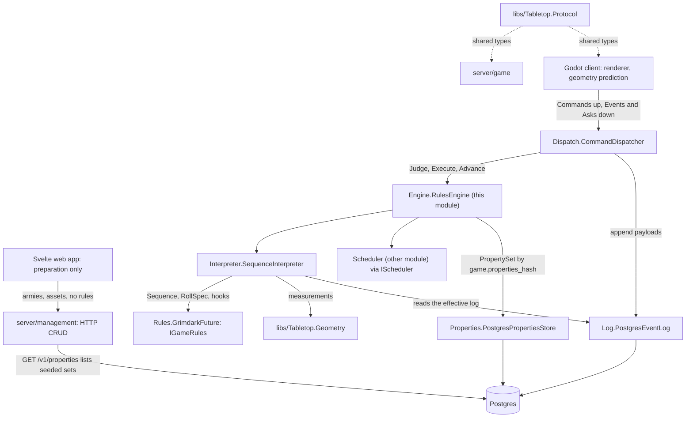

The only edges that matter to this module: the dispatcher above it, `IGameRules` beside it, the
event log beneath it, and `Properties` rows pinned per game. Take from this that the module has
no outward interface of its own — it is reached only through the skeleton's seam.

Three seams carry the weight.

**Down to the log.** `RulesEngine.Advance(state)` is a pure function of `GameState`: it reads
`state.Projection` and `EventApplier.EffectiveLog(state.Applier.Log)` and returns
`IReadOnlyList<EventPayload>`. The session appends them and calls again until the list is empty
(skeleton Task 6). The engine holds no state between calls — not a cached stack, not a dice
counter, not an open Ask — which is what makes hydrate-from-log, undo-by-replay, reconnect and
crash recovery the same code path. The cost is that every `Advance` walks the log; §Failure
modes prices it.

**Sideways to `IGameRules`.** The generic half (`Properties/`, `Dice/`, `Effects/`,
`Interpreter/`, `Engine/`) may not name a stat, roll, action, condition or catalog entry.
Everything OPR is either a row in the pinned set or a member of `GrimdarkFutureRules`.
`InterfaceConstraintTests` reads the source files of those five directories and fails on the
strings `"hit"`, `"defense"`, `"Quality"`, `"Hold"`, `"shaken"`, `Tough`, `Transport` and their
kin. Two strings are whitelisted, in `Effects/StatReader.cs` only: `"Range"` and `"Attacks"`
(open question 5).

**Sideways to the scheduler.** Both modules produce parts of one `IRulesEngine`. This one owns
`Judge`, `Execute` and the interpreter branch of `Advance`; the scheduler is called only when no
framed Ask is open and the frame stack is empty, and it starts sequences through
`ISequenceStarter.Start`. Neither implements the other's interface, and the split is stated as a
three-line decision procedure in §Interfaces.

## Design

### The pinned `Properties` set

`Properties` is the data half of a ruleset: stat declarations, the action and roll rows an
effect can point at, and one catalog of named rules carrying their effects. `schema.md` makes it
eight tables. This module gives them three representations, and the distinction between them is
the first thing to check in review.

| Form | Type | Lives | Has ids | Has a hash |
| --- | --- | --- | --- | --- |
| Authored | `PropertySetDocument` | `server/game/Content/*.properties.json`, embedded in the build | no | derived |
| Stored | eight tables in the `management` schema | Postgres | yes, minted at seeding | `properties.content_hash` PK |
| Runtime | `PropertySet` | memory, one per hash per process | yes, read back | yes |

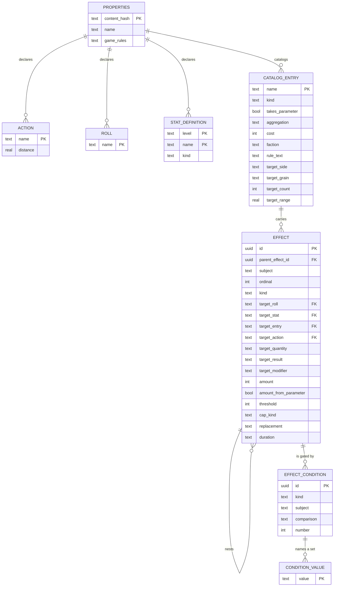

Take from this that `effect` is one table for twelve kinds with three single-kind columns
(`threshold`, `cap_kind`, `replacement`) and a self-reference for nesting, and that
`condition_value` exists because one predicate can name a set — `Fast` applies to *Rush/Charge*.
The `properties_hash` column that every child table carries as part of its key, and the
`entry_name` and `condition_id` foreign keys, are elided for width; `schema.md` has them in
full.

`PropertySet` mirrors the tables member for member. Every closed set is a C# enum whose wire
spelling is the check-constraint value under `ContentJson`'s snake_case policy, and
`PropertySetTests` asserts that directly (`EffectKind.ModifyRoll` serialises as `"modify_roll"`,
`CapKind.ModelsInTargetUnit` as `"models_in_target_unit"`). `Effect.EffectiveAmount(int?
parameter)` is the one piece of behaviour on the row: `amount` is signed and keeps its sign when
the magnitude comes from the entry's `X`, so `AP(3)` is `Math.Sign(-1) * 3`.

#### The canonical hash, and why authoring is a file

`architecture.md` → Rules as data left exactly one thing undesigned: *how authored content
reaches those tables*. The plan proposes the minimal mechanism, and it is the decision most
worth challenging because it is the one with no spec behind it.

A set is authored as one JSON document — the eight tables' shape without ids — under
`server/game/Content/*.properties.json`, embedded in the game server's assembly.
`PropertiesJson.Canonical` serialises it with the lists whose order carries no meaning sorted
(`stats` by level then name, `actions`, `rolls` and `entries` by name, all `StringComparer.Ordinal`)
and the lists whose order *is* meaning left alone (an effect's `ordinal` is authored, and so is
the order of its children and conditions). `PropertiesJson.Hash` is `"sha256:"` plus 64 lowercase
hex over that. `PropertySetDocumentTests` pins the property that matters: reversing `entries` and
`rolls` does not change the hash, changing `name` does.

Consequences worth naming:

- **Editing a document produces a new set.** The hash changes, `SeedAsync` inserts new rows, and
  every game that pinned the old hash keeps reading the old rows. That is exactly what
  undo-by-replay needs and it means content is append-only in practice — nothing ever updates a
  seeded row, and stale sets are never garbage-collected. §Failure modes takes that up.
- **Effect and condition ids are minted at seeding**, not authored, so `Grant.EffectId` is stable
  within one database and *not* portable between databases. A grant in an event log refers to an
  `effect.id`; restoring a log into a database seeded independently would dangle. Nothing in the
  design depends on portability today, and nothing warns about it either.
- **The hash covers content, so the same file seeds the same hash everywhere** — which is what
  makes `PropertiesSummary.GameRules` from `GET /v1/properties` a stable thing for the web app
  and the client to offer at game creation.

`PropertiesJson.Validate` returns a list of human-readable problems and `ToSet` throws
`InvalidDataException` listing them. It enforces what the database's foreign keys and per-kind
`CHECK` constraints enforce, at authoring time rather than at insert time: every `targetRoll`,
`targetStat`, `targetEntry` and `targetAction` resolves inside the same document; `aggregation` is
set exactly when `kind` is `model`; `cost` and `targeting` exactly when `kind` is `spell`;
`threshold` only on `roll`, `cap_kind` only on `multiply`, `replacement` only on `replace_stat`; a
`roll` effect has at least one child; the three relational predicates take no subject; and — the
one rule that is a reading rather than a constraint — a `spell` entry's top-level effect must be
`add_hit` or carry `duration = once`. That last one comes from spell effects having read
forty-eight real spells and found *"always with one duration: once"*; the plan turns the reading
into a validator so an unexpected spell shape fails loudly instead of applying nowhere.

One shape had to be invented because `schema.md` gave the predicate no way to say it: a
`roll_result` condition's `condition_value` rows are exactly two — the roll it reads and `raw` or
`modified` — with `number` the face. Since `(condition_id, value)` is the primary key and carries
no ordinal, the loader re-orders those two so the roll name comes first, and `Validate` refuses a
roll named `raw` or `modified`. This is spec correction 2, and it is a real hole in the schema
rather than a plan convenience.

#### Store and seeder

```csharp
interface IPropertiesStore
{
    Task<PropertySet?> LoadAsync(string contentHash, CancellationToken ct);
    Task<bool> SeedAsync(PropertySetDocument document, CancellationToken ct);  // false: this hash already exists
}
```

`PostgresPropertiesStore` reads the eight tables and assembles the effect tree by
`parent_effect_id`, ordering siblings by `ordinal` then `id`; `InMemoryPropertiesStore` is what
every test outside `PropertiesStoreTests` uses. `PropertiesSeeder.SeedEmbeddedAsync` runs once at
startup from `Program.cs`, guarded off the `Test` environment so `WebApplicationFactory` tests do
not write to the shared database.

**Who seeds is open question 1.** The plan assumes the game server, at startup, because it is the
only process that interprets the catalog and the write is idempotent by hash. Management owns the
schema and lists the sets, so it is the defensible alternative; moving the seeder there is
mechanical (`PropertiesSeeder` and `SeedAsync` move behind an admin endpoint or a CLI verb and
the game server keeps only `LoadAsync`).

### The roll primitive

`architecture.md` says *RNG lives in server state as a seed*, and undo must reproduce the same
dice so rewinding cannot be used to fish for a roll. The plan gets both without storing anything.

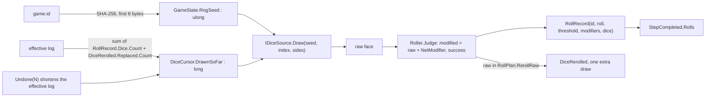

Take from this that the RNG has no state of its own: the seed is derived from the game id and
the cursor is counted from the log, so an undo rewinds the dice along with everything else and
redoing the same action draws the same faces.

`DiceSource` is a counter-based generator — a SplitMix64 finaliser over `seed ^ (index * golden
ratio)` — so die *i* of a game is a pure function of `(seed, i)` with no sequential dependency.
`ScriptedDice(params int[] faces)` returns `faces[index % Length]` and ignores the seed, which is
how every sequence test scripts a whole engagement as one array of faces in draw order.

`RollPlan` is the settled roll: `Roll`, `Threshold` (nullable — the roll-off has none),
`Modifiers`, `Convention`, `RequiredRaw` and `RerollRaw`. `NetModifier` sums the modifiers and
then clamps to `±Convention.ModifierCap` when the ruleset set one; OPR never clamps, 40k clamps
hit and wound at ±1, and *summing is generic while clamping is the ruleset's* is constraint 4.
Success is `RequiredRaw is { } r ? Raw >= r : Threshold is { } t && Modified >= t` — the
`RequiredRaw` branch is fatigue's *unmodified 6s* and 40k's critical hits, and it is why a die
carries both raw and modified.

Every roll is recorded per die: `RollRecord(Guid Id, string Roll, int? Threshold,
IReadOnlyList<RollModifier> Modifiers, IReadOnlyList<Die> Dice)` with `Die(int Raw, int Modified,
bool Success)`. **Replay applies these; it never re-derives them.** `GameRules` is unpinned C#,
so a threshold recomputed after a deploy could disagree with what the players rolled — the
resolution session settled this on 08-30 and this module is the first consumer.

Three ways a die changes after it is drawn, and they are deliberately different events:

| Origin | Payload | Draws a new die | Cursor grows |
| --- | --- | --- | --- |
| A property forcing a reroll (`Poison`) | `DiceRerolled` emitted by the step, after its `step_completed` | yes, once per matching die, never again | yes |
| A player's reroll command | `DiceRerolled` from `RulesEngine.Execute(RerollDice)` | yes | yes |
| A player's edit command | `DiceEdited` from `Execute(SetDice)` | no — the raw face is given and re-judged | no |

`RollOutcome.Successes/Failures/CountRaw` read a record back **as it now stands**, because the
applier folds replacements into the projection's copy. That is what "rerolls stay commands
between steps" buys: with the wait setting on, a reroll of a block die between `roll-to-block`
and `assign` changes the number of wounds `assign` asks the defender to allocate, because
`assign` reads the record rather than a stored count.

One known inconsistency, called out in the plan: `RequiredRaw` is not in `RollRecord`, so
`RulesEngine.PlanOf` cannot restore it and a player's reroll of a fatigued hit die is judged as
`Modified >= Threshold`. `GfRolls.HitPlan` sets threshold 6 with no modifiers for that case, so
the two agree by construction — an alignment held in place by a comment rather than by a type.

### The effect grammar: two passes, and why ordering is a field

An effect is a row saying what a named rule does. Twelve kinds cover Grimdark Future, and
**four of them act on other properties** rather than on game state — grant, suppress, modify a
parameter, suppress modifiers. That is the whole reason resolution is two passes: `Poison`
deletes `Regeneration` from the interaction and `Lance` changes what `AP` contributes, so which
properties are live and what their parameters are has to be settled before anything is applied.

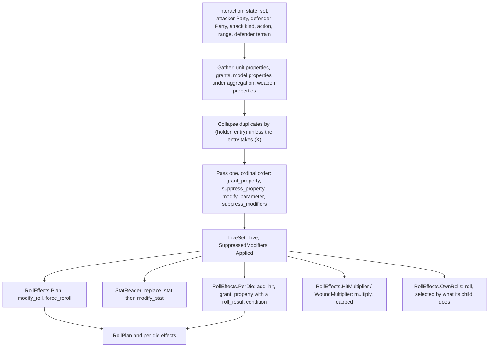

Take from this that pass one produces a value (`LiveSet`) and pass two is several readers over
it, each answering one question a step asks — there is no single "apply everything" call.

Pass one deliberately **skips any effect with a `roll_result` condition**, because those cannot
be judged before a die exists; they reappear in pass two through `LiveSet.Effects(side, kind,
die)` and `LiveSet.WithGranted`, which folds a per-die grant (`Rending`'s *unmodified 6s get
AP(4)*) into a copy of the set for the block roll that hit group produces.

**Ordering is `Effect.Ordinal`, an explicit integer field, not registration order.** This was
contested and re-decided. The resolution session (08-28) argued that restricting modifiers to
arithmetic makes them commute and therefore *removes* the explicit priority scheme
`architecture.md` called for. The effect grammar session (08-29) read every rule in the book and
found that commutativity holds for **one of twelve kinds**; suppression and parameter-modification
do not commute, and the rulebook orders several by hand — `Deadly` is *"resolved first"*, `Blast`
applies *"after resolving other special rules"*. `architecture.md` was right the first time.
Every enumeration in `LiveSet.Effects` and in `LiveProperties.Settle` is `OrderBy(Ordinal)`.

Two subtleties inside pass one, both worth a reviewer's attention:

- **Aggregation is a field on the entry, not a predicate.** `Stealth` is *"units where all models
  have this rule"* and reads `all`; `Tough(X)` reads `none` and yields one `LiveProperty` per
  model. `Gather` computes the count of distinct models carrying the entry and applies
  `all | any | majority | none` — with no tie rule for `majority` beyond `count * 2 > models.Count`
  (identity and enumerations left that open).
- **Duplicates collapse unless the entry takes a parameter** (p.13: instances of the same rule
  do not stack unless it has (X)). The grouping key is `(entry name, model id when aggregation is
  none, weapon *name* when it is a weapon rule, grant id)` — weapon *name* and not weapon id, so
  three Lances in a group contribute one `AP(1)` rather than three.

`EffectDuration` is the spell-effects addition: `interaction` is every core rule, and `once`
means *applying the effect writes a grant onto its target instead*. A grant is
`Grant(Id, EffectId, EntryName, CasterUnitId, RemainingUses)` on the unit — a fourth in-play
store beside the action record, conditions and placement — rebuilt from the log, editable from
the menu, read by both passes through `Lookup.UnitProperties` and by `GameRules`' name checks
through `Lookup.UnitHas`. A grant's parameter is read from its effect's `amount` in the pinned
set by `EffectId`; the grant row carries none, which is why the id stability noted above matters.
Consumption is the consuming step's job: `RollEffects.ConsumeGrants` emits a `GrantRemoved` for
every granted instance whose entry contributed a modifier to the plan.

The twelve kinds, the eight predicates, the two-pass code in detail, and the worked rows for
`AP`, `Stealth`, `Impact`, `Poison`, `Rending`, `Blast` and `Lock-On` are in
[the effect grammar](effect-grammar.md).

### The resolution stack

A game in play has a **resolution stack**: frames, one per sequence in flight. A frame is the
sequence's name, the `SequenceContext` it was invoked with, its position, and the values its
completed steps produced.

**The stack is never stored.** Four event kinds carry it — `sequence_started`, `step_completed`,
`sequence_finished`, `sequence_abandoned` — and `FrameReader.Read(state)` rebuilds every
`FrameView` from `state.Projection.Stack` plus the effective log on every call.

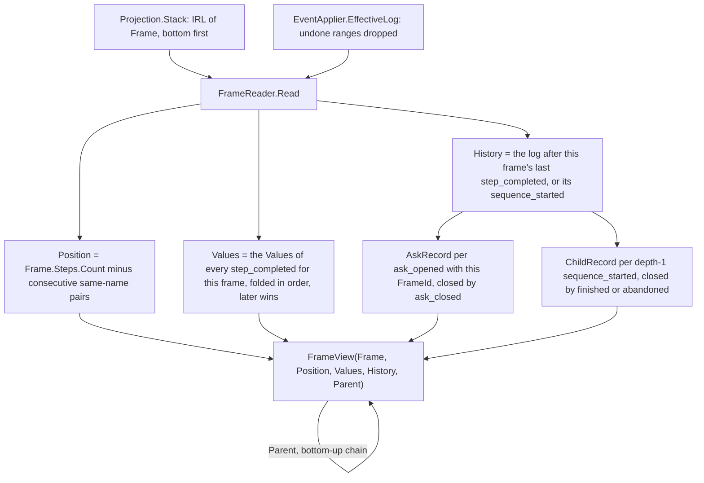

Take from this that a step's entire memory is derived: its position, the parameters it settled,
the Asks it opened and the children it pushed all come out of the log window since it last
completed. Nothing is cached, and there is no per-step schema.

**Why a stack and not a call stack.** A C# continuation cannot be serialised, so an async
rendering of these sequences cannot be durable state, cannot survive hydrate-from-log, and
cannot be replayed for undo. Three standing decisions rule it out at once. The price is stated
plainly and is the module's dominant ergonomic cost: **a step holds no C# locals across a
suspension**, so every `IStep.Run` opens by re-reading its own history to work out where it is.
Read `GfMoves.MoveStep` or `GfMelee`'s `fight` step and the pattern is unmistakable — a chain of
`if (ctx.History.LastClosed() is { } closed)` and `if (ctx.History.Children.Count > 0)` guards
standing in for what would otherwise be `await`.

Two details in `FrameReader` are load-bearing and easy to misread:

- **Position is completed steps minus repeats.** A repeating step logs a second `step_completed`
  with the same name, so `Sequence`'s constructor refuses a sequence that lists one name twice in
  a row — that invariant is what makes "same name as the previous completion" mean "repeat"
  rather than "next step". The check is an `ArgumentException` at construction, which means a
  ruleset bug fails at first use of `GfRules.Sequence(...)` rather than mid-game.
- **History is depth-1.** `History` counts nesting with a `depth` counter so a grandchild
  sequence does not appear as this frame's child. `ChildRecord` order is push order, and *"the
  k-th chosen reaction is the k-th child"* is how a re-run window step knows which reactions it
  has already pushed.

#### A step ends one of five ways

Action sequences (09-03) named four ways a step can end: completing, asking, pushing, and opening
a window. The plan makes five, and the mapping is not one-to-one. *Opening a window* turns out
not to be an outcome at all — `Windows.Run` returns an `OpenAsks` or a `Push`, so a window is
built out of the other two rather than beside them. In its place are two new ones: `Finish`,
which completes a step and ends the sequence early, and `Repeat`, which is a genuine addition to
the spec (correction 5).

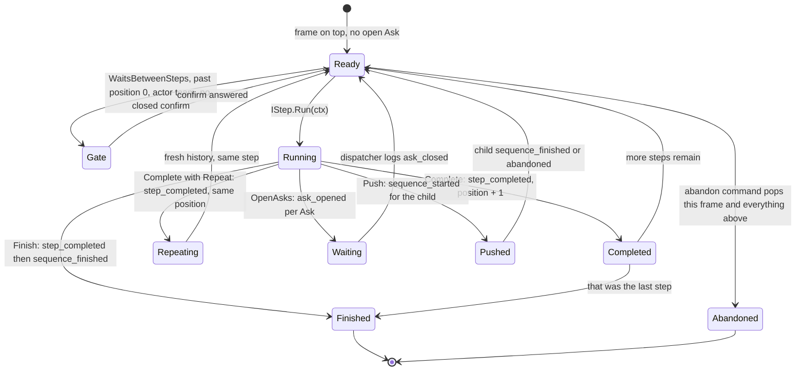

Take from this that repeat and complete emit the same payload and differ only in whether the
position advances — the log distinguishes them by the name of the previous completion.

| Outcome | Type | Payloads | Frame afterwards |
| --- | --- | --- | --- |
| Complete | `Complete(Changes, Values?, Repeat = false)` | `step_completed`, then any forced `dice_rerolled`, then `sequence_finished` if it was the last step | position + 1 |
| Repeat | `Complete(..., Repeat = true)` | the same, never `sequence_finished` | same position, empty history |
| Finish | `Finish(Changes, Values?)` | `step_completed` then `sequence_finished` regardless of position | gone; the remaining steps never happen |
| Ask | `OpenAsks(IRL<Ask>)` | one `ask_opened` each | suspended until every Ask is closed |
| Push | `Push(Sequence, Context)` | `sequence_started` for the child | suspended; the step runs again and sees a `ChildRecord` |

`Finish` is what a charge with no target in reach does (p.7: *the unit may complete its move in
any direction and ends its activation*) and what a `Shaken` unit's `shoot-or-not` does. `Repeat`
is what a move step's next segment does after a mid-move cast, and it is the outcome a reviewer
should push hardest on: a step that repeats must be certain its own state advances, or it loops
forever emitting `step_completed`. `GfMoves.MoveStep` guards this with an explicit
`Values["phase"]` machine; `GfContainers.WreckTestStep` guards it with `Frame.Value("dangerous_dice") > 0`.
There is no interpreter-level loop bound.

`StepCompleted.Values` is a flat `IReadOnlyDictionary<string, int>` — attacks counted, a capped
hit multiplier, extra hits, a distance in tenths of an inch, a bid, who lost. Spec correction 4
settles action sequences' open question *whether `step_completed` payloads need a schema per step
kind* with: no, one flat map. The reason is stated as a mechanism rather than a preference — a
later step or a nested frame reads a settled parameter without re-deriving it, **and** a reroll
between steps changes what the next step reads (it reads the record) without changing what was
settled (it reads the value). The cost is that keys are untyped strings with no registry;
`dangerous_dice`, `net_bid`, `bid_max_<team>`, `phase`, `hits`, `hit_multiplier`,
`distance_used_tenths`, `place_1..place_n` and `loser` are conventions held in `GfNames`' vicinity
and in prose, not in a type.

**Abandonment** is an ordinary logged command handled by the skeleton's dispatcher, not by this
module: it pops the frame and everything above it, and the dispatcher closes the popped frames'
Asks before `sequence_abandoned`. **Applied effects stay applied; unapplied steps never happen.**
There is no rollback and there are no inverse events, because nothing recorded is an invariant —
players fix what they dislike from the menu or undo past the whole sequence by replay. A step
that observes an abandoned child treats it the same as a finished one; `ShootOrNotStep` and
`DisgorgeStep` both read `Finished || Abandoned`.

**Confirm gates.** When `game.waits_between_steps` is on, every step boundary past position 0 is
a gate: the interpreter opens its own `Ask` with question `AskQuestions.Confirm` and a
`Confirmation` legal set, addressed to the acting unit's team. *Pausing is an Ask, so confirming
is answering it* — one input path rather than a second mechanism. A frame with **no actor** is
never gated, which is how the roll-off (a one-step, actor-less sequence) finishes in the batch
that started it; that has the side effect that the roll-off's dice can never be edited from the
menu, since `RerollDice` needs the frame still on the stack. That is open question 8, and the
scheduler module records the same consequence as its own question.

### Asks, windows and the sealed bid

An Ask is addressed to a **team**, carries a question name and a server-computed `LegalSet`, and
is the only way input enters resolution. The interpreter never emits `ask_answered` or
`ask_closed`; the dispatcher does, and the interpreter reads `ask_closed` back out of the log to
resume. What the legal set *means* is enforcement's business, not this module's: under `strict`
an out-of-set answer is refused, under `warn` it is accepted and logged with a warning, under
`silent` accepted. Every step therefore has to tolerate an answer outside its own legal set —
`Windows.Run` reads `if (ask.Single is not Chosen chosen) continue;` and `AssignStep` applies the
defender's allocation as given.

Every Ask this module opens is **framed** (`Ask.FrameId` non-null); every Ask the scheduler opens
is unframed. That single bit is what splits `Advance` between the two.

A **window** is an Ask about interrupting. A step declares a named point and
`IGameRules.ReactionsAt(state, properties, point, frame)` says who can react there; **if nothing
can react, no window opens and nobody is bothered.** `Windows.Run(ctx, point)` returns
`null` when the window is done, so a step can write `if (Windows.Run(ctx, point) is { } outcome)
return outcome;` and fall through. Teams are asked one at a time in `Windows.ReactionOrder` and a
chosen reaction is pushed before the next team is asked, so reactions resolve in turn order after
the actor. `ReactionOrder` is **the one reaction-ordering policy** in the system: it consults
`IGameRules.OrderReactions` first and otherwise rotates `Projection.Scheduler.Order` to start
after the actor's team, appends teams the order does not list in `Info.Teams` order, restricts to
the reacting teams and drops teams in `Projection.Scheduler.Passed`. The scheduler module defines
no ordering type of its own.

Two ways a window opens, one suspension: **offered** to teams other than the actor (OPR core
barely uses it; 40k's Fire Overwatch pushes a whole shooting sequence into an enemy move step),
and **invoked** by the actor inside its own step — which is casting, *at any point before
attacking*, mid-move included.

One variant is **sealed and simultaneous**, and it exists for exactly one OPR rule: casting's
token bid. Every eligible team answers the same Ask concurrently and the answers are withheld
until the window closes, because online, sequential reveal hands the last mover an advantage the
tabletop does not. It is the first and only use of the per-player filtered event streams
`architecture.md` kept available; the skeleton's `EventFilter.ForViewer` does the withholding.

`Bid` is one number for the whole Ask, so it carries the **largest** team maximum and
`Windows.Bids` clamps each team to its own. Per-team maxima are not in the Ask at all: the step
before the bid writes them as `Values["bid_max_<team:N>"]`, and `Windows.MaxFor` reads them back
off the frame. That is open question 6 — the alternative is a per-team map in `Bid` (a Protocol
change) or one sealed Ask per team with the engine holding answers until the last closes, which
the dispatcher does not do today. As it stands a team can *see* a maximum larger than its own,
which leaks the largest opposing pool; the clamp is server-side so it cannot over-bid.

### The engine seam

```csharp
// Engine/RulesEngine.cs
IReadOnlyList<EventPayload> Advance(GameState state)
{
    if (state.Projection.OpenAsks.Values.Any(a => a.Ask.FrameId is not null)) return [];
    if (state.Projection.Stack.Count > 0) return Interpreter.Advance(state);
    return scheduler.Advance(state, Interpreter);
}
```

Three lines, and they are the whole division of labour: **a framed Ask blocks everything; a
non-empty stack is the interpreter's; an empty stack is the scheduler's.** The scheduler is still
called while one of *its own* unframed Asks is open — it returns `[]` for one that is live, and it
is what closes, with an empty answer list, one that a menu edit superseded. That is the only
`ask_closed` the engine ever writes.

`Judge` and `Execute` handle exactly three commands and refuse everything else:

| Command | `Judge` | `Execute` |
| --- | --- | --- |
| `RerollDice(FrameId, RollId, DiceIndices)` | `Legal` when the frame is on the stack and the roll is in one of its completed steps | `DiceRerolled` with the named dice (all when empty) redrawn under the record's own threshold and modifiers |
| `SetDice(FrameId, RollId, Dice)` | the same | `DiceEdited` with each die re-judged from its new raw |
| `AddModifier(FrameId, Roll, Amount)` | `Legal` when the frame is on the stack and `properties.HasRoll(roll)` | `ModifierAdded(frame, roll, new RollModifier("player", amount))` |
| anything else | `Illegal` | `RefuseCommand(Unknown, ...)` |

These are the *same* operations abilities use, with a different actor — resolution's
automation-and-the-menu-write-the-same-fields rule. The protection undo offers was never that
dice are unchangeable; it is that changing them is visible and logged with a name.

`RulesEngineFactory` replaces the skeleton's `InertEngineFactory`. It loads the set by
`game.PropertiesHash`, caches by hash behind a lock, and throws `PropertiesNotFoundException`
when the hash is not seeded; `ConnectionHandshake` catches that and closes the socket with
`1011 cannot hydrate this game` rather than faulting the process. `Create` is synchronous because
`IRulesEngineFactory` is, so the load blocks a hydration on a database round trip — acceptable
once per game per process, and the cache makes it once per hash.

### The battlefield reader, and the two readings of a unit's models

`Interpreter/Battlefield.cs` is the only place the module asks geometry a question. Every method
takes ids and returns a measurement; what a measurement *means* is `GrimdarkFutureRules`'.
`Placed` returns `null` for a model that is not `OnTable`, and `At(state, modelId, placement)`
builds a body at a placement it does not hold yet — how a destination is judged before it is
applied, and the only way to place an occupant, which has no position of its own.

Two findings from the 2026-09-06 review are recorded here because they are subtle and both are
proposed spec corrections (10 and 11).

**Containment answers three ways, not two.** The naive implementation — filter to models that
have a position — gets half of p.14 right and half wrong. The rulebook says units inside a
transport have no line of sight to the outside *and* that units inside **can** target other
units inside, and the transport itself.

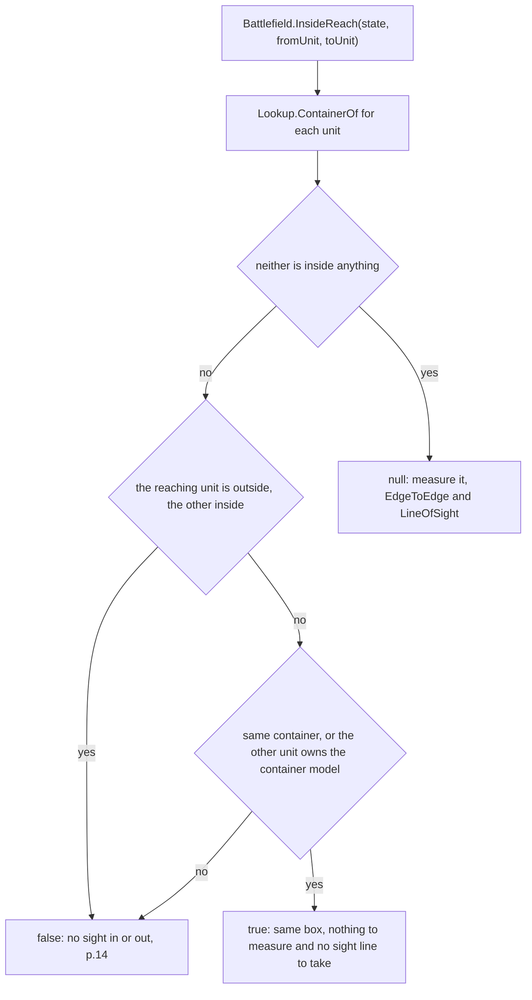

Take from this that containment is asked **before** any measurement, and that `null` — not
`false` — is the ordinary case, so every caller must handle a nullable answer.
`GfAttack.EligibleModels` and `GfCasting.SpellTargets` both short-circuit on it.

**A unit's models mean two different things.** Game flow says a model is in exactly one of three
places and that *"a transported model is very much in play"* while the shelf is out of play. The
plans originally had one predicate doing both jobs, which made a carried unit read as destroyed
and left its occupants unable to be wounded when their transport was. So:

| Reader | Means | Used by |
| --- | --- | --- |
| `Lookup.LivingModels` | models **with a position** — on the table | every distance, sight line, cover and blocker question; `BidCapacity` on both ends |
| `Lookup.AliveModels` | models **still in play** — on the table or inside a container | how many models a unit has, who may be assigned a wound, whether a unit is destroyed, at-half-or-less, `Party.Whole`, the morale test |

Every use of either is a decision, and getting one wrong produces a bug that only shows up with a
transport on the table. That is the single most error-prone distinction in the module.

### The generalisation budget: nine constraints

Only OPR's `GameRules` is built. What stops the generic half from quietly becoming OPR-shaped is
a list of nine constraints derived from Warhammer 40,000's core rules, each with the 40k rule
that falsifies the OPR-shaped assumption. `InterfaceConstraintTests` pins seven of them
mechanically; constraints 5 and 8 are pinned by the shape of Tasks 8 and 9 rather than by an
assertion.

| # | Constraint | Falsified by | Where it lives | Pinned |
| --- | --- | --- | --- | --- |
| 1 | Roll count and names are data | 40k has Hit, Wound, Save and Feel No Pain against OPR's two | `roll` rows; `RollDefinition` | source scan of five directories |
| 2 | Threshold derivation is a function, not a stat reference | 40k's wound roll is a Strength-against-Toughness lookup | `RollSpec.Threshold : Func<LiveSet, Side, int?>` | the property is a `Delegate` |
| 3 | Dice conventions are per roll | Battle-shock is 2D6 >= Leadership | `RollConvention.Sides` | every OPR roll is `(6, null)`; no `Six`/`D6` member on `Roller` |
| 4 | Modifier caps are per roll | 40k clamps hit and wound at ±1; OPR never clamps | `RollConvention.ModifierCap`, applied after summing | `RollPlan.NetModifier` under both conventions |
| 5 | Granularity: pooled or per attack | 40k allocates per attack, with pooling legitimised by Fast Dice Rolling | `Roller.Roll(frameId, plan, count)` plus a later step consuming the pool | by shape |
| 6 | Damage reads a capacity, not a rule name | `Tough(X)` in OPR, the W stat in 40k | `Lookup.ModelParameter(state, modelId, "Tough") ?? 1` inside `GfAttack` only | `Tough` absent from the generic half |
| 7 | Morale is a sequence with ruleset-owned triggers | 40k sweeps below-half units in the Command phase | `morale-test` plus `IGameRules.EndOfTurnSequences` | no step named `morale` in `attack-sequence` or `resolve-hits` |
| 8 | Interrupts push whole sequences from the non-active team | Fire Overwatch is a shooting sequence inside an enemy move step | `Windows.Run` returning `Push` | by shape |
| 9 | Who answers an Ask differs per ruleset | 40k's defender allocates attacks; OPR's removes casualties in any order | `Ask.Teams`; `StepContext.Ask(..., Guid team, ...)` | `SequenceInterpreter.cs` contains neither `Attacker` nor `Defender` |

The tests are source-text scans, which is crude and will produce false positives on an innocent
comment; they are also the only mechanism available for "this directory must not know that word".

### Grimdark Future's sequences

Fifteen sequences behind `IGameRules.Sequence(string)`, and the shape that matters most:
**shooting and melee are one four-step attack sequence invoked from two contexts.** Pages 8 and 9
give the same four steps word for word — Determine Attacks, Roll to Hit, Roll to Block, Remove
Casualties — so there is one `attack-sequence` (`determine-attacks`, `roll-to-hit`, `resolve`)
pushing one `resolve-hits` (`roll-to-block`, `deal`) pushing one `deal-wounds` (`assign`,
`disgorge`), and shooting, melee, `Impact` and a spell's hits all enter that chain at different
depths. `architecture.md`'s original sketch — *declare target, range/LoS, hit rolls, defense
rolls, apply wounds, morale* — put targeting and morale inside the pipeline; both live outside,
targeting in the action's Ask and morale on a trigger of its own.

The full catalogue — the four actions, the move step's phase machine and its casting checkpoint,
charge and melee's seven steps, casting's five, the morale test, dangerous terrain's three
triggers, and a destroyed container disgorging what it held — is in
[Grimdark Future's sequences](opr-sequences.md).

## Key decisions

### Decisions that were contested and re-decided

| Decision | Reason | Rejected alternative | Source |
| --- | --- | --- | --- |
| Ordering is an explicit `ordinal` field on the effect | The rulebook orders effects by hand, and four of twelve kinds act on other properties, which does not commute | Registration order, on the grounds that arithmetic modifiers commute — resolution (08-28) concluded exactly this and was overturned | effect grammar → This restores explicit ordering; resolution → Modifiers and abilities, corrected 08-29 |
| Enforcement has three positions, `silent \| warn \| strict` | Action sequences and the scheduler both wrote a refusing mode; the review put the contradiction to the owner, who kept it | Identity and enumerations' boolean: *the server warns, or it says nothing* | whole-design review → ruling 1 |
| A spell's hits are rolled as a hit roll that cannot fail | *"Roll as many dice as hits to see if on-rolls-of-6 effects trigger"* needs real dice | Action sequences' *spells skip the hit roll* | spell effects → Damage spells need nothing new; review → Contradictions fixed |
| A spell's target is a **set**, from four columns on the entry | Real spells are *"pick up to two friendly units within 12 inches"* | Action sequences' *Ask the target in line of sight*, which assumed one | spell effects → Target selection |
| A once-effect writes a **grant**, a fourth store on the unit | A grant carries three references, so it is not a condition — conditions are names | Action sequences' *grants write a condition*; writing the rule into the unit's property list, which is the frozen snapshot's copy | spell effects → The grants store |
| Rolls are rows in `Properties`, not an enumeration | *What an effect can target must be data*; 40k's wound and save rolls would otherwise be a migration | `effect.target_roll` as a `text` check constraint of four OPR values | action sequences → Rolls become rows; schema → A roll is a row |
| Waiting between steps is a **game** setting; animation is a player's | Waiting changes what the server does and what the log records | Resolution's *both are set at game setup* | review → ruling 3 |
| Containment answers three ways | A filter on *has a position* silently forbids the inside-to-inside targeting p.14 allows | Two-valued containment; a positional filter | proposed spec correction 10 |
| `LivingModels` and `AliveModels` are different readers | One predicate for both jobs made a carried unit read as destroyed | A single *is alive* predicate | proposed spec correction 11 |
| `Counter` resolves before `Impact` | The book leaves the order ambiguous and the session ruled it | Impact first | action sequences → Rulings |

### Decisions the plan took because a spec was silent

| Decision | Reason | Rejected alternative | Recorded as |
| --- | --- | --- | --- |
| Authored content is a JSON document per set under `server/game/Content/`, hashed over a canonical serialisation and seeded as rows at game-server startup, idempotently by hash | `architecture.md` names this the one part of Rules-as-data no design doc has touched; the interpreter needed a mechanism and this is the smallest one | Management owning the seeder behind an admin endpoint or CLI verb; a migration per set | spec correction 1, question 1 |
| A step's settled parameters are a flat `Values` map on `step_completed` | A later step reads a parameter without re-deriving it, and a reroll changes what the next step reads without changing what was settled | A payload schema per step kind — the *Still open* item action sequences left | spec correction 4 |
| A fifth step outcome: complete and run again | A move takes a second segment after a mid-move cast, and one window per activation would allow only one spell | A separate *checkpoint* primitive; a sequence listing the move step twice | spec correction 5 |
| The RNG is counter-based: seed from the game id, cursor from the count of dice drawn in the effective log | Nothing about the RNG is stored, so an undo rewinds the dice with the log | Storing RNG state in the game record and rewinding it explicitly | spec correction 7 |
| A property's own roll is a `RollRecord` named after the entry, with the effect row's threshold | Nothing targets it, so it needs no `roll` row — and `AddModifier` therefore cannot name it | A `roll` row per property that rolls | spec correction 3 |
| One sealed `Bid` legal set carrying the largest team maximum, clamped per team in the step | `Bid.MaxTokens` is one number for the whole Ask | A per-team map in the Protocol; one sealed Ask per team | spec correction 6, question 6 |
| A `spell` entry's top-level effect must be `add_hit` or `duration = once`, validated | Reading all forty-eight spells found nothing else; anything else would apply nowhere | Accepting it and silently doing nothing | spec correction 8 |
| Transport destruction is its own sequence, `transport-destroyed`, one frame per occupant unit, pushed by `deal-wounds`' `disgorge` | p.14 places survivors *before removal*, so the container must still have a placement while they are placed | Shelving the container in `assign` and placing survivors relative to a remembered position | spec correction 12 |
| `Effects/StatReader` may name `"Range"` and `"Attacks"` | `StatKind.Distance` and `StatKind.Count` need a *which* | `IGameRules.RangeStat` and `AttacksStat` as `StatRef` members | question 5 |
| `OneTryPerSpellScope = "activation"` and `RecomputeAttacksPerGroup = true`, as visible constants | The book is ambiguous and action sequences asked for flagged interpretations rather than silent guesses | The round scope; recording each group's attack count up front | questions 2 and 3 |
| A frame with no actor is never confirm-gated | The roll-off has no actor and there is no obvious team to gate on | A confirm Ask to every team, waiting for all | question 8 |
| `ContainersInReach` offers **friendly** containers only, while `InsideReach` implements p.14 as written | The rulebook's containment text is written for the same-army case (p.20) | Offering enemy transports; forbidding the inside-to-inside clause outright | question 9 |
| A caster inside a container may cast, unmodified | `ReactionsAt` reads `AliveModels`, so the window opens; `BidCapacity` stays positional, so no bids reach it | Barring it by reading `LivingModels` in `ReactionsAt` and `Casters` | question 10 |
| The disembark radius is `GfNames.ExitWithin = 6`, measured edge to edge from the container's base | Every other distance in the system is edge to edge | A 6-inch circle about the hull centre | question 11 |
| A survivor with nowhere legal to stand is shelved | The container is removed in the same step, so `Inside` would dangle | Leaving them inside a removed container; auto-placing them | question 12 |
| `Hero`'s *must use the unit's Defense* needs no effect row | `Defense` is declared at unit level, so every model already rolls the unit's | A `replace_stat` row restating it | Task 3 |

## Interfaces

### Produced for other modules

`Tabletop.GameServer.Engine`:

| Type | Members |
| --- | --- |
| `sealed class RulesEngine(IGameRules, PropertySet, IDiceSource, IScheduler) : IRulesEngine` | `SequenceInterpreter Interpreter`; `Judge`/`Execute` for `RerollDice`, `SetDice`, `AddModifier`; `Advance(GameState)` per the three-line procedure above |
| `sealed class RulesEngineFactory(IPropertiesStore, IDiceSource, ISchedulerFactory) : IRulesEngineFactory` | replaces `InertEngineFactory`; caches by hash; `PropertiesNotFoundException(string hash)` |
| `interface IScheduler` | `IReadOnlyList<EventPayload> Advance(GameState state, ISequenceStarter starter)` — **the scheduler module implements this** |
| `interface ISchedulerFactory` | `IScheduler Create(IGameRules rules, GameInfo game, PropertySet properties)` |
| `sealed class NoScheduler`, `sealed class NoSchedulerFactory` | the registration until the scheduler module replaces it |

`Tabletop.GameServer.Interpreter`:

| Type | Members |
| --- | --- |
| `interface IStep` | `string Name { get; }`, `StepOutcome Run(StepContext ctx)` |
| `interface ISequenceStarter` | `IReadOnlyList<EventPayload> Start(GameState, string sequence, SequenceContext)` returning `[sequence_started]`; `SequenceInterpreter` implements it |
| `sealed record Sequence(string Name, IReadOnlyList<IStep> Steps)` | throws `ArgumentException` on two consecutive steps sharing a name |
| `abstract record StepOutcome` | `Complete(Changes, Values?, Repeat)`, `Finish(Changes, Values?)`, `OpenAsks(Asks)`, `Push(Sequence, Context)` |
| `sealed record AskRecord(Ask, IRD<Guid, AskAnswer>?)` | `Closed`, `Single` |
| `sealed record ChildRecord(Guid FrameId, string Sequence, SequenceContext Context, bool Finished, bool Abandoned)` | |
| `sealed record StepHistory(IRL<AskRecord> Asks, IRL<ChildRecord> Children)` | `Waiting`, `LastClosed(string? question)`, `Confirmed`, `ClosedExceptConfirm` |
| `sealed record FrameView(Frame, int Position, IRD<string,int> Values, StepHistory History, FrameView? Parent)` | `Id`, `Context`, `Value(key, fallback)` |
| `static class FrameReader` | `IRL<FrameView> Read(GameState)`, bottom first |
| `sealed class StepContext` | `State`, `Properties`, `Rules`, `Frame`, `History`, `Projection`, `ActorTeam`, `TeamOf`, `Roll`, `Rolls`, `ForcedRerolls`, `Plan`, `Ask`, `SealedAsk` |
| `sealed class SequenceInterpreter(IGameRules, PropertySet, IDiceSource) : ISequenceStarter` | `Advance(GameState)`, `Start(...)` |
| `static class Windows` | `ReactionOrder`, `Run`, `SealedBid`, `Bids` |
| `static class Battlefield` | `Placed`, `At`, `InsideReach`, `Terrain`, `Blockers`, `CanSee`, `Distance`, `Vertical`, `UnitDistance`, `InCover`, `TerrainUnder`, `Settle` |
| `static class Teams` | `Of(GameState, Guid unitId)`, `Others(GameState, Guid? team)` |

`Tabletop.GameServer.Rules` — the eight members added to `IGameRules`, beside the scheduler's
eight:

| Member | Meaning |
| --- | --- |
| `Sequence Sequence(string name)` | throws `UnknownSequenceException` |
| `string? ActionSequence(string actionName)` | the sequence an `action` row starts; null for a name with none |
| `RollSpec RollSpec(string roll)`, `sealed record RollSpec(string Roll, RollConvention Convention, Func<LiveSet, Side, int?> Threshold)` | convention and threshold derivation, per roll |
| `string HitRoll { get; }` | the roll `ToHitPenalties` suppresses |
| `IRL<Reaction> ReactionsAt(GameState, PropertySet, string point, FrameView)`, `sealed record Reaction(Guid TeamId, string OptionId, string Label, string Sequence, SequenceContext Context)` | who may react at a window |
| `IRL<SequenceStart> EndOfTurnSequences(GameState, PropertySet, TurnContext)`, `sealed record SequenceStart(string Sequence, SequenceContext Context)` | OPR: end-of-activation morale tests |
| `IRL<StateChange> OnRoundStarted(GameState, PropertySet, int round)` | OPR: clear `fatigued`, grant `Caster(X)` tokens capped at 6; round 0 yields none |
| `IRL<StateChange> OnTurnEnded(GameState, PropertySet, TurnContext)` | OPR: `WoundsThisActivation` to 0; an idle activation clears `shaken` |

Plus `GameState.RngSeed : ulong` on the skeleton's `GameState`, and `GfNames` as the one names
class — it declares the scheduler module's names too (`Deployment`, `Scouts`, `Rounds`, `Deploy`,
`Scout`, `Ambush`, `Immobile`, `Aircraft`, `Caster`, `Tough`, `Transport`, `SetAside`).

`Tabletop.GameServer.Properties`, `.Dice`, `.Effects` are consumed by the scheduler module only
through four names: `PropertySet.Actions` for the turn Ask's action rows, `Lookup.UnitHas` for
`Immobile`/`Aircraft`/`Scout`/`Ambush` legality (so the grants store counts), `GfRolls.RollOffSequence`
by the name `FirstTeamDecision.RollOffNeeded` carries, and `ScriptedDice`/`InMemoryPropertiesStore`
in tests.

Ask questions a client may see, which the client-shell module renders from their legal-set
shapes: `move`, `shoot_or_not`, `declare_targets`, `remove_casualties`, `charge_target`,
`strike_back`, `disembark`, `cast`, `spell_targets`, plus the engine's `confirm`, `react` and
`bid`. Window kinds a player may mute: `before-attacking`, `casting`.

### Consumed from other modules

| From | Exact names |
| --- | --- |
| Contracts (`Tabletop.Protocol`) | `StepCompleted` with `IReadOnlyDictionary<string,int>? Values { get; init; }` and `CompletedStep.Values` copied by `EventApplier.ApplyTo` — **the one addition this module asks for**; `SequenceStarted/Finished/Abandoned`, `AskOpened/Answered/Closed`, `TeamAnswer`, `DiceRerolled`, `DiceEdited`, `DieReplacement`, `ModifierAdded`, `Undone`, `RollRecord`, `Die`, `RollModifier`, `Grant`, `SequenceContext`, `Location` (`OnTable`, `OnShelf`, `Inside`), `ModelRelocation`, every `StateChange`, `Ask`, `AskOption`, every `LegalSet` and `AskAnswer`, `AskQuestions`, `Projection`, `Frame`, `CompletedStep`, `OpenAsk`, `UnitInPlay`, `ModelInPlay`, `EventApplier.EffectiveLog` |
| Geometry (`Tabletop.Geometry`) | `Distance.EdgeToEdge`, `Distance.Vertical`, `LineOfSight.Check`, `Cover.InsideCoverVolumes`, `Cover.SightBlockersBetween`, `Containment.VolumesContaining`, `Containment.BaseFullyWithin(PlacedModel, PlacedModel, double)`, `Settling.SurfaceHeightAt`, `Bodies.AsBlockingVolume`, `Movement.Check(PlacedModel, Point2, double, IRL<WorldVolume> impassable, IRL<WorldVolume> difficult, double? cap, TableSize?)`, `Movement.VolumesCrossed` |
| Skeleton (`server/game/`) | `IGameRules`, `IRulesEngine`, `IRulesEngineFactory`, `GameState`, `Actor`, `EngineResult` (`Emit`, `RefuseCommand`), `Legality`, `CommandDispatcher`, `RowMapping.EnumText/EnumFrom`, `IEventLog`, `InMemoryEventLog`, `PostgresFixture`, `RecordingClient`, `FixedAskEngine`, `GrimdarkFutureRules` as `sealed partial` |
| Scheduler | `TurnContext`, `Activation`, `ActivationOption.Idle`, `IGameRules.OrderReactions`, `SchedulerBase.RoundsPhase`; and `SchedulerFactory` replacing `NoSchedulerFactory` in `Program.cs` |
| Management | nothing new: `GET /v1/properties` already lists the seeded sets, and the Army Forge import's stat names `Quality`, `Defense`, `Range`, `Attacks` must match `grimdark-future-core.properties.json` |

Two geometry obligations are discharged by this module rather than by geometry:
`Movement.VolumesCrossed` is what a dangerous terrain test is owed, because p.11 says *"moves in
or through"* rather than "ends in"; and `Containment.BaseFullyWithin` implements p.14's *"fully
within 6 inches of it"*, with `GfMoves.ExitPlacement` its only caller.

## Sequences

### One step, one Ask, one round trip

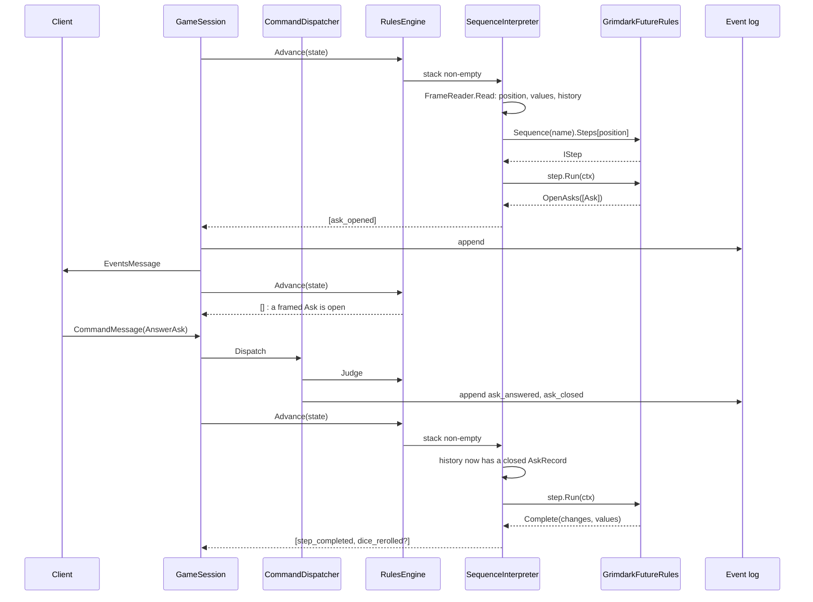

What it shows: the step runs **twice** for one Ask — once to open it, once to consume the answer
— and both runs read the answer out of the log rather than from a local. Where it goes wrong: a
step that opens the same Ask again instead of recognising its closed record loops forever, which
is why every asking step tests `ctx.History.LastClosed()` before anything else. The
`AdvanceAsync` loop calling until the batch is empty is the skeleton's, so a step that always
returns a non-empty batch hangs the session, not just the frame.

### The sealed token bid

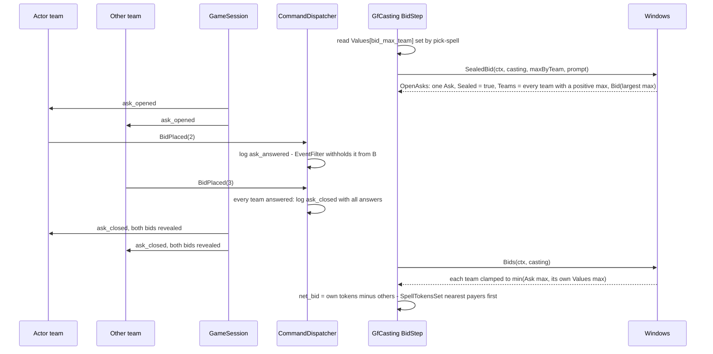

What it shows: one Ask to many teams, withheld until all have answered, then revealed together —
and that the per-team clamp lives in the step's `Values`, not in the Ask. Where it goes wrong: if
a team disconnects without answering, the Ask never closes and the frame never resumes; the only
exits are a menu edit or an abandon. Nothing in this module times a sealed Ask out.

### An activation, end to end, across both modules

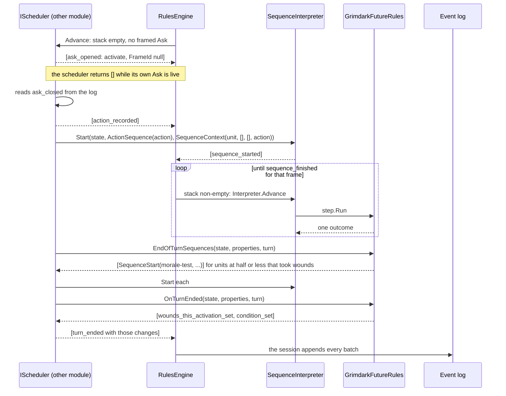

What it shows: the interpreter owns `Advance` from `sequence_started` to `sequence_finished` and
nothing else, and morale reaches the log through a `GameRules` hook the scheduler calls rather
than through a step of the attack machinery — constraint 7. Where it goes wrong: the handover is
inferred from the log on each call, so an event kind emitted in the wrong order (a `turn_ended`
before the frame finishes, say) desynchronises both modules with no error; the integration is
pinned only by `SchedulerHarness` tests running the real `RulesEngine`.

### A wound landing, and a container disgorging

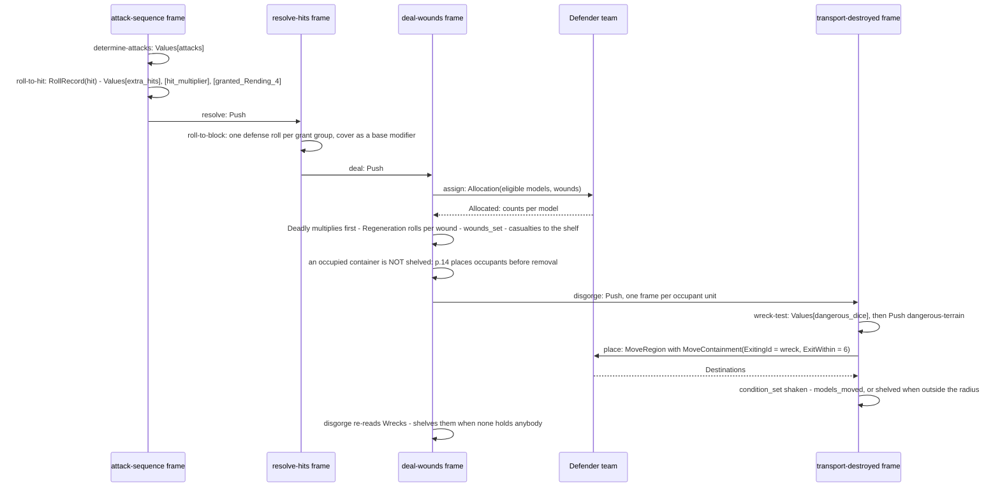

What it shows: the three shared sub-sequences chain by `Push`, the defender answers twice on one
attack (allocation, then placement), and the wreck outlives its own destruction until the last
occupant is out. Where it goes wrong: the occupants' dangerous terrain test pushes a
`deal-wounds` of its own, whose `disgorge` would find the wreck the frame above it is emptying
and push `transport-destroyed` for a unit already being processed. The guard is a walk up
`FrameView.Parent` — this frame's own ancestors, not the stack — so a nested `deal-wounds`
beneath a `transport-destroyed` completes `disgorge` immediately. That is the module's most
delicate piece of reentrancy and it is worth a reviewer's full attention.

## State and data

### Persisted

Two schemas. This module reads both and writes to exactly one place: the eight `Properties`
tables, once per hash, through `PropertiesSeeder` at startup. Every payload it produces reaches
`game.game_event` through the skeleton's session, never through this module.

| Table | Columns this module reads or writes | Who writes |
| --- | --- | --- |
| `management.properties` | `content_hash` PK, `name`, `game_rules` | `PropertiesSeeder` at startup, once per hash |
| `management.action` | `properties_hash`, `name`, `distance` | the same |
| `management.roll` | `properties_hash`, `name` | the same |
| `management.stat_definition` | `properties_hash`, `level`, `name`, `kind` | the same |
| `management.catalog_entry` | `properties_hash`, `name`, `kind`, `takes_parameter`, `aggregation`, `cost`, `faction`, `rule_text`, `target_side`, `target_grain`, `target_count`, `target_range` | the same |
| `management.effect` | `id`, `properties_hash`, `entry_name`, `parent_effect_id`, `subject`, `ordinal`, `kind`, `target_roll`, `target_stat`, `target_entry`, `target_action`, `target_quantity`, `target_result`, `target_modifier`, `amount`, `amount_from_parameter`, `threshold`, `cap_kind`, `replacement`, `duration` | the same |
| `management.effect_condition` | `id`, `effect_id`, `kind`, `subject`, `comparison`, `number` | the same |
| `management.condition_value` | `condition_id`, `value` | the same |
| `management.game` | `properties_hash` read at hydration; nothing written | management, then the game server while `lobby`/`setup` |
| `game.game_event` | `(game_id, seq, kind, payload)` — every payload this module returns | the skeleton's `PostgresEventLog` |

`PostgresFixture.DeletePropertiesAsync(hash)` deletes the `properties` row and lets the seven
others cascade; the embedded core set is left in a developer's database on purpose.

### In memory, and what is rebuilt instead

| Thing | Held where | Lifetime |
| --- | --- | --- |
| `PropertySet` | `RulesEngineFactory._cache`, keyed by hash | process |
| `GameState.RngSeed` | derived on `GameState` construction from the game id | session |
| The frame stack | `Projection.Stack`, applied from the four sequence events | rebuilt by the applier; **never a row** |
| A frame's position, values and history | nothing — computed by `FrameReader.Read` on every `Advance` | one call |
| The dice cursor | nothing — `DiceCursor.DrawnSoFar` sums over the effective log | one call |
| A unit's grants, conditions, action record, wounds-this-activation, spell tokens | `UnitInPlay`/`ModelInPlay` in the projection | rebuilt from the log |
| An open Ask and its answers | `Projection.OpenAsks` | rebuilt from the log |

Nothing here stores a position, a wound, a token count or whose activation it is. A table growing
a *current* column means the event spine has been broken.

## Failure modes

### Ordering and lifecycle

| Hazard | What happens | What the design does |
| --- | --- | --- |
| A step returns a non-empty batch forever | The session's `AdvanceAsync` loop never terminates and the game hangs | Nothing generic. Every repeating step must advance its own `Values`; no loop bound exists. **The most likely way to hang a session.** |
| A step opens an Ask it already opened | Same hang, one call later | Every asking step tests `ctx.History.LastClosed()` first; `WindowTests` and `InterpreterTests` pin the pattern for the two generic cases |
| A sequence lists one step name twice in a row | `FrameReader` would read the second completion as a repeat and the position would stall | `Sequence`'s constructor throws `ArgumentException`, at first call of `GfRules.Sequence` |
| A sealed Ask never closes because a team is disconnected | The frame is stuck; every other team waits | Not handled. A menu edit or an abandon is the only exit; nothing times out |
| A team disconnects mid-window | `Windows.Run` keeps returning the same `OpenAsks` | Same. Muting is client-side, so a muted window is still an unanswered Ask unless the client auto-passes |
| `GameRules` changes between deploys | An old log replays against a different step list or a different threshold function | Accepted, deliberately. Replay applies recorded results, so thresholds and dice are faithful; a *step-list* change is detectable because `step_completed` names its step, and `Properties` is pinned while `GameRules` is not |
| A menu edit puts state the rules call impossible under a running frame | A step reads a dead model on the table, a unit with no models, a container that is not a model | *Nothing is an invariant.* Steps read state defensively — `Lookup.AliveModels(...).Count == 0` finishes, an `Inside` whose container is not on the table is dropped — but this is a per-step obligation with no type-level help |
| An out-of-set Ask answer under `warn`/`silent` | A step receives an answer its legal set did not offer | Applied as given. Steps use `is not Chosen`/`?? []` guards; `AssignStep` applies whatever allocation arrived |

### Reentrancy and containment

- **`disgorge` beneath `transport-destroyed`.** The one real reentrancy in the module, guarded by
  an ancestor walk rather than a stack scan, so the outer `disgorge` still works while its child
  runs. The plan's two `GfContainersTests` cases cover the ordering — occupants tested, shaken,
  placed, wreck last — and do not obviously assert the guard itself. Worth a third case.
- **A model-grain spell cast from inside a container finds nothing.** `SpellTargets`' model-grain
  branch measures per model and an occupant has no position. Left open because no model-grain
  spell exists yet (question 10).
- **A grant on a model-grain target lands on the model's unit,** because the grants store is the
  unit's. If two models of one unit are granted the same rule the instances collapse unless the
  entry takes a parameter — a real behaviour, not a bug, but not obvious.

### Cost, and what is deliberately left to break

- **Every `Advance` is O(log length).** `FrameReader.Read` walks the effective log once per
  frame, `DiceCursor.DrawnSoFar` walks it again, `Conditions.Usage` walks it for a `Limited`
  weapon, and `GfCasting.TriedThisActivation` walks it for a caster. With the wait setting on and
  four players over several hours the log is thousands of events and `Advance` runs after every
  appended batch. No index, no memoisation, no incremental reader. This is the design's clearest
  performance liability, and it is a deliberate trade for statelessness: `architecture.md` prices
  the workload as *turn-based, small state, no simulation tick*.
- **Content grows monotonically.** Editing an authored document seeds a new set; nothing deletes
  the old rows, and no tool reports which hashes are unreferenced.
- **Effect ids are database-local.** A `Grant.EffectId` in an event log does not survive being
  restored into a differently-seeded database. Nothing detects it.
- **`GameRules` is unpinned**, so an ended game restarted after a deploy may replay differently.
  Accepted in identity and enumerations: the alternative makes every deploy a wall old games
  cannot cross.
- **Capacity is never enforced.** `Transport(X)`'s parameter is carried by the catalog entry and
  read by nothing. Game flow rules it explicitly.
- **The 1-inch separation and unit coherency are never enforced** — the client flags them.
  `MoveStep`'s `ignoreSeparation` changes only the Ask's prompt.
- **Scoring, victory conditions and missions do not exist here.** Players count their own points.

### Concurrency

There is one point of shared mutable state and it is small: `RulesEngineFactory._cache`, guarded
by a `lock`. Everything else is per-session, and the skeleton serialises a session's work through
`GameSession.RunAsync`, so no step ever runs concurrently with another step of the same game.
`PropertiesSeeder` races another process starting at the same moment; `SeedAsync` returning
`false` for an existing hash makes the loser a no-op, and the insert is by primary key, so the
worst case is a duplicate-key error on one of the two.

## Testing

Test-driven throughout, in `tests/Tabletop.GameServer.Tests`: every task starts with a failing
xUnit test, and every OPR sequence has either the rulebook's own worked example or a constructed
case with scripted dice. The plan expects 74 new tests.

| Suite | Covers | Needs Docker |
| --- | --- | --- |
| `PropertySetTests`, `PropertySetDocumentTests` | lookups, `Comparison` over six operators, enum wire spellings, canonical hashing, validation, a spell's two admissible effect shapes | no |
| `CoreContentTests` | the authored OPR core set parses, validates and builds | no |
| `PropertiesStoreTests` | eight tables in, eight tables out; `SeedAsync` idempotent by hash | **yes** — `[Collection("Postgres")]`, `PostgresFixture` |
| `DiceTests` | counter-based determinism, cursor arithmetic, `RequiredRaw` versus threshold, forced rerolls, undo reproducing dice | no |
| `LivePropertiesTests`, `RollEffectsTests` | aggregation, collapse-unless-parameter, the four pass-one kinds in ordinal order, plan modifiers, suppression, per-die grants, capped multipliers | no |
| `InterpreterTests`, `WindowTests` | the five outcomes, position and history from the log, confirm gates, reaction order, the sealed bid | no |
| `RulesEngineTests` | the three-line `Advance` split, the three dice commands, `PropertiesNotFoundException` | no |
| `GfRollsTests` and the seven `Gf*Tests` | every OPR sequence against the rulebook, including p.8's and p.9's worked examples | no |
| `InterfaceConstraintTests` | seven of the nine constraints, by source scan and reflection | no |

The harness is two small classes and they carry most of the leverage. `Armies` builds a two-team
playing game around one sequence; `Sim.Gf(state, params int[] faces)` wraps it over an
`InMemoryEventLog` with `ScriptedDice`, exposes `Start`, `AskFor`, `Answer`, `Steps` and
`Alive`, and drives the `Advance`/answer loop. A whole engagement becomes an array of faces in
draw order and a handful of assertions on `step_completed.Values` — which is only possible
because the dice are counter-based and the log is the whole state.

**What cannot be tested headlessly:** nothing in this module. It is Godot-free and has no client
dependency, which is the point of the load-bearing seam. The Postgres-backed store tests need
`docker compose up -d`; every other test runs on an in-memory log and an
`InMemoryPropertiesStore`.

Notable gaps:

- **The constraint tests are source-text scans.** They will pass a violation written with string
  concatenation and fail on an innocent comment mentioning `Tough`. Constraints 5 and 8 have no
  assertion at all.
- **No test bounds a repeating step.** The hang described above is not covered.
- **No test covers a disconnect during a sealed bid or an open window.**
- **The two-module integration is covered only by the scheduler module's `SchedulerHarness`,**
  which runs the real `RulesEngine`. There is no test in this module that exercises the
  scheduler-to-interpreter handover.
- **Log-length cost is unmeasured.** No benchmark exists for `Advance` over a long game.
- **`DiceSource`'s distribution is unexamined** beyond uniformity in `1..sides`; `% sides` on a
  64-bit value has negligible modulo bias for six, and nothing tests it.

## Open questions and deferred work

The plan's twelve questions, each with the assumption taken and the cost of the other answer.

| # | Question | Assumed | If the answer differs |
| --- | --- | --- | --- |
| 1 | Who seeds `Properties`, and when? | The game server, at startup, from embedded documents, idempotently by hash | `PropertiesSeeder` and `SeedAsync` move to `server/management/` behind an admin endpoint or a CLI verb; the game server keeps only `LoadAsync`. Or `Program.cs` gains a `seed-properties` argument |
| 2 | *One try per spell* — activation or round? | The activation; `OneTryPerSpellScope = "activation"`, `TriedThisActivation` scans from the activation's `sequence_started` | The scan starts at the last `round_started` and the constant reads `"round"`; nothing else changes |
| 3 | Are a later weapon group's attacks recomputed after an earlier group's casualties? | Yes; `RecomputeAttacksPerGroup = true` | `fire-groups` records each group's attack count before pushing and `determine-attacks` reads it; *all weapons are fired simultaneously* then wins over group order |
| 4 | Catalog kinds and aggregation for the core rules no spec fixes | `Entrenched` is `any` — the loosest reading and the one worth confirming; `Fast`/`Slow`/`Flying`/`Strider`/`Immobile`/`Furious`/`Relentless` are `model` with `all`; the per-model rules are `none`; `Aircraft`/`Ambush`/`Scout` are `unit` | The document changes and the hash with it. `all` is `Entrenched`'s alternative; `none` is not available, since a per-model instance would add its −2 once per entrenched model to a unit-pooled hit roll |
| 5 | May generic `Effects/` know the two weapon stat names? | Yes, while OPR is the only ruleset; `StatReader` reads `"Range"` and `"Attacks"`, whitelisted by the constraint test | `IGameRules` gains `StatRef RangeStat` and `StatRef AttacksStat` and `StatReader` takes them |
| 6 | One sealed `Bid` legal set for every team? | Yes; the largest team maximum in the Ask, per-team clamping in the step | `Bid` needs a per-team map — a Protocol change — or one sealed Ask per team with the engine holding answers until the last closes, which the dispatcher does not do |
| 7 | `Sniper`'s per-model target | Not modelled; a Sniper group resolves first at Quality 2+ against the target unit | A model-grain `PieceSelection` per Sniper model and `AttackInteraction` over one model as a unit of 1 — the same path a model-grain spell takes. About a task of work |
| 8 | Confirm gates and the actor | The `Confirm` Ask goes to the acting unit's team; an actor-less frame is never gated | The gate becomes one Ask per team and waits for all; `SequenceInterpreter.Advance` gates position 0 for actor-less frames too. About ten lines here, plus the scheduler reading the roll-off order only after the gate closes. As assumed, the roll-off's dice are never editable and undo re-rolls the same dice |
| 9 | Can a unit embark into an enemy's transport, or an occupant target its own container? | The narrow reading for the offer, the faithful one for the predicate: `ContainersInReach` lists friendly containers only; `InsideReach` implements p.14 as written, leaving the clause latent | For a captured building or two armies in one container, nothing changes. To forbid it, `InsideReach` returns false for two units on the same team and the clause disappears |
| 10 | May a caster inside a container cast? | Yes, at what is in there with it, but unmodified: `BidCapacity` is positional on both ends, so such a cast draws no bids and resolves at a flat 4+ | `ReactionsAt` and `GfCasting.Casters` go back to `LivingModels` and two lines disappear. Either way the model-grain edge stays open |
| 11 | Where does the disembark radius come from, and is it edge to edge? | `GfNames.ExitWithin = 6` for every container, edge to edge from its base, so the region is the footprint grown by 6 inches | Nothing else changes; `Containment.BaseFullyWithin` is the only place the number is applied |
| 12 | A survivor with nowhere legal to stand | Shelved; the container is removed in the same step and `Inside` would dangle | Leaving them inside a removed container or auto-placing them needs a rule the rulebook does not give |

### Deferred, and where it is recorded

| Deferred | Recorded in |
| --- | --- |
| 40k's `GameRules`. The core rules were read to falsify the interface, not to build it | action sequences → Deliberately not decided; `architecture.md` → Where data stops |
| Generalising `GameRules` itself — turn structure, action definitions, step order, scheduler policy, dice conventions stay C# | `architecture.md` → Where data stops, for now |
| The Army Forge content import that turns generated spell structure into documents | spell effects → Deliberately not decided; spec correction 1 |
| Advanced Casting's spell books, psychic pool and living spells (p.31–32) | action sequences → Deliberately not decided |
| Action Boosting, which needs percentages — a thirteenth effect kind or a flavour on kind 1 | effect grammar → Still open |
| The two further durations the optional extra actions need (*until its next activation*, *this round*) | spell effects → Duration |
| Buildings as targets: terrain carrying stats and becoming event-driven state on the setup snapshot | game flow → Inside a container |
| Conflicts between two abilities reading the same result — whether both apply or one wins | resolution → Deliberately not decided |
| Whether effects ever need to nest more than one level; whether twelve kinds survive 40k; whether `majority` needs a tie rule | effect grammar → Still open; identity and enumerations → Deliberately not decided |
| What a dice expression stat looks like beyond existing as a `StatKind` | content values → Deliberately not decided |
| Deployment, phases, activation legality, the round boundary | the scheduler module |

## References

**Plan.** [`docs/superpowers/plans/2026-09-05-interpreter-and-effects.md`](../../superpowers/plans/2026-09-05-interpreter-and-effects.md)
— 19 tasks, `Interfaces → Produces`, 12 proposed spec corrections, 6 interface needs, 12 questions.

**Specs**, in the order the plan names them:

- [action sequences (2026-09-03)](../../superpowers/specs/2026-09-03-action-sequences-design.md) — primary: the stack, the four (now five) outcomes, one roll primitive, Asks, windows, OPR's sequences, the nine constraints, rolls become rows
- [resolution (2026-08-28)](../../superpowers/specs/2026-08-28-resolution-design.md) — two orthogonal settings, a half-resolved pipeline as durable state, players roll their own dice, rerolling does not break undo
- [the effect grammar (2026-08-29)](../../superpowers/specs/2026-08-29-effect-grammar-design.md) — twelve kinds, eight predicates, two passes, ordering as a field
- [spell effects (2026-09-04)](../../superpowers/specs/2026-09-04-spell-effects-design.md) — duration, the grants store, target selection, faction rules as catalog entries
- [content values (2026-08-29)](../../superpowers/specs/2026-08-29-content-values-design.md) — typed stats at three levels, a weapon on the model slot, effects are data
- [identity and enumerations (2026-08-29)](../../superpowers/specs/2026-08-29-identity-and-enumerations-design.md) — the four catalog kinds, the Stealth case, every closed set, only `Properties` is pinned
- [game flow (2026-08-28)](../../superpowers/specs/2026-08-28-game-flow-design.md) — the four in-play stores, the shelf, inside a container, nothing is an invariant
- [the scheduler (2026-09-04)](../../superpowers/specs/2026-09-04-scheduler-design.md) — the seam only: the turn is an Ask, windows, the round boundary
- [the whole-design review (2026-09-04)](../../superpowers/specs/2026-09-04-whole-design-review.md) — newest, and wins: five rulings and the gaps filled

**Repository documents.** [`docs/architecture.md`](../../architecture.md) → The load-bearing seam,
Command / Event spine, Rules enforcement, Undo, Abilities, Rules as data, Pinning;
[`docs/schema.md`](../../schema.md) → `Properties` is eight tables, One `effect` table not twelve,
A condition is a row, Worked against the book; [`docs/data-model.md`](../../data-model.md).

**Rulebook.** Grimdark Future v3.4.1, read for this plan: p.7 (the four actions and their
distances), p.8 (shooting, weapon groups, two targets, the worked attack example), p.9 (melee
reach, striking back, fatigue), p.10 (who won, consolidation, morale, Shaken), p.11 (terrain:
cover, difficult, dangerous), p.13–14 (every special rule), p.20 (solid buildings), p.29–34 and
p.49 (the token economy's edges and the free-for-all roll-off).

**Sibling documents in this folder.**

- [The effect grammar](effect-grammar.md) — twelve kinds, eight predicates, the two passes in
  detail, the grants store, and the worked rows.
- [Grimdark Future's sequences](opr-sequences.md) — the fifteen sequences, the shared attack
  chain, the move step's phase machine, casting, and containment.

**Other module designs.** [`docs/design/game-server/`](../game-server/) is the one this module
extends — its `IGameRules`/`IRulesEngine` seam is quoted above rather than restated here — and
[`docs/design/scheduler/`](../scheduler/) is the one it shares an engine with.
Also [`docs/design/contracts/`](../contracts/), [`docs/design/geometry/`](../geometry/),
[`docs/design/client/`](../client/), [`docs/design/management-api/`](../management-api/),
[`docs/design/web-app/`](../web-app/).
