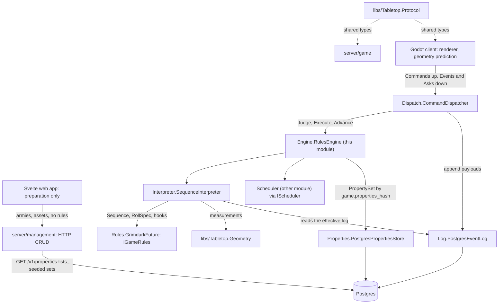

# Interpreter and effects

The rules engine's resolution half, built only in `server/game/`. It contains the pinned
`Properties` set loaded from ten Postgres tables, a counter-based roll primitive over the
game's stored seed, the effect grammar's two passes, a generic sequence interpreter whose
frames are rebuilt from the event log on every call, and Grimdark Future's sequences behind
`IGameRules`. It supplies the one `IRulesEngine` the game server skeleton left inert. It shares
that engine with the scheduler module through `Engine.IScheduler`.

Nothing about resolution is stored: not the frame stack, not the step's position, not the dice
cursor. The RNG seed is read with the game's row and never written here. Every call to `Advance`
re-reads the effective log and reconstructs them. A step may therefore hold no C# local across a
suspension. Undo-by-replay, hydration and crash recovery are the same mechanism because of this.

## Scope

### In

| Directory | Contents |
| --- | --- |
| `server/game/Properties/` | `PropertySet`, `PropertySetDocument`, `PropertiesJson`, `IPropertiesStore`, `PostgresPropertiesStore`, `PropertiesSeeder` |
| `server/game/Content/` | `grimdark-future-core.properties.json` (the rulebook's rules), `grimdark-future-army-rules.part.json` (hand-written army-book rules), `grimdark-future-army-book-rules.part.json` and `army-books/<uid>.book.json` (48 books, written by `scripts/ArmyBooks`), embedded resources composed into one set |
| `server/game/Dice/` | `IDiceSource`, `DiceSource`, `ScriptedDice`, `DiceCursor`, `RollPlan`, `Roller`, `RollOutcome` |
| `server/game/Effects/` | `Interaction`, `Conditions`, `LiveProperties`, `RollEffects`, `StatReader`, `Lookup` |
| `server/game/Interpreter/` | `Steps`, `FrameReader`, `StepContext`, `SequenceInterpreter`, `Windows`, `Battlefield` |
| `server/game/Engine/` | `RulesEngine`, `RulesEngineFactory`, `IScheduler`, `ISchedulerFactory`, `NoScheduler` |
| `server/game/Rules/GrimdarkFuture/` | `GfRules.Sequences.cs`, `GfNames`, `GfRolls`, `GfHooks`, `GfMoves`, `GfAttack`, `GfShooting`, `GfMelee`, `GfMorale`, `GfCasting`, `GfContainers` |

Modified, not created: `Rules/IGameRules.cs` (the interpreter's nine members), `Rules/IRulesEngine.cs`
(`GameState.RngSeed`), `Program.cs` (three registrations plus startup seeding),
`Session/ConnectionHandshake.cs` (one more exception in the hydrate catch),
`Tabletop.GameServer.csproj` (the embedded content), and the skeleton's `PostgresFixture`.

### Not in

- **The scheduler.** This module defines `Engine.IScheduler` and calls it. The scheduler module
  implements it. Whose turn it is, activation legality, deployment, phases and the round
  boundary all belong to it.
- **The socket, the session, the event log, the dispatcher and enforcement.** The skeleton owns
  them. This module returns payloads. It never appends, never broadcasts, and never emits
  `ask_answered` or `ask_closed`.
- **`Tabletop.Protocol` and `Tabletop.Content`.** Every event, command, Ask and state change is
  the contracts module's. The only addition asked of it is `StepCompleted.Values`.
- **Geometry.** `Tabletop.Geometry` answers every measurement. `Interpreter/Battlefield.cs` is a
  reader over the projection that calls it, and never re-implements it.
- **`libs/`.** No rules type leaves `server/game/`. The client receives the consequences of a
  rule, never a rule (`architecture.md` → What is actually shared).
- **A second ruleset.** 40k's core rules were read to falsify the interface, not to build it.
  Only `GrimdarkFutureRules` exists. Nine constraints bound what the generic half may assume.
- **The army-book generator.** `scripts/ArmyBooks` (`./scripts/army-books`) translates Army Forge's
  books into the `*.book.json` and generated `*.part.json` files this module embeds; it is repo-level
  support, not part of the module ([the spell library](../../superpowers/specs/2026-10-02-spell-library-design.md) → The generator).
- **Buildings as targets, a `Takedown` weapon's *resolved as if it was a unit of 1*, advanced casting's three
  optional modules, and the two extra effect durations the optional extra actions need.** Recorded,
  not built. A `Takedown` group names the model its wounds land on (the plan's ruling 7), offers only models
  its weapon reaches and sees with the target's own models ignored, and reads cover off that model alone; `Blast`'s
  cap and the defence roll still read the whole target unit. A model-target spell is resolved as a unit of one: `GfAttack.TakedownModel`
  reads the model off the casting frame's `targets` answer, its wounds go to that model with no allocation, and
  `Blast` is capped at one model.

### Build order and prerequisites

`architecture.md` → Build order step 8, *resolution pipelines*, running alongside step 7, the
scheduler. Three modules must land first:

| Module | What this one consumes |
| --- | --- |
| Contracts | Every `EventPayload`, `Command`, `Ask`, `LegalSet`, `StateChange`, `Projection`, `Frame`, `EventApplier.EffectiveLog`, `StepCompleted.Values`, and `GameInfo.RngSeed` |
| Geometry | `Distance`, `LineOfSight`, `Cover`, `Movement`, `Bodies`, `Containment`, `Collision` |
| Game server skeleton | `IGameRules`, `IRulesEngine`, `IRulesEngineFactory`, `GameState`, `Actor`, `EngineResult`, `CommandDispatcher`, `Legality`, `InMemoryEventLog`, `PostgresFixture`, `GrimdarkFutureRules` as a `partial` |

Nothing of this module exists yet. The repository is at scaffold stage: only `client/` has code,
and `server/game/` is empty until the skeleton lands.

`IGameRules` gains members from two modules at once. The merged interface is written in full in
the skeleton plan. The scheduler module adds seven members and this one adds nine, each exactly
once. `TurnContext` and `Activation` are the scheduler's records, so this module's
`EndOfTurnSequences` and `OnTurnEnded` signatures require that module's Task 1 to have landed,
or those two records to be copied from it.

## Context

The module has no outward interface of its own. It is reached only through the skeleton's seam.

**Down to the log.** `RulesEngine.Advance(state)` is a pure function of `GameState`. It reads
`state.Projection` and `EventApplier.EffectiveLog(state.Applier.Log)` and returns
`IReadOnlyList<EventPayload>`. The session appends them and calls again until the list is empty
(skeleton Task 6). The engine holds no state between calls: no cached stack, no dice counter, no
open Ask. Hydration, undo-by-replay, reconnect and crash recovery are therefore one code path.
Every `Advance` walks the log. [Failure modes](operations.md#failure-modes) prices that scan.

**Sideways to `IGameRules`.** The generic half (`Properties/`, `Dice/`, `Effects/`,
`Interpreter/`, `Engine/`) may not name a stat, roll, action, condition or catalog entry.
Everything OPR is either a row in the pinned set or a member of `GrimdarkFutureRules`.
`InterfaceConstraintTests` reads the source files of those five directories and fails on the
strings `"hit"`, `"defense"`, `"Quality"`, `"Hold"`, `"shaken"`, `Tough`, `Transport` and their
kin. Two strings are whitelisted, in `Effects/StatReader.cs` only: `"Range"` and `"Attacks"`
(the plan's ruling 5).

**Sideways to the scheduler.** Both modules produce parts of one `IRulesEngine`. This one owns
`Judge`, `Execute` and the interpreter branch of `Advance`. The scheduler is called only when no
framed Ask is open and the frame stack is empty. It starts sequences through
`ISequenceStarter.Start`. Neither implements the other's interface. [The engine seam](resolution.md#the-engine-seam) states the split
as a three-line decision procedure.

## Parts

| Document | Holds |
| --- | --- |
| [The pinned `Properties` set](properties.md) | the three forms of a set, the canonical hash, composition from authored files, validation, the store and seeder |
| [Resolution](resolution.md) | the roll primitive, the effect grammar's two passes, the resolution stack and step outcomes, Asks and windows, the engine seam, the battlefield reader, the nine constraints |
| [Decisions and rulings](decisions.md) | contested decisions, decisions taken where a spec was silent, the fourteen rulings, what is deferred |
| [Interfaces and sequences](interfaces.md) | types produced and consumed, and the cross-module sequence diagrams |
| [State, failure modes and testing](operations.md) | persisted and in-memory state, failure modes, accepted gaps, the test suites |
| [The effect grammar](effect-grammar.md) | the kinds, the predicates, both passes in code, the grants store, worked rows |
| [Grimdark Future's sequences](opr-sequences.md) | every sequence, its steps and their rulebook pages |

## References

**Specs**:

- [action sequences (2026-09-03)](../../superpowers/specs/2026-09-03-action-sequences-design.md), primary: the stack, four of the five outcomes, one roll primitive, Asks, windows, OPR's sequences, the nine constraints, rolls become rows
- [resolution (2026-08-28)](../../superpowers/specs/2026-08-28-resolution-design.md): two orthogonal settings, a half-resolved pipeline as durable state, players roll their own dice, rerolling does not break undo
- [the effect grammar (2026-08-29)](../../superpowers/specs/2026-08-29-effect-grammar-design.md): twelve kinds, eight predicates, two passes, ordering as a field
- [spell effects (2026-09-04)](../../superpowers/specs/2026-09-04-spell-effects-design.md): duration, the grants store, target selection, faction rules as catalog entries
- [the spell library (2026-10-02)](../../superpowers/specs/2026-10-02-spell-library-design.md): every official book's spells in one composed set, a caster casts its own book's spells, a grant holds one effect row, sixteen kinds and ten predicates
- [army-rule hooks (2026-10-02)](../../superpowers/specs/2026-10-02-army-rule-hooks-design.md): the `place` kind, `add_hit` attacks, the `at_point` predicate
- [content values (2026-08-29)](../../superpowers/specs/2026-08-29-content-values-design.md): typed stats at three levels, a weapon on the model slot, effects are data
- [identity and enumerations (2026-08-29)](../../superpowers/specs/2026-08-29-identity-and-enumerations-design.md): the four catalog kinds, the Stealth case, every closed set, only `Properties` is pinned
- [game flow (2026-08-28)](../../superpowers/specs/2026-08-28-game-flow-design.md): the four in-play stores, the shelf, inside a container, nothing is an invariant
- [the scheduler (2026-09-04)](../../superpowers/specs/2026-09-04-scheduler-design.md), the seam only: the turn is an Ask, windows, the round boundary
- [the whole-design review (2026-09-04)](../../superpowers/specs/2026-09-04-whole-design-review.md), the newest and therefore authoritative: five rulings and the gaps filled

**Repository documents.** [`docs/architecture.md`](../../architecture.md) → The load-bearing seam,
Command / Event spine, Rules enforcement, Undo, Abilities, Rules as data, Pinning;
[`docs/schema.md`](../../schema.md) → `Properties` is ten tables, One `effect` table for every kind,
An army book is a row and lists its spells, A condition is a row, Worked against the book; [`docs/data-model.md`](../../data-model.md).

**Rulebook.** Grimdark Future v3.5.1, read for this plan: p.7 (the four actions and their
distances), p.8 (shooting, weapon groups, two targets, the worked attack example), p.9 (melee
reach, striking back, fatigue), p.10 (who won, consolidation, morale, Shaken), p.11 (terrain:
cover, difficult, dangerous), p.13–15 (every special rule), p.21 (solid buildings), p.30–35 and
p.50 (the token economy's edges and the free-for-all roll-off).

**Sibling documents in this folder.**

- [The effect grammar](effect-grammar.md): seventeen kinds, eleven predicates, the two passes in
  detail, the grants store, and the worked rows.
- [Grimdark Future's sequences](opr-sequences.md): the nineteen sequences, the shared attack
  chain, the move step's phase machine, casting, and containment.

**Other module designs.** [`docs/design/game-server/`](../game-server/) is the module this one
extends. [`docs/design/scheduler/`](../scheduler/) is the one it shares an engine with.
Also [`docs/design/contracts/`](../contracts/), [`docs/design/geometry/`](../geometry/),
[`docs/design/client/`](../client/), [`docs/design/management-api/`](../management-api/),
[`docs/design/web-app/`](../web-app/).
