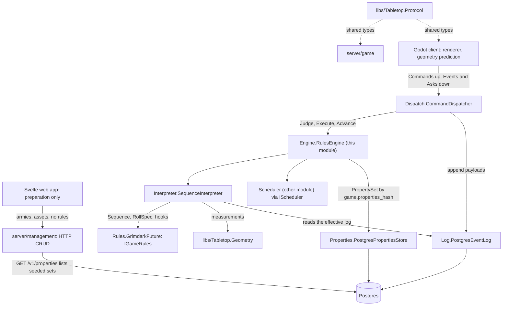
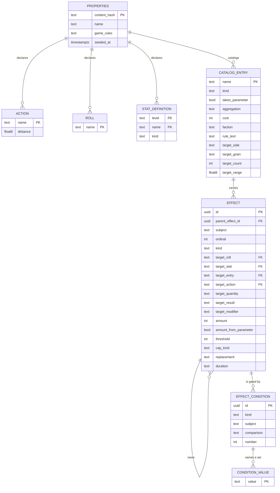
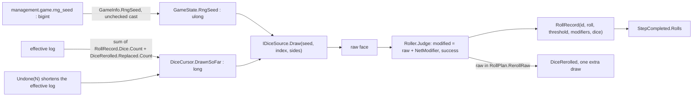
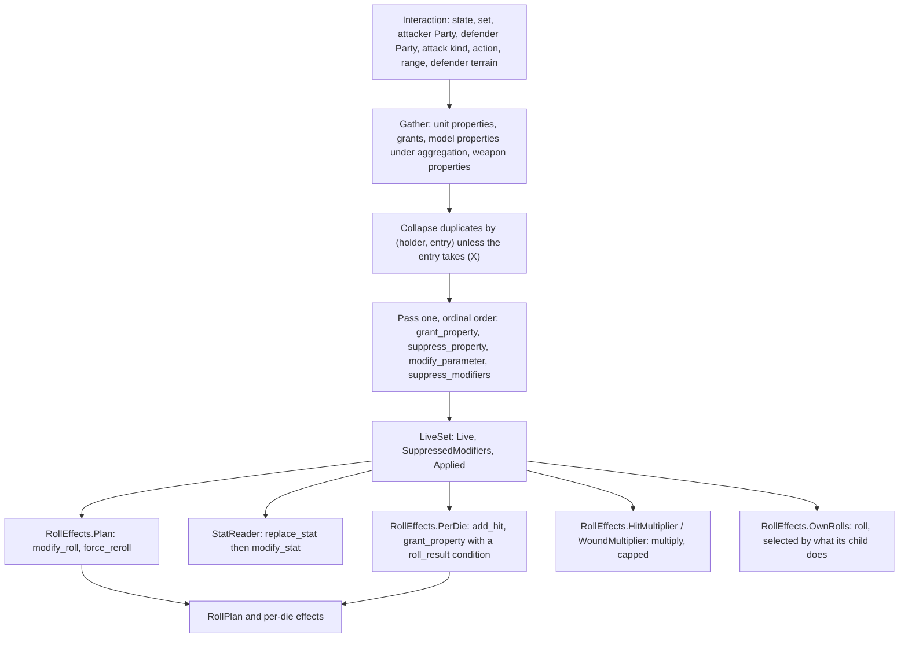
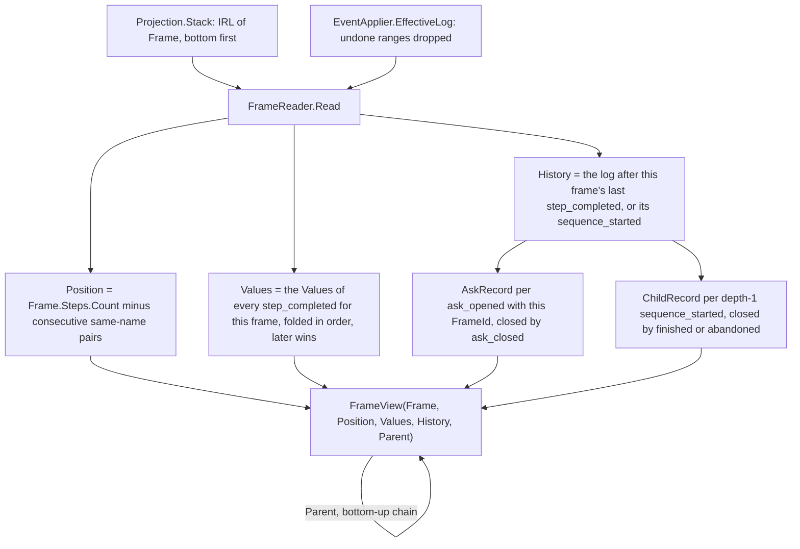
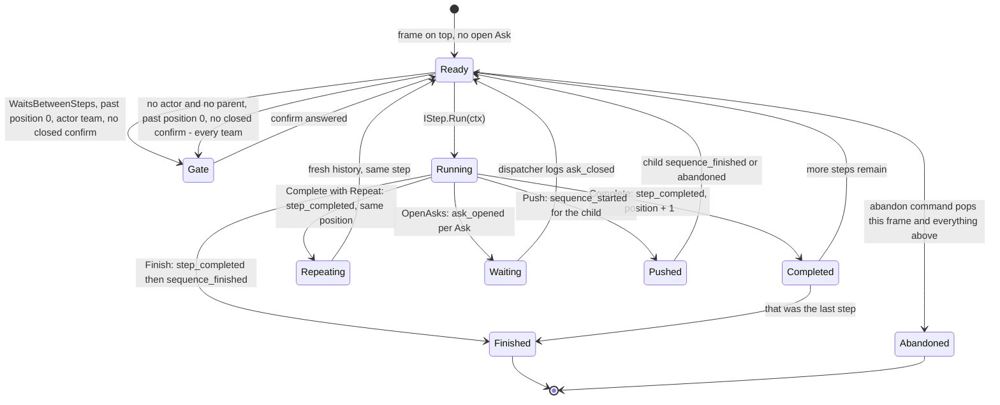
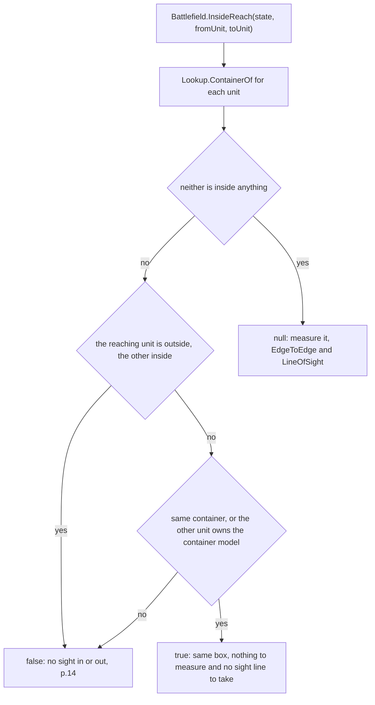
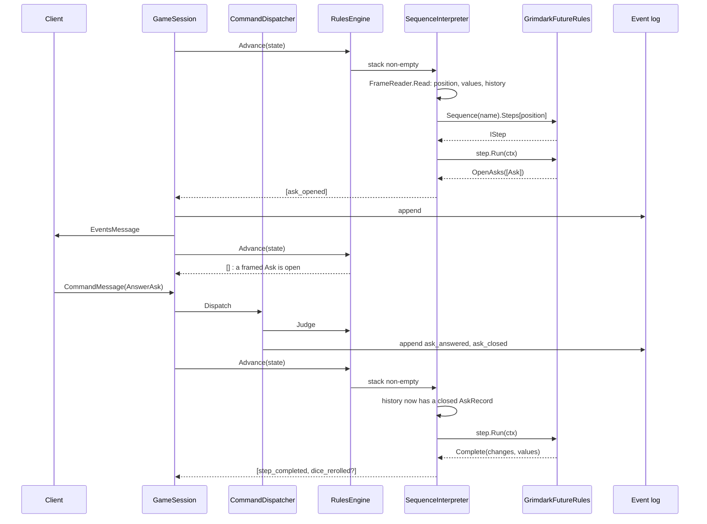
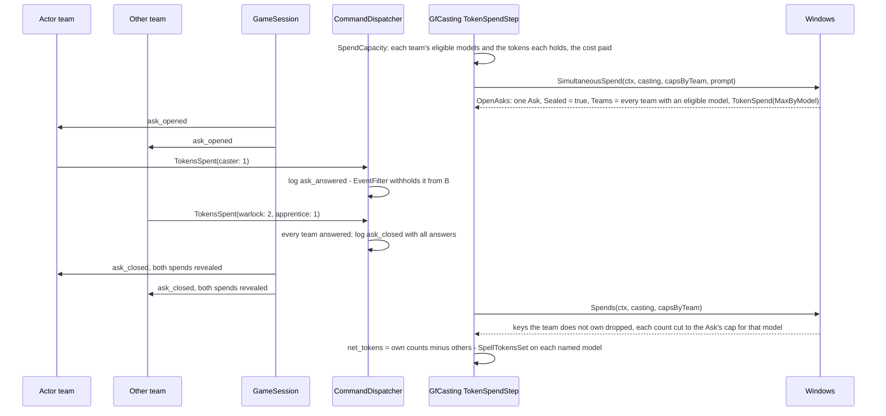
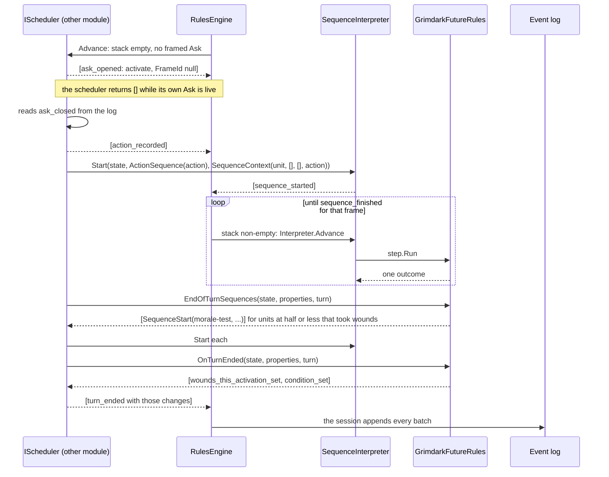

# Interpreter and effects

The rules engine's resolution half, built only in `server/game/`. It contains the pinned
`Properties` set loaded from eight Postgres tables, a counter-based roll primitive over the
game's stored seed, the effect grammar's two passes, a generic sequence interpreter whose
frames are rebuilt from the event log on every call, and Grimdark Future's sequences behind
`IGameRules`. It supplies the one `IRulesEngine` the game server skeleton left inert. It shares
that engine with the scheduler module through `Engine.IScheduler`.

Nothing about resolution is stored: not the frame stack, not the step's position, not the dice
cursor. The RNG seed is read with the game's row and never written here. Every call to `Advance`
re-reads the effective log and reconstructs them. A step may therefore hold no C# local across a
suspension. Undo-by-replay, hydration and crash recovery are the same mechanism because of this.

## Scope

### In

| Directory | Contents |
| --- | --- |
| `server/game/Properties/` | `PropertySet`, `PropertySetDocument`, `PropertiesJson`, `IPropertiesStore`, `PostgresPropertiesStore`, `PropertiesSeeder` |
| `server/game/Content/` | `grimdark-future-core.properties.json`, the authored OPR core set, an embedded resource |
| `server/game/Dice/` | `IDiceSource`, `DiceSource`, `ScriptedDice`, `DiceCursor`, `RollPlan`, `Roller`, `RollOutcome` |
| `server/game/Effects/` | `Interaction`, `Conditions`, `LiveProperties`, `RollEffects`, `StatReader`, `Lookup` |
| `server/game/Interpreter/` | `Steps`, `FrameReader`, `StepContext`, `SequenceInterpreter`, `Windows`, `Battlefield` |
| `server/game/Engine/` | `RulesEngine`, `RulesEngineFactory`, `IScheduler`, `ISchedulerFactory`, `NoScheduler` |
| `server/game/Rules/GrimdarkFuture/` | `GfRules.Sequences.cs`, `GfNames`, `GfRolls`, `GfHooks`, `GfMoves`, `GfAttack`, `GfShooting`, `GfMelee`, `GfMorale`, `GfCasting`, `GfContainers` |

Modified, not created: `Rules/IGameRules.cs` (the interpreter's nine members), `Rules/IRulesEngine.cs`
(`GameState.RngSeed`), `Program.cs` (three registrations plus startup seeding),
`Session/ConnectionHandshake.cs` (one more exception in the hydrate catch),
`Tabletop.GameServer.csproj` (the embedded content), and the skeleton's `PostgresFixture`.

### Not in

- **The scheduler.** This module defines `Engine.IScheduler` and calls it. The scheduler module
  implements it. Whose turn it is, activation legality, deployment, phases and the round
  boundary all belong to it.
- **The socket, the session, the event log, the dispatcher and enforcement.** The skeleton owns
  them. This module returns payloads. It never appends, never broadcasts, and never emits
  `ask_answered` or `ask_closed`.
- **`Tabletop.Protocol` and `Tabletop.Content`.** Every event, command, Ask and state change is
  the contracts module's. The only addition asked of it is `StepCompleted.Values`.
- **Geometry.** `Tabletop.Geometry` answers every measurement. `Interpreter/Battlefield.cs` is a
  reader over the projection that calls it, and never re-implements it.
- **`libs/`.** No rules type leaves `server/game/`. The client receives the consequences of a
  rule, never a rule (`architecture.md` → What is actually shared).
- **A second ruleset.** 40k's core rules were read to falsify the interface, not to build it.
  Only `GrimdarkFutureRules` exists. Nine constraints bound what the generic half may assume.
- **The Army Forge content import.** The authored-document format is designed here and one core
  document written. Turning army-book spells and faction rules into documents is a later writer
  for the same format.
- **Buildings as targets, `Takedown`'s *resolved as if it was a unit of 1*, advanced casting's three
  optional modules, and the two extra effect durations the optional extra actions need.** Recorded,
  not built. A `Takedown` group does name the model its wounds land on (the plan's ruling 7); what is not built
  is resolving its shots against that model as a unit, so cover, `Blast`'s cap and the defence roll
  still read the whole target unit.

### Build order and prerequisites

`architecture.md` → Build order step 8, *resolution pipelines*, running alongside step 7, the
scheduler. Three modules must land first:

| Module | What this one consumes |
| --- | --- |
| Contracts | Every `EventPayload`, `Command`, `Ask`, `LegalSet`, `StateChange`, `Projection`, `Frame`, `EventApplier.EffectiveLog`, `StepCompleted.Values`, and `GameInfo.RngSeed` |
| Geometry | `Distance`, `LineOfSight`, `Cover`, `Movement`, `Bodies`, `Containment`, `Settling` |
| Game server skeleton | `IGameRules`, `IRulesEngine`, `IRulesEngineFactory`, `GameState`, `Actor`, `EngineResult`, `CommandDispatcher`, `Legality`, `InMemoryEventLog`, `PostgresFixture`, `GrimdarkFutureRules` as a `partial` |

Nothing of this module exists yet. The repository is at scaffold stage: only `client/` has code,
and `server/game/` is empty until the skeleton lands.

`IGameRules` gains members from two modules at once. The merged interface is written in full in
the skeleton plan. The scheduler module adds seven members and this one adds nine, each exactly
once. `TurnContext` and `Activation` are the scheduler's records, so this module's
`EndOfTurnSequences` and `OnTurnEnded` signatures require that module's Task 1 to have landed,
or those two records to be copied from it.

## Context



The module has no outward interface of its own. It is reached only through the skeleton's seam.

**Down to the log.** `RulesEngine.Advance(state)` is a pure function of `GameState`. It reads
`state.Projection` and `EventApplier.EffectiveLog(state.Applier.Log)` and returns
`IReadOnlyList<EventPayload>`. The session appends them and calls again until the list is empty
(skeleton Task 6). The engine holds no state between calls: no cached stack, no dice counter, no
open Ask. Hydration, undo-by-replay, reconnect and crash recovery are therefore one code path.
Every `Advance` walks the log. §Failure modes prices that scan.

**Sideways to `IGameRules`.** The generic half (`Properties/`, `Dice/`, `Effects/`,
`Interpreter/`, `Engine/`) may not name a stat, roll, action, condition or catalog entry.
Everything OPR is either a row in the pinned set or a member of `GrimdarkFutureRules`.
`InterfaceConstraintTests` reads the source files of those five directories and fails on the
strings `"hit"`, `"defense"`, `"Quality"`, `"Hold"`, `"shaken"`, `Tough`, `Transport` and their
kin. Two strings are whitelisted, in `Effects/StatReader.cs` only: `"Range"` and `"Attacks"`
(the plan's ruling 5).

**Sideways to the scheduler.** Both modules produce parts of one `IRulesEngine`. This one owns
`Judge`, `Execute` and the interpreter branch of `Advance`. The scheduler is called only when no
framed Ask is open and the frame stack is empty. It starts sequences through
`ISequenceStarter.Start`. Neither implements the other's interface. §Interfaces states the split
as a three-line decision procedure.

## Design

### The pinned `Properties` set

`Properties` is the data half of a ruleset: stat declarations, the action and roll rows an
effect can point at, and one catalog of named rules carrying their effects. `schema.md` makes it
eight tables. This module gives them three representations.

| Form | Type | Lives | Has ids | Has a hash |
| --- | --- | --- | --- | --- |
| Authored | `PropertySetDocument` | `server/game/Content/*.properties.json`, embedded in the build | no | derived |
| Stored | eight tables in the `management` schema | Postgres | yes, minted at seeding | `properties.content_hash` PK |
| Runtime | `PropertySet` | memory, one per hash per process | yes, read back | yes |



`effect` is one table for twelve kinds. Three columns serve a single kind each: `threshold`,
`cap_kind` and `replacement`. The self-reference carries nesting. `condition_value` exists
because one predicate can name a set: `Fast` applies to *Rush/Charge*. The `properties_hash`
column that every child table carries as part of its key is elided for width, as are the
`entry_name` and `condition_id` foreign keys. `schema.md` has them in full.

`PropertySet` mirrors the tables member for member. Every closed set is a C# enum whose wire
spelling is the check-constraint value under `ContentJson`'s snake_case policy.
`PropertySetTests` asserts that directly: `EffectKind.ModifyRoll` serialises as `"modify_roll"`,
`CapKind.ModelsInTargetUnit` as `"models_in_target_unit"`. `Effect.EffectiveAmount(int?
parameter)` is the one piece of behaviour on the row. `amount` is signed and keeps its sign when
the magnitude comes from the entry's `X`, so `AP(3)` is `Math.Sign(-1) * 3`.

#### Canonical hash and authored files

`architecture.md` → Rules as data, *How authored content reaches those tables*, names the mechanism.
This section is its design.

A set is authored as one JSON document under `server/game/Content/*.properties.json`, embedded in
the game server's assembly. The document has the eight tables' shape without ids.
`PropertiesJson.Canonical` serialises it with the lists whose order carries no meaning sorted
(`stats` by level then name, `actions`, `rolls` and `entries` by name, all `StringComparer.Ordinal`)
and the lists whose order *is* meaning left alone (an effect's `ordinal` is authored, and so is
the order of its children and conditions). `PropertiesJson.Hash` is `"sha256:"` plus 64 lowercase
hex over that. `PropertySetDocumentTests` pins the property that matters: reversing `entries` and
`rolls` does not change the hash, changing `name` does.

Consequences:

- **Editing a document produces a new set.** The hash changes, `SeedAsync` inserts new rows, and
  every game that pinned the old hash keeps reading the old rows. Undo-by-replay requires this.
  Content is therefore append-only: nothing updates a seeded row, and stale sets are never
  garbage-collected. §Failure modes takes that up.
- **Effect and condition ids are minted at seeding**, not authored. `Grant.EffectId` is stable
  within one database and not portable between databases. A grant in an event log refers to an
  `effect.id`, so restoring a log into an independently seeded database would dangle. Nothing in
  the design depends on portability today, and nothing warns about it either.
- **The hash covers content, so the same file seeds the same hash everywhere.**
  `PropertiesSummary.GameRules` from `GET /v1/properties` is therefore stable enough for the web
  app and the client to offer at game creation.

`PropertiesJson.Validate` returns a list of human-readable problems and `ToSet` throws
`InvalidDataException` listing them. It enforces what the database's foreign keys and per-kind
`CHECK` constraints enforce, at authoring time rather than at insert time. The rules: every
`targetRoll`, `targetStat`, `targetEntry` and `targetAction` resolves inside the same document;
`aggregation` is set exactly when `kind` is `model`; `cost` and `targeting` exactly when `kind`
is `spell`; `threshold` only on `roll`, `cap_kind` only on `multiply`, `replacement` only on
`replace_stat`; a `roll` effect has at least one child; the three relational predicates take no
subject; and a `spell` entry's top-level effect must be `add_hit` or carry `duration = once`.

That last rule is a reading, not a schema constraint. Spell effects read forty-eight real spells
and found *"always with one duration: once"*. Validating it makes an unexpected spell shape fail
loudly instead of applying nowhere.

A `roll_result` condition's `condition_value` rows are exactly two: the roll it reads, and `raw` or
`modified` (`schema.md` → A condition is a row, and its values are rows). `number` is the face.
`(condition_id, value)` is the primary key and carries no ordinal, so the loader re-orders those
two to put the roll name first, and `Validate` refuses a roll named `raw` or `modified`.

#### Store and seeder

```csharp
interface IPropertiesStore
{
    Task<PropertySet?> LoadAsync(string contentHash, CancellationToken ct);
    Task<bool> SeedAsync(PropertySetDocument document, CancellationToken ct);  // false: this hash already exists
}
```

`PostgresPropertiesStore` reads the eight tables and assembles the effect tree by
`parent_effect_id`, ordering siblings by `ordinal` then `id`. `InMemoryPropertiesStore` is what
every test outside `PropertiesStoreTests` uses. `PropertiesSeeder.SeedEmbeddedAsync` runs once at
startup from `Program.cs`, guarded off the `Test` environment so `WebApplicationFactory` tests do
not write to the shared database.

**The game server seeds** (the plan's ruling 1). It is the only process
that interprets the catalog, and the write is idempotent by content hash. Management is a second
process over the same database, and its `GET /v1/properties` lists the latest seeded set per ruleset and name. The two
processes are one system, so the seeding write needs no endpoint to pass through.

### The roll primitive

`architecture.md` says *RNG lives in server state as a seed*. Undo must reproduce the same dice,
so rewinding cannot be used to fish for a roll. The seed is `GameInfo.RngSeed`, written once when
management creates the game row and never written again. The cursor is counted from the effective
log and stored nowhere.



The seed is fixed for the life of the game and the cursor is a function of the effective log. An
undo rewinds the dice with everything else, and redoing the same action draws the same faces.

`DiceSource` is a counter-based generator: a SplitMix64 finaliser over `seed ^ (index * golden
ratio)`. Die *i* of a game is a pure function of `(seed, i)` with no sequential dependency.
`ScriptedDice(params int[] faces)` returns `faces[index % Length]` and ignores the seed. Every
sequence test uses it to script a whole engagement as one array of faces in draw order.

`RollPlan` is the settled roll: `Roll`, `Threshold`, `Modifiers`, `Convention`, `RequiredRaw` and
`RerollRaw`. `Threshold` is nullable because the roll-off has none. `NetModifier` sums the
modifiers, then clamps to `±Convention.ModifierCap` when the ruleset set one. OPR never clamps.
40k clamps hit and wound at ±1. Summing is generic and clamping is the ruleset's: constraint 4.
Success is `RequiredRaw is { } r ? Raw >= r : Threshold is { } t && Raw != AlwaysFails && (Raw ==
AlwaysSucceeds || Modified >= t)`, the two faces read from the convention. OPR's are 1 and 6 on every
roll (p.5). The `RequiredRaw` branch covers fatigue's *unmodified 6s*, rolls that are no test (a
spell's *"Roll as many dice as hits"*, Unpredictable's table roll) and 40k's critical hits, and is
why a die carries both raw and modified.

Every roll is recorded per die: `RollRecord(Guid Id, string Roll, int? Threshold,
IReadOnlyList<RollModifier> Modifiers, IReadOnlyList<Die> Dice, int? RequiredRaw)` with `Die(int Raw, int Modified,
bool Success)`. A reroll or `SetDice` re-judges a die under the record's own threshold, modifiers and `RequiredRaw`. **Replay applies these. It never re-derives them.** `GameRules` is unpinned C#,
so a threshold recomputed after a deploy could disagree with what the players rolled (resolution →
Rerolling does not break undo).

Three ways a die changes after it is drawn, each a distinct event:

| Origin | Payload | Draws a new die | Cursor grows |
| --- | --- | --- | --- |
| A property forcing a reroll (`Bane`) | `DiceRerolled` emitted by the step, after its `step_completed` | yes, once per matching die, never again | yes |
| A player's reroll command | `DiceRerolled` from `RulesEngine.Execute(RerollDice)` | yes | yes |
| A player's edit command | `DiceEdited` from `Execute(SetDice)` | no; the raw face is given and re-judged | no |

`RollOutcome.Successes/Failures/CountRaw` read a record back **as it now stands**, because the
applier folds replacements into the projection's copy. This is what rerolls-as-commands-between-steps
buys. With the wait setting on, a reroll of a block die between `roll-to-block` and `assign`
changes the number of wounds `assign` asks the defender to allocate, because `assign` reads the
record rather than a stored count.

One known inconsistency: `RequiredRaw` is not in `RollRecord`, so `RulesEngine.PlanOf` cannot
restore it, and a player's reroll of a fatigued hit die is judged as `Modified >= Threshold`.
`GfRolls.HitPlan` sets threshold 6 with no modifiers for that case, so the two agree by
construction, and `GfRolls.HitQuality` returns 6 for every model of a fatigued unit, so there is
one pool to keep aligned rather than one per Quality value. A comment holds that alignment in place, not a type.

### The effect grammar: two passes

An effect is a row saying what a named rule does. Twelve kinds cover Grimdark Future.
**Four of them act on other properties** rather than on game state: grant, suppress, modify a
parameter, suppress modifiers. Resolution is two passes for that reason. `Bane` deletes
`Regeneration` from the interaction and `Thrust` adds an `AP` that may not have been there, so which
properties are live and what their parameters are must be settled before anything is applied.



Pass one produces a value, `LiveSet`. Pass two is several readers over it, each answering one
question a step asks. There is no single "apply everything" call.

Pass one **skips any effect with a `roll_result` condition**, because those cannot be judged
before a die exists. They reappear in pass two through `LiveSet.Effects(side, kind, die)` and
`LiveSet.WithGranted`. `WithGranted` folds a per-die grant into a copy of the set for the block
roll that hit group produces, as `Rending`'s *unmodified 6s get AP(+4)* needs.

**Ordering is `Effect.Ordinal`, an explicit integer field, not registration order.** Restricting
modifiers to arithmetic would make them commute and remove the explicit priority scheme
`architecture.md` calls for, but across every rule in the book commutativity holds for one of
twelve kinds. Suppression and parameter-modification do not commute, and the rulebook orders
several by hand.
`Deadly` is *"resolved first"*. `Blast` applies *"after resolving other special rules"*. Every
enumeration in `LiveSet.Effects` and in `LiveProperties.Settle` is `OrderBy(Ordinal)`.

Two details inside pass one:

- **Aggregation is a field on the entry, not a predicate.** `Stealth` is *"units where all models
  have this rule"* and reads `all`. `Tough(X)` reads `none` and yields one `LiveProperty` per
  model. `Gather` computes the count of distinct models carrying the entry and applies
  `all | any | majority | none`. `majority` has no tie rule beyond `count * 2 > models.Count`;
  identity and enumerations fixes none.
- **A `unit`-kind entry on a model slot is the unit's rule.** Aggregation is declared exactly when
  the kind is `model`, so a `unit`-kind entry carries none and aggregation cannot answer for it.
  Import produces the shape two ways: a rule whose count is smaller than the unit, and a hero
  joined to another unit, whose rules all land on its slot whatever their kind. `Gather` and
  `Lookup.UnitHas` both read such an entry off the unit's definition, holder-less, so the effect
  pass and the name lookup agree. `Aircraft`, `Ambush` and `Scout` are the entries it can be.
- **Duplicates collapse unless the entry takes a parameter** (p.13: instances of the same rule
  do not stack unless it has (X)). The grouping key is `(entry name, model id when aggregation is
  none, weapon *name* when it is a weapon rule, grant id)`. It keys on weapon name rather than
  weapon id, so three Lances in a group contribute one `AP(1)` rather than three.

`EffectDuration` is spell effects → Duration. `interaction` covers every core rule. `once`
means applying the effect writes a grant onto its target instead. A grant is
`Grant(Id, EffectId, EntryName, CasterUnitId, RemainingUses)` on the unit. It is a fourth in-play
store beside the action record, conditions and placement: rebuilt from the log, editable from
the menu, read by both passes through `Lookup.UnitProperties` and by `GameRules`' name checks
through `Lookup.UnitHas`. A grant's parameter is read from its effect's `amount` in the pinned
set by `EffectId`. The grant row carries no parameter, so grant behaviour depends on the id
stability described above. Consumption belongs to the consuming step:
`RollEffects.ConsumeGrants` emits a `GrantRemoved` for every granted instance whose entry
contributed a modifier to the plan.

The twelve kinds, the eight predicates, the two-pass code in detail, and the worked rows for
`AP`, `Stealth`, `Impact`, `Bane`, `Rending`, `Blast` and `Unstoppable` are in
[the effect grammar](effect-grammar.md).

### The resolution stack

A game in play has a **resolution stack**: frames, one per sequence in flight. A frame is the
sequence's name, the `SequenceContext` it was invoked with, its position, and the values its
completed steps produced.

**The stack is never stored.** Four event kinds carry it: `sequence_started`, `step_completed`,
`sequence_finished` and `sequence_abandoned`. `FrameReader.Read(state)` rebuilds every
`FrameView` from `state.Projection.Stack` plus the effective log on every call.



A step's entire memory is derived. Its position, the parameters it settled, the Asks it opened
and the children it pushed all come out of the log window since it last completed. There is no
per-step schema.

**A stack, not a call stack.** A C# continuation cannot be serialised, so an async rendering of
these sequences cannot be durable state, cannot survive hydrate-from-log, and cannot be replayed
for undo. Three standing decisions rule it out at once. The cost is the module's dominant
ergonomic burden: **a step holds no C# locals across a suspension**. Every `IStep.Run` opens by
re-reading its own history to work out where it is. `GfMoves.MoveStep` and `GfMelee`'s `fight`
step show the pattern: a chain of `if (ctx.History.LastClosed() is { } closed)` and
`if (ctx.History.Children.Count > 0)` guards in place of `await`.

Two details in `FrameReader` are load-bearing:

- **Position is completed steps minus repeats.** A repeating step logs a second `step_completed`
  with the same name, so `Sequence`'s constructor refuses a sequence that lists one name twice in
  a row. That invariant is what makes "same name as the previous completion" mean "repeat" rather
  than "next step". The check is an `ArgumentException` at construction, so a ruleset bug fails
  at first use of `GfRules.Sequence(...)` rather than mid-game.
- **History is depth-1.** `History` counts nesting with a `depth` counter so a grandchild
  sequence does not appear as this frame's child. `ChildRecord` order is push order. *"The k-th
  chosen reaction is the k-th child"* is how a re-run window step knows which reactions it has
  already pushed.

#### Step outcomes

A step ends one of five ways. Action sequences → A step ends one of four ways lists completing,
asking, pushing and opening a window. Opening a window is not an outcome here: `Windows.Run`
returns an `OpenAsks` or a `Push`, so a window is built out of those two. The other two are
`Finish`, which completes a step and ends the sequence early, and `Repeat`, which completes a
step and runs it again.



Repeat and complete emit the same payload and differ only in whether the position advances. The
log distinguishes them by the name of the previous completion.

| Outcome | Type | Payloads | Frame afterwards |
| --- | --- | --- | --- |
| Complete | `Complete(Changes, Values?, Repeat = false)` | `step_completed`, then any forced `dice_rerolled`, then `sequence_finished` if it was the last step | position + 1 |
| Repeat | `Complete(..., Repeat = true)` | the same, never `sequence_finished` | same position, empty history |
| Finish | `Finish(Changes, Values?)` | `step_completed` then `sequence_finished` regardless of position | gone; the remaining steps never happen |
| Ask | `OpenAsks(IRL<Ask>)` | one `ask_opened` each | suspended until every Ask is closed |
| Push | `Push(Sequence, Context)` | `sequence_started` for the child | suspended; the step runs again and sees a `ChildRecord` |

`Finish` is what a charge whose targets have all gone out of reach does (p.7: *if being within charge
distance becomes impossible (due to killed models, special rules, etc.), then the unit may complete
its move in any direction and ends its activation*; a charge with no target in reach is never offered,
because `GfMelee.ChargeTargets` gates it in `ActionsFor`) and what a `Shaken` unit's `shoot-or-not` does. `Repeat`
is what a move step's next segment does after a mid-move cast. A step that repeats must advance
its own state, or it loops forever emitting `step_completed`. `GfMoves.MoveStep` guards this with
an explicit `Values["phase"]` machine. `GfContainers.WreckTestStep` guards it with
`Frame.Value("dangerous_dice") > 0`. There is no interpreter-level loop bound.

`StepCompleted.Values` is a flat `IReadOnlyDictionary<string, int>`: attacks counted, a capped
hit multiplier, extra hits, a distance in tenths of an inch, a token spend, who lost. There is no
schema per step kind, one flat map (contracts → Event inventory). It buys two things. A later step or a nested frame reads a settled
parameter without re-deriving it. A reroll between steps changes what the next step reads, which
is the record, without changing what was settled, which is the value. The cost is untyped string
keys with no registry. `dangerous_dice`, `net_tokens`, `phase`, `hits`, `hit_multiplier`,
`distance_used_tenths`, `place_1..place_n` and `loser` are conventions held in `GfNames`' vicinity
and in prose, not in a type.

**Abandonment** is an ordinary logged command handled by the skeleton's dispatcher, not by this
module. It pops the frame and everything above it. The dispatcher closes the popped frames' Asks
before `sequence_abandoned`. **Applied effects stay applied. Unapplied steps never happen.**
There is no rollback and there are no inverse events, because nothing recorded is an invariant.
Players fix what they dislike from the menu, or undo past the whole sequence by replay. A step
that observes an abandoned child treats it the same as a finished one. `ShootOrNotStep` and
`DisgorgeStep` both read `Finished || Abandoned`.

**Confirm gates.** When `game.waits_between_steps` is on, every step boundary past position 0 is
a gate. The interpreter opens its own `Ask` with question `AskQuestions.Confirm` and a
`Confirmation` legal set, addressed to the acting unit's team. Pausing is an Ask, so confirming
is answering it, and there is one input path rather than two.

A frame with **no actor and no parent** is gated at every boundary past position 0 whatever
`game.waits_between_steps` says, and its gate is addressed to **every team** in `Info.Teams`. The
roll-off is the only such frame. Nothing else holds its log open: with no actor there is no team
to address, and with no parent there is no enclosing frame left on the stack once it finishes, so
its rolls would be out of reach of `RerollDice` and `SetDice` forever. Every team has the same
claim on a roll that fixes turn order for all of them, so the Ask carries all of them. It is
unsealed, and the dispatcher closes an unsealed Ask on the first answer, so any team releases the
gate. Waiting for all of them would need a sealed Ask, which exists to withhold and reveal
answers, and would make the first round wait on every team being present.

An **actorless nested** frame stays ungated, which is the terrain-wounds `deal-wounds` case. Its
`assign` opens the defender's Ask, so the frame is already suspended and its dice are already
editable, and the target's team would be the addressee if a gate were ever wanted there.

The gate on the roll-off is the plan's ruling 8. `GfRolls.RollOffSequence` has a second step,
`order`, so the gate has a boundary to sit on and an edit made at the gate is read back into the
order.

### Asks, windows and the simultaneous token spend

An Ask is addressed to a **team** and carries a question name and a server-computed `LegalSet`.
It is the only way input enters resolution. The interpreter never emits `ask_answered` or
`ask_closed`. The dispatcher does, and the interpreter reads `ask_closed` back out of the log to
resume. What the legal set means is enforcement's business, not this module's: under `strict` an
out-of-set answer is refused, under `warn` it is accepted and logged with a warning, under
`silent` accepted. Every step must therefore tolerate an answer outside its own legal set.
`Windows.Run` reads `if (ask.Single is not Chosen chosen) continue;` and `AssignStep` applies the
defender's allocation as given.

Every Ask this module opens is **framed** (`Ask.FrameId` non-null). Every Ask the scheduler opens
is unframed. That bit splits `Advance` between the two.

A **window** is an Ask about interrupting. A step declares a named point and
`IGameRules.ReactionsAt(state, properties, point, frame)` says who can react there. **If nothing
can react, no window opens.** `Windows.Run(ctx, point)` returns `null` when the window is done,
so a step can write `if (Windows.Run(ctx, point) is { } outcome) return outcome;` and fall
through. Teams are asked one at a time in `Windows.ReactionOrder`. A chosen reaction is pushed
before the next team is asked, so reactions resolve in turn order after the actor.
`ReactionOrder` is **the one reaction-ordering policy** in the system. It consults
`IGameRules.OrderReactions` first. Otherwise it rotates `Projection.Scheduler.Order` to start
after the actor's team, appends teams the order does not list in `Info.Teams` order, restricts to
the reacting teams and drops teams in `Projection.Scheduler.Passed`. The scheduler module defines
no ordering type of its own.

A window opens two ways, with one suspension. **Offered** windows go to teams other than the
actor. OPR core barely uses them. 40k's Fire Overwatch pushes a whole shooting sequence into an
enemy move step. **Invoked** windows are opened by the actor inside its own step. That is
casting, *at any point before attacking*, mid-move included.

One variant is **sealed and simultaneous**, for one OPR rule: casting's token spend (p.13).
Every eligible team answers the same Ask concurrently and the answers are withheld until the
window closes.
Sequential reveal online would hand the last mover an advantage the tabletop does not. This is
the only use of the per-player filtered event streams `architecture.md` kept available. The
skeleton's `EventFilter.ForViewer` does the withholding.

`TokenSpend` carries **a cap per model**, `MaxByModel`, and `TokensSpent` answers a count per
model: p.13's spend is a per-model eligibility test and the player chooses which of its own models
pays (the plan's ruling 14). One map covers every addressed team, because an Ask has one legal set for all
of its teams, and it hides nothing, since `ModelInPlay.SpellTokens` is in every client's
projection. There is no total anywhere: a team's maximum is the sum of its own entries, so nothing
clamps one and no Ask carries another team's pool (the plan's ruling 6).

Two checks are the spend step's rather than `LegalSetMembership`'s, which has no state to answer
them with: a key belongs to the answering team, and a count is within that key's cap. The
precedent is `MoveRegion`, whose membership checks model ids and leaves distance to the move step.
Both are applied whatever the enforcement setting, because spending tokens a model does not hold
would drive its counter below zero.

### The engine seam

```csharp
// Engine/RulesEngine.cs
IReadOnlyList<EventPayload> Advance(GameState state)
{
    if (state.Projection.OpenAsks.Values.Any(a => a.Ask.FrameId is not null)) return [];
    if (state.Projection.Stack.Count > 0) return Interpreter.Advance(state);
    return scheduler.Advance(state, Interpreter);
}
```

The division of labour: **a framed Ask blocks everything, a non-empty stack is the interpreter's,
an empty stack is the scheduler's.** The scheduler is still called while one of its own unframed
Asks is open. It returns `[]` for one that is live. It closes, with an empty answer list, one
that a menu edit superseded. That is the only `ask_closed` the engine ever writes.

`Judge` and `Execute` handle exactly three commands and refuse everything else:

| Command | `Judge` | `Execute` |
| --- | --- | --- |
| `RerollDice(FrameId, RollId, DiceIndices)` | `Legal` when the frame is on the stack and the roll is in one of its completed steps | `DiceRerolled` with the named dice (all when empty) redrawn under the record's own threshold and modifiers |
| `SetDice(FrameId, RollId, Dice)` | the same | `DiceEdited` with each die re-judged from its new raw |
| `AddModifier(FrameId, Roll, Amount)` | `Legal` when the frame is on the stack and `properties.HasRoll(roll)` | `ModifierAdded(frame, roll, new RollModifier("player", amount))` |
| anything else | `Illegal` | `RefuseCommand(Unknown, ...)` |

These are the same operations abilities use, with a different actor. Resolution's rule is that
automation and the menu write the same fields. Undo never made dice unchangeable. It makes
changing them visible and logged with a name.

`RulesEngineFactory` replaces the skeleton's `InertEngineFactory`. It loads the set by
`game.PropertiesHash`, caches by hash behind a lock, and throws `PropertiesNotFoundException`
when the hash is not seeded. `ConnectionHandshake` catches that and closes the socket with
`1011 cannot hydrate this game` rather than faulting the process. `Create` is synchronous because
`IRulesEngineFactory` is, so the load blocks a hydration on a database round trip. That costs one
round trip per game per process, and the cache reduces it to one per hash.

### Battlefield reader and the two model readings

`Interpreter/Battlefield.cs` is the only place the module asks geometry a question. Every method
takes ids and returns a measurement. What a measurement means is `GrimdarkFutureRules`'.
`Placed` returns `null` for a model that is not `OnTable`. `At(state, modelId, placement)` builds
a body at a placement it does not hold yet. That is how a destination is judged before it is
applied, and the only way to place an occupant, which has no position of its own.

**Containment answers three ways, not two.** Filtering to models that have a position gets half
of p.14 right and half wrong. The rulebook says units inside a transport have no line of sight
to the outside. It also says units inside **can** target other units inside, and the transport
itself.



Containment is asked **before** any measurement. `null`, not `false`, is the ordinary case, so
every caller must handle a nullable answer. `GfAttack.EligibleModels` and
`GfCasting.SpellTargets` both short-circuit on it.

The *target the transport itself* half of p.14 is not reachable in a game. `GfShooting.ValidTargets`
offers enemy units only, a unit's own container is friendly, and no unit may enter an enemy
container. The branch is written for faithfulness to p.15 and is reached only from a
menu-written state.

**A unit's models mean two different things.** Game flow says a model is in exactly one of three
places, and that *"a transported model is very much in play"* while the shelf is out of play. One
predicate doing both jobs makes a carried unit read as destroyed, and leaves its occupants unable
to be wounded when their transport is.

| Reader | Means | Used by |
| --- | --- | --- |
| `Lookup.LivingModels` | models **with a position**: on the table | every distance, sight line, cover and blocker question; `EligibleSpenders` on both ends, the caster's own model excepted |
| `Lookup.AliveModels` | models **still in play**: on the table or inside a container | how many models a unit has, who may be assigned a wound, whether a unit is destroyed, at-half-or-less, `Party.Whole`, the morale test |

Every use of either is a decision. Getting one wrong produces a bug that only shows up with a
transport on the table.

**Cover is a fraction of the unit, and the fraction is the ruleset's.** p.11 says *"If the majority
of models in a unit are fully inside a piece of cover terrain or behind a sight blocker"*: one
majority over the models that pass either test. A majority is strictly more than half, so five of
ten is not one. A model counts when it is in cover terrain, when it is screened (every attacking
model with a clear line to it has a sight blocker along that line), or when no attacking model sees
it. The terrain test follows the book's wording for the unit's size: the whole base inside a `Cover`
volume for a multi-model unit ("fully inside"), the base centre for a single-model unit ("mostly
inside"), sized by starting size. `Battlefield` lists models and never judges:
`ModelsInCoverTerrain(state, unit, wholeBase)` and `ModelsBehindSightBlockers(state, unit,
attackerModels)`. `GfRolls.InCover` takes the union and compares its size against the fraction,
because a fraction is a ruleset number and no ruleset number belongs outside `Rules/GrimdarkFuture/`.

The sight test reads every eligible attacker model, not one of them, so the answer does not depend
on the order models sit in the army snapshot. Its blockers are terrain and every unit except the
target's and the attacker's own: p.11's other units *"are sight blockers that can provide other
units with cover"*, so a model takes no cover behind its own unit, and the attackers ignore their
own (p.8). p.14's Indirect *"ignores cover from sight obstructions"* drops the sight test only; the
terrain test stands. Blast's *"Ignores cover"* (p.13) suppresses the whole modifier in the roll.

### The generalisation budget: nine constraints

Only OPR's `GameRules` is built. Nine constraints derived from Warhammer 40,000's core rules stop
the generic half from becoming OPR-shaped. Each names the 40k rule that falsifies the OPR-shaped
assumption. `InterfaceConstraintTests` pins seven of them mechanically. Constraints 5 and 8 are
pinned by the shape of Tasks 8 and 9 rather than by an assertion.

| # | Constraint | Falsified by | Where it lives | Pinned |
| --- | --- | --- | --- | --- |
| 1 | Roll count and names are data | 40k has Hit, Wound, Save and Feel No Pain against OPR's two | `roll` rows; `RollDefinition` | source scan of five directories |
| 2 | Threshold derivation is a function, not a stat reference | 40k's wound roll is a Strength-against-Toughness lookup | `RollSpec.Threshold : Func<LiveSet, Side, int?>` | the property is a `Delegate` |
| 3 | Dice conventions are per roll | Battle-shock is 2D6 >= Leadership | `RollConvention.Sides` | every OPR roll is `(6, null, 1, 6)`; no `Six`/`D6` member on `Roller` |
| 4 | Modifier caps are per roll | 40k clamps hit and wound at ±1; OPR never clamps | `RollConvention.ModifierCap`, applied after summing | `RollPlan.NetModifier` under both conventions |
| 5 | Granularity: pooled or per attack | 40k allocates per attack, with pooling legitimised by Fast Dice Rolling | `Roller.Roll(frameId, plan, count)` plus a later step consuming the pool | by shape |
| 6 | Damage reads a capacity, not a rule name | `Tough(X)` in OPR, the W stat in 40k | `Lookup.ModelParameter(state, modelId, "Tough") ?? 1` inside `GfAttack` only | `Tough` absent from the generic half |
| 7 | Morale is a sequence with ruleset-owned triggers | 40k sweeps below-half units in the Command phase | `morale-test` plus `IGameRules.EndOfTurnSequences` | no step named `morale` in `attack-sequence` or `resolve-hits` |
| 8 | Interrupts push whole sequences from the non-active team | Fire Overwatch is a shooting sequence inside an enemy move step | `Windows.Run` returning `Push` | by shape |
| 9 | Who answers an Ask differs per ruleset | 40k's defender allocates attacks; OPR's removes casualties in any order | `Ask.Teams`; `StepContext.Ask(..., Guid team, ...)` | `SequenceInterpreter.cs` contains neither `Attacker` nor `Defender` |

The tests are source-text scans and read comments too, so a doc comment in a generic folder names
no catalog entry. They are also the only mechanism available for "this directory must not know that word".

### Grimdark Future's sequences

Fifteen sequences sit behind `IGameRules.Sequence(string)`. **Shooting and melee are one
four-step attack sequence invoked from two contexts.** Pages 8 and 9 give the same four steps
word for word: Determine Attacks, Roll to Hit, Roll to Block, Remove Casualties. So there is one
`attack-sequence` (`determine-attacks`, `pick-target-model`, `roll-to-hit`, `resolve`) pushing
one `resolve-hits` (`roll-to-block`, `deal`) pushing one `deal-wounds` (`assign`, `disgorge`). Shooting, melee,
`Impact` and a spell's hits all enter that chain at different depths. Targeting and morale are
not steps of the pipeline: targeting is the action's Ask, morale a trigger of its own.

The full catalogue is in [Grimdark Future's sequences](opr-sequences.md): the four actions, the
move step's phase machine and its casting checkpoint, charge and melee's seven steps, casting's
five, the morale test, dangerous terrain's three triggers, and a destroyed container disgorging
what it held.

## Key decisions

### Contested decisions

| Decision | Reason | Rejected alternative | Source |
| --- | --- | --- | --- |
| Ordering is an explicit `ordinal` field on the effect | The rulebook orders effects by hand, and four of twelve kinds act on other properties, which does not commute | Registration order, on the grounds that arithmetic modifiers commute, which holds for one kind of twelve | effect grammar → This restores explicit ordering |
| Enforcement has three positions, `silent \| warn \| strict` | `strict` refuses an out-of-set Ask answer or an illegal command, `warn` accepts and logs it, `silent` accepts it. The menu's edits are accepted under every setting, being the override path and logged with an actor | Identity and enumerations' boolean: *the server warns, or it says nothing* | whole-design review → Five rulings, 1 |
| A spell's hits are rolled as a hit roll that cannot fail | *"Roll as many dice as hits to see if on-rolls-of-6 effects trigger"* needs real dice | Action sequences' *spells skip the hit roll* | spell effects → Damage spells need nothing new; review → Contradictions fixed |
| A spell's target is a **set**, from four columns on the entry | Real spells are *"pick up to two friendly units within 12 inches"* | Action sequences' *Ask the target in line of sight*, which assumed one | spell effects → Target selection |
| A once-effect writes a **grant**, a fourth store on the unit | A grant carries three references, so it is not a condition. Conditions are names | Action sequences' *grants write a condition*; writing the rule into the unit's property list, which is the frozen snapshot's copy | spell effects → The grants store |
| Rolls are rows in `Properties`, not an enumeration | *What an effect can target must be data*; 40k's wound and save rolls would otherwise be a migration | `effect.target_roll` as a `text` check constraint of four OPR values | action sequences → Rolls become rows; schema → A roll is a row |
| Waiting between steps is a **game** setting; animation is a player's | Waiting changes what the server does and what the log records | Resolution's *both are set at game setup* | whole-design review → Five rulings, 3 |
| Containment answers three ways | A filter on *has a position* silently forbids the inside-to-inside targeting p.14 allows | Two-valued containment; a positional filter | game flow → Inside a container |
| `LivingModels` and `AliveModels` are different readers | One predicate for both jobs makes a carried unit read as destroyed | A single *is alive* predicate | game flow → Inside a container |
| `Counter` resolves before `Impact` | The book leaves the order ambiguous | Impact first | action sequences → Grimdark Future's sequences |

### Decisions taken where a spec was silent

| Decision | Reason | Rejected alternative | Source |
| --- | --- | --- | --- |
| Authored content is a JSON document per set under `server/game/Content/`, hashed over a canonical serialisation and seeded as rows at game-server startup, idempotently by hash | The interpreter is the only process that reads the catalog, and the two servers are one system over one database, so the seeding write needs no endpoint to pass through; this is the smallest mechanism | Management owning the seeder behind an admin endpoint or CLI verb; a migration per set | `architecture.md` → Rules as data; the plan's ruling 1 |
| A step's settled parameters are a flat `Values` map on `step_completed` | A later step reads a parameter without re-deriving it, and a reroll changes what the next step reads without changing what was settled | A payload schema per step kind | contracts → Event inventory |
| A fifth step outcome: complete and run again | A move takes a second segment after a mid-move cast, and one window per activation would allow only one spell | A separate *checkpoint* primitive; a sequence listing the move step twice | §Step outcomes |
| The RNG is counter-based: the seed is the game's stored `rng_seed`, the cursor the count of dice drawn in the effective log | The seed is written once at creation and never again, and no RNG state is stored, so an undo rewinds the dice with the log | Deriving the seed from the game id, which fixes it but leaves a simulator run no way to choose one; storing RNG state in the game record and rewinding it explicitly | `schema.md` → A game stores its dice seed |
| A property's own roll is a `RollRecord` named after the entry, with the effect row's threshold | Nothing targets it, so it needs no `roll` row, and `AddModifier` therefore cannot name it | A `roll` row per property that rolls | effect grammar → `Roll` nests |
| One sealed Ask to every eligible team, whose `TokenSpend` carries a cap per model and no total | An Ask has one legal set for all of its teams, and the caps reveal nothing: a model's token count is already in every client's projection. One Ask per team is what the dispatcher cannot hold, since a sealed Ask closes when its addressed teams have all answered, so the first answer would reach the last team | One sealed Ask per team, needing the engine to withhold answers until the last closes; a per-team maximum in the Ask, which the per-model caps make redundant | contracts → Ask inventory; the plan's ruling 6 |
| The player chooses which of its own models pays a team's token spend | p.13's test is per model and every token holder is itself a `Caster`, so a server-chosen payer spends tokens a player was keeping for that model's own spell. `TokenSpend.MaxByModel` and `TokensSpent.Counts` are maps keyed by model; `GfCasting.EligibleSpenders` supplies both the eligibility and the caps, so a model out of range or without a sight line is neither offered nor paid from. The caster's own model is an entry, capped at what the spell's cost left it | Nearest-first payer selection; one Ask per eligible model, for which the dispatcher has no sealed group; an `Allocation` over the team's models, which cannot express it because an `Allocated` must sum to its `Amount` and carries no per-target cap | the plan's ruling 14 |
| A `Takedown` group names the model its wounds land on, in `attack-sequence`'s `pick-target-model` step, and `deal-wounds` opens no allocation for it. `GfShooting.Groups` splits a takedown weapon type into one group per model, so the pick is per model | p.14 gives a Takedown an individual target and writes the clause as *"This model may pick"*. The step sits before `roll-to-hit`, because p.8 declares targets before any roll, and after `determine-attacks`, so a group with nothing in range never asks. Skipping the allocation is what skips the ordering, since p.15's heroes-last and its wounded-`Tough`-first among the rest decide that prompt's targets and nothing else. The entry carries no effects, so a takedown hits at the model's own `Quality` | Not modelling it; one pick per whole weapon type, which *"This model"* does not allow; resolving the group against that model as a unit of 1, which would also move cover, `Blast` and the defence roll | the plan's ruling 7 |
| The `remove_casualties` allocation is addressed to the target unit's team, and any member of that team may answer it | p.8 names the defending player, and the dispatcher already holds one answer per team, refusing a second with `NotPermitted` | Narrowing the Ask to the owning participant, which `UnitInPlay.ParticipantId` makes possible and which would put a participant grain on `Ask` and `TeamAnswer` for this one question, and reach the dispatcher, the client, the viewer's addressee panel and the simulator's `ComposedAnswers` | Task 12 |
| `EligibleForNextWound` defers heroes before it reads the `Tough` ordering, not after it | p.15 writes *heroes must be assigned wounds last, even if already wounded* as a parenthetical inside the continuation clause, so it is an exception to that clause rather than a rule beside it. Reading the two independently makes a wounded `Tough` hero the sole eligible target while unwounded models stand | The most-wounded-`Tough` pick over every living model, heroes included | Task 12 |
| A `spell` entry's top-level effect must be `add_hit` or `duration = once`, validated | Reading all forty-eight spells found nothing else; anything else would apply nowhere | Accepting it and silently doing nothing | spell effects → Duration |
| Transport destruction is its own sequence, `transport-destroyed`, one frame per occupant unit, pushed by `deal-wounds`' `disgorge` | p.15 places survivors *before removal*, so the container must still have a placement while they are placed | Shelving the container in `assign` and placing survivors relative to a remembered position | action sequences → Grimdark Future's sequences |
| `Effects/StatReader` may name `"Range"` and `"Attacks"` | `StatKind.Distance` and `StatKind.Count` need a *which* | `IGameRules.RangeStat` and `AttacksStat` as `StatRef` members | the plan's ruling 5 |
| `OneTryPerSpellScope = "activation"`, as a visible constant | The book is ambiguous and action sequences asks for flagged interpretations rather than silent guesses. A caster that failed a spell this activation may try it again in a later one | The round scope | the plan's ruling 2 |
| Every weapon group's attack counts, the defending unit's model count and p.11's cover majority are settled before any group fires, and no constant flags it | p.8 fires a unit's weapons simultaneously, so a group pushed later must not be shortened, capped lower, left blocking a lone joined hero, or shooting a unit out of cover by an earlier group's casualties. `fire-groups` records `attacks_<i>`, one `attacks_<i>_q<n>` per Quality value, `defender_models_<i>` and `in_cover_<i>`; `determine-attacks` reads them through `GfAttack.Pushed` and `GfAttack.ByQuality` and carries the model count and the cover fact onto its own frame, where `roll-to-hit` caps `Blast`, and `roll-to-block` reads p.14's Hero sunset and p.11's +1. Nothing branches on a flag, so a `false` constant would advertise a switch that does not exist | Recomputing per group; `RecomputeAttacksPerGroup = false` as a constant; leaving `Blast`'s cap live; `blast_cap_<i>` as a second key holding the same number under one rule's name | the plan's ruling 3 |
| A frame with no actor and no parent is confirm-gated at every boundary past position 0, whatever the wait setting, by one unsealed `Confirm` Ask addressed to every team | The roll-off is the only such frame, and nothing else keeps its log open, so its dice would never be reachable by `RerollDice`. Its result fixes turn order for every team, so every team is the addressee. An actorless nested frame stays ungated, since its own Ask already suspends it | Never gating an actorless frame; naming the roll-off inside the generic interpreter as an exception; a sealed Ask waiting for every team | the plan's ruling 8 |
| A unit cannot enter an enemy transport. `ContainersInReach` offers **friendly** containers only, while `InsideReach` implements p.15 as written | The rulebook's containment text is written for the same-army case (p.21). p.15's *target the Transport itself* is therefore unreachable, since valid targets are enemies and a unit's own container is friendly | Offering enemy transports; forbidding the inside-to-inside clause outright | the plan's ruling 9 |
| A caster inside a container may cast, modified by its own tokens and nobody else's | `ReactionsAt` reads `AliveModels`, so the window opens; `EligibleSpenders` stays positional for everyone but the caster, so no other model's tokens reach it | Barring it by reading `LivingModels` in `ReactionsAt` and `Casters`; keeping the caster out of its own spend, which p.13 does not require | the plan's ruling 10 |
| The disembark radius is `GfNames.ExitWithin = 6`, measured edge to edge from the container's base | Every other distance in the system is edge to edge | A 6-inch circle about the hull centre | the plan's ruling 11 |
| A survivor with nowhere legal to stand is destroyed | The rulebook does not cover the case. `PlaceSurvivorsStep` writes what `assign` writes for a casualty: wounds at capacity, the model to the shelf, the wounds on the unit's activation tally | Shelving them unwounded; leaving them inside a removed container; auto-placing them | the plan's ruling 12 |
| Cover is p.11's one majority over the union of the target unit's models in cover terrain, screened by a sight blocker, or unseen; Indirect drops the sight half | p.11's *"the majority of models in a unit are fully inside a piece of cover terrain or behind a sight blocker"* is one majority over the models that pass either test, and a majority is strictly more than half. A screened model counts because p.11 makes other units sight blockers that provide cover. `Battlefield` lists and `GfRolls.InCover` holds the fraction, since a fraction is a ruleset number | Two majorities, one per test; sight cover as fewer than half of the unit seen, which drops screened models; a boolean between two models | §Battlefield reader and the two model readings |
| `Hero`'s *must use the unit's Defense* needs no effect row, in either half | `GfRolls.DefensePlan` reads `Defense` at unit level while the target holds more than one model, and reads the surviving model's own slot `Defense` once the settled count is one, which for a slot without one is the unit's value again and so branches on no rule name. No effect row could have expressed the sunset: `roll-to-block` throws one roll per hit before `deal` assigns a wound to any model, so the threshold is chosen while no model is named, and the count has to be the frozen one rather than a live read | A `replace_stat` row restating the first half; a live model count, against the plan's ruling 3's *no live read of the target's size is left in the shooting path* | Task 3; the plan's ruling 13 |
| `Quality` and `Defense` are declared at `model` level as well as `unit` level, and the model-level `Quality` is read | A joined hero is a model of the unit it joined (the management plan), and it attacks at its own Quality and blocks on the unit's Defense until every other model is dead: p.4 defines a Quality test against *"the model's Quality value"*, the Hero rule overrides `Defense` alone, and its *may take morale tests on behalf of the unit* clause is meaningless unless the hero's Quality is its own. `StatReader.TargetNumber` resolves either level for a named model, `GfAttack` splits a group's attacks by the value each model brings and `roll-to-hit` rolls a pool per value, and `GfRolls.MoralePlan` takes the best of the unit's and every living `Hero` model's own; the plan's ruling 13 records the mechanism | Reading only the unit's, which makes the Hero rule's morale clause a no-op | Task 3; the plan's ruling 13 |
| A `unit`-kind entry on a model slot means the unit has the rule, read off the definition in both `Lookup.UnitHas` and `LiveProperties.Gather` | If the two readers disagree, `Gather` treating it as live for the whole unit through its `_ => true` arm while `UnitHas` answers false, a joined hero with `Ambush` is invisible to the scheduler's deployment set while its effects apply to the squad. The definition rather than the living models, because a unit-scoped rule does not lapse when the model carrying it dies, and `Ambush` and `Scout` are read before any model has a position. One model therefore grants the whole unit a unit-scoped rule | Answering false in both, which makes a joined hero's own `Ambush` and `Scout` do nothing and applies `Aircraft`'s effect row nowhere, with no diagnostic | Task 6; the plan's ruling 13 |

## Interfaces

### Produced for other modules

`Tabletop.GameServer.Engine`:

| Type | Members |
| --- | --- |
| `sealed class RulesEngine(IGameRules, PropertySet, IDiceSource, IScheduler) : IRulesEngine` | `SequenceInterpreter Interpreter`; `Judge`/`Execute` for `RerollDice`, `SetDice`, `AddModifier`; `Advance(GameState)` per the three-line procedure above |
| `sealed class RulesEngineFactory(IPropertiesStore, IDiceSource, ISchedulerFactory) : IRulesEngineFactory` | replaces `InertEngineFactory`; caches by hash; `PropertiesNotFoundException(string hash)` |
| `interface IScheduler` | `IReadOnlyList<EventPayload> Advance(GameState state, ISequenceStarter starter)`; **the scheduler module implements this** |
| `interface ISchedulerFactory` | `IScheduler Create(IGameRules rules, GameInfo game, PropertySet properties)` |
| `sealed class NoScheduler`, `sealed class NoSchedulerFactory` | the registration until the scheduler module replaces it |

`Tabletop.GameServer.Interpreter`:

| Type | Members |
| --- | --- |
| `interface IStep` | `string Name { get; }`, `StepOutcome Run(StepContext ctx)` |
| `interface ISequenceStarter` | `IReadOnlyList<EventPayload> Start(GameState, string sequence, SequenceContext)` returning `[sequence_started]`; `SequenceInterpreter` implements it |
| `sealed record Sequence(string Name, IReadOnlyList<IStep> Steps)` | throws `ArgumentException` on two consecutive steps sharing a name |
| `abstract record StepOutcome` | `Complete(Changes, Values?, Repeat)`, `Finish(Changes, Values?)`, `OpenAsks(Asks)`, `Push(Sequence, Context)` |
| `sealed record AskRecord(Ask, IRD<Guid, AskAnswer>?)` | `Closed`, `Single` |
| `sealed record ChildRecord(Guid FrameId, string Sequence, SequenceContext Context, bool Finished, bool Abandoned)` | |
| `sealed record StepHistory(IRL<AskRecord> Asks, IRL<ChildRecord> Children)` | `Waiting`, `LastClosed(string? question)`, `Confirmed`, `ClosedExceptConfirm` |
| `sealed record FrameView(Frame, int Position, IRD<string,int> Values, StepHistory History, FrameView? Parent)` | `Id`, `Context`, `Value(key, fallback)` |
| `static class FrameReader` | `IRL<FrameView> Read(GameState)`, bottom first |
| `sealed class StepContext` | `State`, `Properties`, `Rules`, `Frame`, `History`, `Projection`, `ActorTeam`, `TeamOf`, `Roll`, `Rolls`, `ForcedRerolls`, `Plan`, `Ask`, `SealedAsk` |
| `sealed class SequenceInterpreter(IGameRules, PropertySet, IDiceSource) : ISequenceStarter` | `Advance(GameState)`, `Start(...)` |
| `static class Windows` | `ReactionOrder`, `Run`, `SimultaneousSpend`, `Spends` |
| `static class Battlefield` | `Placed`, `At`, `InsideReach`, `Terrain`, `CanSee`, `Distance`, `Vertical`, `UnitDistance`, `ModelsInCoverTerrain(state, unit, wholeBase)`, `ModelsBehindSightBlockers(state, unit, fromModels)`, `TerrainUnder`, `Settle` |
| `static class Teams` | `Of(GameState, Guid unitId)`, `Others(GameState, Guid? team)` |

`Tabletop.GameServer.Rules`, the nine members added to `IGameRules` beside the scheduler's
seven:

| Member | Meaning |
| --- | --- |
| `Sequence Sequence(string name)` | throws `UnknownSequenceException` |
| `string? ActionSequence(string actionName)` | the sequence an `action` row starts; null for a name with none |
| `RollSpec RollSpec(string roll)`, `sealed record RollSpec(string Roll, RollConvention Convention, Func<LiveSet, Side, int?> Threshold)` | convention and threshold derivation, per roll |
| `string HitRoll { get; }` | the roll `ToHitPenalties` suppresses |
| `IRL<Reaction> ReactionsAt(GameState, PropertySet, string point, FrameView)`, `sealed record Reaction(Guid TeamId, string OptionId, string Label, string Sequence, SequenceContext Context)` | who may react at a window |
| `IRL<SequenceStart> EndOfTurnSequences(GameState, PropertySet, TurnContext)`, `sealed record SequenceStart(string Sequence, SequenceContext Context)` | OPR: end-of-activation morale tests |
| `IRL<StateChange> OnRoundStarted(GameState, PropertySet, int round)` | OPR: clear `fatigued`, grant `Caster(X)` tokens capped at 6; round 0 yields none |
| `IRL<StateChange> OnTurnEnded(GameState, PropertySet, TurnContext)` | OPR: `WoundsThisActivation` to 0; an idle activation, or an Aircraft's Advance, clears `shaken` |
| `IRL<Guid>? OrderReactions(GameState, Guid? actorTeam, IRL<Guid> reactingTeams)` | the order teams react in at a window; null takes the rotation of `Projection.Scheduler.Order`. OPR returns null |

Plus `GameState.RngSeed : ulong` on the skeleton's `GameState`, `unchecked((ulong)Info.RngSeed)`
from the game's stored seed, and `GfNames` as the one names class. `GfNames` declares the
scheduler module's names too: `Deployment`, `Scouts`, `Rounds` (a reference to
`SchedulerBase.RoundsPhase`), `Deploy`, `Scout`, `Ambush`, `Immobile`, `Aircraft`, `Artillery`
(added by the scheduler), `Caster`, `Tough`, `SetAside`. `Transport` is this module's own.

`Tabletop.GameServer.Properties`, `.Dice`, `.Effects` are consumed by the scheduler module only
through four names: `PropertySet.Actions` for the turn Ask's action rows, `Lookup.UnitHas` for
`Immobile`/`Artillery`/`Aircraft`/`Scout`/`Ambush` legality (so the grants store counts), `GfRolls.RollOffSequence`
by the name `FirstTeamDecision.RollOffNeeded` carries, and `ScriptedDice`/`InMemoryPropertiesStore`
in tests.

The roll-off's gate bounds what the scheduler may assume about it. It does not resolve in the
batch that started it, so the scheduler is re-entered only after the gate closes, and the order
sits on the `step_completed` named `order` (`GfNames.RollOffOrderStep`), not the one named
`roll-off`. The keys are `winner_ordinal` and `place_1 .. place_n`.

Ask questions a client may see, which the client-shell module renders from their legal-set
shapes: `move`, `shoot_or_not`, `declare_targets`, `takedown_target`, `remove_casualties`, `charge_target`,
`strike_back`, `disembark`, `cast`, `spell_targets`, plus the engine's `confirm`, `react` and
`spend_tokens`. Window kinds a player may mute: `before-attacking`, `casting`.

### Consumed from other modules

| From | Exact names |
| --- | --- |
| Contracts (`Tabletop.Protocol`) | `StepCompleted` with `IReadOnlyDictionary<string,int>? Values { get; init; }` and `CompletedStep.Values` copied by `EventApplier.ApplyTo`, **the one addition this module asks for**; `SequenceStarted/Finished/Abandoned`, `AskOpened/Answered/Closed`, `TeamAnswer`, `DiceRerolled`, `DiceEdited`, `DieReplacement`, `ModifierAdded`, `Undone`, `RollRecord`, `Die`, `RollModifier`, `Grant`, `SequenceContext`, `Location` (`OnTable`, `OnShelf`, `Inside`), `ModelRelocation`, every `StateChange`, `Ask`, `AskOption`, every `LegalSet` and `AskAnswer`, `AskQuestions`, `Projection`, `Frame`, `CompletedStep`, `OpenAsk`, `UnitInPlay`, `ModelInPlay`, `EventApplier.EffectiveLog`, `GameInfo.RngSeed : long` |
| Geometry (`Tabletop.Geometry`) | `Distance.EdgeToEdge`, `Distance.Vertical`, `LineOfSight.Check`, `Cover.InsideCoverVolumes`, `Cover.SightBlockersBetween`, `Containment.VolumesContaining`, `Containment.BaseFullyWithin(PlacedModel, PlacedModel, double)`, `Settling.SurfaceHeightAt`, `Bodies.AsBlockingVolume`, `Movement.Check(PlacedModel, Point2, double, IRL<WorldVolume> impassable, IRL<WorldVolume> difficult, double? cap, TableSize?)`, `Movement.VolumesCrossed`, `Footprint.IsValid(scale)`, `Table.IsValid` (for `DraftEditor.Degenerate`) |
| Skeleton (`server/game/`) | `IGameRules`, `IRulesEngine`, `IRulesEngineFactory`, `GameState`, `Actor`, `EngineResult` (`Emit`, `RefuseCommand`), `Legality`, `CommandDispatcher`, `RowMapping.EnumText/EnumFrom`, `IEventLog`, `InMemoryEventLog`, `PostgresFixture`, `RecordingClient`, `FixedAskEngine`, `GrimdarkFutureRules` as `sealed partial` |
| Scheduler | `TurnContext`, `Activation`, `ActivationOption.Idle`, `SchedulerBase.RoundsPhase`; and `SchedulerFactory` replacing `NoSchedulerFactory` in `Program.cs` |
| Management | `GET /v1/properties` already lists the seeded sets, and the Army Forge import's stat names `Quality`, `Defense`, `Range`, `Attacks` must match `grimdark-future-core.properties.json`. Its joined hero is a model of the unit it joined, which obliges this module in two places: the document declares `Quality` and `Defense` at `model` level as well as `unit` level, so a joined hero's `slot_stat` rows are declared ones, and a `unit`-kind entry on a model slot is read as the unit's rule in both readers. The hero attacks at its own Quality and blocks on the unit's Defense until it is alone, so the model-level `Quality` is read; `StatReader.TargetNumber` resolves either level for a named model and the split lives in `GfRolls.HitQuality`, `GfAttack.Attacks` and `GfRolls.DefensePlan` (the plan's ruling 13) |

Two geometry obligations are discharged by this module rather than by geometry. A dangerous
terrain test is owed `Movement.VolumesCrossed`, because p.11 says *"moves in or through"* rather
than "ends in". `Containment.BaseFullyWithin` implements p.15's *"fully within 6 inches of it"*,
and `GfMoves.ExitPlacement` is its only caller.

## Sequences

### One step, one Ask, one round trip



The step runs **twice** for one Ask: once to open it, once to consume the answer. Both runs read
the answer out of the log rather than from a local. A step that opens the same Ask again instead
of recognising its closed record loops forever. Every asking step therefore tests
`ctx.History.LastClosed()` before anything else. The `AdvanceAsync` loop calling until the batch
is empty is the skeleton's, so a step that always returns a non-empty batch hangs the session,
not just the frame.

### The sealed token spend



One Ask goes to many teams, withheld until all have answered, then revealed together. Ownership
of a key lives in the step, not in the Ask. If a team disconnects without
answering, the Ask never closes and the frame never resumes. The only exits are a menu edit or an
abandon. Nothing in this module times a sealed Ask out.

### An activation, end to end, across both modules



The interpreter owns `Advance` from `sequence_started` to `sequence_finished` and nothing else.
Morale reaches the log through a `GameRules` hook the scheduler calls rather than through a step
of the attack machinery: constraint 7. The handover is inferred from the log on each call, so an
event kind emitted in the wrong order desynchronises both modules with no error. A `turn_ended`
before the frame finishes is one such case. `SchedulerHarness` tests running the real
`RulesEngine` are the only pin on the integration.

### A wound landing, and a container disgorging

```mermaid
sequenceDiagram
    participant AS as attack-sequence frame
    participant RH as resolve-hits frame
    participant DW as deal-wounds frame
    participant Def as Defender team
    participant TD as transport-destroyed frame

    AS->>AS: determine-attacks: Values[attacks] and Values[attacks_q3], [attacks_q5] read off the pushing frame, Values[eligible_models] counted now
    AS->>AS: roll-to-hit: one RollRecord(hit) per attacks_q&lt;n&gt; - Values[extra_hits], [hit_multiplier] capped at defender_models, [granted_Rending_4]
    AS->>RH: resolve: Push
    RH->>RH: roll-to-block: one defense roll per grant group, cover as a base modifier off in_cover, the unit's Defense until defender_models is 1
    RH->>RH: cover: GfRolls.InCover over the target unit's models, seen from every eligible attacker model
    RH->>DW: deal: Push
    DW->>Def: assign: Allocation(eligible models, wounds)
    Def-->>DW: Allocated: counts per model
    DW->>DW: Deadly multiplies first - Regeneration rolls per wound - wounds_set - casualties to the shelf
    DW->>DW: an occupied container is NOT shelved: p.15 places occupants before removal
    DW->>TD: disgorge: Push, one frame per occupant unit
    TD->>TD: wreck-test: Values[dangerous_dice], then Push dangerous-terrain
    TD->>Def: place: MoveRegion with MoveContainment(ExitingId = wreck, ExitWithin = 6)
    Def-->>TD: Destinations
    TD->>TD: condition_set shaken - models_moved, or destroyed when there is no legal placement
    DW->>DW: disgorge re-reads Wrecks - shelves them when none holds anybody
```

The three shared sub-sequences chain by `Push`. `determine-attacks` reads counts `fire-groups`
settled before any group fired, one per Quality value, and carries down the defending unit's model
count it settled beside them, so a group that shoots after casualties rolls what it had when the
action started, `Blast` caps at what the target then held (p.13), and a joined hero is not left
blocking on its own `Defense` because an earlier group emptied the squad (p.14). A survivor the answer leaves nowhere legal to stand is destroyed rather than parked
off the table. The defender answers twice on one attack: allocation, then placement. The wreck outlives its own destruction until the last occupant is
out. The occupants' dangerous terrain test pushes a `deal-wounds` of its own, whose `disgorge`
would find the wreck the frame above it is emptying and push `transport-destroyed` for a unit
already being processed. The guard is a walk up `FrameView.Parent`, this frame's own ancestors
rather than the stack. A nested `deal-wounds` beneath a `transport-destroyed` therefore completes
`disgorge` immediately.

## State and data

### Persisted

One database, two schemas. This module reads both and has one write path of its own: the eight
`Properties` tables, once per hash, through `PropertiesSeeder` at startup. Every payload it
produces reaches `game.game_event` through the skeleton's session, never through this module.

| Table | Columns this module reads or writes | Who writes |
| --- | --- | --- |
| `management.properties` | `content_hash` PK, `name`, `game_rules` | `PropertiesSeeder` at startup, once per hash |
| `management.action` | `properties_hash`, `name`, `distance` | the same |
| `management.roll` | `properties_hash`, `name` | the same |
| `management.stat_definition` | `properties_hash`, `level`, `name`, `kind` | the same |
| `management.catalog_entry` | `properties_hash`, `name`, `kind`, `takes_parameter`, `aggregation`, `cost`, `faction`, `rule_text`, `target_side`, `target_grain`, `target_count`, `target_range` | the same |
| `management.effect` | `id`, `properties_hash`, `entry_name`, `parent_effect_id`, `subject`, `ordinal`, `kind`, `target_roll`, `target_stat`, `target_entry`, `target_action`, `target_quantity`, `target_result`, `target_modifier`, `amount`, `amount_from_parameter`, `threshold`, `cap_kind`, `replacement`, `duration` | the same |
| `management.effect_condition` | `id`, `effect_id`, `kind`, `subject`, `comparison`, `number` | the same |
| `management.condition_value` | `condition_id`, `value` | the same |
| `management.game` | `properties_hash` and `rng_seed` read at hydration; nothing written | management, which writes `rng_seed` once at creation, then the game server while `lobby`/`setup` |
| `game.game_event` | `(game_id, seq, kind, payload)`: every payload this module returns | the skeleton's `PostgresEventLog` |

`PostgresFixture.DeletePropertiesAsync(hash)` deletes the `properties` row and lets the seven
others cascade. The embedded core set is left in a developer's database on purpose.

### In memory

| Thing | Held where | Lifetime |
| --- | --- | --- |
| `PropertySet` | `RulesEngineFactory._cache`, keyed by hash | process |
| `GameState.RngSeed` | `unchecked((ulong)Info.RngSeed)` on `GameState` construction, the value stored on the game row | session |
| The frame stack | `Projection.Stack`, applied from the four sequence events | rebuilt by the applier; **never a row** |
| A frame's position, values and history | nothing; computed by `FrameReader.Read` on every `Advance` | one call |
| The dice cursor | nothing; `DiceCursor.DrawnSoFar` sums over the effective log | one call |
| A unit's grants, conditions, action record, wounds-this-activation, spell tokens | `UnitInPlay`/`ModelInPlay` in the projection | rebuilt from the log |
| An open Ask and its answers | `Projection.OpenAsks` | rebuilt from the log |

Nothing here stores a position, a wound, a token count or whose activation it is. A table growing
a *current* column means the event spine has been broken.

## Failure modes

### Ordering and lifecycle

| Hazard | What happens | What the design does |
| --- | --- | --- |
| A step returns a non-empty batch forever | The session's `AdvanceAsync` loop never terminates and the game hangs | Nothing generic. Every repeating step must advance its own `Values`; no loop bound exists. **The most likely way to hang a session.** |
| A step opens an Ask it already opened | Same hang, one call later | Every asking step tests `ctx.History.LastClosed()` first. `WindowTests` and `InterpreterTests` pin the pattern for the two generic cases |
| A sequence lists one step name twice in a row | `FrameReader` would read the second completion as a repeat and the position would stall | `Sequence`'s constructor throws `ArgumentException`, at first call of `GfRules.Sequence` |
| A sealed Ask never closes because a team is disconnected | The frame is stuck and every other team waits | Not handled. A menu edit or an abandon is the only exit, and nothing times out |
| A team disconnects mid-window | `Windows.Run` keeps returning the same `OpenAsks` | Same. Muting is client-side, so a muted window is still an unanswered Ask unless the client auto-passes |
| `GameRules` changes between deploys | An old log replays against a different step list or a different threshold function | Accepted. Replay applies recorded results, so thresholds and dice are faithful. A *step-list* change is detectable because `step_completed` names its step. `Properties` is pinned while `GameRules` is not |
| A menu edit puts state the rules call impossible under a running frame | A step reads a dead model on the table, a unit with no models, a container that is not a model | *Nothing is an invariant.* Steps read state defensively: `Lookup.AliveModels(...).Count == 0` finishes, and an `Inside` whose container is not on the table is dropped. This is a per-step obligation with no type-level help |
| An out-of-set Ask answer under `warn`/`silent` | A step receives an answer its legal set did not offer | Applied as given. Steps use `is not Chosen`/`?? []` guards, and `AssignStep` applies whatever allocation arrived |

### Reentrancy and containment

- **`disgorge` beneath `transport-destroyed`.** The one reentrancy in the module. An ancestor
  walk guards it rather than a stack scan, so the outer `disgorge` still works while its child
  runs. The two `GfContainersTests` cases cover the ordering: occupants tested, shaken, placed,
  wreck last. Neither asserts the guard itself. A third case would.
- **A model-grain spell cast from inside a container finds nothing.** `SpellTargets`' model-grain
  branch measures per model and an occupant has no position. Left open because no model-grain
  spell exists yet (the plan's ruling 10).
- **A grant on a model-grain target lands on the model's unit,** because the grants store is the
  unit's. If two models of one unit are granted the same rule, the instances collapse unless the
  entry takes a parameter. That is the intended behaviour, not a bug.

### Cost and accepted gaps

- **Every `Advance` is O(log length).** `FrameReader.Read` walks the effective log once per
  frame, `DiceCursor.DrawnSoFar` walks it again, `Conditions.Usage` walks it for a `Limited`
  weapon, and `GfCasting.TriedThisActivation` walks it for a caster. With the wait setting on and
  four players over several hours the log is thousands of events and `Advance` runs after every
  appended batch. No index, no memoisation, no incremental reader. The scan is the price of
  statelessness. `architecture.md` prices the workload as *turn-based, small state, no simulation
  tick*.
- **Content grows monotonically.** Editing an authored document seeds a new set. Nothing deletes
  the old rows, and no tool reports which hashes are unreferenced.
- **Effect ids are database-local.** A `Grant.EffectId` in an event log does not survive being
  restored into a differently-seeded database. Nothing detects it.
- **`GameRules` is unpinned**, so an ended game restarted after a deploy may replay differently.
  Accepted in identity and enumerations: the alternative makes every deploy a wall old games
  cannot cross.
- **Capacity is never enforced.** `Transport(X)`'s parameter is carried by the catalog entry and
  read by nothing. Game flow rules it explicitly.
- **The 1-inch separation and unit coherency are never enforced.** The client flags them.
  `MoveStep`'s `ignoreSeparation` changes only the Ask's prompt.
- **Missions beyond the core one do not exist here.** Objective seizing and the round-4 winner are the ruleset's `OnRoundEnded` and `JudgeAdvance`, not interpreter steps; players keep their own counters.

### Concurrency

One point of shared mutable state exists: `RulesEngineFactory._cache`, guarded by a `lock`.
Everything else is per-session, and the skeleton serialises a session's work through
`GameSession.RunAsync`, so no step ever runs concurrently with another step of the same game.
`PropertiesSeeder` races another process starting at the same moment. `SeedAsync` returning
`false` for an existing hash makes the loser a no-op, and the insert is by primary key, so the
worst case is a duplicate-key error on one of the two.

## Testing

Test-driven throughout, in `tests/Tabletop.GameServer.Tests`. Every task starts with a failing
xUnit test. Every OPR sequence has either the rulebook's own worked example or a constructed case
with scripted dice. 80 new tests are expected, which is the figure the plan's final step checks.

| Suite | Covers | Needs Docker |
| --- | --- | --- |
| `PropertySetTests`, `PropertySetDocumentTests` | lookups, `Comparison` over six operators, enum wire spellings, canonical hashing, validation, a spell's two admissible effect shapes | no |
| `CoreContentTests` | the authored OPR core set parses, validates and builds | no |
| `PropertiesStoreTests` | eight tables in, eight tables out; `SeedAsync` idempotent by hash | **yes**: `[Collection("Postgres")]`, `PostgresFixture` |
| `DiceTests` | counter-based determinism, the stored seed reinterpreted whole including a negative one, cursor arithmetic, `RequiredRaw` versus threshold, forced rerolls, undo reproducing dice | no |
| `LivePropertiesTests`, `RollEffectsTests` | aggregation, a `unit`-kind entry on a model slot read the same way by both readers, collapse-unless-parameter, the four pass-one kinds in ordinal order, plan modifiers, suppression, per-die grants, capped multipliers | no |
| `InterpreterTests`, `WindowTests` | the five outcomes, position and history from the log, confirm gates, reaction order, the simultaneous spend | no |
| `RulesEngineTests` | the three-line `Advance` split, the three dice commands, `PropertiesNotFoundException` | no |
| `GfRollsTests` and the seven `Gf*Tests` | every OPR sequence against the rulebook, including p.8's and p.9's worked examples | no |
| `InterfaceConstraintTests` | seven of the nine constraints, by source scan and reflection | no |

The harness is two classes. `Armies` builds a two-team playing game around one sequence.
`Sim.Gf(state, params int[] faces)` wraps it over an `InMemoryEventLog` with `ScriptedDice`,
exposes `Start`, `AskFor`, `Answer`, `Steps` and `Alive`, and drives the `Advance`/answer loop. A
whole engagement becomes an array of faces in draw order and a handful of assertions on
`step_completed.Values`. That works because the dice are counter-based and the log is the whole
state.

**What cannot be tested headlessly:** nothing in this module. It is Godot-free and has no client
dependency. The Postgres-backed store tests need
`docker compose up -d`. Every other test runs on an in-memory log and an
`InMemoryPropertiesStore`.

Notable gaps:

- **The constraint tests are source-text scans.** They will pass a violation written with string
  concatenation and fail on an innocent comment mentioning `Tough`. Constraints 5 and 8 have no
  assertion at all.
- **No test bounds a repeating step.** The hang described above is not covered.
- **No test covers a disconnect during a simultaneous spend or an open window.**
- **The two-module integration is covered only by the scheduler module's `SchedulerHarness`,**
  which runs the real `RulesEngine`. There is no test in this module that exercises the
  scheduler-to-interpreter handover.
- **Log-length cost is unmeasured.** No benchmark exists for `Advance` over a long game.
- **`DiceSource`'s distribution is unexamined** beyond uniformity in `1..sides`. `% sides` on a
  64-bit value has a modulo bias for six too small to matter, and nothing tests it.

## Rulings

Fourteen rulings, numbered as in the plan's Rulings. Each row gives the decision with its reason,
and what else it touches.

| # | Question | Ruling | Consequences |
| --- | --- | --- | --- |
| 1 | Who seeds `Properties`, and when? | The game server, at startup, from embedded documents, idempotently by hash. It is the only process that interprets the catalog, and the two servers share one database | None beyond `PropertiesSeeder`; `GET /v1/properties` lists what is seeded |
| 2 | *One try per spell*: activation or round? | The activation. `OneTryPerSpellScope = "activation"`, and `TriedThisActivation` scans from the activation's `sequence_started`, so a caster that failed a spell may try it again in a later activation | None |
| 3 | Are a later weapon group's attacks recomputed after an earlier group's casualties? | No. Counted once, before any group fires, because p.8 fires the weapons simultaneously. `fire-groups` records `attacks_<i>` and one `attacks_<i>_q<n>` per Quality value, `determine-attacks` reads them, and there is no `RecomputeAttacksPerGroup` constant. `Blast`'s cap and p.14's *until all other models have been killed* read the same frozen number: `fire-groups` records `defender_models_<i>` beside the counts, `determine-attacks` carries it down, and `roll-to-hit` and `roll-to-block` read it. p.11's cover majority is frozen the same way, or a group firing after casualties would judge the majority against what was still standing: `fire-groups` records `in_cover_<i>` through `GfAttack.InCoverAgainst` and `roll-to-block` reads it off the frame | The live count survives only as `GfAttack.Pushed`'s fallback for a push that recorded nothing, which is every melee push and every spell's hits |
| 4 | Catalog kinds and aggregation for the core rules no spec fixes | `Fearless` and `Regeneration` are `all` because 3.5.1 says *"a unit where all models have this rule"* outright. `Artillery` is `all` because its -2 is written per model and the hit roll is pooled, so `none` is not available, and `Stealth`, the same penalty at the same range band reading *"all models"*, is the precedent rather than cover's majority. `Fast`/`Slow`/`Flying`/`Strider`/`Immobile`/`Furious`/`Relentless` are `model` with `all`. The per-model rules are `none`. `Aircraft`/`Ambush`/`Scout` are `unit` | The three `unit` readings decide more than where import writes the name: such an entry on a model slot is the whole unit's rule, so one joined hero with `Ambush` sets the squad aside (ruling 13) |
| 5 | May generic `Effects/` know the two weapon stat names? | Yes, while OPR is the only ruleset. `StatReader` reads `"Range"` and `"Attacks"`, whitelisted by the constraint test | A second ruleset needs `IGameRules` to gain `StatRef RangeStat` and `StatRef AttacksStat`, and `StatReader` to take them |
| 6 | One sealed `TokenSpend` legal set for every team? | Yes. `TokenSpend` is a cap per model (ruling 14), so no per-team maximum exists to place in the Ask and no clamp derives one. One Ask serves every team, since a sealed Ask closes when its addressed teams have all answered and one Ask per team would reveal the first answer to the last | None; the Ask carries nothing per team |
| 7 | `Takedown`'s per-model target | Per **model**: p.14 reads *"This model may pick"*. `attack-sequence` has `pick-target-model`, a `PieceSelection(AliveModels(target), 1, 1)` to the attacker's team after `determine-attacks` and before `roll-to-hit`, and `deal-wounds` assigns that group's wounds to the named model without opening its allocation. `GfShooting.Groups` splits a takedown weapon type into one group per model, so each pick, hit roll and `deal-wounds` is one model's | *Resolved as if it was a unit of [1]* is not modelled, so cover, `Blast`'s cap and the defence roll read the whole target unit |
| 8 | Confirm gates and the actor | The gate goes to the acting unit's team where there is one, and a frame with no actor and no parent is gated at every boundary past position 0 whatever the wait setting, by one unsealed `Confirm` Ask to every team. The roll-off is the only such frame; its `order` step gives the gate a boundary to sit on, and its dice are editable from the menu like any other roll | A root frame *with* an actor and one step, which is the end-of-turn `morale-test`, pops before any boundary can gate it, so that die is unreachable once the frame is gone. Gating a root frame's terminal boundary would close that too, at the price of a confirm after every morale test |
| 9 | Can a unit embark into an enemy's transport, or an occupant target its own container? | No: a unit cannot enter an enemy transport, and only friendly containers are offered, since p.21 writes the containment text for the same-army case. `ContainersInReach` lists friendly containers only. p.15's *target the Transport itself* is consequently unreachable, since valid targets are enemies and a unit's own container is friendly | `InsideReach` keeps p.15's predicate as written, which only a menu-written state reaches |
| 10 | May a caster inside a container cast? | Yes, at what is in there with it. `EligibleSpenders` is positional on both ends for every model but the caster, which is admitted without measurement, so such a cast draws no tokens from anybody else and resolves at 4+ modified only by what the caster itself still holds | Barring it would mean `ReactionsAt` and `GfCasting.Casters` reading `LivingModels`, two lines. Either way the model-grain edge stays open |
| 11 | Where does the disembark radius come from, and is it edge to edge? | `GfNames.ExitWithin = 6`, p.15's `Transport` figure, edge to edge from the container's base as the table domain model's *"never centre to centre"* requires, so the region is the footprint grown by 6 inches. A garrisonable building has no automated exit (the geometry plan's ruling 8) | `Containment.BaseFullyWithin` is the only place the number is applied |
| 12 | A survivor with nowhere legal to stand | Destroyed. The rulebook does not cover the case, so removal is a ruling rather than a reading. `PlaceSurvivorsStep` writes the casualty changes `assign` writes, and reports `Values["destroyed"]` | None |
| 13 | A joined hero's quality and defence, and a `unit`-kind entry on its slot | Its own Quality, since p.4 tests against *"the model's Quality value"*; the unit's Defense until it is alone, since the Hero rule overrides `Defense` alone. The morale clause resolves as always-when-it-helps: the threshold is the better of the two while the hero lives. A `unit`-kind entry on its slot is the unit's rule. `StatReader.TargetNumber` resolves either level for a named model, `GfRolls.HitQuality` names p.4's value per model, `determine-attacks` and `fire-groups` carry an attack count per Quality value, `roll-to-hit` rolls a pool for each, and `GfRolls.DefensePlan` takes the model count `fire-groups` settled | A step may carry several `RollRecord`s, one per Quality pool, which the wire allows and which costs three readers a line each: the client's log-panel dice controls and its `Animator` readout, which cannot assume `Rolls[0]`, and the recording's log line, which prints a roll's threshold beside its name to tell two pools apart |
| 14 | Who chooses which eligible model pays a team's token spend? | The player. `TokenSpend.MaxByModel` offers a cap per model and `TokensSpent.Counts` answers per model, so a team distributes its spend across its own eligible models and each named model is deducted its own count. Every token holder is itself a `Caster`, so a server-chosen payer would spend tokens held for that model's own spell. `EligibleSpenders` supplies the caps as well as the eligibility, and includes the caster's own model: p.13 does not exclude it, it is admitted without measurement as a model of the caster's own unit, and its cap is what the cost left it, because the caps are built in `spend-tokens` after `pick-spell` deducted the cost | Nothing on the wire: an `Allocation` cannot express it, since an `Allocated` must sum to its `Amount` and carries no per-target cap, and the two token kinds are maps |

### Deferred

| Deferred | Recorded in |
| --- | --- |
| 40k's `GameRules`. The core rules were read to falsify the interface, not to build it | action sequences → Deliberately not decided; `architecture.md` → Where data stops |
| Generalising `GameRules` itself. Turn structure, action definitions, step order, scheduler policy and dice conventions stay C# | `architecture.md` → Where data stops, for now |
| The Army Forge content import that turns generated spell structure into documents | spell effects → Deliberately not decided; `architecture.md` → Rules as data |
| Advanced Casting's spell books, psychic pool and living spells (p.32–33) | action sequences → Deliberately not decided |
| Action Boosting, which needs percentages. A thirteenth effect kind, or a flavour on kind 1 | effect grammar → Still open |
| The two further durations the optional extra actions need (*until its next activation*, *this round*) | spell effects → Duration |
| Buildings as targets: terrain carrying stats and becoming event-driven state on the setup snapshot | game flow → Inside a container |
| Conflicts between two abilities reading the same result: whether both apply or one wins | resolution → Deliberately not decided |
| Whether effects ever need to nest more than one level; whether twelve kinds survive 40k; whether `majority` needs a tie rule | effect grammar → Still open; identity and enumerations → Deliberately not decided |
| What a dice expression stat looks like beyond existing as a `StatKind` | content values → Deliberately not decided |
| Deployment, phases, activation legality, the round boundary | the scheduler module |

## References

**Plan.** [`docs/superpowers/plans/2026-09-05-interpreter-and-effects/README.md`](../../superpowers/plans/2026-09-05-interpreter-and-effects/README.md):
19 tasks, `Interfaces → Produces`, 6 interface needs, 14 rulings.

**Specs**, in the order the plan names them:

- [action sequences (2026-09-03)](../../superpowers/specs/2026-09-03-action-sequences-design.md), primary: the stack, four of the five outcomes, one roll primitive, Asks, windows, OPR's sequences, the nine constraints, rolls become rows
- [resolution (2026-08-28)](../../superpowers/specs/2026-08-28-resolution-design.md): two orthogonal settings, a half-resolved pipeline as durable state, players roll their own dice, rerolling does not break undo
- [the effect grammar (2026-08-29)](../../superpowers/specs/2026-08-29-effect-grammar-design.md): twelve kinds, eight predicates, two passes, ordering as a field
- [spell effects (2026-09-04)](../../superpowers/specs/2026-09-04-spell-effects-design.md): duration, the grants store, target selection, faction rules as catalog entries
- [content values (2026-08-29)](../../superpowers/specs/2026-08-29-content-values-design.md): typed stats at three levels, a weapon on the model slot, effects are data
- [identity and enumerations (2026-08-29)](../../superpowers/specs/2026-08-29-identity-and-enumerations-design.md): the four catalog kinds, the Stealth case, every closed set, only `Properties` is pinned
- [game flow (2026-08-28)](../../superpowers/specs/2026-08-28-game-flow-design.md): the four in-play stores, the shelf, inside a container, nothing is an invariant
- [the scheduler (2026-09-04)](../../superpowers/specs/2026-09-04-scheduler-design.md), the seam only: the turn is an Ask, windows, the round boundary
- [the whole-design review (2026-09-04)](../../superpowers/specs/2026-09-04-whole-design-review.md), the newest and therefore authoritative: five rulings and the gaps filled

**Repository documents.** [`docs/architecture.md`](../../architecture.md) → The load-bearing seam,
Command / Event spine, Rules enforcement, Undo, Abilities, Rules as data, Pinning;
[`docs/schema.md`](../../schema.md) → `Properties` is eight tables, One `effect` table not twelve,
A condition is a row, Worked against the book; [`docs/data-model.md`](../../data-model.md).

**Rulebook.** Grimdark Future v3.5.1, read for this plan: p.7 (the four actions and their
distances), p.8 (shooting, weapon groups, two targets, the worked attack example), p.9 (melee
reach, striking back, fatigue), p.10 (who won, consolidation, morale, Shaken), p.11 (terrain:
cover, difficult, dangerous), p.13–15 (every special rule), p.21 (solid buildings), p.30–35 and
p.50 (the token economy's edges and the free-for-all roll-off).

**Sibling documents in this folder.**

- [The effect grammar](effect-grammar.md): twelve kinds, eight predicates, the two passes in
  detail, the grants store, and the worked rows.
- [Grimdark Future's sequences](opr-sequences.md): the fifteen sequences, the shared attack
  chain, the move step's phase machine, casting, and containment.

**Other module designs.** [`docs/design/game-server/`](../game-server/) is the module this one
extends. [`docs/design/scheduler/`](../scheduler/) is the one it shares an engine with.
Also [`docs/design/contracts/`](../contracts/), [`docs/design/geometry/`](../geometry/),
[`docs/design/client/`](../client/), [`docs/design/management-api/`](../management-api/),
[`docs/design/web-app/`](../web-app/).
