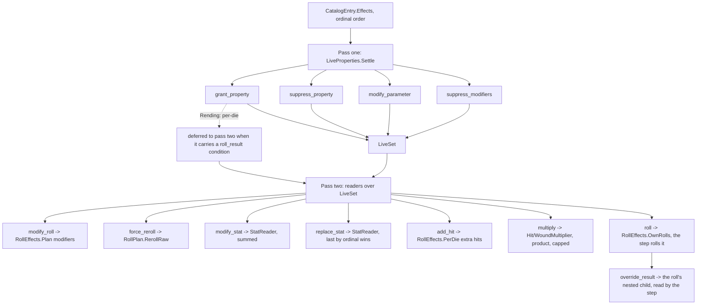
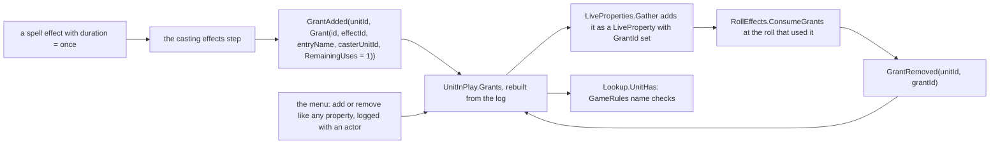

# The effect grammar — twelve kinds, eight predicates, two passes

A sibling of [design.md](design.md), which states the two-pass decision and its motivation. This
document is the detail: what each of the twelve effect kinds does in code, what each of the eight
predicates reads, which pass a kind belongs to and why, and how a grant is written and consumed.
Everything here lives in `server/game/Effects/` and may not name an OPR rule.

## The interaction, and the two sides

Every effect question starts from an `Interaction` — the subject of the two passes, and the only
place *which side is which* is decided.

```csharp
enum AttackKind { Shooting, Melee }
enum Side { Attacker, Defender }

sealed record Party(Guid UnitId, IReadOnlyList<Guid> ModelIds, IReadOnlyList<Guid> WeaponIds)
{
    static Party Whole(GameState, Guid unitId);                            // every model still in play, no weapons
    static Party Of(GameState, Guid unitId, IEnumerable<Guid> modelIds, IEnumerable<Guid> weaponIds);
}

sealed record Interaction(GameState State, PropertySet Properties, Party Attacker, Party? Defender,
    AttackKind? Attack, string? ActionTaken, double? RangeInches, IReadOnlyList<string> DefenderTerrain)
{
    Party Of(Side side);
    static Side Other(Side side);
    int Round { get; }
}
```

`Defender` is nullable: a morale test, a move and a dangerous terrain test are one-sided
interactions, and every predicate has to cope. `Party.Whole` uses `Lookup.AliveModels` — models
still in play, container occupants included — so an occupant unit's own properties are still
gathered when a wrecked transport wounds it.

`self` and `opponent` on the effect resolve against the *holder*, not against attacker and
defender. That is the effect grammar's central move and it is why `AP(X)` on the attacker's
weapon and `Stealth` on the target are written the same way:

```csharp
sealed record LiveProperty(Side Holder, CatalogEntry Entry, int? Parameter, Guid? ModelId, Guid? WeaponId, Guid? GrantId)
{
    Side ActedOn(Effect e) => e.Subject == EffectSubject.Self ? Holder : Interaction.Other(Holder);
}
```

`Entrenched` needs all of it at once: the property sits on the target model, the effect is −2 to
the **opponent's** hit roll, and the condition — *hasn't moved since the beginning of its last
activation* — tests **self**.

## The eight predicates

Closed, and a flat list on the effect — all must hold. There is no *or* and no *not* anywhere in
Grimdark Future's properties; `Rush/Charge` looks like an *or* and is set membership over action
names, which is why a condition's values are rows. `Comparison` includes `neq` because a single
predicate still has to test a state's absence (`Impact` is *unless fatigued*).

| `ConditionKind` | Reads | Subject | Read in `Conditions.Holds` as |
| --- | --- | --- | --- |
| `ActionTaken` | `Interaction.ActionTaken` | yes | set membership over the action name; false when no action is in context |
| `AttackKind` | `Interaction.Attack` | yes | membership over `"shooting"`/`"melee"`; false when neither |
| `Range` | `Interaction.RangeInches` | **no** | `Compare((int)Math.Floor(r))` — inches truncated to an integer |
| `RollResult` | the `DieContext` passed in | yes | `Values` are exactly `[roll, "raw" or "modified"]`; false when no die is in context |
| `ActorState` | the named side's unit conditions, plus the source model's own conditions | yes | presence, negated under `neq` |
| `PositionTerrain` | `Interaction.DefenderTerrain` | yes | membership over declaration names; applies to the defender, or to the lone party when there is no defender |
| `RoundNumber` | `Interaction.Round` | **no** | `Compare(round)` |
| `UsageCount` | the effective log | **no** | how many `sequence_started` payloads name this weapon id — the usage record `Limited` reads |

`Validate` refuses a subject on the three relational predicates, because a range test is
*inherently* about both parties and naming a subject for it would be meaningless.

Two of these are worth challenging. `Range` truncating to an integer means a condition written
`gt 9` is false at exactly 9.0 and true at 9.6 but tested as 9 — correct for OPR, where every
threshold is a whole number of inches, and quietly lossy for a ruleset that is not.
`UsageCount` scanning `SequenceContext.WeaponIds` counts *sequences the weapon was in*, not
shots fired, which is the right reading for *once per game* and not obviously right for anything
else.

`"Unmodified" is a first-class concept`: `Rending`, `Furious`, `Relentless` and `Poison` all
trigger on the raw die, so `Die` carries `Raw` and `Modified` and the predicate names which it
reads.

**Aggregation is not a predicate.** `Stealth`'s *"units where all models have this rule"* is the
`aggregation` field on the entry. Writing it as a condition too would state one fact twice.

## The twelve kinds, and which pass runs them



Take from this that only four kinds run in pass one, that `grant_property` runs in **both** passes
depending on whether it carries a `roll_result` condition, and that `override_result` is never
applied by the effects module at all — it is a marker on a `roll` effect's child that the step
selecting the roll reads.

| # | `EffectKind` | Pass | Applied by | OPR rules |
| --- | --- | --- | --- | --- |
| 1 | `ModifyRoll` | two | `RollEffects.Plan` adds one `RollModifier(entry name, amount)` per effect on this roll | `AP(X)`, `Stealth`, `Entrenched`, `Indirect`, `Lance` |
| 2 | `ModifyStat` | two | `StatReader.TargetNumber`/`WeaponRange`/`ActionDistance`, summed | `Slow`, `Fast`, `Aircraft`'s −12 inches range |
| 3 | `ReplaceStat` | two | `StatReader.TargetNumber`, in ordinal order, last wins | `Reliable`, `Sniper` |
| 4 | `ForceReroll` | two | `RollEffects.Plan` collects the face into `RollPlan.RerollRaw`; `Roller.Roll` redraws once | `Poison` |
| 5 | `Roll` | two | `RollEffects.OwnRolls` returns it; the **step** rolls it under the entry's name with the row's threshold | `Regeneration`, `Fearless`, `Impact(X)` |
| 6 | `AddHit` | two | `RollEffects.PerDie` per die with a `RollResult` condition; unconditional ones are a spell's *takes N hits* and are read by the casting step | `Furious`, `Relentless`, damage spells |
| 7 | `Multiply` | two | `RollEffects.HitMultiplier`/`WoundMultiplier`, product of amounts, each capped by `CapKind` | `Blast(X)` on hits, `Deadly(X)` on wounds |
| 8 | `OverrideResult` | two | nobody: it is the child of a kind-5 roll, and the step reads `TargetResult` to know what a success does | `Regeneration` (wound), `Fearless` (morale test) |
| 9 | `GrantProperty` | one, or two when per-die | `LiveProperties.Settle` adds a `LiveProperty`; per-die, `RollEffects.PerDie` names it and the step folds it in with `LiveSet.WithGranted` | `Rending`, every spell grant |
| 10 | `SuppressProperty` | one | `Settle` removes every instance of the entry on the acted-on side | `Poison` and `Rending` ignoring `Regeneration` |
| 11 | `ModifyParameter` | one | `Settle` adds to every matching instance's parameter | `Lance` (`AP(+1)`), `Counter` (−1 `Impact` rolls) |
| 12 | `SuppressModifiers` | one | `Settle` records the `TargetModifier` class in `LiveSet.SuppressedModifiers` | `Lock-On` |

`Roll` nests: *X dice at 2+, each success adds a hit* is a `Roll` whose `Amount` is the count (or
the entry's parameter), `Threshold` is the score, and whose `Children` hold the per-success
effect. `Add a hit` is reused rather than special-cased, which is why kind 6 takes an `amount`.
One level covers the whole rulebook and nothing forbids deeper — `AllEffects()` walks children
depth-first and `Validate` recurses.

A kind-5 roll is recorded as a `RollRecord` whose `Roll` is the **entry's** name —
`Regeneration`, `Impact`, `Fearless` — with the effect row's threshold. It is deliberately *not*
a `roll` row, because nothing targets it; the consequence is that `AddModifier` cannot name it,
so a player cannot hand-modify a `Regeneration` roll (proposed spec correction 3).

## Pass one: `LiveProperties.Settle`

Three phases, and the order inside each matters.

**Gather, per side.** Unit properties from `UnitInPlay.Definition.Properties`; grants from
`UnitInPlay.Grants`, each becoming a `LiveProperty` whose `GrantId` is set and whose parameter is
read out of the pinned set by `Grant.EffectId`; model properties, grouped by entry name across the
party's models (or `Lookup.LivingModels` when the party names none) and admitted per the entry's
`Aggregation`; weapon properties per weapon id, carrying both the weapon and the model.

| `Aggregation` | Live when | Instances produced |
| --- | --- | --- |
| `All` | every model in the party carries it | one, unattributed |
| `Any` | at least one does | one, unattributed |
| `Majority` | `count * 2 > models.Count` — no tie rule | one, unattributed |
| `None` | always | one **per model**, each carrying its own `ModelId` and parameter |

**Collapse.** Grouped by `(entry name, model id when aggregation is none, weapon *name* when it
is a weapon rule, grant id)`, first of each group kept. p.13: instances of the same rule do not
stack unless it has (X). Keying on weapon *name* rather than weapon id is the deliberate part —
three Lances in one group contribute one `AP(1)`, and the group's parameter is the weapon's rather
than the sum.

**Apply the four kinds,** in `Ordinal` order across every effect of both sides whose conditions
hold and which references no `RollResult`. Two guards inside the loop are what make ordering
meaningful: `if (!live.Contains(source) ...)` skips a source another effect has already
suppressed this pass, and conditions are re-judged at application time rather than at candidate
time. So `Poison`'s `suppress_property` at ordinal 5 removes `Regeneration` before anything at
ordinal 50 can read it, and a rule that suppresses a rule that grants a rule resolves in the
order the author wrote.

The candidate list is computed **once, before the loop**, from the initial `live` list. An effect
belonging to a property *granted* during pass one is therefore never a candidate in the same
pass. That is a real limitation with no test pinning it, and it is the first thing to check if a
chain of grants ever behaves oddly.

## Pass two: readers over `LiveSet`

```csharp
sealed class LiveSet
{
    IReadOnlyList<LiveProperty> Live { get; }
    IReadOnlySet<TargetModifier> SuppressedModifiers { get; }
    IReadOnlyList<(LiveProperty Source, Effect Effect)> Applied { get; }   // what pass one did, for explaining a result

    IEnumerable<LiveProperty> On(Side side);
    bool Has(Side side, string entry);
    int? Parameter(Side side, string entry);                               // summed over instances
    IEnumerable<(LiveProperty Source, Effect Effect)> Effects(Side actedOn, EffectKind kind, DieContext? die = null);
    LiveSet WithGranted(Side holder, string entry, int? parameter);
}
```

`Effects` is the whole of pass two's dispatch: it filters by kind and acted-on side, judges
conditions *now* (with the die when one is given), and orders by `Ordinal`. Every reader below is
a fold over it.

**`RollEffects.Plan`** builds the `RollPlan`. Base modifiers come from the ruleset — cover is
`GfRolls.DefensePlan` passing `new RollModifier("cover", +1)` — then every `ModifyRoll` on this
roll is appended, then two suppressions are applied by removal:

- `TargetModifier.Cover` suppressed removes modifiers whose `Source` is the literal `"cover"`.
- `TargetModifier.ToHitPenalties` suppressed removes every negative modifier, **but only when the
  roll is the ruleset's hit roll** — which `Plan` receives as the `hitRollName` parameter rather
  than knowing. That parameter is the whole mechanism keeping `Effects/` free of OPR's roll names.

Matching a base modifier by the magic string `"cover"` is the weakest join in the module: it
couples a generic suppressor to a string the ruleset happens to use, and `Lock-On` silently stops
working if `GfRolls` ever spells it differently. `RangePenalties` avoids the problem by dropping
negative amounts in `StatReader.WeaponRange` instead.

`ForceReroll` is collected here rather than evaluated per die: the effect's `roll_result`
condition names the *face*, every other condition must hold now, and the face goes into
`RollPlan.RerollRaw` so `Roller.Roll` can redraw it once.

**`RollEffects.PerDie`** returns `DieEffects(int ExtraHits, IReadOnlyList<(string Entry, int?
Parameter)> Grants)` for one die, keeping only effects that actually carry a `RollResult`
condition — so a spell's unconditional *takes 4 hits* is not counted once per die.

**`RollEffects.HitMultiplier(live, side, defenderModels)`** is the *product* of `Multiply` amounts
on hits, each clamped to `Math.Min(x, defenderModels)` when `CapKind.ModelsInTargetUnit` is set,
with a floor of 1. `WoundMultiplier` is the same with no cap. A product rather than a sum, which
matters only if two multiplying rules ever apply at once — nothing in OPR does.

**`StatReader`** reads a stat as the live properties leave it: replace first (ordinal order, last
wins), then modify (summed). It throws `NotSupportedException` for a model-level target number,
because OPR declares `Quality` and `Defense` at unit level and nothing needed the model case yet
— an explicit hole for a second ruleset rather than a silent wrong answer.

## Worked against the book

`schema.md` works four rules out row by row; two more are added here because they exercise the
parts the first four do not. Read these before reviewing any of the code above — they are the
whole grammar in six lines.

| Rule | Rows |
| --- | --- |
| `AP(X)` | one effect: `subject = opponent`, `kind = modify_roll`, `target_roll = defense`, `amount = -1`, `amount_from_parameter`. No conditions |
| `Stealth` | `catalog_entry.aggregation = all`; one effect: `subject = opponent`, `modify_roll`, `target_roll = hit`, `amount = -1`. Two conditions — attack kind is shooting, and range `gt` 9 with no subject |
| `Impact(X)` | one effect: `kind = roll`, `amount_from_parameter`, `threshold = 2`, with a **child** effect `kind = add_hit`, `amount = 1`. Conditions: action taken is charge, actor state `neq` fatigued |
| `Poison` | **two** effects on one entry — `force_reroll` with `target_roll = defense` on the opponent, conditioned on a raw `defense` result of 6; and `suppress_property` with `target_entry = Regeneration`, unconditional, at a lower `ordinal` so it wins |
| `Rending` | `grant_property` with `target_entry = AP` and `amount = 4`, conditioned on a raw `hit` result of 6 — so it is deferred to pass two and folded in per die |
| `Blast(X)` | `kind = multiply`, `target_quantity = hits`, `amount_from_parameter`, `cap_kind = models_in_target_unit`, at a high `ordinal` because the book says *after resolving other special rules* |
| `Lock-On` | two `suppress_modifiers` effects, `target_modifier = cover` and `target_modifier = to_hit_penalties`, plus a `modify_stat` on `Range` that `range_penalties` suppression protects |

`Poison` is the case that proves conditions belong to the effect and not to the entry: one of its
two effects is conditional and the other is not, and a single condition list on the entry would
get it wrong. `Indirect` is the same argument with three effects, one conditional and two not.

## The grants store



Take from this that a grant is written by one step's `step_completed` and consumed by another's,
both explicitly in the payload, so the client's projection copies rather than derives — and that
name checks read it too, or a granted hook-name rule would never fire.

- **`RemainingUses` is 1 for every once-effect.** *"Next time the effect would apply"* read
  literally: a grant that never gets a chance to apply is never consumed.
- **A model-grain target's grant lands on the model's unit**, because the store is the unit's.
- **A grant's parameter is the granting effect's `amount`,** read from the pinned set by
  `EffectId`. The grant row carries none, which is what makes the id's database-locality (see
  design.md → Failure modes) matter.
- **Conditions stay names.** Game flow kept containment out of the condition store because it
  carried one reference; a grant carries three, so it is not a condition either. Writing the rule
  into the unit's property list was rejected because that list is the frozen army snapshot's copy.

## Name checks: what `GameRules` handles instead

Some entries carry no effects at all. They are names `GrimdarkFutureRules` checks for at hooks it
owns, and `Lookup` is the reader — `UnitHas`, `UnitParameter`, `ModelParameter`, all of which
consult the unit's own properties, the aggregated model properties **and** the grants store.

| Hook | Entries |
| --- | --- |
| Deployment | `Ambush`, `Scout` |
| Movement | `Flying`, `Strider`, `Aircraft` |
| Action legality | `Immobile` |
| Usage | `Limited` |
| Melee strike order | `Counter` |
| Interrupt | `Caster` |
| Wound assignment | `Tough`, `Hero` |
| Containment | `Transport` |

This is name-matching, and it is accepted deliberately: the alternative is inventing grammar for
deployment timing, movement exemption and a token economy, most of which would be used by one
property each. That is where effects-as-data stops paying.

**A property may be in both places.** `Indirect` carries two effect rows *and* is checked by name
for *"may target enemies that are not in line of sight"*, which is no kind. `Aircraft` carries
two and is checked by name during movement. `Hero` is the opposite case: its third clause, *must
use the unit's Defense until all other models have been killed*, needs **no** effect row at all,
because `Defense` is declared at unit level so every model already rolls the unit's — a
`replace_stat` row would restate it.

## What the whole grammar still does not cover

- **Percentages.** `amount` is an integer, and Action Boosting is written as proportions —
  boosted `Rush` *"may move by up to +50%"*. A thirteenth kind, or a flavour on kind 1.
- **Two abilities reading the same result.** Whether both apply or one wins is deferred; every
  example is specific to one ruleset.
- **Whether twelve kinds survive a genuinely different ruleset.** Derived from one, and Age of
  Fantasy shares the engine. Warhammer is the test.
- **Deeper nesting.** One level covers the book; nothing forbids more and nothing tests it.
