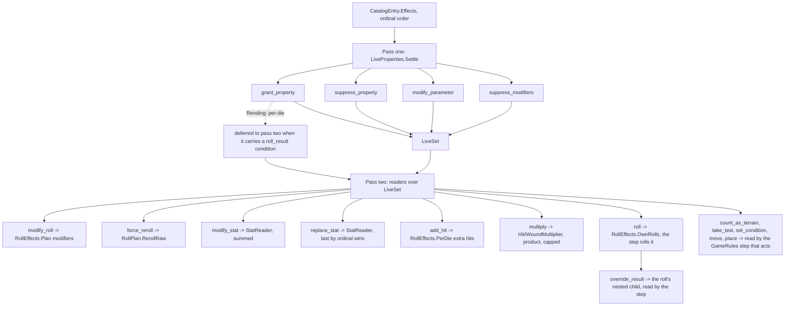
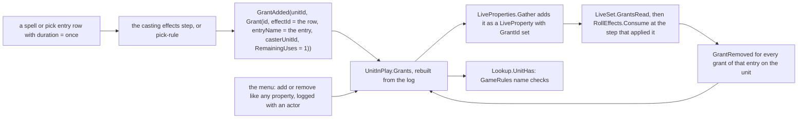

# The effect grammar

What each of the eighteen effect kinds does in code, what each of the thirteen predicates reads, which
pass a kind belongs to, and how a grant is written and consumed. [design.md](design.md) states
the two-pass decision and its motivation. Everything here lives in `server/game/Effects/` and may
not name an OPR rule.

## The interaction and the two sides

Every effect question starts from an `Interaction`. It is the subject of both passes, and the
only place where which side is which is decided.

```csharp
enum AttackKind { Shooting, Melee, Spell }
enum Side { Attacker, Defender }

sealed record Party(Guid UnitId, IReadOnlyList<Guid> ModelIds, IReadOnlyList<Guid> WeaponIds)
{
    static Party Whole(GameState, Guid unitId);                            // every model still in play, no weapons
    static Party Of(GameState, Guid unitId, IEnumerable<Guid> modelIds, IEnumerable<Guid> weaponIds);
}

sealed record Interaction(GameState State, PropertySet Properties, Party Attacker, Party? Defender,
    AttackKind? Attack, string? ActionTaken, double? RangeInches, IReadOnlyList<string> DefenderTerrain,
    string? Point = null, IReadOnlyDictionary<Side, IReadOnlyDictionary<string, int>>? Faces = null,
    IReadOnlyList<(string Entry, int? Parameter)>? SpellRules = null)
{
    Party Of(Side side);
    static Side Other(Side side);
    int Round { get; }
}
```

`Defender` is nullable. A morale test, a move and a dangerous terrain test are one-sided
interactions, and every predicate has to cope. Spell hits resolve with `AttackKind.Spell`, so no
*when shooting* or *in melee* rule reaches them, and `SpellRules` carries the spell's granted weapon
rules into the settled set. A morale test's interaction carries the attack kind that caused it:
`melee` for p.10's melee test, the kind of the unit's last wound that activation for the general
test, `spell` for a `take_test`. After a melee or a shooting it also carries the opposing unit as the defender and a range (`GfMorale.Ix`): the
charge's recorded range and, for the unit charged, `ActionTaken` `Charge`; the range the attack measured (3.6: `determine-attacks`' `range_hundredths`). In a Charge's melee, `RangeInches` is the distance at the charge's
start, which the `charge-target` step records as `charge_range` in hundredths of an inch. `Party.Whole` uses `Lookup.AliveModels`, which is
models still in play, container occupants included. An occupant unit's own properties are
therefore still gathered when a wrecked transport wounds it.

`self` and `opponent` on the effect resolve against the *holder*, not against attacker and
defender. `AP(X)` on the attacker's weapon and `Stealth` on the target are written the same way
because of this:

```csharp
sealed record LiveProperty(Side Holder, CatalogEntry Entry, int? Parameter, Guid? ModelId, Guid? WeaponId, Guid? GrantId,
    Effect? GrantRow = null, IReadOnlyList<Effect>? Chosen = null, string? Via = null)
{
    IReadOnlyList<Effect> Effects;   // Chosen, else the grant's one row, else none for a carried pick entry, else Entry.Effects
    Side ActedOn(Effect e) => e.Subject == EffectSubject.Self ? Holder : Interaction.Other(Holder);
}
```

`Artillery` needs most of it at once. The property sits on the target model, and the effect is −2
to the **opponent's** hit roll. `Counter` is the case that also tests **self**: the property is
the defender's, the effect takes a roll off the *charger's* `Impact`, and the condition is *when
charged*. Under 3.5.1 `Artillery` needs no movement condition because it *may only use Hold actions*. Under 3.6.0
(p.13) it may move: its opponent row carries `actor_state` with subject **self** `neq moved this round`, the condition's
subject read relative to the holder, so the -1 acted on the shooter tests the Artillery unit's own state; its self row's `action_taken eq Hold` reads the shooter's action.

## The thirteen predicates

The set is closed. An effect carries a flat list of them and all must hold. Grimdark Future's
properties contain no *or* and no *not*. `Rush/Charge` looks like an *or* and is set membership
over action names, which is why a condition's values are rows. `Comparison` includes `neq`
because a single predicate still has to test a state's absence. `actor_state` is read in the core sets by `Impact` (*unless fatigued*) and by 3.6.0's `Artillery` (*as long as they haven't moved during this round*).

| `ConditionKind` | Reads | Subject | Read in `Conditions.Holds` as |
| --- | --- | --- | --- |
| `ActionTaken` | `Interaction.ActionTaken` | yes | set membership over the action name; false when no action is in context |
| `AttackKind` | `Interaction.Attack` | yes | membership over `"shooting"`/`"melee"`/`"spell"`; false when there is none. `neq spell` is *"hits that are not from spells"* |
| `Range` | `Interaction.RangeInches` | **no** | `Compare(r)` on the measured inches, unrounded; the charge-start distance in a Charge's melee |
| `RollResult` | the `DieContext` passed in | yes | `Values` are `[roll, "raw" or "modified"]`, optionally a third, `"success"` or `"fail"`, that the die's success must match; false when no die is in context |
| `ActorState` | the named side's unit conditions, plus the source model's own conditions | yes | presence, negated under `neq`; false on a side the interaction lacks |
| `PositionTerrain` | `Interaction.DefenderTerrain` | yes | membership over declaration names; applies to the defender, or to the lone party when there is no defender |
| `RoundNumber` | `Interaction.Round` | **no** | `Compare(round)` |
| `UsageCount` | the effective log | **no** | how many `sequence_started` payloads name this weapon id, the usage record `Limited` reads; with a first value `round`, `activation` or `game`, how many sequences the holder's unit started under this entry's name in that scope |
| `HoldsProperty` | `Lookup.UnitHas` on the named side | yes | the side holds the one named entry under its own aggregation, granted instances included; a suppression does not unhold, so a Boost still sees its base |
| `MostModels` | the named side's living models | yes | more than half meet `Compare` on the one named value: a declared stat's target number (`Defense lte 3`), or a rule's parameter, which a model without the rule fails (`Tough gte 3`) |
| `AtPoint` | `Interaction.Point` | **no** | membership over the named points (`activation-start`, `before-attacking`, `after-shooting`, `after-melee`, `attack-start`, `activation-end`, `after-deploy`); always true on a granted row, since the grant is that use |
| `WeaponRange` | `Interaction.RangeInches` and the source instance's `WeaponId` | **no** | `RangeInches × 100` compared with `number × range`, the weapon's range as the live set leaves it (`StatReader.PeekWeaponRange`; printed in pass one, where there is no live set); false with no weapon on the source, no range on the weapon or no range in the interaction |
| `RemainingSize` | `Lookup.RemainingSize` on the named side | yes | `remaining × 100` compared with `number × starting`: models still in play against the definition's count, or for a single model the named rule's parameter (1 without it) less its wounds, 0 on the shelf, against that parameter |

`Validate` refuses a subject on the five relational predicates, `Range`, `RoundNumber`, `UsageCount`,
`AtPoint` and `WeaponRange`, and requires one, with exactly one value, on `HoldsProperty`, `MostModels` and `RemainingSize`;
`WeaponRange` and `RemainingSize` need a number. A range test is about
both parties, so a subject would have no meaning.

`Range` compares the distance as measured (p.5, base to base), so a condition written `gt 9` is
false at exactly 9.0 and true at 9.41. `ActorState`, `HoldsProperty`, `MostModels` and `RemainingSize` on the
defender are false when the interaction has none (a charge's reach, a move, a lone roll), as
`PositionTerrain` reads the lone party. `UsageCount` scanning `SequenceContext.WeaponIds`
counts sequences the weapon was in, not shots fired. That is the right reading for *once per
game* and not clearly right for anything else.

**"Unmodified" is a first-class concept.** `Rending`, `Furious`, `Relentless` and `Bane` all
trigger on the raw die, so `Die` carries `Raw` and `Modified`, and the predicate names which it
reads.

**Aggregation is not a predicate.** `Stealth`'s *"units where all models have this rule"* is the
`aggregation` field on the entry. Writing it as a condition too would state one fact twice.

## The eighteen kinds and their passes



Only four kinds run in pass one. `grant_property` runs in **both** passes, depending on whether
it carries a `roll_result` condition. The effects module never applies `override_result`. It is a
marker on a `roll` effect's child, read by the step that selects the roll.

| # | `EffectKind` | Pass | Applied by | OPR rules |
| --- | --- | --- | --- | --- |
| 1 | `ModifyRoll` | two | `RollEffects.Plan` adds one `RollModifier(entry name, amount)` per effect on this roll | `AP(X)`, `Stealth`, `Artillery`, `Indirect`, `Thrust` |
| 2 | `ModifyStat` | two | `StatReader.TargetNumber`/`WeaponRange`/`ActionDistance`, summed | `Slow`, `Fast`, `Aircraft`'s −12 inches range |
| 3 | `ReplaceStat` | two | `StatReader.TargetNumber`, in ordinal order, last wins | `Reliable` |
| 4 | `ForceReroll` | two | `RollEffects.Plan` collects the face into `RollPlan.RerollRaw`; `Roller.Roll` redraws once | `Bane` |
| 5 | `Roll` | two | `RollEffects.OwnRolls` returns it; the **step** rolls it under the entry's name with the row's threshold | `Regeneration`, `Fearless`, `Impact(X)` |
| 6 | `AddHit` | two | `RollEffects.PerDie` per die with a `RollResult` condition, by `TargetQuantity`: `hits` extra hits, `wounds` extra wounds to the side the subject names (subject `opponent` on a defense die, subject `self` on a hit die), `attacks` extra attacks. An unconditional one is a spell's *takes N hits*, which `spell-hits` reads: with `TargetRoll = hit` it rolls one die per hit that cannot fail, with none the hits land and no die is rolled | `Furious`, `Relentless`, `Shred`, `Hazardous`, damage spells |
| 7 | `Multiply` | two | `RollEffects.HitMultiplier`/`WoundMultiplier`, product of amounts, each capped by `CapKind` | `Blast(X)` on hits, `Deadly(X)` on wounds |
| 8 | `OverrideResult` | two | nobody: it is the child of a kind-5 roll, and the step reads `TargetResult` to know what a success does | `Regeneration` (wound), `Fearless` (morale test) |
| 9 | `GrantProperty` | one, or two when per-die | `LiveProperties.Settle` adds a `LiveProperty`; per-die, `RollEffects.PerDie` names it and the step folds it in with `LiveSet.WithGranted` | `Rending`, every spell grant |
| 10 | `SuppressProperty` | one | `Settle` removes every instance of the entry on the acted-on side | `Bane`, `Rending` and `Unstoppable` ignoring `Regeneration` |
| 11 | `ModifyParameter` | one | `Settle` adds to every matching instance's parameter; a `floor` holds the sum at it and never raises a parameter already below it | `Counter` (−1 `Impact` rolls); 3.6.0 `Fortified`, `Guardian` (AP(-1) *"to a min. of AP(0)"*, `floor: 0`) |
| 12 | `SuppressModifiers` | one | `Settle` records the `TargetModifier` class in `LiveSet.SuppressedModifiers` | `Unstoppable`, and `Blast` for cover |
| 13 | `CountAsTerrain` | two | `GfMoves` reads the `TargetTerrain` row: `difficult` caps the holder's next move at 6", `dangerous` runs the `dangerous-terrain` test at its next activation, an idle one included | spells granting either terrain type |
| 14 | `TakeTest` | two | `GfCasting`'s `effects` step pushes `spell-test`, which pushes `morale-test` for the target with p.10's consequence; the row's children apply when the test fails | morale-test spells |
| 15 | `SetCondition` | two | `spell-test`'s `consequence` sets `TargetCondition` on the target's unit; at an `at_point`, the rule's rows are a choice: `GfHooks.ReactionsAt` offers the rule once and `choose-effect` sets the row picked (the unit's chosen conditions clear as its next activation starts), read by the rule's `actor_state` rows | *Terrifying Fury* (`fatigued`); Versatile Attack, Speed Feat |
| 16 | `Move` | two | `spell-test`'s `consequence` opens a `move` Ask to the caster's team over the target's alive models, `Amount` inches under that unit's own move rules, which may pass; at an `at_point`, `GfHooks.ReactionsAt` offers it and `reposition` moves the holder; with `AmountDice` (`d3`, `d3+1`) `reposition` rolls the distance once chosen and moves the holding models | *Deep Hypnosis*; `Hit & Run Fighter`, `Harassing`, `Guerrilla`; 3.6.0 `Rapid Blink`, `Wolfborn`, Bounding, Dash |
| 17 | `Place` | two | `GfHooks.ReactionsAt` offers it at its `at_point` and `reposition` places the holder, `Amount` inches or `AmountDice` (`d3`, or `d3+1`: a D3 plus one per die) | `Teleport`, `Rapid Blink`, `Wolfborn`, Bounding, Dash |
| 18 | `RemoveWounds` | two | a pick entry's use row: `pick-rule`'s `rule-effects` takes `Amount` or `AmountDice` (`d3`) wounds off the picked model | `Mend` |

`Roll` nests. *X dice at 2+, each success adds a hit* is a `Roll` whose `Amount` is the count or
the entry's parameter, whose `Threshold` is the score, and whose `Children` hold the per-success
effect. `Add a hit` is reused rather than special-cased, which is why kind 6 takes an `amount`.
One level covers the whole rulebook and nothing forbids deeper. `AllEffects()` walks children
depth-first and `Validate` recurses.

A kind-5 roll is recorded as a `RollRecord` whose `Roll` is the **entry's** name, such as
`Regeneration`, `Impact` or `Fearless`, with the effect row's threshold. It is not a `roll` row,
because nothing targets it ([the effect grammar spec](../../superpowers/specs/2026-08-29-effect-grammar-design.md) → `Roll` nests).

## Pass one: `LiveProperties.Settle`

Three phases. The order inside each matters.

**Gather, per side.** Five sources. Unit properties from `UnitInPlay.Definition.Properties`.
Grants from `UnitInPlay.Grants`, each becoming a `LiveProperty` whose `GrantId` is set and whose
parameter is read out of the game's set by `Grant.EffectId`. A `unit`-kind catalog entry sitting
on a model slot, from `Lookup.UnitKindOnSlots` over the unit's definition, holder-less. Model
properties, grouped by entry name across the party's models, or `Lookup.LivingModels` when the
party names none, and admitted per the entry's `Aggregation`. Weapon properties per weapon id,
carrying both the weapon and the model.

The model-property arm skips a `unit`-kind entry, because the source above it added the entry for
the whole unit. Import produces the shape two ways: a rule whose count is smaller than the unit,
and a hero joined to another unit, whose rules all land on its slot whatever their kind.

| `Aggregation` | Live when | Instances produced |
| --- | --- | --- |
| `All` | every model in the party carries it | one, unattributed |
| `Any` | at least one does | one, unattributed |
| `Majority` | `count * 2 > models.Count`, with no tie rule | one, unattributed |
| `None` | always | one **per model**, each carrying its own `ModelId` and parameter |
| not declared: a `unit`-kind entry on a model slot | always, off the definition rather than the living models | one, unattributed, carrying the slot's parameter |

**Collapse.** Grouped by `(entry name, model id when aggregation is none, weapon *name* when it
is a weapon rule, grant id)`, first of each group kept. p.13: instances of the same rule do not
stack unless it has (X). The key uses weapon *name* rather than weapon id. Three Lances in one
group therefore contribute one `AP(1)`, and the group's parameter is the weapon's rather than the
sum.

**Apply the four kinds,** in `Ordinal` order across every effect of both sides whose conditions
hold and which references no `RollResult`. Two guards inside the loop make ordering meaningful.
`if (!live.Contains(source) ...)` skips a source another effect has already suppressed this pass.
Conditions are re-judged at application time rather than at candidate time. `Bane`'s
`suppress_property` at ordinal 5 therefore removes `Regeneration` before anything at ordinal 50
can read it, and a rule that suppresses a rule that grants a rule resolves in the order the
author wrote.

**`ordinal` diverges from p.13's rules priority, deliberately.** p.13: *"If multiple special
rules happen at the same time, and it's not clear which should be done first, if all the rules
affect only one player, then that player may decide the order. If the rules affect multiple
players, then the players roll-off and the winner picks the order."* The engine never reaches that case, because `ordinal` makes every order explicit in the
content document, and a deterministic order is what replay needs. The cost is that a player
cannot choose an order the document already fixed, which no core rule requires.

The candidate list is computed **once, before the loop**, from the initial `live` list. An effect
belonging to a property *granted* during pass one is therefore never a candidate in the same
pass. That limitation has no test pinning it.

## Pass two: readers over `LiveSet`

```csharp
sealed class LiveSet
{
    IReadOnlyList<LiveProperty> Live { get; }
    IReadOnlySet<TargetModifier> SuppressedModifiers { get; }
    IReadOnlyList<(LiveProperty Source, Effect Effect)> Applied { get; }   // what pass one did, for explaining a result

    IEnumerable<LiveProperty> On(Side side);
    bool Has(Side side, string entry);
    int? Parameter(Side side, string entry);                               // summed over instances
    IEnumerable<(LiveProperty Source, Effect Effect)> Effects(Side actedOn, EffectKind kind, DieContext? die = null);
    LiveSet WithGranted(Side holder, string entry, int? parameter);
}
```

`Effects` is pass two's whole dispatch. It filters by kind and acted-on side, judges conditions
now, taking the die when one is given, and orders by `Ordinal`. Every reader is a fold over it.

**`RollEffects.Plan`** builds the `RollPlan`. Base modifiers come from the ruleset:
`GfRolls.DefensePlan` passes `new RollModifier("cover", +1)`. So does the threshold, where the
ruleset has one: `StepContext.Plan` takes an optional `threshold` that overrides
`RollSpec.Threshold`, which is how a target number read off a model's slot rather than the unit's
reaches a plan without putting a model on `RollSpec` and therefore on `IGameRules`. Every `ModifyRoll` on this roll is
then appended, and four suppressions are applied by removal:

- `TargetModifier.Cover` suppressed removes modifiers whose `Source` is the literal `"cover"`.
- `TargetModifier.ToHitPenalties` suppressed removes every negative modifier, **but only when the
  roll is the ruleset's hit roll**. `Plan` receives that roll's name as the `hitRollName`
  parameter. That parameter is what keeps `Effects/` free of OPR's roll names.
- `TargetModifier.ForeignToHitPenalties` suppressed removes, on the same roll, every negative modifier
  that is not from the roller's own rules (3.6.0 p.15 Unstoppable: *"which are not from this model's
  special rules"*). A modifier is the roller's own when `LiveSet.OwnedBy` traces its `modify_roll`
  row's property, through pass one's grantor and a per-die grant's rule, to a property its side holds,
  and a granted row on it was placed by its own team. A base modifier has no property, so it goes.
- `TargetModifier.PositiveDefense` suppressed removes every positive modifier, base (`cover`) and rule rows alike, **only on the
  ruleset's defense roll** (the `defenseRollName` parameter, from `IGameRules.DefenseRoll`), each listed in `RollPlan.Ignored` by
  its suppressor; negative modifiers (AP) stay (3.6.0 Pierce).

Matching a base modifier by the string `"cover"` is the weakest join in the module. It couples a
generic suppressor to a string the ruleset happens to use, and `Blast` silently stops ignoring cover
if `GfRolls` ever spells it differently. `RangePenalties` avoids the problem by dropping negative
amounts in `StatReader.WeaponRange` instead.

`ForceReroll` is collected here rather than evaluated per die. The effect's `roll_result`
condition names the *face*, every other condition must hold now, and the face goes into
`RollPlan.RerollRaw` so `Roller.Roll` can redraw it once. A face whose condition carries
`"success"` goes into `RollPlan.RerollSuccessfulRaw` instead, redrawn only when the die succeeded
(Scrapper Boost: *"re-roll successful unmodified defense results of 5-6"*). `Validate` refuses
`"fail"` on a `force_reroll`.

**`RollEffects.PerDie`** returns `DieEffects(int ExtraHits, int ExtraWounds, IReadOnlyList<(string Entry, int?
Parameter)> Grants)` for one die. It keeps only effects that carry a `RollResult` condition, so a
spell's unconditional *takes 4 hits* is not counted once per die. The dice an `add_hit` on attacks adds are
`roll-to-hit`'s to draw, which reads those rows itself. A defense die's extra wounds are wounds of the hit
whose block failed, so `GfAttack.WoundsToDeal` adds them to the failures and `Deadly` multiplies them; a hit die's
subject-`self` wounds go to the attacker's own unit after the attack, through `self-wounds`.

**`RollEffects.HitMultiplier(live, side, defenderModels)`** is the *product* of `Multiply` amounts
on hits, each clamped to `Math.Min(x, defenderModels)` when `CapKind.ModelsInTargetUnit` is set,
with a floor of 1. `defenderModels` is a number the ruleset passes in, not a count read here, so
when the cap is fixed at some earlier moment the ruleset is what remembers it. `WoundMultiplier`
is the same with no cap. The product rather than the sum matters only if two multiplying rules
ever apply at once, and nothing in OPR does.

**`StatReader`** reads a stat as the live properties leave it. Replace runs first, in ordinal
order, last wins. Modify runs second, summed. `TargetNumber` takes an optional model: a
`StatLevel.Unit` ref reads the unit's text, a `StatLevel.Model` ref reads the named slot's and
falls back to the unit's where the slot declares none, and a model-level ref with no model throws
`NotSupportedException`. Grimdark Future declares `Quality` and `Defense` at `model` level as well
as `unit` level, and a joined hero's slot carries its own pair, which p.4 makes the values its
Quality tests use ([decisions.md → Rulings](decisions.md#rulings), 13). The replace and modify scans match on the stat's
**name** at either level rather than on the ref, because a target number is one stat with a
declaration at each level and every catalog row names the unit-level ref; that is what puts
`Reliable`'s *"attacks at Quality 2+"* over a hero's own value as well as over a squad's.

## Worked against the book

`schema.md` works four rules out row by row. Two more are added here because they exercise the
parts the first four do not.

| Rule | Rows |
| --- | --- |
| `AP(X)` | one effect: `subject = opponent`, `kind = modify_roll`, `target_roll = defense`, `amount = -1`, `amount_from_parameter`. No conditions |
| `Stealth` | `catalog_entry.aggregation = all`; one effect: `subject = opponent`, `modify_roll`, `target_roll = hit`, `amount = -1`. Two conditions: attack kind is shooting, and range `gt` 9 with no subject |
| `Impact(X)` | one effect: `kind = roll`, `amount_from_parameter`, `threshold = 2`, with a **child** effect `kind = add_hit`, `amount = 1`. Conditions: action taken is charge, actor state `neq` fatigued |
| `Bane` | **two** effects on one entry. `force_reroll` with `target_roll = defense` on the opponent, conditioned on a raw `defense` result of 6. And `suppress_property` with `target_entry = Regeneration`, unconditional, at a lower `ordinal` so it wins |
| `Rending` | `grant_property` with `target_entry = AP` and `amount = 4`, conditioned on a raw `hit` result of 6, so it is deferred to pass two and folded in per die |
| `Thrust` | **two** effects. `modify_roll` on `hit`, `amount = 1`; and `grant_property` with `target_entry = AP` and `amount = 1`. Both conditioned on the action taken being `Charge` and the attack kind melee. The grant is not per-die, so unlike `Rending`'s it settles in pass one |
| `Blast(X)` | `kind = multiply`, `target_quantity = hits`, `amount_from_parameter`, `cap_kind = models_in_target_unit`, at a high `ordinal` because the book says *after resolving other special rules* |
| `Unstoppable` | *"Ignores Regeneration, and ignores all negative modifiers to this weapon"*: one `suppress_property` on `Regeneration`, plus `suppress_modifiers` for `to_hit_penalties` and `range_penalties`. 3.6.0 p.15 adds *"which are not from this model's special rules"*: the 3.6 row is `foreign_to_hit_penalties`. Not `cover`, which is a bonus to the target's defence roll rather than a modifier to this weapon; `Blast` is what suppresses that |

`Bane` shows why conditions belong to the effect and not to the entry. One of its two effects
is conditional and the other is not, and a single condition list on the entry would get it wrong.
`Indirect` is the same argument with three clauses, one conditional and two not.

`Thrust` shows why an additive `AP` is a grant and not a `modify_parameter`. 3.5.1 writes both
`Thrust`'s `AP(+1)` and `Rending`'s `AP(+4)` with the same `+`, and `Settle` applies a
`modify_parameter` to **every** matching instance. Three cases separate them, and the grant is
right in all three where the modifier was right in one: a weapon with `AP(1)` reaches 2 either way,
because `LiveSet.Parameter` sums an entry's instances; a weapon with **no** `AP` gets 1 from the
grant and nothing at all from the modifier; and a weapon whose `Rending` has already granted `AP(4)`
on a 6 gets 6 from the grant and 7 from the modifier, which adds to both instances
([closing the open questions](../../superpowers/specs/2026-09-09-open-questions-design.md)).
`ModifyParameter` keeps its place in the grammar for `Counter`, which genuinely modifies an existing
instance's parameter rather than adding one.

## The grants store



A grant is written by one step's `step_completed` and consumed by another's, both explicitly in
the payload, so the client's projection copies rather than derives. Name checks read the store
too, or a granted hook-name rule would never fire.

- **A grant is its effect row.** `EntryName` names the spell and `EffectId` the one row the grant holds;
  `LiveProperties.Gather` makes a granted instance whose `GrantRow` exposes that row and its children and nothing
  else of the spell. A subject-`opponent` row gives the holder nothing, so *Relentless against* does not read
  as the enemy's own `Relentless`, and it applies only when the opponent's team is the team of the grant's
  `CasterUnitId`. One cast writes one grant per once-row per target, and none on a target already holding
  grants of that spell.
- **`RemainingUses` is 1 for every once-effect.** *"Next time the effect would apply"* read
  literally: the first step whose query returns the row, with every condition holding except a per-die one,
  consumes it, and every grant that spell left on the unit goes with it. Reading a grant to build a legal set
  (Charge offered by a speed grant) consumes nothing. A grant that never gets a chance to apply is never consumed.
- **A granted `Flying` lasts the activation** in which it first applied; the turn-end hook removes it
  (`GfMoves.ConsumeKeepingFlying`). A spell's forced move flies with it but neither spends nor holds it.
- **A model-grain target's grant lands on the model's unit**, because the store is the unit's.
- **A granted `Regeneration` is consumed by the step that assigns the wound,** not by a roll plan:
  kind 5 is a roll of its own rather than a modifier, so no plan carries it; `assign` finds the grant through
  the row-bearing instance.
- **A grant's parameter is the granting effect's `amount`,** read from the game's set by
  `EffectId`. The grant row carries none, so the id's database-locality matters
  ([operations.md → Failure modes](operations.md#failure-modes)).
- **Conditions stay names.** Game flow keeps containment out of the condition store because it
  carries one reference. A grant carries three, so it is not a condition either. The rule is not
  written into the unit's property list, because that list is the frozen army snapshot's copy.

**A marker is a grant.** A row with duration `marker` or `spent_marker` is one marker a rule places on a unit: the ruleset
writes one `GrantAdded` of the row per marker (a pick entry's use, a unit destroyed, a round's start), and grants of one
rule stack, so *"for each marker"* is the sum of the instances. A carried entry exposes none of its marker rows. A `marker`
grant is never spent (`LiveSet.Spend` skips it); a `spent_marker` grant is consumed with every grant of its rule on the
unit, as a once grant is. A subject-opponent marker row the holder's own side placed reaches every opponent.

**A pick entry writes grants too.** A `model` entry with `targeting` (count one, an optional `lineOfSight: false`, an
optional `requires`: the rule the picked unit or model must hold, *"with Caster"*) whose rows all carry `at_point
before-attacking` is an army-book Buff, Mark, Debuff or before-attacking active. Carried, it exposes no rows. The
`pick-rule` sequence (`rule-roll`, `rule-target`, `rule-effects`) rolls the entry's `roll` row when it has one (*"roll 3
dice. For each 2+ one enemy unit …"*) and asks one target per success, or one without dice; it writes one `GrantAdded`
per `once` row on each unit it picks, read and consumed as a spell's is; and it resolves the use rows on each target:
`add_hit` hits (top-level, or the `roll` row's children) push `spell-hits`, `take_test` pushes `spell-test`, and
`remove_wounds` takes `Amount` or `AmountDice` (`d3`) wounds off the picked model, and a `move` row moves the picked model's unit up to `Amount` under its own move rules. A granted row's `at_point` holds
wherever the grant is read: it said when the rule was used. Each carrying model has one use per activation, counted by
`GfPick.Uses`; a row with `usage_count lt 1 [game]` makes it one per game (`GfPick.GameUses`).

## Name checks handled by `GameRules`

Some entries carry no effects at all. They are names `GrimdarkFutureRules` checks for at hooks it
owns. `Lookup` is the reader: `UnitHas`, `UnitParameter` and `ModelParameter` all consult the
unit's own properties, the aggregated model properties **and** the grants store.

| Hook | Entries |
| --- | --- |
| Deployment | `Ambush`, `Scout` |
| Movement | `Flying`, `Strider`, `Aircraft` |
| Action legality | `Immobile` |
| Usage | `Limited` |
| Melee strike order | `Counter` |
| Melee result | `Fear` |
| Interrupt | `Caster` |
| Wound assignment | `Tough`, `Hero` |
| Containment | `Transport` |
| Activation (army-book) | `Coordinate`, `Delayed Action`, `Inquisitorial Agent`, `Martial Prowess`, `Instinctive` (its +1 to hit is rows) |

This is name-matching. The alternative is inventing grammar for deployment timing, movement
exemption and a token economy, most of which would be used by one property each. That is where
effects-as-data stops paying.

`Lookup.UnitHas` also reads a carried Aura (an `any` model entry whose unconditional subject-self `grant_property` row
names the rule) off its living carriers: the models still in play once any is, the unit's definition while every model
is on the shelf. *"This model and its unit get Scout"* is a Scout unit at deployment, and a carrier removed as a casualty
grants nothing.

**A property may be in both places.** `Indirect` carries one effect row, its −1 to hit after
moving, *and* is checked by name for *"may target enemies that are not in line of sight"* and
*"ignores cover from sight obstructions"*. Neither is a kind: the second drops only the sight half
of p.11's cover, which `GfRolls.InCover` reads, while `suppress_modifiers cover` would drop the
terrain half too. `Aircraft` carries one, the −12" to the range of units targeting it, and is
checked by name during movement. `Hero` is the opposite case. Its third clause, *must
use the unit's Defense until all other models have been killed*, needs **no** effect row at all,
in either half. `GfRolls.DefensePlan` reads `Defense` at unit level while the target holds more
than one model, so a `replace_stat` row would restate it, and it reads the surviving model's own
slot `Defense` once the settled count of living models is one. No effect row could have expressed
the second half: `roll-to-block` throws one roll per hit before `deal` assigns a wound to any
model, so the threshold is chosen while no model is named, and the ruleset is the only thing that
knows the count was settled before the first group fired.

## Not covered by the grammar

- **Percentages.** `amount` is an integer, and Action Boosting is written as proportions. Boosted
  `Rush` *"may move by up to +50%"*. A nineteenth kind, or a flavour on kind 1.
- **Two abilities reading the same result.** Whether both apply or one wins is deferred. Every
  example is specific to one ruleset.
- **Whether eighteen kinds survive a different ruleset.** The grammar is derived from one, and Age
  of Fantasy shares the engine. Warhammer is the test.
- **Deeper nesting.** One level covers the book. Nothing forbids more and nothing tests it.
