# The grants store

How a once row, a marker or a pick entry writes a grant, what reads it and when it is released.
Part of [the effect grammar](effect-grammar.md); everything here lives in `server/game/Effects/`
and the ruleset steps that read it.

```mermaid
flowchart LR
    spell["a spell or pick entry row with duration = once"]
    step1["the casting effects step, or pick-rule"]
    ga["GrantAdded(unitId, Grant(id, effectId = the row, entryName = the entry, casterUnitId, RemainingUses = 1))"]
    store["UnitInPlay.Grants, rebuilt from the log"]
    gather["LiveProperties.Gather adds it as a LiveProperty with GrantId set"]
    namecheck["Lookup.UnitHas: GameRules name checks"]
    consume["LiveSet.GrantsRead, then StepContext.Consume at the step that applied it"]
    held["held_unit_grant in the step's Values (under an attack root) or move_held_unit_grant (a move segment)"]
    release["RollEffects.Release at attack-end (GfAttack.ReleaseHeld) or at the move step's end"]
    gr["GrantRemoved for every grant of that entry on the unit; a one_marker grant alone"]
    menu["the menu: add or remove like any property, logged with an actor"]

    spell --> step1 --> ga --> store
    store --> gather
    store --> namecheck
    gather --> consume
    consume -- "outside an attack root or a move" --> gr
    consume -- "under an attack root or a move" --> held --> release --> gr
    gr --> store
    menu --> store
```

A grant is written by one step's `step_completed` and consumed by another's, both explicitly in
the payload, so the client's projection copies rather than derives. Name checks read the store
too, or a granted hook-name rule would never fire.

- **A grant is its effect row.** `EntryName` names the spell and `EffectId` the one row the grant holds;
  `LiveProperties.Gather` makes a granted instance whose `GrantRow` exposes that row and its children and nothing
  else of the spell. A subject-`opponent` row gives the holder nothing, so *Relentless against* does not read
  as the enemy's own `Relentless`, and it applies only when the opponent's team is the team of the grant's
  `CasterUnitId`. One cast writes one grant per once-row per target, and none on a target already holding
  grants of that spell.
- **`RemainingUses` is 1 for every once-effect.** *"Next time the effect would apply"* read
  literally: the first step whose query returns the row, with every condition holding except a per-die one,
  consumes it, and every grant that spell left on the unit goes with it. Reading a grant to build a legal set
  (Charge offered by a speed grant) consumes nothing. A grant that never gets a chance to apply is never consumed.
- **A once grant read under an attack is released when the attack ends.** *"Next time the effect would apply"* is the
  attack, so `StepContext.Consume(live)` under an `attack-sequence`, `spell-hits` or `rule-hits` frame emits nothing and
  holds each grant it read as `held_<unit>_<grant>` in the step's Values (`StepContext.UnderHoldingSequence`); the
  `attack-end` step that closes the three sequences (`GfAttack.AttackEndStep`, `GfAttack.ReleaseHeld`) emits
  `GrantRemoved` for every grant held by a step of the frame or its descendants that is still on its unit, with the other
  grants of the same entry on that unit. So Thrust in Melee Buff's grant gives its +1 to hit at `roll-to-hit` and its
  AP(+1) at `roll-to-block`, and Bane Mark's re-roll and its Regeneration suppression both act. Outside an attack root
  (a morale test, a reposition, a casting roll) a step consumes at once. A grant held by an attack that is
  abandoned stays on the unit, as a grant that never applied does.
- **A once grant read by an Advance, Rush or Charge move is released when the move ends.** p.7 (3.6.0 p.7: *"When
  using an Advance action, all models in the unit may move by up to 6”"*) makes the move one action, which a stop does
  not end, so *"next time the effect would apply"* is the action's whole move. Each segment of `GfMoves.MoveStep` that
  moves writes `move_held_<unit>_<grant>` (`GfNames.MoveHeldPrefix`) for the grants it read and removes nothing; the
  run that ends the step releases them by Consume's rule. Shock Speed cast at a stop of a Slow unit's Advance makes the
  allowance 6", and after a 1" stop 5" remain; the next move action reads no grant. A segment that moved nothing holds
  nothing, so a move that stands still keeps the grant. A move abandoned mid-move (`SequenceAbandoned`) leaves the
  grant on the unit, as an abandoned attack does.
- **A granted `Flying` lasts the activation** in which it first applied; the turn-end hook removes it
  (`GfMoves.ConsumeKeepingFlying`). A spell's forced move flies with it but neither spends nor holds it.
- **A model-grain target's grant lands on the model's unit**, because the store is the unit's.
- **A granted `Regeneration` is consumed by the step that assigns the wound,** not by a roll plan:
  kind 5 is a roll of its own rather than a modifier, so no plan carries it; `assign` finds the grant through
  the row-bearing instance.
- **A grant's parameter is the granting effect's `amount`,** read from the game's set by
  `EffectId`. The grant row carries none, so the id's database-locality matters
  ([operations.md → Failure modes](operations.md#failure-modes)).
- **Conditions stay names.** Game flow keeps containment out of the condition store because it
  carries one reference. A grant carries three, so it is not a condition either. The rule is not
  written into the unit's property list, because that list is the frozen army snapshot's copy.

**A marker is a grant.** A row with duration `marker`, `spent_marker` or `one_marker` is one marker a rule places on a unit: the
ruleset writes one `GrantAdded` of the row per marker (a pick entry's use, a unit destroyed, a round's start), and grants of one
rule stack, so *"for each marker"* is the sum of the instances. A carried entry exposes none of its marker rows. A `marker`
grant is never spent (`LiveSet.Spend` skips it). A `spent_marker` grant is a token the attacking team may remove (*"When
attacking, friendly units may remove tokens from their target before rolling to block to get +AP(X) on their weapons, where
X is the number of removed tokens"*): `attack-sequence`'s `spotter-tokens` step asks the attacking team how many
(`remove_tokens`, 0 to all, per entry with the team's tokens on the target), removes that many at once and records
`tokens_<entry>`; inside a step `LiveProperties.Gather` gathers no `spent_marker` grant and acts with the count removed
(`Interaction.RemovedTokens`). The unit's attack on that target asks once: every later `attack-sequence` the same shooting
or melee strike pushes at the same target copies the first one's count and removes nothing. Hits no attack makes
(`rule-hits`, spell hits, Impact) remove none. A `one_marker` grant is one token: grants of the entry stack,
but `LiveProperties.Gather` keeps one instance of the entry per side, the first grant, so one token acts on an attack, and
`RollEffects.Release` spends that grant alone (*"may remove one token from their target before rolling to block to get
AP(+1)"*). The token is spent whenever its row applies, since a modifier is never a player choice. A subject-opponent marker
row the holder's own side placed reaches every opponent. A marker of an `any` entry some of the unit's models carry
(*"all models with this rule in this unit get AP(+1)"*) reaches only a party whose models all carry the rule, so a joined
Hero without it, or the squad beside a Hero with it, attacks without the bonus.

**A pick entry writes grants too.** A `model` entry with `targeting` (count one, an optional `lineOfSight: false`, an
optional `requires`: the rule the picked unit or model must hold, *"with Caster"*) whose rows all carry `at_point
before-attacking` is an army-book Buff, Mark, Debuff or before-attacking active. Carried, it exposes no rows. The
`pick-rule` sequence (`rule-roll`, `rule-target`, `rule-effects`) rolls the entry's `roll` row when it has one (*"roll 3
dice. For each 2+ one enemy unit …"*) and asks one target per success, or one without dice; it writes one `GrantAdded`
per `once` row on each unit it picks, read and consumed as a spell's is; and it resolves the use rows on each target:
`add_hit` hits (top-level, or the `roll` row's children) push `spell-hits`, `take_test` pushes `spell-test`, and
`remove_wounds` takes `Amount` or `AmountDice` (`d3`) wounds off the picked model, and a `move` row moves the picked model's unit up to `Amount` under its own move rules. A granted row's `at_point` holds
wherever the grant is read: it said when the rule was used. Each carrying model has one use per activation, counted by
`GfPick.Uses`; a row with `usage_count lt 1 [game]` makes it one per game (`GfPick.GameUses`).

Two `targeting` fields change who a pick may name. `oncePerRound: true` leaves out of the eligible targets
(`GfCasting.Targets`, read by `GfPick.Offers` and `rule-target`) every unit a use of the entry, by any carrying model of any
unit, moved since the round started (`GfCasting.MovedByThisRound`: a `move` step change under a `pick-rule` frame of the
entry naming the unit); a unit whose test passed was not moved and stays eligible. `countFromParameter: true` makes the
pick one to X units, X the entry's parameter (`count` is the floor when X is absent): for a marker entry (`GfMarkers.Rows`)
one unit picked takes X markers and several take one each.
