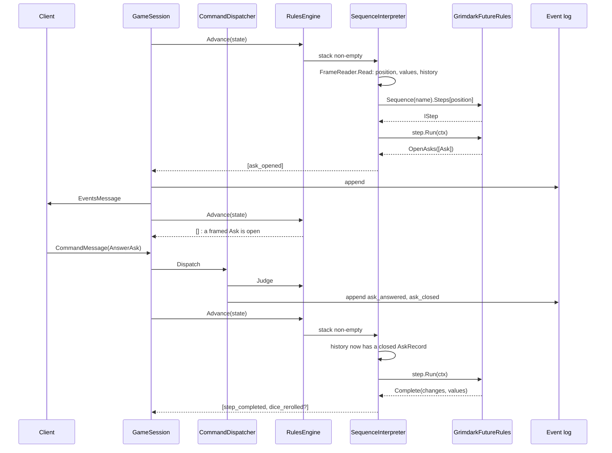
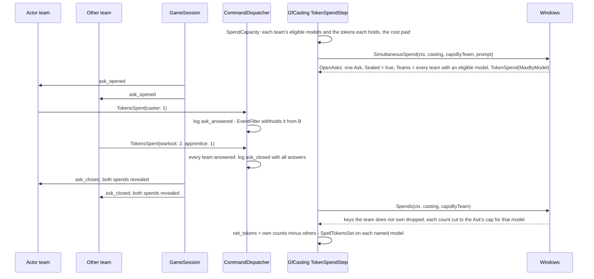
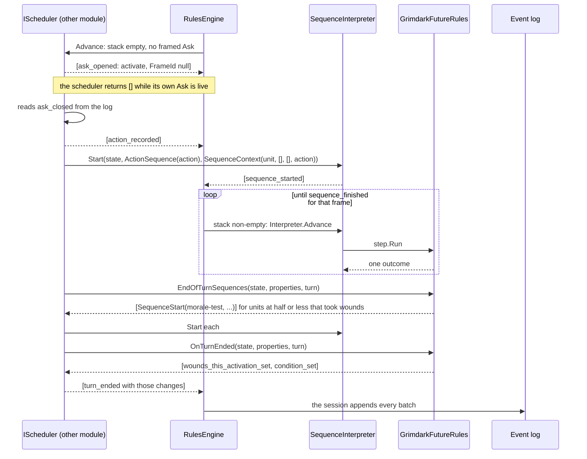

# Interfaces and sequences

Part of [the interpreter design](design.md).

## Interfaces

### Produced for other modules

`Tabletop.GameServer.Engine`:

| Type | Members |
| --- | --- |
| `sealed class RulesEngine(IGameRules, PropertySet, IDiceSource, IScheduler) : IRulesEngine` | `SequenceInterpreter Interpreter`; `Judge`/`Execute` for `RerollDice`, `SetDice`, `AddModifier`; `Advance(GameState)` per the three-line procedure above |
| `sealed class RulesEngineFactory(IPropertiesStore, IDiceSource, ISchedulerFactory) : IRulesEngineFactory` | replaces `InertEngineFactory`; caches by hash; `PropertiesNotFoundException(string hash)` |
| `interface IScheduler` | `IReadOnlyList<EventPayload> Advance(GameState state, ISequenceStarter starter)`; **the scheduler module implements this** |
| `interface ISchedulerFactory` | `IScheduler Create(IGameRules rules, GameInfo game, PropertySet properties)` |
| `sealed class NoScheduler`, `sealed class NoSchedulerFactory` | the registration until the scheduler module replaces it |

`Tabletop.GameServer.Interpreter`:

| Type | Members |
| --- | --- |
| `interface IStep` | `string Name { get; }`, `StepOutcome Run(StepContext ctx)` |
| `interface ISequenceStarter` | `IReadOnlyList<EventPayload> Start(GameState, string sequence, SequenceContext)` returning `[sequence_started]`; `SequenceInterpreter` implements it |
| `sealed record Sequence(string Name, IReadOnlyList<IStep> Steps)` | throws `ArgumentException` on two consecutive steps sharing a name |
| `abstract record StepOutcome` | `Complete(Changes, Values?, Repeat)`, `Finish(Changes, Values?)`, `OpenAsks(Asks)`, `Push(Sequence, Context)` |
| `sealed record AskRecord(Ask, IRD<Guid, AskAnswer>?)` | `Closed`, `Single` |
| `sealed record ChildRecord(Guid FrameId, string Sequence, SequenceContext Context, bool Finished, bool Abandoned)` | |
| `sealed record StepHistory(IRL<AskRecord> Asks, IRL<ChildRecord> Children)` | `Waiting`, `LastClosed(string? question)`, `Confirmed`, `ClosedExceptConfirm` |
| `sealed record FrameView(Frame, int Position, IRD<string,int> Values, StepHistory History, FrameView? Parent)` | `Id`, `Context`, `Value(key, fallback)` |
| `static class FrameReader` | `IRL<FrameView> Read(GameState)`, bottom first |
| `sealed class StepContext` | `State`, `Properties`, `Rules`, `Frame`, `History`, `Projection`, `ActorTeam`, `TeamOf`, `Roll`, `Rolls`, `ForcedRerolls`, `Plan`, `Ask`, `SealedAsk` |
| `sealed class SequenceInterpreter(IGameRules, PropertySet, IDiceSource) : ISequenceStarter` | `Advance(GameState)`, `Start(...)` |
| `static class Windows` | `ReactionOrder`, `Run`, `SimultaneousSpend`, `Spends` |
| `static class Battlefield` | `Placed`, `At`, `InsideReach`, `Terrain`, `CanSee`, `Distance`, `Vertical`, `UnitDistance`, `ModelsInCoverTerrain(state, unit, wholeBase)`, `ModelsBehindSightBlockers(state, unit, fromModels)`, `TerrainUnder`, `Settle(state, modelId, placement)` (ignores the client's Z; rests on `Collision.RestHeight`) |
| `static class Teams` | `Of(GameState, Guid unitId)`, `Others(GameState, Guid? team)` |

`Tabletop.GameServer.Rules`, the nine members added to `IGameRules` beside the scheduler's
seven:

| Member | Meaning |
| --- | --- |
| `Sequence Sequence(string name)` | throws `UnknownSequenceException` |
| `string? ActionSequence(string actionName)` | the sequence an `action` row starts; null for a name with none |
| `RollSpec RollSpec(string roll)`, `sealed record RollSpec(string Roll, RollConvention Convention, Func<LiveSet, Side, int?> Threshold)` | convention and threshold derivation, per roll |
| `string HitRoll { get; }` | the roll `ToHitPenalties` suppresses |
| `IRL<Reaction> ReactionsAt(GameState, PropertySet, string point, FrameView)`, `sealed record Reaction(Guid TeamId, string OptionId, string Label, string Sequence, SequenceContext Context)` | who may react at a window |
| `IRL<SequenceStart> EndOfTurnSequences(GameState, PropertySet, TurnContext)`, `sealed record SequenceStart(string Sequence, SequenceContext Context)` | OPR: end-of-activation morale tests |
| `IRL<StateChange> OnRoundStarted(GameState, PropertySet, int round)` | OPR: clear `fatigued`, grant `Caster(X)` tokens capped at 6; round 0 yields none |
| `IRL<StateChange> OnTurnEnded(GameState, PropertySet, TurnContext)` | OPR: `WoundsThisActivation` to 0; an idle activation, or an Aircraft's Advance, clears `shaken` |
| `IRL<Guid>? OrderReactions(GameState, Guid? actorTeam, IRL<Guid> reactingTeams)` | the order teams react in at a window; null takes the rotation of `Projection.Scheduler.Order`. OPR returns null |

Plus `GameState.RngSeed : ulong` on the skeleton's `GameState`, `unchecked((ulong)Info.RngSeed)`
from the game's stored seed, and `GfNames` as the one names class. `GfNames` declares the
scheduler module's names too: `Deployment`, `Scouts`, `Rounds` (a reference to
`SchedulerBase.RoundsPhase`), `Deploy`, `Scout`, `Ambush`, `Immobile`, `Aircraft`, `Artillery`
(added by the scheduler), `Caster`, `Tough`, `SetAside`. `Transport` is this module's own.

`Tabletop.GameServer.Properties`, `.Dice`, `.Effects` are consumed by the scheduler module only
through four names: `PropertySet.Actions` for the turn Ask's action rows, `Lookup.UnitHas` for
`Immobile`/`Artillery`/`Aircraft`/`Scout`/`Ambush` legality (so the grants store counts), `GfRolls.RollOffSequence`
by the name `FirstTeamDecision.RollOffNeeded` carries, and `ScriptedDice`/`InMemoryPropertiesStore`
in tests.

The roll-off's gate bounds what the scheduler may assume about it. It does not resolve in the
batch that started it, so the scheduler is re-entered only after the gate closes, and the order
sits on the `step_completed` named `order` (`GfNames.RollOffOrderStep`), not the one named
`roll-off`. The keys are `winner_ordinal` and `place_1 .. place_n`.

Ask questions a client may see, which the client-shell module renders from their legal-set
shapes: `move`, `shoot_or_not`, `declare_targets`, `takedown_target`, `remove_casualties`, `charge_target`,
`strike_back`, `disembark`, `cast`, `spell_targets`, plus the engine's `confirm`, `react` and
`spend_tokens`. Window kinds a player may mute: `before-attacking`, `casting`.

### Consumed from other modules

| From | Exact names |
| --- | --- |
| Contracts (`Tabletop.Protocol`) | `StepCompleted` with `IReadOnlyDictionary<string,int>? Values { get; init; }` and `CompletedStep.Values` copied by `EventApplier.ApplyTo`, **the one addition this module asks for**; `SequenceStarted/Finished/Abandoned`, `AskOpened/Answered/Closed`, `TeamAnswer`, `DiceRerolled`, `DiceEdited`, `DieReplacement`, `ModifierAdded`, `Undone`, `RollRecord`, `Die`, `RollModifier`, `Grant`, `SequenceContext`, `Location` (`OnTable`, `OnShelf`, `Inside`), `ModelRelocation`, every `StateChange`, `Ask`, `AskOption`, every `LegalSet` and `AskAnswer`, `AskQuestions`, `Projection`, `Frame`, `CompletedStep`, `OpenAsk`, `UnitInPlay`, `ModelInPlay`, `EventApplier.EffectiveLog`, `GameInfo.RngSeed : long` |
| Geometry (`Tabletop.Geometry`) | `Distance.EdgeToEdge`, `Distance.Vertical`, `LineOfSight.Check`, `Cover.InsideCoverVolumes`, `Cover.SightBlockersBetween`, `Containment.VolumesContaining`, `Containment.BaseFullyWithin(PlacedModel, PlacedModel, double)`, `Collision.RestHeight`, `Collision.Crosses`, `Bodies.AsBlockingVolume`, `Movement.Check(PlacedModel, Point2, double, IRL<WorldVolume> impassable, IRL<WorldVolume> difficult, double? cap, TableSize?)`, `Movement.VolumesCrossed`, `Footprint.IsValid(scale)`, `Table.IsValid` (for `DraftEditor.Degenerate`) |
| Skeleton (`server/game/`) | `IGameRules`, `IRulesEngine`, `IRulesEngineFactory`, `GameState`, `Actor`, `EngineResult` (`Emit`, `RefuseCommand`), `Legality`, `CommandDispatcher`, `RowMapping.EnumText/EnumFrom`, `IEventLog`, `InMemoryEventLog`, `PostgresFixture`, `RecordingClient`, `FixedAskEngine`, `GrimdarkFutureRules` as `sealed partial` |
| Scheduler | `TurnContext`, `Activation`, `ActivationOption.Idle`, `SchedulerBase.RoundsPhase`; and `SchedulerFactory` replacing `NoSchedulerFactory` in `Program.cs` |
| Management | `GET /v1/properties` already lists the seeded sets, and the Army Forge import's stat names `Quality`, `Defense`, `Range`, `Attacks` must match `grimdark-future-core.properties.json`. Its joined hero is a model of the unit it joined, which obliges this module in two places: the document declares `Quality` and `Defense` at `model` level as well as `unit` level, so a joined hero's `slot_stat` rows are declared ones, and a `unit`-kind entry on a model slot is read as the unit's rule in both readers. The hero attacks at its own Quality and blocks on the unit's Defense until it is alone, so the model-level `Quality` is read; `StatReader.TargetNumber` resolves either level for a named model and the split lives in `GfRolls.HitQuality`, `GfAttack.Attacks` and `GfRolls.DefensePlan` (the plan's ruling 13) |

Two geometry obligations are discharged by this module rather than by geometry. A dangerous
terrain test is owed `Movement.VolumesCrossed`, because p.11 says *"moves in or through"* rather
than "ends in". `Containment.BaseFullyWithin` implements p.15's *"fully within 6 inches of it"*,
and `GfMoves.ExitPlacement` is its only caller; it also holds the base on the table (`Table.ContainsBase`, p.7).

## Sequences

### One step, one Ask, one round trip



The step runs **twice** for one Ask: once to open it, once to consume the answer. Both runs read
the answer out of the log rather than from a local. A step that opens the same Ask again instead
of recognising its closed record loops forever. Every asking step therefore tests
`ctx.History.LastClosed()` before anything else. The `RunToRestAsync` loop calling until the batch
is empty is the skeleton's, so a step that always returns a non-empty batch hangs the session,
not just the frame.

### The sealed token spend



One Ask goes to many teams, withheld until all have answered, then revealed together. Ownership
of a key lives in the step, not in the Ask. If a team disconnects without
answering, the Ask never closes and the frame never resumes. The only exits are a menu edit or an
abandon. Nothing in this module times a sealed Ask out.

### An activation, end to end, across both modules



The interpreter owns `Advance` from `sequence_started` to `sequence_finished` and nothing else.
Morale reaches the log through a `GameRules` hook the scheduler calls rather than through a step
of the attack machinery: constraint 7. The handover is inferred from the log on each call, so an
event kind emitted in the wrong order desynchronises both modules with no error. A `turn_ended`
before the frame finishes is one such case. `SchedulerHarness` tests running the real
`RulesEngine` are the only pin on the integration.

### A wound landing, and a container disgorging

```mermaid
sequenceDiagram
    participant AS as attack-sequence frame
    participant RH as resolve-hits frame
    participant DW as deal-wounds frame
    participant Def as Defender team
    participant TD as transport-destroyed frame

    AS->>AS: determine-attacks: Values[attacks] and Values[attacks_q3], [attacks_q5] read off the pushing frame, Values[eligible_models] counted now
    AS->>AS: roll-to-hit: one RollRecord(hit) per attacks_q&lt;n&gt; - Values[hit_multiplier] capped at defender_models
    AS->>AS: score-hits: the hit dice as they now stand - Values[extra_hits], [granted_Rending_4], [self_wounds]
    AS->>RH: resolve: Push
    RH->>RH: roll-to-block: one defense roll per grant group, cover as a base modifier off in_cover, the unit's Defense until defender_models is 1
    RH->>RH: cover: GfRolls.InCover over the target unit's models, seen from every eligible attacker model
    RH->>DW: deal: Push
    DW->>Def: assign: Allocation(eligible models, wounds, MaxTargets)
    Def-->>DW: Allocated: counts per model
    DW->>DW: Deadly multiplies first - Regeneration rolls per wound - wounds_set - casualties to the shelf
    DW->>DW: an occupied container is NOT shelved: p.15 places occupants before removal
    DW->>TD: disgorge: Push, one frame per occupant unit
    TD->>TD: wreck-test: Values[dangerous_dice], then Push dangerous-terrain
    TD->>Def: place: MoveRegion with MoveContainment(ExitingId = wreck, ExitWithin = 6)
    Def-->>TD: Destinations
    TD->>TD: condition_set shaken - models_moved, or destroyed when there is no legal placement
    DW->>DW: disgorge re-reads Wrecks - shelves them when none holds anybody
```

The three shared sub-sequences chain by `Push`. `determine-attacks` reads counts `fire-groups`
settled before any group fired, one per Quality value, and carries down the defending unit's model
count it settled beside them, so a group that shoots after casualties rolls what it had when the
action started, `Blast` caps at what the target then held (p.13), and a joined hero is not left
blocking on its own `Defense` because an earlier group emptied the squad (p.14). A survivor the answer leaves nowhere legal to stand is destroyed rather than parked
off the table. The defender answers twice on one attack: allocation, then placement. The wreck outlives its own destruction until the last occupant is
out. The occupants' dangerous terrain test pushes a `deal-wounds` of its own, whose `disgorge`
would find the wreck the frame above it is emptying and push `transport-destroyed` for a unit
already being processed. The guard is a walk up `FrameView.Parent`, this frame's own ancestors
rather than the stack. A nested `deal-wounds` beneath a `transport-destroyed` therefore completes
`disgorge` immediately.
