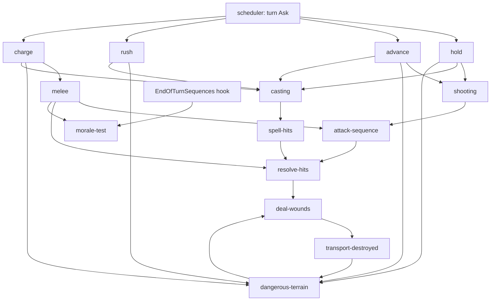
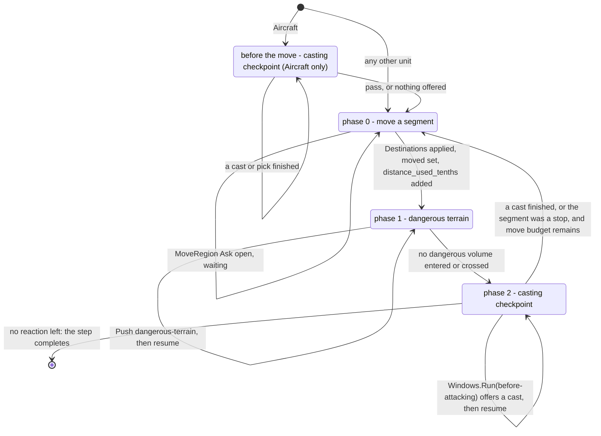

# Grimdark Future's sequences

Nineteen sequences, what each step does, which rulebook page it comes from, and where the
composition is subtle. [design.md](design.md) designs the generic interpreter they run on.
Everything here lives in `server/game/Rules/GrimdarkFuture/`, the only directory in the module
allowed to name an OPR rule.

Read against Grimdark Future v3.5.1, pages 7–15 and 21, with 30–35 and 50 for the token economy's
edges and the free-for-all roll-off.

## The catalogue

| Sequence | Steps | File | Started by |
| --- | --- | --- | --- |
| `hold` | `activation-terrain`, `casting-window`, `shoot-or-not` | `GfMoves` | the scheduler, from the turn Ask |
| `advance` | `activation-terrain`, `move`, `crossing`, `shoot-or-not` | `GfMoves` | the scheduler |
| `rush` | `activation-terrain`, `move`, `crossing` | `GfMoves` | the scheduler |
| `idle` | `activation-terrain`, `activation-start` | `GfMoves` | the scheduler, for an Idle activation (p.11: a unit activated in dangerous terrain tests) |
| `charge` | `activation-terrain`, `charge-target`, `move`, `crossing`, `defender-closes`, `fight` | `GfMelee` | the scheduler |
| `shooting` | `declare-targets`, `fire-groups` | `GfShooting` | `shoot-or-not` |
| `melee` | `melee-start`, `counter`, `impact`, `charger-ravage`, `charger-attacks`, `strike-back`, `defender-ravage`, `unwieldy`, `self-destruct`, `compare`, `consolidate`, `after-melee` | `GfMelee` | `charge`'s `fight` |
| `attack-sequence` | `determine-attacks`, `pick-target-model`, `roll-to-hit`, `score-hits`, `resolve`, `self-wounds` | `GfAttack` | `fire-groups`, `counter`, `charger-attacks`, `strike-back` |
| `resolve-hits` | `roll-to-block`, `deal` | `GfAttack` | `attack-sequence`'s `resolve`, `impact`, `spell-hits` |
| `deal-wounds` | `assign`, `disgorge`, `caster-group`, `destroyed`, `retaliation` | `GfAttack`, `GfContainers`, `GfSpellSupport`, `GfMarkers`, `GfRuleHits` | `resolve-hits`' `deal`, `dangerous-terrain`'s `deal`, `rule-wounds`' `deal` |
| `morale-test` | `test`, `override`, `consequence` | `GfMorale` | `melee`'s `compare`; `IGameRules.EndOfTurnSequences` |
| `dangerous-terrain` | `test`, `deal` | `GfMoves` | `activation-terrain`, `move` phase 1, `wreck-test` |
| `dangerous-terrain-36` | `test`, `deal` | `GfMoves` (`GfMoves.Dangerous36.cs`) | the same pushers under 3.6.0 (`GfEdition.UnitDangerousTest`, `GfMoves.DangerousSeq`) |
| `transport-destroyed` | `wreck-test`, `place` | `GfContainers` | `deal-wounds`' `disgorge` |
| `casting` | `pick-spell`, `origin`, `spend-tokens`, `roll`, `result`, `targets`, `effects` | `GfCasting` | a `before-attacking` window |
| `spell-hits` | `hit`, `score-hits`, `resolve`, `self-wounds` | `GfCasting` | `casting`'s `effects`, `pick-rule`'s `rule-effects` |
| `spell-test` | `test`, `consequence` | `GfCasting` | `casting`'s `effects` or `pick-rule`'s `rule-effects`, for a `take_test` row |
| `reposition` | `reposition` | `GfMoves` | a `move` or `place` row offered at its point by `GfHooks.ReactionsAt` |
| `pick-rule` | `rule-roll`, `rule-target`, `rule-effects` | `GfPick` | a pick entry's use offered at `before-attacking` by `GfHooks.ReactionsAt` |
| `choose-effect` | `choose` | `GfChoice` | a rule's `set_condition` rows offered at their point by `GfHooks.ReactionsAt` (*"pick one effect"*) |
| `activation-end` | `activation-end` | `GfActivationEnd` | `IGameRules.EndOfTurnSequences`, when the actor holds a row at `activation-end` (Dash) |
| `after-deploy` | `after-deploy` | `GfActivationEnd` | `IGameRules.EndOfTurnSequences` after a deployment turn, when the unit holds a row at `after-deploy` (Fanatic, Vanguard) |
| `ambush-redeploy` | `remove` | `GfAmbush` | the `activation-end` window, for a unit all of whose models hold Ambush Re-Deployment |
| `coordinate` | `coordinate-pick`, `coordinate-act`, `coordinate-end` | `GfActivationEnd` | `IGameRules.EndOfTurnSequences`, when the actor holds Coordinate |
| `rule-hits` | `hit`, `score-hits`, `resolve` | `GfRuleHits` | `deal-wounds`' `retaliation` (Deathstrike, Retaliate, Self-Destruct), `melee`'s `self-destruct`, `pick-rule`'s `rule-effects` (Surprise Attack) |
| `rule-wounds` | `roll`, `deal` | `GfRuleHits` | `melee`'s `charger-ravage` and `defender-ravage`, an action's `crossing` (Crossing Attack) |
| `rally` | `rally` | `GfMarkers` | `IGameRules.RoundBoundaryStep`, for a Shaken unit holding Steadfast, Battleborn or Honor Code |
| `roll-off` | `roll-off`, `order` | `GfRolls` | the scheduler, via `FirstTeamDecision.RollOffNeeded` |



`attack-sequence`, `resolve-hits` and `deal-wounds` are the shared spine every damage path
funnels into. The graph has two cycles: `deal-wounds` to `transport-destroyed` to
`dangerous-terrain` back to `deal-wounds`, and any action to `casting` and back. Guards in the
steps bound both, not the interpreter.

## The shared spine

### `attack-sequence` (pages 8 and 9)

Pages 8 and 9 give the same four steps for shooting and melee: Determine Attacks, Roll to Hit,
Roll to Block, Remove Casualties. There is **one** sequence, invoked from two contexts.

Frame context: `ActorUnitId` = the attacker, `TargetUnitIds = [target]`, `WeaponIds` = **one
weapon group** (one weapon type), `Action` = the action the attacker took this activation, or null
for a strike-back.

| Step | Does |
| --- | --- |
| `determine-attacks` | `GfAttack.EligibleModels` for the attacker's models that can reach the target, then `StatReader.Attacks` summed over the group's weapons on those models, **grouped by the Quality value each model tests against** (p.4: *"the model's Quality value"*, so a joined hero's own). Writes `Values["attacks"]` (the total), one `Values["attacks_q<n>"]` per value, `Values["eligible_models"]`, `Values["defender_models"]`, `Values["in_cover"]` and the cover verdict's `cover_models`, `cover_of`, `cover_indirect`. The counts come from `Values["attacks_<i>_q<n>"]` on the pushing frame, which `fire-groups` settled for every group before it pushed the first, so an earlier group's casualties do not shorten a later group (p.8 fires a unit's weapons simultaneously). It counts for itself only when the pushing step recorded nothing, which is every melee push: p.9 sequences melee by hand, so each push is already at the moment the rulebook fires it. `eligible_models` is the live figure either way. Shooting also writes `Values["aim_<shooter>_<target>"]` per eligible model on the table (`GfAttack.Aims`, read only by the Godot client's shot beams): the nearest target model in its range that it sees, valued at the index into `LineOfSight.TargetPoints` of the point its clear line reaches; an Indirect model that sees none aims at the nearest in range, at its body centre |
| `pick-target-model` | Nothing, unless the group shoots and carries `Takedown` and the target has more than one living model. Then a `PieceSelection(models, 1, 1)` to the **attacker's** team, `models` being the target's living models the group's weapon is in range of and, shooting without Indirect, sees with the target's own models ignored (p.14: *"other models in the target's unit don't block line of sight"*; all of `AliveModels(target)` if none qualifies), which names the model this group's wounds land on (p.14). One pick per group, and `GfShooting.Groups` makes a takedown weapon type one group per model, so the pick is that model's own. The answer stays on this step for `GfAttack.TakedownModel` to read |
| `roll-to-hit` | `GfRolls.HitPlan`, one pooled roll per `Values["attacks_q<n>"]`, ascending, and the dice a success's extra-attacks row adds, judged on the faces as rolled. Each die carries what it set off as `Die.Triggered` (`RollEffects.Triggers`); an added die leaves out the extra-attacks rows, which do not apply to newly generated attacks. Writes `Values["hit_multiplier"]` (`Blast(X)`, capped at `Values["defender_models"]`, which is p.13's models in the target counted with the attack counts rather than when this group fires; at one for a `Takedown` group's picked model, p.14's unit of [1]). Nothing a face decides: that is `score-hits`' (→ Dice edits). Consumes the grants it read except those `score-hits` reads |
| `score-hits` | Every `hit` roll of the frame as it now stands, through `RollEffects.PerDie`. Writes `Values["extra_hits"]` (`Surge`/`Relentless` per unmodified 6 on a success) and `Values["granted_<entry>_<amount>"]` counts for per-die grants (`Rending`'s 6s), both summed over every pool, and `Values["self_wounds"]` (`Hazardous`'s 1s) with `Values["wounds"]` equal to it. Consumes the per-die grants |
| `resolve` | `Push(resolve-hits, ...)` |
| `self-wounds` | `Push(deal-wounds)` at the attacker's own unit, with no actor, when `self_wounds` is above 0 |

`GfAttack.HitsFrom(parent)` is what `resolve-hits` reads back. It is the successes of the
parent's `hit` rolls plus its `extra_hits`, times its `hit_multiplier`. When the parent rolled no
hit roll at all it is the successes of the parent's `impact` roll as it now stands (`GfMelee.ImpactHits`), which is how
`Impact` enters, and otherwise `parent.Value("hits")`.

`EligibleModels` is where containment short-circuits. `Battlefield.InsideReach` is asked
**first**, before any measurement. Shooting then needs line of sight to a target model and a
weapon in range of it (p.8). Melee needs a model within 2 inches horizontally and 4 inches
vertically (p.9). `GfAttack.KindOf` decides which by asking whether the group has a `Range` stat
at all. Content values: a melee weapon has no range, and *an absent range is absent, not zero*.

### `resolve-hits`: one die per hit

`roll-to-block` rolls `GfRolls.DefensePlan` once **per grant group**: the hits that carry a
per-die grant are rolled separately with that property folded into the live set by
`LiveSet.WithGranted`, which is how `Rending`'s *unmodified 6s get AP(+4)* reaches the defence
roll. Every one of those plans takes `Values["defender_models"]` off the `attack-sequence` frame,
because p.14 lets a joined hero block on its own `Defense` only *"until all other models have been
killed"* and that count is settled with the attack counts. A `Takedown` group's picked model is the lone model
instead (p.14: *"resolved as if it was a unit of [1]"*), so its own `Defense` is read. Cover is a base modifier of +1, read off the frozen `Values["in_cover"]` that `fire-groups` settled with `GfAttack.InCoverAgainst`, which is `GfRolls.Cover(target, eligible attacker models)` asked once for the whole action
(p.11). The verdict travels with it as `Values["cover_models"]`, `Values["cover_of"]` and, when Indirect's dropped sight half
lost the majority, `Values["cover_indirect"]`; `roll-to-block` puts the one verdict on every group's defense roll as
`RollRecord.Cover`, with a cover suppressor (Blast) named as `IgnoredBy`. p.11's one majority lives in that call: more than half of the target's living models are
in cover terrain, screened by a sight blocker or by cover terrain on the line that does not block sight (a wall or fence, a barricade), or unseen. `Battlefield` supplies only the two
model lists, `ModelsInCoverTerrain` and `ModelsBehindSightBlockers`, and the fraction is the size
of their union, because the fraction is a ruleset number. Sight is measured from the whole
eligible attacker set, not from one vantage model. Indirect drops the sight list. Each defense die carries what it set off on the
defender's side as `Die.Triggered` (Shred's `+1 wound` on a 1). For every face of each defense roll that adds wounds, `roll-to-block`
writes `Values["extra_wounds_<roll>_<face>"]` (`RollEffects.ExtraWounds` judged under the roll's plan), so the wounds are read off the
face a die shows when they are dealt; `Values["wounds"]` and `Values["extra_wounds"]` are the totals as rolled. `deal` pushes `deal-wounds`.

`Impact` hits enter here directly, skipping the hit roll. Spell hits enter from `spell-hits`: after a hit roll
that cannot fail when the spell prints *"Roll as many dice as hits"*, so *on rolls of 6* rules read a real die,
and with no die rolled when it does not.

### `deal-wounds`: the defender's Ask

Frame context: `ActorUnitId` = the attacker (**null** when terrain wounds), `TargetUnitIds =
[target]`, `WeaponIds` = the attacking group's (so `Deadly`, and `Bane`'s and `Rending`'s
suppression of `Regeneration`, are live), `Action` = the attacker's.

`GfAttack.WoundsToDeal(frame)` is the failures of every `defense` roll in the parent frame's
completed steps plus each defense die's `extra_wounds_<roll>_<face>` for the face it shows, all as the dice now stand. Under a
`dangerous-terrain` parent it is the failures of its test as they now stand (`GfMoves.DangerousWounds`). Otherwise it is the
parent's `Values["wounds"]`.

`assign` opens `Allocation(Targets = GfAttack.EligibleForNextWound(...), Amount = wounds, MaxTargets)` to the
target's team, and any member of that team may answer it. p.8 gives the defending player free
choice of removal order. p.15 constrains it twice, and the two clauses are ordered. Heroes are
assigned wounds last *even if already wounded*. Among the models that are not heroes, a wounded
`Tough` model takes wounds until it dies. The second clause is where the first is written, as a
parenthetical inside it, so heroes are deferred before the `Tough` ordering is read rather than
after: a wounded `Tough` hero waits for every other model instead of soaking the next wound.
`EligibleForNextWound` enumerates over `Lookup.AliveModels`, so a unit inside a container is
wounded like any other. A hero joined to another unit is a model of that unit carrying `Hero` on
its own slot, and `Hero` is `none` aggregation, so the same per-model predicate orders it last.
That is one of two clauses of `Hero` the slot property reaches, the other being `GfRolls.MoralePlan`'s *"may take morale tests on behalf of the unit"*.
When every eligible model is `Tough` (none wounded, or only heroes left), `MaxTargets` is 1: p.15's *"continue to put wounds on
the tough model with most wounds in the unit until it is killed, before starting to put them on the next tough model"* means the
defender names one model, it takes every wound it can, and the rest carry to the next segment, which offers the survivors again.
Otherwise `MaxTargets` is null and the answer is applied as given. An out-of-set allocation under `warn`/`silent` is applied too,
because nothing is an invariant; a spread over `Tough` models reads as all its wounds on the first model it names.

A **takedown** wound opens no Ask at all. When `GfAttack.TakedownModel` names a living model of the
target, every wound this group deals is assigned to that one model and the defender is not asked
(p.14 `Takedown`). What that skips is precisely what building the prompt's targets decides:
`EligibleForNextWound`, and so p.8's free choice of removal order, p.15's heroes-last and its
wounded-`Tough`-model-first among the rest, and the per-model read of `Hero` that orders a joined
hero last. Nothing after the
assignment changes: `Deadly` multiplies, `Regeneration` rolls, the `Tough` capacity read shelves the
model, and `WoundsThisActivation` rises by what landed. `Tough` therefore splits in two: it is not
consulted as an *ordering* rule, so a takedown may name a fresh model while a wounded `Tough` model
stands, and it is still read as a *capacity*. Wounds past that capacity are lost, exactly as they
are when a defender allocates more to one model than it can take. A name that is not a living model
of the target is ignored and the ordinary Ask opens; only a menu edit can produce one, because the
pick and the wound are two steps of one frame and the only wounds dealt in between are this group's.

Each assigned wound is multiplied by `RollEffects.WoundMultiplier`. That is `Deadly(X)`, first by
ordinal 0, with no carry-over past the model's capacity. `Regeneration` live on the target unit, which 3.5.1 needs
every model to carry, rolls one die at the effect row's threshold, recorded as a `RollRecord` named `Regeneration`, and a
success ignores the wound. A segment that rolls takes two runs of `assign`: the first rolls each model's dice and records the
segment as `Values["ignore_wounds"]` and `Values["allocated_<i>_<model>"]` (Repeat), the second reads those dice as they then
stand and applies the wounds. The model's `Wounds` rises. At
`Lookup.ModelParameter(state, modelId, "Tough") ?? 1` it goes to the shelf.
`WoundsThisActivation` on the target rises by the wounds that landed. It is a per-unit counter in
game state, because the morale threshold needs it to outlive the frame that wrote it.

**Constraint 6 lives in that one expression.** `deal-wounds` reads a *capacity*. The only place
the string `Tough` appears is `GfAttack.cs`, and `InterfaceConstraintTests` asserts both halves.

`disgorge` is covered under §Containment (Task 19).

## The four actions

`activation-terrain` is the first step of all four: p.11's third trigger, *is activated in it*.
It writes `Values["dangerous_dice"]` for the models standing in a `Dangerous` volume (or, in a `rush` or
`charge`, a `DangerousOnRushCharge` one: p.12 *"Ruins - Cover + Dangerous when using rush/charge"*) when the
activation begins and pushes `dangerous-terrain`, so the test itself is one step and only the
affected models are rolled for.

p.11 is one test per model per activation, however many of its triggers the model meets (*"If a model moves in or
through dangerous terrain, or is activated in it, then it must take a dangerous terrain test"*): activated in it, moving
out of it, through several pieces, over several segments of a move a stop splits, or a charge and its move. Each step
that writes `dangerous_dice` also writes `Values["dangerous_tested_<model>"]` for the models it covers, and `ApplyMove`
leaves out every model so marked on the action's frame or any frame under which the move runs (`GfMoves.TestedThisActivation`).

Under 3.6.0 the test is the unit's (3.6.0 p.12 *"If any model in a unit moves into or through Dangerous terrain, or activates in it,
then the entire unit must take a Dangerous Terrain Test. To take a Dangerous Terrain Test, roll as many dice as the number of wounds
it would take to fully destroy the unit, and for each result is 1 the unit takes one wound."*; 3.6.0 p.15 Transport says the same of
a destroyed transport's passengers). The same pushers push `dangerous-terrain-36` (`GfMoves.DangerousSeq`): its `test`
(`UnitDangerousTestStep`) rolls `GfMoves.WoundsToDestroy` dice, the sum over the unit's models in play of Tough (or 1) less wounds
taken, at 2+, and `deal` is the 3.5.1 sequence's. The pusher writes `Values["dangerous_tested_unit_<unit>"]` beside the model marks,
and `ApplyMove` owes no dice once the unit is so marked on any frame above the move.

`shoot-or-not` (p.7–8: Hold and Advance may shoot) is three cases in order. A `Shaken` unit
`Finish`es with `ConditionSet(unit, shaken, false)`, spending the activation idle and ceasing to
be Shaken (p.10). No valid target `Complete`s. Otherwise `Options([shoot, pass])`, and `shoot`
pushes `shooting`.

### The move step's phase machine

`MoveStep(action, ignoreSeparation)` is one `IStep` that runs several times, once per
`Complete(Repeat: true)`, over `Values["phase"]`.



The casting checkpoint returns the step to phase 0 when budget remains and to phase 2 otherwise,
in both cases with a fresh history, so the window **reopens**. p.13 is *"spend as many tokens as
the spell's value to try casting one or more spells (only one try per spell)"*, and one window per
activation would allow only one spell. That reopening is why the fifth step outcome exists.

p.13 is also *"at any point before attacking"*, so a move may stop anywhere. `MoveRegion.Stoppable` is true when
`ReactionsAt(before-attacking)` offers the mover's team something at the Ask, for any unit but an Aircraft. An answer with
`Destinations.Continues` is a stop, recorded in `Values["continues"]`: after the checkpoint the step goes back to phase 0
when budget remains, whether the window was answered, passed or offered nothing. A plain answer followed by a pass ends
the step. A stop drops every relocation that leaves a model where it stands, facing as it faces (`MoveStep.Unmoved`), so a
stop with no drag sets nothing `moved`, uses no distance and is how a unit casts before it moves. An Aircraft cannot stop
(its move is one mandatory segment), so it gets the checkpoint once before phase 0 as well, in `Values["before_move"]`.
The window's Ask is titled with the point's own words (`Windows.Prompt`: `before-attacking` → *Before attacking*).

Phase 0's Ask is a `MoveRegion` carrying eight parameters: the unit's models still in play,
`allowance − used`, the impassable volume ids, the difficult volume ids, what is left of `GfNames.DifficultCap`
(6 inches less `used`), `MoveStep.Containers(...)`, a minimum distance (an Aircraft's 30", else null), and `Stoppable`. The cap is
`null` for a `Strider`/`Flying`/`Aircraft` unit, which it does not bind. p.11's cap is *"for that movement"*, so it spans
every segment a cast splits the move into: once a segment went in or through difficult ground the step records
`Values["entered_difficult"]` and clamps every later segment's allowance to what is left of the cap. p.11 also holds
*every* model of the unit to the cap once any one enters; the answer is judged for that by `GfMoves.DifficultCapBreach`
at dispatch (`IGameRules.AnswerBreach`, rule `difficult_cap`), which reads the recorded flag for an earlier segment. The allowance is `StatReader.ActionDistance(live, side, action)`, so
`Fast` and `Slow` are ordinary `modify_stat` effects on an `action` row. That is the reason an
action is a row at all. `Values["distance_used_tenths"]` accumulates the largest
`Movement.Check(...).Distance` over the moved models, in tenths of an inch, because `Values` is a
map of integers. A `Passed` answer is a zero move.

The server applies the destinations with its own settled Z (`Battlefield.Settle`) and sets the
unit's `moved` condition, which `GfHooks.OnTurnEnded` clears: it means moved this activation, what p.14
Indirect's *"shooting after moving"* reads. Under the enforcement setting, dispatch judges the answer's allowance, impassable
terrain, landing and table edge (`GfMoves.PathBreach`), a disembark's 6" (`move_exit`) and any relocation the step would not read
(`move_not_offered`; a relocation to where the model already is stands still). p.13 Flying *"may move through units and
terrain"* and p.11 lets *"any rules that allow them to ignore it"* pass impassable terrain, so a Flying unit's Ask lists no
impassable volume; p.11 *"may not end their move partially overhanging gaps or terrain"* and p.7 *"physically impossible
locations"* still hold its landing (`GfMoves.LandsInImpassable`). An Aircraft's region, its own move, a forced one or a placement
(`GfMoves.PlacementRegion`), sets `IgnoresTerrain` (p.13 *"ignore all units and terrain when moving and stopping"*), so its landing is not judged. p.7's contact clauses are judged too (`GfMoves.ContactBreach`: `move_overlap` on a landing on another model's base,
`move_through_models` unless the region `PassesModels`, `move_separation` within the region's `Separation`, both between bodies in
three dimensions (`Movement.Check`'s `CrossesModels` along the path, `Distance.BodyToBody`), so a model passing above another does not move through it; 1 except the Charge
move, the close-in, consolidation and an Aircraft's move or placement (move step, forced move, reposition); a disembark keeps it). Coherency is `GfMoves.CoherencyBreach` (`move_coherency`, p.7): a unit in coherency before the answer stays in it,
per `architecture.md` → Rules enforcement. `ignoreSeparation` leaves the Ask's `Separation` null for a charge.

How a unit treats terrain is read once, from its live set, by `GfMoves.TerrainFor`: Aircraft (no volume listed or swept, no
cap, no dangerous terrain test), Flying (p.13 *"may move through units and terrain, and ignore terrain effects whilst moving"*:
no impassable volume, no cap, no dangerous terrain test), Strider (p.14 *"May ignore the effects of difficult terrain when
moving"*: no cap) and the Banner of Eternal Flame (p.36 Relic Wargear, *"The Hero and its unit may ignore all terrain
effects"*: no cap and no dangerous terrain test, moving or activated, as Flying's *"ignore terrain effects"* reads them; moving
through impassable terrain is no terrain effect, since Flying names it apart, and cover, a benefit the banner *"may"* ignore, is
kept). The banner is `Banner of Eternal Flame` in `Content/grimdark-future-relic-wargear.part.json`, a model entry with `any`
aggregation (the Hero carries it for its unit) whose one row is a `marker` grant of itself, so the menu's Add a grant gives it
to a unit for the game; reading it spends nothing. The same reading builds the move step's region, `ApplyMove`, `activation-terrain`'s skip, a rule's
reposition, and a spell's forced move: the owner's ruling is *"Spells move as however that unit moves"*, so `take_test`'s
`move` child opens `GfMoves.ForcedMoveRegion` and applies through `GfMoves.ApplyForcedMove`, both from the target's own rules.
A target whose base already touches an impassable volume (only a hand move puts it there: p.7 *"never ... be placed in
physically impossible locations"*; the book says nothing of moving out) is moved out of it: as `GfMoves.PathBreach` judges it,
the volume it stands in does not block a path's first leg that heads out of it (its base centre's signed distance from the
footprint grows from the first step, `Movement.Check`), but does block one along it or deeper in (p.11 *"Units may not move through
impassable terrain"*), and its landing is judged as any other.

A granted Flying lasts the whole activation (owner ruling: *"Granted flying applies to the whole move - its per activation"*).
It applies when `activation-terrain` skips a test for it or a move of the unit is applied, and from then it stays on the unit:
the step that used it removes nothing of that spell's grants and writes a `Values["flying_held_<unit>_<grant>"]` key instead
(`GfMoves.ConsumeKeepingFlying`), so every later leg of a split move and the landing still read it. `GfHooks.OnTurnEnded`
removes every grant so held since the activation was answered (`GfMoves.FlyingHeldThisActivation`). A spell's forced move of the unit
reads it for terrain but neither spends nor holds it (owner ruling: the forced move is not the unit's activation), so the grant
waits for the unit's own activation. This is the one granted rule held
past the step that used it, and it is held by name.

p.13 Aircraft is the move step's too: *"May only use Advance actions, moving in a straight line, and adding 30" to its
total move (even if Shaken). Aircraft ignore all units and terrain when moving and stopping"*. For an Aircraft unit
the allowance gains `GfNames.AircraftMove` (30), the Ask names no impassable or difficult volume and no cap,
`ApplyMove` sweeps no terrain (so no dangerous terrain test), `activation-terrain` tests nothing, and the move is one
segment (the casting checkpoint never returns it to phase 0, and a `Continues` from it is not a stop), so each model
moves in one straight line; it is offered the checkpoint before that segment and after it. The step lists
`Aircraft` in `Applied`. *"Can't be charged"* is `GfMelee.ChargeTargets`'. The move is mandatory (*"can't move into the
table edges to move less than 30""*): the Ask allows no pass and sets `MoveRegion.MinDistance` to 30, and
`GfMoves.MinimumBreach` (rule `aircraft_minimum`) refuses under strict any model that moved less, or that the answer
left out. Where the table has no room for 30" in any direction (a small table: p.6 allows "smaller areas", p.7 keeps every
base on the table), the owner's ruling is that it moves as far as it can in the direction taken: the minimum is the room
towards where the model went (`GfMoves.Minimum`, `Movement.RoomAlong`).

Phase 1 pushes `dangerous-terrain` when a moved model that has not tested this activation **entered or crossed** a `Dangerous` volume, or a
`DangerousOnRushCharge` volume when the step's action is Rush or Charge (`GfMoves.DangerousFor`). A rule's
`reposition` move tests only `Dangerous`.
p.11 says *"moves in or through"*, so the test is `Movement.Check` with the dangerous volumes
passed in its `difficult` slot and `EntersDifficult` read back. It is the same swept test asked of
a different set. That is the obligation the geometry module states of this one.

### `dangerous-terrain`: one step, then wounds

`test` rolls exactly `Frame.Parent?.Value("dangerous_dice")` dice, falling back to the models
standing in it now. That is one die per affected model, or that model's `Tough` value in dice, at
threshold 2. Each failure, meaning each 1, is a wound; `Values["wounds"]` is the count as rolled. `deal`
pushes `deal-wounds` with no attacker when the test's dice as they now stand hold a failure (`GfMoves.DangerousWounds`). Three invokers write `dangerous_dice` on their own frame
and push: the activation, the move, and transport destruction.

## Shooting

`declare-targets` opens `Assignment(Items = GfShooting.Groups(...), Targets = valid target units,
MaxDistinctTargets = 2, TargetsByItem = each group's own valid targets)`. p.8: targets are declared
*before any roll*, and up to two different targets; a target is valid for a group when a model can see
it and has a weapon of that group in range (`GfShooting.ValidTargets` per group), so each group may be
assigned only a unit on its own list. `GfShooting.Declared` drops any aim off that list. A group the
answer leaves out holds fire (p.8: models "may" shoot); `fire-groups` fires only the groups with a target. `fire-groups` reads that `Assigned` answer back off `Frame.Frame.Steps[0].Answer`, records
every group's attack counts and the defending unit's model count as `Values["attacks_<i>"]`, one
`Values["attacks_<i>_q<n>"]` per Quality value that group's models bring, and
`Values["defender_models_<i>"]`, `Values["in_cover_<i>"]` with `cover_models_<i>`, `cover_of_<i>` and `cover_indirect_<i>`, before it pushes anything, pushes
one `attack-sequence` per group with `Takedown` groups first (p.14), and completes when the last has
finished.

`GfShooting.Groups` is one `WeaponGroup(Name, WeaponIds, Takedown)` per ranged weapon **type** across
living models, excluding `Limited` weapons already used this game. A type carrying `Takedown` is the
exception: it splits into one group per model, each holding that model's own weapon, named
`"{type} ({i})"` when the type sits on more than one model. `ValidTargets` is the enemy
units with a model still in play that `EligibleModels` admits. A unit inside a container is
therefore a candidate and is then ruled out, or ruled in for a fellow occupant.

A `Takedown` group resolves first and names one model in the target unit as the target of its
wounds in `attack-sequence`'s `pick-target-model` step. It hits at the shooting model's own
`Quality`: p.14's `Takedown` says nothing about Quality, so the catalogue entry carries no effects
at all and only `Reliable` on the weapon's own profile moves the threshold. The pick precedes the hit roll, because p.8 declares targets before any roll, and
follows `determine-attacks`, so a group with nothing in range never asks. `GfAttack.IsTakedownGroup`
is the one predicate: `WeaponGroup.Takedown` and the step read it, so a group cannot be ordered
first without also being offered the pick. The pick is per **model**, which is what the group split
buys: p.14 reads *"This model may pick"*, so two takedown models sharing a weapon
type are two groups and name a model each. The picked model is *resolved as if it was a unit of [1]*:
`roll-to-hit` caps `Blast` at one model, and `roll-to-block` reads cover over that model alone and passes it to
`GfRolls.DefensePlan` as the lone model, so a picked joined hero blocks on its own `Defense` (the plan's ruling 7).

## Charge and melee

```mermaid
sequenceDiagram
    participant CT as Charger team
    participant DT as Defender team
    participant C as charge frame
    participant M as melee frame
    participant A as attack-sequence frames

    C->>C: activation-terrain
    C->>CT: charge-target: PieceSelection, min 1 max 1
    Note over C: no target in charge distance: Finish, p.7
    CT-->>C: SelectedPieces
    C->>CT: move: MoveRegion(charge distance), ignoreSeparation
    CT-->>C: Destinations
    C->>DT: defender-closes: MoveRegion(3 inches) for models not in base contact
    DT-->>C: Destinations or Passed
    C->>M: fight: Push melee, or Finish when no charger model is in reach
    M->>M: melee-start: record both units' WoundsThisActivation
    M->>A: counter: the defender's Counter weapons strike first
    M->>M: impact: Impact(X) dice minus one per Counter model in reach, threshold 2; the repeat resolves the hits as the dice then stand
    M->>A: charger-attacks, then set fatigued on the charger
    M->>DT: strike-back: Options([strike, pass])
    DT-->>M: Chosen
    M->>A: the defender's attack-sequence, then set fatigued on the defender
    M->>M: compare: wounds each way, Fear(X) added, a destroyed unit always loses
    M->>M: the loser pushes morale-test with Action = melee - a tie tests nobody
    M->>CT: consolidate: 3 inches if a unit died, else the charger falls back 1 inch
```

The defender is asked three times in one charge: close in, strike back, and allocation inside
each `deal-wounds`. `Counter` resolves before `Impact`; the book leaves the order ambiguous. `melee-start` has to record both units' `WoundsThisActivation` **before**
anything strikes, because `compare` subtracts that baseline. A step inserted before `melee-start`
that causes a wound would be counted twice.

`charge-target` offers enemy units with a model a charger model reaches in base contact within `StatReader.ActionDistance(Charge)`
along a path round every impassable volume (`Movement.ContactDistance`; p.9 *"has a clear path to reach it"*, *"charge moves
don't have to be in a straight line"*); a Flying charger's path is not blocked (p.13). The charge move's `MoveRegion.ContactWith` is the
target's models on the table, and `GfMoves.ChargeContactBreach` (`charge_contact`) holds the move to p.9 *"must move by up to 12” to get into
base contact with an enemy model from the target unit, or as close as possible"*: when contact is reachable, an answer that leaves no charging
model within `GfNames.ChargeContactGrace` (0.5", `MoveRegion.ContactGrace`) of a target model is a breach. Owner ruling: *"charging base to base
is TOO strict and requires literally overlapping. It should have a small grace window, and if it had the movement to make the charge then it
should be accepted."* So the answer is read as the charge ends it (`GfMoves.ChargeLanding`, inside `GfAnswers.Moves`): each charging model within
the grace is drawn straight in to touch the target, or, with none within it, the nearest that can be, from where it ended; a model is drawn in only
where its path, the difficult cap, overlap and coherency still hold, and an answer that already breaks one is read as it is. Base contact is
then true contact for `defender-closes`. Two containment consequences fall out:

- **A charger inside a container measures from the container**, because p.15 says *"units may use
  Charge actions to disembark"* and an occupant has no position of its own. Its reach is
  `GfNames.ExitWithin` from the container it is inside. An enemy within that reach is one the
  charger could be placed fully within 6 inches of and then be in contact with. The step's own
  `move` is then the disembark, because `MoveStep.Containers` offers the exit on a Charge and
  never the enterable list. Charging a transport is an attack on it, not a way into it.
- **A unit inside a container cannot be charged**, and this needs no rule. The predicate measures
  to the target's *living* models and an occupant has none, which is p.15's
  no-line-of-sight-in.

`GfMelee.WoundsCaused` is the target's `WoundsThisActivation` less the value recorded at
`melee-start`, plus `Fear(X)` summed over the attacker's models when it attacked (p.13).
`consolidate` gives the survivor's team a 3-inch `MoveRegion` when one unit was destroyed or
routed, and otherwise makes the charger fall back 1 inch (p.10).

Fatigue is a unit condition set by the melee sequence when a unit first attacks in melee in a
round and cleared at the round boundary by `OnRoundStarted`. It is read twice: by
`GfRolls.HitQuality` and `GfRolls.HitPlan`, which set the value to 6 and the plan to `RequiredRaw = 6`,
threshold 6, no modifiers, so a fatigued unit hits only on unmodified 6s (p.9) and every model of it
shares one pool, since p.9 replaces the Quality value rather than modifying it; and by `Impact`'s
`actor_state neq fatigued` condition.

## The morale test

Three steps, `test`, `override` and `consequence`, so each die is recorded a step before what it
decides (→ Dice edits). p.10, both paragraphs:

1. `test`: a unit with no models still in play `Finish`es without testing. A `Shaken` unit **always
   fails and no die is rolled**. Otherwise one `GfRolls.MoralePlan` die, at the best of the unit's
   `Quality` and every living `Hero` model's own (p.14: *"The hero may take morale tests on behalf
   of the unit"*, resolved always-when-it-helps, so no Ask).
2. `override`: when the `test` die as it now stands failed, or there is none, every kind-5 roll
   whose child overrides a `morale_test` result gets its chance. That is `Fearless`: one die at the
   effect row's threshold.
3. `consequence`: the test passed when the `test` die or any `override` die is a success as it now
   stands. A failed **wounds** test sets `shaken`. A failed **melee** test Routs when the unit is
   at half or less of starting size, or its `Tough` value for a single model, sending every model
   to the shelf. Otherwise it sets `shaken`.

`consequence` writes `Values["passed"]` and `Values["routed"]`, both 0/1. Removal happens only on
the melee path. `Action` in the frame context carries that distinction as `"wounds"` or `"melee"`.

Morale is never a step of the attack machinery. It is reached from `melee`'s `compare` and from
`IGameRules.EndOfTurnSequences`, which the scheduler calls after the declared action's sequence
finishes and before `turn_ended`. `GfHooks.UnitsToTestAtEndOfActivation` names the units that took
wounds this activation, are now at half or less, and **did not fight a melee this activation**.
Those compared wounds instead. That is constraint 7.

`GfMorale.TestStep` reads `Lookup.AliveModels`, not `LivingModels`. A unit carried in a transport
still takes its test.

## Casting

`casting` is pushed by an **invoked** window at the `before-attacking` point, whenever
`GfHooks.ReactionsAt` finds a caster that can afford a spell it has not tried this activation
(`GfCasting.SpellOptions`, the same list `pick-spell` offers). The two invokers are `hold`'s own
`casting-window` step and the move step's phase 2.

| Step | Does |
| --- | --- |
| `pick-spell` | `Options` over `GfCasting.Casters(state, unit)` crossed with the spells the game's set lists under that model's own book (`PropertySet.SpellsOf(slot.ArmyBook)`, p.13: *"the Caster's spells must be picked from their own faction"*), not yet tried this activation, whose `Cost` the model can pay. A slot with no book, or a book the set does not list, is offered nothing. The option id is `"{spell}\|{casterModelId}"`, so the paying model is in the answer. On the answer: `SpellTokensSet` deducting the cost, and nothing else |
| `spend-tokens` | `Windows.SimultaneousSpend` then `Windows.Spends`, over `GfCasting.SpendCapacity`. Each addressed team names which of its own models pays what and each named model is deducted its own count. `Values["net_tokens"]` is the own team's counts summed less everyone else's |
| `roll` | `GfRolls.CastingPlan(net_tokens)`: one die at 4+ with the net token spend as a signed modifier (p.13) |
| `result` | The `roll` die as it now stands (→ Dice edits): `Values["passed"]` 0/1, and a failure `Finish`es (p.13: *"on 4+ resolve the effect"*) |
| `targets` | `PieceSelection` from the spell entry's four columns: `Side` relative to the caster's team, `Grain` (unit ids or model ids), `Count` as the maximum with a minimum of 1, `Range` from the caster model, and line of sight from the caster model |
| `effects` | Once per chosen target, via `Values["target_index"]` and `Repeat`: every effect of the spell whose conditions hold, in ordinal order |

`effects` can do exactly three things, because `PropertiesJson.Validate` refuses any other spell
shape:

- **`AddHit` with no `RollResult` condition** → `Push(spell-hits, ...)`. Its `hit` step adds
  `amount` hits; when the row's `TargetRoll` is `hit` (the spell prints *"Roll as many dice as hits"*) it rolls
  them as dice at threshold 1 with `RequiredRaw` 1, so every die is a hit (p.5's natural 1 does not
  judge a roll that is no test, and an edit is judged the same way) and *on rolls of 6* rules read a
  real die; each die carries what it set off as `Die.Triggered` (`RollEffects.Triggers`). With no `TargetRoll`
  the hits land and no die is rolled. The spell's weapon rules (its `add_hit`'s `grant_property` children) are
  in the hit interaction, so `Blast` and `Deadly` multiply, and the hits resolve with attack kind `spell`. A
  model target is resolved as a unit of one: `GfAttack.TakedownModel` reads the model off the `targets` answer,
  `Blast` is capped at one model and the wounds go to that model with no allocation. Its `score-hits` is
  `attack-sequence`'s: `extra_hits`, `self_wounds` and `granted_<entry>_<amount>` from the dice as they now
  stand, and it `Finish`es the frame when the spell scored no hit. Then `resolve-hits` is pushed.
- **`TakeTest`** → `Push(spell-test, ...)`: `test` pushes `morale-test` for the target with p.10's ordinary
  consequence and attack kind `spell`, and `consequence`, when the test failed, applies the row's children: a
  `SetCondition` on the target's unit, or a `Move` Ask to the caster's team over the target's models.
- **Every effect with `Duration = Once`** → one `GrantAdded(targetUnit, new Grant(id, effect.Id,
  spell.Name, casterUnit, 1))` per once-row, none when the target already holds grants of that spell
  (p.13: the same spell does not stack). A model-grain target's grant lands on its unit, because the grants
  store is the unit's.

`EligibleSpenders` is p.13's per-model test: *models with tokens within 18 inches and line of
sight of the caster's unit*, both sides, **the caster included**. `SpendCapacity` groups it by
team, keyed to the tokens each model holds. One predicate serves the caps and the eligibility, so an
ineligible model is neither offered nor paid from. The caster's own model is admitted without
measurement, being a model of the caster's own unit, and p.13 does not exclude it. That is the one
exception to a test that is otherwise **positional on both ends**: `LivingModels` on the caster's
side and `Location is OnTable` on the spender's. A cast from inside a container therefore draws no
tokens from anybody else and resolves at 4+ modified only by what the caster itself still holds
(the plan's ruling 10).

The caps are built in `spend-tokens`, after `pick-spell`'s deduction is applied, so the caster is
offered what the spell's cost left it and no step subtracts that cost twice. A caster whose tokens
exactly paid the cost holds none and is not an entry.

The spend is answered per model, not as one number per team: `TokenSpend.MaxByModel` carries a cap
per model and `TokensSpent.Counts` a count per model, so the player chooses which of its own models
pays (the plan's ruling 14). Every token holder is itself a `Caster(X)` model, which is why the choice
matters: a server-chosen payer would spend the tokens held for that model's own spell. The roll
reads only the sums, since the modifier is ±1 per token spent. Two checks are the step's rather than
the protocol's: a key belongs to the answering team, and a count is within that key's cap.

The token economy is a per-model counter: `+X` at the start of each round for a model with
`Caster(X)`, **even off the table** (p.13), capped at `GfNames.TokenCap = 6`, spent by casting and
by the simultaneous spend on another model's casting roll. It is ordinary editable game state,
granted by `OnRoundStarted`, and needs nothing in `Properties` beyond the parameter the entry
already carries.

`TriedThisActivation` scans the effective log back to the activation's `sequence_started` for
closed `pick-spell` steps. That is the *one try per spell* scope, the activation (the plan's
ruling 2). It keys on the sequence context's `Action` being one of the four action names, so a
cast reached by any other route would not bound correctly.

## Containment

Three rules, one location concept. Embarking in play checks no capacity (game flow). `Transport(X)`'s
parameter is read only when a unit is put in a Transport before deployment (`GrimdarkFutureRules.MayDeployInside`,
p.15's spaces; passengers spec). `GfMoves.IsContainer` asks only whether the name is there.

### Embarking and disembarking inside a move

p.14 makes them a move: *"units may enter/exit by using any move action"*. They are therefore the
move step's work, not a sequence of their own. `MoveStep.Containers` decides what the Ask offers.
`Apply` handles the three destination shapes a `Destinations` answer can carry:

| Answer shape | Meaning | What is measured |
| --- | --- | --- |
| `To is Inside` | embarking | **nothing.** p.15: *"only one model needs to reach the Transport for everyone to embark"*, and the 1-inch move restriction is ignored. `distance_used_tenths` does not grow. The one guard is state integrity: an `Inside` whose container is not a model on the table is dropped |
| `From is Inside`, `To is OnTable` | disembarking | p.15's *"must stay fully within 6 inches of it when exiting"* and p.7's *"never move outside of the battlefield (no part of them, at any point)"*, and p.11's *"may not end their move partially overhanging gaps or terrain"*, via `GfMoves.ExitPlacement` over `Containment.BaseFullyWithin`, `Table.ContainsBase` and `GfMoves.LandsInImpassable` (every impassable volume, whatever the Ask lists). Checked on the server rather than trusted from the client. Under strict, a placement outside the radius, off the table or in impassable terrain is refused (`move_exit`); under warn and silent it is not applied and that model stays inside. A model answered `Inside` the container it is in stands still and stays inside |
| table to table | an ordinary move | as before |

Ignoring the 1-inch restriction needs no code, because nothing enforces it in the first place.
Only the Ask's prompt and the client's decision not to flag it change.

**"Never both in one activation" lives in `Containers`**, which reads
`ContainerMovesThisActivation` and returns `null` for the exit after an embark and `null` for the
enterable list after a disembark. The legal set enforces it, the way every other rule here does.
The answer is applied as sent, and `LegalSet.Contains` under `strict` checks a `move_region`
answer's model ids (each once) and finite placements only, plus p.11's cap and an Aircraft's minimum (`IGameRules.AnswerBreach`).
Both breach checks and every step that applies a move read the answer through `GfAnswers.Moves`: the first relocation per listed
model, `From` taken from the projection, and nothing that is not applied. It drops a non-finite placement, one farther from the
model than the table's diagonal, an `Inside` the Ask did not list as enterable, and a move out of a container the Ask is not
exiting (so a unit that embarked cannot step out on a later segment, whose Ask offers no exit). A dropped model has not moved.

`ContainersInReach` lists **friendly** containers only, so no automated move puts a unit inside an
enemy vehicle, while `Battlefield.InsideReach` implements p.14 as written. That asymmetry leaves
the inside-to-inside clause latent rather than wrong (the plan's ruling 9).

**`Hold` from inside a container is legal and changes nothing.** The unit stays inside, and
`shoot-or-not` finds a target only among the container's other occupants and the container itself.

### A destroyed container's disgorge order

p.15's last clause, and p.21 says the same of a solid building: *"When a transport is destroyed,
units inside must take a dangerous terrain test, are Shaken, and must be placed fully within 6
inches of the transport before removal."*

*Before removal* is why this is two steps in two sequences:

1. `assign` (in `deal-wounds`) **stops shelving** a container at or past its capacity while it
   holds anybody. A container destroyed empty is an ordinary casualty and never reaches step 2.
2. `disgorge` (in `deal-wounds`) runs one `transport-destroyed` frame per occupant unit, re-reads
   `GfContainers.Wrecks(state)` after each child, and shelves every wreck only when none holds
   anybody.
3. `transport-destroyed`'s `wreck-test` writes `Values["dangerous_dice"]` and pushes
   `dangerous-terrain`, p.11's third trigger, reusing the same `DangerousTestStep`.
4. `place` opens a `disembark` Ask: a `MoveRegion` whose `MoveContainment(Enterable: [], ExitingId:
   wreck, ExitWithin: 6)` tells the client to draw the same region a disembark draws. It then
   sets `shaken` on the unit and moves each survivor to its placement. A survivor the answer left
   no legal placement for is **destroyed** rather than parked off the table. The step writes what
   `assign` writes for a casualty: wounds at the model's capacity, the model removed to the shelf,
   and those wounds on the unit's activation tally, so a unit cut to half or less this way still
   owes p.10's end-of-activation test. The frame reports `Values["destroyed"]` (the plan's ruling 12).

**A nested `deal-wounds` never disgorges.** The occupants' own dangerous terrain test pushes a
`deal-wounds`, whose `disgorge` would find the very wreck the frame above it is emptying. The
guard is a walk up `FrameView.Parent`, this frame's own ancestors rather than the stack, so the
outer `disgorge` is unaffected while its child runs. A `deal-wounds` beneath a
`transport-destroyed` frame completes `disgorge` at once. This is the one piece of reentrancy in
the module.

## The roll-off

Two steps, owned here and consumed by the scheduler. `roll-off` rolls one die per team in ordinal
order at a null threshold, with any teams still tied rolling again among themselves until every
team is ordered. Roll k's dice belong, in ordinal order, to the teams still tied after rolls 0 to
k-1. `order` ranks the teams from those recorded dice and writes
`Values["winner_ordinal"]` and `Values["place_1"] .. ["place_n"]`, team ordinals best first, which
the scheduler's `RollOff.Order` reads into `round_started.Order`. p.50 needs the whole descending
order for a free-for-all, not just a winner.

A null threshold means `Die.Success` is `false` for every die and raw results are compared. The
roll primitive admits that case (whole-design review → Gaps filled).

For players the two steps run in one go: no Continue before deployment (roll-off result spec). Under `game.waits_between_steps`
the boundary between them is a confirm gate, so the frame stays on the stack after the dice are recorded, which is what `SetDice`
needs, and the rules suite (which runs with the setting on when it fixes dice) fixes the roll-off's dice as it fixes any other roll's.
`order` also writes `rolled_<ordinal>_<k>`, each team's k-th face, which the client shows as the result.
The gate is **addressed to every team**: the roll-off has no acting unit, and its result fixes
turn order for all of them, so there is no team with a better claim to release it. One unsealed
`Confirm` Ask carries every team, and the dispatcher closes an unsealed Ask on the first answer,
so any team may release it.

`order` never rolls. A `SetDice` that leaves two teams on equal dice is therefore settled by team
ordinal rather than by a fresh die, which is the same tolerance `RollOff.Order` already has for a
hand-edited log. The ranking is a step of its own for the reason every face decision is
(→ Dice edits).

## Dice edits

`SetDice` (the rules suite's; resolution → The engine seam) reaches a `RollRecord` of a frame on the stack, and only there
(`RulesEngine.Find`): a popped frame's rolls are out of reach, and the client treats an edit to one
as a desync. An edit appends `dice_edited` and nothing else. The applier folds
it into the record, so `RollOutcome` and `record.Dice` read the dice as they now stand. Every
`step_completed` already appended keeps its `Values` and `Changes`, and so does every event after
it. An edit therefore changes exactly what the steps that run after it read off the record.

So a decision the rulebook takes from a face is never settled by the step that rolls the die. The
rolling step records the dice and settles what does not depend on their faces; the next step reads
the record as it now stands and settles the decision. The boundary between the two is where an
edit lands: a confirm gate (the wait setting's, the roll-off's included), or any Ask the frame waits
beneath. With neither, the deciding step runs in the same advance as the roll and an edit reaches
only the readers after it. Replay re-derives nothing: the deciding step's `Values` and `Changes`
are appended once, after whatever edits preceded it, and replay applies them.

| Sequence | Rolls | Decides | What it settles from the dice as they stand |
| --- | --- | --- | --- |
| `roll-off` | `roll-off` | `order` | `place_1 .. place_n`, `winner_ordinal` |
| `attack-sequence` | `roll-to-hit` | `score-hits` | `extra_hits`, `granted_<entry>_<amount>`, `self_wounds`, `wounds` |
| `spell-hits` | `hit` | `score-hits` | the same, and `Finish` when the spell scored no hit |
| `casting` | `roll` | `result` | `passed`; a failure `Finish`es |
| `morale-test` | `test`, then `override` | `override`, then `consequence` | whether the override rolls at all; then `passed`, `routed`, `shaken` or the rout |

Two things stay with the roll. `hit_multiplier` reads no face. The dice an extra-attacks row adds
are drawn on the faces as rolled, because an edit draws no die: editing an added attack's source
die neither adds nor removes dice, and `score-hits` reads whichever dice were drawn.

A granted instance is consumed by the step that reads it. The rolling step reads the plan's grants
and the deciding step the per-die ones, so the rolling step leaves out of its `GrantRemoved`s every
grant the deciding step will read, with the rest of that spell's grants (`GfDeferred.Leave`). The
deciding step then settles the same live set the roll was planned against. `override` may roll
nothing, so `test` names each grant it read and held back in a `Values["held_<unit>_<grant>"]` key,
and `override` removes those on either path: a spell's morale modifier beside its Fearless is spent
once whether or not the test passed.

The other rolls are read where their result is used, off the record as it then stands; the value the rolling step writes is
the result as rolled:

| Roll | Read by | As it now stands |
| --- | --- | --- |
| `roll-to-block`'s `defense` | `GfAttack.WoundsToDeal` (`assign`) | failures, and each die's `extra_wounds_<roll>_<face>` |
| `assign`'s wound-ignoring roll | `assign`'s next run | the successes each ignore a wound |
| `dangerous-terrain`'s `test` | `deal`, then `WoundsToDeal` | the failures |
| `impact` | `impact`'s repeat, then `GfAttack.HitsFrom` | the successes (`GfMelee.ImpactHits`) |
| `attack-start`, `melee-start` | `GfAttack.FacesFor` | the first die of the roll `Values["rolled_<unit>_<entry>"]` names |
| a placement's distance dice | `reposition`'s next runs | p.4's D3 per die (`distance_tenths` is the same as rolled) |

`assign`'s and `reposition`'s roll repeat a step at position 0, and the wait setting gates that repeat too (resolution → Confirm
gates), so an edit lands between the roll and its reading.

## Roll specs

`GfRolls.Spec(roll)` gives every OPR roll the same convention, `new RollConvention(6, null, 1, 6)`,
which is 1D6 with no modifier cap, where a raw 1 always fails and a raw 6 always succeeds (p.5). The specs differ only in threshold derivation, and a spec's threshold is the default a caller that
names none gets: `GfRolls` passes its own to `StepContext.Plan` wherever the rulebook makes the
target number a model's.

| Roll | Threshold | Notes |
| --- | --- | --- |
| `hit` | `Quality` at unit level in the spec, overridden per pool by `GfRolls.HitQuality`, which reads the attacking model's slot and falls back to the unit's | one pool per distinct value (p.4: *"the model's Quality value"*). Fatigued in melee: `RequiredRaw = 6`, threshold 6, no modifiers (p.9) |
| `defense` | `Defense` at unit level in the spec, overridden by `GfRolls.DefensePlan` with the surviving model's own once the target holds one model (p.14) | base modifier `cover +1` when shooting into cover (p.11) |
| `morale` | `Quality` at unit level in the spec, overridden by `GfRolls.MoralePlan` with a living `Hero` model's own where that is better (p.14) | a `Shaken` unit rolls no die at all |
| `casting` | 4, fixed | the net token spend as a signed `tokens` modifier (p.13) |
| `roll-off` | none | raw comparison, ties rerolled |

A threshold belongs to a whole roll: a `RollRecord` carries one `Threshold` for all of its dice.
`Quality` and `Defense` are declared at `model` level as well, because a hero joined to another
unit is a model of it and its slot carries its own two, and both declarations are read.
`StatReader.TargetNumber` takes an optional model and resolves either level, falling back to the
unit's text for a slot that declares none, so an ordinary squad reads one number whichever ref is
used.

The hit roll is therefore **one pooled roll per distinct Quality value**, not per weapon group.
p.4 scores a Quality test against *"the model's Quality value"*, so `determine-attacks` sums a
group's attacks per value and `roll-to-hit` rolls a pool for each, ascending. p.4's *"we recommend
having dice of multiple colors ... and then roll them all at once"* is the same procedure at the
table. The defence roll stays the unit's number until the unit holds one model, which is `Hero`'s
own sunset, *"must use the unit's Defense until all other models have been killed"*; the count is
the one settled before any group fired, so a second group does not find the hero alone that the
first group left it. The morale threshold is the best of the unit's Quality and every living
`Hero` model's own, which is `Hero`'s *"may take morale tests on behalf of the unit"* resolved
always-when-it-helps. [decisions.md → Rulings](decisions.md#rulings), 13, records the mechanism.

The dangerous-terrain test and every kind-5 property roll (`Regeneration`, `Impact`, `Fearless`)
borrow a convention from a spec but are **not** `roll` rows. Nothing targets them, so they exist
only as `RollRecord.Roll` names.

## The one flagged interpretation

A visible constant on `GrimdarkFutureRules` rather than silent behaviour, as action sequences asks
of a flagged interpretation:

```csharp
public const string OneTryPerSpellScope = "activation";   // p.13 "only one try per spell": per activation
```

There is no `RecomputeAttacksPerGroup` constant: attack counts are settled before any group fires
(the plan's ruling 3), nothing branches on it, and a `false` would advertise a switch that does not
exist and name the settled behaviour by its negation.

`Counter` before `Impact` is the other ambiguity. It is ordinary code in `GfMelee` rather than a
flagged constant (action sequences → Grimdark Future's sequences).
