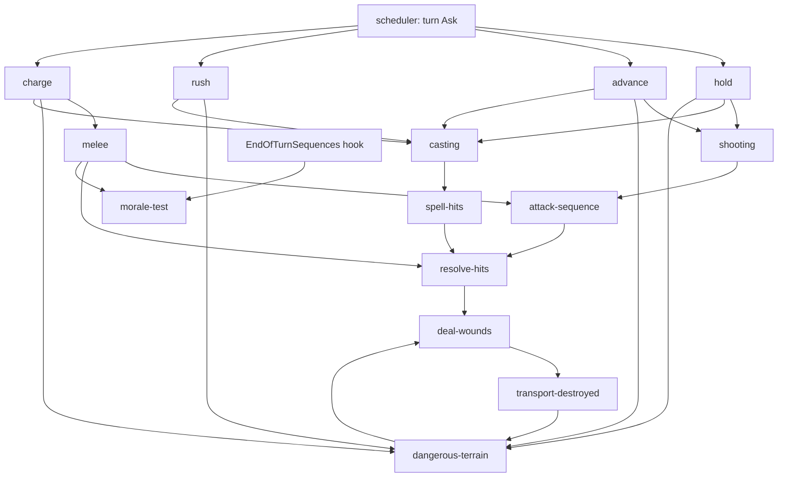
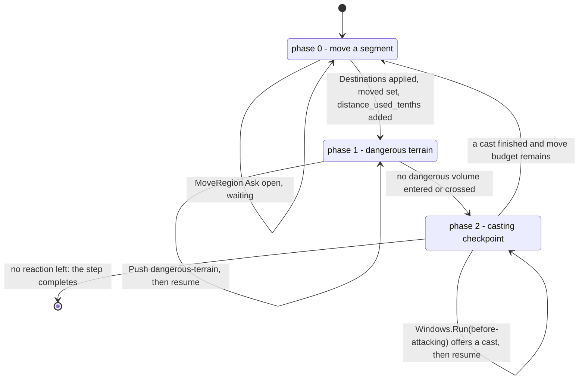
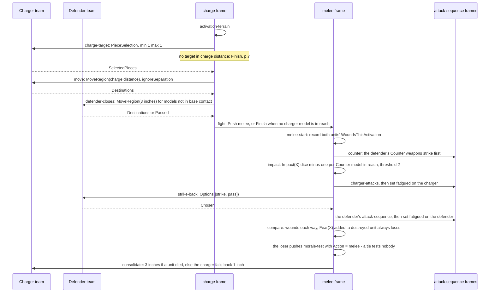

# Grimdark Future's sequences

Fifteen sequences, what each step does, which rulebook page it comes from, and where the
composition is subtle. [design.md](design.md) designs the generic interpreter they run on.
Everything here lives in `server/game/Rules/GrimdarkFuture/`, the only directory in the module
allowed to name an OPR rule.

Read against Grimdark Future v3.5.1, pages 7–15 and 21, with 30–35 and 50 for the token economy's
edges and the free-for-all roll-off.

## The catalogue

| Sequence | Steps | File | Started by |
| --- | --- | --- | --- |
| `hold` | `activation-terrain`, `casting-window`, `shoot-or-not` | `GfMoves` | the scheduler, from the turn Ask |
| `advance` | `activation-terrain`, `move`, `shoot-or-not` | `GfMoves` | the scheduler |
| `rush` | `activation-terrain`, `move` | `GfMoves` | the scheduler |
| `charge` | `activation-terrain`, `charge-target`, `move`, `defender-closes`, `fight` | `GfMelee` | the scheduler |
| `shooting` | `declare-targets`, `fire-groups` | `GfShooting` | `shoot-or-not` |
| `melee` | `melee-start`, `counter`, `impact`, `charger-attacks`, `strike-back`, `compare`, `consolidate` | `GfMelee` | `charge`'s `fight` |
| `attack-sequence` | `determine-attacks`, `roll-to-hit`, `resolve` | `GfAttack` | `fire-groups`, `counter`, `charger-attacks`, `strike-back` |
| `resolve-hits` | `roll-to-block`, `deal` | `GfAttack` | `attack-sequence`'s `resolve`, `impact`, `spell-hits` |
| `deal-wounds` | `assign`, `disgorge` | `GfAttack`, `GfContainers` | `resolve-hits`' `deal`, `dangerous-terrain`'s `deal` |
| `morale-test` | `test` | `GfMorale` | `melee`'s `compare`; `IGameRules.EndOfTurnSequences` |
| `dangerous-terrain` | `test`, `deal` | `GfMoves` | `activation-terrain`, `move` phase 1, `wreck-test` |
| `transport-destroyed` | `wreck-test`, `place` | `GfContainers` | `deal-wounds`' `disgorge` |
| `casting` | `pick-spell`, `spend-tokens`, `roll`, `targets`, `effects` | `GfCasting` | a `before-attacking` window |
| `spell-hits` | `hit`, `resolve` | `GfCasting` | `casting`'s `effects` |
| `roll-off` | `roll-off`, `order` | `GfRolls` | the scheduler, via `FirstTeamDecision.RollOffNeeded` |



`attack-sequence`, `resolve-hits` and `deal-wounds` are the shared spine every damage path
funnels into. The graph has two cycles: `deal-wounds` to `transport-destroyed` to
`dangerous-terrain` back to `deal-wounds`, and any action to `casting` and back. Guards in the
steps bound both, not the interpreter.

## The shared spine

### `attack-sequence` (pages 8 and 9)

Pages 8 and 9 give the same four steps for shooting and melee: Determine Attacks, Roll to Hit,
Roll to Block, Remove Casualties. There is **one** sequence, invoked from two contexts.

Frame context: `ActorUnitId` = the attacker, `TargetUnitIds = [target]`, `WeaponIds` = **one
weapon group** (one weapon type), `Action` = the action the attacker took this activation, or null
for a strike-back.

| Step | Does |
| --- | --- |
| `determine-attacks` | `GfAttack.EligibleModels` for the attacker's models that can reach the target, then `StatReader.Attacks` summed over the group's weapons on those models. Writes `Values["attacks"]` and `Values["eligible_models"]`. The count comes from `Values["attacks_<i>"]` on the pushing frame, which `fire-groups` settled for every group before it pushed the first, so an earlier group's casualties do not shorten a later group (p.8 fires a unit's weapons simultaneously). It counts for itself only when the pushing step recorded nothing, which is every melee push: p.9 sequences melee by hand, so each push is already at the moment the rulebook fires it. `eligible_models` is the live figure either way |
| `pick-target-model` | Nothing, unless the group shoots and carries `Takedown` and the target has more than one living model. Then `PieceSelection(Lookup.AliveModels(target), 1, 1)` to the **attacker's** team, which names the model this group's wounds land on (p.13). One pick per group, not per shot, and the answer stays on this step for `GfAttack.TakedownModel` to read |
| `roll-to-hit` | `GfRolls.HitPlan`, one pooled roll. Writes `Values["extra_hits"]` (`Furious`/`Relentless` per unmodified 6), `Values["hit_multiplier"]` (`Blast(X)`, capped at `Values["blast_cap_<i>"]` on the pushing frame, which is p.13's models in the target counted with the attack counts rather than when this group fires), and `Values["granted_<entry>_<amount>"]` counts for per-die grants (`Rending`'s 6s). Consumes any granted instance that contributed, via `RollEffects.ConsumeGrants` |
| `resolve` | `Push(resolve-hits, ...)` |

`GfAttack.HitsFrom(parent)` is what `resolve-hits` reads back. It is the successes of the
parent's `hit` rolls plus its `extra_hits`, times its `hit_multiplier`. When the parent rolled no
hit roll at all it is `parent.Value("hits")`, which is how `Impact` enters.

`EligibleModels` is where containment short-circuits. `Battlefield.InsideReach` is asked
**first**, before any measurement. Shooting then needs line of sight to a target model and a
weapon in range of it (p.8). Melee needs a model within 2 inches horizontally and 4 inches
vertically (p.9). `GfAttack.KindOf` decides which by asking whether the group has a `Range` stat
at all. Content values: a melee weapon has no range, and *an absent range is absent, not zero*.

### `resolve-hits`: one die per hit

`roll-to-block` rolls `GfRolls.DefensePlan` once **per grant group**: the hits that carry a
per-die grant are rolled separately with that property folded into the live set by
`LiveSet.WithGranted`, which is how `Rending`'s *unmodified 6s get AP(+4)* reaches the defence
roll. Cover is a base modifier of +1, from `GfRolls.InCover(target, eligible attacker models)`
(p.11). Both of p.11's thresholds live in that call: a majority of the target's living models
with a base centre in a `Cover` volume, or fewer than half of them seen. `Battlefield` supplies
only the two counts, `ModelsInCoverTerrain` and `ModelsVisibleFrom`, because the fraction is a
ruleset number. Sight is measured from the whole eligible attacker set, not from one vantage
model. `deal` pushes `deal-wounds`.

`Impact` hits enter here directly, skipping the hit roll. Spell hits enter after a hit roll that
cannot fail, so *on rolls of 6* rules read a real die.

### `deal-wounds`: the defender's Ask

Frame context: `ActorUnitId` = the attacker (**null** when terrain wounds), `TargetUnitIds =
[target]`, `WeaponIds` = the attacking group's (so `Deadly`, and `Bane`'s and `Rending`'s
suppression of `Regeneration`, are live), `Action` = the attacker's.

`GfAttack.WoundsToDeal(frame)` is the failures of every `defense` roll in the parent frame's
completed steps. When the parent rolled none it is the parent's `Values["wounds"]`, which is the
dangerous-terrain path.

`assign` opens `Allocation(Targets = GfAttack.EligibleForNextWound(...), Amount = wounds)` to the
target's team. p.8 gives the defending player free choice of removal order. p.15 constrains it
twice: a wounded `Tough` model takes wounds until it dies, and heroes are assigned last.
`EligibleForNextWound` enumerates over `Lookup.AliveModels`, so a unit inside a container is
wounded like any other. A hero joined to another unit is a model of that unit carrying `Hero` on
its own slot, and `Hero` is `none` aggregation, so the same per-model predicate orders it last.
That is the one clause of `Hero` a joined hero's slot property does reach. The answer is applied as given. An out-of-set allocation under
`warn`/`silent` is applied too, because nothing is an invariant.

A **takedown** wound opens no Ask at all. When `GfAttack.TakedownModel` names a living model of the
target, every wound this group deals is assigned to that one model and the defender is not asked
(p.14 `Takedown`). What that skips is precisely what building the prompt's targets decides:
`EligibleForNextWound`, and so p.8's free choice of removal order, p.15's wounded-`Tough`-model-first
and heroes-last, and the per-model read of `Hero` that orders a joined hero last. Nothing after the
assignment changes: `Deadly` multiplies, `Regeneration` rolls, the `Tough` capacity read shelves the
model, and `WoundsThisActivation` rises by what landed. `Tough` therefore splits in two: it is not
consulted as an *ordering* rule, so a takedown may name a fresh model while a wounded `Tough` model
stands, and it is still read as a *capacity*. Wounds past that capacity are lost, exactly as they
are when a defender allocates more to one model than it can take. A name that is not a living model
of the target is ignored and the ordinary Ask opens; only a menu edit can produce one, because the
pick and the wound are two steps of one frame and the only wounds dealt in between are this group's.

Each assigned wound is multiplied by `RollEffects.WoundMultiplier`. That is `Deadly(X)`, first by
ordinal 0, with no carry-over past the model's capacity. `Regeneration` live on that model rolls
one die at the effect row's threshold, recorded as a `RollRecord` named `Regeneration`, and a
success ignores the wound. The model's `Wounds` rises. At
`Lookup.ModelParameter(state, modelId, "Tough") ?? 1` it goes to the shelf.
`WoundsThisActivation` on the target rises by the wounds that landed. It is a per-unit counter in
game state, because the morale threshold needs it to outlive the frame that wrote it.

**Constraint 6 lives in that one expression.** `deal-wounds` reads a *capacity*. The only place
the string `Tough` appears is `GfAttack.cs`, and `InterfaceConstraintTests` asserts both halves.

`disgorge` is Task 19's addition, covered under §Containment.

## The four actions

`activation-terrain` is the first step of all four: p.11's third trigger, *is activated in it*.
It writes `Values["dangerous_dice"]` for the models standing in a `Dangerous` volume when the
activation begins and pushes `dangerous-terrain`, so the test itself is one step and only the
affected models are rolled for.

`shoot-or-not` (p.7–8: Hold and Advance may shoot) is three cases in order. A `Shaken` unit
`Finish`es with `ConditionSet(unit, shaken, false)`, spending the activation idle and ceasing to
be Shaken (p.10). No valid target `Complete`s. Otherwise `Options([shoot, pass])`, and `shoot`
pushes `shooting`.

### The move step's phase machine

`MoveStep(action, ignoreSeparation)` is one `IStep` that runs several times, once per
`Complete(Repeat: true)`, over `Values["phase"]`.



The casting checkpoint returns the step to phase 0 when budget remains and to phase 2 otherwise,
in both cases with a fresh history, so the window **reopens**. p.13 is *"spend as many tokens as
the spell's value to try casting one or more spells (only one try per spell)"*, and one window per
activation would allow only one spell. That reopening is why the fifth step outcome exists.

Phase 0's Ask is a `MoveRegion` carrying six parameters: the unit's models still in play,
`allowance − used`, the impassable volume ids, the difficult volume ids, `GfNames.DifficultCap`
of 6 inches, and `MoveStep.Containers(...)`. The cap is `null` for a `Strider`/`Flying` unit,
which it does not bind. The allowance is `StatReader.ActionDistance(live, side, action)`, so
`Fast` and `Slow` are ordinary `modify_stat` effects on an `action` row. That is the reason an
action is a row at all. `Values["distance_used_tenths"]` accumulates the largest
`Movement.Check(...).Distance` over the moved models, in tenths of an inch, because `Values` is a
map of integers. A `Passed` answer is a zero move.

The server applies the destinations with its own settled Z (`Battlefield.Settle`) and sets the
unit's `moved` condition. It does **not** enforce the 1-inch separation or coherency. The client
flags those, per `architecture.md` → Rules enforcement. `ignoreSeparation` changes only the Ask's
prompt for a charge.

Phase 1 pushes `dangerous-terrain` when a moved model **entered or crossed** a `Dangerous` volume.
p.11 says *"moves in or through"*, so the test is `Movement.Check` with the dangerous volumes
passed in its `difficult` slot and `EntersDifficult` read back. It is the same swept test asked of
a different set. That is the obligation the geometry module states of this one.

### `dangerous-terrain`: one step, then wounds

`test` rolls exactly `Frame.Parent?.Value("dangerous_dice")` dice, falling back to the models
standing in it now. That is one die per affected model, or that model's `Tough` value in dice, at
threshold 2. Each failure, meaning each 1, is a wound, written as `Values["wounds"]`. `deal`
pushes `deal-wounds` with no attacker. Three invokers write `dangerous_dice` on their own frame
and push: the activation, the move, and transport destruction (proposed spec correction 12).

## Shooting

`declare-targets` opens `Assignment(Items = GfShooting.Groups(...), Targets = valid target units,
MaxDistinctTargets = 2)`. p.8: targets are declared *before any roll*, and up to two different
targets. `fire-groups` reads that `Assigned` answer back off `Frame.Frame.Steps[0].Answer`, records
every group's attack count and `Blast` cap as `Values["attacks_<i>"]` and `Values["blast_cap_<i>"]`
before it pushes anything, pushes
one `attack-sequence` per group with `Takedown` groups first (p.14), and completes when the last has
finished.

`GfShooting.Groups` is one `WeaponGroup(Name, WeaponIds, Takedown)` per ranged weapon **type** across
living models, excluding `Limited` weapons already used this game. `ValidTargets` is the enemy
units with a model still in play that `EligibleModels` admits. A unit inside a container is
therefore a candidate and is then ruled out, or ruled in for a fellow occupant.

A `Takedown` group resolves first, at Quality 2+, and names one model in the target unit as the
target of its wounds in `attack-sequence`'s `pick-target-model` step. The pick precedes the hit
roll, because p.8 declares targets before any roll, and follows `determine-attacks`, so a group
with nothing in range never asks. `GfAttack.IsTakedownGroup` is the one predicate: `WeaponGroup.Takedown`
and the step read it, so a group cannot be ordered first without also being offered the pick. Two
parts of p.14's sentence are not modelled. The pick is per **group** rather than per Takedown model,
because a group is one weapon type whose dice `roll-to-hit` pools into one roll, so two Takedown
models sharing a weapon type name one model between them. And *resolved as if it was a unit of 1*
is not, so cover, `Blast`'s cap and the defence roll still read the whole target unit. That is what
is left of question 7.

## Charge and melee



The defender is asked three times in one charge: close in, strike back, and allocation inside
each `deal-wounds`. `Counter` resolves before `Impact`, a ruling made because the book leaves the
order ambiguous. `melee-start` has to record both units' `WoundsThisActivation` **before**
anything strikes, because `compare` subtracts that baseline. A step inserted before `melee-start`
that causes a wound would be counted twice.

`charge-target` offers enemy units with a model within `StatReader.ActionDistance(Charge)` of a
charger model whose straight path crosses no impassable volume
(`Movement.Check(...).CrossesImpassable`). Two containment consequences fall out:

- **A charger inside a container measures from the container**, because p.15 says *"units may use
  Charge actions to disembark"* and an occupant has no position of its own. Its reach is
  `GfNames.ExitWithin` from the container it is inside. An enemy within that reach is one the
  charger could be placed fully within 6 inches of and then be in contact with. The step's own
  `move` is then the disembark, because `MoveStep.Containers` offers the exit on a Charge and
  never the enterable list. Charging a transport is an attack on it, not a way into it.
- **A unit inside a container cannot be charged**, and this needs no rule. The predicate measures
  to the target's *living* models and an occupant has none, which is p.15's
  no-line-of-sight-in.

`GfMelee.WoundsCaused` is the target's `WoundsThisActivation` less the value recorded at
`melee-start`, plus `Fear(X)` summed over the attacker's models when it attacked (p.13).
`consolidate` gives the survivor's team a 3-inch `MoveRegion` when one unit was destroyed or
routed, and otherwise makes the charger fall back 1 inch (p.10).

Fatigue is a unit condition set by the melee sequence when a unit first attacks in melee in a
round and cleared at the round boundary by `OnRoundStarted`. It is read twice: by
`GfRolls.HitPlan`, which sets `RequiredRaw = 6` and threshold 6 with no modifiers so a fatigued
unit hits only on unmodified 6s (p.9), and by `Impact`'s `actor_state neq fatigued` condition.

## The morale test

One step, `test`. p.10, both paragraphs:

1. A unit with no models still in play `Finish`es without testing.
2. A `Shaken` unit **always fails and no die is rolled**.
3. Otherwise one `GfRolls.MoralePlan` die. On a failure, every kind-5 roll whose child overrides a
   `morale_test` result gets its chance. That is `Fearless`: one die at the effect row's
   threshold, and a success counts as passed.
4. A failed **wounds** test sets `shaken`. A failed **melee** test Routs when the unit is at half
   or less of starting size, or its `Tough` value for a single model, sending every model to the
   shelf. Otherwise it sets `shaken`.

`Values["passed"]` and `Values["routed"]` are 0/1. Removal happens only on the melee path.
`Action` in the frame context carries that distinction as `"wounds"` or `"melee"`.

Morale is never a step of the attack machinery. It is reached from `melee`'s `compare` and from
`IGameRules.EndOfTurnSequences`, which the scheduler calls after the declared action's sequence
finishes and before `turn_ended`. `GfHooks.UnitsToTestAtEndOfActivation` names the units that took
wounds this activation, are now at half or less, and **did not fight a melee this activation**.
Those compared wounds instead. That is constraint 7.

`GfMorale.TestStep` reads `Lookup.AliveModels`, not `LivingModels`. A unit carried in a transport
still takes its test.

## Casting

`casting` is pushed by an **invoked** window at the `before-attacking` point, whenever
`GfHooks.ReactionsAt` finds a caster with tokens. The two invokers are `hold`'s own
`casting-window` step and the move step's phase 2.

| Step | Does |
| --- | --- |
| `pick-spell` | `Options` over `GfCasting.Casters(state, unit)` crossed with the spell entries not yet tried this activation whose `Cost` the model can pay. The option id is `"{spell}\|{casterModelId}"`, so the paying model is in the answer. On the answer: `SpellTokensSet` deducting the cost, and nothing else |
| `spend-tokens` | `Windows.SimultaneousSpend` then `Windows.Spends`, over `GfCasting.SpendCapacity`. Each addressed team names which of its own models pays what and each named model is deducted its own count. `Values["net_tokens"]` is the own team's counts summed less everyone else's |
| `roll` | `GfRolls.CastingPlan(net_tokens)`: one die at 4+ with the net token spend as a signed modifier (p.13). A failure `Finish`es |
| `targets` | `PieceSelection` from the spell entry's four columns: `Side` relative to the caster's team, `Grain` (unit ids or model ids), `Count` as the maximum with a minimum of 1, `Range` from the caster model, and line of sight from the caster model |
| `effects` | Once per chosen target, via `Values["target_index"]` and `Repeat`: every effect of the spell whose conditions hold, in ordinal order |

`effects` can do exactly two things, because `PropertiesJson.Validate` refuses any other spell
shape:

- **`AddHit` with no `RollResult` condition** → `Push(spell-hits, ...)`. Its `hit` step rolls
  `amount` dice at threshold 1, so every die is a hit and *on rolls of 6* rules read a real die.
  It writes `granted_<entry>_<amount>` for the hits' nested grants, then pushes `resolve-hits`.
- **Any effect with `Duration = Once`** → `GrantAdded(targetUnit, new Grant(id, effect.Id,
  effect.TargetEntry ?? spell.Name, casterUnit, 1))`. A model-grain target's grant lands on its
  unit, because the grants store is the unit's.

`EligibleSpenders` is p.13's per-model test: *models with tokens within 18 inches and line of
sight of the caster's unit*, both sides, **the caster included**. `SpendCapacity` groups it by
team, keyed to the tokens each model holds. One predicate serves the caps and the eligibility, so an
ineligible model is neither offered nor paid from. The caster's own model is admitted without
measurement, being a model of the caster's own unit, and p.13 does not exclude it. That is the one
exception to a test that is otherwise **positional on both ends**: `LivingModels` on the caster's
side and `Location is OnTable` on the spender's. A cast from inside a container therefore draws no
tokens from anybody else and resolves at 4+ modified only by what the caster itself still holds
(question 10).

The caps are built in `spend-tokens`, after `pick-spell`'s deduction is applied, so the caster is
offered what the spell's cost left it and no step subtracts that cost twice. A caster whose tokens
exactly paid the cost holds none and is not an entry.

The spend is answered per model, not as one number per team: `TokenSpend.MaxByModel` carries a cap
per model and `TokensSpent.Counts` a count per model, so the player chooses which of its own models
pays (question 14). Every token holder is itself a `Caster(X)` model, which is why the choice
matters: a server-chosen payer would spend the tokens held for that model's own spell. The roll
reads only the sums, since the modifier is ±1 per token spent. Two checks are the step's rather than
the protocol's: a key belongs to the answering team, and a count is within that key's cap.

The token economy is a per-model counter: `+X` at the start of each round for a model with
`Caster(X)`, **even off the table** (p.13), capped at `GfNames.TokenCap = 6`, spent by casting and
by the simultaneous spend on another model's casting roll. It is ordinary editable game state,
granted by `OnRoundStarted`, and needs nothing in `Properties` beyond the parameter the entry
already carries.

`TriedThisActivation` scans the effective log back to the activation's `sequence_started` for
closed `pick-spell` steps. That is the *one try per spell* scope, ruled to be the activation
(question 2). It keys on the sequence context's `Action` being one of the four action names, so a
cast reached by any other route would not bound correctly.

## Containment

Three rules, one location concept, and no capacity check anywhere. Game flow rules that
explicitly: *"Capacity is not enforced."* `Transport(X)`'s parameter is carried by the catalog
entry and read by nothing. `GfMoves.IsContainer` asks only whether the name is there.

### Embarking and disembarking inside a move

p.14 makes them a move: *"units may enter/exit by using any move action"*. They are therefore the
move step's work, not a sequence of their own. `MoveStep.Containers` decides what the Ask offers.
`Apply` handles the three destination shapes a `Destinations` answer can carry:

| Answer shape | Meaning | What is measured |
| --- | --- | --- |
| `To is Inside` | embarking | **nothing.** p.15: *"only one model needs to reach the Transport for everyone to embark"*, and the 1-inch move restriction is ignored. `distance_used_tenths` does not grow. The one guard is state integrity: an `Inside` whose container is not a model on the table is dropped |
| `From is Inside`, `To is OnTable` | disembarking | only p.15's *"must stay fully within 6 inches of it when exiting"*, via `GfMoves.ExitPlacement` over `Containment.BaseFullyWithin`. Checked on the server rather than trusted from the client, because it is the one containment rule that is geometry. A placement outside the radius is not applied and that model stays inside |
| table to table | an ordinary move | as before |

Ignoring the 1-inch restriction needs no code, because nothing enforces it in the first place.
Only the Ask's prompt and the client's decision not to flag it change.

**"Never both in one activation" lives in `Containers`**, which reads
`ContainerMovesThisActivation` and returns `null` for the exit after an embark and `null` for the
enterable list after a disembark. The legal set enforces it, the way every other rule here does.
The answer is applied as sent, and `LegalSet.Contains` under `strict` checks a `move_region`
answer's model ids only.

`ContainersInReach` lists **friendly** containers only, so no automated move puts a unit inside an
enemy vehicle, while `Battlefield.InsideReach` implements p.14 as written. That asymmetry leaves
the inside-to-inside clause latent rather than wrong (question 9).

**`Hold` from inside a container is legal and changes nothing.** The unit stays inside, and
`shoot-or-not` finds a target only among the container's other occupants and the container itself.

### A destroyed container's disgorge order

p.15's last clause, and p.21 says the same of a solid building: *"When a transport is destroyed,
units inside must take a dangerous terrain test, are Shaken, and must be placed fully within 6
inches of the transport before removal."*

*Before removal* is why this is two steps in two sequences:

1. `assign` (in `deal-wounds`) **stops shelving** a container at or past its capacity while it
   holds anybody. A container destroyed empty is an ordinary casualty and never reaches step 2.
2. `disgorge` (in `deal-wounds`) runs one `transport-destroyed` frame per occupant unit, re-reads
   `GfContainers.Wrecks(state)` after each child, and shelves every wreck only when none holds
   anybody.
3. `transport-destroyed`'s `wreck-test` writes `Values["dangerous_dice"]` and pushes
   `dangerous-terrain`, p.11's third trigger, reusing the same `DangerousTestStep`.
4. `place` opens a `disembark` Ask: a `MoveRegion` whose `MoveContainment(Enterable: [], ExitingId:
   wreck, ExitWithin: 6)` tells the client to draw the same region a disembark draws. It then
   sets `shaken` on the unit and moves each survivor to its placement. A survivor the answer left
   no legal placement for is **destroyed** rather than parked off the table. The step writes what
   `assign` writes for a casualty: wounds at the model's capacity, the model removed to the shelf,
   and those wounds on the unit's activation tally, so a unit cut to half or less this way still
   owes p.10's end-of-activation test. The frame reports `Values["destroyed"]` (question 12).

**A nested `deal-wounds` never disgorges.** The occupants' own dangerous terrain test pushes a
`deal-wounds`, whose `disgorge` would find the very wreck the frame above it is emptying. The
guard is a walk up `FrameView.Parent`, this frame's own ancestors rather than the stack, so the
outer `disgorge` is unaffected while its child runs. A `deal-wounds` beneath a
`transport-destroyed` frame completes `disgorge` at once. This is the one piece of reentrancy in
the module.

## The roll-off

Two steps, owned here and consumed by the scheduler. `roll-off` rolls one die per team in ordinal
order at a null threshold, with any teams still tied rolling again among themselves until every
team is ordered. Roll k's dice belong, in ordinal order, to the teams still tied after rolls 0 to
k-1. `order` ranks the teams from those recorded dice and writes
`Values["winner_ordinal"]` and `Values["place_1"] .. ["place_n"]`, team ordinals best first, which
the scheduler's `RollOff.Order` reads into `round_started.Order`. p.50 needs the whole descending
order for a free-for-all, not just a winner.

A null threshold means `Die.Success` is `false` for every die and raw results are compared. The
roll primitive admits that case. The whole-design review filled the gap.

The boundary between the two steps is a confirm gate, and it is the only gate in the module that
does not depend on `game.waits_between_steps`. The frame therefore stays on the stack after the
dice are recorded, which is what `RerollDice` and `SetDice` need, so the roll-off's dice are
editable from the menu like every other roll (the owner's ruling of 2026-09-06 on question 8).
The gate is **addressed to every team**: the roll-off has no acting unit, and its result fixes
turn order for all of them, so there is no team with a better claim to release it. One unsealed
`Confirm` Ask carries every team, and the dispatcher closes an unsealed Ask on the first answer,
so any team may release it.

`order` never rolls. A menu edit that leaves two teams on equal dice is therefore settled by team
ordinal rather than by a fresh die, which is the same tolerance `RollOff.Order` already has for a
hand-edited log. Splitting the ranking out of the rolling step is what makes an edit take effect
at all: `dice_edited` reaches back into a recorded `RollRecord` and never rewrites a
`step_completed`'s `Values`, so a one-step roll-off would have offered an edit the order ignored.

## Roll specs

`GfRolls.Spec(roll)` gives every OPR roll the same convention, `new RollConvention(6, null)`,
which is 1D6 with no modifier cap. The specs differ only in threshold derivation.

| Roll | Threshold | Notes |
| --- | --- | --- |
| `hit` | `Quality` at unit level, read through `StatReader.TargetNumber` | fatigued in melee: `RequiredRaw = 6`, threshold 6, no modifiers (p.9) |
| `defense` | `Defense` at unit level | base modifier `cover +1` when shooting into cover (p.11) |
| `morale` | `Quality` at unit level | a `Shaken` unit rolls no die at all |
| `casting` | 4, fixed | the net token spend as a signed `tokens` modifier (p.13) |
| `roll-off` | none | raw comparison, ties rerolled |

All three target numbers are the unit's, and every one is the whole roll's: a `RollRequest`
carries one `Threshold`. `Quality` and `Defense` are declared at `model` level as well, because a
hero joined to another unit is a model of it and its slot carries its own two, and neither
declaration is read. A joined hero therefore hits and blocks on its host squad's numbers, which
is what `Hero`'s own clause asks for on the defence side and what the roll shape imposes on the
hit side. Interpreter design → question 13 prices the change.

The dangerous-terrain test and every kind-5 property roll (`Regeneration`, `Impact`, `Fearless`)
borrow a convention from a spec but are **not** `roll` rows. Nothing targets them, so they exist
only as `RollRecord.Roll` names.

## The one flagged interpretation

Recorded as a visible constant on `GrimdarkFutureRules` rather than as silent behaviour, as
action sequences asked:

```csharp
public const string OneTryPerSpellScope = "activation";   // question 2
```

`RecomputeAttacksPerGroup` was the second such constant. The owner ruled question 3 on 2026-09-06
and it is **deleted** rather than set to `false`: nothing branched on it, so `false` would
advertise a switch that does not exist and name the settled behaviour by its negation.

`Counter` before `Impact` is the other ambiguity. The 09-03 session ruled it rather than flagging
it, so it is ordinary code in `GfMelee`.
