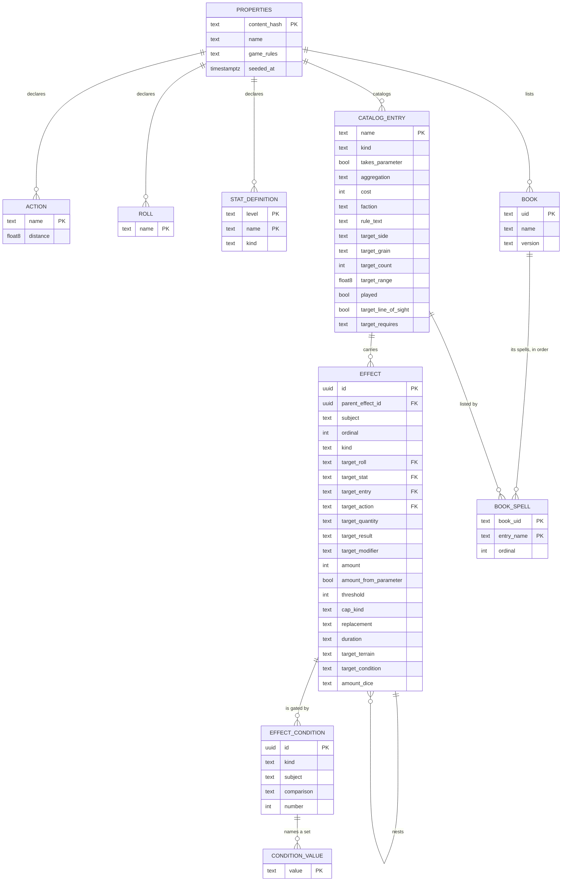

# The `Properties` set

Part of [the interpreter design](design.md).

`Properties` is the data half of a ruleset: stat declarations, the action and roll rows an
effect can point at, one catalog of named rules carrying their effects, and the army books that
list the catalog's spells. `schema.md` makes it ten tables. This module gives them three representations.

| Form | Type | Lives | Has ids | Has a hash |
| --- | --- | --- | --- | --- |
| Authored | `PropertySetDocument`, composed from a `*.properties.json`, every `*.part.json` and every `BookDocument` (`*.book.json`) of its game rules | `server/game/Content/`, embedded in the build | no | derived |
| Stored | ten tables in the `management` schema | Postgres | yes, minted at seeding | `properties.content_hash` PK |
| Runtime | `PropertySet` | memory, one per hash per process | yes, read back | yes |



`effect` is one table for eighteen kinds. Six columns serve a single kind each: `threshold`,
`cap_kind`, `replacement`, `target_terrain` (`count_as_terrain`), `target_condition` (`set_condition`) and
`amount_dice` (`place`). The self-reference carries nesting. `condition_value` exists
because one predicate can name a set: `Fast` applies to *Rush/Charge*. The `properties_hash`
column that every child table carries as part of its key is elided for width, as are the
`entry_name` and `condition_id` foreign keys and the `position` columns. [`schema-diagram.md`](../../schema-diagram.md) has them in full.

`PropertySet` mirrors the tables member for member; `PropertySet.Books` is keyed by uid, and
`SpellsOf(bookUid)` is the spells a book lists, empty for a null or unlisted uid. Every closed set is a C# enum whose wire
spelling is the check-constraint value under `ContentJson`'s snake_case policy.
`PropertySetTests` asserts that directly: `EffectKind.ModifyRoll` serialises as `"modify_roll"`,
`CapKind.ModelsInTargetUnit` as `"models_in_target_unit"`. `Effect.EffectiveAmount(int?
parameter)` is the one piece of behaviour on the row. `amount` is signed and keeps its sign when
the magnitude comes from the entry's `X`, so `AP(3)` is `Math.Sign(-1) * 3`.

## Canonical hash and authored files

`architecture.md` → Rules as data, *How authored content reaches those tables*, names the mechanism.
This section is its design.

A set is authored as files under `server/game/Content/<GfEdition.ContentFolder>/`, embedded in the game server's assembly, one
folder per edition (`grimdark-future-3.5.1/` for the game-rules id `grimdark-future`, `grimdark-future-3.6/` for `grimdark-future-3.6`),
the same files in each: `core.properties.json` (the rulebook's rules), `army-rules.part.json` and `relic-wargear.part.json`
(written by hand), `army-book-rules.part.json` and `army-books/<uid>.book.json` (48 books under 3.5.1, 49 under 3.6.0, written by
`scripts/ArmyBooks`, never by hand). Each file's `gameRules` field names its edition's id. `PropertiesSeeder.EmbeddedDocuments`
returns one composed document per `*.properties.json`, so two, one per edition: `Compose` unions its entries with every part's and every
book's spells of the same `gameRules`, writes an entry two sources carry once when their canonical forms are equal
and refuses two different entries of one name, and lists each book as a `BookRecord(Uid, Name, Version, Spells)`
in uid order with its spell names in the book's order. The composed document has the ten tables' shape without
ids, and is what validates, hashes and seeds; the core document's `name` is the edition's display name (`Grimdark Future v3.5.1`,
`Grimdark Future v3.6.0`), so each edition's listed set is the one holding that edition's books ([the spell library](../../superpowers/specs/2026-10-02-spell-library-design.md)
→ One set holds every book).
`PropertiesJson.Canonical` serialises it with the lists whose order carries no meaning sorted
(`stats` by level then name, `actions`, `rolls` and `entries` by name, `books` by uid, all `StringComparer.Ordinal`)
and the lists whose order *is* meaning left alone (an effect's `ordinal` is authored, and so is
the order of its children, conditions and condition values, and a book's spell order). The stored rows keep both kinds of order: every action,
effect, condition and condition value records its `position` in the document (`docs/schema.md` → Ordered child rows
record their position), because the engine reads actions in order too. `PropertiesJson.Hash` is `"sha256:"` plus 64 lowercase
hex over that. `PropertySetDocumentTests` pins the property that matters: reversing `entries` and
`rolls` does not change the hash, changing `name` does.

Consequences:

- **Editing a document, or regenerating a book, produces a new set, and every game that has not ended moves to it.** The hash
  changes, `SeedAsync` inserts new rows, `PropertiesSeeder` records the hash as its game rules' current set (`CurrentProperties`),
  and `Hydrator` repins each game that has not ended to it (`IGameRows.RepinPropertiesAsync`); an ended game keeps its set
  ([games follow the current rules](../../superpowers/specs/2026-10-19-games-follow-the-current-rules-design.md)). Content is append-only: nothing updates a seeded row's content, and stale sets are never
  garbage-collected. The one update is a present set's null `position`s, filled from its document. [Failure modes](operations.md#failure-modes) takes that up.
- **Effect and condition ids are minted at seeding**, not authored. `Grant.EffectId` is stable
  within one database and not portable between databases. A loaded set aliases the effect rows of the other sets of its game
  rules by entry, position path and kind (`EffectAliases.Match`), and `PropertySet.EffectById` falls back to them, so a grant
  minted before a game moved still names its row. A grant in an event log refers to an
  `effect.id`, so restoring a log into an independently seeded database would dangle. Nothing in
  the design depends on portability today, and nothing warns about it either.
- **The hash covers content, so the same file seeds the same hash everywhere.**
  `PropertiesSummary.GameRules` from `GET /v1/properties` is therefore stable enough for the web
  app and the client to offer at game creation.

`PropertiesJson.Validate` returns a list of human-readable problems and `ToSet` throws
`InvalidDataException` listing them. It enforces what the database's foreign keys and per-kind
`CHECK` constraints enforce, at authoring time rather than at insert time. The rules: every
`targetRoll`, `targetStat`, `targetEntry` and `targetAction` resolves inside the same document;
`aggregation` is set exactly when `kind` is `model`; `cost` and `targeting` exactly when `kind`
is `spell`, except that a `model` pick entry carries `targeting` too; `threshold` only on `roll`, `cap_kind` only on
`multiply`, `replacement` only on `replace_stat`, `target_terrain` exactly on `count_as_terrain`, `target_condition`
exactly on `set_condition`, `amount_dice` (`d3`) only on `place`; a `roll` effect has at least one child; an `add_hit`
of `wounds` or `attacks` carries a `roll_result` condition; `range`, `round_number`, `usage_count` and `at_point` take
no subject, while `holds_property` and `most_models` need one and name exactly one value; a text-only entry
(`played = false`) has no effects; a `spell` entry's top-level effect is `add_hit`, `take_test`, or carries
`duration = once`; a book's uids are unique, every name a book lists is a `spell` entry listed once in that book,
and every `spell` entry is listed by some book.

The spell-shape rule is a reading, not a schema constraint: the 282 spells of the 47 books that publish them
are those three families ([the spell library](../../superpowers/specs/2026-10-02-spell-library-design.md) →
Grammar additions). Validating it makes an unexpected spell shape fail loudly instead of applying nowhere.

A `roll_result` condition's `condition_value` rows are the roll it reads, `raw` or `modified`, and
optionally `success` or `fail` (`schema.md` → A condition is a row, and its values are rows).
`number` is the face. `condition_value.position` carries each value's index (`schema.md` → Ordered child rows record their position); the loader's re-order to roll name, then `raw`/`modified`, then the outcome serves only rows seeded before that column, and `Validate`
refuses a roll named `raw`, `modified`, `success` or `fail`.

## Store and seeder

```csharp
interface IPropertiesStore
{
    Task<PropertySet?> LoadAsync(string contentHash, CancellationToken ct);
    Task<bool> SeedAsync(PropertySetDocument document, CancellationToken ct);  // false: this hash already exists
}
```

`PostgresPropertiesStore` reads the ten tables and assembles the effect tree by
`parent_effect_id`, ordering siblings by `position`, then `ordinal`, then `id`, and each book's spells by
`book_spell.ordinal`. `InMemoryPropertiesStore` is what
every test outside `PropertiesStoreTests` uses. `PropertiesSeeder.SeedEmbeddedAsync` runs once at
startup from `Program.cs`, guarded off the `Test` environment so `WebApplicationFactory` tests do
not write to the shared database.

**The game server seeds** (the plan's ruling 1). It is the only process
that interprets the catalog, and the write is idempotent by content hash. Management is a second
process over the same database, and its `GET /v1/properties` lists the latest seeded set per ruleset and name. The two
processes are one system, so the seeding write needs no endpoint to pass through.
