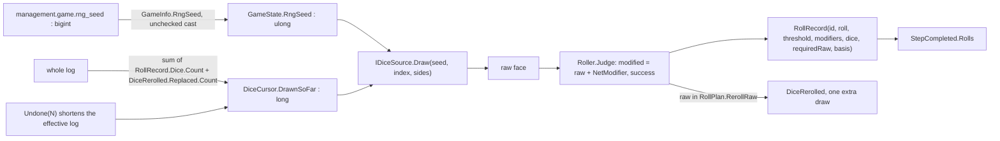
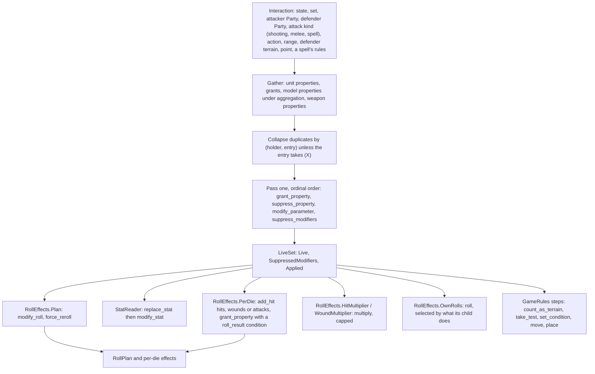
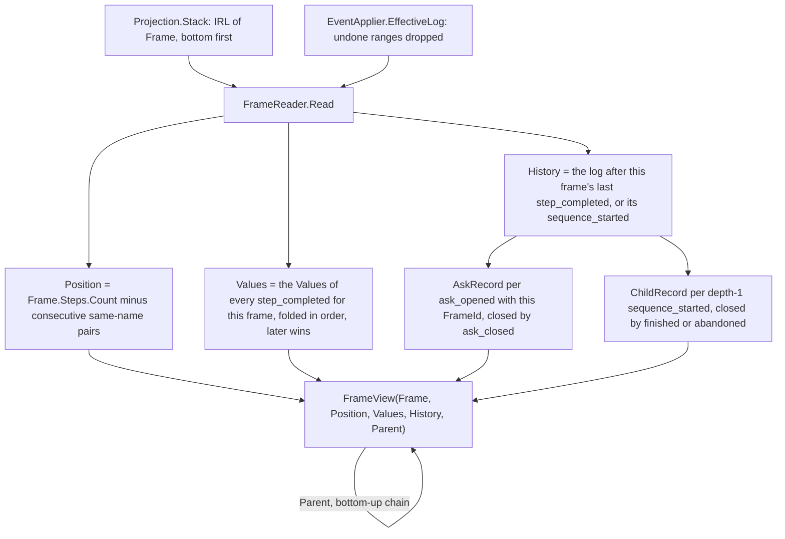
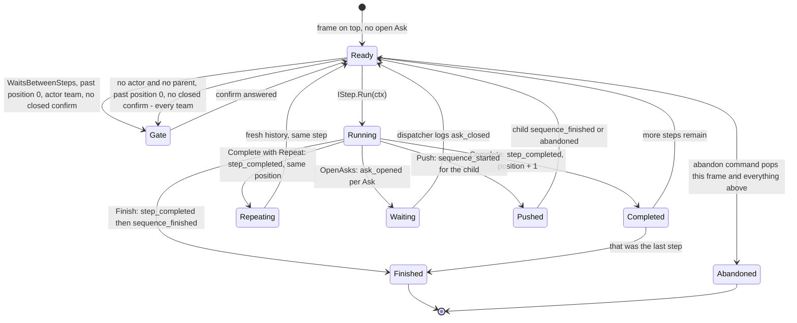
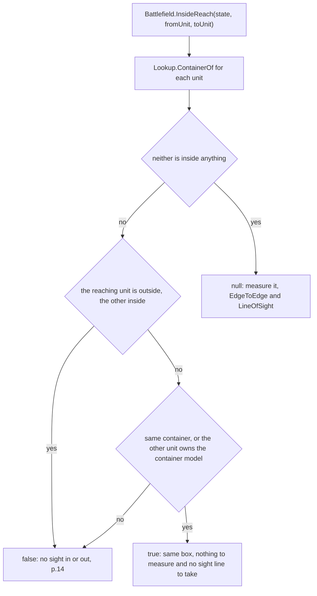

# Resolution

Part of [the interpreter design](design.md): the roll primitive, the effect grammar's two passes, the resolution stack, Asks and windows, the engine seam, the battlefield reader, the generalisation budget and where Grimdark Future's sequences sit.

## The roll primitive

`architecture.md` says *RNG lives in server state as a seed*. An undone roll's dice stay drawn,
so rewinding cannot be used to see the coming dice or fish for a roll. The seed is `GameInfo.RngSeed`, written once when
management creates the game row and never written again. The cursor is counted from the whole
log, undone events included, and stored nowhere.



The seed is fixed for the life of the game and the cursor is a function of the whole log. An
undo rewinds everything but the dice: an undone roll's dice stay drawn, and redoing the same action draws fresh faces.

`DiceSource` is a counter-based generator: a SplitMix64 finaliser over `seed ^ (index * golden
ratio)`. Die *i* of a game is a pure function of `(seed, i)` with no sequential dependency.
`ScriptedDice(params int[] faces)` returns `faces[index % Length]` and ignores the seed. Every
sequence test uses it to script a whole engagement as one array of faces in draw order.

`RollPlan` is the settled roll: `Roll`, `Threshold`, `Modifiers`, `Convention`, `RequiredRaw`,
`RerollRaw`, `RerollSuccessfulRaw` and `Basis`, the threshold's `ThresholdBasis` from
`StatReader`'s `TargetRead`. `Threshold` is nullable because the roll-off has none. `NetModifier` sums the
modifiers, then clamps to `±Convention.ModifierCap` when the ruleset set one. OPR never clamps.
40k clamps hit and wound at ±1. Summing is generic and clamping is the ruleset's: constraint 4.
Success is `RequiredRaw is { } r ? Raw >= r : Threshold is { } t && Raw != AlwaysFails && (Raw ==
AlwaysSucceeds || Modified >= t)`, the two faces read from the convention. OPR's are 1 and 6 on every
roll (p.5). The `RequiredRaw` branch covers fatigue's *unmodified 6s*, rolls that are no test (a
spell's *"Roll as many dice as hits"*, Unpredictable's table roll) and 40k's critical hits, and is
why a die carries both raw and modified.

Every roll is recorded per die: `RollRecord(Guid Id, string Roll, int? Threshold,
IReadOnlyList<RollModifier> Modifiers, IReadOnlyList<Die> Dice, int? RequiredRaw, ThresholdBasis? Basis = null)` with `Die(int Raw, int Modified,
bool Success)`. A forced reroll or `SetDice` re-judges a die under the record's own threshold, modifiers and `RequiredRaw`. **Replay applies these. It never re-derives them.** `GameRules` is unpinned C#,
so a threshold recomputed after a deploy could disagree with what the players rolled (resolution →
Rerolling does not break undo).

Dice and modifiers are the rules' alone: no player command rerolls a die, sets a face or adds a
modifier. Two ways a die changes after it is drawn, each a distinct event:

| Origin | Payload | Draws a new die | Cursor grows |
| --- | --- | --- | --- |
| A property forcing a reroll (`Bane`) | `DiceRerolled` emitted by the step, after its `step_completed` | yes, once per matching die, never again | yes |
| The rules suite fixing a roll's faces | `DiceEdited` from `RulesEngine.Execute(SetDice)`, only where the engine accepts `SetDice` (below) | no; the raw face is given and re-judged | no |

`RollOutcome.Successes/Failures/CountRaw` read a record back **as it now stands**, because the
applier folds replacements into the projection's copy. A `SetDice` of a block die between
`roll-to-block` and `assign` changes the number of wounds `assign` asks the defender to allocate,
because `assign` reads the record rather than a stored count.

**The edit model.** An edit (`SetDice`) reaches a frame on the stack and nothing popped. It appends one event
and rewrites none: every `step_completed` already appended keeps its `Values` and `Changes`, and an
edit changes exactly what later steps read off the record. Where a sequence is split for it, the
rolling step records and the next step reads the record as it now stands and decides, so the
boundary between them is where an edit lands. Grimdark Future splits the roll-off, the hit rolls
(attacks and spell hits), the casting roll and the morale test. Six rolls still settle their
consequence in the step that rolls them, and an edit to one reaches only later readers:
`roll-to-block`'s per-die extra wounds, `assign`'s wound-ignoring rolls, `dangerous-terrain`'s
test, `impact`, the attack-start rolls and a dice-distance move
([opr-sequences.md → Dice edits](opr-sequences.md#dice-edits)).

## The effect grammar: two passes

An effect is a row saying what a named rule does. Eighteen kinds cover Grimdark Future and its army books.
**Four of them act on other properties** rather than on game state: grant, suppress, modify a
parameter, suppress modifiers. Resolution is two passes for that reason. `Bane` deletes
`Regeneration` from the interaction and `Thrust` adds an `AP` that may not have been there, so which
properties are live and what their parameters are must be settled before anything is applied.



Pass one produces a value, `LiveSet`. Pass two is several readers over it, each answering one
question a step asks. There is no single "apply everything" call.

Pass one **skips any effect with a `roll_result` condition**, because those cannot be judged
before a die exists. They reappear in pass two through `LiveSet.Effects(side, kind, die)` and
`LiveSet.WithGranted`. `WithGranted` folds a per-die grant into a copy of the set for the block
roll that hit group produces, as `Rending`'s *unmodified 6s get AP(+4)* needs.

**Ordering is `Effect.Ordinal`, an explicit integer field, not registration order.** Restricting
modifiers to arithmetic would make them commute and remove the explicit priority scheme
`architecture.md` calls for, but across every rule in the book commutativity holds for one of
eighteen kinds. Suppression and parameter-modification do not commute, and the rulebook orders
several by hand.
`Deadly` is *"resolved first"*. `Blast` applies *"after resolving other special rules"*. Every
enumeration in `LiveSet.Effects` and in `LiveProperties.Settle` is `OrderBy(Ordinal)`.

Two details inside pass one:

- **Aggregation is a field on the entry, not a predicate.** `Stealth` is *"units where all models
  have this rule"* and reads `all`. `Tough(X)` reads `none` and yields one `LiveProperty` per
  model. `Gather` computes the count of distinct models carrying the entry and applies
  `all | any | majority | none`. `majority` has no tie rule beyond `count * 2 > models.Count`;
  identity and enumerations fixes none.
- **A `unit`-kind entry on a model slot is the unit's rule.** Aggregation is declared exactly when
  the kind is `model`, so a `unit`-kind entry carries none and aggregation cannot answer for it.
  Import produces the shape two ways: a rule whose count is smaller than the unit, and a hero
  joined to another unit, whose rules all land on its slot whatever their kind. `Gather` and
  `Lookup.UnitHas` both read such an entry off the unit's definition, holder-less, so the effect
  pass and the name lookup agree. `Aircraft`, `Ambush` and `Scout` are the entries it can be.
- **Duplicates collapse unless the entry takes a parameter** (p.13: instances of the same rule
  do not stack unless it has (X)). The grouping key is `(entry name, model id when aggregation is
  none, weapon *name* when it is a weapon rule, grant id)`. It keys on weapon name rather than
  weapon id, so three Lances in a group contribute one `AP(1)` rather than three.

`EffectDuration` is spell effects → Duration. `interaction` covers every core rule. `once`
means applying the effect writes a grant onto its target instead. A grant is
`Grant(Id, EffectId, EntryName, CasterUnitId, RemainingUses)` on the unit: `EntryName` is the spell or pick
entry that wrote it and `EffectId` the one row it holds, so a granted instance (`LiveProperty.GrantRow`)
exposes that row and its children and nothing else of the entry. One cast writes one grant per once-row per
target, and writes none on a target already holding grants of that spell (p.13: the same spell does not
stack). It is a fourth in-play
store beside the action record, conditions and placement: rebuilt from the log, editable from
the menu, read by both passes through `Lookup.UnitProperties` and by `GameRules`' name checks
through `Lookup.UnitHas`, which count a granted rule only through a subject-`self` `grant_property` row.
A grant's parameter is read from its effect's `amount` in the pinned
set by `EffectId`. The grant row carries no parameter, so grant behaviour depends on the id
stability described above. Consumption belongs to the consuming step: a reader marks a granted source it
used in `LiveSet.GrantsRead`, and `RollEffects.Consume(live)` emits a `GrantRemoved` for every grant on that
unit with the same `EntryName`, so the grants one spell left are consumed together. Reading a grant to
build a legal set consumes nothing.

The eighteen kinds, the eleven predicates, the two-pass code in detail, and the worked rows for
`AP`, `Stealth`, `Impact`, `Bane`, `Rending`, `Blast` and `Unstoppable` are in
[the effect grammar](effect-grammar.md).

## The resolution stack

A game in play has a **resolution stack**: frames, one per sequence in flight. A frame is the
sequence's name, the `SequenceContext` it was invoked with, its position, and the values its
completed steps produced.

**The stack is never stored.** Four event kinds carry it: `sequence_started`, `step_completed`,
`sequence_finished` and `sequence_abandoned`. `FrameReader.Read(state)` rebuilds every
`FrameView` from `state.Projection.Stack` plus the effective log on every call.



A step's entire memory is derived. Its position, the parameters it settled, the Asks it opened
and the children it pushed all come out of the log window since it last completed. There is no
per-step schema.

**A stack, not a call stack.** A C# continuation cannot be serialised, so an async rendering of
these sequences cannot be durable state, cannot survive hydrate-from-log, and cannot be replayed
for undo. Three standing decisions rule it out at once. The cost is the module's dominant
ergonomic burden: **a step holds no C# locals across a suspension**. Every `IStep.Run` opens by
re-reading its own history to work out where it is. `GfMoves.MoveStep` and `GfMelee`'s `fight`
step show the pattern: a chain of `if (ctx.History.LastClosed() is { } closed)` and
`if (ctx.History.Children.Count > 0)` guards in place of `await`.

Two details in `FrameReader` are load-bearing:

- **Position is completed steps minus repeats.** A repeating step logs a second `step_completed`
  with the same name, so `Sequence`'s constructor refuses a sequence that lists one name twice in
  a row. That invariant is what makes "same name as the previous completion" mean "repeat" rather
  than "next step". The check is an `ArgumentException` at construction, so a ruleset bug fails
  at first use of `GfRules.Sequence(...)` rather than mid-game.
- **History is depth-1.** `History` counts nesting with a `depth` counter so a grandchild
  sequence does not appear as this frame's child. `ChildRecord` order is push order. *"The k-th
  chosen reaction is the k-th child"* is how a re-run window step knows which reactions it has
  already pushed.

### Step outcomes

A step ends one of five ways. Action sequences → A step ends one of four ways lists completing,
asking, pushing and opening a window. Opening a window is not an outcome here: `Windows.Run`
returns an `OpenAsks` or a `Push`, so a window is built out of those two. The other two are
`Finish`, which completes a step and ends the sequence early, and `Repeat`, which completes a
step and runs it again.



Repeat and complete emit the same payload and differ only in whether the position advances. The
log distinguishes them by the name of the previous completion.

| Outcome | Type | Payloads | Frame afterwards |
| --- | --- | --- | --- |
| Complete | `Complete(Changes, Values?, Repeat = false)` | `step_completed`, then any forced `dice_rerolled`, then `sequence_finished` if it was the last step | position + 1 |
| Repeat | `Complete(..., Repeat = true)` | the same, never `sequence_finished` | same position, empty history |
| Finish | `Finish(Changes, Values?)` | `step_completed` then `sequence_finished` regardless of position | gone; the remaining steps never happen |
| Ask | `OpenAsks(IRL<Ask>)` | one `ask_opened` each | suspended until every Ask is closed |
| Push | `Push(Sequence, Context)` | `sequence_started` for the child | suspended; the step runs again and sees a `ChildRecord` |

`Finish` is what a charge whose targets have all gone out of reach does (p.7: *if being within charge
distance becomes impossible (due to killed models, special rules, etc.), then the unit may complete
its move in any direction and ends its activation*; a charge with no target in reach is never offered,
because `GfMelee.ChargeTargets` gates it in `ActionsFor`) and what a `Shaken` unit's `shoot-or-not` does. `Repeat`
is what a move step's next segment does after a mid-move cast. A step that repeats must advance
its own state, or it loops forever emitting `step_completed`. `GfMoves.MoveStep` guards this with
an explicit `Values["phase"]` machine. `GfContainers.WreckTestStep` guards it with
`Frame.Value("dangerous_dice") > 0`. There is no interpreter-level loop bound.

`StepCompleted.Values` is a flat `IReadOnlyDictionary<string, int>`: attacks counted, a capped
hit multiplier, extra hits, a distance in tenths of an inch, a token spend, who lost. There is no
schema per step kind, one flat map (contracts → Event inventory). It buys two things. A later step or a nested frame reads a settled
parameter without re-deriving it. A forced reroll or a `SetDice` between steps changes what the next step reads, which
is the record, without changing what was settled, which is the value. A value a face decides is
therefore settled by the step after the roll in the split sequences above. The cost is untyped string
keys with no registry. `dangerous_dice`, `net_tokens`, `phase`, `hits`, `hit_multiplier`,
`distance_used_tenths`, `place_1..place_n` and `loser` are conventions held in `GfNames`' vicinity
and in prose, not in a type.

**Abandonment** is an ordinary logged command handled by the skeleton's dispatcher, not by this
module. It pops the frame and everything above it. The dispatcher closes the popped frames' Asks
before `sequence_abandoned`. **Applied effects stay applied. Unapplied steps never happen.**
There is no rollback and there are no inverse events, because nothing recorded is an invariant.
Players fix what they dislike from the menu, or undo past the whole sequence by replay. A step
that observes an abandoned child treats it the same as a finished one. `ShootOrNotStep` and
`DisgorgeStep` both read `Finished || Abandoned`.

**Confirm gates.** When `game.waits_between_steps` is on, every step boundary past position 0 is
a gate. The interpreter opens its own `Ask` with question `AskQuestions.Confirm` and a
`Confirmation` legal set, addressed to the acting unit's team. Pausing is an Ask, so confirming
is answering it, and there is one input path rather than two.

A frame with **no actor and no parent** is gated at every boundary past position 0 whatever
`game.waits_between_steps` says, and its gate is addressed to **every team** in `Info.Teams`. The
roll-off is the only such frame. Nothing else holds its log open: with no actor there is no team
to address, and with no parent there is no enclosing frame left on the stack once it finishes, so
its rolls would be out of reach of `SetDice` forever. Every team has the same
claim on a roll that fixes turn order for all of them, so the Ask carries all of them. It is
unsealed, and the dispatcher closes an unsealed Ask on the first answer, so any team releases the
gate. Waiting for all of them would need a sealed Ask, which exists to withhold and reveal
answers, and would make the first round wait on every team being present.

An **actorless nested** frame stays ungated, which is the terrain-wounds `deal-wounds` case. Its
`assign` opens the defender's Ask, so the frame is already suspended and its dice are already
editable, and the target's team would be the addressee if a gate were ever wanted there.

The gate on the roll-off is the plan's ruling 8. `GfRolls.RollOffSequence` has a second step,
`order`, so the gate has a boundary to sit on and an edit made at the gate is read back into the
order.

## Asks, windows and the simultaneous token spend

An Ask is addressed to a **team** and carries a question name and a server-computed `LegalSet`.
It is the only way input enters resolution. The interpreter never emits `ask_answered` or
`ask_closed`. The dispatcher does, and the interpreter reads `ask_closed` back out of the log to
resume. What the legal set means is enforcement's business, not this module's: under `strict` an
out-of-set answer is refused, under `warn` it is accepted and logged with a warning, under
`silent` accepted. Every step must therefore tolerate an answer outside its own legal set.
`Windows.Run` reads `if (ask.Single is not Chosen chosen) continue;` and `AssignStep` applies the
defender's allocation as given.

Every Ask this module opens is **framed** (`Ask.FrameId` non-null). Every Ask the scheduler opens
is unframed. That bit splits `Advance` between the two.

A **window** is an Ask about interrupting. A step declares a named point and
`IGameRules.ReactionsAt(state, properties, point, frame)` says who can react there. **If nothing
can react, no window opens.** `Windows.Run(ctx, point)` returns `null` when the window is done,
so a step can write `if (Windows.Run(ctx, point) is { } outcome) return outcome;` and fall
through. Teams are asked one at a time in `Windows.ReactionOrder`. A chosen reaction is pushed
before the next team is asked, so reactions resolve in turn order after the actor.
`ReactionOrder` is **the one reaction-ordering policy** in the system. It consults
`IGameRules.OrderReactions` first. Otherwise it rotates `Projection.Scheduler.Order` to start
after the actor's team, appends teams the order does not list in `Info.Teams` order, restricts to
the reacting teams and drops teams in `Projection.Scheduler.Passed`. The scheduler module defines
no ordering type of its own.

A window opens two ways, with one suspension. **Offered** windows go to teams other than the
actor. OPR core barely uses them. 40k's Fire Overwatch pushes a whole shooting sequence into an
enemy move step. **Invoked** windows are opened by the actor inside its own step. That is
casting, *at any point before attacking*, mid-move included.

One variant is **sealed and simultaneous**, for one OPR rule: casting's token spend (p.13).
Every eligible team answers the same Ask concurrently and the answers are withheld until the
window closes.
Sequential reveal online would hand the last mover an advantage the tabletop does not. This is
the only use of the per-player filtered event streams `architecture.md` kept available. The
skeleton's `EventFilter.ForViewer` does the withholding.

`TokenSpend` carries **a cap per model**, `MaxByModel`, and `TokensSpent` answers a count per
model: p.13's spend is a per-model eligibility test and the player chooses which of its own models
pays (the plan's ruling 14). One map covers every addressed team, because an Ask has one legal set for all
of its teams, and it hides nothing, since `ModelInPlay.SpellTokens` is in every client's
projection. There is no total anywhere: a team's maximum is the sum of its own entries, so nothing
clamps one and no Ask carries another team's pool (the plan's ruling 6).

Two checks are the spend step's rather than `LegalSetMembership`'s, which has no state to answer
them with: a key belongs to the answering team, and a count is within that key's cap. The
precedent is `MoveRegion`, whose membership checks model ids and leaves distance to the move step.
Both are applied whatever the enforcement setting, because spending tokens a model does not hold
would drive its counter below zero.

## The engine seam

```csharp
// Engine/RulesEngine.cs
IReadOnlyList<EventPayload> Advance(GameState state)
{
    if (state.Projection.OpenAsks.Values.Any(a => a.Ask.FrameId is not null)) return [];
    if (state.Projection.Stack.Count > 0) return Interpreter.Advance(state);
    return scheduler.Advance(state, Interpreter);
}
```

The division of labour: **a framed Ask blocks everything, a non-empty stack is the interpreter's,
an empty stack is the scheduler's.** The scheduler is still called while one of its own unframed
Asks is open. It returns `[]` for one that is live. It closes, with an empty answer list, one
that a menu edit superseded. That is the only `ask_closed` the engine ever writes.

`Judge` and `Execute` handle one command, `SetDice`, and refuse everything else:

| Command | `Judge` | `Execute` |
| --- | --- | --- |
| `SetDice(FrameId, RollId, Dice)`, engine accepts it | `Legal` when the frame is on the stack, the roll is in one of its completed steps, every index is a die of it and none repeats, and every face is on the roll's convention | `DiceEdited` with each die re-judged from its new raw |
| `SetDice`, engine does not accept it | `Illegal` | `RefuseCommand(NotPermitted, ...)` |
| anything else | `Illegal` | `RefuseCommand(Unknown, ...)` |

`SetDice` is the rules suite's way to fix a roll's faces, not a player's. `RulesEngine` takes it only
when constructed with `acceptsSetDice`: `GameServerOptions.AcceptsSetDice`, on in the Development
environment alone, and the sim's in-process driver. A production game server refuses it under every
enforcement setting, since `Execute` refuses it too when warn or silent let an illegal command through.

`RulesEngineFactory` replaces the skeleton's `InertEngineFactory`. It loads the set by
`game.PropertiesHash`, caches by hash behind a lock, and throws `PropertiesNotFoundException`
when the hash is not seeded. `ConnectionHandshake` catches that and closes the socket with
`1011 cannot hydrate this game` rather than faulting the process. `Create` is synchronous because
`IRulesEngineFactory` is, so the load blocks a hydration on a database round trip. That costs one
round trip per game per process, and the cache reduces it to one per hash.

## Battlefield reader and the two model readings

`Interpreter/Battlefield.cs` is the only place the module asks geometry a question. Every method
takes ids and returns a measurement. What a measurement means is `GrimdarkFutureRules`'.
`Placed` returns `null` for a model that is not `OnTable`. `At(state, modelId, placement)` builds
a body at a placement it does not hold yet. That is how a destination is judged before it is
applied, and the only way to place an occupant, which has no position of its own.

**Containment answers three ways, not two.** Filtering to models that have a position gets half
of p.14 right and half wrong. The rulebook says units inside a transport have no line of sight
to the outside. It also says units inside **can** target other units inside, and the transport
itself.



Containment is asked **before** any measurement. `null`, not `false`, is the ordinary case, so
every caller must handle a nullable answer. `GfAttack.EligibleModels` and
`GfCasting.SpellTargets` both short-circuit on it.

The *target the transport itself* half of p.14 is not reachable in a game. `GfShooting.ValidTargets`
offers enemy units only, a unit's own container is friendly, and no unit may enter an enemy
container. The branch is written for faithfulness to p.15 and is reached only from a
menu-written state.

**A unit's models mean two different things.** Game flow says a model is in exactly one of three
places, and that *"a transported model is very much in play"* while the shelf is out of play. One
predicate doing both jobs makes a carried unit read as destroyed, and leaves its occupants unable
to be wounded when their transport is.

| Reader | Means | Used by |
| --- | --- | --- |
| `Lookup.LivingModels` | models **with a position**: on the table | every distance, sight line, cover and blocker question; `EligibleSpenders` on both ends, the caster's own model excepted |
| `Lookup.AliveModels` | models **still in play**: on the table or inside a container | how many models a unit has, who may be assigned a wound, whether a unit is destroyed, at-half-or-less, `Party.Whole`, the morale test |

Every use of either is a decision. Getting one wrong produces a bug that only shows up with a
transport on the table.

**Cover is a fraction of the unit, and the fraction is the ruleset's.** p.11 says *"If the majority
of models in a unit are fully inside a piece of cover terrain or behind a sight blocker"*: one
majority over the models that pass either test. A majority is strictly more than half, so five of
ten is not one. A model counts when it is in cover terrain, when it is screened (every attacking
model with a clear line to it has a sight blocker along that line), or when no attacking model sees
it. The terrain test follows the book's wording for the unit's size: the whole base inside a `Cover`
volume for a multi-model unit ("fully inside"), the base centre for a single-model unit ("mostly
inside"), sized by starting size. `Battlefield` lists models and never judges:
`ModelsInCoverTerrain(state, unit, wholeBase)` and `ModelsBehindSightBlockers(state, unit,
attackerModels)`. `GfRolls.InCover` takes the union and compares its size against the fraction,
because a fraction is a ruleset number and no ruleset number belongs outside `Rules/GrimdarkFuture/`.

The sight test reads every eligible attacker model, not one of them, so the answer does not depend
on the order models sit in the army snapshot. Its blockers are terrain and every unit except the
target's and the attacker's own: p.11's other units *"are sight blockers that can provide other
units with cover"*, so a model takes no cover behind its own unit, and the attackers ignore their
own (p.8). p.14's Indirect *"ignores cover from sight obstructions"* drops the sight test only; the
terrain test stands. Blast's *"Ignores cover"* (p.13) suppresses the whole modifier in the roll.

## The generalisation budget: nine constraints

Only OPR's `GameRules` is built. Nine constraints derived from Warhammer 40,000's core rules stop
the generic half from becoming OPR-shaped. Each names the 40k rule that falsifies the OPR-shaped
assumption. `InterfaceConstraintTests` pins seven of them mechanically. Constraints 5 and 8 are
pinned by the shape of Tasks 8 and 9 rather than by an assertion.

| # | Constraint | Falsified by | Where it lives | Pinned |
| --- | --- | --- | --- | --- |
| 1 | Roll count and names are data | 40k has Hit, Wound, Save and Feel No Pain against OPR's two | `roll` rows; `RollDefinition` | source scan of five directories |
| 2 | Threshold derivation is a function, not a stat reference | 40k's wound roll is a Strength-against-Toughness lookup | `RollSpec.Threshold : Func<LiveSet, Side, int?>` | the property is a `Delegate` |
| 3 | Dice conventions are per roll | Battle-shock is 2D6 >= Leadership | `RollConvention.Sides` | every OPR roll is `(6, null, 1, 6)`; no `Six`/`D6` member on `Roller` |
| 4 | Modifier caps are per roll | 40k clamps hit and wound at ±1; OPR never clamps | `RollConvention.ModifierCap`, applied after summing | `RollPlan.NetModifier` under both conventions |
| 5 | Granularity: pooled or per attack | 40k allocates per attack, with pooling legitimised by Fast Dice Rolling | `Roller.Roll(frameId, plan, count)` plus a later step consuming the pool | by shape |
| 6 | Damage reads a capacity, not a rule name | `Tough(X)` in OPR, the W stat in 40k | `Lookup.ModelParameter(state, modelId, "Tough") ?? 1` inside `GfAttack` only | `Tough` absent from the generic half |
| 7 | Morale is a sequence with ruleset-owned triggers | 40k sweeps below-half units in the Command phase | `morale-test` plus `IGameRules.EndOfTurnSequences` | no step named `morale` in `attack-sequence` or `resolve-hits` |
| 8 | Interrupts push whole sequences from the non-active team | Fire Overwatch is a shooting sequence inside an enemy move step | `Windows.Run` returning `Push` | by shape |
| 9 | Who answers an Ask differs per ruleset | 40k's defender allocates attacks; OPR's removes casualties in any order | `Ask.Teams`; `StepContext.Ask(..., Guid team, ...)` | `SequenceInterpreter.cs` contains neither `Attacker` nor `Defender` |

The tests are source-text scans and read comments too, so a doc comment in a generic folder names
no catalog entry. They are also the only mechanism available for "this directory must not know that word".

## Grimdark Future's sequences

Nineteen sequences sit behind `IGameRules.Sequence(string)`. **Shooting and melee are one
four-step attack sequence invoked from two contexts.** Pages 8 and 9 give the same four steps
word for word: Determine Attacks, Roll to Hit, Roll to Block, Remove Casualties. So there is one
`attack-sequence` (`determine-attacks`, `pick-target-model`, `roll-to-hit`, `score-hits`, `resolve`, `self-wounds`) pushing
one `resolve-hits` (`roll-to-block`, `deal`) pushing one `deal-wounds` (`assign`, `disgorge`). Shooting, melee,
`Impact` and a spell's hits all enter that chain at different depths. Targeting and morale are
not steps of the pipeline: targeting is the action's Ask, morale a trigger of its own.

The full catalogue is in [Grimdark Future's sequences](opr-sequences.md): the four actions, the
move step's phase machine and its casting checkpoint, charge and melee's seven steps, casting's
six with its `spell-hits` and `spell-test` children, the idle activation, the morale test, dangerous terrain's
triggers, a rule's `reposition` and `pick-rule`, and a destroyed container disgorging what it held.
