# Management API

`server/management/` is the project's HTTP surface: one ASP.NET Core minimal-API process,
`Tabletop.Management`, over the `management` Postgres schema. It owns identity (Stytch login,
accounts), the asset library and its folders, armies imported from Army Forge, layouts, game
records and the public game browser, and the pinned `Properties` sets a game may choose. It holds
no live state and can restart at any time.

It is not the sole writer of the rows it defines. While a game is in `lobby` or `setup` the game
server writes that game's own rows: `game.status`, `team`, `participant.team_id`,
`participant.army_id`, `participant.army_snapshot`, and the `table_state` tree keyed by `game_id`.
Every game endpoint here is written around that split rather than around a lock.

Asset bytes never pass through the process, and the service issues no token of its own.

---

## Scope

### In

| Subject | Surface |
| --- | --- |
| Identity | `POST /v1/auth/otp`, `/otp/verify`, `/password`, `/password/signup`, `/password/reset`, `/password/reset/complete`, `/session/refresh`, `DELETE /v1/auth/session` |
| Account | `GET`, `PATCH`, `DELETE /v1/account`; deletion removes the account's content and hosted games and leaves its joined games |
| Asset library | `/v1/assets` (keyset), create/confirm/download, `PATCH`, `DELETE`, `/volumes` |
| Folders | `/v1/folders`, nested, many-to-many with assets |
| Armies | `POST /v1/armies/import` from Army Forge, list (keyset), get, patch bindings and bases, delete |
| Layouts | `/v1/layouts`, a `TableState` owned by an account |
| Games | `/v1/properties`, `/v1/games` (public, keyset), create, get, join the game, leave, end, delete. Taking a team is the game server's, not here |
| Development mint | `POST /v1/dev/sessions`, a real Stytch session JWT for a named account, mapped only under a development environment |
| Manifest | `GET /v1/games/{id}/assets`, the one cross-owner read in the service |
| Plumbing | the `Tabletop-Client-Version` check, keyset paging, RFC 7807 problems, CORS, DbUp migrations |

### Not in

- **No rules.** No legality, no dice, no turn order, no interpretation of a `Properties` set. The
  service stores `properties` rows and serves `(content_hash, name, game_rules)`. The game server
  owns the catalog types (`architecture.md` → *The load-bearing seam*; contracts plan → *`Properties`
  types are not in `libs/`*).
- **No WebSocket, no live state.** Commands, events, Asks, presence and setup edits are the game
  server's, over `Tabletop.Protocol`.
- **No team, army-pick or draft writes.** Lobby and setup edits are socket messages, not endpoints
  (whole-design review ruling 4). `POST /v1/games/{id}/join` joins the game and assigns no team.
- **No mesh processing.** Conversion, decimation and the bounding-box volume run in the browser
  (mesh conversion → *Conversion runs in the browser*). The service reads a header.
- **No multipart upload.** `IBlobStore` has no multipart member. The management API spec's open
  item stays open.
- **No `Properties` seeding.** The game server writes the ten `Properties` tables from its embedded
  documents at startup ([interpreter → The pinned `Properties` set](../interpreter/properties.md)); until it
  has run, `GET /v1/properties` can return an empty list and `POST /v1/games` then answers `422`.
- **No hosting.** Local only: Postgres and MinIO from `docker-compose.yml`, configuration from
  `TABLETOP_*` and `dotnet user-secrets`.

### Where the code lands

```
server/management/Tabletop.Management.csproj      net10.0, LangVersion 12, RootNamespace Tabletop.Management
  Program.cs                                      composition root; `public partial class Program` for the test host
  Configuration/                                  ManagementOptions, DotEnv
  Http/                                           ClientVersionMiddleware, Keyset, Page<T>, Problems, CurrentAccount
  Persistence/                                    Database, Migrator, IMigrator/PostgresMigrator, Migrations/001_schema.sql, Migrations/002_blob_uploaded.sql,
                                                  Migrations/003_account_starter.sql, Migrations/004_properties_seeded_at.sql
  Identity/                                       StytchJwks, StytchAuthentication, StytchClient, Sessions,
                                                  IAccountRepository/AccountRepository, AuthEndpoints, AccountEndpoints, AccountDeleter
  Content/VolumeRows.cs                           VolumeRow, shared by asset_volume and terrain_volume
  Content/Assets/                                 IBlobStore, S3BlobStore, GlbHeader, IAssetRepository, AssetRepository/Endpoints/Dtos,
                                                  IFolderRepository, FolderRepository/Endpoints, StarterMeshes, StarterAssets
  Content/Armies/                                 ArmyForgeList, ArmyForgeClient, ArmyForgeImport, ICatalogKinds/CatalogKinds,
                                                  IArmyRepository/ArmyRepository, ArmyEndpoints
  Content/Layouts/                                ILayoutRepository/LayoutRepository, LayoutEndpoints
  Games/                                          GameDtos, IGameRepository/GameRepository, GameEndpoints, PropertiesEndpoint, ManifestEndpoint
tests/Tabletop.Management.Tests/Infrastructure/   ManagementFactory, InMemoryRows, InMemory*Repository, InMemoryCatalogKinds,
                                                  InMemoryBlobStore, TestDatabase, TestKeys, FakeStytch, FakeArmyForge, TestGlb
tests/Tabletop.Management.Tests/Contracts/        RepositoryContract, run by InMemoryRepositoryContractTests and PostgresRepositoryContractTests
scripts/management                                run the API from WSL
```

Split by module and then by responsibility: a repository is SQL, an endpoints class is HTTP, a
client class is an external system. `server/management/` is the project root, so the SDK's
`**/*.cs` glob covers every folder with no `.csproj` edits.

### Position in the build order, and prerequisites

Step 3 of `architecture.md`'s build order, in parallel with the web app. It consumes exactly one
earlier module, **contracts and local dev** (`docs/design/contracts/design.md`):

- `libs/Tabletop.Content`: `Army`, `Unit`, `ModelSlot`, `Weapon`, `PropertyInstance`,
  `ArmySnapshot`, `TableState` and its children, `VisualRef`, `ContentJson`.
- `libs/Tabletop.Protocol`: `ProtocolVersion`, `GameStatus`, `SchedulerShape`, `Enforcement`,
  `Team`, `Participant`, `GameInfo`.
- `libs/Tabletop.Geometry`: `Base`, `Orientation`, `Volume`, `Footprint`, `TableSize`, `Point3`, `Yaw`.
- `scripts/postgres/init/001_schema.sql`, adopted verbatim as DbUp migration `001`.
- `docker-compose.yml` (Postgres 5432, MinIO 9000/9001, bucket `tabletop-blobs`) and the
  `TABLETOP_*` names in `.env.example`. Port `5100` is reserved for this service.

Nothing else needs to exist. The geometry plan's bodies are not called here. Only its value types
are used. The game server, web app and client shell all consume this service, and none of them is
a prerequisite.

### What already exists

Only `client/` at scaffold stage. `server/management/`, `libs/` and `tests/` are created by the
contracts plan and this one.

---

## Context

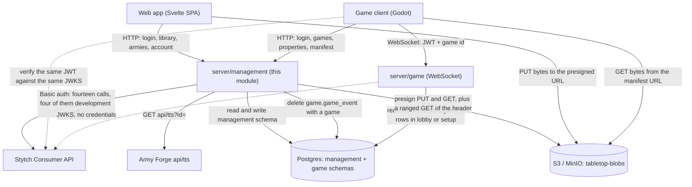

*The two servers never call each other.*

**Auth seam.** Management is the only process holding the Stytch project secret, and the only one
that calls Stytch's Basic-auth endpoints. The game server never touches Stytch's API surface. It
fetches the same public JWKS and applies the same validation parameters. There is no contract type
to agree on and no M2M call. The contract is four constants (`iss`, `aud`, `RS256`, the claim name
`account_id`) plus a URL, recorded under *Interfaces needed from other modules* for the
game-server plan to copy. Auth is not in `architecture.md` → *Contracts to freeze*, and there is
no join token.

**Database seam.** Both servers open the same database. Management owns the schema and runs DbUp
at its own startup. The game server never migrates. A management migration can break the game
server either way, and both specs record that and leave it (management API → *Still open*;
`schema.md` → *Still open*). The write split is not enforced by the database: `game.status`,
`team`, `participant.team_id/army_id/army_snapshot` and a `game_id`-owned `table_state` are
writable by both processes, kept apart by convention inside each. The split buys a game server
that hydrates a game with plain `SELECT`s and no service call. It costs a rule that only code
review enforces.

**Blob seam.** No `.glb` is read or written by this process except 20 bytes plus a JSON chunk.
That removes a job queue, a worker and an async upload state machine (`architecture.md` → *GLB
only; conversion is not in the product*). It costs a two-step create-then-confirm protocol and a
`blob.uploaded` flag that can be false forever.

---

## Design

### 1. Composition and the request pipeline

One process, one composition root. Every collaborator is a singleton. Endpoints, `Sessions`,
`DevSessions`, `AccountDeleter` and `StarterAssets` depend on repository interfaces
(`IAccountRepository`, `IAssetRepository`, `IFolderRepository`, `IArmyRepository`, `ICatalogKinds`,
`ILayoutRepository`, `IGameRepository`) and on `IBlobStore`; the SQL classes implement them and hold
only a `Database`, which holds an `NpgsqlDataSource`, which is the pool. There is no scoped state and
no unit of work. A repository method opens a connection, does its work, and returns. The test host
registers in-memory implementations of the same interfaces (*Testing*).

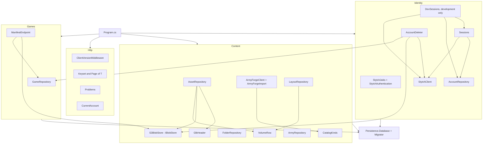

*Four modules over one `Database`.*

`AccountDeleter` reaches into `GameRepository` and `IBlobStore` because deletion deletes hosted games, leaves joined ones and removes blobs.
`ManifestEndpoint` reaches into `IBlobStore` because it presigns. `DevSessions` is the one
collaborator whose registration and route are conditional, on `IHostEnvironment.IsDevelopment()`. `VolumeRow` is shared because
`asset_volume` and `terrain_volume` are the same seventeen columns.

Middleware order is load-bearing:
`UseExceptionHandler` → `UseCors` → `ClientVersionMiddleware` → `UseAuthentication` →
`UseAuthorization` → the endpoint, which calls `CurrentAccount.Id(user)` and passes it to a
repository that puts `owner_id` in the `WHERE` clause. **CORS runs before the version check**
because a preflight carries no version header and must be answered whatever the caller's version.
**The version check runs before authentication** because a client months out of date must be told
to update rather than told its token is bad. The exception handler maps
`ArgumentOutOfRangeException` (a bad `limit`) to `400` and everything else to `500`.

`ClientVersion.Decide(string? header, int minimum)` returns `Accept | UpgradeRequired | Malformed`
and is a pure function, unit-tested apart from the middleware. **A missing header is accepted**:
the web app ships with the API and does not send one, and the mechanism exists for the downloaded
desktop client (management API → *`/v1` in the path*; client shell → *Home*).

### 2. Configuration

`ManagementOptions` is one `sealed record` with eleven members and a `static From(IConfiguration)`
that throws on anything missing. Keys are the `.env` names with `TABLETOP_` stripped
(`AddEnvironmentVariables("TABLETOP_")`), so `TABLETOP_STYTCH_SECRET` and
`dotnet user-secrets set STYTCH_SECRET` are the same key and the secret is never in a committed
file. `DotEnv.Load()` walks up from `AppContext.BaseDirectory` and reads the repo-root `.env`, the
same file `docker compose` reads. Existing environment variables win. One file configures the
compose stack, the API and the tests.

Two settings are easy to confuse:

| Setting | Value | What it is |
| --- | --- | --- |
| `SessionMinutes` | 43200 (30 days) | Stytch's `session_duration_minutes`. The life of the **session**, so a player is not logged out mid-campaign |
| the JWT's own lifetime | 5 minutes, fixed by Stytch | why `POST /v1/auth/session/refresh` exists, and why deleting an account locks it out within five minutes |

Revocation in the management API spec depends on the second number, not the first. Deleting an
account revokes the Stytch user, refresh then fails, and the last JWT lapses within five minutes.
No session table is needed for revocation.

### 3. Authentication

No token of our own is issued. The spec designed two opaque token tables, a `session` table and a
join token. Both are gone (management API → *We issue no tokens of our own*). The credential is a
Stytch session JWT that both servers verify locally.

Stytch's JWT names the user by Stytch's own `sub`. It does not carry `external_id`. The account id
therefore rides in the custom claim `account_id`, which management adds to the session through
`session_custom_claims` on `POST /v1/sessions/authenticate`. Stytch keeps session custom claims on the
session, so every later JWT the session mints carries it. Keeping every Stytch user's `external_id`
equal to its `Account.id` and stamping the session are the job of
`Sessions.Complete(StytchSession)`, and every login method passes through it:

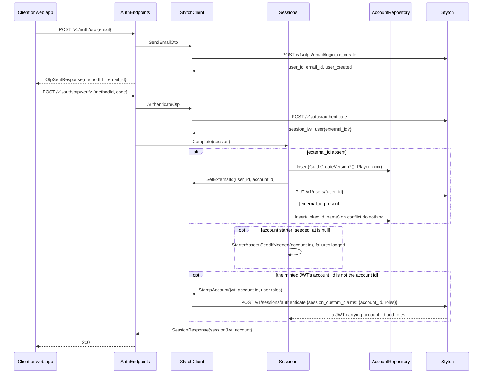

*Every session-returning endpoint ends in this same tail.*

A new session costs one Stytch call beyond the authenticate itself, and a refresh none beyond the
refresh. A session minted by the call that spends a single-use one-time code or a signup password
carries no claim, because that call runs before `external_id` exists, and a new session of a linked
account carries none either. `Sessions.Complete` therefore creates the account row, sets `external_id`
when absent, and, when the minted JWT's `account_id` is not the account id, calls
`StytchClient.StampAccount`, which posts `session_custom_claims: {"account_id": "<uuid>", "roles": [...]}` to
`POST /v1/sessions/authenticate` and returns that JWT. `roles` is the Stytch user's RBAC role ids, the
authenticate response's `user.roles` (`StytchUser.Roles`; `stytch_user` on every user, plus any role
assigned in the dashboard). The game server admits a session whose `roles` holds `admin` as a watcher of
any game (admin watch spec). A refresh stamps the session again when the user's Stytch roles differ from
the ones it carries, so a granted or revoked role reaches the next refresh; an open watcher socket stays open. Every new session pays this call: signup, password
login, OTP login, password-reset completion and the dev session mint. A refresh
(`/v1/auth/session/refresh`, `/v1/sessions/authenticate` with no claims) carries the claim already.
Linking earlier does not work: the code is single-use, so the session must be minted by the call that
spends it, and linking at `POST /v1/auth/otp` would create an account row for any email anyone types.

`external_id` is the link between the two systems: `Sessions.Complete` reads it to find the account and
stamps the claim from it. **No Stytch identifier is stored in our schema** (accounts → *Auth is a module,
not a vendor*). `account` is `id`, `name` and `starter_seeded_at`.

A new account's `name` is `Sessions.DefaultName()`, `Player-` and four random hex digits, never derived
from the email: account names are public (game browser, participant lists). The player sets one with
`PATCH /v1/account`. Accounts created before this rule keep the email local part they were given until
renamed.

Stytch's own error never reaches the caller. `Sessions.Problem` maps a `StytchException` to a fixed detail
and `AuthEndpoints` logs the `error_type`: `401`/`404` → `401` "Wrong email, password or code."; `429` →
`429`; `5xx` and transport failures → `502`; `weak_password` → `422` naming the password; every other `4xx`,
`duplicate_email` included, → `422` with one generic detail (`POST /v1/auth/session/refresh` instead answers `401` for any Stytch `4xx` but `429`: a dead session is unauthenticated), so signup does not say whether an email has an
account. A signup that succeeds still shows that the email was free; that is inherent in password signup
without an email-verification step.

After the account row exists and before the session is stamped, `Sessions.Complete` calls
`StarterAssets.SeedIfNeeded` (§6, *Starter miniatures*). A failure is logged and never blocks the login.

Verification is `Microsoft.AspNetCore.Authentication.JwtBearer` with
`MapInboundClaims = false`, `ValidIssuer = stytch.com/{project_id}`, `ValidAudience = {project_id}`,
`ValidAlgorithms = [RS256]`, `ClockSkew = 30s`. The `IssuerSigningKeyResolver` is synchronous, so it
reads the `StytchJwks` cache only (`Cached(kid)`); the bearer handler's `OnMessageReceived` event reads the
token's `kid` and awaits `StytchJwks.Ensure(kid)` first. `Ensure` completes at once when the kid is held;
otherwise it joins the one fetch in flight or starts it, so concurrent callers share one request and a
caller holding its kid never waits. A miss refetches **at most every 30 seconds**; that is the key
rotation path, and the only reason the cache is not permanent. A fetch is bounded to 5 s
(`StytchJwks.DefaultFetchTimeout`, also the `stytch-jwks` client's timeout); a failed or slow fetch is
logged and leaves the cached set, so the token is a `401`.

The JWKS endpoint `GET {StytchBaseUrl}/v1/sessions/jwks/{project_id}` **takes no credentials**.
Stytch's reference page lists a `basicAuth` scheme and passes `-u project:secret` in its example.
An unauthenticated `curl` answers `200` with the key set. That
is what lets the game server verify a JWT without holding the project secret.

`CurrentAccount.Id(ClaimsPrincipal)` parses the claim and throws `UnauthorizedAccessException` when
it is missing. Every authorized endpoint's first act is to call it, and every repository method
takes `ownerId` as a parameter rather than reading ambient state.

#### The development mint

`POST /v1/dev/sessions` takes a name and returns a real Stytch session JWT for the account of that
name. The simulator's socket driver needs one session token per team, hand-pasting them is not
acceptable, and management is the only process holding the Stytch project secret, so the mint
belongs here.

`DevSessions.Mint(name)`:

1. `AccountIdFor(name)` is a name-based UUIDv8, RFC 9562 §5.8: SHA-256 over a fixed namespace GUID
   and the UTF-8 name, the first sixteen bytes, version and variant nibbles stamped. The account id
   is a pure function of the name, so nothing has to be looked up and a caller can predict it.
2. `AccountRepository.Insert(accountId, name)`, which is `on conflict do nothing`.
3. `GET /v1/users/{accountId}`, the external-id substitution Stytch's get-user documents. A
   `404` is followed by `POST /v1/users {email, external_id = accountId}`.
4. `POST /v1/magic_links` for an embeddable token, then `POST /v1/magic_links/authenticate` with
   `session_duration_minutes`. The second is the same endpoint an emailed magic link would reach.
5. `Sessions.Complete(session)`, the path every login takes.

Because `external_id` is written when the user is created, `Complete` skips the link and stamps the
account's `account_id` on the new session: one `StampAccount` call per mint. The request's optional
`roles` (`{"name": "...", "roles": ["admin"]}`) is stamped in place of the Stytch user's, so tests mint an admin without touching the Stytch
project.

The derived email is the name lowercased, non-alphanumeric characters replaced by `-`, at
`example.com`, reserved by RFC 2606 and undeliverable. No call on this path sends mail: creating a
user does not, and an embeddable magic link is the endpoint that returns the token instead of
mailing it. Two names that slug to one address collide as `duplicate_email` → `409`.

The gate is dev mode: `IHostEnvironment.IsDevelopment()` around the service registration, and
`StartupGuard.DevMode` (Development and `TABLETOP_DEV_MODE=1` together) around `MapDevSession`.
Development without the opt-in refuses to start, and `TABLETOP_DEV_MODE` in any other environment
refuses to start, so neither half alone turns the route on. `EnvironmentName` defaults to
`Production` when neither `ASPNETCORE_ENVIRONMENT` nor `DOTNET_ENVIRONMENT` is set, so a published
build has no such route and answers `404`. The test
host runs as `Testing`, which is also not development.

An account that does not exist is created rather than refused, which is what lets the simulator's
`SocketRowSeeder` make its own accounts. A repeated name is idempotent down to the Stytch user:
same name, same account id, same row, same user found by `external_id`. Only the JWT differs. A
first mint costs four Stytch calls and every later one three.

Nothing about the verification path changes. There is no second signing key, no local trust anchor,
and no development branch in either verifier. The token is Stytch-signed and checked against
Stytch's JWKS exactly as a player's is, which is the reason for minting a real one rather than
forging a cheap one.

The cost is network access. A `--driver socket` simulator run reaches the Stytch test project for
every token; the in-process driver reaches nothing. Automated tests are unaffected, since they mint
with `TestKeys` against a fake JWKS.

### 4. Authorization: owner-only, and 404 rather than 403

There is one rule and two exceptions.

| Route | Rule |
| --- | --- |
| everything under `/v1/assets`, `/v1/folders`, `/v1/armies`, `/v1/layouts`, `/v1/account` | owner only |
| `GET /v1/games`, `GET /v1/games/{id}`, `GET /v1/properties` | any logged-in caller; games are public |
| `POST /v1/games/{id}/leave`, `GET /v1/games/{id}/assets` | participant |
| `POST /v1/games/{id}/end`, `DELETE /v1/games/{id}` | creator |

Owner-only is expressed **in SQL, not in a check before the SQL**: `where id = @id and owner_id =
@ownerId`. A row another account owns and a row that does not exist produce the same zero-row
result and the same `404`. Existence is not disclosed (management API → *The rest of the surface*).
There is no `403` anywhere in the service. A permission error is indistinguishable from a mistyped
id. That is accepted for a single-owner model with no sharing.

`/end` and `DELETE /v1/games/{id}` are the creator's alone, not any participant's; the spec's
"unowned" setup phase does not widen the right. `GameRepository.IsCreator` gates both
routes and everyone else gets the same `404` as any other row that is not the caller's. The right
survives leaving, because `game.created_by` has no `on delete` action and outlives the participant
row. A creator's account deletion takes the game with it, so nothing is left undeletable. The game
server reads `created_by` for the two status transitions (setup phase → *The lifecycle*).

### 5. Persistence

Hand-written SQL over Npgsql, with Dapper for row mapping. No ORM, no `DbContext`, no entities.
`libs/` stays persistence-free by rule (`architecture.md` → *Persistence*). The schema is already
normalised and hand-written, with every closed set as a check constraint. Rows are
`sealed record`s mapped by constructor, so every query aliases columns to parameter names
(`owner_id as OwnerId`) and every `real` column is cast (`dim_a::float8 as DimA`) because the
records use `double`.

`Database` builds one `NpgsqlDataSource` with `SearchPath = "management,game,public"`, so SQL names
tables bare and the cross-schema delete qualifies (`delete from game.game_event`). `game` is both
a schema and a table name. With this search path `from game` resolves to `management.game`, the
table.

`Migrator.Run(connectionString)` is DbUp over `Persistence/Migrations/*.sql` embedded in the
assembly, journalled in `public.schema_version`, one transaction per script. It runs at process
startup through `IMigrator` (`PostgresMigrator`, which the test host replaces with a no-op) and in
`TestDatabase`, and is idempotent. `001_schema.sql` is a byte-for-byte copy of
`scripts/postgres/init/001_schema.sql` and is never edited. Later changes are new scripts. The
**baseline** case: a database created by `docker compose`'s init already holds `001` and has no
journal, so `Migrator` detects `management.account` without a journal, creates the journal, and
records `001` as applied rather than re-running it.

| `management.account` exists | journal exists | What happens |
| --- | --- | --- |
| no | no | DbUp applies 001 then 002 |
| yes | no | journal created, 001 recorded, DbUp applies 002 |
| yes | yes | DbUp applies whatever is unapplied |
| no | yes | the early return fires and DbUp applies only what the journal lacks. If the journal already records `001`, `002` runs against a table that is not there and fails. Not reachable through either supported path, and not tested |

Migration `002_blob_uploaded.sql` adds `blob.uploaded boolean not null default false` and
`blob.content_type text not null check (content_type in ('model/gltf-binary','image/png','image/jpeg','image/webp'))`.
Both are needed by the presigned protocol (`docs/schema.md` → *`blob` records whether its bytes
arrived, and what they are*).

Migration `003_account_starter.sql` adds `account.starter_seeded_at timestamptz null`
(`docs/schema.md` → *`account` records whether its starter meshes were seeded*).

Migration `004_properties_seeded_at.sql` adds `properties.seeded_at timestamptz not null default now()`; the game
server's seeder sets it on every seed, and `GET /v1/properties` lists one set per `(game_rules, name)`, the latest
(`docs/schema.md` → *`properties` records when it was last seeded*).

### 6. The asset library and the presigned protocol

Two records, per the asset library spec. `blob` is the bytes, keyed `(owner_id, hash)`, so
**per-user dedup is a property of the schema**. `asset` is the library item carrying `name`,
`kind`, `scale`, the three orientation angles and, for a miniature only, the modelled base. `kind`
profiles are per kind and one is empty: a texture carries nothing (identity and enumerations →
*`ASSET` profiles are per kind*).

Upload is three calls. The browser's bytes land in a staging key; the server reads them once at
confirm, verifies them and copies them to the content key itself, so no URL a user holds ever writes a
content key:

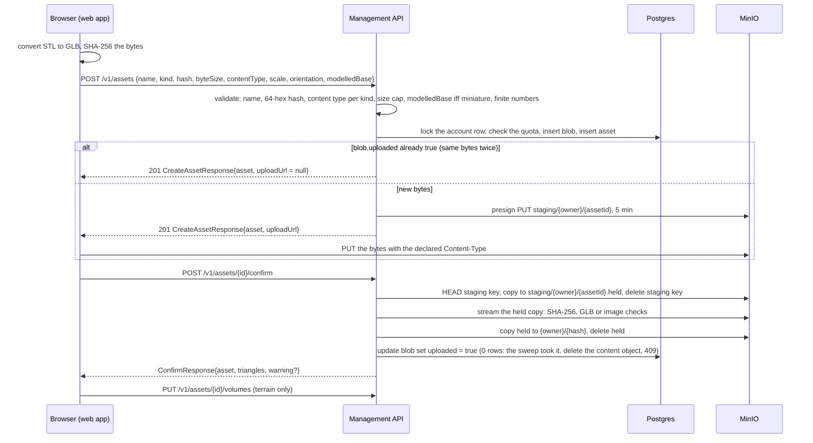

*The three-call upload, including the dedup short-circuit.*

The hash is computed client-side so the service can answer "already there" before any bytes move
(management API, "Asset bytes never pass through the API" — the server reads them only to verify).
The presigned `PUT` carries no size constraint, so the declared `byteSize` is capped at create (a mesh
64 MiB, a texture 16 MiB, `UploadLimits`) and checked against the object at confirm. The `.held` copy,
which no URL names, is what is hashed, validated and kept, so a `PUT` racing the confirm cannot swap the
bytes.

**Quota.** At create, inside the insert's transaction (`select ... for update` on the account row), an
account holds at most 500 assets and 1 GiB of blob bytes, pending blobs included and each hash counted
once (`AssetQuota`, `AssetQuotaExceeded` → `422`). An account holds at most 200 folders.

`confirm` is where every content check lives:

| Condition | Answer |
| --- | --- |
| the blob is already uploaded | `200`, any staging object deleted |
| no staging object | `409`, the bytes are not there yet |
| size ≠ `asset.ByteSize` or over the cap | staging deleted, `422` |
| SHA-256 ≠ the declared hash | `422` |
| a GLB or texture check fails | `422` with fixed text; the detail is logged |
| triangles > 100,000 | `200` with `Warning` set |
| the blob row was swept meanwhile | content object deleted, `409` |
| otherwise | `200`, `blob.uploaded = true` |

**GLB only**, narrowed from `architecture.md`'s "glTF/GLB": a `.gltf` with external `.bin` buffers
is several files with relative references. `GlbHeader.Check(length, RangeReader)` is the validator; every
JSON read checks the value's kind, every range check is overflow-safe, and any parse fault is
`GlbHeader.Malformed`:

- magic `glTF`, version 2, header length equal to the object's; JSON chunk ≤ 1 MiB; the BIN chunk inside
  the file;
- exactly one buffer, with no `uri`, inside the BIN chunk; every bufferView on it and inside it, byteStride
  4–252 and a multiple of 4;
- every accessor ≤ 3,000,000 elements, Σ count × element size ≤ 128 MiB, each inside its bufferView, sparse
  indices and values bounded; every attribute and morph target of a primitive has POSITION's count;
- vertices (Σ POSITION counts) ≤ 500,000 and triangles ≤ 1,000,000, refused; above 100,000 triangles
  warns (mesh conversion → *The threshold*). Triangles convert by `mode`: 4 → `count/3`, 5 and 6 →
  `count - 2`, points and lines → 0, meshes counted once each, not per node;
- at most 8 images, each through a bufferView with no `uri`, `mimeType` png, jpeg or webp matching the
  header bytes, each side 1–4096;
- `extensionsRequired` within `KHR_mesh_quantization`, `KHR_texture_transform`, `KHR_materials_unlit`,
  `KHR_materials_emissive_strength`, `EXT_texture_webp`. The web converter emits none; compressed-geometry
  extensions are refused.

A texture (`ImageHeader.CheckTexture`) must carry the magic of its declared type (PNG IHDR, JPEG SOFn
within the first 1 MiB, WebP VP8/VP8L/VP8X) and sides 1–4096. Only headers are read.

**Sweep.** `UploadSweeper` (a `BackgroundService`, every 10 minutes) runs `UploadSweep.Run(now)`: staging
objects (`.held` copies included) older than 1 hour are deleted, then `DeleteAbandoned(now − 1 h)` deletes
blob rows still not uploaded after an hour (`blob.created_at`, reset when a new asset reuses the pending
blob) with their asset rows, and their objects. A MinIO lifecycle rule expiring `staging/` after a day is
the operator's backstop.

Download is `GET /v1/assets/{id}/download` → a presigned `GET` valid 60 minutes, `409` until
confirmed. Delete removes the asset row. When that was the owner's **last** reference to the hash
it removes the `blob` row too, and returns the S3 key so the endpoint can delete the object after
the transaction commits. Per-user dedup makes that check a single `not exists` over the owner's own
rows rather than a cross-account count.

`Content/VolumeRows.cs` holds `VolumeRow`, one record over the seventeen columns
`asset_volume` and `terrain_volume` share, with `ToVolume()`/`From(id, Volume)` and three
`const string`s (`Columns`, `InsertColumns`, `InsertValues`) so the SQL is written once. The six
terrain declarations are `bool` columns mapped to the `TerrainDeclarations` flags enum. `PUT
/v1/assets/{id}/volumes` is delete-then-insert with fresh ids and answers `409` unless the kind is
terrain; at most 16 volumes, each with a defined kind, known declarations, a valid footprint, finite numbers
and notes ≤ 2000. Asset and folder names pass `Limits.Text`. Deleting an asset also deletes its staging
key.

**Starter miniatures.** `StarterMeshes` builds six GLBs in memory (five round figures, 25 to 60 mm, and the
221 × 119 mm hull), sized from `ArmyForgeImport.HeightFromBase` and `DefaultBody`. `StarterAssets.SeedIfNeeded`
runs from `Sessions.Complete` when `account.starter_seeded_at` is null: it finds or creates a top-level
`Starter` folder, writes each mesh with `IBlobStore.Put` to `Key(owner, hash)`, inserts the `blob` row
(`uploaded = true`, on conflict do nothing), the `asset` row (`kind = miniature`) and the folder link, then
sets the column. The `Put`s share a 5 s budget (`StarterAssets.Budget`), so an unreachable MinIO cancels them
rather than holding the login. A throw is logged and the column stays null, so the next login retries; a retry after a
partial seed can leave a duplicate mesh. Dev sessions pass through the same path
([starter meshes](../../superpowers/specs/2026-10-01-starter-meshes-design.md)).

### 7. Folders

Nested, many-to-many with assets, returned whole. Folders are small enough that they are not paged
(management API → *Pagination is keyset*). `GET /v1/folders` is two queries: the `folder` rows plus
one join over `asset_folder`, assembled into a flat `FolderDto(Id, ParentId, Name, AssetIds)` list.
The client makes the tree. Deleting a folder cascades its children in the schema and touches no
asset. An asset in no folder is valid.

The only logic is cycle prevention on `PATCH`: a new parent must be the owner's own folder, must
not be the folder itself, and must not be a descendant, checked by a `with recursive` query. That
answers `422`. A folder that is not the caller's answers `404`.

### 8. Armies and the Army Forge import

Management fetches the list. The parser lives in one place, there is no CORS problem, and a change
to Army Forge's format is a server deploy rather than a client release (management API → *Army
import*).

`ArmyForgeClient.ListId(source)` accepts a share link's `id=` parameter or a bare id and returns
null otherwise (`422`). `Fetch(listId)` calls `GET https://army-forge.onepagerules.com/api/tts?id={id}`
with a 10 s budget (`ArmyForgeClient.DefaultTimeout`) and a 2 MB response cap (`MaxBytes`, checked on
`Content-Length` and while reading), and throws `ArmyForgeException(status)`: a status on non-200, null when
unreachable, timed out or oversize. The endpoint maps both to `502` with fixed text ("Army Forge did not
return that list." / "Army Forge could not be reached."), an unreadable export to `422`, and logs the
exception.

`ToArmy` validates the list before building (`ArmyLimits`, `InvalidArmyException` → `422` with the reason):
Quality and Defense integers 2–6; size 1–50 per entry; at most 100 units and 500 models after merging;
weapon `Attacks` 1–100 and `Count` 0 to 4 × the entry's size; rule ratings 0–50; `range` a whole number of
inches 0–120 (null is melee); every chosen base 0.4–12" a side; list, unit, weapon, rule and item names
through `Limits.Text` (≤ 64, no control or bidirectional formatting characters); `source` ≤ 512; a repeated
or missing `selectionId` and an empty list are refused. An account keeps at most 200 armies
(`IArmyRepository.Count`).

`PATCH /v1/armies/{id}` runs `ArmyLimits.Patch` first (`422`): name as above, slot bases 0.4–12" with a
defined shape, heights 0.1–24", at most 100 unit and 500 slot patches. Every asset id it writes
(`UnitPatch.AssetId`, `SlotPatch.AssetId`) must be an uploaded `miniature` of the caller's
(`AssetReferences.Check`), else `422`; clearing names no asset.

`ArmyForgeList.cs` is the **subset of the export this project reads**, verified against a live
fetch (`c2-6YsWRH3py`, 26 KB, saved as a fixture). Every optional member is nullable
and nothing is `required`, because a required-field model throws on the real payload. What the
fetch established:

| Observation | Consequence for import |
| --- | --- |
| `gameSystem` is `"gf"` on this list and is the list's own field | the only signal import uses. `gf` and `aof` are the two accepted values and both map to `grimdark-future`; a list carrying another book's content still reports its own system, and nothing here resolves the book |
| `selectionId` is unique; `id` repeats across duplicated units | combining and joining key on `selectionId` |
| `armyId`, the army book's `uid`, is on every unit entry (`prsajf5ot936qznk` on every entry of this list) | written to each slot built from that entry as `ModelSlot.ArmyBook` and `model_slot.army_book`, a joined entry's slots included: a caster casts the spells its own slot's book lists ([the spell library](../../superpowers/specs/2026-10-02-spell-library-design.md)) |
| `quality` and `defense` are **plain integers** (`4`, not `"4+"`, never objects) | `TargetNumber` accepts a number or a string and emits `"4+"` |
| `loadout` is the resolved post-upgrade list; `weapons` is the pre-upgrade profile | import reads `loadout` and ignores `weapons`. Unit 0's `weapons[0]` is a "Blood Sword" that its `loadout[0]` replaced |
| a rule's `rating` is **absent**, not null, when it takes none | `AfRule.Rating` is `JsonElement?` and `Rating()` returns `int?` |
| `range` is `0` on some melee weapons and `null` on others in one payload | the melee test is `is { } range and > 0`, and a melee weapon gets **no** `Range` stat at all |
| `attacksMultiplier` is `1` on every entry observed | not read; a list carrying anything else makes the `Attacks` stat wrong, and the fix is one term |
| `bases` is `{round, square}`, both strings of millimetres | `"32"` → `Base.Circle(32/25.4)`, `"60x35"` → `Base.Oval(60/25.4, 35/25.4)` |
| there is no `customName` | `name` is the only name field |
| `combined: true` on two entries whose `joinToUnit` cross-reference | one unit of double size; sizes and loadout counts add |
| `joinToUnit` on an entry that is not a `combined` partner | a hero joining that unit; its models become models of that unit (the plan's ruling 2). This list carries no such entry, so the join path is tested against hand-written lists |

`ArmyForgeImport.ToArmy(list, source, catalog)` is a pure function: no database, no HTTP. The
mapping is the most heavily unit-tested piece in the module.

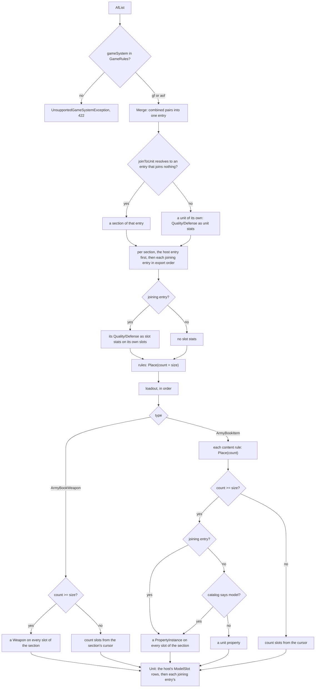

*Expansion to one slot per model happens here and nowhere else, because nothing carries a count
(`data-model.md`).*

Two branch points are state-dependent. The catalog lookup depends on database state at import
time. The cursor is shared, and both weapons and part-count rules advance it.

The cursor answers `9x Rifle, 1x Flamer`: the flamer lands on slot 10, not slot 1. Because it is
shared between weapons and partial-count item rules, a shield on two models and a flamer on one do
not both start at slot 1. The choice is arbitrary and deterministic (the plan's ruling 4). There is one
cursor per section, so a joining entry's loadout can never reach a slot of the unit it joined.

The level of a rule comes from `CatalogKinds.For(gameRules)`, a `distinct` query over
`catalog_entry` joined to `properties` on `game_rules`: a name the catalog calls `model` goes onto
every slot, anything else is a unit property. **The dictionary is empty until content is loaded**,
and no content import exists yet, so today every rule imports at unit level.

#### A joined hero as a model of its host

An entry that carries `joinToUnit` and is not a `combined` partner contributes its models to the
unit it names (the plan's ruling 2). `Merge` returns a host entry plus the entries joining it, and
`Section` appends one entry's slots to the unit under construction. The host's slots come first,
then each joining entry's in export order. `ModelSlot.Ordinal` counts over the merged unit, while
the slot name is `"{entry name} {index within that entry}"`. The two coincide for a unit nothing
joined.

Nothing had to be added to hold the hero. `ModelSlot` already carries `Stats` and `Properties`,
`slot_stat` and `slot_property` are already among the ten tables the repository writes in one
transaction and reads back, and the content values spec declares stats at unit, model and weapon
level. A joining entry's own quality and defence become slot stats on the slots it contributes. Its
base comes from its own entry in the chosen base set, and its height is scaled from that base.

Every rule on a joining entry becomes a slot property on that entry's slots, whatever level
`CatalogKinds` gives the name. The unit's stats and properties stay the host's. A stat read for the unit reads the
host's value; a stat read for a model reads that model's slot and falls back to the host's, which
is how a joined hero's own `Quality` reaches its hit roll (rulebook p.4). A `unit`-kind rule on a
joined slot is the whole unit's. Two obligations on the
interpreter follow, in *Obligations this module places on others*.

Join resolution is one pass over what the combined pass left. An absorbed `combined` partner's
`selectionId` resolves to the entry that absorbed it, so a hero naming either half of a combined
pair joins the merged unit of ten. Combined pairing requires `combined: true` on both entries, so a
hero is never absorbed as a partner and the two mechanisms cannot collide. A `joinToUnit` that no
surviving entry answers leaves the entry as its own unit. A `joinToUnit` naming an entry that
itself joins does the same, so joins are never chained
and a cycle needs no walk.

**The base set is the player's, per import.** Army Forge publishes two bases per entry, `bases.round`
and `bases.square`, and nothing says which units are vehicles. `ImportRequest.Bases` (`BaseSet { Round,
Square }`, default `Round`) picks one for the whole army. `ParseBase(text, set)` maps round `"32"` to
`Base.Circle`, round `"60x35"` to `Base.Oval`, square `"30"` to `Base.Rect(30, 30)` and square `"50x25"` to
`Base.Rect(50, 25)`, millimetres to inches. The height is `HeightFromBase` of the base the
import writes, round or square. The set is not stored on the army (base shape at import spec).

Defaults where nothing supplies one: `DefaultBody`, a 221 × 119 × 113 mm vehicle hull, when
the chosen set's field is absent (the other set is not consulted), not a 32 mm infantry circle: Army Forge publishes `bases.round` reliably
for infantry, so a missing base means a vehicle or monster in practice, and a 32 mm circle would put
a tank's whole 6" disembark region — and its movement, cover and line of sight — inside its own
hull (open questions → *The default base for a model that publishes none*). The default carries its
own height rather than going through `HeightFromBase`, which would scale 221 mm into a 13" tall
tank. The army spec says bases default to "whatever the ruleset says" and no ruleset value exists
anywhere in the model (the plan's ruling 3; the army → *Base shape and height*). The player corrects
it per model through `SlotPatch.Base`, which the web app's base editor already writes.

`HeightFromBase(base)` is `HeightScale * max(base.A, base.B)`, `1.5 ×` the base's larger dimension (the plan's
ruling 3; the owner's 2026-10-16 ruling that height follows the imported base). A 25.4 mm circle gets 1.5", a 32 mm circle 1.89", a 60x35 mm oval 3.54" and a 120x92 mm oval 7.09".
Neither ruleset publishes a height and neither does Army Forge, so the base is the only physical
dimension available to scale from and the factor is a guess. The player corrects it per slot with
`SlotPatch.Height`.

Storage is ten tables and a single transaction: `army`, `unit`, `unit_stat`, `unit_property`,
`model_slot`, `slot_stat`, `slot_property`, `weapon`, `weapon_stat`, `weapon_property`.
`ArmyRepository.Get` reads the whole tree in **nine queries plus one head query** and assembles it
with `ToLookup`, rather than one join that would multiply rows across six child tables.
`model_slot.asset_id` is written as given with **no existence check**. The reference is soft, the
army holds the hitbox, and deleting a mesh must not be blocked (the army → *Assets are a soft
reference*).

`PATCH /v1/armies/{id}` is **a patch, not a document**: `PatchArmyRequest(Name?, Units?, Slots?)`
where `UnitPatch(UnitId, AssetId?)` sets the unit default across every slot and
`SlotPatch(SlotId, AssetId?, ClearAsset, Base?, Height?)` overrides one. That is the army spec's
shape: the pack or the import supplies a default, and the user overrides per slot (management API
→ *Deliberately not decided*, the `PATCH` item). There is no `Name?` on either
patch. Names are the list's. Appearance and physical presence are the user's.

A changed list means a re-import, with no reconciliation and no preserved bindings. The army spec
accepts that cost. `list_entry` and `upgrades` therefore do not exist as columns.

### 9. Layouts

A layout and a game's setup result are **one shape with two owners**: `table_state` carries a
nullable `owner_id` and a nullable `game_id` with a check constraint that exactly one is set (setup
content → *The setup phase is snapshotted*; `schema.md` → *`table_state` has two nullable owners*).
Management writes the `owner_id` half and never the `game_id` half.

`LayoutRepository.Save(ownerId, TableState)` regenerates **every** id: the layout row, each
`terrain_placement`, each `terrain_volume`, each `marker`, each `deployment_zone`. These are global
primary keys and saving is a copy. Loading happens elsewhere. The client reads
`GET /v1/layouts/{id}` and sends a `ReplaceDraft` setup edit, so the game server regenerates ids on
the way in. That keeps the rule *the game server never writes an owner-side row* true
(whole-design review ruling 4: **layouts stay management's**). It costs a round trip through the
client, which a service-to-service call would have avoided. There are no service-to-service calls.

`PATCH /v1/layouts/{id}` takes `PatchLayoutRequest(Name?, State?)`. A name-only patch is an
`update`. A state patch deletes the three child collections and rewrites them. `POST` requires a
name and answers `422` without one. A game's draft has none. A saved layout must have one.

Both writes go through `LayoutRules.Problem` (`422`): name ≤ 64 characters with no control or
bidirectional formatting characters; table sides above 0 and at most 144"; at most 64 terrain pieces, 32
markers, 16 zones and 16 volumes per piece; finite positions, yaws and volume dimensions; terrain scale in
(0, 100], marker diameter in (0, 24"]; builtin names, marker labels and zone shapes ≤ 64; volume notes ≤
2000; defined enum values. Then `AssetReferences.Check`: every asset id the layout names is an uploaded
asset **of the caller's** of a fitting kind (`texture` for the texture, `terrain` for a placement, either
mesh kind for a marker visual), else `422`. An account holds at most 200 layouts.

`LayoutRepository.ReadTree(connection, id, name, size, texture)` is `static`. It is the one reader
of the placement/volume/marker/zone tree, and the game-server plan reads the same rows for a game's
draft.

### 10. Games, the browser and the row-ownership split

A game is a lobby: one row with a status (accounts → *A game is a lobby*). Management creates it
at `lobby`, inserts a `participant` row for the creator with **no team and no army**, and from then
on the row is co-owned.

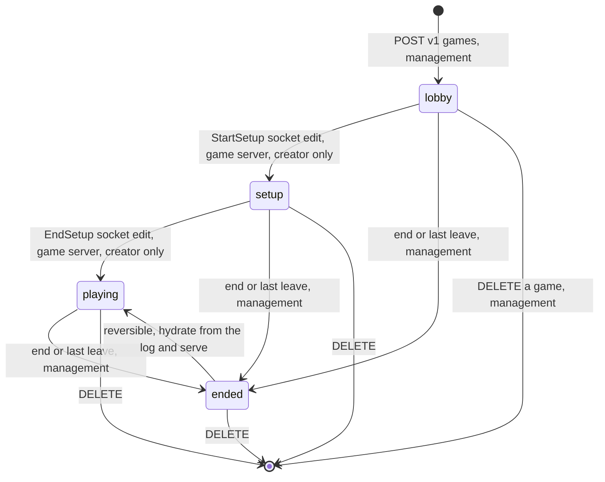

*`ended` is a flag, not a terminal state. Restarting an ended game is the same
hydrate-from-the-log operation as recovering a crashed task.*

The full split:

| Table or column | Management writes | Game server writes (while `lobby` or `setup`, and the end) |
| --- | --- | --- |
| `account`, `blob`, `asset`, `asset_volume`, `folder`, `asset_folder`, the ten army tables, `table_state` with `owner_id` and its children | always | never, reads only |
| `properties` and the seven tables under it | never (loaded by the undesigned content import) | never, reads only |
| `game` insert, `name`, `game_rules`, `properties_hash`, `scheduler_shape`, `enforcement`, `waits_between_steps`, `created_by`, `created_at` | on create | rewrites the configuration on `SetConfiguration` |
| `game.status` | `'lobby'` on create; `'ended'` on `/end` and on the last leave | `lobby → setup → playing`; `playing → ended` when its own log ends the game (guarded on `playing`) |
| `team` | never | inserts on `CreateTeam`, while `lobby` or `setup` |
| `participant` insert and delete, which is **joining the game** | create, join, leave | never |
| `participant.team_id`, which is **taking a team** and is not joining | never, null on insert | writes on `PickTeam`, while `lobby` or `setup` |
| `participant.army_id`, `participant.army_snapshot` | never, null on insert | writes on `PickArmy`, `EndSetup` |
| `table_state` with `game_id`, and its `terrain_placement`, `terrain_volume`, `marker`, `deployment_zone` | never | writes the live draft, then frozen by the status flip |
| `game.game_event` | deletes with the game | appends |

These are two disjoint write sets over the same handful of tables, separated by convention. Nothing
in the database enforces it: no trigger, no per-column grant, no status guard. The service does not
read `game.status` before writing `'ended'`. The game server's `'ended'` is guarded on `status = 'playing'`, so it never overwrites management's. The game server does not check whether management has
deleted the game under it.

`participant` carries two columns this module's SQL depends on (`docs/schema.md` → *`participant`
links to its game, and holds the army it picked*): `game_id uuid not null references game(id) on
delete cascade` with `unique (game_id, account_id)`, because `team_id` is nullable and a team-less
participant would otherwise be attached to nothing; and `army_id uuid references army(id) on delete
set null`, the lobby's pick, which the manifest reads before a snapshot exists.

Endpoint behaviour:

- `POST /v1/games` validates the `properties_hash` against the `properties` table and copies
  `game_rules` from the chosen row, so a game can never name a ruleset its pinned set disagrees
  with. An unknown hash is `422` with a pointer to `GET /v1/properties`. The name is ≤ 64 characters with
  no control or bidirectional formatting characters. `GameRepository.Create` writes `game.rng_seed` once.
  The seed never leaves the servers: every die is a pure function of it, so `GameInfo.RngSeed` is
  `[JsonIgnore]` and no create, get or join response (nor any game-server frame) carries it.
- `GET /v1/games` lists **every status**, keyset over `id`, **descending**. Filtering is the user's, not
  the server's. "Open games" was the wrong phrase. Nothing is hidden by status (accounts → *Still
  open*). Descending by id means newest first: the list filters by status, name and created-by-me,
  which is a filter set for finding something recent, and ascending puts every finished game ahead
  of tonight's (the plan's ruling 7).
  `id < @after order by id desc`; `Page<T>.Next` still holds the last id. Each `GameSummary` carries
  `ParticipantNames`, the participants' account names in join order, which the viewer's game list shows.
- `POST /v1/games/{id}/join` is `insert ... on conflict (game_id, account_id) do nothing` guarded by
  `where exists (select 1 from game ...)`, so joining twice is the same row and joining a
  nonexistent game is `404`. Joining is allowed at every status, including `ended`. The arriving
  client hydrates from the log like any reconnect (setup phase → *Joining is allowed at any status*).
  This endpoint joins the game. It does not take a team, and the row it inserts has `team_id null`.
  Taking a team is a lobby edit on the game server's socket, allowed only while the game is `lobby`
  or `setup`, and no route here reaches it. An account that joins a `playing` game therefore has a
  row and no team, which is what a spectator is. A player who already holds a slot rejoins it by
  reconnecting, not by joining again. The canonical statement of the team model is game flow →
  *Teams are frozen at the flip, and a team is a slot*.
- `POST /v1/games/{id}/leave` deletes the row and then, in the same transaction, sets `status =
  'ended'` when no participant remains. Disconnecting is not leaving. The client's Home button
  closes the socket and keeps the row (client shell → *Screens*).
- `DELETE /v1/games/{id}` deletes `game.game_event` first and then `game`, in one transaction,
  because no foreign key crosses the schema boundary.

### 11. The manifest, the one cross-owner read

The library is private for discovery, not for access. Every other asset route is owner-only. This
one is authorized by participation and returns presigned URLs for every asset in play that **a
participant of the game owns** (management API → *The game manifest*). An id in play that no participant
owns (a setup edit can name any id) is dropped, so the manifest never presigns a stranger's blob.

`GameRepository.ManifestAssets(gameId)` collects one `HashSet<Guid>` of asset ids from five
sources, then joins `asset` to `blob` and keeps only what is uploaded and owned by an account with a
`participant` row in the game:

| Source | Query | When |
| --- | --- | --- |
| a participant's picked army | `participant.army_id` → `unit` → `model_slot.asset_id` | only where `army_snapshot is null`, so `lobby` and `setup` |
| a participant's frozen army | `army_snapshot::text` → `ContentJson.Deserialize<ArmySnapshot>` → slots' `AssetId` | only where `army_snapshot is not null`, so `playing` and after |
| the board texture | `table_state.texture_asset_id where game_id = @id` | always |
| terrain meshes | `terrain_placement.asset_id` under that `table_state` | always |
| marker visuals | `marker.visual_asset_id` under that `table_state` | always |

The `army_snapshot is null` test is what makes one endpoint serve both before and after the freeze.
`blob.uploaded` is what keeps a half-uploaded asset out. Then one presigned `GET` per asset, 60
minutes, and the result is `Manifest(ManifestEntry[], ExpiresAt)`.

`ManifestEntry(AssetId, Kind, Hash, Url, Scale, Orientation)` carries the owner's confirmed scale
and orientation because `GET /v1/assets/{id}` is owner-only. A participant drawing someone else's
mesh has no other way to learn how it should stand. The alternative is loosening the owner-only
rule. It carries `Hash` so the client's content-addressed on-disk cache can key on it and fetch a
blob once per machine (client shell → *The table view*).

Nothing is copied and no row is created. It is a download, not a share, and per-user dedup is
untouched. A presigned URL outlives the participation check that produced it. The spec accepts
that: another player retaining a mesh they were already shown harms nobody.

### 12. Paging, problems, and JSON

**Keyset, not offset.** `Keyset.Parse(limit, after)` defaults to 50, caps at 200, and throws
`ArgumentOutOfRangeException` (→ `400`) on a non-positive limit. The cursor is the id, because
UUIDv7 is time-ordered by construction, so no sort column is needed and a library being added to
while someone scrolls it does not skip or repeat rows. `Page<T>(Items, Next)` sets `Next` to the
last item's id when the page came back full. Applied to assets, armies and the game browser only.
Folders, teams and a game's participants come back whole.

Every error is `application/problem+json` via `Problems.NotFound/Conflict/Unprocessable/BadGateway`
plus `AddProblemDetails()`. The status vocabulary across the whole surface:

| Status | When |
| --- | --- |
| `400` | a malformed version header, a non-positive `limit`, a body that does not bind (an enum as an integer or an unknown name) |
| `401` | no token, wrong issuer, expired token, Stytch `401`/`404` on a login, any Stytch `4xx` but `429` on `session/refresh` |
| `404` | a missing row, another owner's row, a game the caller is not a participant of (for the participant-only routes) |
| `409` | confirm before the bytes are there, download before confirm, volumes on a non-terrain asset |
| `413` | a request body over 1 MB |
| `415` | a content type the kind does not accept. STL is refused here, at create time |
| `422` | validation and limits (§14), an asset reference that is not the caller's uploaded asset of a fitting kind, an unknown `properties_hash`, an unimportable game system, a folder cycle, any Stytch `4xx` other than `401`/`404`/`429`, except on `session/refresh` (see `401`) (`duplicate_email` included, with the same detail as the rest) |
| `426` | `Tabletop-Client-Version` below `MinimumClientVersion` |
| `429` | a rate limit (§14), Stytch `429`; always with `Retry-After` in whole seconds |
| `502` | Army Forge unreachable or non-200, Stytch `5xx` |

Problem details are fixed text. Upstream errors (Stytch's `error_type`, Army Forge and GLB parse
exceptions) are logged, never echoed.

Response bodies serialise through `ContentJson.Configure`: camelCase, snake_case enums, nulls
omitted. Request bodies bind with the same options except that enums bind **by name only**
(`JsonStringEnumConverter(allowIntegerValues: false)`), so `{"kind": 99}` is a `400`. A `TableState` or a `GameInfo` on HTTP is therefore byte-identical to the same value on
the socket. That is why those types live in `libs/Tabletop.Content` and `libs/Tabletop.Protocol`
instead of being redefined here. Everything with no contract type is a DTO of this project.

### 13. Total account deletion

Deleting an account destroys its armies, assets, blobs, folders and layouts, then **every game it
hosted** (`game.created_by`), both the game record and its event log, then **leaves every game it
joined** through `IGameRepository.Leave`, the same call `POST /v1/games/{id}/leave` makes, and then
deletes the account row. No tombstone, no scrubbed name, no deactivated state. A joined game keeps
its teams and its log and loses the account's `participant` row; the last leave ends it. The
collateral is the hosted games, which disappear for everyone in them (accounts → *Deletion is
total*).

Accounts are rarely deleted. The owner's expectation is that an account is more often locked so it
cannot log in; locking is not designed.

Postgres cascades cannot express this. Content hangs *below* the account and cascades normally.
A hosted game hangs *above* it, through `game.created_by`, and its delete reaches back down into
other people's participants and across into the `game` schema's log. Deletion is therefore a
multi-step operation rather than a constraint or a trigger. A trigger would hide a destructive
cross-schema action behind an ordinary `DELETE` (`schema.md` → *Deleting an account is application
logic*).

```mermaid
sequenceDiagram
    participant E as AccountEndpoints
    participant D as AccountDeleter
    participant A as IAccountRepository
    participant G as IGameRepository
    participant S3 as IBlobStore
    participant K as Stytch

    E->>D: Delete(accountId)
    D->>A: Get(accountId), null answers 401
    D->>A: BlobKeys: select s3_key from blob where owner_id = me
    D->>A: HostedGameIds: select id from game where created_by = me
    loop per hosted game
        D->>G: Delete(gameId)
        Note over G: delete game.game_event, then game (cascades team, participant, table_state)
    end
    D->>A: JoinedGameIds: select game_id from participant where account_id = me, game not created_by me
    loop per joined game
        D->>G: Leave(gameId, me)
        Note over G: delete my participant row; the last leave sets status ended
    end
    D->>A: Delete: delete from account (cascades army, asset, blob, folder, table_state, participant)
    D->>S3: Delete(keys)
    D->>K: DELETE /v1/users/{external_id}
    K-->>D: 200, or 404 which is logged and ignored
    D-->>E: 204
```

*Database first, then S3, then Stytch, so a Stytch failure leaves no orphaned content.*

A Stytch failure other than `404` answers `502` after the content is already gone. Logging in again
then recreates an empty account with the same id, because `Sessions.Complete` inserts on conflict.

Hosted games are found by `game.created_by`, not by participation. `game.created_by` is
`not null references account(id)` with **no** `on delete` action, and `/leave` deletes the
participant row while the game survives. An account that created a game and then left is still
named by `created_by`, so a plain `delete from account` would fail on that foreign key. Deleting
every game it created is what makes `schema.md`'s assertion true, that a deleted creator leaves no
orphan. `AccountTests` exercises that case, a game created, then left, then still deleted, beside a
joined game that survives with the account gone from its participants and a joined game the
account was last in, which ends.

---

### 14. Abuse limits: proxy, rate limits, sizes and counts

The service is hosted behind Caddy on the same machine. `UseForwardedHeaders` runs first and believes
`X-Forwarded-For` and `X-Forwarded-Proto` only from `TABLETOP_TRUSTED_PROXIES` (comma-separated addresses,
default `127.0.0.1,::1`), one hop deep; any other peer is its own client whatever it claims.

`UseRateLimiter` runs after authentication (`Http/RateLimiting.cs`). Fixed one-minute windows, each
overridable by a `TABLETOP_` variable, `0` turning it off:

| Budget | Partition | Default | Variable |
| --- | --- | --- | --- |
| every request | client IP | 600 | `RATE_LIMIT_PER_IP` |
| every authenticated request | `account_id` | 600 | `RATE_LIMIT_PER_ACCOUNT` |
| the credential endpoints (`/v1/auth/otp`, `otp/verify`, `password`, `password/signup`, `password/reset`, `password/reset/complete`) | client IP | 20 | `RATE_LIMIT_AUTH_PER_IP` |
| the same endpoints, by the email in the body | lowercased email (`EmailThrottle`) | 5 | `RATE_LIMIT_AUTH_PER_EMAIL` |

`session/refresh` and logout are not credential endpoints and carry only the general budgets. A refusal is
`429` with fixed text and a `Retry-After` header: the limiter lease's retry-after, else the one-minute window length; `EmailThrottle` sets it the same way. Under `Development` (compose, `./scripts/management`) every default is `0`, so the
simulator and the E2E suite never trip them; tests set them per host.

`BodySizeLimit` refuses a request body over 1 MB with `413`, from `Content-Length` or, without one, by
counting as it reads. Asset bytes never pass through this service.

Text and counts (`Http/Limits.cs`, `422`): every stored name (account, folder, asset, game, layout, army,
unit, weapon, rule) is at most 64 characters with no control (`Cc`) or bidirectional formatting characters
(U+200E/F, U+061C, U+202A–E, U+2066–9); volume notes at most 2000 (line feeds and tabs allowed); an army's
source at most 512. An account holds at most 200 armies, 200 layouts and 200 folders. Assets, layouts and
armies carry their own caps (§6, §8, §9). Migration `016_text_limits.sql` repeats the length limits as
`not valid` check constraints.

## Key decisions

### Contested decisions

| Decision | Reason | Alternative rejected | Source |
| --- | --- | --- | --- |
| **No token of our own.** Stytch's session JWT is the only credential. Both servers verify it locally against Stytch's JWKS | our UUID is the identifier on both sides, so swapping vendors changes what issues the token, not what it means. Verification is local, so nothing calls Stytch on the request path. Short expiry covers revocation | two opaque token tables, a `session` table and a join token | management API → *We issue no tokens of our own*; accounts → *Auth is a module, not a vendor* |
| **The join token is gone.** A game has an id, a session says who you are, `participant` records who is allowed in | the token restated three facts and added an expiry that could lapse mid-game. A four-player game runs hours, so a token issued at the lobby could be dead when a player who dropped at hour three reconnects | a fourth frozen contract between two servers that never call each other | accounts → *A game is a lobby*; `architecture.md` → *Contracts to freeze* |
| **The client has its own login screen. Both it and the web app call the same two methods** | there is no social login and no magic link, so nothing needs a browser page to redirect to, and email plus password or one-time code costs the client the same two management calls the web app makes | loopback and device code, both designed to carry a browser session into the client; an embedded webview to catch an auth redirect | client shell → *No social login*; web app → *Login is the web app's* |
| **The account id rides in a custom claim set per session with `session_custom_claims`, not in `external_id`** | Stytch's JWT names the user by its own `sub` and does not carry `external_id`, so our id has to ride in a custom claim. Stytch keeps session custom claims on the session, so one stamp per new session carries every refresh | reading `external_id` from the token, which the JWT does not carry; a `SESSION` custom claim template rendering `{{ user.external_id }}`, which is dashboard configuration outside the repo and fails silently when absent | management API → *Authentication*; the plan's ruling 1; plan Task 5 |
| **GLB only**, narrowed from "glTF/GLB" | a `.gltf` with external buffers is several files with relative references: single-object presigned upload breaks, the header read becomes pointless, and serving it to another player's client can fail | accepting `.gltf` with sidecar buffers | management API → *GLB only*; `architecture.md` → *GLB only* |
| **The triangle check warns and never blocks**, above 100,000 | the guardrail exists because nothing stops an undecimated Blender export landing on every client. Refusing an upload is not this product's shape | a hard limit; server-side decimation, which would mean a job queue, a worker and an async upload state | mesh conversion → *The threshold*; asset library → *Still open* |
| **`enforcement` is `silent \| warn \| strict`**, not a boolean | action sequences and the scheduler both carry a refusing mode, which a boolean cannot express | `warns boolean`, on the reading that a blocking mode contradicts the product. This module only stores and validates the column | whole-design review ruling 1 |
| **A participant has no team until they pick one, and picking is not joining** | nothing said what team `join` assigned. `POST /v1/games/{id}/join` inserts the row and sets no team, at any status; taking a team is a game-server lobby edit before play. A team-less participant is never addressed by an Ask, which is what a spectator is | presence's "joins a third team"; and a `join` that assigns a team, which conflates the two operations | whole-design review ruling 5; game flow → *Teams are frozen at the flip, and a team is a slot* |
| **A development-only route mints a real Stytch session for a named account.** `POST /v1/dev/sessions`, gated on `IHostEnvironment.IsDevelopment()` | the simulator's socket driver has to hold a session token per team, and hand-pasting four of them is not acceptable. Management holds the project secret and already creates users and authenticates sessions, so the mint costs four Stytch calls and no new machinery. Minting a real token keeps the socket driver on the production verification path, which is the only reason that driver exists | a hand-pasted `TABLETOP_SIM_JWT`; a second signing key or a local trust anchor for either verifier, which would put a bypass in the auth path; a feature flag, which a deployment could set by accident | simulation design → *How a socket run gets its session JWTs* |
| **The game server writes a game's own rows before play** | three documents said it was read-only and wrote only events. The setup phase had it flipping status, writing the draft, and taking team and army picks over the socket | keeping management the sole writer, which would have meant endpoints for every lobby and setup edit | whole-design review ruling 4 |
| **Layouts stay management's** even though the game server owns the draft | the client saves by `POST /v1/layouts` from its own copy of the draft and loads by `GET` plus a replace-draft edit, so the game server never writes an owner-side row | letting the game server write the layout directly, which would have put an owner's row in the other service's write set | whole-design review ruling 4; setup phase → *Layouts* |
| **Grimdark Future and Age of Fantasy both import**, both carrying `game_system = "grimdark-future"` | the mechanics are the same and only the content differs, which is what `architecture.md` → *Rules as data* already records when it rules Age of Fantasy out as a second ruleset: its terrain rules are word for word identical. One rules implementation therefore serves both, and the list's `gameSystem` selects nothing but whether the list is accepted | `gf` alone, on the reading that Age of Fantasy is not a second ruleset and so not a second import; a second `GameRules` identifier, which would need a second engine to mean anything. The skirmish and regiment variants stay refused, being different mechanics rather than different content | the plan's ruling 5; plan Task 9 |
| **A slot's starting height is scaled from its base**, `1.5 ×` the larger dimension of the base the import writes | a flat 1.5" would give a 120 mm monster the height of an infantryman, and the base is the only physical dimension Army Forge publishes. The scale is arbitrary and reads as arbitrary, which suits a value the player is expected to correct per slot through `SlotPatch.Height` | the flat `DefaultHeight = 1.5`; per-`GameRules` heights from `Properties`, which needs a table that does not exist | the plan's ruling 3; plan Task 9 |
| **Only the creator may `/end` or `DELETE` a game**, and still may after leaving it | the creator already starts and ends setup, so ending and destroying the game belong to the same account. `game.created_by` has no `on delete` action and outlives the participant row, so leaving does not surrender the right | any participant, on the reading that the setup phase leaves a game "unowned". A game whose creator's account is deleted is not stranded: account deletion destroys every game the account created and leaves the games it only joined | the plan's ruling 6; plan Task 12; accounts → *Ending is a flag, not a state* |
| **A joined hero is a model of the unit it joined**, with its own quality, defence and rules on its own slot | Army Forge publishes the attachment on the joining entry, and dropping it imports a squad of five plus a hero of one where the list describes one unit of six. `ModelSlot` already carries `Stats` and `Properties`, `slot_stat` and `slot_property` are already written and read back, and content values declares stats at model level, so the merge is a restructuring of `ArmyForgeImport` and no schema change | importing the hero as its own unit and losing the join, on the reading that no column records it; a host column on `unit`, which the army tables do not have and which only import would ever write | the plan's ruling 2; plan Task 9 |
| **A changed list means a re-import**, losing per-slot bindings | armies are cheap to rebuild and list changes are rare | reconciliation and copy-on-write, with a `Binding` table and a `list_entry` column to serve them | the army → *A changed list means a re-import*; asset library → *Binding is not a third record*; content values → *`list_entry` is dropped* |
| **Dedup is per user**, `blob` keyed `(owner_id, hash)` | nobody shares storage, so cross-user reference counting never has to exist, and deleting an asset checks only the owner's own rows | global content addressing with reference counts | asset library → *Two records*; `schema.md` → *Identifiers* |
| **Normalised, not `jsonb`** | with `jsonb` the database checks nothing, at the layer where checking is cheapest | document columns per aggregate: the army tree, the table state and the asset profile as `jsonb`. Two `jsonb` columns survive for opposite reasons: `game_event.payload` is heterogeneous, and `participant.army_snapshot` **must not** be reasoned about | `schema.md` → *Normalised, not documents*, *Where `jsonb` survives* |

### Taken as designed

| Decision | Reason | Alternative rejected | Source |
| --- | --- | --- | --- |
| Starter miniatures are copied into each account's library at first login | the army editor can bind a mesh without an upload first, with no change to the snapshot, the wire or the client: the copies are ordinary assets | shipping built-in model meshes with the client, which needs a `model_slot` builtin-or-asset column, a snapshot change and client and web changes | starter meshes spec |
| Asset bytes never pass through the service. Presigned `PUT` and `GET` | every participant pulls every mesh in a game, including other people's. Streaming that through the API is the wrong shape, and no AWS credential reaches a client | proxying bytes; a signed-download endpoint that reads and re-serves | management API → *Asset bytes never pass through the API* |
| The triangle count is a ranged `GET` of the GLB header | a GLB's first chunk is JSON carrying the mesh accessors, so the total needs no part of the binary. One small read, no worker, no queue | a background job on upload; trusting a client-declared count | management API → *The triangle count is a ranged read* |
| Owner-only authorization answering `404` | existence is not disclosed, and there is no sharing model for a `403` to mean anything in | `403` for another owner's row | management API → *The rest of the surface* |
| Keyset paging with the id as the cursor | UUIDv7 is time-ordered, so no sort column is needed. Offset skips and repeats rows when the list changes, and a library being added to while it is scrolled is the normal case | offset/limit | management API → *Pagination is keyset* |
| Dapper over Npgsql with hand-written SQL | the schema is normalised and hand-written already, the army tree and table state load whole in a handful of queries, and every constraint lives in the database rather than in mapping attributes. `libs/` must stay persistence-free | EF Core | plan Task 2; `architecture.md` → *Persistence* |
| DbUp with embedded scripts, `001` baselined | the compose init SQL must keep working for a bare `docker compose up`, so the migrator recognises a database that already holds `001` and records it instead of re-running it | EF migrations; running the init SQL only from compose and never versioning it | plan Task 2; contracts plan → *Local development* |
| `game.game_event` deleted explicitly with a game | no foreign key crosses the schema boundary, so the cascade cannot reach it | a cross-schema FK; a trigger | plan Task 12; `schema.md` |
| Management fetches the Army Forge list | the parser lives in one place, there is no CORS problem, and a format change is a server deploy rather than a client release | the browser fetching and posting the JSON | management API → *Army import* |
| Single-object presigned `PUT`, no multipart | a converter-produced GLB is a few megabytes; adding multipart later is a second presign method plus a complete call and changes none of the three endpoints | pre-empting the spec's open item with a multipart API nothing needs yet | management API → *Still open*; plan Task 6 |
| The manifest carries `Scale`, `Orientation` and `Hash` | `GET /v1/assets/{id}` is owner-only, so a participant has no other way to learn how another player's mesh should stand. `Hash` keys the client's per-machine blob cache | relaxing owner-only on the asset row; a second cross-owner endpoint | plan Task 12; client shell → *The table view* |

### Taken because a spec was silent

| Question the specs do not answer | What the plan does | What it costs if wrong |
| --- | --- | --- |
| Is a request with no version header accepted? | yes, the web app ships with the API and does not send one | a stale cached SPA would not be told to reload. The mechanism was built for the desktop client |
| Does `PATCH /v1/armies/{id}` take a document or a patch? | a patch: `Name?`, `UnitPatch` (unit default), `SlotPatch` (per-slot asset, base, height) | a whole-document `PUT` would need the client to hold the full tree and would race with itself |
| What are the error shapes? | RFC 7807 `application/problem+json` throughout. Another owner's row is `404` | nothing. The spec listed this under *Deliberately not decided* |
| How are partial weapon counts dealt onto models? | an advancing cursor. `9x Rifle, 1x Flamer` puts the flamer last (the plan's ruling 4) | if the user must be asked, import cannot expand deterministically and the web app needs a weapon editor that is not designed |
| Is the game browser newest-first? | **yes** (the plan's ruling 7) | `id < @after order by id desc`; `Page<T>.Next` still holds the last id, so the cursor mechanism is unchanged |
| Does the texture kind accept WebP? | **yes** (the plan's ruling 8): Godot 4 loads it natively and every client in a game downloads the table texture | one value in `AssetRules.ContentTypes`, one in the `002` check constraint, and the web app's intake |
| Is the manifest re-issued on reconnect? | not decided here. The client re-requests it. `ExpiresAt` is 60 minutes and a game runs hours | management API → *Deliberately not decided*; the client must handle expiry |

---

## Interfaces

### Produced: the HTTP surface

| Method and path | Body → response | Auth |
| --- | --- | --- |
| `GET /healthz` | → `{status}` | none |
| `POST /v1/auth/otp` | `EmailRequest(Email)` → `OtpSentResponse(MethodId)` | none |
| `POST /v1/auth/otp/verify` | `OtpVerifyRequest(MethodId, Code)` → `SessionResponse(SessionJwt, Account)` | none |
| `POST /v1/auth/password` | `PasswordRequest(Email, Password)` → `SessionResponse` | none |
| `POST /v1/auth/password/signup` | `PasswordRequest` → `201 SessionResponse` | none |
| `POST /v1/auth/password/reset` | `EmailRequest` → `202` | none |
| `POST /v1/auth/password/reset/complete` | `ResetCompleteRequest(Token, Password)` → `SessionResponse` | none |
| `POST /v1/auth/session/refresh` | `RefreshRequest(SessionJwt)` → `SessionResponse` | none; the JWT may be expired |
| `DELETE /v1/auth/session` | → `204` | bearer |
| `GET /v1/account` | → `AccountRow(Id, Name)` | bearer |
| `PATCH /v1/account` | `RenameRequest(Name)` → `AccountRow` | bearer |
| `DELETE /v1/account` | → `204` | bearer |
| `GET /v1/assets?limit&after&kind` | → `Page<AssetDto>` | owner |
| `POST /v1/assets` | `CreateAssetRequest` → `201 CreateAssetResponse(Asset, UploadUrl?)` | owner |
| `GET`/`PATCH`/`DELETE /v1/assets/{id}` | `PatchAssetRequest(Name?, Scale?, Orientation?, ModelledBase?)` → `AssetDto` / `204` | owner |
| `POST /v1/assets/{id}/confirm` | → `ConfirmResponse(Asset, Triangles?, Warning?)` | owner |
| `GET /v1/assets/{id}/download` | → `DownloadResponse(Url, ExpiresAt)` | owner |
| `GET`/`PUT /v1/assets/{id}/volumes` | `Volume[]` → `TerrainVolume[]` | owner |
| `GET /v1/folders`, `POST /v1/folders` | `FolderRequest(Name, ParentId)` → `FolderDto(Id, ParentId, Name, AssetIds)` list / `201` | owner |
| `PATCH /v1/folders/{id}`, `DELETE /v1/folders/{id}`, `PUT`/`DELETE /v1/folders/{id}/assets/{assetId}` | `FolderRequest` for `PATCH`; all four → `204` | owner |
| `POST /v1/armies/import` | `ImportRequest(Source, Bases = round)` → `201 Tabletop.Content.Army` | owner |
| `GET /v1/armies?limit&after` | → `Page<ArmySummary>` | owner |
| `GET`/`PATCH`/`DELETE /v1/armies/{id}` | `PatchArmyRequest(Name?, Units?, Slots?)` → `Army` / `204` | owner |
| `GET /v1/layouts` | → `LayoutSummary(Id, Name, Size, Terrain, Markers)[]` | owner |
| `POST /v1/layouts` | `TableState` with `Name` → `201 TableState` | owner |
| `GET`/`PATCH`/`DELETE /v1/layouts/{id}` | `PatchLayoutRequest(Name?, State?)` → `TableState` / `204` | owner |
| `GET /v1/properties` | → `PropertiesSummary(ContentHash, Name, GameRules)[]`, one per `(GameRules, Name)`, the latest seeded | bearer |
| `GET /v1/properties/{hash}/rules` | → `CatalogRuleText(Name, Kind, TakesParameter, RuleText, Played)[]` by name; `404` for an unknown hash | bearer |
| `GET /v1/properties/{hash}/grants` | → `GrantableEffect(EntryName, EffectId, Duration)[]`: the set's top-level `once`, `marker` and `spent_marker` effect rows by entry then ordinal, what the client's Add a grant names in an `AddGrant`; `404` for an unknown hash | bearer |
| `GET /v1/games?limit&after` | → `Page<GameSummary>` | bearer, public |
| `POST /v1/games` | `CreateGameRequest(Name, PropertiesHash, SchedulerShape, Enforcement, WaitsBetweenSteps)` → `201 Tabletop.Protocol.GameInfo` | bearer |
| `GET /v1/games/{id}` | → `GameInfo` | bearer, public |
| `POST /v1/games/{id}/join` | → `GameInfo`. Joins the game, no team | bearer |
| `POST /v1/games/{id}/leave` | → `204` | participant |
| `POST /v1/games/{id}/end`, `DELETE /v1/games/{id}` | → `204` | creator |
| `GET /v1/games/{id}/assets` | → `Manifest(Assets, ExpiresAt)` | participant |
| **`POST /v1/dev/sessions`, development only, not a product endpoint** | `DevSessionRequest(Name, Roles?)` → `SessionResponse` | none, and the route exists only under `IHostEnvironment.IsDevelopment()` |

The last route is the simulator's token source. Nothing else calls it, no client and no web app may,
and a build whose environment is unset serves `404` for it.

### Produced: types and services

| Type | Members |
| --- | --- |
| `Configuration.ManagementOptions` | `DbConnection, S3Endpoint, S3Bucket, S3AccessKey, S3SecretKey, StytchProjectId, StytchSecret, StytchBaseUrl, WebUrl, MinimumClientVersion, SessionMinutes`; `static From(IConfiguration)` |
| `Configuration.DotEnv` | `static Load()` |
| `Http.ClientVersion`, `ClientVersionVerdict`, `ClientVersionMiddleware` | `Decide(string?, int) : ClientVersionVerdict { Accept, UpgradeRequired, Malformed }` |
| `Http.Keyset`, `Http.Page<T>` | `Keyset.Parse(int?, Guid?)`, `Keyset.Default = 50`, `Max = 200`; `Page<T>.Of(items, limit, id)` |
| `Http.Problems`, `Http.CurrentAccount` | `NotFound()`, `Conflict(detail)`, `Unprocessable(detail)`, `BadGateway(detail)`; `CurrentAccount.Id(ClaimsPrincipal)` |
| `Persistence.Database`, `Persistence.Migrator`, `Persistence.IMigrator` | `Open(CancellationToken)`, `Source`; `Migrator.Run(connectionString)`, `Migrator.Pending(connectionString)`; `IMigrator.Run()`, `IMigrator.Pending()`, implemented by `PostgresMigrator`; `MigrateCommand` (`--migrate`) |
| `Identity.StytchJwks` | `Ensure(string? kid)`, `Cached(string? kid)`, `Resolve(string? kid)`, `Url`, `DefaultFetchTimeout` |
| `Identity.StytchAuthentication` | `AddStytchJwt(IServiceCollection, ManagementOptions)`, `AccountClaim = "account_id"`, `RolesClaim = "roles"`, `SessionClaim = "https://stytch.com/session"`, `Issuer(projectId)`, `JwksClient = "stytch-jwks"` |
| `Identity.StytchClient` | `SendEmailOtp`, `AuthenticateOtp`, `AuthenticatePassword`, `CreatePassword`, `StartPasswordReset`, `CompletePasswordReset`, `RefreshSession`, `RevokeSession`, `SetExternalId`, `DeleteUser`, and for the development mint `FindUserId`, `CreateUser`, `CreateEmbeddableToken`, `AuthenticateMagicLink`; `HttpClientName = "stytch"`; `StytchException(Status, ErrorType)`; `StytchSession`, `StytchUser`, `StytchEmail`, `OtpSent` |
| `Identity.Sessions` | `Complete(StytchSession) : SessionResponse`; `static Problem(StytchException) : IResult` |
| `Identity.DevSessions`, `Identity.DevSessionEndpoint` | `Mint(name) : SessionResponse`, `static AccountIdFor(name) : Guid`, `static EmailFor(name) : string`; `DevSessionRequest(Name)`; `MapDevSession`, registered only under a development environment |
| `Identity.IAccountRepository`, `AccountRepository`, `AccountRow` | `Get(id)`, `Insert(id, name)`, `Rename(id, name)`, `BlobKeys(accountId)`, `HostedGameIds(accountId)`, `JoinedGameIds(accountId)`, `Delete(accountId)` |
| `Identity.AccountDeleter` | `Delete(Guid accountId) : Task<bool>` |
| `Content.VolumeRow` | `ToVolume()`, `static From(id, Volume)`, `Columns`, `InsertColumns`, `InsertValues` |
| `Content.Assets.IBlobStore`, `S3BlobStore` | `static Key(owner, hash)`, `StagingPrefix`, `StagingKey(owner, assetId)`, `HeldKey(owner, assetId)`, `PresignUpload`, `PresignDownload`, `Size`, `ReadRange`, `OpenRead`, `Copy`, `ListOlderThan`, `Put`, `Delete` |
| `Content.Assets.StarterMeshes`, `StarterAssets` | `StarterMeshes` builds the six starter GLBs in memory, deterministically; `StarterAssets.SeedIfNeeded(account)` puts the bytes, then `IAssetRepository.AddStarter` writes the rows into the `Starter` folder and sets `starter_seeded_at` |
| `Content.Assets.GlbHeader`, `ImageHeader`, `UploadLimits`, `ContentCheck`, `RangeReader` | `GlbHeader.Check(length, RangeReader)`, `GlbHeader.Malformed`, `ImageHeader.CheckTexture`; `UploadLimits` holds every upload limit and the extension allowlist |
| `Content.Assets.UploadSweep`, `UploadSweeper` | `Run(now)`; the hosted service runs it every 10 minutes |
| `Content.Assets.AssetReferences` | `Check(assets, owner, refs)`, `Miniature`, `Terrain`, `Texture`, `Mesh` |
| `Content.Assets.AssetKind`, `AssetRules` | `{ Miniature, Terrain, Texture }`; `ContentTypes`, `IsSha256`, `Kind`, `Shape` |
| `Content.Assets.IAssetRepository`, `AssetRepository` | `Create(owner, r, AssetQuota?)` (throws `AssetQuotaExceeded`), `Get`, `List`, `Patch`, `MarkUploaded` (false when the row is gone), `UploadedKinds`, `DeleteAbandoned(cutoff)`, `Delete`, `GetVolumes`, `PutVolumes`, `StarterSeeded`, `AddStarter` |
| `Content.Assets.IFolderRepository`, `FolderRepository` | `List`, `Count`, `Create`, `Patch`, `Delete`, `AddAsset`, `RemoveAsset` |
| `Content.Armies.ArmyForgeClient` | `static ListId(source)`, `static Parse(json)`, `Fetch(listId)`, `HttpClientName = "army-forge"`, `BaseUrl`; `ArmyForgeException(Status)` |
| `Content.Armies.ArmyForgeImport` | `ToArmy(AfList, source, catalog, set = Round)`, `ParseBase(text, set)`, `HeightFromBase(base)`, `GameRules`, `DefaultBody`, `HeightScale`; `PropertyLevel { Unit, Model }`; `BaseSet { Round, Square }`; `UnsupportedGameSystemException` |
| `Content.Armies.ICatalogKinds`, `CatalogKinds` | `For(string gameRules) : IReadOnlyDictionary<string, PropertyLevel>` |
| `Content.Armies.IArmyRepository`, `ArmyRepository` | `Insert`, `Get`, `List`, `Patch`, `Delete`; `ArmySummary`, `ImportRequest`, `UnitPatch`, `SlotPatch`, `PatchArmyRequest` |
| `Content.Layouts.ILayoutRepository`, `LayoutRepository` | `Save`, `Get`, `List`, `Patch`, `Delete`; `LayoutRepository.ReadTree` is `static`; `LayoutSummary`, `PatchLayoutRequest` |
| `Games.IGameRepository`, `GameRepository` | `ListProperties`, `RuleTexts`, `Create`, `List`, `Get`, `IsParticipant`, `IsCreator`, `Join`, `Leave`, `End`, `Delete`, `ManifestAssets` |
| `Games` DTOs | `PropertiesSummary`, `CreateGameRequest`, `GameSummary`, `ManifestEntry`, `Manifest`, `ManifestRow` |

### Consumed

| From | Names |
| --- | --- |
| `Tabletop.Content` | `Army`, `Unit`, `ModelSlot`, `Weapon`, `PropertyInstance`, `ArmySnapshot`, `TableState`, `TerrainPlacement`, `TerrainVolume`, `Marker`, `MarkerKind`, `DeploymentZone`, `VisualRef`, `ContentJson` |
| `Tabletop.Protocol` | `ProtocolVersion.{Current, Header, UpgradeRequiredStatusCode}`, `GameStatus`, `SchedulerShape`, `Enforcement`, `Team`, `Participant`, `GameInfo` |
| `Tabletop.Geometry` | `Base`, `BaseShape`, `Orientation`, `Volume`, `VolumeKind`, `Footprint`, `FootprintKind`, `TerrainDeclarations`, `TableSize`, `Point2`, `Point3`, `Yaw` |
| contracts plan | `scripts/postgres/init/001_schema.sql`; `TABLETOP_DB_CONNECTION`, `TABLETOP_S3_ENDPOINT`, `TABLETOP_S3_BUCKET`, `TABLETOP_S3_ACCESS_KEY`, `TABLETOP_S3_SECRET_KEY`, `TABLETOP_MANAGEMENT_URL`, `TABLETOP_WEB_URL`, `TABLETOP_STYTCH_*` |
| Stytch Consumer API | `/v1/otps/email/login_or_create`, `/v1/otps/authenticate`, `/v1/passwords`, `/v1/passwords/authenticate`, `/v1/passwords/email/reset/start`, `/v1/passwords/email/reset`, `/v1/sessions/authenticate`, `/v1/sessions/revoke`, `PUT`/`DELETE /v1/users/{id}`, `GET /v1/sessions/jwks/{project_id}`; and for the development mint `GET /v1/users/{id}`, `POST /v1/users`, `POST /v1/magic_links` (embeddable, Consumer API only, returns the token instead of mailing it), `POST /v1/magic_links/authenticate` |
| Army Forge | `GET /api/tts?id={listId}` |

### Obligations this module places on others

| Module | Must honour |
| --- | --- |
| Game server | verify the JWT exactly as here: JWKS at `{StytchBaseUrl}/v1/sessions/jwks/{project_id}` with **no** credentials, `iss = stytch.com/{project_id}`, `aud = project_id`, RS256, 30 s skew, account id in the top-level claim `account_id` as a GUID string, the Stytch role ids in the top-level claim `roles` (an array; absent means none); verify **at connect only** (a socket outlives the five-minute JWT and is never re-verified); write only the rows in the split table above; set `participant.army_id` on `PickArmy`, because the manifest reads it before a snapshot exists; regenerate every child id on `ReplaceDraft` from a loaded layout, since placement, volume, marker and zone ids are global primary keys; write `army_snapshot` as `ContentJson.Serialize(ArmySnapshot)`; seed the `stat_definition` names `Quality`, `Defense` (unit) and `Range`, `Attacks` (weapon) that import writes as stat keys; load at least one `properties` row, without which no game can be created |
| Interpreter, through the OPR properties document | author an Age of Fantasy content set. `aof` lists import (the plan's ruling 5), a game pins a set by `properties.content_hash`, and the only authored document is `grimdark-future-core.properties.json`, whose catalog is Grimdark Future's army books and spells. An Age of Fantasy army can therefore be imported before anything exists to play it with, and nothing detects the mismatch: `army.game_system` and `properties.game_rules` are both `grimdark-future`, which is what lets one rules implementation serve both |
| Interpreter, through the OPR properties document | declare `Quality` and `Defense` at `model` level beside their `unit` declarations, because a joined hero's slots carry both as slot stats and `slot_stat` has no foreign key to `stat_definition` to catch the gap. **Both are discharged.** A joined hero attacks at its own Quality and blocks on the unit's Defense until every other model is dead, so the slot's `Quality` is read for every hit roll and the slot's `Defense` once the unit holds one model, and a `unit`-kind entry on a slot is the whole unit's rule in `Gather` and `UnitHas` alike (the interpreter design's ruling 13) |
| Web app | host `/reset-password` at `TABLETOP_WEB_URL` and read `?token=` from Stytch's redirect; compute the SHA-256 before `POST /v1/assets`; `PUT` with the same `Content-Type` it declared; call `/confirm` and show `Warning`; write the bounding-box volume with `PUT /v1/assets/{id}/volumes`. Unit and slot names are read-only. They are the list's |
| Client shell | send `Tabletop-Client-Version: {ProtocolVersion.Current}` on every request; treat `426` as a screen; refresh with `POST /v1/auth/session/refresh` about once a minute; apply `ManifestEntry.Scale/Orientation` to another participant's mesh; mirror `AccountRow`, `SessionResponse`, `OtpSentResponse`, `Page<T>`, `GameSummary`, `CreateGameRequest`, `PropertiesSummary`, `ArmySummary`, `LayoutSummary`, `AssetKind`, `AssetDto`, `DownloadResponse`, `ManifestEntry`, `Manifest` member-for-member |
| Simulator | call `POST /v1/dev/sessions` once per team plus once for the recorder, and seed `participant` rows for the account ids it returns. It needs this service running in dev mode (`ASPNETCORE_ENVIRONMENT=Development`, `TABLETOP_DEV_MODE=1`) with the Stytch secret set, and network access to the Stytch test project |
| Stytch dashboard | `TABLETOP_WEB_URL/reset-password` registered as a `RESET_PASSWORD` redirect URL, in the test environment and again in live; the OAuth and magic-link redirect URLs are unused and can go. Claims need no dashboard setting |

---

## Sequences

Three flows are drawn where they are designed: **login and account linking** (§3), **presigned
upload and confirm** (§6), and **total account deletion** (§13). The two auth flows are stated in
prose rather than drawn.

### Create a game, then connect

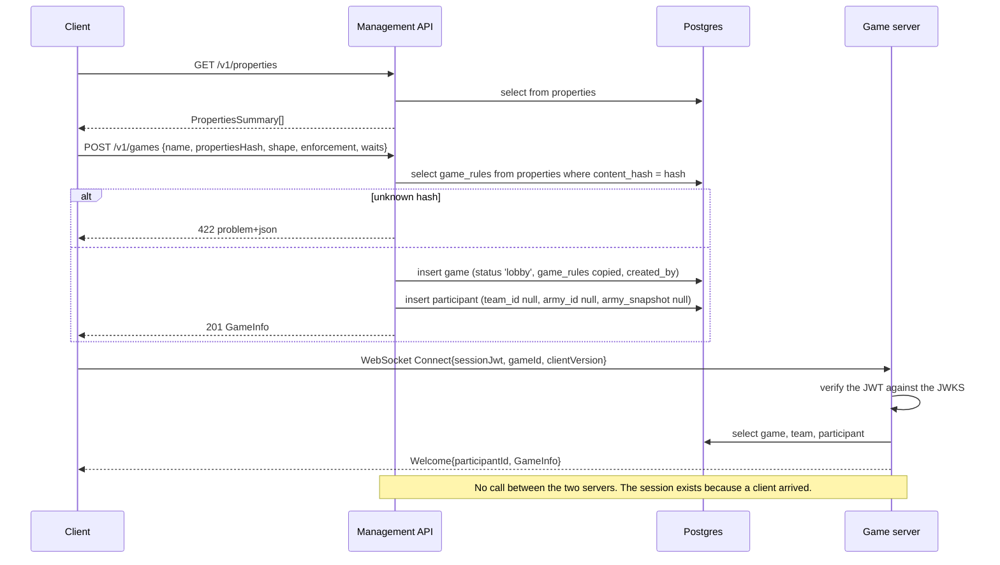

*Nobody instantiates a game session.*

The client holds a `GameInfo` from management and a `GameInfo` from the socket. After any lobby
edit only the socket's is current. `POST /v1/games` succeeds against a `properties` table the game
server may not have finished seeding.

### Key resolution, and the refresh loop

**Key resolution.** The `JwtBearer` handler's `OnMessageReceived` awaits `StytchJwks.Ensure(kid)` for
every request, and its resolver then reads `StytchJwks.Cached(kid)`. On an empty cache `Ensure` fetches
`GET {StytchBaseUrl}/v1/sessions/jwks/{project_id}` with no credentials. When the token names a `kid` the
cached set does not hold, it refetches **once, and only if the last miss refetch is more than 30 seconds
old**. That floor is a stampede guard. It is also the exposure: a Stytch key rotation inside 30 seconds of
the last fetch answers `401` until the window passes. One fetch runs at a time; concurrent callers await it
asynchronously, and a fetch is cut off after 5 s.

**Refresh.** The client calls `POST /v1/auth/session/refresh` about once a minute with the JWT it
holds, expired or not. Stytch documents that `/v1/sessions/authenticate` accepts a JWT already past
its `exp`, which the endpoint depends on. The handler calls `RefreshSession(jwt)` and hands the
result to `Sessions.Complete`, which finds the account already linked, sees `account_id` in the JWT and
returns the JWT Stytch has just minted. **That is one `POST /v1/sessions/authenticate` call per refresh, per client, per
minute.** The fresh JWT carries `account_id` because the session keeps its custom claims.

### Ending or deleting a game the game server is holding

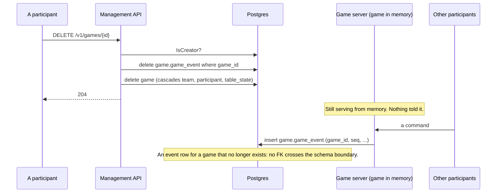

*A delete or an `/end` during play is invisible to the process holding the game.*

There is no management-to-game-server channel (`architecture.md`, "Contracts to freeze": no M2M).
`/end` leaves only a stale status, which the server overwrites on its next flip. `DELETE` leaves an
in-memory game with no row, and its appends write orphan log rows into the other schema. Nothing in
either plan detects or cleans that.

---

## State and data

This service holds **no in-memory state** beyond two caches: the `StytchJwks` key set, and the
`NpgsqlDataSource` connection pool. Nothing is rebuilt from the event log here. The event log is
the game server's, and this service only deletes from it. Restarting the process loses nothing.

### The tables this service owns

Three diagrams rather than one: the management schema is twenty-five tables.

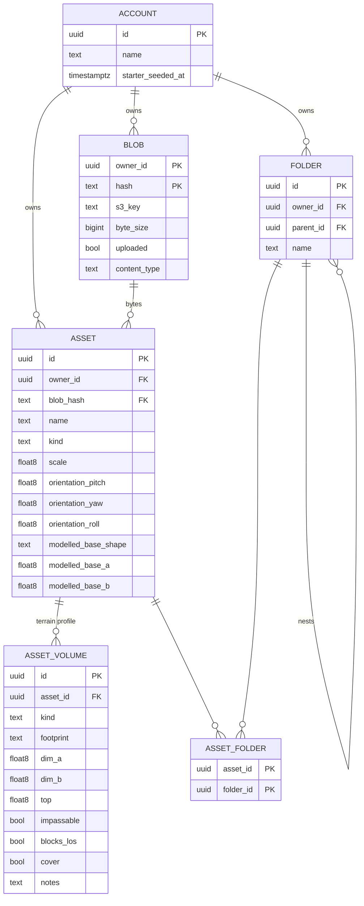

*The account and the library. `blob.uploaded`, `blob.content_type` and `account.starter_seeded_at` come from this module's
migrations `002` and `003`. `ASSET_VOLUME` is abbreviated here: it carries all
six declaration booleans and the full footprint, seventeen columns mapped by one `VolumeRow`.*

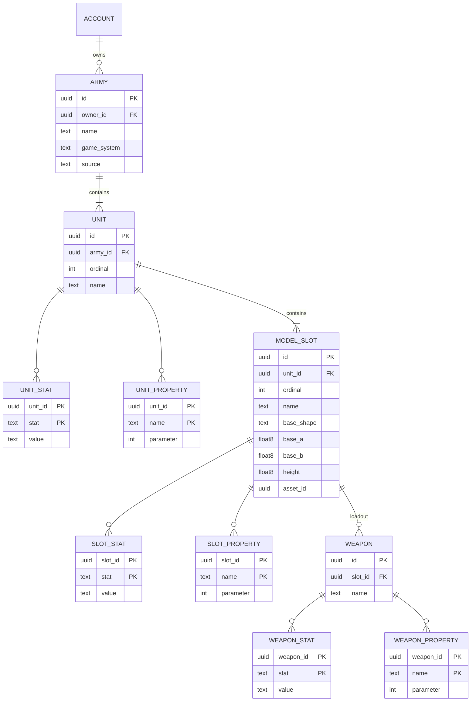

*Ten tables written in one transaction by import and read back in nine queries.
`model_slot.asset_id` has no foreign key, so the reference is soft. Stats are rows at three levels
because stats are declared by `Properties` rather than typed into the engine.*

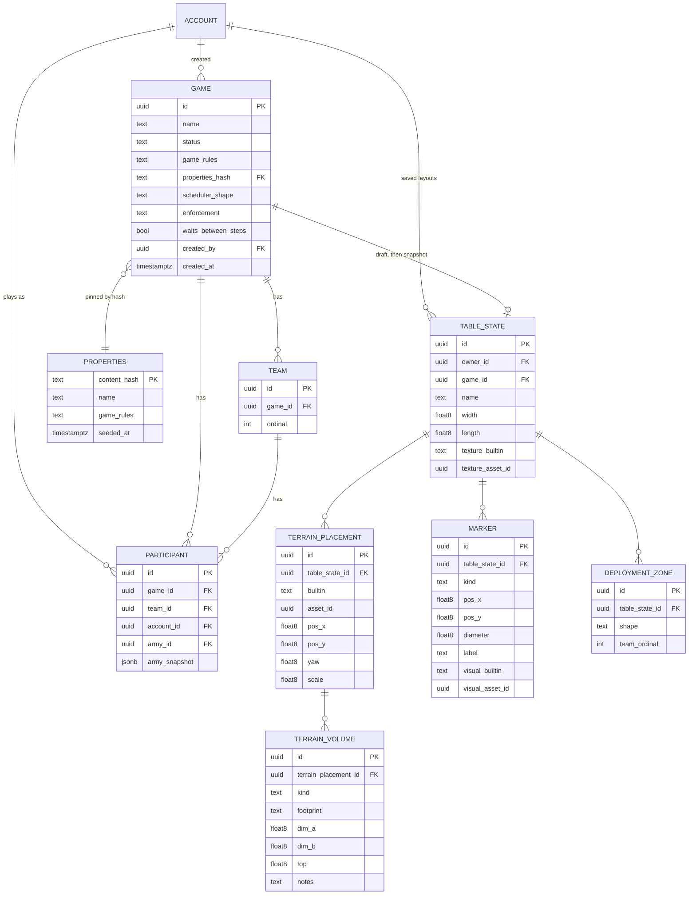

*Games and the table state. `TABLE_STATE` has two nullable owners with a check constraint that
exactly one is set: management writes the `owner_id` rows, the game server the `game_id` row.
`PARTICIPANT.game_id`, `unique (game_id, account_id)` and `army_id` are the contracts plan's
proposed corrections to `schema.md`, and this module's SQL requires them. `PROPERTIES` and the
seven tables beneath it are read here and written by nothing that exists.*

No column holds a model position, a wound, or whose activation it is. None of that is a row. It is
events, reconstructed into the game server's memory. A "current position" column here would mean
the event spine has been broken.

The one `jsonb` this module reads is `participant.army_snapshot`. It reads it **only** to collect
asset ids for the manifest, via `ContentJson.Deserialize<ArmySnapshot>`. The snapshot stays opaque
on purpose. Normalised, a later migration could alter what a past game was played with.

---

## Failure modes

### Concurrency and ordering

| Hazard | What happens | What the design does |
| --- | --- | --- |
| **Two simultaneous last leaves** | each `Leave` deletes its own `participant` row and then runs `update game set status='ended' where not exists (select 1 from participant where game_id = @id)`. Under read committed each transaction may still see the other's row, so **neither** ends the game and it survives with zero participants | nothing. No advisory lock, no `select for update`, no test. The consequence is an empty game listed as `lobby`, and it is not detected |
| **Concurrent create with the same hash** | `insert blob ... on conflict (owner_id, hash) do nothing` makes the second a no-op, and both assets point at one blob. The **first** row's `byte_size` and `content_type` win | intended for dedup. Unintended when the second caller declared a different `contentType`, because `confirm` branches on `asset.ContentType`, which is read from the blob row |
| **Confirm twice** | idempotent: `Size` still matches, the header is read again, `uploaded` is set again. The dedup path re-reads the header so a second asset over the same bytes still gets its triangle count | by design |
| **Two `PUT /volumes` on one asset** | delete-then-insert inside one transaction. Last writer wins, and volume ids change every time | by design: volumes are a value, not an identity |
| **Migration during a live game** | management runs DbUp at startup against the database the game server is holding games in. A management deploy can add or alter a column under it | named as still open by both the management API spec and `schema.md`, and not addressed. There is no coordination, no read-only window, and no version handshake |
| **Delete or `/end` during play** | the game server keeps serving from memory and appends `game_event` rows for a game row that is gone | no channel exists to tell it |
| **A `PATCH` on an army during setup** | the game server writes `army_snapshot` from the army "as it stands" at `EndSetup`; an edit landing between the read and the write is a lost or surprising update | accepted. The army is loaded once at setup. The army spec says independence rather than immutability, and no versioning exists |

### Lifecycle and leakage

| Hazard | Consequence | Disposition |
| --- | --- | --- |
| `POST /v1/assets` and then no `confirm` | a pending `blob` row and possibly a staging object | `UploadSweep` deletes both after an hour; the row is invisible to downloads and manifests meanwhile |
| Account and layout/army/folder counts under concurrent creates | the 200-per-account counts are read before the insert, so a burst can overshoot by the number in flight | accepted; the asset quota is checked under a row lock |
| Presigned `PUT` carries no size constraint | `IBlobStore.PresignUpload` takes `byteSize` and does not use it, so a client can `PUT` any number of bytes. The only size check is `confirm`, after the bytes are in the bucket | not addressed. A content-length-range condition would need a POST policy rather than a presigned `PUT` |
| S3 delete after the transaction commits | if `blobs.Delete` throws after the rows are gone, the object leaks with nothing pointing at it | accepted. The alternative is deleting bytes before committing, which loses data on rollback |
| Account deletion: Stytch fails with anything but `404` | content and hosted games are already gone, joined games already left. The caller gets `502`. The Stytch user survives, so logging in again recreates an **empty** account with the same id | ordering is database first, so a Stytch failure leaves no orphaned content |
| A valid JWT with no `account_id` claim | `CurrentAccount.Id` throws `UnauthorizedAccessException`. Task 4 says the Task 3 exception handler maps it to `401`; the handler as written in Task 3 maps only `ArgumentOutOfRangeException`, so this is a `500` | a gap, and untested. Listed under *Notable gaps* |
| JWKS refetch throttle | a Stytch key rotation within 30 seconds of the last fetch yields `401`s until the window passes | accepted stampede guard |
| Presigned download URL outlives participation | a player who left keeps a working URL for up to 60 minutes | **accepted**: another player retaining a mesh they were already shown harms nobody |
| Manifest `ExpiresAt` is 60 minutes, and games run hours | mid-game asset loads fail after an hour unless the client re-requests | the spec leaves re-issue undecided. The client must handle it |
| `GET /v1/games/{id}` exposes participants' display names to any logged-in caller | there is no relationship graph, but a public game reveals who is in it | consistent with games being public; what an account looks like to another account beyond a name is undecided (accounts) |
| Army Forge changes its export format | `POST /v1/armies/import` starts throwing, or maps silently wrong values | only a saved fixture guards it. A format change is a server deploy, which is the reason import lives here |
| `CatalogKinds.For` returns empty | every imported rule lands at unit level. Model-level rules such as `Tough(X)` land wrong until content exists, and re-importing later changes the outcome | not addressed. There is no content import yet, so this is today's behaviour |

### Refusals

Under `strict` enforcement the **game server** refuses commands. Nothing in this service refuses
anything on rules grounds. The triangle check warns. Model placement, coherency and base overlap
are not this service's concern at all. The only things this service refuses are malformed input,
an unknown `properties_hash`, a non-GLB masquerading as one, an unsupported game system, and a row
that is not the caller's.

---

## Testing

Test-driven throughout: a failing test, then the code. Two suites (spec
`2026-10-16-test-suites-design.md`): `dotnet test tests/Tabletop.Management.Tests` is the unit suite and reaches no
live service; `--settings tests/e2e.runsettings` runs the `Category=E2E` tests against `docker compose up -d`.

### Headless unit tests, no Docker

| Subject | Tests |
| --- | --- |
| `ClientVersion.Decide` | five cases: missing, equal, above, below, malformed |
| `Keyset.Parse` / `Page<T>.Of` | default 50, cap 200, non-positive throws, `Next` only on a full page |
| `GlbHeader` | magic and version, the JSON chunk length, triangle count per `mode` (4, 5, 6, lines), summing over primitives, the 100,000 boundary. `TestGlb.Build` synthesises a structurally valid GLB with an empty binary chunk |
| `ArmyForgeImport` | against the **real** saved export (`Fixtures/army-forge-c2-6YsWRH3py.json`): parse, combined merge, stats and bases, catalog-driven property level, the weapon cursor over a hand-written five-model list, range on ranged weapons and absent on melee, `ListId` from a share link and a bare id, an `aof` list importing as `grimdark-future` and `aofs` refused, the height scaled from the base. Two hand-written lists cover the join: a hero merged into a squad (six slots, the host's unit stats, the hero's own slot stats, rules, base and weapon on slot six) and the resolution rules (a hero naming an absorbed `combined` partner joins the merged unit, a name nothing answers and a name whose entry itself joins each stay their own unit) |

### Endpoint tests over the fakes, no Docker

`ManagementFactory : WebApplicationFactory<Program>` replaces every live dependency:

- **The repositories**: `InMemoryAccountRepository`, `InMemoryAssetRepository`, `InMemoryFolderRepository`,
  `InMemoryArmyRepository`, `InMemoryCatalogKinds`, `InMemoryLayoutRepository` and `InMemoryGameRepository` over one
  `InMemoryRows`, the schema's rows behind one lock. It checks the foreign keys the repositories lean on (a missing
  account, a missing blob, a game still naming its creator), applies the declared cascades by hand, and hands out
  strictly increasing v7 ids, so creation order is id order. Its `Seed*`, `PickArmy` and `FreezeArmy` write the rows no
  repository writes: Properties sets and catalog entries, a participant's lobby pick and frozen army, a game's table, the
  event log.
- **`InMemoryBlobStore`** for `IBlobStore`. Presigned URLs name `blobs.invalid`; `Client()` is the `HttpClient` that
  serves them, refusing a PUT whose content type differs from the signed one.
- **`IMigrator`**: a no-op. `Database` is removed, and `DB_CONNECTION` and `S3_ENDPOINT` name a closed port, so a test
  that still reaches Postgres or S3 fails at once.
- **`TestKeys`**: an RSA key, a JWT minter matching Stytch's claim shape, a fake JWKS handler that
  counts fetches, and `Rotate()`. `AuthenticatedClient(accountId)` inserts the account row, mints a
  JWT and sets the bearer header.
- **`FakeStytch`**: an `HttpMessageHandler` implementing enough of Stytch to log in: users by
  email, one fixed OTP code, passwords, external ids, sessions minted through `TestKeys`, plus
  revoke and delete lists to assert against. It asserts Basic auth is present on every call. It
  also serves the four calls the development mint uses, so `DevSessionTests` runs without touching
  Stytch. `ManagementFactory.HostEnvironment` defaults to `Testing` and that one test class stands
  a second host up as `Development`.
- **`FakeArmyForge`**: serves the fixture for one id and `404` for anything else.

### Contract tests, both suites

`Contracts/RepositoryContract` states each repository's contract once and runs twice: `InMemoryRepositoryContractTests`
over the fakes (unit) and `PostgresRepositoryContractTests` over the SQL classes on a `TestDatabase` (E2E). It covers
keyset paging (assets and armies ascending after the cursor, games descending before it), per-owner blob dedup and the
last delete returning the key, an account's hosted and joined game ids, account deletion cascading content and
participant rows and being refused while a game names the account as creator, folder cycles and cascades, army patch precedence and the lobby pick cleared on army
delete, layout copies with fresh ids, join idempotence, the last leave ending the game under concurrent leaves, the
latest Properties set per name, rule texts, catalog kinds, and the manifest's union of picks, snapshots and the game
table. `BlobStoreContract` does the same for `InMemoryBlobStore` (unit) and `S3BlobStore` on MinIO (E2E): a presigned
`PUT`, a size, a ranged read, a presigned `GET`, a PUT refused for the wrong content type.

### E2E only, Docker required

- **`TestDatabase`**: a database of its own per fixture on the Docker Postgres named in `.env`,
  created, migrated by `Migrator.Run`, dropped `with (force)` on dispose. `MigrationTests` asserts
  the table count across the `management` and `game` schemas and that a second `Migrator.Run` is a no-op.
- `PostgresRepositoryContractTests` and `S3BlobStoreTests`, above.

Notable endpoint assertions: `426` before anything else runs, and `problem+json` on it; the CORS
preflight answered for `TABLETOP_WEB_URL` and not for another origin; the same bytes twice
short-circuiting the upload and only the second delete removing the blob; an STL renamed `.glb`
refused at confirm; a 100,001-triangle GLB warned and accepted; keyset paging across three assets;
another owner's row answering `404` on `GET`, `PATCH` and `DELETE`; a folder cycle refused;
import storing and reading back a byte-identical tree; unit-default then per-slot binding then
clear; save-a-layout regenerating every id; join at `ended` and idempotent re-join; the last leave
ending the game; a participant who is not the creator answering `404` on `/end` and on `DELETE`,
and the creator still deleting after leaving; a whole-game delete removing `game.game_event`; the manifest returning three
assets across two owners with the owner's corrections and excluding the unconfirmed one; deletion
removing content, blobs, three games including one created-and-left, and the Stytch user, while
leaving another account's untouched game alone; `POST /v1/dev/sessions` answering `404` on the
`Testing` host and no Stytch call being made; the same name minting twice to one account id, one
Stytch user and one stamp call per mint, with the second JWT accepted by `GET /v1/account`.

### What cannot be tested headlessly

- **Real Stytch.** Every automated test runs against `FakeStytch`. Task 5 ends with one manual
  pass: set the secret, `POST /v1/auth/otp` to a real address, verify the emailed code, and check
  the JWT's `account_id` claim is the account id. One thing stays unproven by the suite: that
  `session_duration_minutes` behaves as documented. `FakeStytch` models the project without a claim
  template: a session carries `account_id` only once `session_custom_claims` set it. Task 5 also mints once for real through `POST /v1/dev/sessions`, which is the only
  proof that the embeddable-magic-link pair works against the live project. A `--driver socket`
  simulator run depends on that pair and therefore on network access to the Stytch test project,
  which the in-process driver does not need.
- **The live Army Forge format.** A fixture is a snapshot. The suite cannot notice a format
  change.
- **CORS in a browser.** The preflight test exercises the middleware, not a real browser's
  enforcement.
- **Presigned URL reachability from Windows.** URLs are minted against `TABLETOP_S3_ENDPOINT`
  verbatim, so `localhost:9000` works from both WSL and the Windows host. Only the manual
  `Invoke-WebRequest` check in Task 14 exercises that.

### Notable gaps

- **Concurrency is tested only for the double leave.** Not two creates racing on one hash, not
  two confirms.
- **The compose-init baseline path is never exercised.** `TestDatabase` creates an empty database,
  so `Migrator.Baseline` always takes its early return. The branch for a database the compose init
  already populated has no test. A partially applied init would be baselined as complete, because
  the probe is `management.account` alone.
- **No test for a valid JWT lacking `account_id`**, the case that reveals the exception-handler
  gap.
- **No test that `blob.content_type` cannot diverge** from a second asset's declared type over the
  same hash.
- Nothing asserts a presigned URL's TTL, or that an expired one is refused.

---

## Rulings and deferred work

### Rulings

| Question | Decision | Reason |
| --- | --- | --- |
| 1. Custom claim by per-login `session_custom_claims` or by a Stytch dashboard claim template (`{"account_id": "{{ user.external_id }}"}`)? | **`session_custom_claims`, stamped once per new session** | the template is dashboard configuration outside the repo and its absence fails silently, so signup and sign-in could not be shown to work from the repo. Stytch keeps session custom claims on the session, so the stamp costs one extra call per new session and a refresh makes none. `external_id` links the account and `Sessions.Complete` stamps from it |
| 2. Do joined heroes (`joinToUnit` without `combined`) import as their own unit? | **no: the hero is a model of the unit it joined** | Army Forge publishes the attachment on the joining entry, and `ModelSlot` already carries the stats and properties the hero needs, so no table records the join. `Merge` returns a host plus the entries joining it, `Section` appends one entry's slots with its own stats, base and cursor, the unit's stats and properties stay the host's, and an unresolvable `joinToUnit` imports as a unit of its own |
| 3. Default base and height when Army Forge gives none? | **`DefaultBody`, a 221 × 119 × 113 mm vehicle hull carrying its own height, when `bases.round` is absent; a published base gets `HeightFromBase`, `1.5 ×` its larger dimension** | Army Forge publishes `bases.round` reliably for infantry, so a missing base is a vehicle or monster in practice, and the base is the only physical dimension the export gives. `HeightFromBase` is one expression, and a per-`GameRules` table of heights would be the alternative |
| 4. How are partial weapon counts dealt onto models? | **an advancing cursor**, and the flamer lands last | import expands deterministically; asking the user would need a per-slot weapon editor and a `PATCH` shape for weapons, neither designed |
| 5. Which game systems import? | **Grimdark Future and Age of Fantasy, both as `grimdark-future`** | the mechanics are the same and only the content differs. No Age of Fantasy content set exists, so such a list imports before anything can play it, recorded against the interpreter |
| 6. Who may `/end` and `DELETE` a game? | **the creator alone**, still so after leaving | the creator starts and ends setup, so ending and destroying the game belong to the same account. `GameRepository.IsCreator` gates both routes and anyone else gets `404` |
| 7. Is `GET /v1/games` newest-first? | **yes** | the list's filters are for finding something recent, and ascending would put every finished game ahead of tonight's. `id < @after order by id desc`; `Page<T>.Next` still holds the last id |
| 8. Does the texture kind accept `image/webp`? | **yes** | Godot 4 loads it natively and every client in a game downloads the table texture. One value in `AssetRules.ContentTypes`, one in the `002` check constraint, and the web app's `ContentType` union and `classifyFiles` |

A request with no version header is accepted (management API → *Authentication*, the version
check): the check exists for the downloaded desktop client, and the client shell says the client
sends its version on every request.

### Deferred, with where it is recorded

| Deferred | Where |
| --- | --- |
| Multipart upload for large files | management API → *Still open*. `IBlobStore` has no multipart member |
| Rate limiting | management API → *Deliberately not decided* |
| Whether the manifest is re-issued on reconnect or re-requested | management API → *Deliberately not decided* |
| The JWT lifetime and refresh interval as anything but working figures | management API → *Deliberately not decided*. Five minutes and one minute are used here |
| Indexes beyond primary and foreign keys | `schema.md` → *Still open*; the game browser's listing query is the first candidate |
| Whether the two schemas become two databases | contracts design → *Two Postgres schemas in one database*: one database for local development; hosting may revisit |
| Hosting, and therefore how a migration is coordinated with a running game server | `architecture.md` → *Deployment* |
| Whether the client ever edits an army | web app → *Still open* |
| Password-protected games, friend-joining, a relationship graph | accounts → *Deliberately not decided* |

---

## References

**Specs**:

- `docs/superpowers/specs/2026-08-29-management-api-design.md` (primary)
- `docs/superpowers/specs/2026-08-29-accounts-design.md`
- `docs/superpowers/specs/2026-08-28-army-design.md`
- `docs/superpowers/specs/2026-08-28-asset-library-design.md`
- `docs/superpowers/specs/2026-08-29-setup-content-design.md`
- `docs/superpowers/specs/2026-08-29-web-app-design.md`
- `docs/superpowers/specs/2026-09-04-mesh-conversion-design.md`
- `docs/superpowers/specs/2026-09-04-client-shell-design.md`
- `docs/superpowers/specs/2026-09-04-setup-phase-design.md`
- `docs/superpowers/specs/2026-08-29-identity-and-enumerations-design.md`
- `docs/superpowers/specs/2026-08-29-content-values-design.md`
- `docs/superpowers/specs/2026-09-04-whole-design-review.md` (newest, wins)

**Repo documents.** `docs/architecture.md`, `docs/data-model.md`, `docs/schema.md`, `CLAUDE.md`.

**Consumed module.** `docs/design/contracts/design.md` supplies the
three libraries, `001_schema.sql`, `docker-compose.yml`, the `TABLETOP_*` names, and the reserved
ports.
Its `001_schema.sql` carries `participant.army_id` and `participant.game_id` with its unique
constraint (`docs/schema.md` → *`participant` links to its game, and holds the army it picked*),
which this module's SQL depends on.

**External, verified.** Stytch Consumer API reference, checked page by page against the test
project `project-test-7a0ad7e7-906a-434a-a3d2-bf90668f9f43` at base `https://test.stytch.com`; the
JWKS endpoint takes no credentials, which an unauthenticated `curl` shows. Army Forge
`GET https://army-forge.onepagerules.com/api/tts?id=c2-6YsWRH3py` fetched live (`200`, 26 KB,
`access-control-allow-origin: *`) and saved as the fixture.

**Rulebook.** No page of Grimdark Future is read by this module. It stores content and enforces no
rule. The one number from the rules side is the triangle warning threshold, 100,000, and that is a
product decision from mesh conversion rather than a rulebook figure. Pages 6, 16, 17–18, 19 and 49
of Grimdark Future v3.5.1 are read by the setup phase, whose rows this module stores as layouts but
never interprets.

**Sibling design documents** in `docs/design/`: `contracts/`, `geometry/`, `game-server/`,
`scheduler/`, `interpreter/`, `client/`, `web-app/`.
