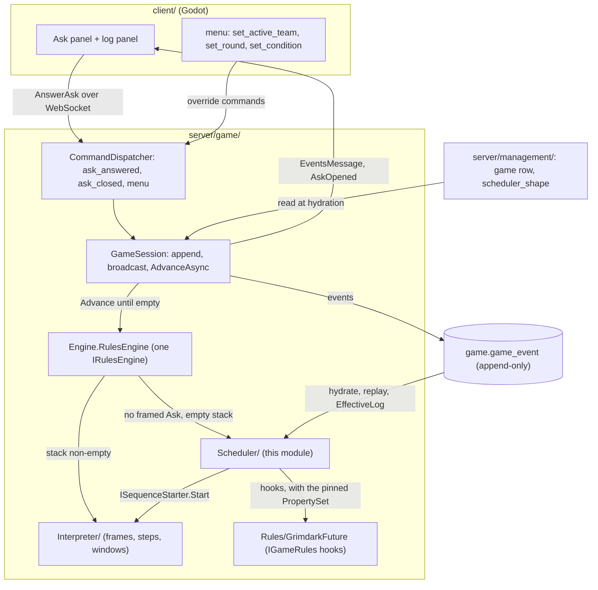
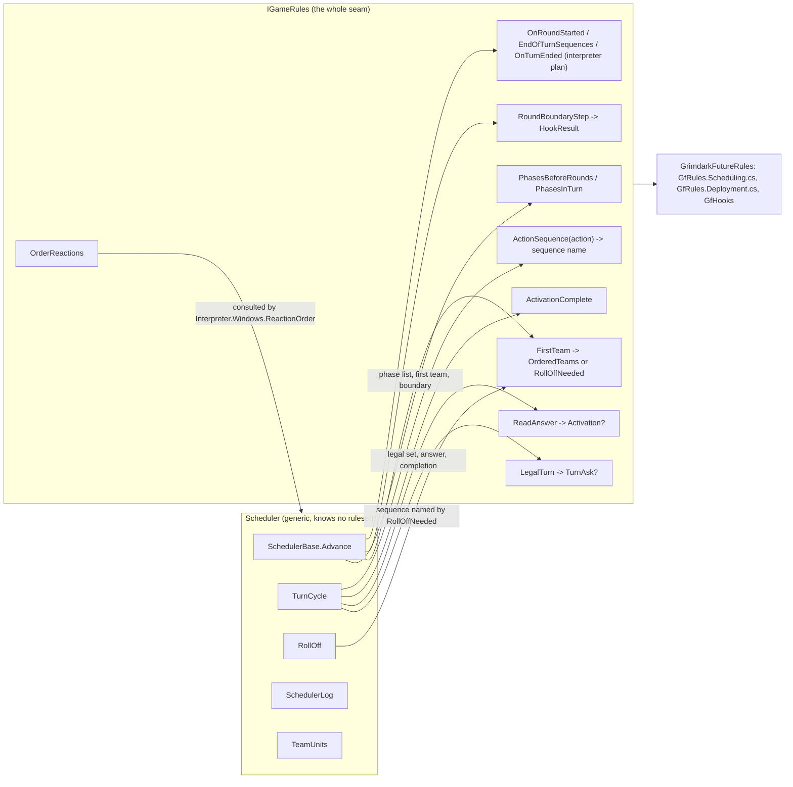
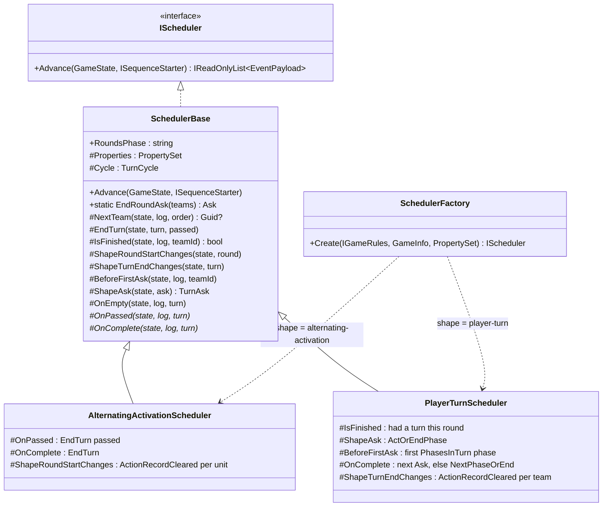
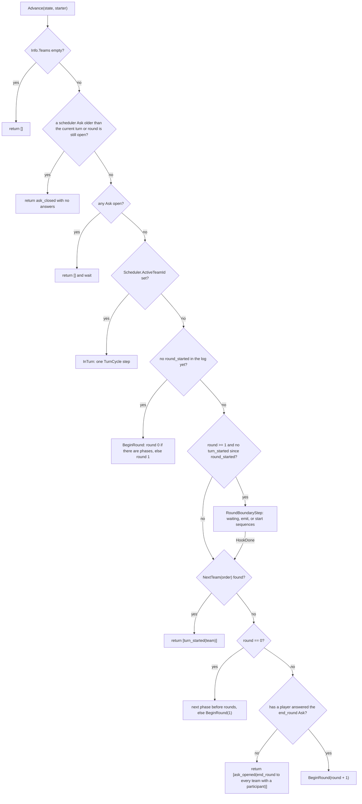
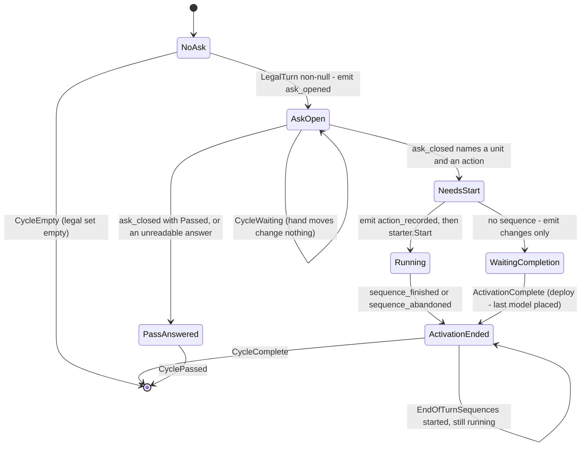
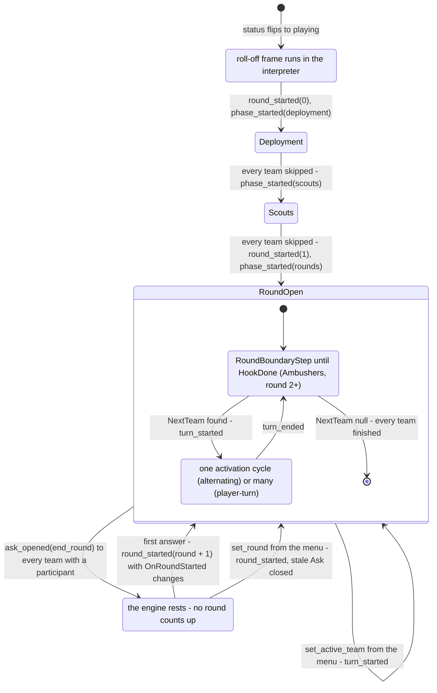
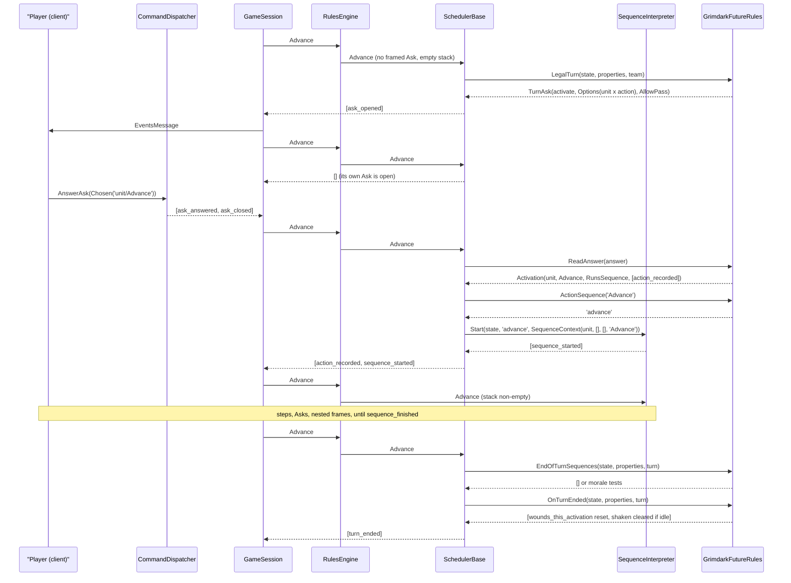
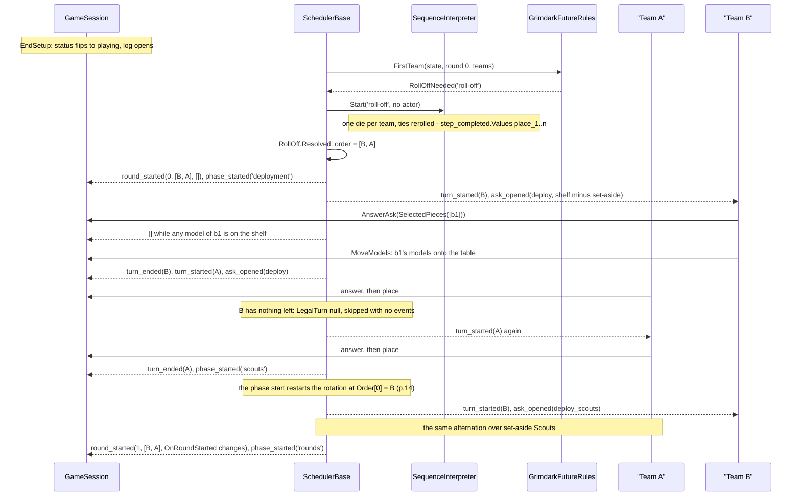
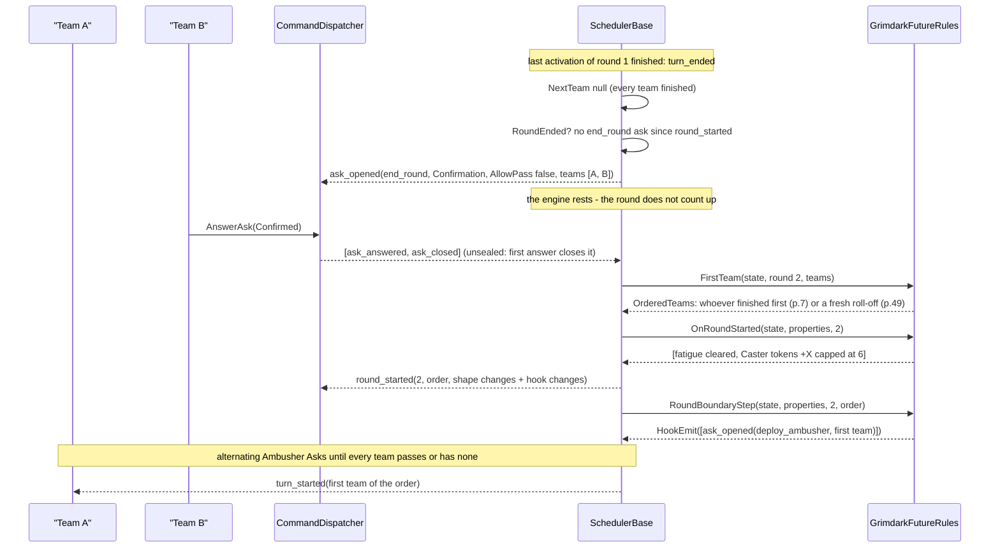
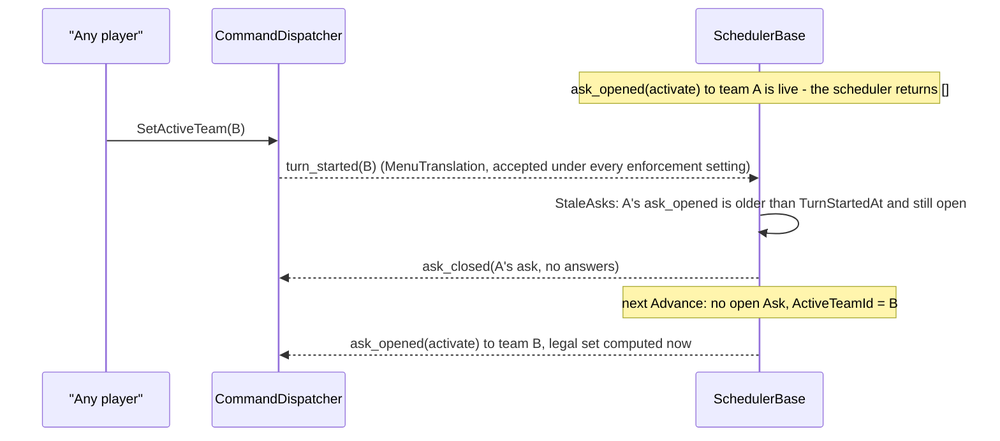

# Scheduler

The scheduler answers whose input is needed next and what is legal in that window. It is generic
engine code in `server/game/Scheduler/`, one half of the single `IRulesEngine` the game server
runs. The interpreter owns the other half and composes both. Two shapes, alternating activation
and player-turn, sit behind one interface, selected per *game* from `game.scheduler_shape` rather
than per ruleset. Everything ruleset-specific is a hook on `IGameRules` implemented by
`GrimdarkFutureRules`, so no engine code branches on ruleset identity.

The scheduler holds no state. Round, order, active team and passed teams are re-derived from
`Projection.Scheduler` and the effective event log on every `Advance` call. Four events carry
them: `round_started`, `turn_started`, `turn_ended`, `phase_started`. A *player* ends a round
(2026-09-06 ruling). Undo-by-replay, a rejoining client and a rehydrated server therefore reach
the same answer.

## Scope

**In scope.** `IScheduler.Advance`, the two shapes and their common base; the turn as an unframed
Ask through the interpreter's own Ask machinery; one activation cycle read from the log; the
phases before round one (deployment, Scouts) and the flip into round one; the first-team policy
and the roll-off started through the interpreter; the round boundary, its confirmation Ask and
the interactive boundary hook (Ambushers); reaction *ordering* as a policy hook; the eight
`IGameRules` members the scheduler adds and their Grimdark Future bodies; the factory and its
registration in `Program.cs`.

**Not in scope.**

| Not built here | Where it lives |
| --- | --- |
| The interpreter, frames, steps, the roll primitive, the confirm gate | interpreter plan, `Interpreter/`, `Dice/`, `Engine/RulesEngine.cs` |
| `Windows.ReactionOrder` itself; the scheduler supplies only the hook it consults | `Interpreter/Windows.cs` |
| Reaction *eligibility* (`IGameRules.ReactionsAt`) | interpreter plan, `GfHooks` |
| Fatigue clearing, spell tokens, end-of-activation morale, the wounds-this-activation reset | `IGameRules.OnRoundStarted` / `EndOfTurnSequences` / `OnTurnEnded`, bodies in `GfHooks` |
| Appending, broadcasting, `ask_answered` / `ask_closed` for an answer, authorization | `GameSession`, `CommandDispatcher` (skeleton) |
| 40k's `GameRules` | never; the interface is falsified against it through `FakeRules` only |
| Alternation *inside* one team's turn (40k's Fight phase) | not built; scheduler spec, constraint 2 |
| `Overwatch` (p.32) and action boosting's *Random* playstyle (p.30) | deferred; `handoff.md` |

**Code lands in** `server/game/Scheduler/` (ten new files), two partials of the one ruleset in
`server/game/Rules/GrimdarkFuture/` (`GfRules.Scheduling.cs`, `GfRules.Deployment.cs`), eight
new members on `server/game/Rules/IGameRules.cs`, one registration line in
`server/game/Program.cs`, one Layout bullet in `CLAUDE.md`, and thirteen test classes plus five
infrastructure files in `tests/Tabletop.GameServer.Tests/`.
Nothing is added to `libs/`. No Protocol type is reshaped. `Scheduler/` is a sibling of `Rules/`
and `Dispatch/` because the scheduler is engine code, not a ruleset.

**Position in the build order.** `architecture.md` step 7 (*Scheduler and OPR skeleton*). Nothing
exists yet: the client is a scaffold and `server/game/` is empty. What must land first:

1. the contracts plan: every `Tabletop.Protocol` name, including the `AskQuestions.EndRound`
   constant added there on 2026-09-06 for the round-boundary ruling;
2. the game-server skeleton: `IGameRules`, `IRulesEngine`, `GameState`, `Actor`, `Legality`,
   `EngineResult`, `CommandDispatcher`, `InMemoryEventLog`, `EventApplier`, the `Postgres` test
   fixture, and `GrimdarkFutureRules` as a `sealed partial class` in `GfRules.cs`;
3. the interpreter plan's Tasks 1–11: `Engine.IScheduler`, `Engine.ISchedulerFactory`,
   `Engine.RulesEngine`, `Interpreter.ISequenceStarter`, `Properties.PropertySet`,
   `Effects.Lookup`, `GfNames`, `GfRolls.RollOffSequence`, `GfHooks`, and the test infrastructure
   `Sim`, `TestProperties.Core`, `LambdaStep`.

Only this module's Tasks 1–2 can start before the interpreter's Task 11. Everything from the
roll-off onward needs it. One edge is cyclic: `GfNames.Rounds` is defined as
`SchedulerBase.RoundsPhase` so the two spellings cannot drift. Either that constant lands first,
or `GfNames.Rounds` is the literal `"rounds"` until it does.

## Context



The scheduler touches four things and nothing else: `GameState` (which is `GameInfo`, `Board`,
the `EventApplier` and `IGameRules`), the `ISequenceStarter` it is handed on every call, the
`PropertySet` its factory was given, and the effective log it reads out of the applier.

**The engine seam.** `RulesEngine.Advance(state)` is a three-way ladder. A framed Ask open
returns `[]`. Every Ask the interpreter opens carries a `FrameId`. A non-empty resolution stack
runs `Interpreter.Advance`. Otherwise it calls `IScheduler.Advance(state, Interpreter)`. The
scheduler therefore runs only *between* sequences, never while a frame is live, so `TurnCycle`'s
`Running` and `WaitingCompletion` states are reachable from unit tests but never from the real
engine. Unframed Asks are the scheduler's own, and it is still called while one is open. It
returns `[]` to wait. It is the one thing in the engine allowed to emit an `ask_closed`, with an
empty answer list, for an Ask of its own that a menu edit superseded. The session's loop calls
`Advance` after every appended batch until it returns nothing, capped at 10 000 iterations.

**The ruleset seam.** The scheduler never reads a unit's action record, conditions or properties
itself. It branches on nothing but `GameInfo.SchedulerShape`. Every ruleset question is a member
of `IGameRules` taking `GameState` and the pinned `PropertySet` and returning a value. There are
no callbacks into the scheduler and no state held on either side. Name checks go through the
interpreter's `Effects.Lookup.UnitHas`, so a rule *granted* by a spell counts (whole-design
review → *`GameRules` name checks read the grants store*).

**The persistence seam.** The scheduler writes nothing to Postgres and reads one column
indirectly: `game.scheduler_shape`, already materialised as `GameInfo.SchedulerShape` by the
skeleton's hydration. Its state is the event log, `game.game_event (game_id, seq, kind, payload)`.

## Design

### Ownership boundary with `GameRules`

The scheduler spec draws this line as a two-column table. In code the right-hand column is eight
members of `IGameRules`, plus three the interpreter plan owns and the scheduler calls. The
governing rule is `architecture.md` → Turn scheduling: *"No engine code branches on ruleset
identity; the scheduler is the firewall."*



Two placements were rejected in the spec.

The scheduler *inside* `GameRules`, with the shape as a parameter, was rejected: it makes the two
shapes two branches in one class instead of two implementations behind one interface. Game flow
chose both shapes to have a second example at this seam.

The scheduler *as a sequence on the resolution stack* was rejected. It would make the turn
literally an Ask, but the interpreter has no loop primitive by design, abandoning the game loop
would mean nothing, and a frame that lives for the whole game is not what the stack is for. One
thing survived from that option: the turn is an Ask, issued through the interpreter's own `Ask`
type.

### The two shapes behind one interface



The shapes differ in six overrides and nothing else. The phases before round one, the rotation,
the boundary and the activation cycle are all on the base.

The two shapes are not two rulesets. `SchedulerFactory.Create` reads `GameInfo.SchedulerShape`
once per game, because *setup configuration is fixed once playing* (scheduler spec). A group that
wants the other shape starts a new game. The shape is chosen per game rather than per ruleset by
game flow's decision: *"a group may pick alternating activation in a game whose pack defaults to
player turns, and the reverse"*. The one `GrimdarkFutureRules` runs under both. `FirstTeam` is
handed the round and the teams, never the shape. A `FirstTeam` that branched on `SchedulerShape`
would be `GameRules` knowing about the scheduler, which the seam exists to prevent.

Where they differ:

| | Alternating activation | Player-turn |
| --- | --- | --- |
| A turn is | one activation | every activation the team can make |
| Turn Ask question | `activate` | `act_or_end_phase` |
| Team finished when | passed this round, or empty legal set | had a `turn_ended` this round, or empty legal set |
| Action record clears | at `round_started`, every unit | at the team's `turn_ended`, that team's units |
| Phases inside a turn | none | `IGameRules.PhasesInTurn`, each its own Ask loop |
| Round ends when | every team is finished | every team has had a turn |

Both stop at the same boundary Ask. OPR supplies `PhasesInTurn = []`, which the player-turn shape
runs as one unnamed phase: `Projection.Scheduler.Phase` stays `rounds`.

### The `Advance` ladder

One call, no state, and a strict order. `SchedulerBase.Advance` returns the *next* batch of
payloads for the session to append, or `[]` to rest.



Stale Asks are closed before anything else. A menu edit may have left one hanging, and the
dispatcher only closes Asks that carry a `FrameId`. An open Ask is the universal wait: one branch
covers the turn Ask, the deploy Asks, a boundary hook's Ambusher Ask and the `end_round` Ask. The
round-boundary hook runs after `round_started` and before the first `turn_started` of the round,
where the spec puts it. The round-0 branch never reaches the gate. Deployment's phases and its
flip into round one are untouched by the 2026-09-06 ruling.

### State rebuilding and its cost

`Projection.Scheduler` is a `SchedulerPosition`: `int Round`, `IReadOnlyList<Guid> Order`,
`Guid? ActiveTeamId`, `string? Phase`, `IReadOnlySet<Guid> Passed`. The applier maintains it from
the four events. Those five fields are the whole of the flow state game flow named, and the
scheduler adds no field of its own. The spec's *Nothing is an invariant* is implemented as the
absence of a cache.

Everything finer-grained than those five fields is read from the log by `SchedulerLog`: where in
this activation we are, whether the end-of-turn hook has run, which team was asked for an
Ambusher last. `SchedulerLog.Of(state)` builds it afresh on every `Advance`. It wraps
`EventApplier.EffectiveLog(state.Applier.Log)`, which drops every undone range and the `undone`
markers, and cuts it at five anchors:

| Anchor | Definition | Used for |
| --- | --- | --- |
| `RoundStartedAt` | last `round_started` | the boundary hook's slice, the roll-off's scope, `end_round` |
| `PhaseStartedAt` | last `phase_started` | the deployment/Scouts phase boundary |
| `TurnStartedAt` | last `turn_started` | the turn's slice |
| `RotationStartAt` | `max(round, phase)` | where the rotation restarts from `Order[0]` |
| `CycleStartAt` | `max(turn, phase)` | the current activation cycle, under either shape |

`RotationStartAt` makes page 14's *"starting with the player that activates next"* a logged fact
rather than a special case. A `phase_started` restarts the rotation at `Order[0]`, which for the
Scouts phase is the roll-off winner. Without a phase boundary the rotation would continue after
whichever team deployed last, and the Scouts phase would begin with the wrong player. This is the
plan's spec correction 2.

**Cost.** Every `Advance` is `O(log)`. `EffectiveLog` walks the whole log to strip undone ranges,
and each anchor is a `LastOrDefault` over the result. The session loops `Advance` until it rests,
so one player answer can mean several passes. An activation with an empty sequence, measured in
this plan's own tests, is around six events and therefore six or seven scans. A four-player game
running hours accumulates thousands of events. A `SchedulerLog` is allocated per call, along with
its `After(seq)` lists.

The cost is accepted for one reason. Any cache is a second source of truth that undo-by-replay, a
rejoining client and a rehydrated server would each have to invalidate correctly. The spec's
answer to *"is this team finished"* is *read again every time*. The cost is also bounded by the
product shape: a turn-based game with no simulation tick, where the server only works when a
command arrives. The fix if it bites is memoising `EffectiveLog` per `(log length, last undone
seq)` inside `EventApplier`, not caching scheduler state. That keeps the one hydrate path intact.

Replay applies the four events and never re-derives them. `round_started.Order` is a fact, not a
recomputation. A change to a first-team policy after a deploy must not rewrite who went first in
a game already played. This is the same reasoning that put thresholds in roll events. The roll-off
is an ordinary logged sequence, and on replay nobody reads its dice again.

### The turn Ask

When a turn opens, the scheduler asks the team, through the same `Tabletop.Protocol.Ask` type the
interpreter uses, with `FrameId = null`. `TurnCycle.AskFor(teamId, turnAsk)` is the whole
construction:

```csharp
new Ask(Guid.CreateVersion7(), ask.Question, ask.Prompt, [teamId], ask.Legal,
        ask.AllowPass, Sealed: false, WindowKind: null, FrameId: null);
```

The legal set is server-computed and is the activatable units paired with the actions each may
take. `GrimdarkFutureRules.LegalTurn` builds it as an `Options` legal set whose `AskOption.Id` is
`ActivationOption.Id(unitId, action)`, the string `"{unitId:N}/{action}"`. The label is
`"{unit name}: {action}"` and `Pieces = [unitId]`, so the client highlights the unit. The id names
both halves because under `warn` or `silent` an out-of-set `Chosen` still reaches the scheduler
and must still say what the player meant (scheduler spec → Enforcement). The client renders
`Label` and `Pieces` and never parses the id.

For Grimdark Future the legal set is *units of this team with an empty action record and at least
one model on the table*, crossed with `ActionsFor`:

```csharp
if (Lookup.UnitHas(state, props, unit.Id, Aircraft)) return actionRows.Where(a => a == Advance).ToList();
if (unit.Conditions.Contains(Shaken)) return [ActivationOption.Idle];
if (Lookup.UnitHas(state, props, unit.Id, Immobile)) return actionRows.Where(a => a == Hold).ToList();
return actionRows;
```

The order of those three tests is a rulebook reading, not a preference. Page 13 gives `Aircraft`
*"may only use Advance actions … (even if Shaken)"* and adds that their mandatory move *"doesn't
break the staying idle requirement to stop being Shaken"*. `Aircraft` is therefore read before
`Shaken`, and a Shaken Aircraft is offered `Advance`, not `Idle`. Page 10 gives every other Shaken
unit *"must spend their activation being idle and doing nothing, which stops them from being
Shaken at the end of their activation"*, which is `ActivationOption.Idle`, a `const string` that
is not an action row and runs no sequence. Page 14 gives `Immobile`: `Hold` only. The action rows
come from `PropertySet.Actions` in catalog order (`Hold`, `Advance`, `Rush`, `Charge`), because
actions are named per ruleset rather than enumerated.

The turn ends when the declared action's sequence finishes. There is no end-turn command.
`architecture.md`'s old `EndActivation` example was struck by the whole-design review for this
reason. `TurnCycle` reads how far one activation got, from the log slice since `CycleStartAt`,
and takes one step:



1. **The record is written when the sequence starts, not when it ends.** `Activation.Changes` for
   an OPR activation is `[new ActionRecorded(unit, action)]`, emitted in the same batch as the
   `sequence_started`, so *an abandoned sequence still counts as the unit having gone* (spec) and
   an abandoned activation still ends the turn.
2. **"Has this activation started" is read from the log**, by looking for the activation's own
   changes after the `ask_closed`. There is no flag to get wrong on replay.
3. **The end-of-turn hook runs exactly once**, also read from the log. A `sequence_started`
   after the activation ended means the hook already ran, so `EndOfTurnSequences` is not called
   again. An empty result completes the turn in the same call.
4. **Hand moves never end a turn.** `models_moved` is not an answer, and it is not in any of the
   transitions above. Deployment is the one exception, where `ActivationComplete` is a question
   about placements. Even there the answer that opened the activation was an Ask answer, not a
   move.
5. **An answer that names nothing is a pass.** `ReadAnswer` returns null for an option id that
   does not parse or a unit that does not exist, and `TurnCycle.Read` maps that to
   `PassAnswered`. This is the plan's open question 3.
6. **An out-of-set action with no sequence is recorded and nothing more.** `ActionSequence("Teleport")`
   is null, so the cycle emits `ActionRecorded(unit, "Teleport")` and completes. That is
   enumeration-not-validation carried through to the end.

`TurnCycle` takes the pinned `PropertySet` in its constructor and is otherwise stateless. It is
constructed once per scheduler and reads everything from the arguments of each call.

### Skipping, passing and spectators

Three distinct mechanisms.

**An empty legal set is a skip.** `LegalTurn` returning null means no Ask and no turn events.
`NextTeam` walks the order and passes over the team, so nothing is logged about it at all. This is
how OPR's *"continues until all units have activated"* works when one side has more units. It is
also the only mechanism needed for a team that brought no army.

**A participant with no team is never addressed.** Every Ask the scheduler builds names teams,
and the `end_round` Ask is addressed to `teams.Where(t => Info.Participants.Any(p => p.TeamId == t))`.
`participant.team_id` is nullable, and a `join` creates the row with no team. A participant with
no team is what a spectator is: ruling 5 of the whole-design review, superseding presence's
"joins a third team". There is no spectator type, no second identity and no filtering. A watcher
appears in no `Ask.Teams`.

**A pass is a logged fact.** `turn_ended` carries `Passed`, and the applier adds the team to
`SchedulerPosition.Passed`. It stands for the round: `IsFinished` is
`Passed.Contains(teamId) || LegalTurn(...) is null`. `SchedulerPosition` holds passed teams rather
than finished teams, because a team that passed with a non-empty legal set would otherwise have
been re-asked at once. The consequence is asymmetric and intended. If a menu edit clears a unit's
record after that team's legal set emptied, the scheduler sees a non-empty set at the team's slot
and asks it again. If the team *passed*, it is not re-asked. Under the player-turn shape
`IsFinished` reads *had a `turn_ended` this round* instead, which subsumes the pass.

### Deployment: the phase before round one

Deployment is not special-cased machinery. It is the same scheduler running a phase list the
ruleset supplies. `IGameRules.PhasesBeforeRounds` is `[deployment, scouts]` for Grimdark Future
and `[]` for a ruleset that starts at round one. The sequence of logged facts is:

`roll-off sequence` → `round_started(0, order, [])` → `phase_started("deployment")` → alternating
`turn_started` / deploy Ask / `models_moved` / `turn_ended` → `phase_started("scouts")` → the same
again → `round_started(1, order, changes)` → `phase_started("rounds")`.

Round 0 carries the deployment order on `round_started.Order`, because `SchedulerPosition` has no
other field for it and hydration must find it in the log. This is the plan's spec correction 1.
Round 0's `round_started.Changes` is empty: `OnRoundStarted` returns `[]` for round 0, so no
fatigue is cleared and no spell token is granted before the game begins.

The deploy Ask is a `PieceSelection(ids, 1, 1)` with `AllowPass: false`, one unit per Ask and no
pass, over *the team's shelf minus set-aside units*:

```csharp
var units = TeamUnits.Of(state, teamId).Where(u => TeamUnits.AllShelved(state, u));
units = phase == Deployment
    ? units.Where(u => !u.Conditions.Contains(SetAside))
    : units.Where(u => u.Conditions.Contains(SetAside) && Lookup.UnitHas(state, props, u.Id, Scout));
```

**Set-aside is an ordinary condition on the shelved unit**, spelled `set-aside`
(`GfNames.SetAside`), written from the menu with `SetCondition` like any other property. There is
no *set aside or deploy* Ask and no phase for it. Game flow's *Nothing is an invariant* makes
every property editable at any time through the same path automation writes. The players set it
whenever they like, and the next deploy Ask's legal set excludes it. A set-aside unit that is
neither a Scout nor an Ambusher is never offered at all. It stays on the shelf until somebody
clears the condition and hand-moves it.

**The turn ends when the last model of the unit has a placement.** `ActivationComplete` is the
whole rule:

```csharp
activation.Action != Deploy ||
!TeamUnits.ModelsOf(state, state.Projection.Units[activation.UnitId]).Any(m => m.Location is OnShelf);
```

The answer names a unit. The models come off the shelf by ordinary `MoveModels` commands. The
scheduler stays put while any model is still shelved, and the turn ends on the batch that placed
the last one. `Activation.Changes` is empty for a deploy, so deploying writes nothing to the
action record. That is what lets an Ambusher activate in the round it arrives.

**Scouts** (p.14) are a second phase rather than a second Ask in the same phase, because the
phase boundary restarts the rotation at `Order[0]`. That is the roll-off winner, who is *"the
player that activates next"*. Question `deploy_scouts`.

**Ambushers** (p.13) are not a phase. They are the interactive round-boundary hook, from round two
on, and the reason `RoundBoundaryStep` is stepwise rather than a single call. It returns a
`HookResult`: `HookDone`, `HookWaiting`, `HookEmit(events)` or `HookStartSequences(sequences)`.
The base calls it on every `Advance` until it says done:

| What the hook reads since `round_started` | What it returns |
| --- | --- |
| a `deploy_ambusher` Ask still open | `HookWaiting` |
| an Ask closed with a unit whose models are all still shelved | `HookWaiting` |
| an eligible team after the last one asked | `HookEmit([ask_opened(...)])` |
| every team passed or out of Ambushers | `HookDone` |

A pass there stands for the boundary only. `turn_ended.Passed` is round-scoped in the projection,
so reusing it at the boundary would mark the team as passed for the whole round and skip its
activations. This is the plan's spec correction 7. The Ambusher loop tracks passes by scanning its
own Asks in the round's slice, and writes no `turn_started` or `turn_ended` at all.

### First team: policy and roll-off

`FirstTeam(state, round, teams)` returns either `OrderedTeams(order)` or
`RollOffNeeded(sequenceName)`. Grimdark Future's reading of it is four lines and three rulebook
pages:

- **round 0**, before deployment: roll off (p.6, *"the players roll-off and the winner must start
  deploying"*).
- **more than two teams**, any round: roll off (p.49, free-for-all rolls off *"at the beginning of
  each round"*, **including the first**).
- **round 1** with two teams: the deployment order stands, so the roll-off winner takes the first
  turn of round one (p.7).
- **round 2 on** with two teams: whoever finished activating first goes first (p.7), computed as
  `previous.OrderBy(t => lastTurnEndedSeq[t])`, reading the round that just finished, with the
  previous order as the tie-break.

The round-2 reading has an edge the rulebook does not cover. A team with *no* `turn_ended` in the
round just finished sorts at seq 0 and therefore goes first next round. Such a team was skipped
all round, having no army or nothing left alive, so the outcome is harmless in play. It would be
wrong the moment such a team could act again. Nothing in the plan tests it.

Free-for-all is a first-team policy, not a third shape. This answers `architecture.md`'s
*"Free-for-all = N teams of one, differing in the order over teams and in the first-team policy"*.
Nothing in the scheduler counts teams except `teams.Count > 2` inside the *ruleset's* hook. The
engine's rotation is the same code for two teams and for six.

The roll-off itself is not a scheduler primitive. `RollOff.Advance` starts the ruleset sequence
that `RollOffNeeded` named, which for OPR is `GfNames.RollOffSeq`, whose body is the interpreter
plan's `GfRolls.RollOffSequence`. It starts through `ISequenceStarter.Start` with
`SequenceContext(null, [], [], null)`, that is, no actor. It reads the descending order back from
the finished frame's `step_completed.Values`: `place_1..place_n` as team ordinals, best first.
Four states, all read from the log since the round anchor:

| Log since `round_started` | `RollOff.Progress` |
| --- | --- |
| no `sequence_started` for that name | `Emit(starter.Start(...))` |
| started, frame still on `Projection.Stack` | `Waiting` |
| started, then `sequence_abandoned` | `Emit(...)`, start again |
| started, frame gone | `Resolved(Order(state, lastStepCompleted))` |

The `Waiting` case is defensive rather than reachable. `RulesEngine.Advance` runs the interpreter
while any frame is on the stack and does not call the scheduler, so in the real engine the
scheduler only ever sees the roll-off's frame gone. It is kept because `RollOff.Advance` is also a
unit-testable function over a hand-built log, and because *the scheduler must not assume its last
output is still true*.

`RollOff.Order` tolerates a hand-edited log. Unknown or duplicate ordinals are skipped, and teams
the values do not name follow in ordinal order. A menu-mangled roll-off therefore yields a total
order rather than an exception. A frame with no actor is never confirm-gated (interpreter plan,
question 8), so the roll-off finishes in the same `Advance` batch that started it under either
wait setting. Its dice cannot be edited afterwards, because `RerollDice`/`SetDice` need the frame
on the stack. That is recorded as an open question.

### The round boundary

Two specs pulled opposite ways. Game flow → Flow said *"Rounds advance automatically when no
unspent units remain. The player does not have to declare it."* The scheduler spec → There is no
round limit said *"Rounds count up"* and offered no cap, so a table where every model is dead
would count rounds up without bound. The project owner ruled on 2026-09-06 that the round does not
advance on its own: a player ends it. The ruling avoids an accidental auto-advance, and is wider
than the degenerate case it came from. It is one rule for both:

> When no team can take another turn, the scheduler stops at the boundary, opens one unframed Ask
> addressed to **every team that has a participant**, and waits. The question is
> `AskQuestions.EndRound`, the legal set is a `Confirmation`, and `AllowPass` is false. The first
> answer to it is what emits the next round's `round_started`.

`SchedulerBase.EndRoundAsk(teams)` builds it. The private `RoundEnded` reads it entirely from the
log since `round_started`. An `end_round` Ask closed with a non-empty answer list means the round
is ended, so a round that already advanced is never re-asked, and undo-by-replay reaches the same
answer as a rehydrated server. The Ask is unsealed, so any player on any team may end the round.
The dispatcher closes an unsealed Ask on the first answer. The Ask is addressed to the table
rather than to a turn, because the boundary is not a turn-order question.

Four consequences:

- **The Ask sits before `round_started`.** `OnRoundStarted`'s changes still ride on the new
  round's event: fatigue clearing and the `Caster(X)` token grant capped at 6.
  `RoundBoundaryStep` still runs after it. Round one's fatigue is still set while the boundary Ask
  is open, which one of the plan's tests pins.
- **The degenerate case needs no cap.** A wiped or idle table waits at the same Ask. Nothing
  counts up until somebody says to. The earlier *"the scheduler idles and the menu moves the game
  on"* wording is withdrawn. There is no special handling for a round nobody can act in.
- **It is one of the scheduler's own unframed Asks.** `SchedulerLog.IsSchedulerAsk` finds it,
  `set_active_team` or `set_round` supersedes it, and it is then closed with no answers. If it was
  closed unanswered, the next boundary opens a fresh one.
- **`GameRules` cannot replace it.** It is generic engine behaviour, not a policy. No constraint
  asks for a ruleset to advance rounds by itself, and if one ever did it would be a hook rather
  than a branch.

Nobody to ask is the one silent case. When no team has a participant, `RoundEnded` returns false
with nothing to emit, and the scheduler rests as an empty legal set rests.

The whole lifecycle, both shapes:



### Reaction ordering

Eligibility is the sequence's business. Ordering is the scheduler's. This module contributes one
member, `IGameRules.OrderReactions(state, actorTeamId, reactingTeams)`, and no type. The single
policy lives in the interpreter's `Windows.ReactionOrder`. It consults the hook first, and
otherwise applies the default the spec fixes: the current turn order rotated to start with the
team *after the actor*, teams missing from the order following in `Info.Teams` order, restricted
to the teams that reacted, with teams in `Projection.Scheduler.Passed` dropped. The actor's own
team is not excluded, because OPR's casting window is offered to it. It comes last.

Two constraints apply. The actor is whoever's step opened the window, not the active team
(constraint 5). A window may belong to a non-active team, and a whole sequence may run inside
another team's turn, so `ReactionOrder` anchors on `actorTeam` and never on
`Scheduler.ActiveTeamId`. Ordering is a policy with a default (constraint 6). OPR needs no hook,
so `GrimdarkFutureRules.OrderReactions` returns null. 40k's *"the player whose turn it is chooses
the order"* would be a body here and nothing else would change. With two teams the question never
arises.

### Menu overrides, stale Asks, and enforcement

Nothing the scheduler writes is an invariant. The menu writes `turn_started` through
`SetActiveTeam` and `round_started` through `SetRound`, using `MenuTranslation` in the dispatcher
and the same events the scheduler emits. That creates one awkward case. A scheduler Ask addressed
to the *previous* active team is still open, and the dispatcher will never close it, because it
only closes Asks carrying a `FrameId`.

`SchedulerBase.StaleAsks` handles it, and is the engine's single licensed `ask_closed`:

```csharp
var cutoff = Math.Max(log.TurnStartedAt, log.RoundStartedAt);
// every still-open scheduler Ask opened before the cutoff -> AskClosed(id, [])
```

An empty answer list is what makes it not an answer. The plan's spec corrections 4 and 10 both
record this exception, and the skeleton plan carries it too. An Ask is never withdrawn. It stands
as logged until something closes it. Its legal set was computed when it opened, so a menu edit
after that is read by the *next* Ask rather than mutating this one.

**Enforcement is enumeration, not validation**, in three positions. The whole-design review kept
the refusing one. Under `strict` the *dispatcher* refuses an out-of-set answer, so the scheduler
never sees it and the turn stands with the same Ask still open. Under `warn` and `silent` the
answer is logged (with a warning under `warn`) and the scheduler acts on it as if it were legal:
an unknown action is recorded and runs nothing, an unknown unit is a pass. The scheduler has no
legality check of its own. The legal set is the legality. It has no command of its own either. A
pass is an Ask answer, not a `Pass` command.

## Key decisions

**(reversed)** marks a contested and re-decided decision. **(plan)** marks a decision the plan
took because no spec spoke.

| Decision | Why | Alternative rejected | Source |
| --- | --- | --- | --- |
| The scheduler is generic engine code with two implementations, `GameRules` supplies policy | keeps ruleset identity out of the engine; two shapes are the second example at this seam | the scheduler inside `GameRules` with the shape as a parameter, which is two branches in one class | scheduler → The line **(reversed:** `architecture.md` said the ruleset owns the scheduler, corrected 2026-09-04**)** |
| The turn is an Ask through the interpreter's `Ask` type, `FrameId = null` | one input path; the client's Ask panel already renders it | the scheduler as a sequence on the resolution stack, which has no loop primitive and a frame living for the whole game | scheduler → The line, The turn is an Ask |
| The shape is chosen per game (`game.scheduler_shape`), fixed once playing | a group may want alternating activation in a player-turn pack; `FirstTeam` must never see the shape | per ruleset, which would put the scheduler back inside `GameRules` | game flow → Two schedulers; scheduler → Setup configuration is fixed once playing |
| No state held; everything re-read from `Projection.Scheduler` and the effective log | one hydrate path for undo, rejoin and crash recovery; no cache to invalidate | a cached position, a second source of truth | scheduler → State, Nothing is an invariant |
| Four events carry the state; replay applies and never re-derives them | a first-team policy change must not rewrite a played game | recomputing the order on replay | scheduler → Events |
| Finished = passed this round **or** empty legal set; the pass is `turn_ended.Passed` | a team that passed with units left must not be re-asked at once | a held finished flag, or "finished is only an empty legal set" | whole-design review → The scheduler's pass **(reversed)** |
| The turn ends when the declared action's sequence finishes | no end-turn command; an abandoned sequence still counts | an `EndActivation` command | scheduler → The turn is an Ask; whole-design review → Architecture's examples **(reversed)** |
| The action record is written when the sequence *starts* | abandonment must still spend the activation | writing it on completion | scheduler → The turn is an Ask |
| A player ends the round: an unframed `end_round` confirmation Ask to every team with a participant, first answer wins | avoids an accidental auto-advance; removes the unbounded-round degenerate case with no cap | automatic advance when no unspent units remain | ruled by the project owner 2026-09-06 **(reversed:** game flow → Flow said automatic; spec corrections 5 and 11**)** |
| A team with an empty legal set is skipped: no Ask, no turn events | handles unequal unit counts, a team with no army, and a spectator with one rule | a turn that opens and immediately ends | scheduler → The turn is an Ask |
| A participant with no team is never addressed, which is what a spectator is | no second identity, no filtering | presence's "joins a third team" | whole-design review → ruling 5 **(reversed:** presence corrected**)** |
| Deployment is a phase list from `GameRules`, alternating one unit a turn under **both** shapes | the spec describes the phase once, not per shape; p.6 alternates units regardless | a per-shape deployment | scheduler → Deployment (plan's struck correction 6 and struck question 1) |
| Scouts are their own phase, `phase_started("scouts")` | a phase start restarts the rotation at `Order[0]`, making p.14's "the player that activates next" a logged fact | a second deploy Ask in the same phase, where the rotation would continue after the last deployer | **(plan)** spec correction 2 |
| Deployment's order rides on `round_started(0, order, [])` | `SchedulerPosition` has no other field, and hydration must find it in the log | a scheduler-only field | **(plan)** spec correction 1 |
| Set-aside is the ordinary condition `set-aside`, menu-written | every property is editable through the same path automation uses | a *set aside or deploy* Ask, i.e. a phase no spec lists | scheduler → Deployment; game flow → Nothing is an invariant (plan's struck question 2) |
| Ambushers are the interactive boundary hook; a pass there stands for the boundary only, and no turn events are written | `turn_ended.Passed` is round-scoped and would skip the team's activations | reusing `turn_ended` at the boundary | **(plan)** spec correction 7 |
| Free-for-all is a first-team policy (`teams.Count > 2` inside the ruleset hook), not a third shape | the engine's rotation is identical for two teams and six | a free-for-all scheduler | `architecture.md` → Turn scheduling; p.49 |
| The roll-off is a ruleset sequence started with no actor, its order read from `step_completed.Values` | the roll-off must be logged and replayable; the scheduler rolls no dice | a roll primitive in the scheduler | scheduler → Deployment; interpreter plan Task 11 |
| Reaction ordering is one policy in `Windows.ReactionOrder`, consulting `OrderReactions` | ordering is the scheduler's question but the window is the interpreter's mechanism | an `IReactionOrdering` type in `Scheduler/` (drafted, then merged away) | scheduler → Windows; reconciled with the interpreter plan 2026-09-05 |
| Out-of-set answers proceed as if legal under `warn`/`silent`; `strict` refuses at the dispatcher | enumeration, not validation; the model must hold "a unit that has already moved moving again" | a boolean warn/silent dial with no refusing position | identity and enumerations → Enforcement **(reversed** by whole-design review ruling 1**)** |
| An unreadable turn answer is a pass | it arises under `warn`/`silent` and from the menu, and no spec spoke | ending the turn without passing; refusing regardless of enforcement | **(plan)** spec correction 4, open question 3 |
| A superseded scheduler Ask closes with an **empty** answer list, the engine's only `ask_closed` | the dispatcher only closes Asks with a `FrameId`; an Ask is never withdrawn | leaving it open, or having the dispatcher close unframed Asks | **(plan)** spec correction 4; skeleton plan correction 10 |
| The option id is `"{unitId:N}/{action}"` | an out-of-set `Chosen` must still name a unit and an action | an opaque id resolved server-side | **(plan)** scheduler → Enforcement |
| `ActivationOption.Idle` is not an action row and runs no sequence | p.10's Shaken activation is an activation with no action | a real `Idle` action row in `Properties` | **(plan)** p.10 |
| `Aircraft` is tested before `Shaken` in `ActionsFor` | p.13: "may only use Advance actions … even if Shaken", and the mandatory move does not break idling | Shaken first, which would offer a Shaken Aircraft only `Idle` | p.13 |

## Interfaces

`IRL<T>` abbreviates `IReadOnlyList<T>`.

### Produced: `Tabletop.GameServer.Scheduler`

| Type | Members |
| --- | --- |
| `sealed record TurnAsk(string Question, string Prompt, LegalSet Legal, bool AllowPass)` | what a ruleset says a team may be asked now; null from the hook means the legal set is empty |
| `sealed record Activation(Guid UnitId, string Action, bool RunsSequence, IRL<StateChange> Changes)` | what an answer meant |
| `sealed record TurnContext(Guid TeamId, Activation? Activation, long AnsweredAtSeq, long ActivationEndedAtSeq)` | the turn the three interpreter hooks see |
| `abstract record HookResult` | `HookDone`, `HookWaiting`, `HookEmit(IRL<EventPayload> Events)`, `HookStartSequences(IRL<SequenceStart> Sequences)` |
| `abstract record FirstTeamDecision` | `OrderedTeams(IRL<Guid> Order)`, `RollOffNeeded(string Sequence)` |
| `static class ActivationOption` | `const string Idle = "Idle"`; `string Id(Guid unitId, string action)`; `bool TryParse(string id, out Guid unitId, out string action)`; `AskOption For(UnitInPlay unit, string action)` |
| `sealed class SchedulerLog` | `static SchedulerLog Of(GameState)`; `IRL<GameEvent> Effective`; `long LastSeq`; `GameEvent? Last(Func<EventPayload,bool>)`; `IRL<GameEvent> After(long)`; `long RoundStartedAt`, `PhaseStartedAt`, `TurnStartedAt`, `RotationStartAt`, `CycleStartAt`; `IRL<GameEvent> SinceRound`, `SinceRotation`, `SinceTurn`, `SinceCycle`; `static bool IsSchedulerAsk(Ask)`; `LastSchedulerAsk(slice)`; `LastTurnEndedByTeam(slice)`; `Guid? LastTurnEndedTeam(slice)` |
| `static class TeamUnits` | `Guid? TeamOf(GameState, Guid participantId)`; `IRL<UnitInPlay> Of(GameState, Guid teamId)`; `IRL<ModelInPlay> ModelsOf(GameState, UnitInPlay)`; `bool AllShelved(...)`; `bool AnyOnTable(...)`; `int IndexOf(IRL<Guid>, Guid)` |
| `static class RollOff` | `Progress` = `Emit(IRL<EventPayload>)` / `Waiting` / `Resolved(IRL<Guid> Order)`; `Progress Advance(GameState, SchedulerLog, string sequence, ISequenceStarter)`; `IRL<Guid> Order(GameState, StepCompleted?)` |
| `abstract record CycleState` | `NoAsk`, `AskOpen(Ask)`, `PassAnswered(long AnsweredAt)`, `NeedsStart(Activation, long)`, `Running(Activation, long, Guid FrameId)`, `WaitingCompletion(Activation, long)`, `ActivationEnded(Activation, long, long)` |
| `abstract record CycleStep` | `CycleEmit(IRL<EventPayload>)`, `CycleWaiting`, `CycleEmpty`, `CyclePassed(TurnContext)`, `CycleComplete(TurnContext)` |
| `sealed class TurnCycle(PropertySet properties)` | `static Ask AskFor(Guid teamId, TurnAsk)`; `CycleState Read(GameState, Guid teamId, SchedulerLog)`; `CycleStep Step(GameState, Guid teamId, SchedulerLog, ISequenceStarter, Func<TurnAsk,TurnAsk>? shape = null)` |
| `abstract class SchedulerBase(PropertySet) : Engine.IScheduler` | `const string RoundsPhase = "rounds"`; `IRL<EventPayload> Advance(GameState, ISequenceStarter)`; `static Ask EndRoundAsk(IRL<Guid> teams)`; protected `Properties`, `Cycle`, `NextTeam`, `EndTurn`; virtual `IsFinished`, `ShapeRoundStartChanges`, `ShapeTurnEndChanges`, `BeforeFirstAsk`, `ShapeAsk`, `OnEmpty`; abstract `OnPassed`, `OnComplete` |
| `sealed class AlternatingActivationScheduler(PropertySet)`, `sealed class PlayerTurnScheduler(PropertySet)` | the two shapes |
| `sealed class SchedulerFactory : Engine.ISchedulerFactory` | `IScheduler Create(IGameRules, GameInfo, PropertySet)` |

### Produced: `Tabletop.GameServer.Rules`

Eight members added to `IGameRules`, implemented on `GrimdarkFutureRules` in
`GfRules.Scheduling.cs` and `GfRules.Deployment.cs`. `RulesId`, `Instance` and `Id` stay the
skeleton's. Nothing is added to `GfNames`.

| Member | Grimdark Future's answer |
| --- | --- |
| `IRL<string> PhasesBeforeRounds { get; }` | `[deployment, scouts]` |
| `IRL<string> PhasesInTurn { get; }` | `[]` |
| `FirstTeamDecision FirstTeam(GameState, int round, IRL<Guid> teams)` | roll off at round 0 and for more than two teams; else the previous order at round 1, finished-first from round 2 |
| `TurnAsk? LegalTurn(GameState, PropertySet, Guid teamId)` | deploy/scout `PieceSelection`, or `activate` `Options` of unit × action; null when empty |
| `Activation? ReadAnswer(GameState, Guid teamId, AskAnswer)` | `SelectedPieces` → deploy; `Chosen` → parsed unit and action with `ActionRecorded`; else null |
| `bool ActivationComplete(GameState, Activation)` | true unless a deploy still has a shelved model |
| `HookResult RoundBoundaryStep(GameState, PropertySet, int round, IRL<Guid> order)` | the Ambusher loop from round 2; `HookDone` before |
| `IRL<Guid>? OrderReactions(GameState, Guid? actorTeamId, IRL<Guid> reactingTeams)` | null; the default stands |

Plus two internals the tests reach directly:
`internal static IRL<string> ActionsFor(GameState, PropertySet, UnitInPlay, IRL<string> rows)` and
`internal static IRL<Guid> Ambushers(GameState, PropertySet, Guid teamId)`.

### Consumed

| From | Member | Used for |
| --- | --- | --- |
| interpreter | `Engine.IScheduler { IRL<EventPayload> Advance(GameState, ISequenceStarter) }` | the seam this module implements |
| interpreter | `Engine.ISchedulerFactory { IScheduler Create(IGameRules, GameInfo, PropertySet) }` | implemented by `SchedulerFactory`, registered in place of `NoSchedulerFactory` |
| interpreter | `Interpreter.ISequenceStarter.Start(GameState, string, SequenceContext)` → `[sequence_started]` | the action's sequence, the end-of-turn sequences, the roll-off |
| interpreter | `IGameRules.ActionSequence(string) → string?` | the sequence an action row starts; null means record and nothing more |
| interpreter | `IGameRules.OnRoundStarted(GameState, PropertySet, int round)` | `round_started.Changes` (round 0 → `[]`) |
| interpreter | `IGameRules.EndOfTurnSequences(GameState, PropertySet, TurnContext)` | the end-of-activation morale tests |
| interpreter | `IGameRules.OnTurnEnded(GameState, PropertySet, TurnContext)` | `turn_ended.Changes` |
| interpreter | `Properties.PropertySet.Actions` (`ActionDefinition.Name`) | the action rows the turn Ask offers |
| interpreter | `Effects.Lookup.UnitHas(GameState, PropertySet, Guid, string)` | `Immobile`, `Aircraft`, `Scout`, `Ambush`; reads the grants store |
| interpreter | `GfNames`, `GfRolls.RollOffSequence`, `Interpreter.Windows.ReactionOrder` | names; the roll-off body; the one ordering policy |
| interpreter | `Rules.SequenceStart(string Sequence, SequenceContext Context)` | `HookStartSequences`, `EndOfTurnSequences` |
| skeleton | `GameState`, `Actor`, `IGameRules`, `EventApplier.EffectiveLog`, `CommandDispatcher`, `InMemoryEventLog` | state, the log, the drive loop |
| contracts | `Ask`, `AskOption`, `LegalSet` (`Options`, `PieceSelection`, `Confirmation`), `AskAnswer` (`Chosen`, `SelectedPieces`, `Passed`, `Confirmed`), `AskQuestions` | the Asks |
| contracts | `RoundStarted`, `TurnStarted`, `TurnEnded`, `PhaseStarted`, `AskOpened`, `AskClosed`, `ActionRecorded`, `ActionRecordCleared`, `SequenceStarted`, `StepCompleted`, `SequenceFinished`, `SequenceAbandoned` | the events read and written |
| contracts | `Projection.Scheduler` (`SchedulerPosition`), `Projection.OpenAsks`, `Projection.Stack`, `UnitInPlay`, `ModelInPlay`, `OnShelf` | the projection |
| contracts | `AskQuestions.EndRound = "end_round"` | added there on 2026-09-06 for the ruling; read by both server and client |

### Required of others

1. **Contracts plan:** `AskQuestions.EndRound`. One string constant and one table row; the Ask
   itself is the existing `Ask` with a `Confirmation` legal set and `FrameId` null.
2. **Interpreter plan:** `GfHooks.OnTurnEnded` clears `shaken` only when
   `turn.Activation.Action == ActivationOption.Idle`. Page 13 says an Aircraft's mandatory
   `Advance` *"doesn't break the staying idle requirement"*, and `ActionsFor` offers a Shaken
   Aircraft exactly that. The condition belongs in `GfHooks`, not here.
3. **Client shell plan:** nothing new. The boundary Ask is an unframed `Confirmation` addressed to
   several teams, which the Ask panel already renders. That plan relabels the confirm button
   "End the round" and the log line "confirmed for Team 1". Window mutes stay client-side.
4. **`Program.cs`:** replace `AddSingleton<ISchedulerFactory, NoSchedulerFactory>()` with
   `SchedulerFactory`. `NoScheduler`/`NoSchedulerFactory` stay in the tree for the interpreter
   plan's own tests.

## Sequences

### One turn, from the Ask opening to the sequence finishing



The scheduler never blocks. Each of its turns at the wheel is one batch, and the state it needs on
the next call is whatever the log now says.

A `sequence_started` from the end-of-turn hook must be distinguishable from one belonging to the
activation, or the hook runs twice. "The hook ran" is read as *a `sequence_started` after the
activation ended*, and `TurnCycle` locates the activation's own frame by matching
`Context.ActorUnitId` and `Context.Action`. If the interpreter ever started an action's sequence
with a different context, the cycle would read `ActivationEnded` immediately and end the turn
before the action ran.

### Deployment: alternating, skipping, and the flip into round one



Deployment is the ordinary rotation with a ruleset-supplied legal set. The Scouts phase's first
player falls out of the phase boundary rather than out of a special case.

The completion condition is *placement*, not the `models_moved` command. A player who places half
a unit and walks away leaves the phase suspended. That was chosen over guessing when a unit is
"deployed enough". A hand move that puts a model back on the shelf reopens the same activation,
because `ActivationComplete` is re-read.

### The round boundary



The ruling inserts one Ask *before* `round_started` and changes nothing after it. The order, the
hook changes and the Ambusher loop all still land in the new round.

The answer is a logged fact, so `Undo` across the boundary un-ends the round and re-opens the
boundary Ask, taking round two's record clearing with it. Any player on any team may answer,
including a team that never had a turn. That is intended, and it will look wrong to anyone
expecting turn-order authority. `RoundEnded` reads the *last* `end_round` Ask in the round's slice
and requires a non-empty answer list, so a superseded-and-closed one does not count as an answer.

### A menu edit superseding a live scheduler Ask



The cutoff is `max(TurnStartedAt, RoundStartedAt)`. An Ask opened in the *same* batch as the
`turn_started` that follows it would be closed as stale. That cannot happen, because the scheduler
emits a `turn_started` alone and the Ask on a later call. A named in-turn phase (player-turn shape)
moves `PhaseStartedAt` but does not move the stale cutoff, so the current phase's Ask survives its
own `phase_started`.

## State and data

### Persisted

The scheduler owns no table and writes no row. It reads two things that others persist:

| Table | Columns it depends on | How |
| --- | --- | --- |
| `game` (management schema) | `scheduler_shape`, and indirectly `enforcement`, `properties_hash`, `waits_between_steps` | materialised as `GameInfo` by the skeleton's hydration; `SchedulerFactory` reads `SchedulerShape` once per game |
| `game.game_event` | `game_id`, `seq`, `kind`, `payload jsonb` | the whole of the scheduler's state, read back through `EventApplier` |

`team` and `participant` are read through `GameInfo.Teams` and `GameInfo.Participants`.
`TeamUnits.TeamOf` resolves a unit's team through the participant that brought it, because an
army belongs to a player while *acting* with it belongs to the team. `participant.team_id` being
nullable is what makes a spectator expressible.

### In memory

| Held | Where | Lifetime |
| --- | --- | --- |
| the shape (which subclass) | the `IScheduler` instance | one game session |
| the pinned `PropertySet` | `SchedulerBase.Properties`, `TurnCycle` | one game session |
| round, order, active team, phase, passed | `Projection.Scheduler`, maintained by the applier | rebuilt on every hydrate and every undo |
| the log slices and anchors | a fresh `SchedulerLog` per `Advance` | one call |

Nothing else. The two instance fields are configuration, not state. Both are immutable, and both
are re-created identically by a fresh `SchedulerFactory.Create` after a rehydrate.

### The four events and the applier

| Event | Payload | Applier effect |
| --- | --- | --- |
| `round_started` | `int Round`, `IRL<Guid> Order`, `IRL<StateChange> Changes` | sets `Round` and `Order`, clears `ActiveTeamId` and `Passed`, applies `Changes` |
| `turn_started` | `Guid TeamId` | sets `ActiveTeamId` |
| `turn_ended` | `Guid TeamId`, `bool Passed`, `IRL<StateChange> Changes` | adds to `Passed` when passed, clears `ActiveTeamId`, applies `Changes` |
| `phase_started` | `string Phase` | sets `Phase` |

`round_started.Changes` is the shape's changes followed by `OnRoundStarted`'s. Under alternating
activation that is one `ActionRecordCleared` per unit with a record, then fatigue, then tokens.
`turn_ended.Changes` is the shape's followed by `OnTurnEnded`'s. Under player-turn that is the
team's `ActionRecordCleared` rows, then the wounds-this-activation resets and an Idle activation's
`shaken` clear. Both orderings are asserted by tests, because a record clear after a fatigue set
would be a different game state on replay.

## Failure modes

**The engine does not rest.** `AdvanceAsync` caps the loop at 10 000 iterations and logs an error.
The scheduler's contribution to that risk is any state where `Advance` returns a non-empty batch
whose effect does not change what the next call reads. Three candidates. A `RoundBoundaryStep`
that returns `HookEmit` for the same Ask forever; the Ambusher loop guards against it by reading
its own Asks in the round's slice. `RollOff.Advance` returning `Emit` repeatedly because the
started frame is not found, guarded by matching on the sequence name since the round anchor. And
`NextTeam` returning a team whose `LegalTurn` is null, which is impossible because `IsFinished`
calls the same hook. Each of these is a hook contract, so a badly written ruleset can hang the
game. Nothing in the engine can detect it.

**A ruleset hook that is not a pure reading.** Every hook is documented as reading `GameState` and
returning. The scheduler calls several of them more than once per logical decision. `LegalTurn`
runs inside `IsFinished` for every team on every rotation, and again to build the Ask. A hook with
side effects or one that reads a clock would make the scheduler non-deterministic on replay.
Nothing checks it.

**Ordering hazards.** The batch the scheduler returns is appended in order and applied in order.
`action_recorded` before `sequence_started` is therefore load-bearing: a step that read the action
record would see the activation. `ask_closed` for a stale Ask must be returned *before* any new
Ask, or `Projection.OpenAsks.Count > 0` makes the scheduler wait on an Ask nobody will answer.
The `Advance` ladder encodes both orderings, and neither is expressible as a type.

**Concurrency.** There is none inside a game. `GameSession.RunAsync` serialises everything, one
game lives on one task, and `Advance` is called only from that task. The exposure is between
games. `SchedulerFactory` and both shapes must be safe to construct concurrently, and they are:
no static mutable state, and the one static collection (`SchedulerLog`'s set of engine-owned
question names) is private and never mutated after initialisation.

**Lifecycle.** A rehydrated server builds a new applier, replays the log and calls `Advance`. It
must add nothing. Every harness test ends by asserting that (`Rehydrate(); Assert.Empty(Run())`).
It breaks in one characteristic way. Any decision that reads something *not* in the log, such as a
field, a memoised answer or wall-clock time, makes the fresh process emit an event the old one
already emitted. The game then gains a duplicate `turn_started` or a second `round_started`.

**Undo across a boundary.** `Undo(seq)` is replay to `seq`. The effective log drops the undone
range, so undoing past the `end_round` answer un-ends the round and re-opens the boundary Ask.
Round two's record clearing goes with it. Undoing past a roll-off re-rolls the same dice, because
the RNG is counter-based over the effective log. Both are tested.

**Left to break.** A `set_round` to an arbitrary number is followed without question. There is no
clamp, no maximum, and no check that the round is not already past. A unit hand-moved onto the
table after its team's Ask opened is not in that Ask's legal set and cannot be activated until the
next one. A team created after `playing` has no zone and nothing to deploy, and never appears in a
legal set. A model placed half-deployed leaves the phase waiting. All four are *"the players are
in charge"* rather than bugs, and the log is the accountability.

**What no mechanism protects.** `GameRules` is not pinned, only `Properties` is. A deploy that
changes `PhasesBeforeRounds`, `FirstTeam` or `ActionsFor` can therefore make an *ended* game
replay differently when it is picked back up. This is accepted in identity and enumerations. In
the scheduler the divergence would show as a different first team.

## Testing

Every test is headless xUnit, and all but two need nothing running. They drive
`InMemoryEventLog`, `EventApplier` and the real `RulesEngine` directly. The scheduler spec called
this module the first candidate for the test project: pure logic over game state and a log, no
Godot and no socket.

| Level | Files | What it pins |
| --- | --- | --- |
| Unit, no engine | `ActivationOptionTests`, `SchedulerLogTests`, `GrimdarkFutureRulesTests`, `RollOffTests`, `TurnCycleTests` | the option id round trip and its malformed cases; the five anchors and the scheduler-Ask predicate; every OPR hook against hand-built logs; the roll-off's four states and a mangled values map; the cycle's whole state machine, including the `Running`/`WaitingCompletion` states the real engine never reaches |
| Through the real engine | `AlternatingSchedulerTests`, `DeploymentTests`, `RoundBoundaryTests`, `PlayerTurnSchedulerTests`, `SchedulerConstraintTests` | both shapes for two teams and for N teams of one; roll-off, deployment, Scouts, Ambushers, the boundary Ask, passes, re-entry, menu overrides, `strict` refusal; the six interface constraints |
| Ordering policy | `ReactionOrderingTests` | `Windows.ReactionOrder` from the scheduler's side: turn order after the actor, the actor last, passed teams dropped, the hook replacing it |
| Composition | `SchedulerFactoryTests` | the shape comes from `GameInfo`, and `RulesEngineFactory` composes it |
| Socket, Docker Postgres | `SchedulerEndToEndTests` (collection `Postgres`) | `Program.cs`'s real registrations: ending setup rolls off, opens deployment, and a deploy answer plus hand moves end the turn; and a second process rehydrates mid-deployment, re-serves the open Ask and adds no events |

**The harness.** `SchedulerHarness` wraps the interpreter plan's `Sim` over the real
`RulesEngine(rules, TestProperties.Core, QueueDice, scheduler)` and drives it as the session does:
dispatch, append, `Advance` until it rests. Its default rules are `FakeRules.Gf()`, which is
Grimdark Future's scheduling hooks with **every action sequence empty**. An activation's frame then
starts and finishes in one `Advance`, and the tests can assert exact event-kind lists like
`["ask_answered", "ask_closed", "action_recorded", "sequence_started", "sequence_finished", "turn_ended", "turn_started", "ask_opened"]`.
That pins the scheduler's whole contribution to a turn as a sequence of facts. Any extra or
missing event fails.

**`FakeRules` is how 40k is tested without being built.** It implements the whole merged
`IGameRules` with Grimdark Future's bodies and settable hooks. Each of the spec's six constraints
becomes a test that drives the generic scheduler with a hook answering the 40k way: the same team
first every round with no roll-off; a turn that is a list of phases each with its own Ask loop;
reinforcements arriving through the boundary hook; a `LegalTurn` that ignores the action record
entirely; a framed Ask to the non-active team that must not end the turn; and a replaced reaction
ordering. Constraint 2's *alternation inside a phase* is not built, and the test covers only the
part that is.

**Dice are a queue.** `QueueDice` dequeues a face per draw and falls back to a seeded `Random`, so
a roll-off outcome is chosen by the test (`h.Dice.Enqueue(6); h.Dice.Enqueue(1)`). `Rehydrate`
must redraw nothing, which the counter-based RNG over the effective log makes true.

**Needs Docker.** Only `SchedulerEndToEndTests`, for the Postgres event log and management rows.
Everything else runs on `dotnet test` with nothing up.

**Cannot be tested headlessly.** Nothing in this module. There is no Godot, no socket-level
rendering, and no timing. The client-side halves are the client-shell plan's, tested by running
the game: the Ask panel's confirm button and the log line for the boundary answer.

**Notable gaps.**

- Order-of-changes assertions exist for `round_started` and `turn_ended`, but nothing forbids a
  future hook from returning changes that conflict. The engine applies them in order and does not
  reconcile.
- No test drives an activation whose sequence contains a real Ask *and* crosses a round boundary.
  The harness's empty sequences make the composed case cheap to assert, but leave the interaction
  between a long-running frame and a boundary untested here. The interpreter plan's tests cover
  the frame side.
- The 10 000-iteration cap is not exercised. A hook that loops forever is caught by the session's
  log line, not by a test.
- `RollOff.Order`'s tolerance for a hand-edited values map is unit-tested. Nothing tests the path
  where the players edit a roll-off's dice, because they cannot (open question 2).

## Open questions and deferred work

### The plan's own questions

**1. What does an unreadable turn answer mean?** *Assumed: a pass.* `ReadAnswer` returns null and
`TurnCycle.Read` yields `PassAnswered`, so the turn ends with `turn_ended.Passed = true` and the
team is not re-asked this round. It arises under `warn`/`silent` and from a modified client. If it
should end the turn *without* passing, `TurnCycle.Read` returns `ActivationEnded` with a null
activation instead. That is a two-line change. If it should be refused regardless of enforcement,
the dispatcher gains a `Legality.Illegal` check the scheduler exposes. That touches the skeleton's
`CommandDispatcher.Answer` and is a much larger change.

**2. Should the roll-off's dice be editable?** *Assumed no.* The roll-off is a one-step sequence
with no actor, and the interpreter never confirm-gates an actor-less frame, so it finishes in the
batch that started it. `RerollDice`/`SetDice` then find no frame and are refused, and undo
re-rolls the same dice. That is an exception to the scheduler spec's *"every roll result is
editable from the menu"*, recorded as spec correction 9. Option (b) is for the interpreter to gate
actor-less frames with a `Confirm` to every team before position 0, keeping the frame open until
all confirm. That is about ten lines in the interpreter's Task 8, plus one test here where
`RollOff.Advance` must read the order only after the frame has finished.

### Questions answered from the specs

- *Does deployment alternate one unit a turn under the player-turn shape?* Yes. The spec describes
  the phase once, not per shape, and p.6 alternates units regardless.
- *Who sets a unit aside as a Scout or Ambusher, and when?* The players, from the menu, with
  `SetCondition`, whenever they like. No Ask and no phase.
- *Does an abandoned action end the turn?* Yes. The record is written when the sequence starts.
- *Under the player-turn shape, what is the first team from round two?* The same hook. `FirstTeam`
  never sees the shape, by design.
- *Should a round nobody can act in end on its own?* Ruled 2026-09-06: no round advances on its
  own. The degenerate case needs no special handling.

### Deferred

| Deferred | Where it is recorded |
| --- | --- |
| Alternation inside one team's turn (40k's Fight phase) | scheduler spec, constraint 2, *"Not built"* |
| `Overwatch` (p.32) as a real action | scheduler → Windows; one of the optional extra actions `handoff.md` defers. The scheduler's whole share of it is constraint 5, already tested |
| Action boosting's *Random* playstyle (p.30), which would hang off `turn_started` | scheduler → Deliberately not decided |
| 40k's `GameRules` | scheduler → Deliberately not decided; the interface is falsified against it and no more |
| Army terrain placed during deployment *"as if it were a regular unit"* (p.19) | setup phase → What the rulebook has that stays social; needs terrain as event-driven state |
| A round limit or mission round count | scheduler → There is no round limit; players read their book, and ending is a flag they set |

## References

### The plan

- [`docs/superpowers/plans/2026-09-05-scheduler.md`](../../superpowers/plans/2026-09-05-scheduler.md):
  ten tasks, the file structure, the `Interfaces → Produces` tables, eleven spec corrections, ten
  interfaces needed from other modules, seven questions (five struck).

### Specs

| Spec | What this module takes from it |
| --- | --- |
| [`2026-09-04-scheduler-design.md`](../../superpowers/specs/2026-09-04-scheduler-design.md) | primary: the line, state, the four events, the turn as an Ask, the two shapes, deployment, the round boundary, windows, re-entering a round, the six constraints |
| [`2026-08-28-game-flow-design.md`](../../superpowers/specs/2026-08-28-game-flow-design.md) | two schedulers, when the record clears, the shelf, *Nothing is an invariant*, and the automatic-advance sentence the 2026-09-06 ruling replaces |
| [`2026-09-03-action-sequences-design.md`](../../superpowers/specs/2026-09-03-action-sequences-design.md) | the Ask, the frame stack, the end-of-activation hook, fatigue, the token economy, the four actions as sequences |
| [`2026-09-04-setup-phase-design.md`](../../superpowers/specs/2026-09-04-setup-phase-design.md) | the flip into deployment, and the zone swap that reconciles *"the winner picks an edge"* |
| [`2026-08-30-presence-design.md`](../../superpowers/specs/2026-08-30-presence-design.md) | selecting is not activating; the corrected spectator reading |
| [`2026-09-04-whole-design-review.md`](../../superpowers/specs/2026-09-04-whole-design-review.md) | newer than every other spec: enforcement in three positions, a participant with no team is a spectator, the pass as a logged fact, name checks read the grants store |
| [`2026-08-29-identity-and-enumerations-design.md`](../../superpowers/specs/2026-08-29-identity-and-enumerations-design.md) | `scheduler_shape` as a closed set, actions named per ruleset, `GameRules` unpinned |
| [`2026-09-04-client-shell-design.md`](../../superpowers/specs/2026-09-04-client-shell-design.md) | the Ask panel, mutes as client-side, the menu that sets the active team or round |
| [`docs/architecture.md`](../../architecture.md) | the load-bearing seam, the command/event spine, undo by replay, enforcement, Turn scheduling (*"No engine code branches on ruleset identity"*) |
| [`docs/schema.md`](../../schema.md) | `game.scheduler_shape`, `game_event (game_id, seq, kind, payload)` |

### Rulebook: Grimdark Future v3.4.1

| Page | Read for |
| --- | --- |
| 6 | the deployment roll-off, *"the winner must start deploying"*, and *"the players continue alternating in placing one unit each"* |
| 7 | rounds are made of turns, a turn is a single activation; the player that finished activating first goes first next round; movement measured as no part of the base moving further than the total distance |
| 10 | a Shaken unit *"must spend their activation being idle and doing nothing, which stops them from being Shaken at the end of their activation"*; the morale test |
| 13 | `Ambush`, from round two, *"starting with the player that activates next"*; `Aircraft`, *"may only use Advance actions … even if Shaken"* and the mandatory move not breaking the idling requirement; `Caster(X)` for the round-start token grant; `Tough(X)` |
| 14 | `Scout`, deploys after every other unit; `Immobile`, Hold only; wound assignment and the half-strength reading |
| 21–23 | read while planning, for the special-rule names the action-legality hook checks |
| 32 | the optional `Overwatch` action, read to size constraint 5, not built |
| 49 | free-for-all and team games: turn order is team-based, and players *"roll off at the start of every round"*, including the first, activating *"starting with the player that got the highest score, and then alternating in descending order"* |

### Sibling design documents

- `docs/design/contracts/`: `Tabletop.Protocol`'s `Ask`, the four scheduler events,
  `AskQuestions.EndRound`.
- `docs/design/game-server-skeleton/`: `GameState`, `IGameRules`, `CommandDispatcher`, the
  session's `Advance` loop, hydration.
- `docs/design/interpreter/`: the other half of the one engine. `RulesEngine`, frames, steps,
  windows, `ISequenceStarter`, `PropertySet`, `GfHooks`, `GfRolls.RollOffSequence`.
- `docs/design/client-shell/`: the Ask panel that renders the turn Ask and the boundary
  confirmation, and the menu that overrides the active team and round.
- `docs/design/geometry/`, `docs/design/management-api/`, `docs/design/web-app/`: no edge to this
  module.
