# Simulation

`sim/` plays a Grimdark Future game from deployment to the end of the game without the Godot client.
It is a fourth deliverable, a console executable and a library at `sim/Tabletop.Sim.csproj`,
root namespace `Tabletop.Sim`. A game is a `Scenario`. A decision is answered by a script, by a
seeded policy, or by both in one run. The game runs against an in-process `GameSession` or a
real WebSocket, behind one `IGameDriver`. A run ends `ended`, `round_limit`, `stuck` or
`failed`, checks seven invariants, and writes one recording file. `sim/` contains no second
implementation of the rules: it may read anything the engine exposes, but it may never narrow a
legal set and never compute a rules outcome the engine should compute.

## Scope

**In scope.** The `Chooser`, the scenario record and its compiler, the ten catalog scenarios;
the answer policy over all seven `LegalSet` shapes and the script that overrides it; the
`IGameDriver` interface and both implementations; the run loop, its outcomes and its
hand-placement of deployed models; the seven invariants and the projection comparer; the
recording schema, its writer and its JSON; the step-and-wait seam; the console entry point; the
rules suite and its runner service (spec `docs/superpowers/specs/2026-10-09-rules-suite-design.md`); and
the `CLAUDE.md` and `docs/architecture.md` edits that record `sim/` as a deliverable.

**Not in scope.**

| Not built here | Where it lives |
| --- | --- |
| `viewer/`, the developer web app that draws a recording | `viewer/`, designed in `docs/design/viewer/design.md` |
| A control channel, an HTTP endpoint or a browser over the step-and-wait seam | not built; Task 9 builds the seam only |
| A state-reading answer policy, and an opponent that plays well | not built; a second `IAnswerSource`, named as such |
| The rules, the scheduler, the interpreter, the applier | `server/game/`, `libs/Tabletop.Protocol` |
| A second dice implementation | `IDiceSource` in the interpreter; `Chooser` answers Asks and never rolls |
| Replaying a recording into the engine | never; the event log is the only thing undo and hydration read |
| The endpoint that mints session JWTs | the management API, `POST /v1/dev/sessions`; consumed here, designed there |

**Code lands in** `sim/` (thirty-one files including the csproj, across `Scenarios/`,
`Answers/`, `Drivers/`, `Run/`, `Invariants/`, `Recording/` and the root) and
`tests/Tabletop.Sim.Tests/` (a csproj, a collection definition and twelve test classes). Two
documentation files are edited in Task 11. Nothing else outside those two directories is
touched.

**`sim/` is a fourth deliverable.** `CLAUDE.md`'s layout rule lists five shipping directories:
`client/`, `server/` and `web/` ship to players, `sim/` and `viewer/` to developers, with `libs/`
consumed and `docs/`/`scripts/` repo support. `sim/` is a deliverable rather than a folder under
`tests/` because a simulator only xUnit can start is not something you can point at a problem. `sim/` ships to developers, not to players: it is not in the client's
export, no server references it, and a release that omits it is complete.

**Project references.** `sim/` references `server/game/Tabletop.GameServer.csproj`, which
already brings the three `libs/`, Npgsql and the ASP.NET Core framework. It references no test
project, in either direction. That lets `tests/Tabletop.GameServer.Tests` and
`tests/Tabletop.Viewer.Tests` reference `sim/` later without a cycle. It is also why the full-game
tests written against this harness live in `tests/Tabletop.Sim.Tests`, and why `sim/` reaches
the core `PropertySet` through `PropertiesSeeder.EmbeddedDocuments()` rather than through
`TestProperties.Core`.

**Position in the build order.** After the interpreter and the scheduler, which are
`architecture.md` step 7 and step 8. `sim/` drives a complete engine and cannot be started
before one exists. What must land first: the contracts plan's `Tabletop.Protocol` and
`Tabletop.Content` including `GameInfo.RngSeed` and `AskQuestions.EndRound`; the game server
skeleton's `GameSession`, `Hydrator`, `SessionServices`, `InMemoryEventLog`, `IGameRows`,
`ISessionClient` and `Replay`; the interpreter's `RulesEngineFactory`, `IPropertiesStore`,
`PropertiesSeeder` and `DiceSource`; the scheduler's `SchedulerFactory`; and the geometry
plan's `Movement.Check`, `ZoneStyles`, `Collision.RestHeight` and `Collision.Crosses`.

## Context

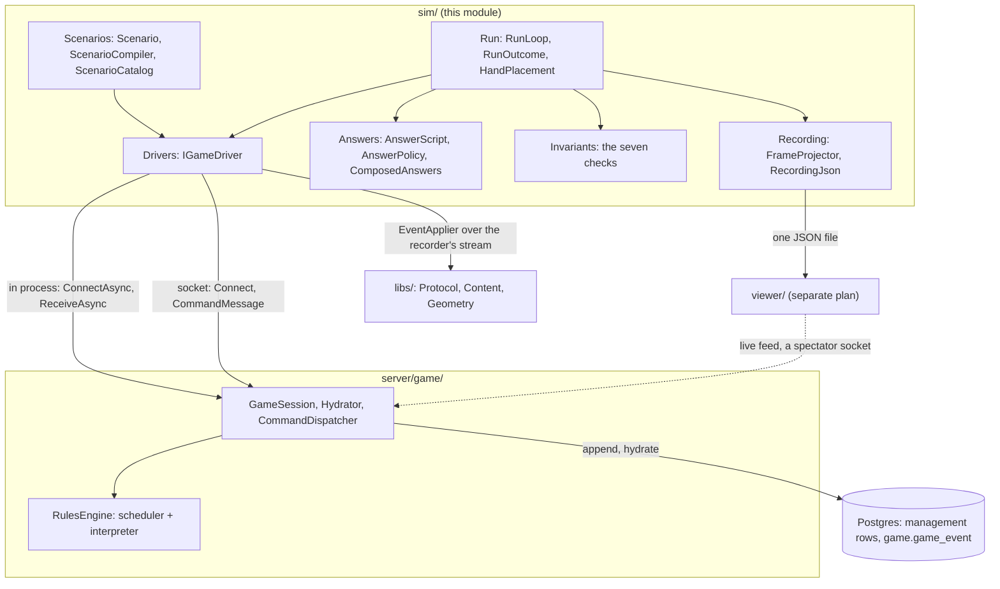

`sim/` sits above the game server and below nothing. It reaches the engine only through
`GameSession`, and it reaches state only through `EventApplier`. The dashed edge is the viewer's
own second feed and is another plan's.

**The engine seam.** Both drivers hydrate through `Hydrator.HydrateAsync` and connect through
`GameSession.ConnectAsync`, so no code path here constructs a `GameState` by hand.
`architecture.md` → Contracts to freeze requires it: nobody instantiates a game session, a
client opens a socket naming a game, and the server hydrates from the log if no session is in
memory. Following that rule in process is what makes the two drivers differ in transport and in
nothing else.

**The projection seam.** Every driver keeps its own `EventApplier` over the scenario's `Board`
and `GameInfo`, fed by the events it drains from the recorder participant's stream. The recorder
is a `Participant` with a null `TeamId`, which is what a spectator is, and it is never Asked.
The run loop, the invariants and the recording therefore all read a projection built exactly the
way a client builds one. `InProcessDriver.ServerProjectionAsync` additionally exposes the
session's own projection, and invariant 1 compares the two.

**The persistence seam.** In process there is none: `InMemoryEventLog`,
`InMemoryPropertiesStore` and `ScenarioRows`, an `IGameRows` over the compiled scenario whose
seven write methods throw. Over the socket `SocketRowSeeder` writes `account`, `game`, `team`
and `participant` in raw SQL, then goes through `IGameRows.StartSetupAsync` and `EndSetupAsync`
for the `table_state` tree and the army snapshots. A socket run sets the seed by writing
`game.rng_seed`.

## Design

### Determinism and the seed

Two independent streams carry a run. The dice are the engine's: they are counter-based on
`(GameState.RngSeed, cursor)`, so the *k*th die of a game is a pure function of the stored seed
and *k*. The answers are `sim/`'s: one `Chooser`, SplitMix64 over a counter, advanced in Ask
order over legal sets the engine offers in its own ordinal order.

Both are fixed by `Scenario.Seed`. It reaches the engine as `GameInfo.RngSeed`, and it
constructs the `AnswerPolicy`'s `Chooser` (`Scenario.Policy()`) and the `RunLoop`'s placement `Chooser`.

The seed is its own stored value on the management-owned game row, `rng_seed`, not null, written
once when the game is created. It is not derived from the game id: hashing the id would make the
dice a function of the id and force `sim/` to derive its ids from its run seed to be reproducible
at all. Identifiers in `sim/` are ordinary `Guid.CreateVersion7()`, with no exception to `CLAUDE.md`.

Reproducibility therefore means: the same scenario with the same seed gives the same dice and
the same answers, and the ids differ between runs. Nothing asserts that two runs share an id,
and nothing compares two recordings byte for byte. What `DriverAgreementTests` compares is the
outcome, the round count, `LastSeq`, the frame count and the answer count. None of the five
carries a server-minted id, which is what lets the comparison be run for run.

`ScenarioCompiler` writes `unchecked((long)s.Seed)` into `GameInfo`, because `rng_seed` is
`bigint` and therefore signed. The reverse cast into `GameState.RngSeed` is the interpreter's.
`RngSeed` is positional and last among `GameInfo`'s scalars, so a construction that forgets the
seed fails to compile rather than silently getting `0`.

### The scenario and its compilation

A scenario is C#. `Scenario` is a record with a fluent `ScenarioBuilder`, and
`ScenarioCatalog` holds ten of them by name. A text format was rejected in the spec's
*Deliberately not decided*: C# costs nothing to start and keeps the assertions typed.

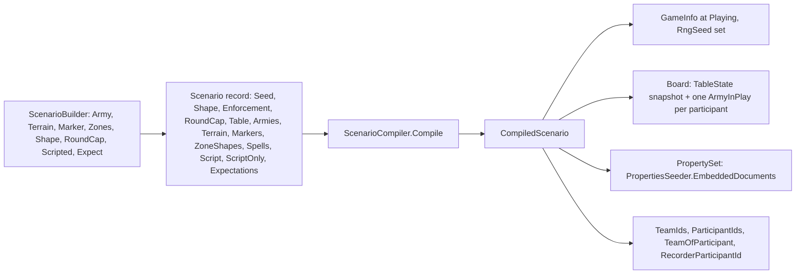

`CompiledScenario` is what `Hydrator` would have read from Postgres: a `GameInfo` already at
`GameStatus.Playing`, a `Board` over a frozen `TableState`, and one `ArmySnapshot` per
participant. `ScenarioCompiler.CoreProperties` reaches the core Grimdark Future `PropertySet`
through the production path, `PropertiesJson.ToSet(PropertiesSeeder.EmbeddedDocuments().Single(
d => d.GameRules == GrimdarkFutureRules.RulesId), Guid.CreateVersion7)`. That is the same
embedded `grimdark-future-core.properties.json` the game server's `TestProperties.Core` reads,
reached without referencing a test project.

`Base.Circle(1.26)` and a height of `1.5` are a 32 mm base in inches, the same two numbers the
scheduler plan's `TestArmies.Build` uses, so a scenario and a fixture describe the same model.

Zone shape ids come from `ZoneStyles.ShapesOf` (`frontline/1`, `free-for-all/1`) in team-ordinal
order, which is what `SetZoneStyle.Shapes` carries during setup. `sim/` stores the expansion
rather than the style name, because that is what a `deployment_zone` row holds.

The ten catalog scenarios and what each exists to exercise:

| Name | Shape | Contents |
| --- | --- | --- |
| `skirmish` | alternating activation | two armies of three units of three; the plain game |
| `terrain` | alternating activation | a solid ruin with `BlocksLineOfSight \| Cover` and an area forest with `Difficult \| Cover` |
| `player-turn` | `SchedulerShape.PlayerTurn` | the second scheduler shape |
| `free-for-all` | alternating activation | three teams, `ZoneStyles.FreeForAll` zones |
| `stalemate` | alternating activation | one model a side and `RoundCap(3)`, so the run must hit the cap |
| `casting` | alternating activation | a `Caster(2)` and one scenario-declared spell, so casting's two player decisions open in a whole-game run |
| `final-round` | alternating activation | one model a side and `RoundCap(6)`, so the run reaches the end of round 4 under `strict` and `game_ended` follows |
| `final-round-warn` | alternating activation | the same under `warn`: round 5 starts with a warning and the run stops at the cap |
| `final-round-silent` | alternating activation | the same under `silent`: round 5 starts with no warning |
| `objectives` | alternating activation | three units of three a side and four objective markers, so the game ends after round 4 with the teams holding the most markers named on `game_ended` (`MostMarkersWin`, any seed, a tie included). Opts into `ObjectiveGoal.Nearest`, so every seed seizes at least once (`EventOfKind("round_ended")`). Blue home sits in Blue's zone, against p.6's "outside of the deployment zones", on purpose |

`Scenario.Enforcement` defaults to `Enforcement.Strict`, which is the opposite of every
fixture's default. An answer outside the legal set must be refused loudly rather than logged and
accepted.

### Two ways to answer an Ask

Every decision in a game arrives as an `Ask` carrying a server-computed `LegalSet`. A simulator
is a function from an Ask to an `AskAnswer`, and there are two useful ones.

A **script** is named answers in order, asserted against the log. It is the regression form: a
rules interaction is pinned as a scenario and fails when the engine changes under it. A **seeded
policy** answers any Ask from its legal set with a seeded random choice. It is the soak form:
five hundred games with five hundred seeds is a fuzz run.

Both, mixed in one run. A scenario scripts the opening and hands the rest to the policy.

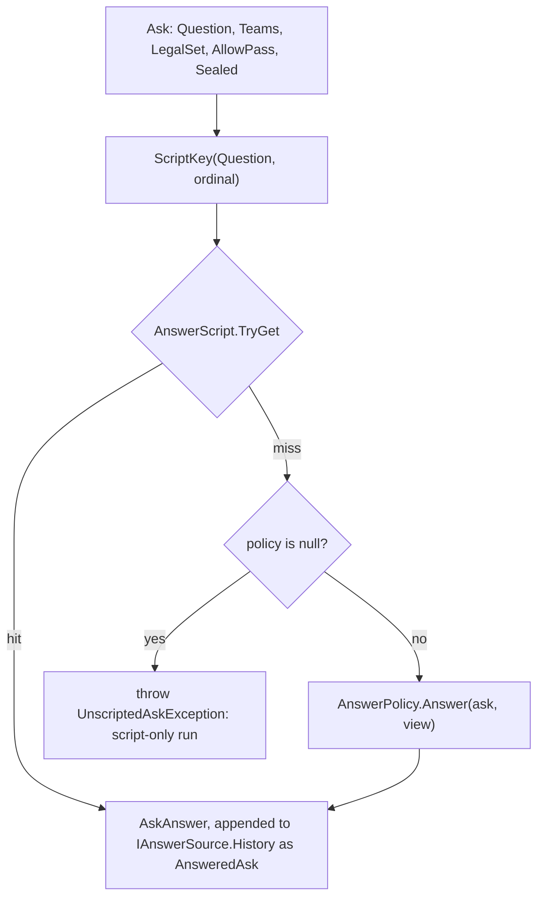

The ordinal is per question and counted over the run. The *n*th `activate` Ask is
`("activate", n)` regardless of how many `confirm` Asks fell between them, because that is the
number a person writing a script can count. `Ask.Id` is server-minted and unusable as a key, and
a frame id is not stable across a rewrite of the sequence. `ScriptBuilder.Then(question, answer)`
takes the next unused ordinal for that question. `At(question, ordinal, answer)` names one. A
duplicate key throws at build time.

The first Ask of every game is the roll-off `confirm` gate, addressed to both teams. An unsealed Ask
addressed to several teams, the gate and `end_round` among them, is answered once, by the first listed
team that has not answered, so `ComposedAnswers.Answer` is called once for it and `("confirm", 0)` is the
gate. A sealed Ask is answered by every addressed team, so `Answer` is called once per (Ask, team) pair
and the ordinal advances each time. A script writer counts one line per answer given, not one per Ask opened.

### The two prohibitions, and the uniform default

`sim/` may read anything the engine exposes. A ban on reading game state would contradict
itself: the invariant checks, the expectations and the recording all read wounds, conditions,
positions and properties. Two prohibitions carry the argument instead.

1. **Never narrow the legal set.** An answer is chosen from what the server offered, whole. A
   policy that filtered the set to answers it judged sensible would stop exercising the ones
   that find bugs.
2. **Never compute a rules outcome the engine should compute.** No deciding here whether a
   target is in range, whether a wound lands, or what a modifier totals. A second rules
   implementation inside the simulator can agree with a broken engine and hide the fault.

`Tabletop.Geometry` is a library rather than a ruleset. Calling `Movement.Check` to see whether
a destination is inside an allowance the *server* stated is not a rules outcome. Deciding what
an allowance ought to be would be.

Separately, and for a different reason: the default policy stays uniform over the legal set and
ignorant of state. A cleverer policy explores a narrower, more plausible region and finds fewer
bugs. A state-reading policy is opt-in, named as such, and never the default for a soak run.

That is enforced by type, not by flag. `AnswerPolicy` reads only `PolicyView`'s geometry
members, never `UnitOf`, `ModelOf`, `TeamOf` or `Properties`. A policy that reads state is a
second implementation of `IAnswerSource`, which is already the seam the spec says a cleverer
opponent would live behind, and `ComposedAnswers` already composes sources. A
`PolicyOptions` boolean was rejected: a type name is named and a boolean defaulting to false is
not, and a boolean is one careless `new PolicyOptions(readState: true)` away from becoming the
soak default. Keeping `AnswerPolicy` free of state reads also lets its own tests pass a bare
view. Asserting "uniform over the legal set" is cheap as a result.

One state read is opted into per scenario, and it is named rather than flagged: a `MoveGoal`
(`delegate Point2? MoveGoal(Guid modelId, PolicyView view)`), passed to `AnswerPolicy`'s
constructor from `Scenario.Goal` (`ScenarioBuilder.Seeking`). `ObjectiveGoal.Nearest` is the one
goal: the nearest objective marker (`PolicyView.ObjectiveMarkers`) that the model's team
(`TeamOf`) does not hold in `Projection.Control`. The goal reads the state; `AnswerPolicy` still
samples and checks destinations from the legal set alone, and the goal only ranks the ones that
passed (see `MoveRegion` below), so neither prohibition is touched. Only `objectives` opts in: with
uniform moves, 8 of its first 20 seeds never seized a marker, so a broken seize would pass as a
0–0 tie.

### `PolicyView` and the seven legal-set shapes

`PolicyView(Projection, Board, IReadOnlyList<WorldVolume>? volumes = null, GameInfo? info = null,
PropertySet? properties = null)` is the whole readable state. `Info` and `Properties` are
nullable because a unit test builds a view from a bare board with neither. `RunLoop` always
supplies both. `TeamOf` returns null when `Info` is absent. The volume override exists
because a test builds volumes without a `TerrainPlacement`, and because `SocketDriver` gets its
board from the wire.

`AnswerPolicy.Answer` switches on `ask.Legal` and has a case for each of the seven shapes.
`AnswerPolicy.ShapeNames` lists all seven, so a shape missing from the switch is a compile-time
hole rather than a runtime one.

| `LegalSet` | Answer | How it is chosen |
| --- | --- | --- |
| `Options` | `Chosen(optionId)` | `Chooser.Pick` over `Choices`; empty set passes if it may, else `NoLegalAnswerException` |
| `PieceSelection` | `SelectedPieces` | a size uniform in `[Min, min(Max, Eligible.Count)]`, then `Chooser.Subset` |
| `Allocation` | `Allocated` | `Amount` independent picks over `Targets`, counted into a dictionary |
| `Assignment` | `Assigned` | a subset of `Targets` capped at `MaxDistinctTargets` in which every item has one of its own targets (`TargetsOf`), else one covering the most items, then one pick per covered item within it; an uncovered item holds fire |
| `MoveRegion` | `Destinations` | see below |
| `TokenSpend` | `TokensSpent` | one `Chooser.Next(max + 1)` per entry of `MaxByModel`, in the server's order |
| `Confirmation` | `Confirmed` | always |

A token spend draws per model rather than once against a total. Grimdark Future p.13 lets each
model spend any number of the tokens it holds, so `TokenSpend` carries a maximum per model and
the bound under test is that maximum. A single draw against the sum could never produce "one from
the model holding four, none from the other", which is the answer a per-model bug shows up in.
The entries are drawn in the order the server sent them. That order is the engine's deterministic insertion order and it survives the wire, whereas ids made in the same millisecond sort on random bits, so one seed answers one run identically only in the server's order.

A `PieceSelection` whose `Eligible` list is model ids needs nothing from the policy: it picks ids
out of the list it was given without asking what they name, which is what makes a Takedown choosing
its target model (p.14) a zero-change shape here. The deployment loop that
places models by hand after an answer keys on the question name, not on the answer shape, so a
model-id selection never reaches it.

A pass is taken only where `Ask.AllowPass` is set and `Chooser.Chance(PassProbability)` fires.
`PassProbability` defaults to `0`, so the policy acts whenever the set admits anything. It stays
a knob rather than a decision, because tuning it toward plausible play is a step toward an
opponent that plays well.

`MoveRegion` is the one shape that reads the view, because it is the one shape whose answer is
not expressible from the set alone. `MoveRegion` names model ids, an allowance and volume ids
and says nothing about where those models stand. `PlacedOf`, `BodyOf`, `VolumesById` and
`RestOf` are how a destination gets computed at all. Per model the policy samples a uniform
bearing and a uniform distance inside the allowance, up to `PolicyOptions.MoveSamples` (24)
times, and accepts the first destination `Movement.Check` likes. With a `MoveGoal` that names a
point for the model, it draws all the samples and takes the passing one nearest that point; with
none, or a null point, the draws and the answer are the uniform ones. Every parameter of that check
comes from the legal set itself. `AnswerPolicy.Clear` then mirrors `GfMoves.Contact`: the landing is on no other
base, does not cross a model (`Collision.Crosses`) unless the region `PassesModels`, and keeps the region's `Separation`;
a repair pass after the sample cap redraws any landing no longer Clear, so a sampled move does not breach under `strict`. Standing still is the fallback and is always legal, because it
is where the model already is. The retry budget is per model rather than per Ask, so a unit of
five gets five independent budgets and one model that cannot find a destination does not freeze
the others.

Containment is handled from `MoveRegion.Containment`, which carries every id and radius an
embark needs. With probability `PolicyOptions.EmbarkProbability` (0.25) the whole unit goes
`Inside` an enterable container.

### Two drivers behind one interface

A scenario runs against either backend and the assertions do not change.

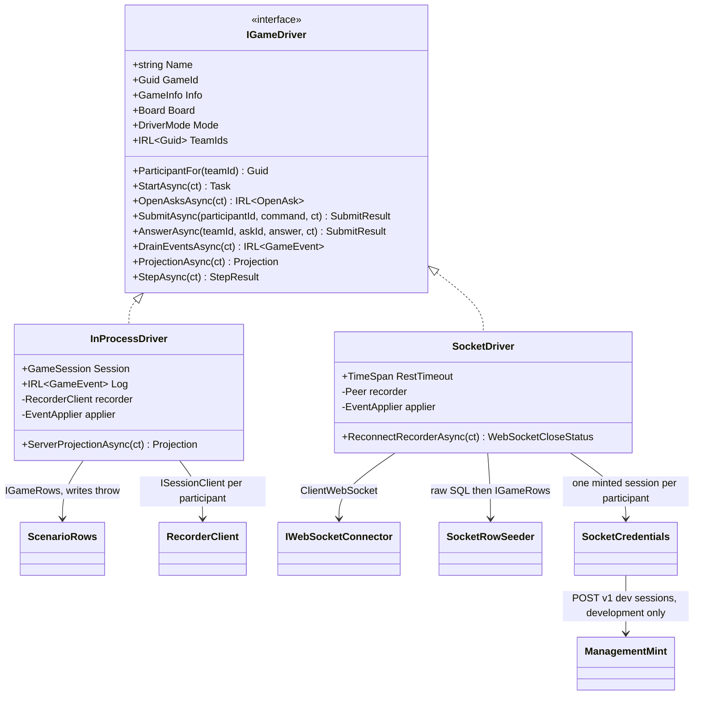

**In process** is the default: `GameSession` over `InMemoryEventLog`, `InMemoryPropertiesStore`
and `ScenarioRows`, with a `RecorderClient` per participant. No socket, no Postgres, no Docker.
A full game must cost milliseconds for a fuzz run to be worth having.

**Over the socket** is a real `ClientWebSocket` to a running game server, a real session JWT,
real rows and a real event log in Postgres. It exercises the handshake, the wire format,
hydration, reconnect and the whole path `architecture.md` calls the only path.

The same scenario passing in process and failing over the socket localises the fault to
transport, serialization or persistence. That is the reason both exist. A driver interface with
one implementation would not have been worth the abstraction.

**Quiescence is exact on both drivers.** `StepAsync` returns when the server has said it is at
rest. In process the signal is a marker: `GameSession.RunAsync` puts one at the back of the
mailbox, so when it returns every queued turn has run. Over the socket the signal is an
`AtRest(long Seq)` frame, sent when the game server has finished processing an inbound `connect`
or `command`, after the last frame that processing produced. `Seq` is the log's high-water mark, so it is `0` before the log opens and
unchanged when the batch appended nothing. WebSocket delivers in order on one connection, so
every `EventsMessage` of a batch precedes that batch's `AtRest`, and the driver's
`Projection.LastSeq` equals `AtRest.Seq` once the batch is drained. `SocketDriver.StepAsync`
asserts that equality and throws on a mismatch, which turns a lost or reordered frame into an
immediate fault. `InProcessDriver.Absorb` and `SocketDriver.DrainEventsAsync` both select
`EventsMessage` and ignore every other kind, so a frame a consumer has no use for never faults
it.

**The rest frame's audience decides which socket waits.** The game server broadcasts `AtRest` to
every socket on the game when the batch appended at least one event, and sends it to the
provoking client alone when it appended none. `SocketDriver.SubmitAsync` therefore reads the
submitting socket's own rest frame, which arrives whatever the outcome and always after a
`Refused` for that command, so the refusal check needs no timing window. `StepAsync` waits on
the recorder's socket only when the last command appended, which the submitting socket's
`AtRest.Seq` says by standing above what the recorder has applied. A step with no batch coming
returns immediately with no events and `Quiescent` true, which is what the run loop's
`Stuck(NoAskNoEvents)` check reads.

**The rest timeout guards a hung server.** `SocketDriver.RestTimeout` is 30 seconds and bounds
one wait for `AtRest`. It is a liveness guard rather than a quiescence guess, so any value above
the slowest real step is correct and no designed step approaches 30 seconds. Expiry throws
`RestTimeoutException`, `RunLoop.RunAsync` catches it, and the run ends `Failed` with the last
frames dumped and a non-zero exit code. Expiry is never `Stuck`, because stuck means the engine
made no progress and a rest timeout means the harness stopped observing. A socket step costs
what the server takes to answer it. The in-process driver stays the default because it needs no
Postgres, no server process and no Docker, and the socket one runs a smaller set of scenarios.

**Row seeding, over the socket.** `account`, `game` (at `lobby`, with the scenario's own id, its
configuration and its `rng_seed`), `team` and `participant` go in as raw SQL, because those four
are management's writes and `IGameRows` has no method for them. Everything after that goes
through `IGameRows`: `StartSetupAsync(gameId, snapshot)` writes the whole `table_state` tree and
flips to `setup`, and `EndSetupAsync(gameId, snapshot, snapshotsByParticipant)` writes each
participant's `army_snapshot` and flips to `playing`. The scenario's own ids therefore survive.
`CreateTeamAsync` would mint its own, and the driver's projection, its recording and its answers
are all keyed on the `CompiledScenario`'s ids.

The properties row is not part of the seeding. `sim/` never writes a `properties` row. `GameServerFactory` runs in the `Test` environment, where the game server seeds no embedded documents, so a socket-backed test seeds the core properties document into Postgres itself, through the game server's own `PostgresPropertiesStore`, before `SeedAsync`. `SeedAsync` throws `PropertiesMissingException` when the row is absent.

**One session per participant.** A session JWT names one account,
`FindParticipantAsync(gameId, accountId)` maps an account to one participant, and a newer socket
for a participant closes the older one. N participants therefore need N accounts and N tokens,
in team-ordinal order with the recorder last. In tests `TestKeys.Mint` produces them against the
fake JWKS, so the suite reaches no network.

From the console they come from the management API's development-only mint,
`POST /v1/dev/sessions`, one call per participant. The mint takes a name, finds or creates the Stytch user and the `account` row, and returns a real Stytch session
JWT, which keeps the socket driver on the production verification path. It lives on the management
API because management holds the Stytch project secret; the game server holds no credential and
could mint nothing real. It is gated on `IHostEnvironment.IsDevelopment()`.

`SocketCredentials.MintAsync(scenario, http, ct)` is the whole consumer side. The accounts are a
fixed pool: `NameFor(index)` is `sim-player-{index}`, the same for every scenario and every run,
and `PoolSize` (4) is the most participants any scenario has, the recorder included. A session JWT
names an account and `FindParticipantAsync` keys on game and account, so one account plays any
number of games at once; the CLI suite and the runner service share the pool. The mint makes an
account on its first use; two first uses at once race on the Stytch create, and `MintOneAsync`
asks again once on the loser's 409. The response carries `account.id` beside the
token, so `AccountOf` is a lookup rather than a base64 decode of a claim. `SocketRowSeeder` keeps
its `insert ... on conflict (id) do nothing` for `management.account`, which is a no-op for a
minted account and remains the path for a test-minted one, so the seeder creates its own accounts
and nothing has to exist first. A `404` from the mint means the management API is not running as a
development environment, and `MintAsync` says so rather than letting a bad token surface at the
handshake.

The cost is network access. A console socket run reaches Stytch's test project once per
participant, and the test project holds the pool's four users and `sim-spectator`, however many
games the suite has. The in-process driver reaches nothing, and neither does `DriverAgreementTests`.

### The run loop and its outcomes

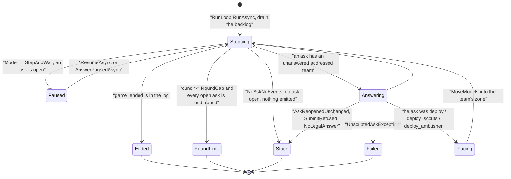

`Failed` is also reached after the loop, when an expectation or an invariant does not hold.

| End | Condition as the loop computes it |
| --- | --- |
| `Ended` | `Projection.Ended` is set: the game logged `game_ended`, with its winners. A wipe-out is not a win (p.6). |
| `RoundLimit` | `Projection.Scheduler.Round >= Scenario.RoundCap` and every open Ask is `AskQuestions.EndRound`. |
| `Stuck(NoAskNoEvents)` | A step produced no events and no Ask is open. Also the `MaxSteps` (20 000) exhaustion. |
| `Stuck(AskReopenedUnchanged)` | The Ask answered at step *n* closed and an Ask with the same `AskFingerprint` opened, with no event between them but the three Ask events. |
| `Stuck(SubmitRefused)` | The driver refused an answer. Under `strict` that is a real bug in the policy or the engine, and the run stops rather than looping. |
| `Stuck(NoLegalAnswer)` | `NoLegalAnswerException`: a legal set with no answer and no pass. |
| `Failed` | An `UnscriptedAskException`, a `RestTimeoutException`, a failed expectation, or a failed invariant. |

Stuck is what the harness exists to find. A scheduler or interpreter that cannot make progress
is a hang in production and a failed assertion here. `RunReport.Passed` is false for `stuck` and
`failed`, and a failing run dumps its last `RunSettings.FrameDumpOnFailure` (12) frames into
`RunReport.Failures`.

`AskFingerprint(Question, Teams, Legal, AllowPass, WindowKind)` excludes the Ask id and includes
the legal set. Two Asks with the same fingerprint are the same question over the same options,
whatever id the server minted.

**Deployment is placed by hand.** Deployment's Ask is `deploy` over a `PieceSelection` of units,
and the phase ends when the last model of that unit has a placement. Moving models by hand is an
ordinary `MoveModels` command, not an Ask: the scheduler spec's *The turn is an Ask* says moving
models by hand never ends one. So after a `deploy` answer the loop puts that unit's models on
the table itself, inside the team's own zone, resolving the shape with `ZoneStyles.Resolve`.
That is geometry from a library, not a rules outcome the engine should have computed. Nothing
checks whether the placement is good, except that an anchor is chosen where no base touches a model already on the table:
a hand placement is judged for overlap (`IGameRules.PlacementBreach`, `move_overlap`; `architecture.md` → Rules
enforcement), and coherency is not judged.

`HandPlacement.IntoZone` writes `Z = 0`; the server rests every hand move (`Battlefield.Settle` ignores the client's
`Z`), so a model deployed onto a hill stands on it.

### The projection recording

A run writes one file: the board, then one frame per event, each frame carrying the model
positions, wounds, conditions and the log line that event produced. It is a recording of a
projection, not a log of events.

It keeps `EventApplier` a single implementation. A viewer given raw events would have to apply
them, which means porting `EventApplier` to TypeScript, and a second applier drifts. Given
frames, the viewer interpolates nothing and decides nothing. It draws what it is handed.

The recording is derived and disposable. It is not a save format, it is never replayed into the
engine, and the event log remains the only thing undo and hydration read. A breaking change to
the schema therefore costs a re-run. `schemaVersion` is one integer rather than a migration
story.

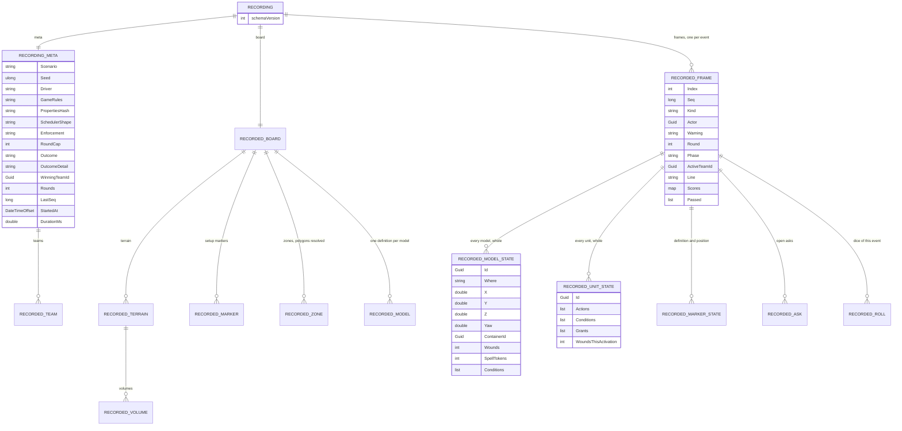

**Every frame carries whole state, not a delta.** Nothing in a viewer has to accumulate, and a
scrub to frame 300 needs frame 300 only. A recording of an 8-round game is 5 to 6 MB of
JSON. `RecordedFrame.Scores` and `RecordedFrame.Passed` are copied rather than aliased, because
the applier keeps mutating both and every frame is kept for the whole run.

**The definition/state split.** A model's base shape, unit, name, ordinal, team and height are
written once in `RecordedBoard.Models`. Only its location, wounds, spell tokens and conditions
ride on each frame. A marker is the exception: its kind, diameter and label ride along per
frame. A marker placed during play by `marker_placed` is in no board block, and a frame that a
viewer has to join against a block which may not hold the row is not whole state. The
alternative, having `BuildBoard` include every marker any frame mentions, was rejected on three
counts: the live feed receives the board frame before any event and cannot know it; it would
make the board depend on how far the run got; and it would leave the frame not whole. Per frame
is nearly free, because `Projection.Board.Table.Markers` and `Projection.Markers` hold `Marker` values that already carry all three
fields and a game has single-digit markers. A frame's markers are the setup markers then the play markers, and a play entry wins over a setup marker with the same id.

**Zones carry resolved polygons.** `RecordedZone.Polygons` is `ZoneStyles.Resolve(shape,
table.Size)` flattened to each `Polygon.Vertices`, one ring per polygon of `{x, y}` in table
inches, in the corner frame. The board block otherwise carried only a shape id such as
`frontline/1`. OPR's frontline is an absolute twelve-inch inset rather than a fraction of the
table, so it cannot be normalised out of the id and the size, and porting `ZoneStyles` would be
a second geometry implementation in the browser. An unknown shape id resolves to no rings, so
`polygons` is `[]` and a viewer draws no outline while still showing the id.

**The dice are carried.** `RecordedRoll` holds every die's raw and modified face, whether it
succeeded, the threshold and the modifiers. A frame carries a list of them, because a step may hold
more than one: the ruleset splits a roll wherever its dice do not share a threshold, and OPR's
`roll-to-hit` takes one pool per Quality value the attacking models bring, since rulebook p.4 tests
each attack against *"the model's Quality value"* and a joined hero brings its own. `LogLines.Dice`
prints each pool's threshold for that reason, since the roll's name alone does not tell two apart. The result alone would make a viewer that cannot
show why a unit died, which is the first thing a person debugging the engine wants to see. The
cost is a few hundred integers per game.

**Open Asks ride on every frame.** `RecordedAsk` carries the question, prompt, teams, flags,
window kind, frame id, legal-set kind, who has answered, options, pieces and allowance. A token
spend records its spender models in `Pieces` and the sum of their maxima in `Allowance`, and not
the per-model maxima: each frame already carries every model's `SpellTokens`, which is the same
number. Pausing
a simulation and answering an open Ask from a browser is therefore a later feature rather than a
schema change.

`RecordingJson` is `sim/`'s own `JsonSerializerOptions`: camelCase, string enums as plain
strings, nulls omitted, indented. It does not reuse `WireJson.Options`, because the recording is
not a wire format. `Recording.Version` serialises as `schemaVersion` through
`[property: JsonPropertyName("schemaVersion")]`. `DictionaryKeyPolicy` is left unset, so a team
id key in `scores` is the canonical hyphenated form and is spelled exactly as a team id anywhere
else in the file.

`LogLines.Of(GameEvent, Projection after, IReadOnlyDictionary<Guid,int> teamOrdinals)` prints
one line per event kind. It takes the ordinals as a third argument because `Projection` has no
team-ordinal lookup. The ordinals live on `GameInfo.Teams`, and `FrameProjector` builds the
dictionary once.

### The seven invariants

Beyond a scenario's own `Expectation` list, every run checks what holds for any game whatever
the ruleset. Each is a statement about the log, the projection and the slab. None recomputes an
outcome the engine produced.

| Invariant | How it is computed |
| --- | --- |
| `ReplayReproducesTheProjection` | `Replay.To(board, info, log, log[^1].Seq)` against the driver's projection through `ProjectionComparer`. In process the session's own projection is compared too, so a cold replay, the incremental projection and the server's all agree. |
| `UndoKeepsTheEarlierDice` | For every seq at which a `StepCompleted` carries rolls, append `Undone(seq)`, take `EventApplier.EffectiveLog`, and require the surviving dice to be a prefix of the original. |
| `EveryAskAnsweredByAnAddressedTeam` | For each `AskAnswered`, the `AskOpened` with that id must exist and must list the answering team in `Ask.Teams`. |
| `NoModelInTwoPlacesOrOffTheSlab` | Walk the effective log: each `ModelRelocation.From` must equal the model's location before the event, and every `OnTable` position must satisfy `0 <= x <= width` and `0 <= y <= length`. |
| `TheRoundAdvancedOnlyThroughTheBoundaryAsk` | For every `RoundStarted` with `Round >= 2`, the nearest preceding `AskClosed` must have closed an Ask whose question is `AskQuestions.EndRound`, or `GameEvent.Actor` must be non-null. |
| `NothingAdvancesAfterTheEnd` | Nothing the engine writes follows `game_ended` until a round is started by hand. |
| `ControlFollowsTheMarkers` | Every `objective_control_set`, alone or inside another event's changes, names a marker the game holds at that point and, when it names a team, a team of the game. |

Invariant 2 needs no second run. The dice are counter-based on `(RngSeed, cursor)` and `RngSeed`
is the stored seed, so die *k* is a pure function of that seed and *k*, and `Undone(N)` shortens
the effective log rather than rewriting it. Doing it at every dice-bearing sequence covers "an
arbitrary sequence" exhaustively rather than by sampling. A redo draws fresh dice, because the cursor counts the undone roll's dice, and is checked once for real over the
socket in `DriverAgreementTests`.

Invariant 5's escape hatch is the menu's `set_round`, an override that `architecture.md` → Rules
enforcement requires to be visible to opponents and recorded in the log, never silent. Rounds 0
and 1 are deployment's flip into round one and are exempt.

`ProjectionComparer.Differences` exists because `Projection` is a class and has no structural
equality. It reports every difference rather than the first, because a wrong projection usually
differs in a pattern. It compares `LastSeq`, the five `SchedulerPosition` fields, the frame
stack by id/sequence/step-count, the open Ask ids, the marker ids, the scores, and per model and
per unit the fields a game changes.

`Invariants.CheckAll` runs after the recording is complete. Neither the undo check nor the
projection comparison appends an event, so the recording is unaffected either way.
`MidRun.Assert` is the same checks as a throwing call, for a test that wants to fail at the
first bad frame rather than at the end.

### The step-and-wait seam

`DriverMode.StepAndWait` makes the loop stop at the first Ask it would have answered and report
`RunOutcome.Paused(askId, question)`, having answered nothing. The first pause is on the roll-off
`confirm` gate. `RunLoop.ResumeAsync` continues
under the current mode. `RunLoop.AnswerPausedAsync(teamId, answer, ct)` supplies one answer from
outside the answer source and pauses again.

That is the whole seam. A caller with a socket, an HTTP endpoint or a REPL can drive a paused
game one decision at a time. There is no control channel, no server, no browser and no viewer
code here. Building one makes the viewer a second thin client, which is a larger surface than a
renderer.

`RunAsync` is re-entrant because every piece of its state accumulates rather than resets: the
log, the projector and the fingerprint. `_lastAnswered` is reset to null at the top of
`DriveAsync`, so a pause between an answer and its reopening is not mistaken for a hang.

### The console

```
dotnet run --project sim -- <scenario> [options]

  --seed N              one seed (default: the scenario's own)
  --seeds A..B          a closed range of seeds, one game each
  --driver in-process   the default; or socket
  --out DIR             where recordings and summary.json go (default: ./recordings)
  --rounds N            override the scenario's round cap
  --no-recording        run and report, write no files
  --list                list the scenario names and exit
```

Exit code `0` when every run passed, `1` otherwise, `2` on a usage error.

```
dotnet run --project sim -- suite [--only A,B] [--driver in-process|socket] [--keep] [--out DIR] [--list]
dotnet run --project sim -- serve [--port 5180] [--bind 127.0.0.1] [--out DIR]
```

`--driver socket` reads `TABLETOP_DB_CONNECTION` (the variable the servers read),
`TABLETOP_SIM_WS` (default `ws://127.0.0.1:5200/ws`) and `TABLETOP_SIM_MANAGEMENT` (default
`http://127.0.0.1:5100`), each from the environment or the nearest `.env`, as the servers load theirs. `TABLETOP_MANAGEMENT_URL` in `.env` is management's bind address, so the client side has its own name. A scenario that declares its own spells cannot run on the socket driver, because
those spells have no authored properties document the game server can load, so that combination is a usage
error with exit code 2. There is no token variable, because the tokens are minted per run.

A socket run leaves its rows and its log in Postgres. The game is then in the database to look
at, and `sim/` is a developer tool. `SocketRowSeeder.DeleteAsync` exists for the tests, which
must not accumulate games. Repeating a `--driver socket` run with the same seed makes a second
game rather than colliding on the primary key, because the game id is random and only `rng_seed`
repeats. A seed range therefore leaves one row per run. That is the price of the seed being
stored rather than derived, and the two runs are separate games that rolled the same dice.

### The rules suite

The suite is the sim's regression net for the rules: about 130 themed games, each a `TestGame`, that bring every catalog
rule and spell into play and check what the rule text states. The `suite` verb plays a selection on one driver, judges
each game, computes coverage and prints a report; `serve` hosts the same runner over HTTP for the viewer's Tests page.

- **Groups.** `core` (pp.4–12: actions, terrain, shooting, melee, morale, transports, objectives, deployment, the round-4
  end), `special` (the 33 core special rules, three to five a game), `army:<book uid>` (the army rules, by the book
  that prints them) and `spells:<book uid>` (every spell, generated per book by `SpellGames`, cast by name).
- **Judging.** Every game is judged by `ended`, `invariants` and `fired` (each covered entry fired), then by its own
  checks. Fired reads `StepCompleted.Applied` and `RollModifier.Source` in the effective log; a rule that acts in the
  scheduler or in action legality gives its game an `Evidence` predicate. An exact check names the entries it is about
  and quotes its rule; its expected value is a literal from the text. A check reports one failure line per reason. The army
  attack checks choose their occasions from the log and the army definitions (the holder's attacks, the attacks on it, the
  attacks with its weapon), never from `Applied`.
- **Dice.** A `DiceFix` sets one roll's faces by `SetDice` once the step that rolled it completes, so a game that fixes
  dice runs with the step gate on. A fix that never meets its roll fails the game.
- **Scripting.** Ids are minted at compile time, so a game's script picks by name: `ScriptBuilder.Match` with `AskPicks`
  (activate a named unit's action, cast a named spell, target a named unit). Set-aside units and per-model entries are
  scenario fields (`ScenarioArmy.SetAside`, `ScenarioArmy.Models`).
- **Known defects.** A game an engine defect blocks keeps its failing check and is pinned (`TestGame.Known`): a check and
  the reason text the defect produces, matched against each failure line. The report files matching failures under the defect id, counts the game apart from
  unexpected failures, and lists every pin that no longer fails.
- **Coverage.** Every entry of the shipped property set, with the games covering it, whether it fired in each, and its
  exact checks. A full run fails on an uncovered entry; any run fails on a covered entry that never fired.
- **Socket hygiene.** A socket run takes an advisory lock, sweeps games an interrupted run left, and deletes each game's
  rows (its log and the game; team, participant and the table_state tree cascade) after judging it. It never deletes an
  account: the pool and `sim-spectator` are shared by every run and by concurrent games. `--keep` keeps the game, writes
  the recording, and adds `sim-spectator` as a participant so a live feed can open the game.

## Key decisions

**(plan)** marks a decision stated in the plan and in no spec.

| Decision | Why | Alternative rejected | Source |
| --- | --- | --- | --- |
| `sim/` is a fourth deliverable, not a folder under `tests/` | a simulator only xUnit can start is not something you can point at a problem | `tests/Tabletop.Sim` as a test project | spec → `sim/` is a fourth deliverable; `CLAUDE.md` → Layout |
| The simulator may read anything the engine exposes; two prohibitions carry the argument | invariants, expectations and the recording all read state, so a ban on reading it would contradict itself | banning every read of game state | spec → Two ways to answer an Ask |
| The default policy is uniform over the legal set and ignorant of state | a cleverer policy explores a narrower region and finds fewer bugs | weighting toward plausible play | spec → Two ways to answer an Ask |
| A state-reading policy is a second `IAnswerSource`, not a `PolicyOptions` flag | a type name is named; a boolean is one careless call away from becoming the soak default | `PolicyOptions(readState: true)` | **(plan)** Task 2 |
| A move goal is a named `MoveGoal` a scenario opts into, ranking only destinations the uniform sampler found legal | the `objectives` scenario must seize on every seed to catch a broken seize; the goal never adds or removes a destination | a separate `IAnswerSource` duplicating the move sampler | sim-goal brief |
| The policy prefers to act: `PassProbability` defaults to `0` | a pass is taken only when the legal set admits nothing else | preferring to pass, or tuning toward plausible play | spec → Deliberately not decided |
| The RNG seed is a stored column, `game.rng_seed bigint not null`, reaching the engine as `GameInfo.RngSeed` | a run sets the seed explicitly and takes ordinary v7 ids | hashing the game id to derive the seed, which would force `sim/` to derive its ids from its run seed | spec → The seed is stored, so a run sets it; `schema.md` → A game stores its dice seed |
| `GameInfo.RngSeed` is positional and last among the scalars | a construction that forgets the seed fails to compile rather than getting `0` | a defaulted or named parameter | [contracts](../contracts/design.md) → Key decisions |
| Two drivers behind `IGameDriver`, in process by default | a full game must cost milliseconds for a fuzz run; the socket exercises the only path | one implementation, which would not be worth the abstraction | spec → Two drivers behind one interface |
| The in-process driver goes through `Hydrator` and `GameSession.ConnectAsync` | the two drivers then differ in transport and nothing else | building a `GameState` by hand | `architecture.md` → Contracts to freeze |
| Quiescence is exact on both drivers: the mailbox marker in process, an `AtRest(long Seq)` frame over the socket | a quiet window would guess at rest, so a slow server would read as stuck and every step would cost the window | a quiet-window timer | the plan's ruling 5; game server plan → Task 9, *The rest frame* |
| `AtRest` is broadcast when the batch appended and sent to the provoking client alone when it did not | a refusal disturbs nobody but its sender, and the recorder is woken exactly when there is a batch for it | broadcasting every rest frame, which would wake every spectator on every refusal | game server plan → Task 9, *The rest frame* |
| `SubmitAsync` reads the submitting socket's rest frame; `StepAsync` reads the recorder's only when the command appended | the submitting socket is the one guaranteed a frame either way, and its `Seq` says whether a batch is coming to the recorder | waiting on the recorder unconditionally, which hangs out `RestTimeout` after every refusal | **(plan)** Task 8 |
| A rest wait that exceeds `SocketDriver.RestTimeout`, 30 seconds, is `Failed` | stuck means the engine made no progress; a rest timeout means the harness stopped observing | `Stuck(NoAskNoEvents)`, which names the wrong fault | **(plan)** Task 8 |
| The driver's projection is its own `EventApplier` over the recorder's stream | the same applier a client runs, so the socket driver needs no second mechanism | reading the session's projection directly, which the socket cannot do | **(plan)** Task 4 |
| The recorder is a `Participant` with a null `TeamId` | presence, the scheduler and the interpreter already treat that participant as a spectator who is never Asked | a new server-side spectator concept | whole-design review → ruling 5 |
| The recording is a projection recording, one whole-state frame per event | keeps `EventApplier` a single implementation; a TypeScript applier would drift | shipping raw events and porting the applier | spec → The recording is the artifact |
| Frames are whole state, not deltas | a scrub to frame 300 needs frame 300 only; nothing accumulates | deltas, to shrink a 5 to 6 MB recording | spec → The recording is the artifact |
| `RecordedMarkerState` carries kind, diameter and label per frame | a marker placed during play is in no board block, and a frame must be whole | a growing board block, which the live feed cannot implement | **(plan)** applied from the viewer plan, item 2 |
| `RecordedZone.Polygons` holds resolved rings | OPR's frontline is an absolute twelve-inch inset, so it cannot be derived from the id and the table size | porting `ZoneStyles` to TypeScript | **(plan)** applied from the viewer plan, item 1 |
| `RecordedFrame` carries `Scores` and `Passed` | the applier maintains both and `ProjectionComparer` compares both | a frame from which a viewer could show neither | **(plan)** applied from the viewer plan, item 3 |
| The recording carries the dice, not only the result | the first thing a person debugging the engine wants is why a unit died | the result alone, at a few hundred integers saved | **(plan)** Task 5 |
| The schema carries `schemaVersion`, one integer | a viewer can refuse a file it does not understand rather than mis-draw it | no version, since the recording is derived | spec → Deliberately not decided |
| `RecordingJson` owns its options rather than reusing `WireJson.Options` | the recording is not a wire format | one shared serializer | **(plan)** Global Constraints |
| The round cap lives on `Scenario`, overridable with `--rounds` | a cap is a property of a run, not of a ruleset; the cap is not the ruleset's final round, which the enforcement engine reads | `GameRules`, which would put a testing concern inside the rules | spec → What a full game means |
| `Ended` is read from the log: the game logged `game_ended` | a wipe-out is not a win (p.6) | reading it from the table | spec → What a full game means |
| A scenario is C# with a fluent builder | costs nothing to start and keeps the assertions typed | a text format | spec → Deliberately not decided |
| `Enforcement.Strict` is a scenario's default | an out-of-set answer must be refused loudly rather than logged and accepted | matching the fixtures' `warn` default | **(plan)** Global Constraints |
| The script is keyed by `(question, ordinal)`, counted per question over the run | that is the number a person writing a script can count | keying by `Ask.Id`, which is server-minted, or by frame id, which is not stable | **(plan)** Task 3 |
| The run loop places deployed models itself with `ZoneStyles` | deployment's Ask names a unit; placing it is an ordinary `MoveModels`, not an Ask | waiting for an Ask that never comes | **(plan)** Task 6; scheduler → The turn is an Ask |
| Stuck fails the exit code | `dotnet run --project sim -- skirmish --seeds 1..500` exits `1` if any game hangs, which is what makes it usable in CI | a warning that still exits `0` | the plan's ruling 2 |
| `sim/` references no test project, in either direction | `tests/Tabletop.GameServer.Tests` and `tests/Tabletop.Viewer.Tests` reference `sim/`; the reverse would be a cycle | reaching `TestProperties` and `TestArmies` | spec → Testing |
| Step-and-wait is a mode and two methods, and nothing more | building a control channel makes the viewer a second thin client | an HTTP endpoint or a browser control surface | spec → Interactive debugging is a door, not a room |

## Interfaces

`IRL<T>` abbreviates `IReadOnlyList<T>`, `IRD<K,V>` abbreviates `IReadOnlyDictionary<K,V>`.
Every type and member below is `public`. Nothing is `internal` and nothing needs
`InternalsVisibleTo`.

### Produced: `Tabletop.Sim`

| Type | Members |
| --- | --- |
| `sealed class Chooser(ulong seed)` | `int Next(int bound)`, `double Double()`, `bool Chance(double)`, `T Pick<T>(IRL<T>)`, `IRL<T> Shuffle<T>(IRL<T>)`, `IRL<T> Subset<T>(IRL<T>, int)`, `long Drawn` |
| `sealed record SimOptions(string? Scenario, ulong FromSeed, ulong ToSeed, string Driver, string OutputDirectory, int? RoundCap, bool Recording, bool List)` | `static Parse(string[])`, `static string Usage`, `IEnumerable<ulong> Seeds`, `const InProcess = "in-process"`, `const Socket = "socket"`; `sealed class UsageException` |
| `sealed record Summary(string Driver, int Runs, int Passed, int Failed, double TotalMs, IRL<RunReport> Reports)` | `static Of(string, IRL<RunReport>)`, `string Table()`, `string ToJson()` |
| `static class Program` | `Task<int> Main(string[])`, `Task<int> RunAsync(SimOptions, TextWriter, CancellationToken)`, `Task<int> RunScenarioAsync(Scenario, SimOptions, TextWriter, CancellationToken)` |

### Produced: `Tabletop.Sim.Scenarios`

| Type | Members |
| --- | --- |
| `sealed record Scenario(string Name, ulong Seed, SchedulerShape Shape, Enforcement Enforcement, int RoundCap, TableSize Table, IRL<ScenarioArmy> Armies, IRL<ScenarioTerrain> Terrain, IRL<ScenarioMarker> Markers, IRL<string> ZoneShapes, IRL<EntryDocument> Spells, AnswerScript Script, bool ScriptOnly, IRL<Expectation> Expectations)` | `Scenario WithSeed(ulong)`, `MoveGoal? Goal { init; }`, `AnswerPolicy? Policy()` (null when script-only) |
| `sealed record ScenarioArmy(string Name, int Units, int ModelsPerUnit, IRL<ScenarioRule> UnitRules, IRL<ScenarioRule> ModelRules, IRL<ScenarioWeapon> Weapons, IRD<string,string> UnitStats, string? ArmyBook = null)` | `IRL<int> SetAside { init; }` (unit ordinals set aside before deployment), `IRL<ScenarioModel> Models { init; }` |
| `sealed record ScenarioModel(int Unit, int Model, IRL<ScenarioRule>? Rules, IRD<string,string>? Stats, IRL<ScenarioWeapon>? Weapons)` | one model's own rules, stats and weapons (1-based ordinals) |
| `sealed record ScenarioRule(int Unit, string Name, int? Parameter)`; `ScenarioWeapon(string Name, IRD<string,string> Stats, IRL<ScenarioRule> Rules)` | |
| `sealed record ScenarioTerrain(string Mesh, Point3 Position, double Yaw, double Scale, IRL<Volume> Volumes)`; `ScenarioMarker(MarkerKind Kind, Point3 Position, double Diameter, string? Label)` | |
| `sealed class ScenarioBuilder(string name, ulong seed)` | `Shape`, `Enforcing`, `RoundCap`, `Table`, `Zones`, `Army`, `Terrain`, `Marker`, `Spells`, `Scripted`, `Seeking`, `Expect`, `Build` |
| `sealed record CompiledScenario(Scenario, GameInfo Info, Board Board, PropertySet Properties, IRL<Guid> TeamIds, IRL<Guid> ParticipantIds, IRD<Guid,Guid> TeamOfParticipant, TableState Snapshot, Guid RecorderParticipantId)` | `Guid ParticipantFor(Guid teamId)` |
| `static class ScenarioCompiler` | `CompiledScenario Compile(Scenario)`, `PropertySet CoreProperties`, `PropertySet PropertiesFor(IRL<EntryDocument>)` |
| `static class ScenarioCatalog` | `IRL<string> Names`, `Scenario Get(string)`, `bool TryGet(string, out Scenario)` |
| `abstract record Expectation` | `EventOfKind(string, int AtLeast = 1)`, `NoEventOfKind(string)`, `ReachedRound(int)`, `TeamWiped(int)`, `ModelsRemaining(int, int)`, `AskAsked(string, int AtLeast = 1)`, `Outcome(string)`, `Warnings(string, int)`, `Won(int)`, `MostMarkersWin` |
| `static class Expectations` | `IRL<string> Check(IRL<Expectation>, Projection, IRL<GameEvent>, RunOutcome, CompiledScenario)`, `int ModelsOnTable(Projection, CompiledScenario, int teamOrdinal)`, `int ModelsOnTable(Projection, CompiledScenario, Guid teamId)` |

### Produced: `Tabletop.Sim.Answers`

| Type | Members |
| --- | --- |
| `sealed class PolicyView(Projection, Board, IRL<WorldVolume>? volumes = null, GameInfo? info = null, PropertySet? properties = null)` | `Projection`, `Board`, `GameInfo? Info`, `PropertySet? Properties`, `TableSize Table`, `IRL<WorldVolume> Volumes`, `IRL<WorldVolume> VolumesById(IRL<Guid>)`, `Location LocationOf(Guid)`, `PlacedModel? PlacedOf(Guid)`, `ModelBody BodyOf(Guid)`, `double RestOf(Guid modelId, Point2 at, Yaw? yaw = null)`, `IRL<Marker> ObjectiveMarkers`, `static IRL<Marker> ObjectiveMarkersOf(Projection)`, `UnitInPlay UnitOf(Guid)`, `ModelInPlay ModelOf(Guid)`, `Guid? TeamOf(Guid)` |
| `sealed record PolicyOptions(double PassProbability = 0, double EmbarkProbability = 0.25, int MoveSamples = 24)` | |
| `sealed class AnswerPolicy(Chooser, PolicyOptions? = null, MoveGoal? goal = null)` | `AskAnswer Answer(Ask, PolicyView)`, `static IRL<string> ShapeNames`; `sealed class NoLegalAnswerException` |
| `delegate Point2? MoveGoal(Guid modelId, PolicyView view)`; `static class ObjectiveGoal` | `static Point2? Nearest(Guid, PolicyView)` |
| `sealed record ScriptKey(string Question, int Ordinal)`; `sealed record AnswerScript(IRD<ScriptKey,AskAnswer> Answers)` | `static Empty`, `static ScriptBuilder Build()`, `bool TryGet(string, int, out AskAnswer)`, `int Count`, `IRL<ScriptMatch> Matches { init; }`, `AskAnswer? Match(Ask, Projection)` |
| `sealed record ScriptMatch(string Question, Func<Ask, Projection, AskAnswer?> Pick)` | consulted in order for an Ask no keyed answer covers; null falls through |
| `sealed class ScriptBuilder` | `At(string, int, AskAnswer)`, `Then(string, AskAnswer)`, `Match(string, Func<Ask, Projection, AskAnswer?>)`, `Build()` |
| `static class AskPicks` | `Option`, `Labeled(Ask, string)`, `Activate(Ask, string unit, string action)`, `Spell(Ask, Projection, string, string? casterUnit)`, `Pieces(Ask, Projection, params string[] units)`, `UnitNameOf(Projection, Guid)`: picks by label and name, never by id |
| `interface IAnswerSource` | `AskAnswer Answer(Ask, PolicyView)`, `IRL<AnsweredAsk> History` |
| `sealed record AnsweredAsk(string Question, int Ordinal, Guid AskId, AskAnswer Answer, bool FromScript)` | |
| `sealed class ComposedAnswers(AnswerScript, AnswerPolicy?) : IAnswerSource`; `sealed class UnscriptedAskException` | a null policy is a script-only run |

### Produced: `Tabletop.Sim.Drivers`

| Type | Members |
| --- | --- |
| `interface IGameDriver : IAsyncDisposable` | `string Name`, `Guid GameId`, `GameInfo Info`, `Board Board`, `IRL<Guid> TeamIds`, `Guid ParticipantFor(Guid)`, `DriverMode Mode { get; set; }`, `Task StartAsync(CancellationToken)`, `Task<IRL<OpenAsk>> OpenAsksAsync(CancellationToken)`, `Task<SubmitResult> SubmitAsync(Guid participantId, Command, CancellationToken)`, `Task<IRL<GameEvent>> DrainEventsAsync(CancellationToken)`, `Task<Projection> ProjectionAsync(CancellationToken)`, `Task<StepResult> StepAsync(CancellationToken)`, default `Task<SubmitResult> AnswerAsync(Guid teamId, Guid askId, AskAnswer, CancellationToken)` |
| `abstract record SubmitResult` | `Accepted(string? Warning)`, `Rejected(RefusalReason Reason, string Detail)` |
| `sealed record StepResult(IRL<GameEvent> Events, IRL<OpenAsk> OpenAsks, bool Quiescent)`; `enum DriverMode { Run, StepAndWait }` | `Quiescent` is true when the server rested without emitting anything |
| `sealed class RestTimeoutException(TimeSpan timeout, long lastSeq)` | `TimeSpan Timeout`, `long LastSeq`; thrown by `SocketDriver` when `AtRest` does not arrive inside `RestTimeout` |
| `sealed class ScenarioRows(CompiledScenario) : IGameRows` | the six reads; the seven writes throw `NotSupportedException` |
| `sealed class RecorderClient(Guid participantId) : ISessionClient` | `IRL<SocketMessage> Frames`, `IRL<SocketMessage> TakeFrames()`, `bool Closed`, `WebSocketCloseStatus? CloseStatus`, `string? CloseReason` |
| `sealed class InProcessDriver : IGameDriver` | `static Task<InProcessDriver> StartAsync(CompiledScenario, CancellationToken)`, `GameSession Session`, `Task<Projection> ServerProjectionAsync(CancellationToken)`, `IRL<GameEvent> Log` |
| `interface IWebSocketConnector`; `sealed class ClientWebSocketConnector(Uri)` | `Task<WebSocket> ConnectAsync(CancellationToken)` |
| `sealed record MintedSession(string Jwt, Guid AccountId)`; `sealed record SocketCredentials(IRL<MintedSession> Sessions)` | `const ManagementUrlVariable = "TABLETOP_SIM_MANAGEMENT"`, `const MintPath = "/v1/dev/sessions"`, `const PoolSize = 4`, `static Pool`, `static NameFor(int)`, `static MintAsync(CompiledScenario, HttpClient, CancellationToken)`, `static MintOneAsync(HttpClient, string, CancellationToken)`, `string For(int)`, `Guid AccountOf(int)` |
| `sealed class SocketRowSeeder(NpgsqlDataSource, IGameRows)`; `sealed class PropertiesMissingException` | `Task SeedAsync(CompiledScenario, SocketCredentials, CancellationToken)`, `Task DeleteAsync(Guid, CancellationToken)` |
| `sealed class SocketDriver : IGameDriver` | `static Task<SocketDriver> StartAsync(CompiledScenario, IWebSocketConnector, SocketCredentials, CancellationToken)`, `TimeSpan RestTimeout { get; init; }`, `Task<WebSocketCloseStatus?> ReconnectRecorderAsync(CancellationToken)` |

### Produced: `Tabletop.Sim.Run`

| Type | Members |
| --- | --- |
| `enum StuckReason { NoAskNoEvents, AskReopenedUnchanged, SubmitRefused, NoLegalAnswer }` | |
| `abstract record RunOutcome` | `Ended(int Round, IReadOnlyList<Guid> Winners)`, `RoundLimit(int Rounds)`, `Stuck(StuckReason, string Detail)`, `Failed(string Detail)`, `Paused(Guid AskId, string Question)`, `string Kind` |
| `sealed record AskFingerprint(string Question, string Teams, string Legal, bool AllowPass, string? WindowKind)` | `static AskFingerprint Of(Ask)` |
| `static class HandPlacement` | `IRL<ModelRelocation> IntoZone(Projection, CompiledScenario, Guid teamId, Guid unitId, Chooser)`, `Chooser ChooserFor(ulong scenarioSeed)` |
| `sealed record RunSettings(int MaxSteps = 20_000, int FrameDumpOnFailure = 12, bool CheckInvariants = true, bool Record = true)` | `Record: false` builds no frames, for a loop attached to a game already past its first event |
| `sealed record RunReport(string Scenario, ulong Seed, string Driver, RunOutcome Outcome, int Rounds, long LastSeq, int Frames, int AsksAnswered, double DurationMs, IRL<string> Failures, string? RecordingPath)` | `bool Passed` |
| `sealed class RunLoop(IGameDriver, CompiledScenario, IAnswerSource, Chooser, RunSettings? = null)` | `Task<RunReport> RunAsync(CancellationToken)`, `Task<RunReport> ResumeAsync(CancellationToken)`, `Task<RunReport> AnswerPausedAsync(Guid teamId, AskAnswer, CancellationToken)`, `FrameProjector Projector`, `IRL<GameEvent> Log`, `IAnswerSource Answers`, `Recording BuildRecording(RunReport)`, `IRL<string> LastFrames(int)` |

### Produced: `Tabletop.Sim.Invariants`

| Type | Members |
| --- | --- |
| `static class ProjectionComparer` | `IRL<string> Differences(Projection expected, Projection actual)` |
| `sealed record InvariantResult(string Name, bool Held, string? Detail)`; `sealed class InvariantViolatedException` | `IRL<InvariantResult> Failures` |
| `static class Invariants` | `CheckAll`, `ReplayReproducesTheProjection`, `UndoKeepsTheEarlierDice`, `EveryAskAnsweredByAnAddressedTeam`, `NoModelInTwoPlacesOrOffTheSlab`, `TheRoundAdvancedOnlyThroughTheBoundaryAsk` |
| `static class MidRun` | `void Assert(Projection, IRL<GameEvent>, CompiledScenario)` |

### Produced: `Tabletop.Sim.Recording`

The viewer's whole input.

| Type | Members |
| --- | --- |
| `sealed record Recording(int Version, RecordingMeta Meta, RecordedBoard Board, IRL<RecordedFrame> Frames)` | `Version` serialises as `schemaVersion` |
| `sealed record RecordingMeta(string Scenario, ulong Seed, string Driver, string GameRules, string PropertiesHash, string SchedulerShape, string Enforcement, int? RoundCap, IRL<RecordedTeam> Teams, string Outcome, string? OutcomeDetail, Guid? WinningTeamId, int Rounds, long LastSeq, DateTimeOffset StartedAt, double DurationMs)` | `Outcome` is `ended`, `round_limit`, `stuck` or `failed` from `sim/`; `live` is what the viewer's live feed sets |
| `RecordedTeam(Guid Id, int Ordinal, string Name, IRL<string> Participants)` | |
| `RecordedBoard(double Width, double Length, string Texture, IRL<RecordedTerrain> Terrain, IRL<RecordedMarker> Markers, IRL<RecordedZone> Zones, IRL<RecordedModel> Models)` | |
| `RecordedTerrain(Guid Id, string Mesh, double X, double Y, double Z, double Yaw, double Scale, IRL<RecordedVolume> Volumes)` | |
| `RecordedVolume(Guid Id, string Kind, string Footprint, double A, double B, double OffsetX, double OffsetY, double Yaw, double Bottom, double Top, IRL<string> Declarations, string? Notes)` | |
| `RecordedMarker(Guid Id, string Kind, double Diameter, string? Label)`; `RecordedZone(Guid Id, string Shape, int TeamOrdinal, IRL<IRL<RecordedPoint>> Polygons)`; `RecordedPoint(double X, double Y)` | `polygons` is one ring per polygon, `{x, y}` in table inches |
| `RecordedModel(Guid Id, Guid UnitId, string UnitName, string Name, int Ordinal, Guid TeamId, int TeamOrdinal, string BaseShape, double BaseA, double BaseB, double Height)` | |
| `RecordedFrame(int Index, long Seq, string Kind, Guid? Actor, string? Warning, int Round, string? Phase, Guid? ActiveTeamId, string Line, IRL<RecordedModelState> Models, IRL<RecordedUnitState> Units, IRL<RecordedMarkerState> Markers, IRL<RecordedAsk> OpenAsks, IRL<RecordedRoll> Rolls, IRD<Guid,int> Scores, IRL<Guid> Passed)` | sixteen members, all whole state |
| `RecordedModelState(Guid Id, string Where, double? X, double? Y, double? Z, double? Yaw, Guid? ContainerId, int Wounds, int SpellTokens, IRL<string> Conditions)` | `Where` is `table`, `shelf` or `inside` |
| `RecordedUnitState(Guid Id, IRL<string> Actions, IRL<string> Conditions, IRL<string> Grants, int WoundsThisActivation)` | |
| `RecordedMarkerState(Guid Id, string Kind, double Diameter, string? Label, double X, double Y, double Z, double Yaw, Guid? ControlledBy)` | `ControlledBy` is the team id that controls an objective marker, or null |
| `RecordedAsk(Guid Id, string Question, string Prompt, IRL<Guid> Teams, bool AllowPass, bool Sealed, string? WindowKind, Guid? FrameId, string LegalKind, IRL<Guid> Answered, IRL<RecordedAskOption> Options, IRL<Guid> Pieces, double? Allowance)`; `RecordedAskOption(string Id, string Label, IRL<Guid> Pieces)` | |
| `RecordedRoll(Guid Id, string Roll, int? Threshold, int Net, IRL<int> Raw, IRL<int> Modified, IRL<bool> Success, IRL<RecordedModifier> Modifiers)`; `RecordedModifier(string Source, int Amount)` | |
| `static class RecordingJson` | `const int SchemaVersion = 1`, `JsonSerializerOptions Options`, `WriteAsync`, `ReadAsync`, `Serialize`, `Deserialize` |
| `static class LogLines` | `string Of(GameEvent, Projection after, IRD<Guid,int> teamOrdinals)` |
| `sealed class FrameProjector(CompiledScenario)` | `RecordedBoard Board`, `RecordedFrame Add(GameEvent)`, `IRL<RecordedFrame> Frames`, `Projection Projection`, `Recording Build(RecordingMeta)` |

### Produced: `Tabletop.Sim.Suite`

| Type | Members |
| --- | --- |
| `sealed record TestGame(string Name, string Group, Scenario Scenario, IRL<string> Covers, IRL<DiceFix> Dice, IRL<GameCheck> Checks, IRD<string, Func<IRL<GameEvent>, bool>>? Evidence = null)` | `bool FiredIn(IRL<GameEvent>, string)`, `IRL<KnownDefect> Known { init; }`, `TestGame Pinned(string id, string check, string reason, DriverKind? driver = null)`, `IRL<KnownDefect> KnownOn(DriverKind)` |
| `sealed record DiceFix(string Roll, int Ordinal, IRL<int> Faces)` | the Ordinal-th roll of that kind gets these faces by `SetDice` |
| `sealed record GameCheck(string Name, Func<SuiteGameRun, string?> Failure, IRL<string>? Entries = null)` | null is a pass; Entries make it an exact check; `static Each(string, Func<SuiteGameRun, IEnumerable<string>>, IRL<string>?)` reports one line per reason; `IRL<string> FailuresOf(SuiteGameRun)` |
| `sealed record KnownDefect(string Id, string Check, string Reason, DriverKind? Driver = null)` | a pin: a failure that starts with Check and contains Reason is that defect's (`bool Matches(string)`) |
| `sealed record SuiteGameRun(TestGame Game, RunOutcome Outcome, IRL<GameEvent> EffectiveLog, Projection Final, IRL<string> InvariantFailures)` | `IRD<string, IRL<ExactResult>> Exact { init; }` |
| `static class Checks` | `Ended()`, `Invariants()`, `FiredAll()`, `Event(string, Func<IRL<GameEvent>, string?>, params string[])` |
| `static class Fired` | `bool In(IRL<GameEvent> effectiveLog, string entry)`: `Applied` or a `RollModifier.Source` |
| `static class Coverage`; `sealed record CoverageEntry(string Name, string Kind, IRL<string> Games, bool Fired, IRL<ExactResult> Exact)`; `ExactResult(string Game, string Check, bool Passed)` | `Of(PropertySet, IEnumerable<SuiteGameRun>, bool fullRun)`, `Complete(IRL<CoverageEntry>)`; `bool Uncovered` |
| `sealed class LogQueries` | `static Of(SuiteGameRun)`; `Frames`, `FramesOf`, `Children`, `Descendants`, `Steps`, `StepsOf`, `Listing`, `Rolls`, `Asks`, `AsksOf`, `ModelsRemoved`, `Moves`, deployments and activations; `LoggedFrame`, `LoggedStep`, `LoggedRoll` (dice as they stand), `LoggedAsk` |
| `static partial class SuiteCatalog` | `IRL<TestGame> All`, `Select(IRL<TestGame>, IRL<string> only)`, `CoreGroup`, `SpecialGroup`, `ArmyPrefix`, `SpellsPrefix` |
| `sealed class SuiteRunner(IRL<TestGame>? games, SuiteSocket? socket, PropertySet? properties)` | `Task<SuiteReport> RunAsync(SuiteOptions, IProgress<SuiteGameResult>?, CancellationToken)`, `SpectatorSessionAsync`, `static ReplayOf(TestGame, DriverKind)` |
| `sealed record SuiteOptions(IRL<string> Only, DriverKind Driver, bool Keep, string OutDir)`; `enum DriverKind { InProcess, Socket }` | |
| `sealed record SuiteGameResult(string Name, string Group, bool Passed, IRL<string> Failures, ulong Seed, string Replay, string? RecordingPath, Guid? GameId, string? Spectator, IRL<string>? Known, IRL<string>? Pinned, IRL<string>? Stale)` | Known: the defect ids when every failure is pinned; Stale: the pins no failure matched |
| `sealed record SuiteReport(Guid RunId, IRL<SuiteGameResult> Games, IRL<CoverageEntry> Coverage, bool Passed)` | `string Table()`, `string ToJson()`, `int ExitCode` |

### Produced: `Tabletop.Sim.Serve`

`ServeApp` maps `GET /suite`, `POST /runs`, `GET /runs/{id}/events`, `GET /runs/{id}/recordings/{game}` and
`POST /runs/{id}/games/{game}/spectate`; `ServeArguments(int Port, string Bind, string Out)`.

### Consumed

| From | Names |
| --- | --- |
| `Tabletop.Protocol` | `GameInfo` (with `RngSeed`), `Board`, `Team`, `Participant`, `GameStatus`, `SchedulerShape`, `Enforcement`, `Projection`, `ModelInPlay`, `UnitInPlay`, `SchedulerPosition`, `Frame`, `OpenAsk`, `Ask`, `AskQuestions`, `LegalSet` and its seven members, `AskAnswer` and its eight members, `Location`/`OnTable`/`OnShelf`/`Inside`, `ModelRelocation`, `Command`, `MoveModels`, `AnswerAsk`, `Undo`, `GameEvent`, `EventPayload` and every member, `EventKinds`, `RollRecord`, `Die`, `Grant`, `EventApplier`, `RefusalReason`, `SocketMessage` and every kind, `WireJson`, `ProtocolVersion` |
| `Tabletop.Content` | `Army`, `ArmySnapshot`, `Unit`, `ModelSlot`, `Weapon`, `PropertyInstance`, `TableState`, `TerrainPlacement`, `TerrainVolume`, `Marker`, `MarkerKind`, `DeploymentZone`, `VisualRef`, `ContentJson` |
| `Tabletop.Geometry` | `Base`, `TableSize`, `Point2`, `Point3`, `Yaw`, `Volume`, `VolumeKind`, `Footprint`, `TerrainDeclarations`, `PlacedModel`, `ModelBody`, `WorldVolume`, `Placement`, `Polygon`, `Movement.Check`, `MoveCheck`, `Collision.RestHeight`, `Collision.Crosses`, `ZoneStyles.ShapesOf`/`Resolve`/`Contains`/`Frontline`/`FreeForAll`, `Distance` |
| `server/game/` | `GameSession`, `SessionServices`, `Hydrator`, `Replay`, `IEventLog`, `InMemoryEventLog`, `IGameRows`, `PostgresGameRows`, `OwnedArmy`, `ISessionClient`, `GameServerOptions`, `RulesEngineFactory`, `IPropertiesStore`, `InMemoryPropertiesStore`, `PropertiesSeeder`, `PropertiesJson`, `PropertySet`, `IDiceSource`, `DiceSource`, `SchedulerFactory`, `GrimdarkFutureRules.RulesId` |
| Test project only | `PostgresFixture`, `GameServerFactory`, `TestKeys` from `tests/Tabletop.GameServer.Tests` |

### Required of others

| Owner | Requirement |
| --- | --- |
| Contracts | `GameInfo.RngSeed` as `long`, positional and last among the scalars, over `management.game.rng_seed bigint not null` with no default. `EventApplier.EffectiveLog(IRL<GameEvent>)` public static. `Projection.Initial(Board, GameInfo)`. `WireJson.Serialize<T>` accepting an enum. `AskQuestions.EndRound`. `AtRest(long Seq)` as a `SocketMessage` kind, wire kind `at_rest`, server to client. |
| Interpreter | `PropertiesSeeder.EmbeddedDocuments()` and `PropertiesJson.ToSet(PropertySetDocument, Func<Guid>)` public. `InMemoryPropertiesStore.Add(PropertySet)` returning `this`. `DiceSource()` parameterless. `RulesEngineFactory(IPropertiesStore, IDiceSource, ISchedulerFactory)` public. |
| Scheduler | `SchedulerFactory()` parameterless and public, since `InProcessDriver` registers it directly rather than through DI. |
| Game server skeleton | `GameSession.ConnectAsync`, `ReceiveAsync`, `RunAsync<T>`, `DrainAsync` and `Play` public. `Hydrator.HydrateAsync`. `Replay.To(Board, GameInfo, IRL<GameEvent>, long)`. `InMemoryEventLog()`. `GameServerOptions` constructible with only `DbConnection`, `StytchProjectId` and `StytchJwksUrl` set. `PostgresGameRows(NpgsqlDataSource)`. `PostgresFixture.CountAsync(string sql, params object[])`. `AtRest` at the end of `ConnectAsync` and at the end of `HandleCommandAsync` whatever the outcome, `Seq` the log's high-water mark, broadcast when the batch appended and to the provoking client alone when it did not, and a `Refused` before that command's `AtRest`. |
| Geometry | `Movement.Check(PlacedModel, Point2, double, IRL<WorldVolume>, IRL<WorldVolume>, double?, TableSize?)` returning a `MoveCheck` with `WithinAllowance`, `CrossesImpassable` and `LeavesTable`. `ZoneStyles.Resolve(string, TableSize)` returning `IRL<Polygon>` in the corner frame, and throwing `ArgumentException` for an unknown or malformed id. `Collision.RestHeight`, `Collision.Crosses`. |
| Management API | `POST /v1/dev/sessions`, body `{"name"}`, response `{"sessionJwt", "account": {"id", "name"}}`, mapped only under `IHostEnvironment.IsDevelopment()`. `SocketCredentials.MintAsync` calls it once per participant. Management API plan → Task 5. |
| Viewer | consumes `Tabletop.Sim.Recording` verbatim as its input format and `RecordingJson.SchemaVersion` as the number to check. It generates its TypeScript types from these C# records. |

## Sequences

### Starting an in-process run

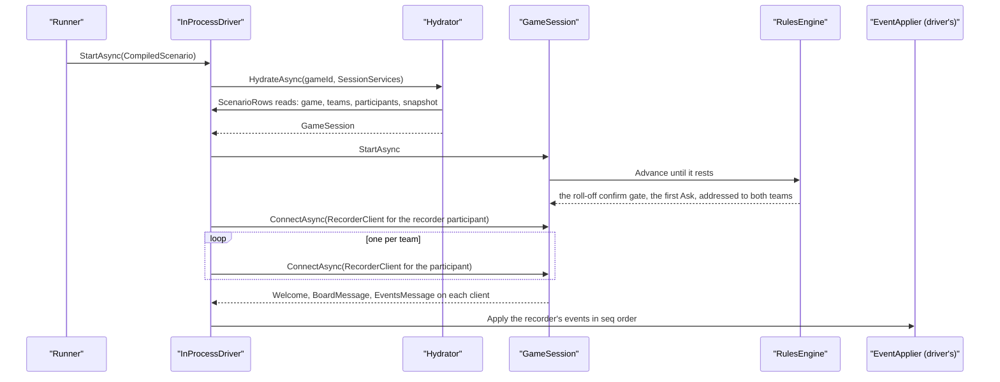

The recorder connects first, so its stream carries the whole log from the start. `ScenarioRows`
supplies the six reads `Hydrator` needs and throws on all seven writes. A write attempted here
means something in the session tried to mutate management's rows during `playing`, which is a
bug in the session rather than in the harness.

Over the socket the same shape holds with `SocketRowSeeder` before it and a `Connect` frame in
place of `ConnectAsync`. The failure mode there is a `Rejected` frame or a `Welcome` naming a
participant other than the one the driver expected, both of which throw at start rather than
producing a run that answers as the wrong team.

### Answering one Ask, and deploying a unit

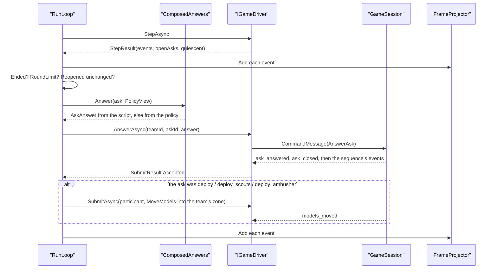

Two orderings are load-bearing. The answer is submitted before the placement, because the
scheduler's deployment phase reads the `deploy` answer to know which unit is being placed. And
every event is absorbed into `FrameProjector` in seq order before the next `StepAsync`, because
a frame is whole state and a projector fed out of order produces a frame that no replay
reproduces.

A sealed Ask addressed to several teams loops over every team without an answer. An unsealed one
breaks after the first. A `SubmitResult.Rejected` at any point ends the run as
`Stuck(SubmitRefused)` rather than retrying, because under `strict` a refusal is a real bug in
the policy or the engine.

### Stuck detection

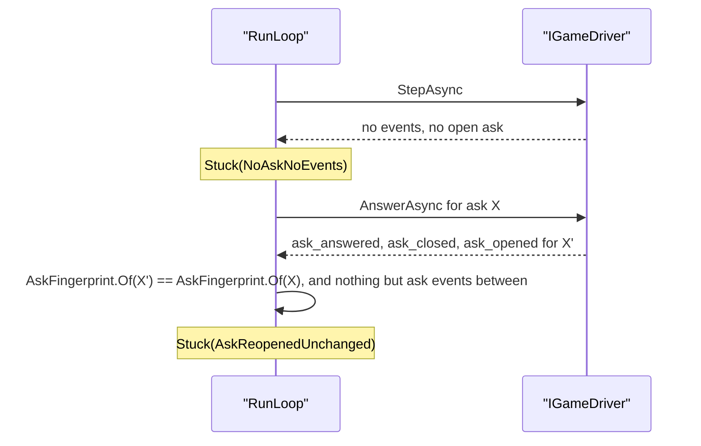

`_sinceLastAnswer` counts events that are not `AskOpened`, `AskAnswered` or `AskClosed`. A single
non-Ask event since the last answer clears the suspicion, so a legitimate re-Ask after real
progress is not reported. The hazard runs the other way: a sequence that re-Asks after emitting
one cosmetic event forever would never be caught by this check, and would end at `MaxSteps`
instead.

### A socket step

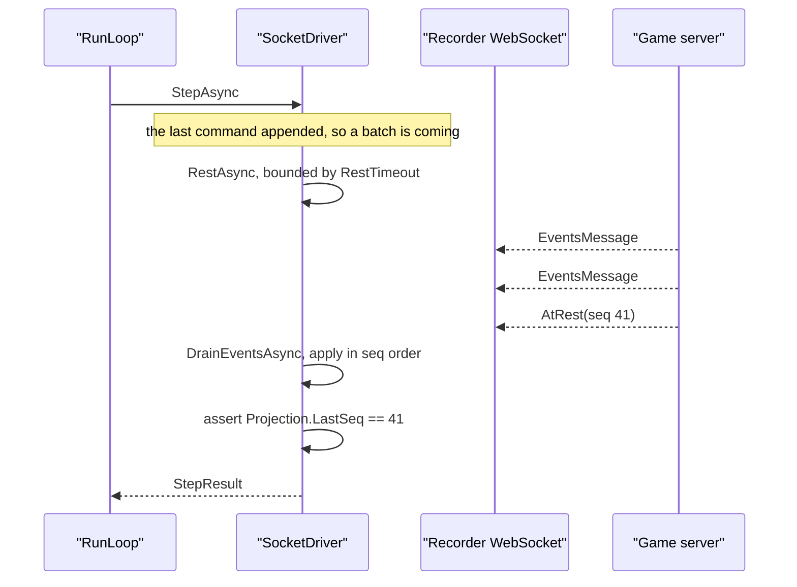

A command that appended nothing sends its `AtRest` to the submitting socket alone, which
`SubmitAsync` has already read. `StepAsync` then waits on nothing and returns an empty step.

Quiescence over the socket is the server's own statement rather than a guess. The wait
returns on the frame, so a slow server delays a step and never reports a rest that has not
happened. `RestTimeout` bounds the wait at 30 seconds and is a liveness guard, not a quiescence
guess: expiry throws `RestTimeoutException` and the run ends `Failed`. A command that appended
nothing sends its `AtRest` to the submitting socket alone, so the recorder gets no batch and the
step returns immediately with an empty event list and `Quiescent` true. That is the only input
`Stuck` detection reads, so a genuinely idle engine is still caught.

### The two drivers agreeing

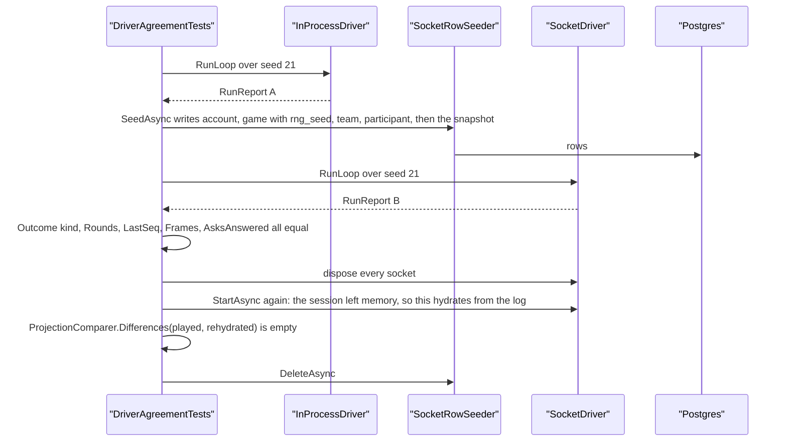

The comparison is run for run: outcome, rounds, `LastSeq`, `Frames` and `AsksAnswered` must all
be equal. It is sound because both drivers observe the same events at the same step boundaries.
Each `StepAsync` returns on a rest signal, so each sees every event of a batch and every Ask the
batch opened, which fixes the `(question, ordinal)` keys the script and the seeded `Chooser` are
indexed by. None of the five compared fields carries a server-minted id, so the Ask ids and
event ids that differ between the two runs are not compared. Any inequality means the socket
path produced, lost or reordered an event that the in-process path did not, which localises to
transport, serialization or persistence.

## State and data

### Persisted

An in-process run persists nothing. A socket run writes management's rows and the game server's
log, through the same code the servers use.

| Table | Written by | Columns `sim/` sets |
| --- | --- | --- |
| `management.account` | `SocketRowSeeder`, raw SQL | `id` from the JWT's `account_id` claim |
| `management.game` | `SocketRowSeeder`, raw SQL | `id`, `name`, `status`, `game_rules`, `properties_hash`, `scheduler_shape`, `enforcement`, `waits_between_steps`, `created_by`, `rng_seed` |
| `management.team` | `SocketRowSeeder`, raw SQL | `id`, `game_id`, `ordinal` |
| `management.participant` | `SocketRowSeeder`, raw SQL | `id`, `game_id`, `team_id`, `account_id`, `army_id` |
| `management.table_state` and its tree | `IGameRows.StartSetupAsync` | the whole snapshot |
| `management.participant.army_snapshot` | `IGameRows.EndSetupAsync` | one per participant |
| `game.game_event` | the game server | nothing; `sim/` only reads `max(seq)` to assert |

`docs/schema.md`'s `PARTICIPANT` block lists `id`, `game_id`, `team_id`, `account_id`, `army_id`
and `army_snapshot`, matching `scripts/postgres/init/001_schema.sql`. The game server's
`FindParticipantAsync(gameId, accountId)` and `SetParticipantArmyAsync` and the management API's
`POST /v1/games/{id}/join` all require `game_id` and `army_id`. `game.rng_seed` is in the same
diagram's `GAME` block.

### In memory

| Held by | State | Rebuilt from |
| --- | --- | --- |
| `IGameDriver` | one `EventApplier` and its `Projection` | the recorder participant's event stream |
| `InProcessDriver` | `GameSession`, one `RecorderClient` per participant | nothing; the session hydrates from the log |
| `SocketDriver` | one `Peer` per participant, each a `WebSocket` plus an unbounded `Channel<SocketMessage>` | nothing |
| `RunLoop` | `_log`, `_lastAnswered`, `_sinceLastAnswer` | nothing; a run accumulates |
| `FrameProjector` | its own `EventApplier`, every `RecordedFrame` of the run | nothing; frames are kept for the whole run |
| `ComposedAnswers` | `History`, and a per-question ordinal counter | nothing |
| `Chooser` | a 64-bit counter and `Drawn` | the seed |

Two appliers run over the same stream, the driver's and the projector's. They are not shared
because the projector needs the projection after each event to build that event's frame, and the
driver needs one that is always at the head. A divergence between them would show as a frame
whose model states do not match the final projection. `RecordingTests` pins that.

### Recording size

A recording of an 8-round game is 5 to 6 MB of indented JSON. Every frame carries every
model and every unit, so the file grows as frames times models. A soak run of 500 seeds at that
size writes about 3 GB into `--out`. `--no-recording` exists for that case.

## Failure modes

**A run that does not end.** `RunLoop` caps at `RunSettings.MaxSteps` (20 000) and reports
`Stuck(NoAskNoEvents)` on exhaustion. The engine's own cap is 10 000 `Advance` iterations inside
`AdvanceAsync`. A scheduler or interpreter that emits one event forever passes the
reopened-unchanged check, since `_sinceLastAnswer` clears on any non-Ask event, and is caught
only by the step cap. The frame dump is what makes that diagnosable.

**A server that never rests.** `RestAsync` waits for `AtRest` and cannot mistake a slow server
for a rested one, so a false rest is not a failure mode. What remains is a server that
stops sending the frame at all, from a hang or from a dropped connection the read loop has not
noticed. `RestTimeout` bounds that at 30 seconds and the run ends `Failed` with the last frames
dumped. The report names the harness rather than the engine, which is the honest attribution: a
run that hangs inside the engine is caught by `MaxSteps` and reported `Stuck`.

**A rest signal the server never sends.** A game server that appends events and omits the frame
leaves every socket step waiting out `RestTimeout` and every socket run `Failed`. That is loud
rather than silent, and it is the reason the timeout exists at all rather than an unbounded
wait.

**An unbounded channel per peer.** Each `Peer` holds `Channel.CreateUnbounded<SocketMessage>()`.
A run that never drains a player's inbox grows it for the length of the game.
`DrainEventsAsync` discards every player frame and reads only the recorder's, so the players'
channels drain each step and the recorder's is the one that matters.

**Answer determinism depends on Ask order.** One `Chooser` is advanced in Ask order. If the
engine offers the same Asks in a different order between two runs of the same seed, the answers
diverge and nothing about the run is reproducible. The engine's order is deterministic because
its state is rebuilt from the log, so this holds. It would break silently if any engine decision
read a clock, a hash seed or a dictionary enumeration order.

**Ordering inside a step.** Events are applied in `Seq` order and skipped when
`e.Seq <= Projection.LastSeq`, so a frame arriving twice is idempotent. A frame arriving out of
order across two `EventsMessage` batches would be applied out of order within a batch boundary,
because the sort is per drain rather than global. In process the mailbox makes that impossible.
Over the socket it depends on the server sending batches in order on one connection, which
WebSocket guarantees.

**The applier's strictness.** `EventApplier` indexes dictionaries by id and throws on an unknown
one. A driver whose projection throws is dead for the run, and reconnecting replays the same
event. In `sim/` that surfaces as an exception out of `DrainEventsAsync` rather than as a
`Failed` outcome, so it is a crash rather than a report. That is the game server's hazard, not
this module's, and `sim/` is one of the better ways to find it.

**Invariant 2 is quadratic.** `UndoKeepsTheEarlierDice` runs `EventApplier.EffectiveLog`
once per dice-bearing sequence, and each call walks the whole log. A game with 300 dice-bearing
sequences and a 1 500-event log does 450 000 event visits per run. That is affordable for one
run and is the dominant cost of a 500-seed soak. `RunSettings.CheckInvariants` turns it off.

**A scenario whose deployment zone does not resolve.** `HandPlacement.IntoZone` calls
`ZoneStyles.Resolve` and gets no polygons for a shape id the library does not know. The unit is
then not placed, the deployment phase waits for models that never arrive, and the run ends
`Stuck(NoAskNoEvents)` or at the step cap. The recording still shows the zone with `polygons: []`,
which is the diagnosis.

**A JWT naming the wrong participant.** `SocketDriver.OpenAsync` compares `Welcome.ParticipantId`
against the participant it expected and throws. Without that check a run would answer Asks as
the wrong team and produce a game that is legal, reproducible and wrong.

**Left to break.** A socket run leaves its rows and its log in Postgres, and a seed range
accumulates one game per run until someone deletes them. A model deployed onto a hill sits at
`Z = 0` until it next moves. A scenario with an army whose units cannot fit in its zone is
placed anyway, overlapping, because placement is free under every enforcement setting. All three
are chosen behaviour.

**What no mechanism protects.** `GameRules` is C# shipped with the build and is not pinned, only
`Properties` is. A deploy that changes a pipeline order can make a recorded game replay
differently. In `sim/` that would show as a scenario's expectations failing after a change
nobody made to the scenario. A regression scenario is what catches it.

## Testing

Twelve xUnit classes in `tests/Tabletop.Sim.Tests`. All but one need nothing running.

| Class | Covers | Needs |
| --- | --- | --- |
| `ChooserTests` | determinism for a seed, range coverage, shuffle and subset, `Next(0)` throwing | nothing |
| `ScenarioTests` | the builder's teams and participants, the same seed with different ids, the properties hash and rules id, every catalog scenario compiling, `strict` by default | nothing |
| `AnswerPolicyTests` | one test per legal-set shape, the empty set, the pass probability, the same seed answering identically, `ShapeNames` matching the switch | nothing |
| `MoveRegionPolicyTests` | 25 seeds each: a destination within the allowance and on the table, an impassable volume not crossed, embarking putting every model inside | nothing |
| `ObjectiveGoalTests` | the goal is the nearest objective marker the team does not hold (tokens and held markers skipped, an enemy's marker kept), none when every marker is held, a goal-directed move within the allowance and closer, the same seed answering identically, no goal leaving the uniform answer unchanged | nothing |
| `AnswerScriptTests` | the ordinal counting per question, a duplicate key throwing, the script winning, a script-only run failing on the first unscripted Ask | nothing |
| `InProcessDriverTests` | hydrating to a playing game with the first Ask open, every model on the shelf before deployment, an accepted answer, an out-of-set answer refused under `strict`, the driver's and the server's projections agreeing, draining twice | nothing |
| `RecordingTests` | the board block, a frame's models, the score and passed, a marker placed during play, an Ask on every frame until it closes, the dice raw and modified, a JSON round trip, camelCase and omitted nulls | nothing |
| `RunLoopTests` | a skirmish ending and never hanging, every model deployed before round one, one seed giving the same dice and answers and a different game id, different seeds diverging, a round cap terminating a stalemate, a script-only failure, the fingerprint, hand placement inside the zone | nothing |
| `InvariantTests` | every invariant over a whole game, a broken invariant reported as a failure, cold replay against the incremental and the server's projections, undo at any dice-bearing sequence, the comparer naming what differs, `MidRun` throwing | nothing |
| `StepAndWaitTests` | pausing with the Ask open and nothing answered, resuming, answering from outside, stepping through a whole game one Ask at a time | nothing |
| `ProgramTests` | argument parsing, `--list`, a seed range writing a recording each and one `summary.json`, an unknown scenario as a usage error, `--no-recording` | nothing |
| `DriverAgreementTests` | the same scenario giving the same outcome, rounds, `LastSeq`, `Frames` and `AsksAnswered` on both drivers, the log landing in Postgres and hydration reproducing the game, undo and redo over the socket | Docker: Postgres, plus `GameServerFactory` |

`PostgresCollection.cs` re-declares `[CollectionDefinition("Postgres")]` locally over
`PostgresFixture`, which is imported from `tests/Tabletop.GameServer.Tests`. xUnit resolves
collection definitions in the test assembly only.

**Notable gaps.** `SocketCredentials.MintAsync` has no test. `DriverAgreementTests` mints with
`TestKeys`, so the only thing that exercises the management mint is a console `--driver socket`
run, and its absence outside a development environment is asserted in the management API's suite
rather than this one. Nothing tests that the policy is uniform in distribution. The tests assert
membership in the legal set and stability under a seed, not the shape of the distribution over
many draws. Nothing tests a socket run against a server that never rests, so `RestTimeout` and
the `Failed` outcome it produces have no coverage. Nothing tests a recording against `viewer/`,
which is that plan's to do.
And no test proves the two prohibitions: that `sim/` never narrows a legal set and never computes
a rules outcome is enforced by `AnswerPolicy` reading only `PolicyView`'s geometry members (a `MoveGoal` only ranks what it already found legal), and a
future `IAnswerSource` could violate both without a test noticing.

## Rulings and deferred work

### Rulings

**1. A socket run gets its session JWTs from a development-only endpoint that mints one.**
Hand-pasting is rejected: a three-team soak would need four tokens pasted by hand. The endpoint
is `POST /v1/dev/sessions` on the management API rather than the game server, because
management holds the Stytch project secret and already creates users and authenticates sessions.
It takes a name, finds or creates the Stytch user and the `account` row, and returns a real Stytch
session JWT, so the socket driver stays on the production verification path. It is gated on
`IHostEnvironment.IsDevelopment()` and absent from the route table a production build serves.
`SocketCredentials.MintAsync` calls it, `AccountOf` reads the account id out of the mint's
response, `NameFor` makes the account names stable per scenario and participant, and
`--driver socket` has no token variable. The cost is that a console socket run needs network
access to the Stytch test project.

**2. A stuck run fails the console's exit code**
([closing the open questions](../../superpowers/specs/2026-09-09-open-questions-design.md)). A
game that cannot finish is a bug in the rules engine, and CI is the only place anyone will run
500 seeds: `RunReport.Passed` is false for `stuck` and `failed`, so a 500-seed soak exits `1` if
any game hangs. The frames are dumped either way.

**3. `sim/` is in `Tabletop.sln`**, in a `sim` solution folder, because the solution is *"at the
repo root, spanning every project"* (`CLAUDE.md`), so `dotnet build` at the root builds it and
`dotnet test` runs its tests.

**4. The catalog ships ten scenarios.** `casting` is one of them, beside `skirmish`, `terrain`, `player-turn`,
`free-for-all`, `stalemate`, the three `final-round` presets and `objectives`. Casting is not a mode — a spell is cast inside an ordinary
activation — so the preset differs from `skirmish` only in fielding a `Caster(2)` and declaring
a spell. It exists because none of the other nine opens casting's two player decisions, the
per-model token spend map (p.13) and the caster spending its own leftover tokens on its own
roll. The spell is the
scenario's own: `ScenarioBuilder.Spells` folds it into the pinned `PropertySet`, so the hash
differs from `CoreProperties` for that run alone. The shipped content document is every special
rule on pages 13–15 and holds no spells, because a spell list belongs to an army book this
project has not designed. A regression scenario for a specific rules interaction is still a
script and is added the same way, so the shape of the catalog does not change.

**5. The socket driver waits for a rest frame, not a quiet window.** The game server sends
`AtRest(long Seq)` when it has finished processing an inbound `connect` or `command`, carrying
the log's high-water mark. `SocketDriver.StepAsync` waits for that frame instead of for silence,
on the recorder's socket when the command appended and on the submitting socket when it did not.
`RestTimeout`, 30 seconds, is a liveness guard on a hung server, and expiry is a `Failed` run
rather than a `Stuck` one. Quiescence is therefore exact on both drivers, `DriverAgreementTests`
compares the two drivers run for run, and a socket step costs what the server takes.

### Answered from the specs

| Spec item | Answer | Where |
| --- | --- | --- |
| The recording's schema and versioning | the record set in `sim/Recording/Recording.cs`, carrying `schemaVersion` | spec → Deliberately not decided |
| Whether a recording carries the dice | it carries them, raw and modified, with threshold and modifiers | spec → Still open |
| Whether the round cap belongs in the scenario or in `GameRules` | the scenario, overridable with `--rounds` | spec → What a full game means |
| Whether the policy prefers to act over passing | it acts; `PassProbability` defaults to `0` | spec → Deliberately not decided |
| Whether a scenario is C# or a text format | C# | spec → Deliberately not decided |

### Deferred

| Deferred | Reason | Recorded in |
| --- | --- | --- |
| A control channel over the step-and-wait seam | it makes the viewer a second thin client, a larger surface than a renderer | spec → Interactive debugging is a door, not a room |
| A state-reading `IAnswerSource` | it explores a narrower region and finds fewer bugs, so it is never the soak default | spec → Two ways to answer an Ask |
| An opponent that plays well | a later feature, behind the same `IAnswerSource` seam | spec → Two ways to answer an Ask |
| How a viewer draws a model inside a container | it is not drawn on the board and is listed in `Scene.offTable`, since a container has no position | spec → Deliberately not decided |
| Whether the live feed needs authentication beyond a spectator's session JWT | the session JWT alone, and a non-participant is refused with `rejected: not_a_participant` | spec → Still open |
| Cleaning up socket runs' rows | a developer tool leaves the game in the database to look at | Task 10 |

## References

### Specs

- `docs/superpowers/specs/2026-09-06-simulation-design.md`, the whole document. Its `viewer/`
  sections belong to the viewer module.
- `docs/superpowers/specs/2026-09-04-whole-design-review.md`, ruling 5: a participant with no
  team is a spectator and is never Asked.
- `docs/superpowers/specs/2026-09-04-scheduler-design.md`, *The turn is an Ask*: moving models by
  hand never ends one, which is why the run loop places deployed models itself.
- `docs/superpowers/specs/2026-08-28-resolution-design.md` and
  `docs/superpowers/specs/2026-09-03-action-sequences-design.md`, for the Ask and `LegalSet`
  shapes the policy answers.
- `docs/superpowers/specs/2026-08-29-identity-and-enumerations-design.md`, for enforcement and
  `Enforcement.Strict`.

### Architecture

- `docs/architecture.md` → There is no offline mode: the network path is the only path, which is
  what the socket driver exercises.
- `docs/architecture.md` → Contracts to freeze: nobody instantiates a game session, which is why
  the in-process driver goes through `Hydrator`.
- `docs/architecture.md` → Rules enforcement: the client prevents base overlap, an Impassable
  Solid and a path through a model, the server judges them, and coherency is not judged.
- `docs/architecture.md` → Undo: replay to sequence N from the initial state, and the RNG as part
  of game state, which is invariant 2.
- `docs/schema.md` → `GAME`, `TEAM`, `PARTICIPANT`, `GAME_EVENT`.

### Rulebook: Grimdark Future v3.5.1

- p.6, deployment alternates one unit a turn, which is what a `deploy` Ask and a hand placement
  reproduce.
- p.50, free-for-all is N teams, which is the `free-for-all` scenario.

### Sibling design documents

| Module | Document |
| --- | --- |
| Contracts and local development | [contracts](../contracts/design.md) |
| Geometry | [geometry](../geometry/design.md) |
| Game server skeleton | [game-server](../game-server/design.md) |
| Interpreter and effects | [interpreter](../interpreter/design.md) |
| Scheduler | [scheduler](../scheduler/design.md) |
| Management API | [management-api](../management-api/design.md) |
| Client | [client](../client/design.md) |
| Web app | [web-app](../web-app/design.md) |
