# Viewer

`viewer/` is a static web page that draws a `sim/` recording top-down in inches, with a timeline
under the board and the log beside it. It is a developer tool and the fifth deliverable, separate
from `web/`: `web/` owns preparation for players, and a debugging surface for the person writing
the engine does not belong in it. Its hosted build also ships in production as the browser play and replay app for every signed-in player
tool at `/viewer/` on the website's origin (*Two builds*, under Context). Two feeds reach it, a recording file and a
live socket, and the live feed manufactures the recording's own shape in the browser, so nothing
below the feed abstraction knows which feed it is on.

That second path is the one place in the project where `Tabletop.Protocol` and the event applier
exist twice. The duplication is generated and tested away rather than maintained: the TypeScript
types come from the C# JSON contracts, and the ported applier must reproduce a recording the C#
applier produced, frame for frame. Playback is the whole first version. The viewer sends one frame
in its life, `Connect`, and after that it only receives.

## Scope

**In scope.** The recording reader and its schema gate; the frame-to-scene projection, including
the two `Tabletop.Geometry` outline functions ported to TypeScript; the 2D canvas, its view
transform and its picking; the timeline reducer with play, step, scrub and jump; the log, Ask, dice
and meta panels; the scoreboard; the feed abstraction and both feeds; the ported event applier, log
lines and frame projector; the TypeScript emitter and its drift guard; the agreement test and its
checked-in fixtures.

**Not in scope.**

| Not built here | Where it lives |
| --- | --- |
| Any command, any Ask answer, any edit | not built; `Feed.control` is declared and `null` |
| Pausing or resuming a run from the browser | `sim/`'s `DriverMode.StepAndWait`, `RunLoop.ResumeAsync`, `RunLoop.AnswerPausedAsync` (simulation plan Task 9) |
| The recording schema | `sim/Recording/Recording.cs`, simulation plan Task 5 |
| Producing recordings | `sim/`, simulation plan |
| Deployment-zone shape resolution | `Tabletop.Geometry.ZoneStyles`, C# only, not ported |
| The resolution frame stack | `Tabletop.Protocol.Projection.Stack`, not ported |
| Joining a game | not built: the viewer watches as an admin without joining |
| 3D, meshes, WebGL, any drawing library, a router, SvelteKit, persistence | not built |

**Code lands in** two places. `viewer/` holds its own `package.json` and lockfile, twenty-eight
files under `src/`, eleven Vitest files, two test helpers and eight checked-in fixture files; two of
the files under `src/lib/protocol/` are generated. `tests/Tabletop.Viewer.Tests/` holds five C#
files, is `net10.0` xUnit, and is added to `Tabletop.sln`'s `tests` folder. Task 12 edits one
bullet in `CLAUDE.md` and one paragraph in `docs/architecture.md`.
Nothing under `viewer/` is in `Tabletop.sln`, and nothing in `viewer/` imports from `web/`.

**Position in the build order.** Last. `viewer/` consumes the recording schema, so `sim/` must land
first, and `sim/` consumes the whole engine. What must exist before Task 1:

1. the contracts plan: `Tabletop.Protocol`'s `SocketMessage` and its closure, `WireJson.Options`,
   `EventApplier` as the C# original the port copies;
2. the simulation plan Tasks 1 through 6: `Recording` and every `Recorded*` record,
   `RecordingJson.SchemaVersion`, `LogLines`, `FrameProjector`, `ScenarioCatalog`,
   `ScenarioCompiler`, `InProcessDriver`, `RunLoop`, all `public`;
3. the simulation plan Task 11, which writes `viewer/`'s placeholder lines into `CLAUDE.md` and
   `docs/architecture.md` that this module's Task 12 replaces;
4. the geometry plan Task 4: `Bodies.BaseOutline`, `WorldVolumes.WorldOutline` and `Point2.Rotate`,
   as the source the port copies line for line;
5. the game-server skeleton, for the live feed only, and the management API's
   `POST /v1/auth/password` and `POST /v1/auth/session/refresh`.

Tasks 1 through 8 need only `sim/` and the recording schema. Tasks 9 through 11 add the live feed
and need `Tabletop.Protocol` and a running game server to be exercised by hand.

## Context

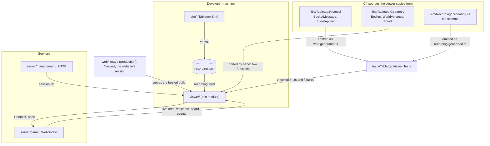

Four seams.

**The recording schema.** `viewer/` consumes it and never redefines it. `schemaVersion` is the
integer `1`, from `RecordingJson.SchemaVersion`. The C# type is `Tabletop.Sim.Recording.Recording`. A file carrying any other value is refused. Every
field the viewer reads is declared by `recording.generated.ts`, so a schema change is a TypeScript
error rather than a silent `undefined`. Three of the schema's fields exist for the viewer's sake.
They are listed under *Interfaces*.

**The socket.** The live feed follows the connect sequence the game-server plan states, sends
`Connect` and reads six frame kinds. It connects as an admin watcher (admin watch spec): a session
whose `roles` claim holds `admin` and which is no participant of the game gets the frames a
participant with no team gets, `Welcome.ParticipantId` `Guid.Empty`, and every frame it could send
that changes the game is `Refused` with reason `watcher`. A participant with no team connects the same
way and is never Asked.

**The management API.** Three routes. `logIn` and `refreshSession` return a body and the viewer
reads `sessionJwt` from it; `listGames` (`src/lib/live/games.ts`) pages `GET /v1/games` with that JWT.
Development is same-origin through Vite's `/v1` proxy, so management needs no CORS entry.

**The game list.** One login per page session (email and password, or a pasted JWT), held in
`SourcePicker`'s state and refreshed before each use, since a JWT lasts five minutes. After login the
picker lists the games: name, status, players (`GameSummary.ParticipantNames`), created time in UTC
(`rowOf`). Clicking a row opens the live feed on that game: the log replays from the start on the
timeline and a running game follows live. Recording files and URLs and the Tests page's Watch and
Open live are unchanged.

**Geometry in the browser.** `viewer/src/lib/geometry/` runs `libs/Tabletop.Geometry` as WebAssembly (`libs/Tabletop.Geometry.Wasm`, JSON in and out) for the browser setup and play, which drag, land, rest, check contacts, measure and test zones with the code Godot runs. The runtime is fetched on the first `loadGeometry()` and never by playback; `scripts/geometry-wasm` builds it, the web image carries it under `/viewer/geometry/_framework/`, and the hosted CSP allows `'wasm-unsafe-eval'` for it. `tests/fixtures/geometry.cases.json` holds cases C# computed directly; Vitest replays them through the WebAssembly.

**Two builds.** `npm run build` (and the dev server) is the developer viewer: its own login,
`VITE_GAME_SOCKET`, the Tests page. `npm run build:hosted` (Vite mode `hosted`, base `/viewer/`) is the
production play and replay app, served by the web image at `/viewer/` on the website's origin
(`web/Dockerfile`, `web/Caddyfile`). `configOf` (`src/lib/hosted/hosted.ts`) tells them apart:

- Session: the website's own, read from `localStorage` `tabletop.session` (`{ sessionJwt, account }`,
  written by `web/src/lib/session/session.svelte.ts`). `hostedSession` refreshes it through
  `/v1/auth/session/refresh` before each use and writes the new JWT back. No stored session, or a refresh
  refused with a 4xx other than 429, shows *Signed out* with a link to `/login?next=/viewer/`; every signed-in
  account opens it (the `admin` role adds Watch). The page gate is for the reader; the socket and `/v1`
  enforce access.
- Socket: `wss://<page host>/ws` (`ws://` on http), the same `/ws` the client reaches through
  `TABLETOP_WEB_URL`.
- No Tests tab and no `TestsPage`: production has no runner behind `/suite` and `/runs`.
- The Games panel opens with the list loaded. `GET /v1/games` lists every status, so ended games
  appear beside running ones and open on the timeline from the start of their log.
- CSP: the web image's Caddy sends the viewer's whole policy as a header on `/viewer/*`
  (`default-src 'self'`, `connect-src 'self' wss://{host}`, `frame-ancestors 'none'`).

**Code generation, not a build step.** `tests/Tabletop.Viewer.Tests` holds the emitter and the
fixture writer. `viewer/` stays a pure npm project with no .NET dependency, and `npm ci && npm run
build` works with no .NET SDK installed. The drift guard runs inside the `dotnet test` every plan
already ends with.

## Design

### One input shape, two feeds

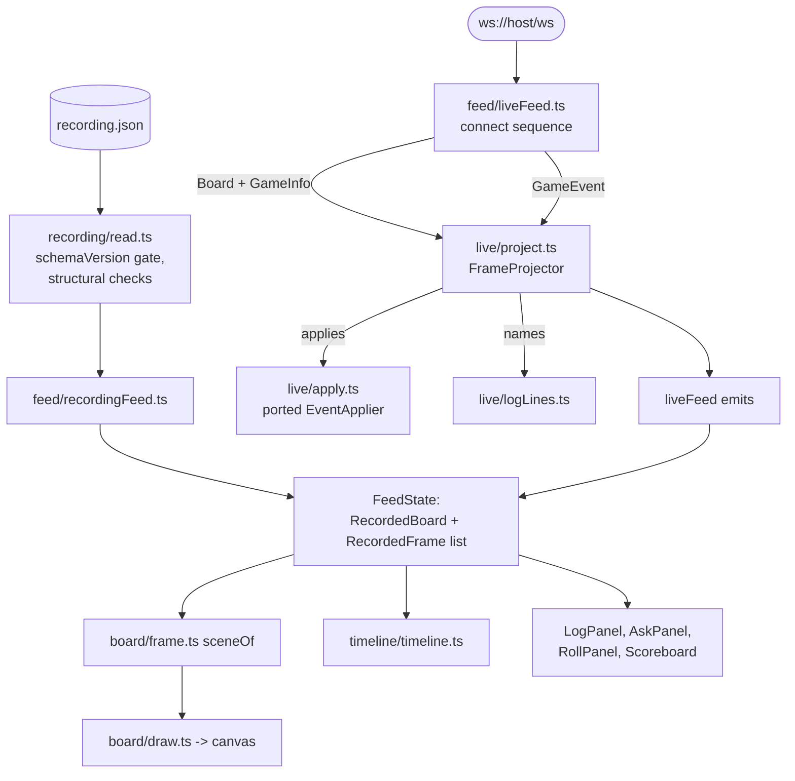

`src/lib/live/` is the only directory that knows `Tabletop.Protocol` exists.

`FeedState` is six fields: `label`, `status`, `detail`, `meta`, `board`, `frames`. `board` is a
`RecordedBoard` and `frames` is a `RecordedFrame[]`, whichever feed produced them. The renderer, the
timeline, the panels and the scoreboard read only those. `Feed` is `kind`, `control`,
`subscribe` and `close`, and `kind` is read once, in `App.svelte`, to decide whether the timeline
starts in follow mode.

The live feed's cost is stated in the spec: the socket carries events, so the viewer must apply
them, so the message types and the applier exist a second time in TypeScript. The alternative was a
live feed that spoke its own shape, which would have made every component branch on the feed and
would have duplicated the frame projection instead of the applier. `liveFeed` builds a
`FrameProjector` when the `board` frame arrives, feeds it each `GameEvent`, and publishes
`projector.board` and `projector.frames`.

Frames are whole state and never deltas. A scrub to frame 300 reads frame 300 and nothing else.
Nothing accumulates, interpolates or tweens.

### The manufactured meta

The live feed has no `RecordingMeta` to read, so it builds one from `GameInfo` on every publish.
`scenario` is `info.name`, `driver` is `live`, `outcome` is `live`, `seed` is `0`, `rounds` and
`lastSeq` come from the last frame, and `teams` is built from `info.teams` with the name
`Team {ordinal}`. `outcome: 'live'` is a value `sim/` never writes; `RecordingMeta.Outcome`'s doc
comment reserves it for a still-running feed. The field is a `string`, so no shape changes.

A finished recording's `outcome` is `ended`, `round_limit`, `stuck` or `failed`. `failed` marks
a run whose script, driver, invariants or expectations failed, and it also marks an ended or
round-capped run whose invariants or expectations failed. `outcomeDetail` is set for `stuck` and
`failed`, and the viewer shows it beside the outcome.

A null `meta` was rejected: the Ask panel resolves a team id to a name through `RecordingMeta.Teams`
and would fall back to an eight-character id for every team in a live game.

### Generated protocol types

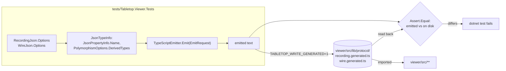

The emitter reflects over `System.Text.Json`'s contract metadata, not over the C# records.
`JsonPropertyInfo.Name` is the wire name, so `[JsonPropertyName]` and the camelCase policy are
honoured without being reimplemented. `JsonPolymorphismOptions.DerivedTypes` supplies each union's
members and every `kind` string. An enum's spelling is obtained by serialising the value, not by
choosing between `snake_case` and `kebab-case`. A reflection-over-properties emitter would be a
second implementation of the JSON conventions, which is the drift the approach exists to remove. A
computed C# property that the serializer includes appears in the output, because the output
describes the bytes.

`Emit` first calls `Options.MakeReadOnly(populateMissingResolver: true)`, because `GetTypeInfo`
throws on options that have not been made read-only. The property walk skips any property whose
`Get` is null, which is a `[JsonIgnore]`d property, so `GameEvent.kind`, `Point3.horizontal` and
`TerrainPlacement.transform` are not declared. A nested array reference is parenthesised, as in
`readonly (readonly RecordedPoint[])[]`.

An object type written by a custom converter has a contract with no properties. The emitter declares
it from a fixed converter map of one entry, `VisualRef` as `{ builtin?: string; assetId?: string }`,
and throws on any other converter-backed object type reachable from a root. A new one is therefore
loud. Reflection cannot see the converter's output, so the wire test asserts the `VisualRef`
declaration.

`EmitRequest` carries `Module`, `Options`, `Roots`, `PrunedUnions` and `Rename`. `PrunedUnions`
narrows `SocketMessage` to the seven frames the live feed reads: `Connect`, `Welcome`,
`GameInfoMessage`, `BoardMessage`, `EventsMessage`, `Refused`, `Rejected`. No `Command`, no `Edit`,
no `Presence`, no `Ping`, no `AtRest`. `Rename` is empty until two reachable types share a `Name`.
The emitter throws when that happens rather than overwriting a declaration.

`AtRest(long Seq)`, wire kind `at_rest`, is the thirteenth `SocketMessage` kind. It is pruned
away. The frame announces that the game server has finished
processing and has nothing further to emit, which replaces the simulator's 250 millisecond quiet
window. The viewer has no quiet window to replace. It republishes on every `EventsMessage`, so its
frame list is current the moment an events frame is decoded, and idleness changes nothing it draws.
Declaring a kind no branch reads would also move the checked-in golden file for no behavioural
reason. Pruning is therefore the side this falls on, and the two generated modules are byte for byte
the same with the kind declared in C# as without it. Wanting an idle indicator later costs one member
in `PrunedUnions`, one entry in `HANDLED` and one `case`.

Output is deterministic in two ways that the golden file records. Declarations are sorted by name,
so `RecordedAsk` is first in `recording.generated.ts`. Members within an interface follow
`JsonTypeInfo.Properties` order, which is the C# record's positional order. A reordered record
shows as a one-line golden-file diff. Nothing else would catch it, so `RecordedMarkerState`'s nine
members are also pinned line for line in a test.

`TABLETOP_WRITE_GENERATED=1 dotnet test tests/Tabletop.Viewer.Tests` rewrites both modules. Any
other run asserts they are what the C# emits today. This is the spec's answer (*Still open*) on
whether generating types is worth a build step: checked in, guarded by a test.

### The recording reader and the schema gate

`readRecording(value: unknown): Recording` validates and refuses. It never repairs. A recording is
derived and disposable, so the answer to a malformed file is to re-run `sim/`.

It checks five things: `schemaVersion` equals `SCHEMA_VERSION`; the root has `meta`, `board` and
`frames` of the right kinds; each frame's `index` equals its position; each frame has a numeric
`seq` and a string `line`; every model id a frame names is defined by `board.models`. It returns the
value unchanged. Everything downstream reads the generated types and trusts them.

A recording with zero frames is accepted. A run that emitted nothing is still a run.

### Frame to scene

`sceneOf(board: RecordedBoard, frame: RecordedFrame): Scene` is pure and is the only place table
geometry is computed. `Scene` has six members: `table`, `terrain`, `zones`, `markers`, `models`,
`offTable`. Everything is in table inches. No screen coordinate reaches it.

| Input | Output | Rule |
| --- | --- | --- |
| `RecordedModel` + `RecordedModelState` where `where === 'table'` | `ModelShape` | `baseOutline` for the base, plus a facing tick of `baseA / 2` along the yaw |
| `RecordedModelState` where `where` is `shelf` or `inside` | `OffTable` | no position is invented; `containerLabel` names the container model |
| `RecordedTerrain` x `RecordedVolume` | one `TerrainShape` per volume | `volumeOutline`; `bottom` and `top` scaled by the piece's `scale` |
| `RecordedMarkerState` | `MarkerShape` | read from the frame alone; `board.markers` is never consulted. A frame's markers are the setup markers then the play markers; `controlledBy` names the controlling team |
| `RecordedZone` | `ZoneShape` | each `polygons` ring wrapped as a `Shape`; nothing resolved |

`baseOutline` is `Tabletop.Geometry.Bodies.BaseOutline` ported line for line, including
`OvalVertices = 64` and the placement by `Point2.Rotate`. `volumeOutline` is
`WorldVolumes.WorldOutline` ported the same way. These two are the whole of the geometry the viewer
needs, because a canvas draws outlines. Two conventions differ and both are inherited: a
`RecordedModel`'s `baseA` is a diameter, and a circle `RecordedVolume`'s `a` is a radius.

`rotate` in `board/transform.ts` is `Point2.Rotate`: yaw 0 faces `+y`, positive yaw turns
counter-clockwise seen from above.

**A model with no position is not drawn.** A model whose `where` is `inside` or `shelf` goes to
`Scene.offTable` and is listed in the meta panel with what it is inside. Placing it beside its
container would be the viewer deciding something, which is what handing it frames prevents. The
spec says the same under *Deliberately not decided*.

**Zone rings come from C#.** `RecordedZone.Polygons` is filled by `ZoneStyles.Resolve(shape, size)`
in `sim/`, already in the corner frame. Resolving a shape id is C# geometry, and OPR's frontline is
an absolute twelve-inch inset rather than a fraction of the table, so a browser cannot recover it
from the id and the table size. Porting `ZoneStyles` would be a second geometry implementation. An
empty ring list draws no outline and is not an error: `ZoneStyles.Resolve` answers an empty list for
a shape id it does not know, and the live feed has no resolver at all.

### The view transform

`View` is `{ scale, panX, panY }`: pixels per inch, and the screen position of the table corner at
`x = 0, y = length`. `fit(table, viewport)` centres the table with a 12-pixel margin. `zoomAt`
clamps scale to `[0.25, 400]` and keeps the table point under the pointer fixed. `gridStep(view)`
returns the smallest of 1, 3, 6, 12 inches that keeps grid lines at least 12 pixels apart.

`toScreen` is the only place `y` is flipped. Table `y` grows away from the near edge, canvas `y`
grows downward, and the flip happens once. `toTable` is its inverse and is what the pointer
handlers use, so every hit test happens in inches.

### Canvas rather than SVG

Frames carry whole state, so moving the timeline one step invalidates every model, every marker and
every position at once. There is no partial update for a retained-mode tree to exploit. At a few
hundred models an SVG document is roughly 300 base nodes, 300 facing ticks, the terrain outlines and
about 120 grid lines, and one step rewrites an attribute on every one of them. Dragging the scrubber
does that at pointer rate, paying style recalculation and layout for the whole document each time. A
single `<canvas>` pays one `clearRect` and about 800 path operations per frame.

The two things SVG gives away are hit testing and text layout. Both are cheap here. A base is a
circle, a square or a convex 64-gon in table space, so `pickAt` is a point test in inches with no
screen-space arithmetic. The only text is a short label drawn with `fillText`.

WebGL and every drawing library are refused. The workload does not need them, and the viewer is
schematic by design: nothing is rendered in 3D and no mesh is ever loaded.

The cost is that nothing on the board is in the accessibility tree, nothing is selectable text, and
the rendering has no unit test. `Board.svelte` owns the canvas, its `ResizeObserver`, the
device-pixel-ratio scaling, wheel zoom, drag pan and a `Reset view` button.

### The render pipeline

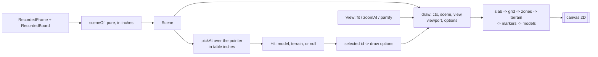

Draw order is also z order. `pickAt` walks models last-drawn first, then terrain, so the visible
shape is the one that is picked.

`contains(shape, point)` is boundary-inclusive, accepts any vertex order and allows a concave ring,
matching `Tabletop.Geometry.Polygon.Contains`. Circles are a squared-distance test. Polygons are an
on-edge test followed by a crossing count.

`draw` is one function over the whole scene with a `DrawOptions` of `selected`, `hovered`,
`showGrid`, `showZones` and `showLabels`. A model with wounds is drawn filled dark rather than
tinted, a model whose `z` is above the slab gets a dashed outline, and grid lines on a twelve-inch
boundary are brighter.

### The timeline reducer

`reduce(state: Timeline, action: TimelineAction): Timeline` is pure and covers eleven actions:
`frames`, `play`, `pause`, `toggle`, `tick`, `step`, `scrub`, `jump`, `first`, `last`, `fps`.
`Timeline` is `count`, `index`, `playing`, `fps`, `follow`. `index` is `-1` when there is no frame.

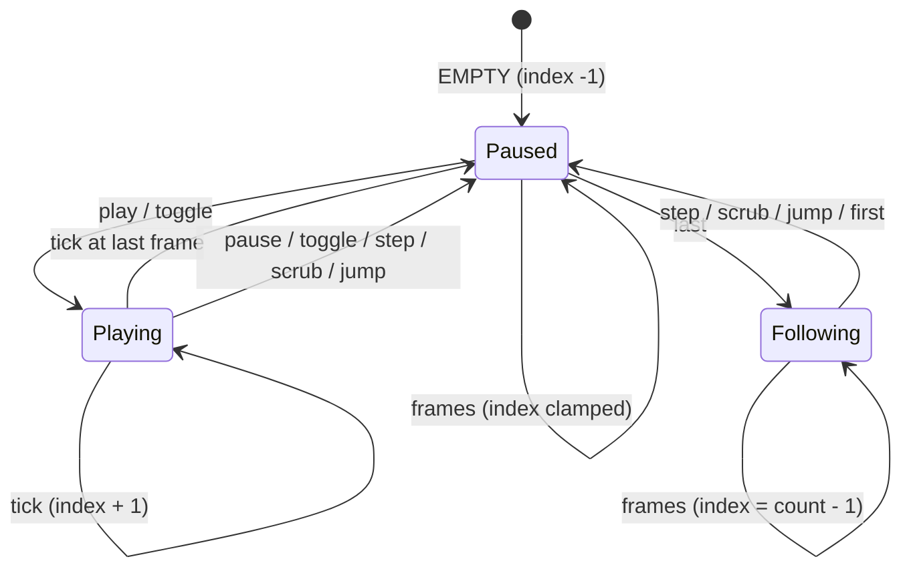

`follow` is what makes one reducer serve both feeds. A recording arrives complete, so `follow`
starts `false` and the timeline sits on frame 0. The live feed appends, so `App.svelte` starts it
`true` and every new frame becomes the current one until the user steps or scrubs. A `frames` action
with a smaller count clamps the index rather than pointing past the end, which is what a feed
replacement does.

`indexOfSeq(seqs, seq)` returns the last index whose seq is at or below the target, which is how a
log line for an event the frame list does not carry still jumps somewhere sensible. It is a linear
scan over a monotonic array. A binary search is the change if a recording ever grows past a few
thousand frames.

### The Ask panel and the empty control channel

`describeAsk(ask, teamLabels): AskView` turns a `RecordedAsk` into a heading, a prompt, one
addressee per team with whether it has answered, the teams still being waited on, a one-line
description of the legal set, and a note list. `describeLegal` covers the seven wire kinds
(`options`, `pieces`, `allocation`, `assignment`, `move_region`, `token_spend`, `confirmation`)
and returns an unknown kind's own string rather than throwing, so a new legal kind degrades to
its name. A token spend is one maximum per eligible model (p.13), so the recording carries the
spender models in `Pieces` and the sum of their maxima in `Allowance`, and the line reads *"a
token spend of up to 3 over 2 models"*. The per-model figures are not recorded twice, because
every frame already carries each model's `SpellTokens`. A `tokens_spent` answer is a count per
model and its log line sums them, which is the same sentence the C# `LogLines` writes.

The panel is display only. It exists because the recording carries the open Ask at every frame, and
showing it is what makes the seam visible without being built on.

`ControlChannel` is declared with `answer(askId, answer)` and `resume()`. Both feeds return `null`
for `Feed.control`, and `feed.test.ts` and `live.test.ts` each assert it. The spec's position is
that interactive debugging is a door, not a room: building on the seam makes the viewer a second
thin client, which is a larger surface than a renderer. The other half of the seam is already built
in `sim/`, where `DriverMode.StepAndWait`, `RunLoop.ResumeAsync` and `RunLoop.AnswerPausedAsync`
pause a run and answer one Ask from outside.

### The ported applier

`src/lib/live/` holds three ports and one HTTP client.

| File | Ports | Notes |
| --- | --- | --- |
| `apply.ts` | `Tabletop.Protocol.EventApplier` | `initialProjection`, `applyChange` (13 state-change kinds), `applyTo`, `effectiveLog`, `class Applier`, `class ProjectionDesyncError` |
| `logLines.ts` | `Tabletop.Sim.Recording.LogLines` | `lineOf(event, after, ordinals)`, `shortId` |
| `project.ts` | `Tabletop.Sim.Recording.FrameProjector` | `recordedBoardOf(board, game)`, `declarationsOf`, `class FrameProjector` |
| `management.ts` | nothing | `logIn`, `refreshSession`, `class ManagementError` |

The applier copies. It never decides legality, never derives a location and never clears a store on
its own. `initialProjection` walks armies, then units, then model slots, in that order, because
insertion order is the order every frame lists models and units in and the C# `Projection.Initial`
walks the same way.

**An unknown id.** The C# `EventApplier` throws `ProjectionDesyncException` on an id the projection
does not hold. The exception carries the event kind
and the unknown id, as `Kind` and `UnknownId`. `apply.ts` mirrors that with `ProjectionDesyncError`,
carrying `kind` and `unknownId`, thrown from the four helpers `unitIn`, `modelIn`, `markerIn` and
`askIn`. No `!` on a `Map.get` survives in the file. The spelling matters more than it looks.
`p.models.get(id)!.wounds = w` throws an untyped `TypeError`. `{ ...p.markers.get(id)!, position }`
on a missing marker spreads `undefined` and succeeds, writing a marker with no `id` into the store,
which is a silent divergence at the exact case the fault exists for: moving a marker neither the board nor
the log holds. A setup marker's first `marker_moved` copies its board row into `markers`, as the C# does. Four sites fault on neither side, because the C# writes through an indexer or calls `Remove`
there: `score_set`, `marker_placed`, `marker_removed` and `ask_closed`. The helpers cover twelve of
the sixteen fallible lookups the C# has. The other four read the resolution frame stack, which is not
ported, so `step_completed` and the dice kinds can fault on an unknown frame id in C# and cannot
here. That is the unported stack showing again rather than a second divergence. A comment in
`applyTo` names every stack-site fault the port leaves unported: `Pop` on `sequence_finished` and
`sequence_abandoned`, `FrameOf`, and `ReplaceDice`'s roll and die-index lookups.

Every `default` arm that reads a union's `kind` is a `const unreachable: never = ...` check, so a
kind added to a generated union fails `npm run check`. `isStateChange` is backed by a
`Record<StateChange['kind'], true>` for the same reason. The projector builds each `Recorded*` value
as an object literal with no cast to a generated type.

A desync stops the live feed. `drain` drops the projector and the pending events and reports
`status: 'error'` naming the kind and the id. Any other error thrown while applying events takes the
same path, with `String(error)` as the detail. It never skips the event and
continues, because a copy of the game that silently disagrees with the server is worse than one that
visibly stops. It does not reconnect on its own either. Reconnecting is the source picker's connect
form, and the connect sequence redelivers the whole log, so a fresh feed rebuilds the projection from
scratch. That is drop, reconnect and rebuild, driven by hand rather than by a retry loop,
which suits the one tool whose purpose is to make a server's behaviour visible. A log that genuinely
names an id nothing created faults again on reconnect, and that is a server bug for `server/game/` to
fault the session over.

`undone` is not a state change and is not applied. `Applier.apply` sees it, rebuilds a fresh
projection and replays `effectiveLog(this.#log)` into it. The log itself stays append-only with the
undone markers in place. Cost is one full replay per undo event.

**The resolution stack is not ported.** C#'s `Projection.Stack` holds `Frame`s. `sequence_started` pushes one,
`sequence_finished` and `sequence_abandoned` pop one, and `dice_rerolled` and `dice_edited` amend a
completed step's rolls. A `RecordedFrame` carries no stack, and its `rolls`
come from the `step_completed` payload rather than from the stack, so the C# recording does not
show a reroll in `rolls` either. Those five event kinds are no-ops in `applyTo`. `apply.test.ts` pins
the reroll and the edit.

`FrameProjector` in TypeScript takes `(board: Board, game: GameInfo)`, while the C# original takes a
`CompiledScenario`. The live feed has no scenario, and `recordedBoardOf` needs only the wire board
and the game's teams.

**The live feed resolves no zone.** `recordedBoardOf` writes `polygons: []` for every zone, because
`ZoneStyles` is C#. A live game therefore draws no deployment-zone outlines, which is the one
deliberate disagreement between the two feeds. The zone list in the meta panel still shows shape id
and team ordinal.

### The applier agreement test

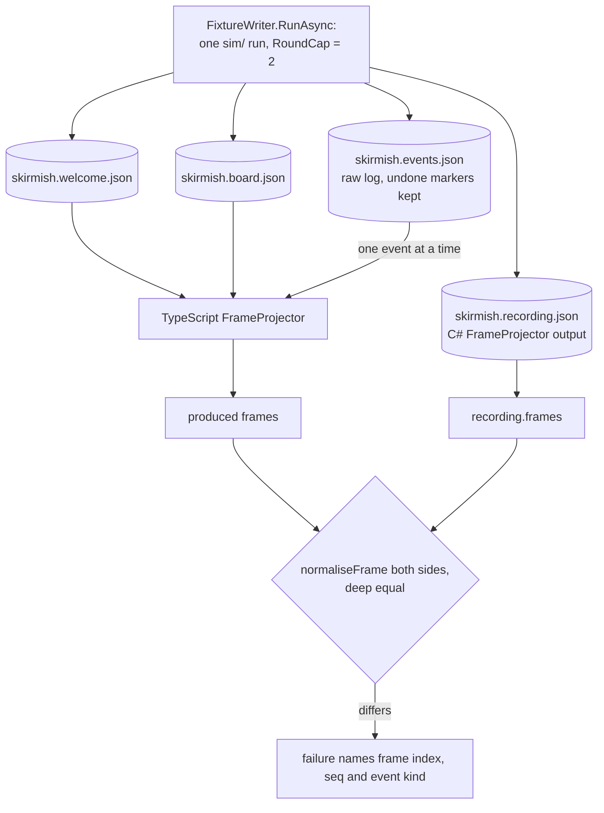

No separate C# projection dump exists, and none is needed. A recording's frames *are* the C#
`EventApplier`'s output, canonicalised by `FrameProjector`. The TypeScript side is handed the three
socket frames of a run and must reproduce every frame of that run's recording, field for field.
That compares a couple of hundred intermediate states rather than one final projection, and it
exercises the generated wire types, the ported applier, the ported log lines and the ported board
projection in one pass. It is also an end-to-end test of the live feed's decoding, because those are
the bytes the socket sends.

`normaliseFrame` sorts collections by id on both sides and sorts string arrays. C# `Dictionary`
enumeration order and JavaScript `Map` insertion order can diverge once an entry is removed and
another added, such as a marker taken off the table or an Ask closed, and C#'s `Order()` is
culture-sensitive where JavaScript's `sort()` is by code unit. Neither is a drift in the applier.
Everything else is compared exactly, including `line`.

`normaliseBoard` drops `polygons`, because the browser has no `ZoneStyles`. That exclusion could
hide an empty field on both sides, so the same test asserts against the C# recording directly:
every `recording.board.zones[i].polygons` must be non-empty and every ring must have more than two
vertices. The drop is then about what is ported, not about what resolved.

Frame comparison proves agreement on a valid log only. The two implementations diverge most cheaply
on an invalid one, where C# throws `ProjectionDesyncException` and the natural TypeScript spelling
spreads `undefined` and carries on. One event covers that gap on both sides: `marker_moved` naming a
marker nothing placed. `AgreementFixtureTests.The_csharp_applier_faults_on_an_id_the_projection_does_not_hold`
asserts the C# throw, and `agreement.test.ts`, *the two appliers fault the same way*, asserts
`ProjectionDesyncError` on the same event and that no marker was written. A typed fault on one side
against a quiet `undefined` on the other is not equivalence, whatever the frame count says.

A third case guards against a fixture that proves nothing: more than 20 frames, more than 5 distinct
event kinds, at least one frame with rolls, at least one with an open Ask, at least one with a model
on the table.

Fixtures are checked in and rewritten only under a flag. Ids are `Guid.CreateVersion7()` and differ
between runs, so a fixture cannot be regenerated and diffed against its predecessor.
`TABLETOP_WRITE_FIXTURES=1` rewrites them, every other run reads what is checked in, and both
scenarios run under a two-round cap so the eight files stay a few megabytes. A recording is 5 to 6 MB for an eight-round game, so a two-round recording is about 1.5 MB.

### Layout

Board on the left, a tabbed side panel on the right, the timeline across the bottom. The tabs are
`log`, `ask`, `dice` and `meta`, because the log is in constant use and the other three are
consulted at a specific frame. `LogPanel` renders one row per frame and clicking a row dispatches
`{ type: 'jump', seq, seqs }`.

Two things sit in the header, outside the tabs, because they are wanted continuously.
`SourcePicker.svelte` loads a file, a URL, or connects to a live game. `Scoreboard.svelte` shows the
round and one chip per team in ordinal order carrying its colour, its name, its score, and `active`
or `passed` when either applies. `RecordedFrame.Scores` and `RecordedFrame.Passed` are read straight
off the frame as whole state. `scores` is the schema's only dictionary and its Guid keys are
canonical lowercase strings, because neither option set sets a dictionary key policy, so
`frame.scores[team.id]` matches `RecordedTeam.Id` verbatim. `?? 0` covers a team the projection has
not scored for, which `noUncheckedIndexedAccess` makes visible.

The score is not geometry. `Scene` is unchanged by it.

## Key decisions

**(plan)** marks a decision stated in the plan and in no spec.

| Decision | Why | Alternative rejected | Source |
| --- | --- | --- | --- |
| `viewer/` is a fifth deliverable, not part of `web/` and not under `tests/` | `web/` owns preparation for players; a debugging surface for the engine author is a different audience | living in `web/`, or a fixture only xUnit can start | spec → *`sim/` is a fourth deliverable*, *`viewer/` is a developer web app* |
| The live feed manufactures `RecordedBoard` and `RecordedFrame[]` in the browser | one input shape below the feed abstraction; neither feed is privileged | a live feed with its own shape, branching every component on the feed | spec → *Two feeds*; plan → Architecture |
| The recording is a projection per event, not a log of events | a viewer given raw events would need an applier, and a second applier drifts | streaming events to the viewer for the recording feed too | spec → *The recording is the artifact* |
| The TypeScript applier exists anyway, for the live feed, and is checked rather than avoided | the socket carries events; there is no third option | a hand-maintained second applier | spec → *Two feeds* |
| Types generated by reflecting over `JsonTypeInfo`, not over C# properties | property names, union discriminators and enum spellings come from the serializer's own contract, so no JSON convention is reimplemented | reflection over records, which reimplements the naming policy and the discriminator rules | **(plan)** plan Task 2 → *Why `JsonTypeInfo`* |
| Generated files checked in, guarded by a test, not produced by a build step | `viewer/` needs no .NET SDK to build; drift is caught by the `dotnet test` every plan already runs | a codegen step in `npm run build`, or a `dotnet` invocation from Vite | plan Task 2, answering spec → *Still open* |
| The emitter lives in `tests/Tabletop.Viewer.Tests`, not in `viewer/` and not in a new directory | keeps `viewer/` a pure npm project and adds no top-level directory | a `tools/` project, or an MSBuild task | **(plan)** plan → *File Structure* |
| Canvas, not SVG | whole-state frames invalidate every model per step, so retained-mode diffing buys nothing; picking is a point test in inches | SVG, which pays layout for the whole document at pointer rate; WebGL and drawing libraries, which the workload does not need | plan Task 5; spec → *`viewer/` is a developer web app* |
| Playback only; `Feed.control` declared and `null` | building on the seam makes the viewer a second thin client | shipping interactive control in version one | spec → *Interactive debugging is a door, not a room* |
| The viewer watches as an admin, without joining | the viewer is an admin tool; an admin watches any game, finished or running; admin is a Stytch role carried in the session's `roles` claim | joining each game as a participant with no team | admin watch spec |
| A session JWT is the whole of the live feed's auth | the server matches the JWT's account against a `participant` row, admits an admin non-participant as a watcher, and answers anyone else `rejected: not_a_participant` | a spectator token, or a viewer-specific grant | admin watch spec → *The watcher* |
| Deployment-zone rings are resolved in C# and recorded | `ZoneStyles` is C# geometry and the frontline inset is absolute, so a browser cannot recover it from the shape id and the table size | porting `ZoneStyles`, a second geometry implementation | plan → *Interfaces needed*, item 1; simulation plan → *Applied from the viewer plan*, item 1 |
| A marker's definition rides on every frame state | a marker placed during play is in no board block, and the live feed writes the board before any event | a board block covering every marker that ever appears | simulation plan → *Applied from the viewer plan*, item 2 |
| A model with no position is listed, not drawn | inventing a position is the viewer deciding something | drawing it beside or on its container | spec → *Deliberately not decided* |
| Fixtures checked in, rewritten only under a flag, never diffed against a predecessor | ids are UUIDv7 and differ between runs, so two recordings are never byte-comparable | generating fixtures on demand, which makes `npm test` need a .NET SDK to have run first | plan ruling 2; spec → *The seed is stored* |
| Agreement compares every frame, not final projections | localises a ported branch to one event; needs no extra export | comparing the last projection only | plan Task 10; spec → *Two feeds* |
| Plain Vite and Svelte 5, no SvelteKit | one screen, no redirect target, no route to split, no server-side anything; `?recording=<url>` needs no router | SvelteKit, which `web/` uses for Stytch redirect paths and code splitting | **(plan)** plan Task 1 |
| The resolution frame stack is not ported | no field of a `RecordedFrame` reads it; the C# recording does not show a reroll in `rolls` either | porting `Projection.Stack` for six no-op event kinds | **(plan)** plan Task 9 |
| The score and the passed teams live in the header, not in a tab | the score is wanted continuously and must not cost a tab change | a fifth tab, or drawing them on the board | **(plan)** plan Task 8, ruling 5 |
| `at_rest` is pruned out of the generated wire union | the viewer republishes on every `EventsMessage` and has no quiet window to replace, so a rest signal changes nothing it draws; the generated surface stays the smallest thing the live feed reads | declaring the kind, which moves the golden file and adds a declaration with no reader | plan Task 2 |
| An unrecognised wire kind is dropped by a membership test, not by a `switch` on a closed union | the union in TypeScript is a pruned seven of thirteen, so the set of kinds actually read is the authority; the protocol grows without an edit here | narrowing on the generated union alone, which faults on a kind it cannot name | **(plan)** plan Task 11 |
| The TypeScript applier throws `ProjectionDesyncError` where the C# throws `ProjectionDesyncException` | written with `!`, the port would spread `undefined` into a fresh marker and diverge silently; the agreement test would still pass | a `!` per lookup, or skipping the change and carrying on | plan Task 9 |
| A desync stops the live feed and the operator reconnects | the tool exists to make server behaviour visible, and the connect sequence redelivers the whole log | an automatic reconnect loop, which repairs the symptom and hides the fault | **(plan)** plan Task 11 |
| `CLIENT_VERSION` is the literal `1`, not generated | `Connect.ClientVersion` is one integer, not worth a second emitter mode; the protocol version stays `1`, because a thirteenth message kind is additive | generating a constant from `ProtocolVersion.Current` | **(plan)** plan → *Interfaces needed*, item 6 |
| Rendering is checked by looking at it | headless Chrome cannot launch in this WSL image (`handoff.md`: missing `libnspr4`) | Playwright or jsdom snapshots | spec → *Testing*; plan ruling 1 |

## Interfaces

`RO<T>` abbreviates `readonly T[]`.

### Produced: `viewer/src/lib/`

| Module | Exports |
| --- | --- |
| `protocol/recording.generated.ts` | `SCHEMA_VERSION`, and one interface per recording type: `Recording`, `RecordingMeta`, `RecordedTeam`, `RecordedBoard`, `RecordedTerrain`, `RecordedVolume`, `RecordedMarker`, `RecordedZone`, `RecordedPoint`, `RecordedModel`, `RecordedFrame`, `RecordedModelState`, `RecordedUnitState`, `RecordedMarkerState`, `RecordedAsk`, `RecordedAskOption`, `RecordedRoll`, `RecordedModifier` |
| `protocol/wire.generated.ts` | `SocketMessage = Connect \| Welcome \| GameInfoMessage \| BoardMessage \| EventsMessage \| Refused \| Rejected`, seven of the wire's thirteen kinds, and the transitive closure: `GameInfo`, `Board`, `GameEvent`, `EventPayload`, `StateChange`, `Location`, `Ask`, `LegalSet`, `AskAnswer`, `Unit`, `ModelSlot`, `Marker`, `Grant`, `RollRecord`, `Die`, `TerrainPlacement`, `Volume`, `Footprint`, `Base`, `Point2`, `Point3`, `Yaw`, `Placement`, and the enums |
| `recording/read.ts` | `class RecordingError`, `readRecording(unknown): Recording`, `parseRecording(string): Recording`, `teamOrdinals(Recording)`, `teamNames(Recording)` |
| `recording/source.ts` | `type RecordingSource`, `fromFile(File)`, `fromUrl(string)`, `recordingUrlFrom(search): string \| null` |
| `board/transform.ts` | `type Point`, `type Table`, `type Viewport`, `type View`, `MARGIN`, `fit`, `toScreen`, `toTable`, `zoomAt`, `panBy`, `gridStep`, `rotate` |
| `board/palette.ts` | `TEAM_COLOURS`, `teamColour(number)`, `DECLARATIONS`, `declarationColour`, `terrainStroke`, `markerColour` |
| `board/frame.ts` | `type Shape`, `OVAL_VERTICES`, `type ModelShape`, `type TerrainShape`, `type MarkerShape`, `type ZoneShape`, `type OffTable`, `type Scene`, `sceneOf(RecordedBoard, RecordedFrame): Scene`, `baseOutline`, `volumeOutline` |
| `board/pick.ts` | `type Hit`, `contains(Shape, Point)`, `pickAt(Scene, Point): Hit \| null` |
| `board/draw.ts` | `type DrawOptions`, `draw(ctx, Scene, View, Viewport, DrawOptions)` |
| `timeline/timeline.ts` | `type Timeline`, `EMPTY`, `type TimelineAction`, `reduce`, `indexOfSeq`, `frameOf` |
| `asks/describe.ts` | `type Addressee`, `type AskView`, `describeAsk`, `describeLegal`, `humanise` |
| `feed/feed.ts` | `type FeedStatus`, `type FeedState`, `IDLE`, `type ControlChannel`, `interface Feed`, `class Emitter` |
| `feed/recordingFeed.ts` | `recordingFeed(RecordingSource): Feed` |
| `feed/liveFeed.ts` | `CLIENT_VERSION`, `type SocketLike`, `type LiveOptions`, `liveFeed(LiveOptions, open?): Feed`, `isServerFrame` |
| `live/apply.ts` | `type UnitInPlay`, `type ModelInPlay`, `type SchedulerPosition`, `type OpenAsk`, `type Projection`, `class ProjectionDesyncError` with `kind` and `unknownId`, `initialProjection`, `applyChange`, `applyTo`, `effectiveLog`, `class Applier` |
| `live/logLines.ts` | `lineOf(GameEvent, Projection, ReadonlyMap<string,number>): string`, `shortId` |
| `live/project.ts` | `declarationsOf(string)`, `recordedBoardOf(Board, GameInfo): RecordedBoard`, `class FrameProjector` |
| `live/management.ts` | `class ManagementError` with `status`, `type Session`, `logIn(email, password, base?)`, `refreshSession(jwt, base?)` |
| `hosted/hosted.ts` | `WEB_SESSION_KEY`, `type ViewerConfig`, `configOf(env, location)`, `readWebSession`, `writeWebSession`, `rolesOf`, `type Access`, `accessOf`, `signInHref`, `hostedSession(storage, refresh)` |
| `components/` | `Board.svelte`, `Timeline.svelte`, `LogPanel.svelte`, `AskPanel.svelte`, `RollPanel.svelte`, `SourcePicker.svelte`, `Scoreboard.svelte` |

### Produced: `tests/Tabletop.Viewer.Tests`

| Type | Members |
| --- | --- |
| `static class RepoPaths` | `string Root`, `string Viewer`, `string Generated`, `string Fixtures` |
| `sealed record EmitRequest(string Module, JsonSerializerOptions Options, IReadOnlyList<Type> Roots, IReadOnlyDictionary<Type, IReadOnlyList<Type>> PrunedUnions, IReadOnlyDictionary<Type, string> Rename)` | |
| `static class TypeScriptEmitter` | `string Emit(EmitRequest)`, with the converter map for `VisualRef` |
| `sealed record Fixture(string Name, Recording Recording, IReadOnlyList<GameEvent> Log, GameInfo Game, Board Board, Guid RecorderParticipantId)` | |
| `static class FixtureWriter` | `string[] FixtureNames`, `Task<Fixture> RunAsync(Scenario, CancellationToken)`, `Task WriteAsync(Fixture, string directory, CancellationToken)` |
| `GeneratedTypesTests`, `AgreementFixtureTests` | the two golden guards; `TABLETOP_WRITE_GENERATED=1` and `TABLETOP_WRITE_FIXTURES=1` rewrite |

### Consumed

| From | Member | Used for |
| --- | --- | --- |
| `sim/` | `Recording`, `RecordingMeta`, `RecordedBoard`, `RecordedFrame`, and every other `Recorded*` record | the one input shape, emitted as TypeScript |
| `sim/` | `RecordingJson.SchemaVersion`, `.Options`, `.Serialize`, `.Deserialize`, `.WriteAsync`, `.ReadAsync` | the schema gate and the fixture writer |
| `sim/` | `RunLoop.BuildRecording(RunReport)`, `RunLoop.Log`, `RunSettings()` (members `MaxSteps`, `FrameDumpOnFailure`, `CheckInvariants`, `Record`), `RunReport` | the fixture writer's run |
| `sim/` | `InProcessDriver.StartAsync`, `.Info`, `.Board`; `CompiledScenario.RecorderParticipantId`; `ScenarioCatalog.Get`; `ScenarioCompiler.Compile`; `Scenario` as a `record` supporting `with { RoundCap = 2 }` | the fixture writer's run |
| `sim/` | `Chooser(ulong)`, `HandPlacement.ChooserFor(ulong)`, `AnswerPolicy(Chooser, PolicyOptions?)`, `ComposedAnswers(AnswerScript, AnswerPolicy?)` | the fixture writer's answers |
| `libs/Tabletop.Protocol` | `WireJson.Options`, `SocketMessage`, `Connect`, `Welcome`, `GameInfoMessage`, `BoardMessage`, `EventsMessage`, `Refused`, `Rejected` | the emitted wire subset |
| `libs/Tabletop.Protocol` | `EventApplier`, `ProjectionDesyncException`, `Projection`, `StateChange`, `EventPayload` | the C# original the TypeScript port copies, including the fault on an unknown id |
| `libs/Tabletop.Protocol` | `GameEvent`, `MarkerMoved`, `MarkerRemoved`, `Point3`, `Yaw` | the one event both appliers are faulted on |
| `libs/Tabletop.Geometry` | `Bodies.BaseOutline`, `Bodies.OvalVertices`, `WorldVolumes.WorldOutline`, `Point2.Rotate`, `Polygon.Contains` | ported by hand into `board/frame.ts`, `board/transform.ts`, `board/pick.ts` |
| `server/game/` | the connect sequence: `Connect` first within 10 s, then `Welcome`, `BoardMessage` from `setup` on, `EventsMessage` batches, then live frames | `liveFeed.ts` |
| `server/management/` | `POST /v1/auth/password`, `POST /v1/auth/session/refresh`, each answering a body with `sessionJwt` | `management.ts` |
| `server/management/` | `GET /v1/games` (keyset pages of `GameSummary`: `id`, `name`, `status`, `createdAt`, `participantNames`) | `games.ts` |

### Required of others

| Of | What | State |
| --- | --- | --- |
| simulation plan | `RecordedZone.Polygons` as `IReadOnlyList<IReadOnlyList<RecordedPoint>>`, resolved by `ZoneStyles.Resolve` | in the schema; that plan's *Applied from the viewer plan*, item 1 |
| simulation plan | `RecordedMarkerState.Kind`, `.Diameter`, `.Label`, positionally before `X` | in the schema; that plan's *Applied from the viewer plan*, item 2 |
| simulation plan | `RecordedFrame.Scores` and `.Passed`, whole rather than deltas | in the schema; that plan's *Applied from the viewer plan*, item 3 |
| simulation plan | every name the fixture writer touches is `public`, and `sim/` references no test project | already true; stated in that plan's *Interfaces → Produces* |
| contracts plan | no two reachable types in the `SocketMessage` closure share a `Name` | assumed; the one candidate is `Placement`, and the fix is one `EmitRequest.Rename` entry |
| contracts plan | `ProtocolVersion.Current` stays `1`, or `liveFeed.ts` is edited | assumed; a thirteenth message kind is additive and leaves it at `1` |
| contracts plan | `EventApplier` throws `ProjectionDesyncException` on an id the projection does not hold | stated there; the type is named in one `Assert.Throws` and ported as `ProjectionDesyncError` |
| contracts plan | `AtRest(long Seq)` is `SocketMessage`'s thirteenth kind, `at_rest` | stated there; nothing here reads it |
| management plan | both auth routes answer a body carrying `sessionJwt` | assumed; the rest of `SessionResponse` is not read |

## Sequences

### Loading a recording and scrubbing

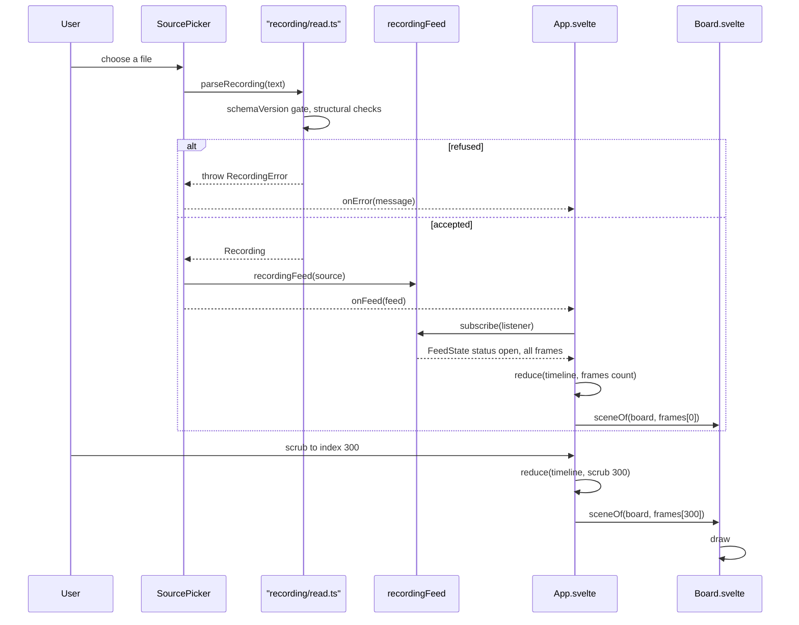

`recordingFeed` emits once, on subscribe, and never again until `close`. A scrub reads one frame and
recomputes one `Scene`. Nothing accumulates.

### The live connect sequence

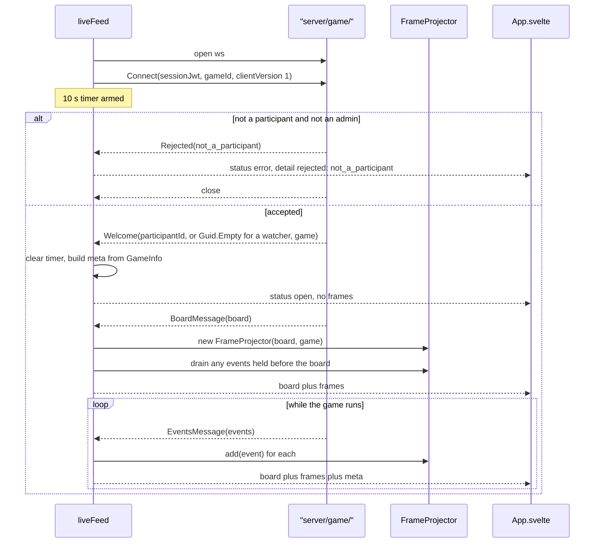

The socket also carries kinds the viewer never acts on: `presence`, `ping`, `presence_ended` and
`at_rest`. `isServerFrame` tests membership of the `HANDLED` set of six server kinds, and the
`switch` ends in a `default` that returns. An unrecognised kind therefore costs one lookup and never
a fault. `at_rest` is pruned out of `wire.generated.ts`, so it arrives as a kind the generated union
does not declare, which is the case that path exists to survive. A viewer that threw on an
unrecognised kind would die the next time the protocol grew one.

Three orderings matter. Events can arrive before the board, so `liveFeed` holds them in `pending`
and drains on the `board` frame. A game ended before setup ever ran has no `table_state` row and no
log, so `Welcome` is the whole sequence and status stays `open` with nothing to draw. A failure is
final. `fail()` returns at once if the feed has already failed, so the first error is kept. It closes
the socket once, and frames that arrive after a failure are ignored. `close()` and the socket's
`close` event together emit `closed` once. A `Rejected` fails the feed, and the close that follows
it does not overwrite the error.

### One event becoming one frame

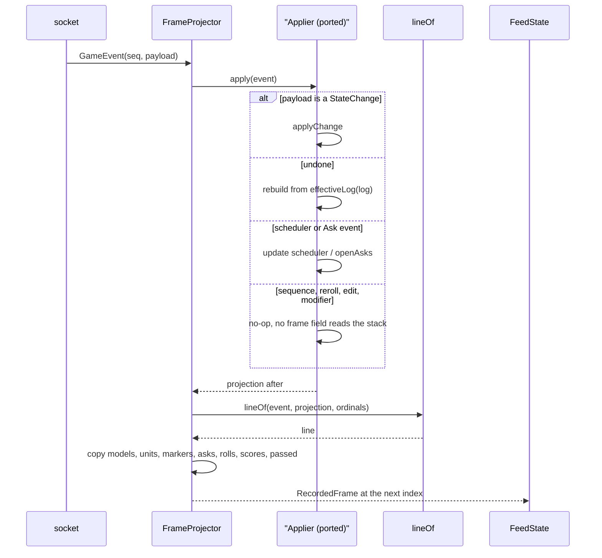

Every collection is copied rather than aliased. The applier keeps mutating its maps and every frame
is kept for the whole run.

### Regenerating the protocol modules

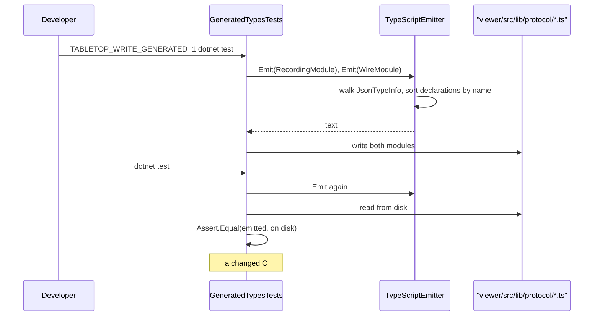

A C# record change that nobody regenerates fails `dotnet test`, never `npm test`. The failure names
the module, not the field, so the diff is read from git.

## State and data

**Nothing is persisted.** The viewer writes no file, sets no cookie, uses no `localStorage` and
registers no service worker. Reloading the page loses the loaded recording, which is correct for a
file the developer has on disk. `?recording=<url>` is the only thing that survives a reload, and it
is read once from `location.search`.

**In memory, per feed.**

| Held by | State | Lifetime |
| --- | --- | --- |
| `Emitter` | the current `FeedState`, one `Set` of listeners | the feed |
| `recordingFeed` | nothing beyond the `Emitter` | the feed |
| `liveFeed` | `game`, `projector`, `pending`, `welcomed`, `failed`, `closedOnce`, one timeout handle | the socket |
| `FrameProjector` | the ported `Projection` plus every `RecordedFrame` produced so far | the socket |
| `App.svelte` | `feed` and `feedState` (both `$state.raw`, reassigned and never mutated), `timeline`, `error`, `selected`, `tab`, three visibility flags | the page |
| `Board.svelte` | `canvas`, `box`, `view`, `hovered`, `dragging`, `downAt` | the component |

`view` is `null` until the user zooms or pans, and `fit(scene.table, box)` is derived until then, so
`Reset view` is one assignment. `view` also resets when the table's width or length changes, because
a new table makes the old pan and zoom meaningless. `downAt` records where the pointer went down,
so a click is told from a pan by distance moved since the press and not since the last move.
`pointercancel` ends a drag without a pick, and `pointerleave` clears the hover.

`App.svelte` names its feed state `feedState`, because `state` collides with the `$state` rune. The
header renders `feedState.detail` beside the status, so a rejection or a desync shows its reason.

**Rebuilt rather than stored.** The live feed's whole frame list is rebuilt by replaying events. An
`undone` event rebuilds the projection from the effective log. `Scene` is recomputed from
`(board, frame)` on every frame change and is never cached.

### The feed lifecycle

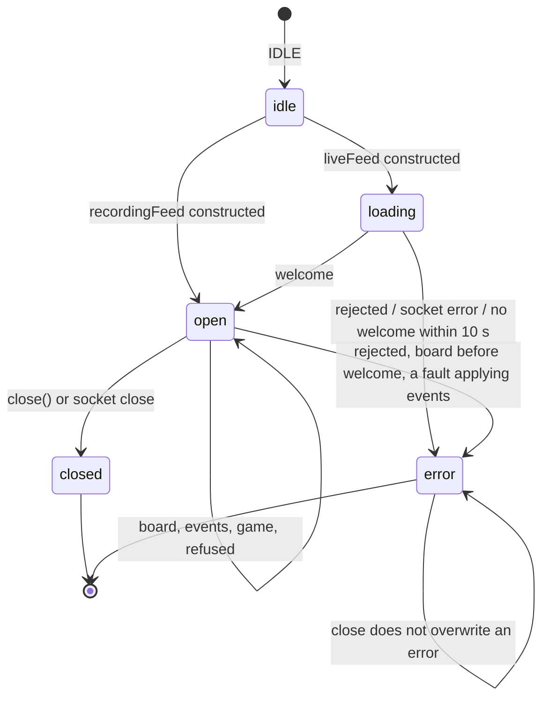

`refused` sets `detail` and leaves `status` at `open`, because a refusal is per-message and the feed
survives it. `rejected` is terminal and is followed by a server close.

## Failure modes

**A malformed or stale recording.** `readRecording` refuses with a `RecordingError` naming what is
wrong: the schema version, the missing key, the frame whose `index` is not its position, the frame
naming a model the board does not define. The message says to re-run `sim/`. Nothing is repaired and
nothing is drawn partially.

**A schema change nobody regenerated.** `dotnet test tests/Tabletop.Viewer.Tests` fails on the
golden file. `npm test` and `npm run build` keep passing against the stale checked-in modules, so a
developer working only in `viewer/` will not see it until CI or a full `dotnet test` runs. That is
the cost of not making it a build step.

**The two appliers diverging.** `agreement.test.ts` fails on the first frame that differs, naming
its index, its seq and its event kind. The divergence a normalisation could hide is collection order
only. The one field excluded from the comparison is `polygons`, and the same test asserts the C#
side resolved non-empty rings so the exclusion cannot cover an empty field on both sides.

**A desync.** An event names an id the projection does not hold. `FrameProjector.add` throws
`ProjectionDesyncError`, `drain` drops the projector and the pending events, and
the feed goes to `status: 'error'` naming the event kind and the id. Any other error thrown while
applying events fails the feed the same way with `String(error)` as the detail. Later frames change
nothing, because the message handler ignores every frame once the feed has failed. The operator reconnects from the
source picker, which rebuilds from the redelivered log. The designed feature that reaches this is
editing the dice of a popped frame.

**Ordering in the live feed.** Events before the board are held and drained. A `board` frame before
a `welcome` is an error, because the projector needs `GameInfo` for team ordinals. A `game` frame
arriving after teams change does not rebuild the board, so a team created mid-game does not
recolour existing models. Lobby edits are refused from `playing` on, so it cannot happen in a
watched game.

**Stale subscriptions.** A `liveFeed`'s socket `close` event is asynchronous, so a listener left
attached across a swap can fire after the new feed is attached and overwrite `feedState` with the old
feed's frames. The case is switching away from a live feed. `attachFeed` owns the order: it drops the
old listener, closes the old feed, subscribes to the new one and returns the new unsubscribe function.
`App.svelte` holds that function and passes it back on the next swap and on teardown.

**Cost per live frame.** `publish()` copies the whole frame array, builds a fresh `RecordingMeta`
and notifies every subscriber, on every `EventsMessage`. `App.svelte` then recomputes `seqs` over
every frame. A long unattended game pays quadratic work in the number of events. A recording of an
eight-round game is 5 to 6 MB of indented JSON, which the browser parses once on load. The
recording feed publishes once, so it is unaffected and only a long-lived live socket is exposed.

**No reconnect.** A dropped socket sets `closed` and the user reconnects by hand. The JWT is
verified once at connect, so nothing refreshes it on an open socket. The source picker never writes
a logged-in token back into the JWT field. A pasted JWT is used as given, and with an email and
password filled in every connect logs in afresh, because a session JWT lasts five minutes and
reusing one would break the reconnect after a desync. A second socket for the same participant closes the first with code `1000`, which
the viewer reports as a plain close.

**Left to break.** A recording whose `meta.gameRules` or `meta.propertiesHash` the viewer has never
seen is drawn anyway, because the viewer holds no ruleset and nothing it draws depends on one. Only
`schemaVersion` gates a file. A live game shows no deployment-zone outlines. `CLIENT_VERSION` is
hard-coded, so a protocol bump makes the server answer `rejected: upgrade_required` until the
constant is edited. `ProtocolVersion.Current` is `1` with `at_rest` declared,
because a thirteenth `SocketMessage` kind is additive and a client that ignores it stays compatible.
None of these has a mechanism behind it.

## Testing

Two suites in two languages. `npm test` is Vitest in a Node environment over `viewer/tests/**`, and
needs no .NET SDK, no Docker and no server. `dotnet test tests/Tabletop.Viewer.Tests` is xUnit and
needs a build of `sim/` and `libs/Tabletop.Protocol`.

| Suite | Files | What it pins |
| --- | --- | --- |
| Vitest, pure modules | `read.test.ts`, `transform.test.ts`, `frame.test.ts`, `pick.test.ts`, `timeline.test.ts`, `describe.test.ts` | the schema gate and every refusal; the single `y` flip, the zoom anchor and the grid step ladder; the ported base and volume outlines against hand-computed corners; boundary-inclusive containment and last-drawn-wins picking; the eleven timeline actions including `follow`; every legal kind and the note list |
| Vitest, feeds | `feed.test.ts`, `live.test.ts` | one emission and a null control channel; the connect frame and that it is the only frame sent; events before the board, an empty events frame, a rejection, a refusal, ignored frames including `at_rest` and an invented kind, a desync going to error, any other fault applying events going to error, the first error kept, `closed` emitted once, a feed that cannot clobber its replacement and the 10-second timeout |
| Vitest, hosted build | `hosted.test.ts` | the two configs (socket from the page origin, no runner); reading and writing back `tabletop.session`, a blocked store; roles as a list or one id; admin, not admin, signed out; the sign-in link; a refreshed token judged and stored, a refused refresh signed out, a 429, 5xx or network failure passed on |
| Vitest, the port | `apply.test.ts`, `agreement.test.ts` | all thirteen state changes, the four scheduler events, the Ask lifecycle, the reroll, edit and modifier no-ops, undo by rebuild, `ProjectionDesyncError` on an unknown unit, model, marker or Ask id; then every frame of two real recordings, field for field, and the shared desync case |
| xUnit | `GeneratedTypesTests`, `AgreementFixtureTests` | the two generated modules are what the C# emits today, including `RecordedMarkerState`'s member order and the absence of `AtRest`; the fixtures exist, round-trip and satisfy the same invariants `read.ts` enforces, and their events replayed through the C# `FrameProjector` reproduce the recorded board and every frame; the C# applier throws `ProjectionDesyncException` on the event the TypeScript one throws on |
| By hand | the page | the board, the zones, the terrain declarations, the team colours, the facing ticks, the scoreboard, play, step, scrub, and a live game watched while `sim/` plays it |

**Nothing needs Docker.** `sim/`'s in-process driver has no Postgres, so the fixture writer runs a
whole game in memory. The socket driver and its Postgres are `sim/`'s concern.

**The gaps.**

1. The rendering has no automated test. `draw.ts` is exercised by nothing but the eye. The spec says
   the rendering is checked by looking at it, and headless Chrome cannot launch in this WSL image.
   The cheapest pin would be a Node canvas shim producing a PNG per fixture frame and a byte
   comparison, which adds a native dependency.
2. The Svelte components have no test. `svelte-check` is the only automated check on them.
3. `Connect` is sent as an object literal rather than as a typed `Connect`, so the one message the
   viewer produces is not checked against the generated type.
4. `management.ts` has no test. It is two `fetch` calls reading one property.
5. The live feed is only tested against a fake socket carrying fixture bytes. The real handshake,
   the reconnect close code and the presence frames are exercised by hand.

## Rulings and deferred work

### Rulings

The plan's five rulings ([closing the open questions](../../superpowers/specs/2026-09-09-open-questions-design.md)), numbered as the plan numbers them.

| # | Ruling | Reason |
| --- | --- | --- |
| 1 | The rendering is checked by looking at it, not pinned by a headless browser test | spec → *Testing*; headless Chrome cannot launch in this WSL image (missing `libnspr4`). The cheapest pin would be a Node canvas shim, a PNG per fixture frame and a byte comparison, which adds a native dependency to `viewer/` |
| 2 | Two checked-in fixtures, `skirmish` and `terrain`, at a two-round cap: eight files, a few megabytes | generating on demand would make the agreement test require a prior `dotnet test`, and `npm test` alone would stop being a complete check |
| 3 | The viewer does not fetch a recording from a server; `?recording=<url>` covers a static file server | a recording is a `sim/` artifact on the developer's filesystem, and neither server knows the concept; an endpoint would be another module's concern |
| 4 | The viewer does not refuse an unknown `meta.gameRules` or `meta.propertiesHash`; only `schemaVersion` gates a file, and both values are shown in the meta panel | the viewer holds no ruleset and has no source for a list of known rulesets |
| 5 | A tabbed side panel, with the source picker and the scoreboard exempt in the header | the log is in constant use and the other three panels are consulted at a specific frame; the score is wanted continuously. Stacking all four would make `App.svelte`'s right pane a scrolling column and move nothing else |

### Answered from the specs

The spec's *Still open* section carries two answers this module gives. Generated types are checked
in and guarded by a test rather than produced by a build step. The live feed needs no authentication
beyond a session JWT, because the game server already answers "may this account watch" as "has this
account joined". Its *Deliberately not decided* section carries a third, a model inside a container
is listed rather than drawn, and the canvas-over-SVG argument sits under *`viewer/` is a developer
web app*.

A recording carries the dice, not only their result (simulation plan), and `RollPanel.svelte` shows
raw and modified faces with the net modifier.

A frame's `rolls` is a list because a step may hold more than one. The ruleset splits a roll
wherever its dice do not share a threshold: OPR's `roll-to-hit` takes one pool per Quality value
the attacking models bring, since rulebook p.4 tests each attack against *"the model's Quality
value"* and a joined hero brings its own. `RollPanel.svelte` renders a section per roll with its
threshold in the heading, so the pools read apart, and the ported log line prints each pool's
threshold for the same reason.

### Deferred

| Deferred | Reason | Recorded in |
| --- | --- | --- |
| Interactive control from the browser | it makes the viewer a second thin client | spec → *Interactive debugging is a door, not a room*; the null `ControlChannel` |
| Drawing a badge on a container for the models inside it | needs no schema change and is a refinement | deferred by the plan |
| Deployment zones on the live feed | needs `ZoneStyles` in the browser or a resolved-zone message | plan → *Interfaces needed*, item 1 |
| A generated `CLIENT_VERSION` | one integer is not worth a second emitter mode | plan → *Interfaces needed*, item 6 |
| An idle indicator driven by `at_rest` | the frame is pruned out of the generated union, and nothing the viewer draws depends on the server being idle | plan Task 2 |
| An automatic reconnect after a desync | a retry loop would hide the fault the tool exists to show | plan Task 11 |
| Serving recordings from a server | neither server has the concept | plan ruling 3 |

## References

### Specs

| Spec | What this module takes from it |
| --- | --- |
| [`2026-09-06-simulation-design.md`](../../superpowers/specs/2026-09-06-simulation-design.md) | primary: the recording as a projection per event, `viewer/` as a fifth deliverable separate from `web/`, the two feeds, interactive debugging as a door, what is tested |
| [`2026-10-09-admin-watch-design.md`](../../superpowers/specs/2026-10-09-admin-watch-design.md) | the viewer as an admin tool: one login, the game list, watching any game as an admin watcher |
| [`2026-09-04-whole-design-review.md`](../../superpowers/specs/2026-09-04-whole-design-review.md) | a participant with no team is a spectator |
| [`2026-08-30-presence-design.md`](../../superpowers/specs/2026-08-30-presence-design.md) | a participant with no team is never addressed by an Ask, which is what a spectator is |
| [`2026-08-29-setup-content-design.md`](../../superpowers/specs/2026-08-29-setup-content-design.md) | the closed seven terrain declarations the palette colours |
| [`2026-08-29-geometry-values-design.md`](../../superpowers/specs/2026-08-29-geometry-values-design.md) | the corner frame, yaw 0 facing `+y`, base shapes |
| [`2026-08-29-web-app-design.md`](../../superpowers/specs/2026-08-29-web-app-design.md) | the Svelte, Vite and Vitest versions only; no code is shared |
| [`docs/architecture.md`](../../architecture.md) | the command/event spine, the applier as rules-free and run on both sides, one world unit is one inch |

### Sibling modules read for their seams

- [simulation](../simulation/design.md): the recording schema, owned there and consumed here; the step-and-wait seam this module
  deliberately does not reach.
- [contracts](../contracts/design.md): `SocketMessage`, `EventApplier`, `WireJson`.
- [game server](../game-server/design.md): the connect sequence, the frame order, the rejection cases.
- [geometry](../geometry/design.md): `Bodies.BaseOutline`, `WorldVolumes.WorldOutline`, `Point2.Rotate`, `Polygon.Contains`.
- [management API](../management-api/design.md): `POST /v1/auth/password`, `POST /v1/auth/session/refresh`.

### Rulebook

No page of Grimdark Future v3.5.1 is read by this module. The one rules fact it depends on, that
OPR's frontline zone is an absolute twelve-inch inset rather than a fraction of the table, reaches
it as resolved `RecordedPoint` rings in `RecordedZone.Polygons`.

### Sibling design documents

- `docs/design/contracts/`: `Tabletop.Protocol`'s `SocketMessage`, `EventPayload`, `StateChange`,
  `Ask`, `LegalSet`, and `EventApplier`, which `src/lib/live/apply.ts` ports.
- `docs/design/geometry/`: the corner frame and the two outline functions ported here.
- `docs/design/game-server/`: the socket, the connect sequence, the admin watcher.
- `docs/design/management-api/`: the two auth routes, the `roles` claim, `GET /v1/games`.
- `docs/design/web-app/`: the Svelte and Vite conventions; no code edge to this module.
- `docs/design/client/`, `docs/design/interpreter/`, `docs/design/scheduler/`: no edge.
