# Web app

`web/` is the Svelte SPA that owns **preparation**: login, the account, armies imported from
Army Forge, mesh binding per model slot, base shape and height per slot, the asset library with
nested folders, terrain collision volumes, and conversion of a print-ready STL into a
game-ready GLB in the browser before upload. It owns **no game concepts**: it never calls
`/v1/games*`, `/v1/layouts` or `/v1/properties`, holds no rules, and has no socket. The
converter *proposes* scale, orientation and the modelled base. The user *confirms* them in a
preview where the mesh stands on a ring of its base, and everything written to the asset row is
derived from the **confirmed** values, including the terrain bounding-box volume.

## Scope

**In.** The whole of `web/`: a SvelteKit 2 / Svelte 5 application built by
`@sveltejs/adapter-static` into a client-side SPA; one typed HTTP client over management's
`/v1`; session storage and refresh; the mm-to-inch edge and the base presets; the STL-to-GLB
pipeline (parse, merge, weld, decimate, creased normals, guesses, support detection, GLB
export) with its Web Worker wrapper; the three.js preview and top-down volume editor; the
presigned upload sequence; the library, folder and army screens. Plus `scripts/web` and the
`CLAUDE.md` edits that record the module.

**Not in.**

| Not here | Where instead | Why |
| --- | --- | --- |
| Games, the game browser, joining, setup, play | `client/` | The line is preparation versus play (web app spec) |
| Layouts, `GET /v1/properties` | client shell | Both are play-side; layouts are a setup draft |
| Any rule, stat interpretation or dice | `server/game/` | The load-bearing seam: rules exist exactly once |
| Army Forge fetching and parsing | management, `ArmyForgeImport` | One parser, no CORS, format changes are a server deploy |
| Triangle counting for the upload warning | management, `GlbHeader.CountTriangles` | A ranged read of the GLB's JSON chunk, server-side |
| Support *removal* | nowhere, ever | Not reliably possible (mesh conversion spec) |
| Renaming a unit or a model slot | nowhere | Names are the list's; `UnitPatch`/`SlotPatch` have no `Name?` |
| A `Tabletop-Client-Version` header | client only | An SPA fetched on every load cannot be months behind |
| Server-side rendering, `load` on a server, a Node runtime | — | `ssr = false`, `prerender = false`, `index.html` fallback |

**Where the code lands.** Everything under `web/`, plus `scripts/web`. `web/` is a deliverable
and shares no code with the .NET projects: nothing under it is referenced by `Tabletop.sln`,
and the DTOs in `src/lib/api/types.ts` are the management plan's records re-declared in
TypeScript, camelCased, by hand. That duplication is accepted (`architecture.md` → Repository
layout). It is the module's largest drift risk.

**What already exists.** Nothing. `web/` is absent. `client/` is a scaffold. `libs/`,
`server/game/` and `server/management/` are empty. The module starts from `npm create`.

**Build order.** `architecture.md` puts the management API and the web app together at step 3,
after contracts (step 1) and alongside geometry (step 2). The web app starts after
`2026-09-05-contracts-and-local-dev.md` (the `Tabletop.Content` and `Tabletop.Geometry` JSON
shapes, the compose stack with Postgres and MinIO) and after `2026-09-05-management-api.md` is
far enough along to answer `/v1`. Tasks 4, 5, 13 and 15 run the SPA against a live management
on `:5100` and MinIO on `:9000`. Tasks 1–3 and 6–10 are the pure modules and need nothing but
Node 24.

## Context

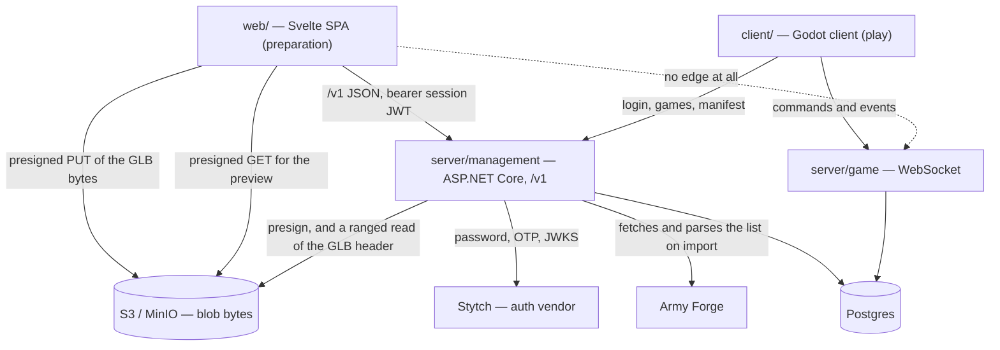

*The web app's only outbound edges are management's `/v1` and S3.*

**Management is the only API.** Every request goes to `/v1` as the management plan's
*Interfaces → Produces → HTTP surface* table lists it. JSON is camelCase with snake_case string
enums and omitted nulls (`ContentJson.Configure`). Errors are `application/problem+json`. Lists
are `Page<T>(items, next)` paged by `?limit=&after=`. Another owner's row is `404`, never `403`.
The SPA sends no version header. The check exists for a downloaded desktop application that can
be months behind, and management accepts a missing header.

**S3 is reached directly, and only for bytes.** Upload is a presigned `PUT` issued by
`POST /v1/assets`. Preview download is a presigned `GET` from `GET /v1/assets/{id}/download`.
No AWS credential reaches the browser, and no `.glb` is streamed through management. Both calls
are cross-origin to the SPA, so MinIO's CORS (default `*`) and management's CORS for
`TABLETOP_WEB_URL` are both load-bearing. In development a Vite proxy makes `/v1` same-origin,
so the CORS path is only exercised in a built deployment with `PUBLIC_API_BASE` set.

**Stytch is confined to management.** The browser holds a Stytch *session JWT* and nothing
else. No project id, no secret, no method identifier beyond the opaque `methodId` an OTP send
returns. The JWT carries our own `Account.id` as a custom claim, so the browser never learns a
Stytch identifier. `/reset-password` is the one page whose URL is registered with the vendor,
because Stytch mails the link. That page reads `?token=` and hands it straight back to
management.

**The seam with the client is behavioural, not code.** The client shell has its own login form
and its own refresh loop. It may copy the behaviour described here (refresh once a minute, sign
out on `401`) and must not share the code. Nothing crosses from browser to client at runtime:
no loopback listener, no device code, no session handoff. There is no social login and no
magic link, so nothing needs a redirect target and no handoff exists.

## Design

### 1. Preparation versus play

The module is organised by one line the web-app spec draws: the browser is where a user
prepares, the client is where they play. The line is enforced by omission, not by a guard.
`src/lib/api/client.ts` has an `auth`, `account`, `assets`, `folders` and `armies` group and no
others. There is no `games`, `layouts` or `properties` function to call, so a page cannot reach
play-side state by accident.

The browser owns preparation and owns login, because you cannot play without an army and
armies are made in the browser. There is no social login and no magic link, so nothing needs a
redirect and there is no browser-to-client handoff. Login therefore lives in both places, each
with its own form, and neither is a fallback for the other.

Two consequences shape the code. First, the web app holds no game concept, so it needs no
projection, no event applier, and no `Tabletop.Protocol` equivalent. The only types it needs
are `Tabletop.Content`'s army shape and `Tabletop.Geometry`'s value shapes, both of which
arrive as JSON. Second, an embedded webview in the client was rejected: it does not remove a UI
stack, it adds a bridge to one. It would bundle a browser engine into a game client, plus a
second renderer inside it for mesh preview, to avoid writing `Control` nodes.

### 2. The application shell

SvelteKit 2 on Svelte 5, built by `@sveltejs/adapter-static` with `fallback: 'index.html'`,
`ssr = false` and `prerender = false` in `src/routes/+layout.ts`. It is a static SPA with real
paths and no server. The reasons for these choices:

- `/reset-password?token=…` is the URL Stytch redirects to. A hash router would put the query
  before the `#`, making the token unreadable, so real paths are a requirement.
- `three` and the `meshoptimizer` WASM module are only needed by `/library`, so per-page code
  splitting keeps the army and account pages from paying for them.
- File-based routing gives `/armies/[id]` and `/library/[id]` for free.

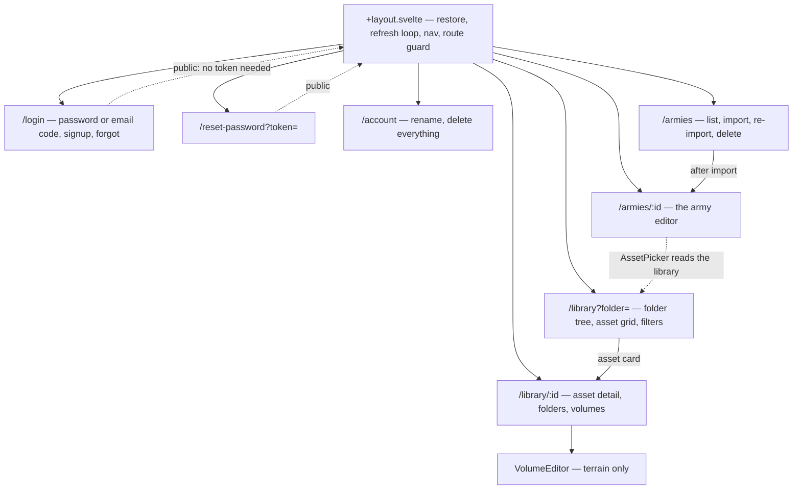

*Seven routes under one layout. `/login` and `/reset-password` are the only public paths.*

The layout does four things: `session.restore()` on mount, `session.startRefreshLoop()` with
its teardown returned from `onMount`, an `$effect` that redirects to `/login` when
`session.ready` and no token is held on a private route, and the nav. Pages are thin over
tested modules. Every branch worth asserting lives in `src/lib/**` and is covered by Vitest
under Node. `.svelte` files are verified by running the application.

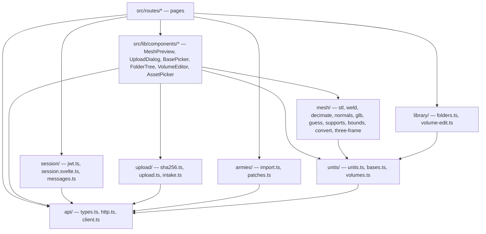

*`api/` knows HTTP and nothing about meshes. `mesh/` knows typed arrays and nothing about HTTP
or the DOM. `upload/` sequences the two. Only `mesh/three-frame.ts` and `components/` touch
three.js.*

### 3. The HTTP client and the wire

Three files, in strict dependency order.

| File | Responsibility |
| --- | --- |
| `api/types.ts` | The management plan's DTOs and the two libraries' value shapes, as TypeScript. No behaviour. |
| `api/http.ts` | `send()`: bearer header, JSON body, `problem+json` to `ApiError`, empty-body handling, `query()` |
| `api/client.ts` | One function per endpoint the web app uses. No logic, no retries, no caching. |

`http.ts` holds three decisions. It reads the token through an injected
`setTokenProvider(() => string | null)` rather than importing the session store. That keeps
`api/` free of Svelte and lets the whole client be tested with `vi.stubGlobal('fetch')`. It
exposes a mutable `http.onUnauthorized` hook rather than throwing a special error, so a `401`
on any bearer request clears the session once, in one place. It computes `isAuthRoute` so that
a `401` from `/v1/auth/password`, a wrong password, does not sign the user out of a session they
may still hold. `DELETE /v1/auth/session` is carved back into the bearer set: logging out needs
the token, and a `401` there should still clear local state.

Wire conventions are copied from the management plan rather than re-derived. Two are easy to
get wrong:

- **`TerrainDeclarations` is a `[Flags]` enum.** `JsonStringEnumConverter(SnakeCaseLower)`
  writes `"none"`, a single name, or names joined by `", "` **in ascending flag order**. So
  `Volume.declarations` is typed `string` at the boundary and only becomes a
  `Set<Declaration>` inside `units/volumes.ts`. `formatDeclarations` re-orders by
  `DECLARATIONS`, not by insertion, so the round trip is stable.
- **Nulls are omitted**, so every optional DTO field is `?:`. `PatchAssetRequest` therefore
  cannot *clear* a field. `modelledBase?: Base` can be set and changed but not removed, while
  `CreateAssetRequest.modelledBase` is `Base | null`. The asymmetry is inherited from
  management and limits the asset page (see Failure modes).

Three folder writes answer `204` with no body: `PATCH /v1/folders/{id}` and both
`/{id}/assets/{assetId}` verbs. They are typed `http.patch<void>` / `http.put<void>`, and
`send()` returns `undefined` for an empty body rather than calling `JSON.parse('')`.

### 4. The session

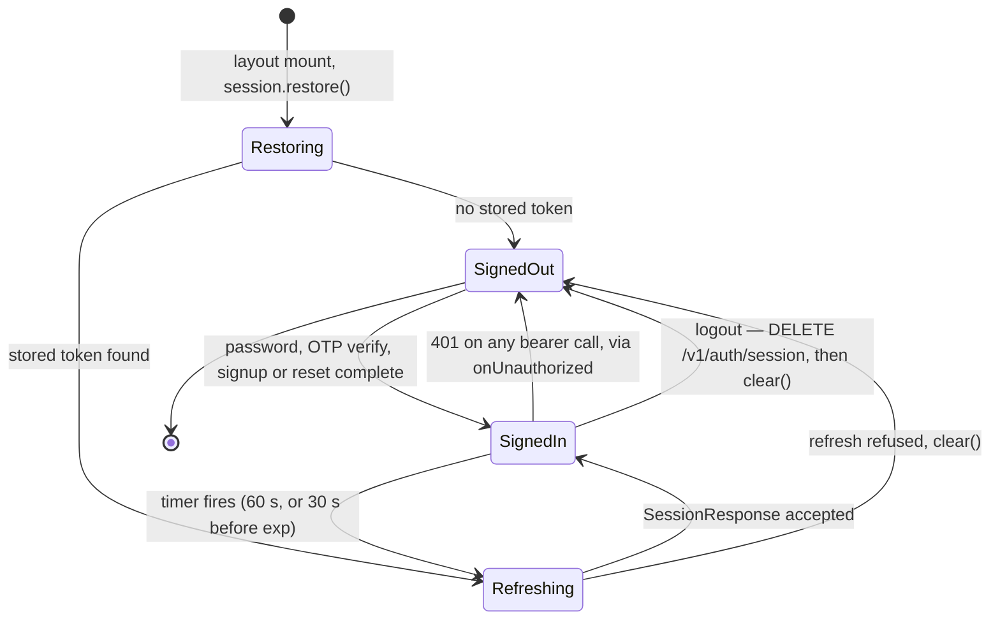

*Every arrow into `SignedOut` runs `clear()`, dropping the token, the account and the
`localStorage` entry. `ready` only gates the first paint.*

`session/session.svelte.ts` is a runes class instance exported as a singleton. `token`,
`account` and `ready` are `$state`, so every page re-renders from one source. Its constructor
wires `setTokenProvider` and `http.onUnauthorized` at module load. That is the only coupling
between `api/` and the session.

The refresh policy comes from the management API spec's working figures: a JWT good for five
minutes, refreshed every minute. It is one pure function, so it can be tested without timers:

```ts
refreshDelayMs(exp, nowMs) = max(0, min(60_000, exp*1000 - nowMs - 30_000))
```

Once a minute normally, sooner when expiry is within 90 seconds, immediately when the token has
already expired. `restore()` also refreshes once unconditionally, because a five-minute JWT is
stale after any tab sleep. `POST /v1/auth/session/refresh` accepts an expired JWT while the
underlying Stytch session lives (30 days). That is what makes "reload and stay signed in" work.

The JWT is opaque except for `exp`. `decodeExp` base64url-decodes the payload and verifies
nothing. Verification is management's and the game server's, locally against Stytch's JWKS.
There is no session table to look up, because both services verify asymmetrically.

`localStorage['tabletop.session']` holds `{ sessionJwt, account }` (the plan's ruling 1), so a
reload and a new tab stay signed in for the Stytch session's 30 days. `sessionStorage` would
sign the user out when the tab closes and is a one-identifier change.

### 5. Millimetres, bases, declarations

`Tabletop.Geometry` does no unit conversion, and millimetres never enter the model. One world
unit is one inch. The web app is where humans type millimetres, so `src/lib/units/` is the
conversion edge and nothing past it knows about mm.

`bases.ts` implements the geometry-values spec's rule that **presets are UI over a shape, not the
stored value**. `32mm round` is a name, `1.26` is the value. `BASE_PRESETS` is ten rounds, six
ovals, four squares and one vehicle rectangle built by `circle(mm)`, `oval(lengthMm, widthMm)` and `rect(lengthMm, widthMm)`.
`presetFor(base)` matches within 0.005″, so a value that came back from Postgres as a `real`
still shows its familiar name. `baseLabel` falls back to `"50.8 × 25.4 mm oval (custom)"`.
Storing a preset name instead would make the geometry library look up a table to answer "how
big is this". The per-slot base exists so a user can
base models their own way.

An oval's `a` is its **length**, along the facing axis (yaw 0 faces +Y). Everything that draws
an oval must put `a` along Y and `b` along X: the preview ring, the volume outlines. Getting
that backwards is invisible on a circle and wrong on every oval.

`volumes.ts` holds the six OPR declarations (`impassable`, `blocks_line_of_sight`,
`see_in_and_out`, `cover`, `difficult`, `dangerous`), their labels, the flags wire codec, and
`defaultVolume(width, length, top)`. That last is the bounding-box prism every terrain asset
gets at upload: `kind: 'solid'`, rect footprint, `bottom 0`, `top` the mesh height,
`declarations: 'none'`.

### 6. The conversion pipeline

Upload accepts GLB and rejects STL (`architecture.md`). Conversion is not server-side: that
would mean a job queue, a worker, an async upload state machine and a source/derived blob split.
It is not an offline command-line tool at `tools/mesh-prep/` either; there is no mesh prep tool,
on three grounds: a command-line tool promises a non-technical user and hands them a terminal; a
desktop app is a second install and a second codebase to keep in step with the upload rules; and
the browser already owns upload, already needs a mesh preview for binding, and can hold a
two-million-triangle STL in memory. Conversion runs in the browser (mesh conversion →
Conversion runs in the browser).

The pipeline is built from existing libraries, not from a WebAssembly build of
`Tabletop.Geometry`. That library has no mesh-processing code and should not grow any.

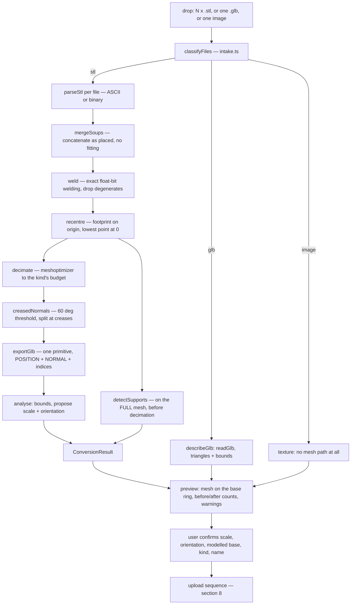

*One file per stage, in the spec's own order, so a stage can be replaced without touching its
neighbours. Support detection branches off the full-resolution mesh because decimation merges
thin pillars and destroys the signature it looks for.*

#### 6.1 Parsing

`mesh/stl.ts` implements its own reader rather than using three's `STLLoader`. The format is 80
bytes of header, a `uint32` count and 50 bytes per facet, or `vertex x y z` lines. Reading it
here keeps `three` out of the headless pipeline, which is what lets the whole of `mesh/` run
under Vitest in a Node environment.

**Binary is detected by arithmetic, not by a magic string.** If `84 + 50 * count === byteLength`
the file is binary; only otherwise is the text checked for a leading `solid`. The order matters
because some binary exporters write the word `solid` into the 80-byte header, and a length check
cannot be fooled the same way. `parseStl` returns a triangle soup: `Float32Array`, nine floats
per triangle. It **discards the per-facet normals**, because STL carries only per-face normals
and a faceted mini is the most common way a conversion looks wrong. Normals are recomputed
later from geometry.

`mergeSoups` is concatenation. Kits ship as parts already placed relative to each other, so
**no fitting is attempted**. That is a spec decision, not a shortcut.

#### 6.2 Welding

`weld(soup) -> IndexedMesh` hashes each corner's three **float bit patterns** (via a
`Uint32Array` view over the same buffer) into a spatial map and reuses an existing vertex on an
exact match. Exact welding is chosen over tolerant welding because STL exporters emit shared
corners bit-for-bit identical, so it recovers the original topology. An epsilon weld would need
a tolerance in units that are not established until later in the pipeline. Triangles whose
corners collapse to fewer than three distinct vertices are dropped.

Welding is not an optimisation. The simplifier and the connected-component analysis both need a
shared-vertex topology, and a triangle soup has none.

#### 6.3 Centring

`recentre(mesh, upAxis)` translates the mesh in place so its footprint is centred on the origin
and its lowest point along the guessed up-axis sits at zero (mesh conversion → *What conversion
does*, *Centre*). The preview has the mesh standing on a ring of its modelled base, and a mesh
exported off-origin, which is normal for a kit part, cannot stand on its base in the preview or
in play.

Centring does not bake scale or orientation into the GLB. The exported GLB keeps the file's own
units and axes, and the asset row carries the confirmed `scale` and `orientation`. Baking would
leave those fields permanently identity, making them meaningless to confirm and making a
dropped GLB behave differently from a converted one.

#### 6.4 Decimation

`BUDGETS = { miniature: 15_000, terrain: 50_000 }` are the spec's numbers. A table holds around
a hundred miniatures and they are small on screen, while terrain is larger and fewer. A
print-ready 32 mm mini is routinely 500k–2M triangles, so this is a 50–100× reduction.

`meshoptimizer` is the simplifier (mesh conversion → *Deliberately not decided*). It is picked
because it embeds its WebAssembly in the JS module, so it loads under Node and inside a Worker
with no asset plumbing, and because its error metric is the quality knob the spec names
("Quality is the simplifier's own error metric, and the preview is the user's check").

The loop is a **widening error ladder**: 0.5%, 1%, 2%, 5%, 10%, 25%, 50%, stopping at the first
result within budget, then `compactMesh` to drop vertices no triangle references.
`MeshoptSimplifier.simplify` treats `targetIndexCount` as a target and `targetError` as a
ceiling, so a single call with a tight error can stop well above the budget. The ladder is how
a hard triangle cap is obtained from a soft-target API. The cost is in Failure modes: if 50%
error does not reach the budget, `decimate` returns the last attempt over budget and silently.

`decimate` returns the same object when the mesh is already within budget. The tests assert
that short-circuit with `toBe`.

#### 6.5 Creased normals

`creasedNormals(mesh, angleDegrees = 60)` computes a face normal per triangle, then for each
triangle corner averages only those incident faces whose normal is within the crease angle of
that triangle's own. It then re-welds on the pair `(vertex, rounded normal)`, so a cube's eight
corners become 24 vertices with three hard faces each, while a 64-segment cylinder wall shares
vertices across its 5.6° facets and shades smooth. The angle is a **parameter with a default**,
not a constant. 60° is the spec's value, tuned against the fixtures (mesh conversion →
*Deliberately not decided*).

The rounding in the weld key is `toFixed(4)`. It makes two computed normals compare equal, and
it sets the precision at which two nearly-identical normals merge.

#### 6.6 Guessing units and the up-axis

STL carries neither, so both are guessed and both become a proposal.

| Guess | Rule | Result |
| --- | --- | --- |
| Units | Always millimetres | `scale = 1/25.4` |
| Up-axis | Whichever of Y or Z is strictly the largest extent; **Z when both or neither qualify**, because slicers export Z-up | `upAxis` |
| Orientation | Z-up → identity; Y-up → `{ pitch: 90, yaw: 0, roll: 0 }` | `Orientation` |

The spec's wording is "whichever of Y or Z gives a footprint that fits a base and a height
taller than it is wide". The plan implements the second half only, taller than wide, and does
not test the footprint against any base. A wide, squat terrain piece therefore has no axis that
is taller than wide, falls through to Z, and is right by luck rather than by rule.

`propose()` is the only place a proposal is manufactured. A dropped GLB gets **no proposal**:
scale 1, identity orientation, and the user sets both, as the spec requires.

#### 6.7 Coordinate frames

Three coordinate frames are in play and the design keeps them separate.

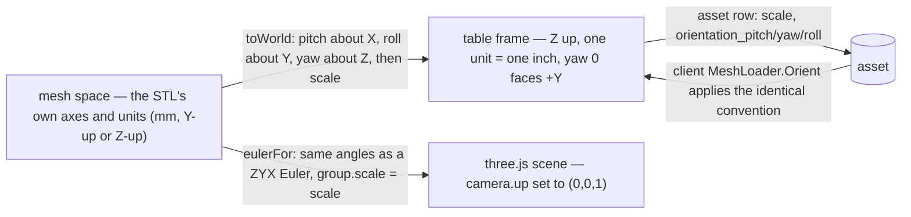

*The GLB is never transformed. `toWorld` (pure, tested) and `eulerFor` (three.js) are two
implementations of one convention that must agree; `worldExtent`, the volume, the ring and the
drawn footprints all depend on it.*

The convention is `Tabletop.Geometry.Orientation`'s (contracts plan). Mesh
coordinates are read as table coordinates, rotated `pitch` about X, then `roll` about Y, then
`yaw` about Z, then scaled. Angles are degrees, right-handed, extrinsic. A Y-up glTF therefore
stands at `pitch = 90`. `mesh/three-frame.ts` is the only file that translates it into three.js,
as a `ZYX` Euler (three applies `Rz·Ry·Rx`, which is X-then-Y-then-Z on the mesh). That
translation is confined to one three-line file so the convention exists in one place.

`worldExtent(bounds, { scale, orientation })` transforms the eight corners of the mesh-space
bounding box and takes the extremes. The preview, the reported dimensions and the terrain volume
therefore describe the same box.

Because the pipeline writes the mesh in its source axes, a Z-up STL yields a GLB whose data is
Z-up. That is non-conformant with glTF, which defines +Y as up. Inside this system it is
consistent, since both the web app and the client apply `orientation` on load. Outside it,
every converted miniature will appear lying on its back in a third-party glTF viewer. Nothing
in the plan flags that.

#### 6.8 Pre-supported files

Print supports are detected and **never removed**. The spec is categorical, because removal is
not reliably possible. `detectSupports` finds connected components by shared vertices
(union-find over the index buffer) and calls a component support-like when all three hold:

| Test | Threshold | Why |
| --- | --- | --- |
| Horizontal extent vs the model's | `<= 6%` | Supports are thin |
| Height vs its own width | `>= 3x` | Supports are tall |
| Distance of its base above the model's floor | `<= 2% of model height` | Supports stand on the plate |

`suspected` fires at **six or more** such components. The thresholds are the spec's (mesh
conversion → *Deliberately not decided*). They are tuned against `supported-binary.stl` (a blob
on sixteen 0.8 mm pillars) and asserted not to fire on the four clean fixtures. When it fires,
the dialog says so and asks for the unsupported file. The Confirm button stays enabled, because
the warning is advice, not a gate.

Detection runs on the welded, full-resolution mesh. After decimation the pillars merge into the
body and the component count collapses.

#### 6.9 The terrain volume

Every terrain asset gets a collision volume at upload, computed from the mesh's bounding box:
rect footprint, `bottom 0`, `top` the mesh height, `kind: solid`. A crate, a rock or a wall is
finished with no authoring, and **volumes are never absent**, so no consumer needs a fallback.
The browser computes it from the mesh it already holds and writes it with
`PUT /v1/assets/{id}/volumes` at confirm (whole-design review → Gaps filled).

`ConversionResult.volume` exists and is computed inside `convert()` from the proposal. **The
upload dialog does not use it.** At confirm the dialog calls
`terrainVolume(meshBounds, { scale, orientation })` with the values the user confirmed. Those
may differ from the proposal, since correcting a bad scale or a wrong facing is the purpose of
the preview. Uploading the proposal-time volume would attach a collision box to a piece the
user just rescaled, and the mismatch would be invisible until a model walked through a hill.

`ConversionResult.volume` remains on the type as a dead field whose only role is to be ignored,
which invites the bug back. Either it should go, or it should be named `proposedVolume`.

Two further limitations of `terrainVolume` follow from `defaultVolume`'s signature:

- It discards `worldExtent`'s `min`, so `bottom` is hard-coded 0. A user-corrected orientation
  that leaves the mesh floating or sunk yields a volume that does not match the mesh.
- `offset` is always `(0, 0)` and the footprint yaw always 0. A rotated non-square piece gets an
  axis-aligned box larger than its footprint. That is correct as a default, and the spec says
  the editor exists for when the default is wrong. A yaw correction in the preview inflates the
  volume without saying so.

#### 6.10 GLB export and the Worker

`exportGlb` builds a `@gltf-transform/core` `Document` and `writeBinary()`s it: one buffer,
three accessors (`POSITION`, `NORMAL`, indices), one primitive, one default PBR material, one
node, one scene. A `Document` written by that library is a valid GLB by construction, which is
why it is used over hand-assembling chunks. The same library reads dropped GLBs, so there is one
glTF implementation in the module and three.js is preview-only. `exportGlb` throws if normals
are missing, which makes the stage order structural rather than conventional. No textures, no
rigging, no materials beyond the default, per the spec's list.

`readGlb` returns every primitive's positions in node-world space plus a triangle total computed
per mode (4 = triangles, 5/6 = strip/fan). The plan asserts this is "the same sum management
computes" from its ranged header read. The two implementations are never compared in a test, so
that parity claim is the one interface assumption here that nothing checks.

**The Worker.** `convert()` knows nothing of the DOM and is the tested unit.
`convertInWorker(input, onProgress)` is a thin wrapper that spawns `mesh/convert.worker.ts` as
an ES module worker, transfers the input `ArrayBuffer`s in (so a two-million-triangle STL is
moved, not copied), streams `{ progress }` messages back per stage, and transfers the finished
GLB buffer out. Without it, decimating a 2M-triangle mesh takes seconds of synchronous WASM and
would freeze the page with no progress and no cancel. The spec asks only that the pipeline run
headless; the worker is what the headless pipeline makes possible.

The worker's contract is one-shot: one message in, progress out, result or error, `terminate()`.
There is no cancellation path, so changing the budget mid-conversion spawns a second worker while
the first runs to completion (see Failure modes).

### 7. The preview

`components/MeshPreview.svelte` is the confirmation surface. three.js was chosen over
`<model-viewer>` because the terrain volume editor needs the same scene under an orthographic
top-down camera with drawn footprints, which a script-tag viewer cannot do. One component, two
modes.

| Prop | Meaning |
| --- | --- |
| `glb: Uint8Array \| null` | Parsed by `GLTFLoader.parseAsync` into a group; never re-transformed |
| `scale`, `orientation` | Applied to the group via `eulerFor` and `scale.setScalar` |
| `base: Base \| null` | Drawn as an outline ring plus a facing arrow along +Y |
| `mode: 'orbit' \| 'top'` | Perspective with `OrbitControls`, or orthographic top-down |
| `volumes: Volume[]` | Outlines at `bottom` and `top`; orange solid, green area |
| `onmeasure(m: Measure)` | Reports `width`, `length`, `height` and the framed table rectangle |

The world is drawn Z-up by setting `camera.up = (0, 0, 1)` and leaving the GLB's data alone. The
stored orientation is what stands the model up. The ring is the **modelled base** in inches: a
circle or oval outline with the oval's `a` along +Y, or a rectangle as four edges. The arrow is the
facing. Standing the mesh on that ring turns "scale = 0.0394" into a decision a person can make.
If the model is twice the ring, the units guess was wrong.

`Measure` is exported from the component's `<script module>` block, because Svelte 5's instance
script has no module exports and `VolumeEditor` needs the type. `frame` is the table rectangle
the top-down camera shows. It is the contract that lets the volume editor map a pointer position
back to table coordinates.

The dialog gates Confirm on `previewed`, which is set by the first `onmeasure`. That implements
the spec's rule: **nothing uploads before the user has seen it.** Enforcement is weak, since the
callback fires when the scene is measured rather than when a human looked, but it is the only
signal available.

`BasePicker` is a preset dropdown plus a *Custom…* entry revealing shape and millimetre inputs,
with an optional *No base* row. It writes a `Base` in inches and never a preset name.

### 8. The upload sequence

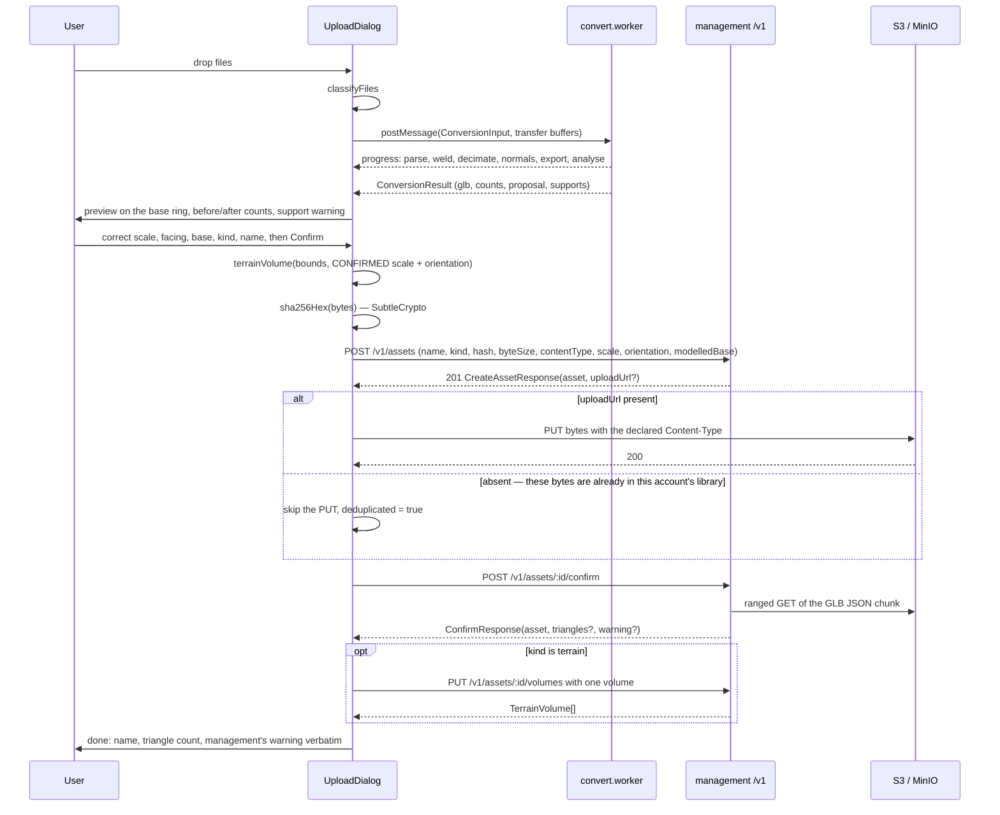

*Five stages in this order, reported through `onStage` so a failure names the stage it failed at.
The hash goes first so management can issue a URL for a known key, which is also what lets a
duplicate be short-circuited before any bytes move.*

`upload/upload.ts` is the sequencer and knows nothing about meshes. A `UploadPlan` carries
finished bytes.

- The `PUT` carries **exactly** the declared `Content-Type`, because the presigned URL was
  signed for it. Any other value and S3 rejects the signature.
- A missing `uploadUrl` means a per-user dedup hit: the bytes are already under this account's
  `{account}/{sha}` key. The asset row is still new, so two library items may point at one
  blob. Dedup is per account, not global (asset library spec), so deleting an asset never has
  to check whether another account still points at the bytes.
- `confirm`'s `warning` is passed through **untouched**. It is the server's words, fired above
  100,000 triangles, and never a refusal. The converter's budgets sit far below that threshold,
  so the warning only fires for a file that skipped the converter.
- `UploadError(stage, cause)` wraps everything, so the UI can say "failed while sending the
  bytes" rather than "TypeError".

`upload/intake.ts` decides what was dropped before any of this: several `.stl` merge, exactly
one `.glb`, or one `.png`/`.jpg`. A `.gltf` is rejected with the reason management would give.
A glTF with external buffers is several files with relative references, which breaks
single-object presigned upload and makes the header read pointless. The kind offered follows the
file: a mesh is *Miniature* or *Terrain*, an image is *Board texture* and the select is fixed.
Management answers `415` for any other pairing of kind and content type.

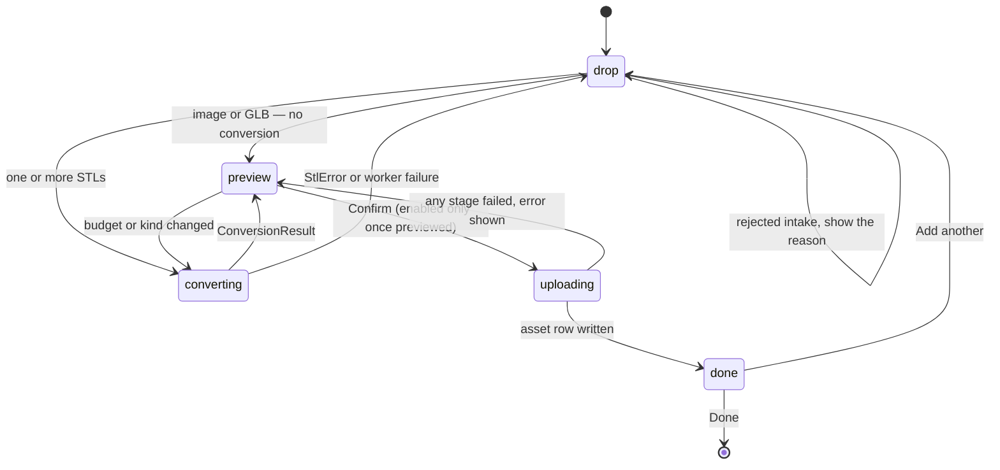

*The dialog's states, in the spec's order. `preview -> converting` is why a stale worker can
outlive a budget change.*

### 9. Folders and the asset grid

Folders **nest** and an asset can be in **several of them**. An ork mesh belongs in the orks
folder and the winter-themed folder at once. They are logical groupings, not a filesystem:
nothing derives from where an asset sits, nothing else in the system reads them, and an asset in
no folder is fine. With the modelled base as a filter, they are how a user with five hundred
meshes finds one.

`library/folders.ts` holds three pure functions: `buildTree` (roots first, name-sorted,
`parentId` linked), `descendantIds` (a fixpoint loop, so an accidental cycle terminates rather
than recursing forever), and `filterAssets(assets, folders, { folderId, kind?, base? })`, where
a folder view includes its **sub-folders'** assets. Management rejects cycles with `422`, but
`descendantIds` does not depend on that.

The grid **loads the whole library** with `GET /v1/assets` paged 200 at a time until `next` is
absent, then filters client-side. Folders are membership lists (`FolderDto.assetIds`), so
filtering by folder needs the whole set. Five hundred meshes is the design case the spec names,
which is a few hundred kilobytes of JSON. The keyset pager stays available if a library ever
outgrows this.

`/library/[id]` edits what `PATCH /v1/assets/{id}` accepts: name, scale, orientation and
modelled base, over the same `MeshPreview`, fed from `GET /v1/assets/{id}/download`'s presigned
URL. It lists folder membership as checkboxes over `PUT`/`DELETE
/v1/folders/{id}/assets/{assetId}`. For terrain it mounts the volume editor.

**Deleting an asset is never blocked**, and the page says why. The army holds the hitbox and the
asset is only appearance, so an army pointing at a deleted mesh stays playable and draws the
slot's own hitbox: the base shape extruded to its height, semi-transparent. The reference never
carried anything the rules depend on, so there is no referential integrity problem to solve.

### 10. The terrain volume editor

Volume authoring is here, not in the client (geometry values → Where volumes come from). It
needs no 3D manipulation: there are no convex hulls, footprints are circles and rectangles only,
so every test is a 2D shape intersection plus a vertical range. Authoring is a footprint and two
heights, a top-down 2D task over a model preview.

The editor exists **only for when the bounding-box default is wrong**: a forest that should be
area rather than solid, a ruin needing an upper floor, a footprint that should not be the full
box. Its bar, from the spec: *upload a terrain model and set where collision happens, easily,
with the supported shapes.*

`library/volume-edit.ts` is the pure half. `VolumeDraft` flattens a `Volume` into scalar fields
plus a `Set<Declaration>` so form controls can bind directly. `toDraft`/`fromDraft` round-trip
it, forcing `b = a` for a circle footprint and dropping empty notes to `undefined`, since nulls
are omitted on the wire. `validate` returns the three rules that are the web app's to enforce:
`top > bottom`, positive dimensions, and **`see_in_and_out` only with `blocks_line_of_sight`**.
That declaration is a modifier on blocking and means nothing on a volume that is not opaque.
`screenToTable` maps a pointer position through the `frame` the top-down preview reported.

`Save` is one `PUT /v1/assets/{id}/volumes` with the whole list. The endpoint replaces. A piece
carries a list because a ruin needs a ground floor and an upper deck, and a solid `0–2` with an
area `2–8` on top is a forest on a hill. Neither case needed a special mechanism. Solid tops
are standable, area volumes are stood inside, and `impassable` is orthogonal to both.

### 11. Armies

**Import.** `POST /v1/armies/import { source }`, and management fetches the list. The browser
never calls Army Forge, so the parser lives in one place, there is no CORS problem, and a change
to Army Forge's format is a server deploy rather than a client release. The web app's only
contribution is `normaliseSource`. A share link is passed through whole (management reads its
`id=` and keeps the link as `source`), any other URL carrying `id=` collapses to the bare id, a
bare id passes, and anything else is rejected locally before a request is made.

**A changed list means a re-import.** There is no copy operation, so nothing carries bindings
across a list change by construction. `reimport` imports the same source as a new
army and then deletes the old one, in that order, so a failed import leaves the original
untouched. The confirm dialog states the cost: every per-slot mesh, base and height override is
lost. Unit defaults are quick to set again, per-slot meshes are not. The trade is accepted
because an army is cheap to rebuild and list changes are rare.

For the same reason `Binding {army_id, target_ref, asset_id}` is not a record. A binding row
would only earn its place if something preserved it across a re-import, and nothing does, so the
asset reference is a plain field on the model slot (`MODEL_SLOT.asset_id`).

**The editor** (`/armies/[id]`) implements the pattern of a default from the pack or the import
plus a per-slot override. A unit-level picker sets every slot's mesh. A per-slot picker
overrides one, and overriding is **expected rather than exceptional**, because the models in a
unit are often made from different meshes. Base shape and height are per slot too, defaulting
from the import. Army Forge publishes a recommended round base; height has no source and import
writes 1.5″.

`armies/patches.ts` is one function per edit, each returning a whole `PatchArmyRequest`:
`unitDefault`, `slotMesh` (null becomes `clearAsset: true`, since an omitted null cannot express
"clear"), `slotBase`, `slotHeight`, `rename`. Every edit is one `PATCH` and the page re-renders
from the returned `Army`. There is no local draft to lose and no reconciliation. The cost is one
round trip per completed field and no offline editing.

The editor does **not** edit stats, weapons, properties, unit names or slot names. The list
determines composition and loadout; the user determines appearance and physical presence.
`UnitPatch` and `SlotPatch` carry no `Name?` (management plan, web-app plan). It is a
one-column change if it is ever wanted.

`AssetPicker` offers *made for this base* first. That is why the asset library records a
modelled base: given a slot on a 32 mm base, the library can offer the meshes built for one.
The asset's modelled base and the slot's base are **two different facts with two different
jobs**. One base on the asset, winning for geometry with any mismatch surfaced as a warning, is
rejected: a mismatch is not an error to warn about but a way to search.

## Key decisions

### Decided by a spec

| Decision | Reason | Rejected alternative | Source |
| --- | --- | --- | --- |
| The web app exists and owns preparation | Splits on what a user is doing, not on which technology is convenient; each side gets one job | Everything in the client (form-heavy CRUD in Godot; slower iteration) | web app → The line is preparation versus play |
| Not an embedded webview in the client | Does not remove a UI stack, adds a bridge to one: a browser engine plus a second renderer inside it | gdcef / godot-webview / godot_wry serving one shared UI | web app → Why this rather than everything in the client |
| Login lives here **and** in the client, neither a fallback | With no OAuth and no magic link, nothing needs a page to redirect to, so no handoff is needed | Browser-only login with loopback or device-code handoff | web app → Login is the web app's; client shell → No social login |
| Password and email OTP only | Both are Basic-auth Stytch endpoints needing the project secret, so they run in management either way | Magic link and OAuth, with the endpoints that served them | accounts, management API → Authentication |
| No token of our own; the Stytch session JWT is the credential | Both services verify locally against JWKS; nothing to look up, no shared signing key | An opaque token in a `session` table; a join token | management API → We issue no tokens of our own |
| Conversion in the browser, not an offline tool | A command-line tool promises a non-technical user and hands them a terminal; a desktop app is a second install and a second codebase | A `tools/mesh-prep/` command line | mesh conversion → Conversion runs in the browser |
| Converter proposes, user confirms | Fields that were always identity would hold nothing to confirm, and a dropped GLB would behave differently from a converted one | The tool writes scale and orientation; or the user writes both unaided | mesh conversion → What it writes; geometry values → Asset scale and orientation |
| The **browser** computes the bounding-box volume, from the **confirmed** values | Volumes are written at upload (geometry values) and only the browser holds the mesh; the user may have corrected the proposal in the preview | Server-side computation (needs the mesh); using `ConversionResult.volume` | whole-design review → Gaps filled; mesh conversion → What it does not do |
| Budgets 15,000 / 50,000; warn above 100,000 | A table holds ~100 miniatures and they are small on screen; terrain is larger and fewer. The warning never blocks | A hard cap at upload; no guardrail at all | mesh conversion → Decimate, The threshold |
| Never remove supports | Not reliably possible | Automatic support removal | mesh conversion → Warn about pre-supported files |
| GLB only | A `.gltf` with external buffers is several files with relative references: breaks presigned single-object upload and the header read | glTF with external `.bin` | management API → GLB only |
| Presets are UI over a shape | Otherwise the geometry library looks up a table to answer "how big is this", and the per-slot base exists so users can base their own way | A base-size enumeration: a preset dropdown as the stored value | geometry values → Bases |
| Volume authoring in the browser | There are no convex hulls; a footprint and two heights is a top-down 2D task | The in-game editor, because volumes "need real 3D manipulation" | geometry values → Where volumes come from |
| A changed list means a re-import; bindings are lost | Armies are cheap to rebuild, not objects to maintain; reconciliation machinery for a rare event | Copy the army and apply the new list to the copy | the army → A changed list means a re-import |
| Dedup is per user | Nobody shares storage, so cross-user reference counting never has to exist | Global blob dedup | asset library → Two records |
| Deleting an asset is not blocked | The army holds the hitbox; the asset is only ever appearance | Referential integrity between army and asset | the army → Assets are a soft reference |
| No unit or slot renaming | The list determines composition; the user determines appearance | `Name?` on `UnitPatch`/`SlotPatch` | management plan → Interfaces needed from other modules |

### Decided by the plan, where the specs were silent

| Decision | Reason | Rejected alternative |
| --- | --- | --- |
| SvelteKit 2 + `adapter-static`, `ssr = false` | `/reset-password?token=` must be a real path; per-page splitting for `three` and WASM; file-based routing | Plain Vite + Svelte with a hash router |
| three.js for the preview | The volume editor needs the same scene under an orthographic camera with drawn footprints | `<model-viewer>` |
| Own STL reader | Keeps `three` out of the headless pipeline, so all of `mesh/` runs under Node | three's `STLLoader` |
| `meshoptimizer` | Embeds its WASM in the JS module (loads under Node and in a Worker with no asset plumbing); its error metric is the spec's quality knob | A JS-only simplifier; a custom edge-collapse |
| `@gltf-transform/core` for GLB in **and** out | A `Document` written by it is a valid GLB by construction; one glTF implementation in the module | Hand-assembled chunks; three's `GLTFExporter` |
| Binary STL detected by length arithmetic first | Some binary exporters write `solid` in the header | Sniffing for the `solid` keyword |
| Exact float-bit welding | STL exporters emit shared corners bit-for-bit; an epsilon needs units, which are not yet known at that stage | Tolerant welding with a fixed epsilon |
| A widening error ladder to hit the budget | The simplifier takes a target count and an error *ceiling*; one call can stop well above budget | A single `simplify` call; binary search on the error |
| Crease angle 60°, support thresholds 6% / 3× / 2% / 6 components | The spec asks for tuning against real STLs; these are defaults, parameterised | Hard-coded constants |
| Conversion in a Web Worker | A 2M-triangle decimation is seconds of synchronous WASM | On the main thread with a spinner |
| Centre the mesh, do not bake the transform | The preview stands the mesh on a ring; an off-origin kit part cannot stand | Bake scale and orientation into the GLB |
| `localStorage['tabletop.session']` | A reload and a new tab stay signed in for the Stytch session's life | `sessionStorage` |
| Load the whole asset list, filter client-side | Folders are membership lists, so folder filtering needs the whole set; 500 meshes is the design case | Server-side folder and base filters |
| `reimport` = import, then delete | A failed import must leave the original army intact | Delete first; a server-side replace endpoint |
| No `Tabletop-Client-Version` header | The check exists for a downloaded desktop client months behind; an SPA cannot be. Management accepts a missing header | Send it and handle `426` |

## Interfaces

### Produced for other modules

Nothing in `web/` is consumed as code by any other module. It shares no code with the .NET
projects. What it produces for others are conventions and one required registration.

| Produced | Consumer | Contract |
| --- | --- | --- |
| The `Orientation` convention, applied in `mesh/guess.ts` `toWorld` and `mesh/three-frame.ts` `eulerFor` | client `MeshLoader.Orient` | `pitch` about table X, then `roll` about Y, then `yaw` about Z; degrees, right-handed, extrinsic; then `scale`. A Y-up mesh stands at `pitch = 90` |
| GLB in the file's own units and axes, footprint centred on the origin, lowest point at 0 | client, and `PUT /volumes` | Scale and orientation live on the asset row, never baked into the bytes |
| The `[Flags]` declarations wire form | management `TerrainDeclarations` | `"none"`, or names joined by `", "` in flag order |
| Login and refresh behaviour (Tasks 3–4) | client shell, by imitation | Refresh once a minute; sign out on `401`; the JWT is opaque except `exp` |
| `/reset-password` hosted at `TABLETOP_WEB_URL` | Stytch dashboard | Must be registered as a password-reset redirect URL |

### Consumed from management (`/v1`)

Exact paths and DTO names, from `2026-09-05-management-api.md` → *Interfaces → Produces → HTTP
surface*. `client.ts` has one function per row and no others.

| Group | Endpoints | Request → response |
| --- | --- | --- |
| `api.auth` | `POST /v1/auth/otp`, `/otp/verify`, `/password`, `/password/signup`, `/password/reset`, `/password/reset/complete`, `/session/refresh`; `DELETE /v1/auth/session` | `EmailRequest`, `OtpVerifyRequest(MethodId, Code)`, `PasswordRequest(Email, Password)`, `ResetCompleteRequest(Token, Password)`, `RefreshRequest(SessionJwt)` → `OtpSentResponse(MethodId)` / `SessionResponse(SessionJwt, Account)` / `202` / `204` |
| `api.account` | `GET`, `PATCH`, `DELETE /v1/account` | `RenameRequest` → `AccountRow(Id, Name)` / `204` |
| `api.assets` | `GET /v1/assets?limit&after&kind`, `POST /v1/assets`, `GET/PATCH/DELETE /{id}`, `POST /{id}/confirm`, `GET /{id}/download`, `GET/PUT /{id}/volumes` | `CreateAssetRequest`, `PatchAssetRequest`, `Volume[]` → `Page<AssetDto>`, `CreateAssetResponse(Asset, UploadUrl?)`, `ConfirmResponse(Asset, Triangles?, Warning?)`, `DownloadResponse(Url, ExpiresAt)`, `TerrainVolume[]` |
| `api.folders` | `GET`, `POST /v1/folders`, `PATCH/DELETE /{id}`, `PUT/DELETE /{id}/assets/{assetId}` | `FolderRequest(Name, ParentId)` → `FolderDto(Id, ParentId, Name, AssetIds)`; four of them `204` with no body |
| `api.armies` | `POST /v1/armies/import`, `GET /v1/armies?limit&after`, `GET/PATCH/DELETE /{id}` | `ImportRequest(Source)`, `PatchArmyRequest(Name?, Units?, Slots?)` → `Army`, `Page<ArmySummary>`, `204` |
| **Not consumed** | `/v1/games*`, `/v1/layouts*`, `/v1/properties`, `/v1/games/{id}/assets`, `/healthz` | The preparation-versus-play line |

### Consumed as value shapes

From `Tabletop.Geometry` and `Tabletop.Content` via `ContentJson`, re-declared in
`api/types.ts`: `Base(shape, a, b)`, `Orientation(pitch, yaw, roll)`, `Point2`, `Yaw(degrees)`,
`Footprint(kind, a, b)`, `Volume(kind, footprint, offset, yaw, bottom, top, declarations,
notes?)`; `PropertyInstance(name, parameter?)`, `Weapon`, `ModelSlot`, `Unit`, `Army`,
`TerrainVolume`. Every one is hand-mirrored, so a rename on the .NET side is a silent break
here (see Failure modes).

### Required from other modules

| From | What | Status |
| --- | --- | --- |
| Management plan Task 3 | CORS for `TABLETOP_WEB_URL` allowing `Authorization`, `Content-Type` and the five methods, with `UseCors` ahead of the version middleware so preflights are answered | Provided |
| Contracts plan Task 15 | MinIO answering CORS for the presigned `PUT` (default `MINIO_API_CORS_ALLOW_ORIGIN=*`) | Provided by default; must include `TABLETOP_WEB_URL` if narrowed |
| Stytch dashboard | `{TABLETOP_WEB_URL}/reset-password` as a registered reset redirect URL | Recorded by the management plan |
| Management plan Task 5 | `/session/refresh` accepting an expired JWT while the Stytch session lives | Provided |
| Management plan Task 10 | Only Grimdark Future imports; `422` otherwise, `502` when Army Forge fails | Provided |

## Sequences

The upload sequence and the conversion pipeline are in §6 and §8. Four more follow.

### Login and password reset

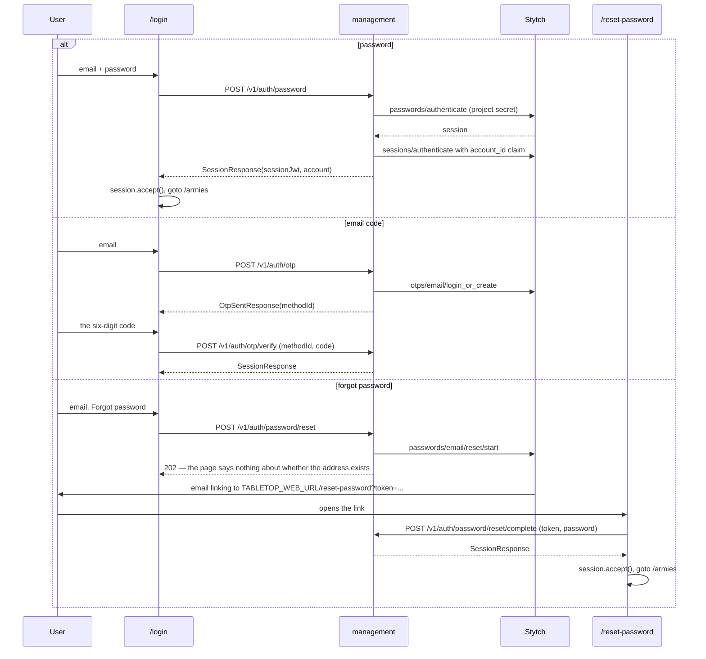

*Every branch ends in `session.accept(SessionResponse)`. The reset branch is the only reason the
app needs real URL paths rather than a hash router.*

The reset token is single-use and short-lived, so a second submit answers `4xx` and the page
tells the user to request another link. A reset link opened with no `?token=`, from a mail
client stripping the query, renders a dedicated message rather than a broken form.
`loginErrorMessage` maps status to wording: `401` to "Wrong email, password or code", `409` to
"an account with that email already exists", `422` to management's detail. Stytch's
weak-password text surfaces through that `422`, so vendor phrasing reaches the user in one
place.

### Session refresh and the 401 path

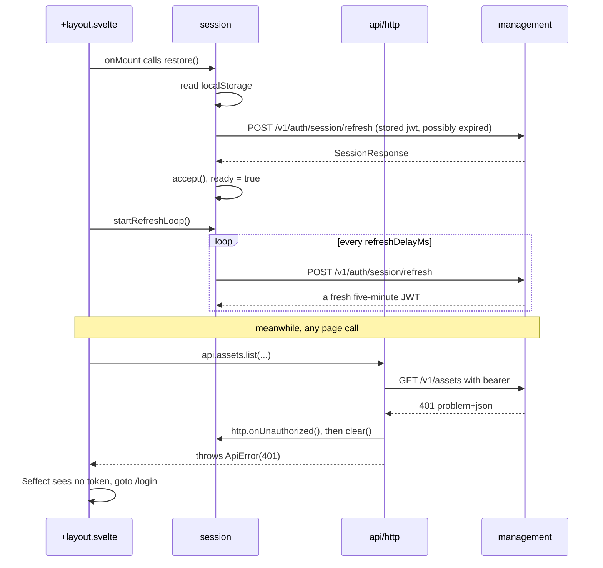

*The `401` path is the safety net under the timer. A deleted account, a revoked Stytch session
or a clock skew all land here, and the account is locked out within the JWT's five minutes.*

`restore()` and `startRefreshLoop()` are started in the same `onMount`, so two refreshes can be
in flight at startup. The last `accept` wins, so it is harmless. A `401` mid-flight rejects the
caller's promise as well as clearing the session, so every page's `.catch` writes an error
banner the user will never read, because the route is about to change. The redirect is to bare
`/login` with no return path, so a deep link to `/library/{id}` opened cold lands on `/armies`
after signing in.

### Re-importing an army

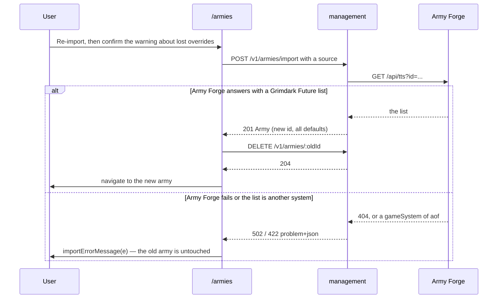

*Import-then-delete is the ordering that makes a failure safe. It is not atomic: if the import
succeeds and the delete fails, the user is left with two armies, one of them stale.*

### Saving terrain volumes

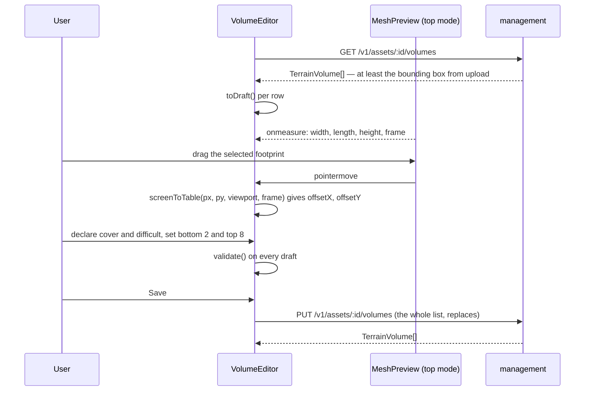

*`PUT` replaces the list, so the editor is the sole writer once it has loaded. Two tabs editing
one asset is last-write-wins with no detection.*

`screenToTable` assumes the pointer target's box equals the canvas the top-down camera drew
into. The handlers sit on a wrapper `div` around a `width: 100%` canvas, so any padding or a
`min-height` that exceeds the div offsets every drag without saying so. The drag also sets the
footprint centre to the cursor rather than by a delta, so grabbing an outline near its edge
makes it jump.

## State and data

The web app owns **no** persistent storage. Everything durable is a row management writes on its
behalf. The only browser-resident state is a session entry and per-page component state.

### Rows written through the API

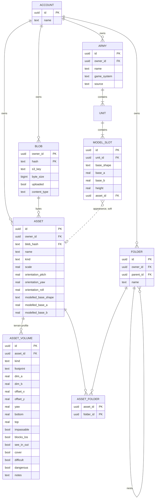

*Every column the web app can cause to change, and nothing else. `blob.uploaded` and
`blob.content_type` are the management plan's additions (migration `002`). The dotted
`MODEL_SLOT` to `ASSET` edge carries no FK constraint the rules depend on, so deleting the asset
degrades appearance only.*

Which fields each screen writes:

| Screen | Columns |
| --- | --- |
| Upload dialog | `blob` (via presign + confirm), `asset.*` including `scale`, the three `orientation_*` and the three `modelled_base_*`; `asset_volume` for terrain |
| Asset page | `asset.name`, `scale`, `orientation_*`, `modelled_base_*`; `asset_folder` rows |
| Volume editor | the whole `asset_volume` set for one asset, replaced |
| Folder tree | `folder.name`, `folder.parent_id`; `asset_folder` |
| Army list | `army` and its whole subtree, inserted by import and deleted whole |
| Army editor | `army.name`; `model_slot.asset_id`, `base_shape`, `base_a`, `base_b`, `height` |
| Account page | `account.name`; `DELETE /v1/account` runs the total cascade |

Two properties of the data model shape the UI. **The army holds its own copy of every value.**
Nothing is fetched later and nothing refers back out, and a game snapshots what it needs when it
loads, so editing an army cannot disturb a match in progress. **Deletion is total.** Deleting an
account destroys its armies, assets, blobs, folders and layouts, plus every game it participated
in, for everyone in it. The account page states that collateral in those words and gates it on
typing the display name.

### Browser-resident state

| Where | What | Lifetime |
| --- | --- | --- |
| `localStorage['tabletop.session']` | `{ sessionJwt, account }` | Until logout, a failed refresh, or a `401` |
| `session` runes store | `token`, `account`, `ready` | Page lifetime; rebuilt from storage on load |
| `UploadDialog` | `intake`, `ConversionResult`, `glb`, `meshBounds`, confirmed `scale`/`orientation`/`base`, `budget` | Until Close or *Add another*; **never persisted** |
| `library/+page` | The whole asset list and folder list | One page visit; refetched after every write |
| `VolumeEditor` | `VolumeDraft[]` | Until Save; discarded on navigation |
| Worker | The input buffers (transferred in) and the GLB (transferred out) | One conversion |

Nothing is rebuilt from an event log. That machinery is the game server's. Nothing is cached
across page visits: every write is followed by a refetch, so a stale list cannot survive.

## Failure modes

### Handled

| Failure | What happens |
| --- | --- |
| Wrong password or code | `401` → "Wrong email, password or code." No sign-out, because `/v1/auth/*` is excluded from `onUnauthorized` |
| Expired or revoked session | Any bearer `401` clears the session and redirects; the refresh timer would also fail and clear |
| Refresh refused | `session.refresh()` returns false and signs out; `restore()` treats a stored-but-dead token as absent |
| Not an STL | `StlError`, meaning neither a valid binary facet table nor a leading `solid`, returns the dialog to *drop* with the message |
| A mixed or unsupported drop | `classifyFiles` rejects locally with the reason, before any parse; `.gltf` gets management's own explanation |
| Mesh over budget | Decimation ladder widens the error until it fits; before/after counts are shown |
| Pre-supported file | Warned in words, asks for the unsupported file, never modifies the mesh, never blocks |
| Over 100,000 triangles | Management's `confirm` warning is shown verbatim; the upload has already succeeded |
| Duplicate bytes | `uploadUrl` absent → the `PUT` is skipped and the outcome says the bytes were already in the library |
| A stage of the upload fails | `UploadError(stage, cause)` names the stage; the dialog returns to *preview* with everything intact, so Confirm can be pressed again |
| Army Forge down, or a non-Grimdark list | `502` / `422` mapped to sentences; a re-import leaves the old army in place |
| Asset deleted while an army points at it | Nothing is blocked; the slot draws its own hitbox in play |
| Folder cycle | Management answers `422`; `descendantIds` is a fixpoint loop and terminates regardless |
| `see_in_and_out` without `blocks_line_of_sight` | Blocked client-side by `validate` before the `PUT` |

### Left to break

- **An abandoned upload leaves a row.** A create followed by a failed `PUT` leaves an asset with
  `uploaded = false`. The grid labels it "upload incomplete". There is no resume, no retry and no
  reaper. Re-uploading the same bytes hits the dedup path and produces a second row.
- **Two tabs.** Volumes, folders and asset fields are all last-write-wins with no version, no
  ETag and no detection. The `PUT /volumes` replace semantics make this loudest for the volume
  editor.
- **No cancel.** Changing the budget spawns a second worker while the first runs to completion.
  Navigating away from a converting dialog leaves a worker to finish and be garbage-collected.
- **Silent over-budget.** If the 50%-error rung still does not reach the budget, `decimate`
  returns the last attempt without signalling it. The preview shows the real "after" count, so a
  human can notice. Nothing asserts it.
- **A presigned URL expiring mid-view.** `/library/[id]` fetches the GLB once. If the URL has
  expired the fetch fails and the page shows a generic error rather than re-presigning.
- **Deep links lose their destination** on a cold load while signed out.
- **`modelledBase` cannot be cleared** through `PATCH`, because nulls are omitted. Switching an
  asset's kind away from `miniature` in the UI stops sending the field, so the stale value stays
  in the row.
- **DTO drift.** `api/types.ts` is a hand transcription of the management plan's records. A
  rename on the .NET side compiles on both sides and fails at runtime. There is no
  generated client and no contract test between the two.

### Concurrency, ordering and lifecycle hazards

| Hazard | Consequence | Caught by |
| --- | --- | --- |
| `restore()` and `startRefreshLoop()` both refreshing at mount | Two in-flight refreshes; last `accept` wins | Nothing; harmless by construction |
| Stage order in `convert()` | `detectSupports` **must** run before `decimate` or the signature is gone; `exportGlb` **must** run after `creasedNormals` | `convert.test.ts` asserts the exact progress order and `supports.suspected`; `exportGlb` throws without normals |
| `recentre` mutates in place | The caller's array is modified; a re-run re-parses from the original bytes | Nothing; the pipeline is single-pass per run |
| Volume computed from the proposal instead of the confirmation | A collision box that does not match the piece | The dialog's explicit re-derivation at confirm; **no test asserts it** |
| Folder rename resending a stale `parentId` | A concurrent move is silently undone, because `FolderRequest` carries both fields | Nothing |
| `AssetPicker` mounted per slot row | Each instance pages the whole miniature library; a ten-model unit issues ten full library loads | Nothing (see Rulings and deferred work) |
| `worldExtent` / `eulerFor` divergence | The ring, the reported size and the volume disagree | `three-frame.test.ts` and `guess.test.ts` pin both against the same convention, but never against each other |

## Testing

Vitest in a **Node** environment over `web/tests/**/*.test.ts`, plus `svelte-check` for types.
Every module in `src/lib/**` with logic is unit-tested headlessly. `.svelte` pages are verified
by running the application against a live management API and MinIO. The plan ends with 45
passing tests and one skipped.

| Area | Tested | How |
| --- | --- | --- |
| `api/http.ts`, `client.ts` | Bearer header, `problem+json` → `ApiError`, `204` → `undefined`, `onUnauthorized` firing on a bearer `401` and *not* on `/v1/auth/*`, keyset query strings, exact paths and verbs | `vi.stubGlobal('fetch')` |
| `session/jwt.ts` | `exp` decoding, the four branches of `refreshDelayMs` | Pure |
| `session/session.svelte.ts` | `accept`/`logout`/`restore`/failed-refresh sign-out | Stubbed `localStorage`, spied `api.auth` |
| `session/messages.ts` | Status-to-wording map | Pure |
| `units/*` | mm↔inch, preset naming and the 0.005″ match, custom labels, the flags codec including flag order, the bounding-box default | Pure |
| `mesh/stl.ts`, `weld.ts` | ASCII, binary, binary-with-a-lying-`solid`-header, garbage rejection, merge extents, corner welding, degenerate dropping | Six generated fixtures |
| `mesh/decimate.ts` | 48,000 → within the miniature budget while keeping extent, vertex compaction, identity short-circuit under budget | The dense fixture, real WASM |
| `mesh/normals.ts` | A cube stays faceted (24 vertices), a cylinder wall shares vertices, every normal unit-length | Fixtures |
| `mesh/glb.ts` | `glTF` magic, version 2, `NORMAL` present, no `images`, round-trip triangle count and bounds | Real `@gltf-transform` write and read |
| `mesh/guess.ts`, `supports.ts`, `bounds.ts` | Up-axis for Z-tall, Y-tall and a cube; the proposal's scale and pitch; `worldExtent` after a pitch-90; the bounding-box volume in inches; supports firing on 16 pillars and on nothing else | Fixtures |
| `mesh/convert.ts` | Kit merge, budget, the exact progress order, centring (`max[0] ≈ 14`, `min[2] ≈ 0`), the support flag, `describeGlb` parity with its own export | Fixtures |
| `mesh/three-frame.ts` | Degrees → `ZYX` Euler in radians | Pure |
| `upload/*` | The `abc` SHA-256 digest, the five-stage order, the declared `Content-Type` on the `PUT`, dedup skipping the `PUT`, terrain-only volumes, the failing stage named | Spied client, stubbed `fetch` |
| `library/*`, `armies/*` | Tree building and sorting, descendants, the three filters; source normalisation, `reimport` ordering and its failure case, patch shapes, `slotSummary` | Pure |

**Fixtures are synthetic**, generated deterministically by `tests/fixtures/make-fixtures.ts` and
committed: an ASCII cube, a Z-up binary cylinder, a two-part kit already placed, a 16-pillar
supported piece, and a 48,000-triangle Y-up ellipsoid. This is a **deviation from the spec**,
which asked for "a small set of real STLs". The plan cannot commit third-party mesh files.
`tests/fixtures/real/` is picked up when present and the corresponding test is `skipIf`'d
otherwise, so the tuning the spec asked for (crease angle, support thresholds) is never
exercised against a real pre-supported print in CI.

**Needs Docker.** Nothing in `npm test`. The compose stack (Postgres + MinIO) and a running
management API are needed for Tasks 4, 5, 12, 13, 14, 15, 16 and 17, all of which are
"run the app and do this" verification steps.

**Cannot be tested headlessly.**

- Everything WebGL: the preview, the base ring, the facing arrow, the top-down camera, the drawn
  footprints, the drag. `eulerFor` and `screenToTable` are extracted so the maths is testable.
  No assertion covers whether the ring is the right size or the oval the right way round.
- The Worker. `convert()` is tested, `convertInWorker` is not. The message protocol, the buffer
  transfers and the progress relay are exercised only by running the page.
- Svelte 5 runes in components: the dialog's state machine, the layout's route guard, the
  `$effect` load-and-refetch cycles.
- The real Stytch round trips: signup, OTP delivery, the reset email and its token.

**Gaps.** No test compares `readGlb`'s triangle count with management's
`GlbHeader.CountTriangles` on the same file, although the design asserts they agree. No test
asserts the confirmed-not-proposed volume: that bug is prevented by a comment and a code path,
not by an assertion. No contract test between `api/types.ts` and management's
DTOs. `svelte-check` is the only thing standing between a renamed DTO field and a runtime
`undefined`.

## Rulings and deferred work

### The plan's ruling

**The browser keeps the session JWT in `localStorage['tabletop.session']`** (the plan's ruling
1; [closing the open questions](../../superpowers/specs/2026-09-09-open-questions-design.md)),
so a reload and a new tab stay signed in for the Stytch session's 30 days: a thirty-day session
means nothing if closing a tab ends it, which is what `sessionStorage` would do. Accounts accepts
that revocation is "a matter of minutes rather than instant" either way, so the security
argument does not decide it; the choice changes only the reload experience and the exposure
window of a token left in a shared browser. Switching to `sessionStorage` would change one
identifier in `session.svelte.ts` and nothing else.

### Questions the plan asked and then answered from the documents

| Question | Answer, and where it came from |
| --- | --- |
| What exactly is the `Orientation` convention? | `Tabletop.Geometry.Orientation`'s (contracts plan); `toWorld`, `eulerFor` and `propose` implement it, and geometry values → Asset scale and orientation states the same convention |
| Bake scale and orientation into the GLB? | No, by mesh conversion's "the fields hold the confirmed value", and a dropped GLB must behave like a converted one |
| Centre the mesh? | Yes; the mesh stands on a ring, and the base is the hitbox the mesh only decorates |
| Send `Tabletop-Client-Version`? | No; the check exists for a downloaded desktop client, and management accepts a missing header |
| Conversion in a Worker? | Yes; the spec asks only that the pipeline run headless |
| Page the library grid? | Load-all, 200 per request, filter client-side; folders are membership lists |

### Deferred, and where it is recorded

| Deferred | Recorded in |
| --- | --- |
| Whether the client ever edits an army rather than only picking one | web app spec → Still open |
| Search beyond folders and modelled base | asset library → Deliberately not decided |
| Reading volumes from glTF node names or `extras` (`KHR_physics_rigid_bodies` is unratified) | geometry values → Third-party authoring |
| Whether a footprint ever needs to be a polygon | geometry values → Still open |
| Rectangular bases | geometry values → Bases |
| Whether armies can be shared between users | the army → Deliberately not decided |
| Multipart upload for very large files | management API → Still open |
| Per-account defaults (a preferred rule pack, default base sizes) | accounts → Deliberately not decided |
| Any browser *game* client (Blazor WASM, Godot web export) | `architecture.md` → A web game client stays possible |
| Hosting, deployment addresses, a built SPA's origin | nowhere yet; local development first |

### Loose ends

Not questions the plan asks. They need deciding before implementation.

1. `ConversionResult.volume` is computed and then left unused. Rename it `proposedVolume` or
   delete it. As it stands it is the exact shape of the proposal-instead-of-confirmation bug.
2. `AssetPicker` loads the whole miniature library **per instance**, and the army editor mounts
   one per model slot. It needs a shared store or a page-level fetch passed in.
3. `slotSummary` reads the hard-coded stat keys `Range` and `Attacks`, which are OPR's. Content
   values makes stats declared per `Properties`, so this line renders wrong for any second game
   system. It is presentation only, but it embeds a ruleset in the web app.
4. `terrainVolume` discards `worldExtent`'s `min` and always writes `offset (0, 0)` and footprint
   yaw 0. That is correct as a default. It wants a comment saying so, and a check against a
   yaw-corrected piece.
5. The emitted GLB carries Z-up data in a format that defines +Y as up. It is consistent inside
   this system. Every converted miniature will lie on its back in any third-party viewer.
6. The up-axis guess implements "taller than wide" and drops the spec's "gives a footprint that
   fits a base" half.

## References

**Plan.** `docs/superpowers/plans/2026-09-05-web-app.md`: 17 tasks, the File Structure, the
whole-project `Interfaces → Produces` table, and one ruling.

**Specs**, in the order the plan's header names them:

- `docs/superpowers/specs/2026-08-29-web-app-design.md`: primary. The preparation/play line,
  the webview rejection, login's location
- `docs/superpowers/specs/2026-09-04-mesh-conversion-design.md`: the flow, what conversion
  does, what it writes, the 100,000 threshold, what it does not do
- `docs/superpowers/specs/2026-08-28-army-design.md`: self-contained armies, binding
  granularity, per-slot base and height, re-import
- `docs/superpowers/specs/2026-08-28-asset-library-design.md`: two records, per-user dedup,
  folders, modelled base as a search axis, the miniature proxy
- `docs/superpowers/specs/2026-08-29-accounts-design.md`: an account is two fields, auth is a
  module not a vendor, total deletion
- `docs/superpowers/specs/2026-08-29-management-api-design.md`: the HTTP shape, presigned
  bytes, the ranged header read, GLB only, keyset pagination, army import
- `docs/superpowers/specs/2026-08-29-geometry-values-design.md`: bases, volumes, the six
  declarations, where volumes come from, asset scale and orientation
- `docs/superpowers/specs/2026-08-29-content-values-design.md`: stats are declared, a weapon
  lives on the model slot, `game_system` and `source`
- `docs/superpowers/specs/2026-09-04-whole-design-review.md`: **newest, wins**. Login in both
  places, and the browser computes the bounding-box volume
- `docs/architecture.md` → Deliverables, Content and assets, GLB only, Web frontend, Repository
  layout, Build order, Local development

**Plans consumed for their seams only.** `2026-09-05-management-api.md` (the HTTP surface, DTO
names, the CORS provision, no `Name?` on `UnitPatch`/`SlotPatch`),
`2026-09-05-contracts-and-local-dev.md` (`Tabletop.Content` and `Tabletop.Geometry` JSON shapes,
the compose stack), `2026-09-05-geometry.md` (the table frame: Z up, yaw 0 faces +Y, an oval's
`a` along the facing axis).

**Data model.** `docs/data-model.md`, `docs/schema.md` (`BLOB`, `ASSET`, `ASSET_VOLUME`,
`FOLDER`, `ASSET_FOLDER`, `ARMY`, `UNIT`, `MODEL_SLOT`).

**Rulebook.** Reached only indirectly. The six terrain declarations are OPR's own terrain types,
read out of the Grimdark Future and Age of Fantasy advanced rulebooks, whose terrain sections are
word-for-word identical (geometry values → Declarations). No rulebook page is read by this
module's code. A weapon profile's printed form, `Heavy Rifle (24", A1, AP(1))`, is echoed by
`slotSummary` from the Grimdark Future advanced rulebook's unit-entry format (content values →
What the rulebook actually says).

**Sibling design documents.** `docs/design/management-api/`, `docs/design/client-shell/`,
`docs/design/game-server-skeleton/`, `docs/design/geometry/`,
`docs/design/contracts-and-local-dev/`, `docs/design/scheduler/`,
`docs/design/interpreter-and-effects/`.
