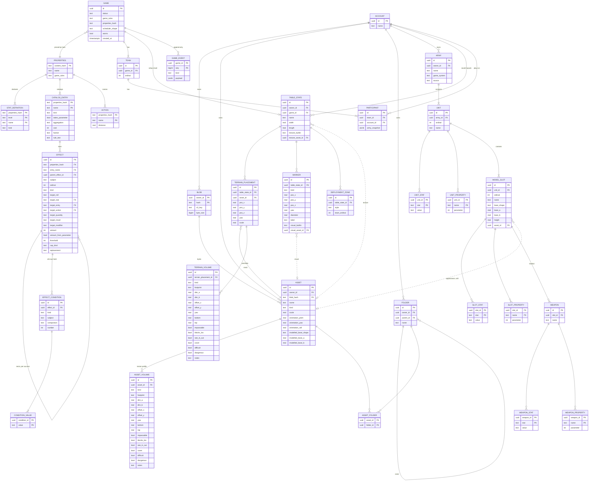

# Schema

The physical Postgres schema. [`docs/data-model.md`](data-model.md) is the conceptual view —
entities and relationships; this is tables, columns and constraints.

Where the two disagree, the conceptual model is the intent and this is the expression.

## Diagram

## Decisions

### Normalised, not documents

An earlier draft of this session put the army tree, the table state and the asset profile in
`jsonb` columns, on the grounds that each is loaded whole and never queried inside.

**That was wrong, and for a reason this project already had a name for.** `jsonb` is the
magic-string move at the storage layer: the database can check nothing, and the typed, closed,
predefined structure that every design session insisted on stops being enforced exactly where
it would be cheapest to enforce it. The supporting argument — that fewer migrations suit a
moving model — does not apply either, since the point of the design sessions was to stop it
moving.

So the army is four tables plus six for stats and properties, and every constraint the design
argued for is a constraint the database holds: `base_shape` is checked, a weapon cannot exist
without a slot, the six terrain declarations are columns rather than strings in an array.

### `Properties` is seven tables, not a document

The schema pinned `game.properties_hash` and stored nothing to resolve it against. **The data
half of a ruleset had no home** — stat declarations and the three property catalogs were
designed in [content values](superpowers/specs/2026-08-29-content-values-design.md) and
[the effect grammar](superpowers/specs/2026-08-29-effect-grammar-design.md) and never given
tables. These are those tables.

A content-addressed document was the alternative, and it is what `blob` already does for asset
bytes. It was rejected for the reason this section opens with: the effect grammar is **closed**
— twelve effect kinds, eight predicate kinds, four stat kinds — so it is exactly the structure
a database can enforce, and putting it in `jsonb` would be the magic-string move at the one
place the enforcement is cheapest.

The cost is real and accepted: pinning by content hash now needs a canonical serialisation to
hash, because the set is spread across seven tables rather than being a run of bytes.

### An action is a row, because an effect can target it

`Properties` names the actions a ruleset has, and each carries **one number: a distance**.
Grimdark Future's are `Hold` at 0", `Advance` at 6", and `Rush` and `Charge` at 12".

The reason this is a table and not a hard-coded list is `Fast` and `Slow`:

> `Fast` — *models move +2" when using Advance and +4" when using Rush/Charge.*

[Content values](superpowers/specs/2026-08-29-content-values-design.md) found that **Grimdark
Future has no movement stat at all** — a unit entry is Quality and Defense, and movement comes
from the action. So the number `Fast` modifies belongs to the action, and without this table two
of the rulebook's thirty-two special rules have nothing to point at.

**That is also where the line falls between an action's data and its behaviour.** An action's
distance is a row because an effect targets it. *"May shoot after this action"*, *"must reach
base contact"*, and *"ends the activation"* are targeted by nothing, so they stay in
`GameRules` with the rest of the turn structure. **What an effect can target must be data**;
what only the engine reads need not be.

Actions are named per ruleset, so a ruleset with an action nobody anticipated needs content
rather than a code change — which is what
[game flow](superpowers/specs/2026-08-28-game-flow-design.md) decided, now with somewhere to
put it.

**The record of what a unit has done is not this.** That is the action record, cleared at the
round boundary, reconstructed from the event log and never a row.

### The catalog holds four kinds, and one of them is a spell

`catalog_entry` is every named rule in a ruleset, and `kind` says what sort:
`unit | model | weapon | spell`. The first three are the property kinds
[identity and enumerations](superpowers/specs/2026-08-29-identity-and-enumerations-design.md)
set out — attachment points, with a name belonging to exactly one of them.

**A spell is the fourth, and it is not a property**, which is why this table is not called
`property_definition`. A property is attached to something and travels with an army; a spell is
cast, belongs to a faction's book, and is picked at the moment of casting.

Everything else it needs already exists. A spell's effect is one of the twelve kinds, and
*"target enemy unit within 12″"* is the range predicate the eight conditions already cover. What
it has that no property has is a **cost**, which is why `cost` is on the entry —
`Caster(X)` grants X spell tokens a round and casting spends as many tokens as the spell's
value.

`faction` groups spells by army book, and is null for the other three kinds. **It is not
enforced.** The rulebook says a caster's spells come from their own faction, and this records
which book a spell came from so the UI can group them — nothing in this project stops a player
choosing wrongly, for the same reason players count their own points.

Spell content lives in the per-faction army books rather than the core rulebook, so the rows
come later. The shape is what had to exist first.

### One `effect` table, not twelve

The twelve kinds share most of their shape — a subject, an ordering, a thing being acted on,
and usually one number. `entry_name` is the catalog entry it belongs to. `amount` carries the number, and
`amount_from_parameter` says the number is the entry's own `X`, which is what makes `Impact(X)`
and `Blast(X)` one row rather than one row per value of X.

**What an effect acts on is seven different things, so it is seven columns rather than one.** A
single `target` string would have been a magic string with no defined contents — the database
could not check it and nothing said what it may contain:

| Column | Vocabulary | Used by |
| --- | --- | --- |
| `target_roll` | `hit \| defense \| morale \| casting` | Modify a roll, Force a reroll |
| `target_stat` | **FK** to `stat_definition` in the same set | Modify a stat, Replace a stat |
| `target_action` | **FK** to `action` in the same set | Modify a stat, where the stat is a move distance |
| `target_entry` | **FK** to `catalog_entry` in the same set | Grant, Suppress, Modify a parameter |
| `target_quantity` | `hits \| wounds` | Multiply |
| `target_result` | `wound \| morale_test` | Override a result |
| `target_modifier` | `cover \| to_hit_penalties \| range_penalties` | Suppress modifiers |

`Roll` and `Add a hit` act on nothing and leave all seven null.

The three foreign keys are the point. `Poison` suppresses `Regeneration`, and it must not be able
to name a rule that does not exist in the set it belongs to; `Reliable` replaces `Quality`, which
must be a stat that set declares. As a string, neither could be checked.

**`amount` is signed, and keeps its sign when the magnitude comes from the parameter.**
`AP(X)` is *−X to Defense rolls* and `Fear(X)` is *+X wounds*: both take their size from `X`
and differ only in direction. So `amount` holds `-1` or `+1` when
`amount_from_parameter` is set, and the effective value is that sign applied to `X`.

Three columns exist for one kind each, which is the honest price of collapsing twelve into one:

- **`threshold`** — `Roll` only. `Impact(X)` is *X dice at 2+*, so it needs a count and a
  score, and the count is `amount`.
- **`cap_kind`** — `Blast(X)` only, and an enumeration rather than prose. *"Up to as many hits
  as models in the target unit"* is part of the effect, per the effect grammar, not a separate
  rule — but written as text the engine could not read it. Grimdark Future has exactly one cap,
  `models_in_target_unit`; a second ruleset needing another adds a value, which is a code
  change like every other closed set here.
- **`replacement`** — `Replace a stat` only. `Reliable` is *attacks at Quality 2+*.

Per-kind `CHECK` constraints keep the nullable columns honest: a `Multiply` row with a
`threshold` is rejected.

**`parent_effect_id` is how `Roll` nests.** *X dice at 2+, each success adds a hit* is a `Roll`
with an `Add a hit` child, so kind 6 is reused rather than special-cased. The column is
self-referencing and nullable; one level covers the whole rulebook and nothing forbids deeper.

**`ordinal` is not decoration.** The rulebook orders effects by hand — `Deadly` is *"resolved
first"*, `Blast` applies *"after resolving other special rules"* — and four of the twelve kinds
act on other properties rather than on game state, which does not commute.

### A condition is a row, and its values are rows

`effect_condition` carries the predicate kind, its subject, and a comparison — `Stealth` is
*range, no subject, greater than, 9*. Relational predicates take no subject, so `subject` is
nullable by design rather than by accident.

**`comparison` includes `neq`**, because `Impact(X)` is *unless fatigued*. The effect grammar
found no *or* and no *not* in the rulebook's properties, and that holds for the structure —
there is no expression tree — but a single predicate still has to be able to test a state's
absence.

Values live in `condition_value` rather than in a column because **one predicate can name a
set**. `Slow` applies *when using Advance*; `Fast` applies to *Rush/Charge*, which the effect
grammar found is set membership over action types and not an `or`. One row is a single value,
several rows are a set, and there is no boolean expression tree anywhere — the rulebook has no
*or* and no *not* in its properties.

Conditions hang off the effect, never off the property. `Indirect` is why: its three effects
have different conditions, one of them conditional and two unconditional.

### Worked against the book

The shape was checked by writing real Grimdark Future rules into these columns rather than by
inspection. Four that between them exercise every unusual column:

| Rule | Rows |
| --- | --- |
| `AP(X)` | one effect: `subject=opponent`, `kind=modify_roll`, `target_roll=defense`, `amount=-1`, `amount_from_parameter`. No conditions. |
| `Stealth` | `catalog_entry.aggregation=all`; one effect: `subject=opponent`, `modify_roll`, `target_roll=hit`, `amount=-1`. Two conditions — attack kind is shooting, and range `gt` 9 with no subject. |
| `Impact(X)` | one effect: `kind=roll`, `amount_from_parameter`, `threshold=2`, with a **child** effect `kind=add_hit`, `amount=1`. Conditions: action taken is charge, actor state `neq` fatigued. |
| `Poison` | **two** effects on one property — `force_reroll` with `target_roll=defense` on the opponent, conditioned on a raw roll result of 6; and `suppress_property` with `target_entry=Regeneration`, unconditional. |

`Poison` is the case that proves conditions belong to the effect and not to the property, and
`Impact(X)` is the one that proves nesting is needed rather than a thirteenth kind.

### Stats are rows because stats are declared

`Quality` and `Defense` cannot be columns on `unit` when Warhammer declares M/T/Sv/W/Ld/OC
instead. A declared stat set forces a key-value child table at each level — `unit_stat`,
`slot_stat`, `weapon_stat`.

This is the one unavoidable smell in the schema, and it is **forced by a decision that is
correct**: [content values](superpowers/specs/2026-08-29-content-values-design.md) settled
that stats are declared by `Properties` rather than typed into the engine.

`value` is `text` because the declaration carries the kind — target number, distance, count, or
dice expression — and `D6` is not a number. The column holds what was written; `Properties`
says how to read it.

### Where `jsonb` survives, and why

Two columns, for opposite reasons to the one originally given.

**`game_event.payload`** — genuinely heterogeneous by event kind. `architecture.md` settled
this: adding an event type must not be a migration.

**`participant.army_snapshot`** — because it **must not** be reasoned about. It is frozen at
game load and read only to rebuild that game. Normalised, a later schema change would migrate
historical snapshots and silently alter what a past game was played with. Being opaque is the
requirement here, not a convenience.

### Enumerations are `text` with a check constraint

Not Postgres `enum` types. The values are closed and extending them is a code change, which is
accepted — but `ALTER TYPE ADD VALUE` has transaction restrictions that bite in migrations,
while altering a check constraint is ordinary DDL. Text also reads directly in queries.

### `table_state` has two nullable owners

`owner_id` is set when it is an account's saved layout; `game_id` is set when it is a game's
setup result. Exactly one, enforced by a check constraint.

Nullable foreign keys are a smell, and the alternative is two tables with identical columns,
which is a worse one. [Setup content](superpowers/specs/2026-08-29-setup-content-design.md)
decided these are **one shape with two owners**, and this is what that looks like.

### A deployment zone names a team ordinal, not a team

A saved layout has deployment zones but no game, so no `team` rows exist to point at. The zone
records `team_ordinal`, and a game maps ordinals onto its actual teams when the layout is
loaded.

### Deleting an account is application logic

Its armies, assets, blobs, folders and layouts cascade downward normally. But
[accounts](superpowers/specs/2026-08-29-accounts-design.md) requires deleting **every game it
participated in**, which cascades *upward* — participant to team to game — and then back down
to other people's participants and into the game schema's event log.

Postgres cascades do not run that way. It is a deliberate multi-step operation in the delete
path rather than a constraint or a trigger: a trigger would hide a destructive cross-schema
action behind an ordinary `DELETE`.

### Identifiers

UUIDv7 throughout, generated in application code with `Guid.CreateVersion7()`, stored as
`uuid`. Per `architecture.md`: v7 so inserts append near the end of the index, and
application-generated because ids must exist before external systems are told about them.

`blob`'s primary key is `(owner_id, hash)` rather than a surrogate id, which makes per-user
dedup a property of the schema rather than a rule in code.

## Still open

- ~~How the game server reads game metadata.~~ **Settled** by
  [the management API](superpowers/specs/2026-08-29-management-api-design.md): the client
  opens its socket with a Stytch session JWT and a game id, and the game server **reads the
  game's row directly**. A read is not a join, so `architecture.md`'s boundary holds — but the two
  services now share a database, so a management migration can break the game server.
- Whether the two schemas are two Postgres schemas in one database or two databases.
- Indexes beyond primary and foreign keys. None are needed at this scale, but the game
  browser's listing query is the first candidate.
- ~~Presence has never been designed.~~ **Settled** by
  [presence](superpowers/specs/2026-08-30-presence-design.md), which changes nothing here:
  cursors, pings, measurements, selection and live placements are relayed and never written,
  so presence has no table and no column.
