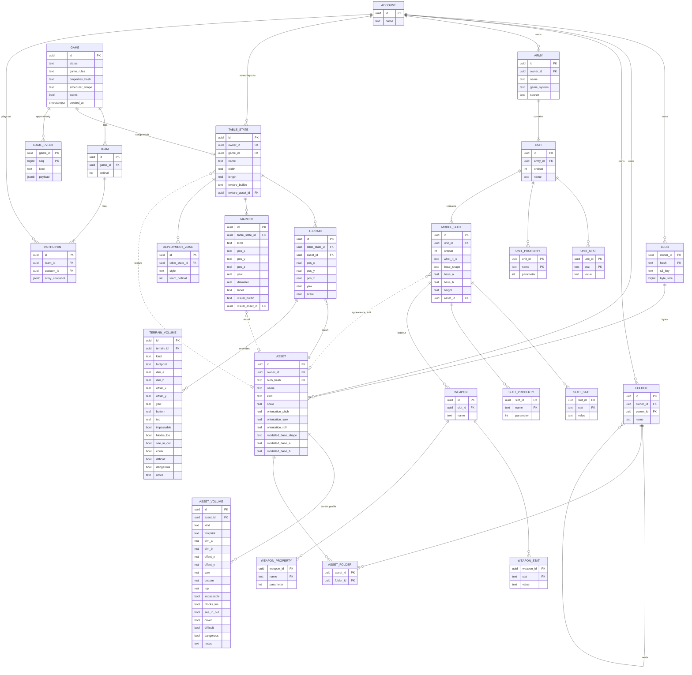

# Schema

The physical Postgres schema. [`docs/data-model.md`](data-model.md) is the conceptual view —
entities and relationships; this is tables, columns and constraints.

Where the two disagree, the conceptual model is the intent and this is the expression.

## Diagram

## Decisions

### Normalised, not documents

An earlier draft of this session put the army tree, the table state and the asset profile in
`jsonb` columns, on the grounds that each is loaded whole and never queried inside.

**That was wrong, and for a reason this project already had a name for.** `jsonb` is the
magic-string move at the storage layer: the database can check nothing, and the typed, closed,
predefined structure that every design session insisted on stops being enforced exactly where
it would be cheapest to enforce it. The supporting argument — that fewer migrations suit a
moving model — does not apply either, since the point of the design sessions was to stop it
moving.

So the army is four tables plus six for stats and properties, and every constraint the design
argued for is a constraint the database holds: `base_shape` is checked, a weapon cannot exist
without a slot, the six terrain declarations are columns rather than strings in an array.

### Stats are rows because stats are declared

`Quality` and `Defense` cannot be columns on `unit` when Warhammer declares M/T/Sv/W/Ld/OC
instead. A declared stat set forces a key-value child table at each level — `unit_stat`,
`slot_stat`, `weapon_stat`.

This is the one unavoidable smell in the schema, and it is **forced by a decision that is
correct**: [content values](superpowers/specs/2026-08-29-content-values-design.md) settled
that stats are declared by `Properties` rather than typed into the engine.

`value` is `text` because the declaration carries the kind — target number, distance, count, or
dice expression — and `D6` is not a number. The column holds what was written; `Properties`
says how to read it.

### Where `jsonb` survives, and why

Two columns, for opposite reasons to the one originally given.

**`game_event.payload`** — genuinely heterogeneous by event kind. `architecture.md` settled
this: adding an event type must not be a migration.

**`participant.army_snapshot`** — because it **must not** be reasoned about. It is frozen at
game load and read only to rebuild that game. Normalised, a later schema change would migrate
historical snapshots and silently alter what a past game was played with. Being opaque is the
requirement here, not a convenience.

### Enumerations are `text` with a check constraint

Not Postgres `enum` types. The values are closed and extending them is a code change, which is
accepted — but `ALTER TYPE ADD VALUE` has transaction restrictions that bite in migrations,
while altering a check constraint is ordinary DDL. Text also reads directly in queries.

### `table_state` has two nullable owners

`owner_id` is set when it is an account's saved layout; `game_id` is set when it is a game's
setup result. Exactly one, enforced by a check constraint.

Nullable foreign keys are a smell, and the alternative is two tables with identical columns,
which is a worse one. [Setup content](superpowers/specs/2026-08-29-setup-content-design.md)
decided these are **one shape with two owners**, and this is what that looks like.

### A deployment zone names a team ordinal, not a team

A saved layout has deployment zones but no game, so no `team` rows exist to point at. The zone
records `team_ordinal`, and a game maps ordinals onto its actual teams when the layout is
loaded.

### Deleting an account is application logic

Its armies, assets, blobs, folders and layouts cascade downward normally. But
[accounts](superpowers/specs/2026-08-29-accounts-design.md) requires deleting **every game it
participated in**, which cascades *upward* — participant to team to game — and then back down
to other people's participants and into the game schema's event log.

Postgres cascades do not run that way. It is a deliberate multi-step operation in the delete
path rather than a constraint or a trigger: a trigger would hide a destructive cross-schema
action behind an ordinary `DELETE`.

### Identifiers

UUIDv7 throughout, generated in application code with `Guid.CreateVersion7()`, stored as
`uuid`. Per `architecture.md`: v7 so inserts append near the end of the index, and
application-generated because ids must exist before external systems are told about them.

`blob`'s primary key is `(owner_id, hash)` rather than a surrogate id, which makes per-user
dedup a property of the schema rather than a rule in code.

## Still open

- **How the game server reads game metadata.** It has no CRUD surface and writes only events,
  but it must read a game's row once at hydration. Either it reads the management schema
  read-only, or the join token carries what it needs. Unresolved.
- Whether the two schemas are two Postgres schemas in one database or two databases.
- Indexes beyond primary and foreign keys. None are needed at this scale, but the game
  browser's listing query is the first candidate.
- Presence — cursors, pings, live drag positions — is absent from the model entirely, not just
  from this schema. It persists nothing, so nothing here changes, but it has never been
  designed.
